# ODDITY — 초능력 보스 액션 게임 기술 문서

> **한 줄 소개**: 주변 물체를 들어 휘두르거나 던지고, 초능력 스킬을 조합해 보스와 싸우는 3D 액션 게임
>
> **구현 범위**: 염동력 시스템, 파편 생성·풀링, 시간 정지, 보스 투하·투척·충격파 패턴·공격 예고·피격 판정·그로기, 보상, 카메라·렌더링·각종 연출, UI/UX

| 구분 | 시스템 | 핵심 내용 | 절 |
|---|---|---|---|
| 핵심 A | 물리 기반 염동력 | 조작 입력, 대상 선택, 들기, 물리 추종, 휘두르기·투척, 피해 처리, 보스·지형과의 상호작용 | §2 |
| 핵심 B | 파편 재사용 | 크기별 풀의 파편에 형태를 입혀 재사용, 작은 파편의 수명과 반환, 재질별 파괴 | §3 |
| 핵심 C | 선택적 시간 정지 | 멈출 물체만 정하는 시간 정지, 풀린 뒤 움직임 복원, 든 물체의 예외 처리 | §4 |
| 보조 D | 보스 패턴과 전투 판정 | 공용 전투 구조, 물체 투하·투척 패턴, 허트박스와 그로기, 근접 시점 보정 | §5 · §9.1 |
| 보조 E | 칩·스킬·임무와 보상·저장 | 팀 공통 성장 구조에 임무 보상과 이어하기 복원 연결 | §6 |
| 핵심 F ① | UI/UX — 화면 UI·조작과 씬 전환 | 상황별 조준점·키 안내·시스템 메시지, HUD 시인성, 창 연출·스타일 통일, 칩 이름 한글 검색, 씬 전환 | §7 · §9.2 · §9.3 |
| 핵심 F ② | UI/UX — 전투 피드백과 비주얼 효과 | 타이틀·보스 등장 연출, 공격 예고, 피격 강도별 연출, 보스 상태 연출, 외곽선과 가림 | §8 |

---

## 1. 프로젝트 개요

### 1.1 게임 소개

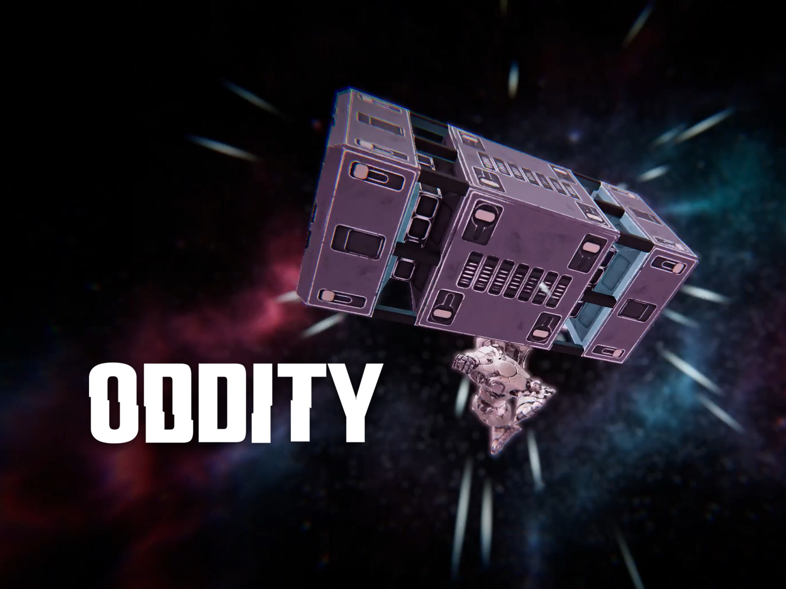

**ODDITY**는 염동력과 초능력 스킬을 사용해 보스와 싸우는 3D 보스 러시 액션 게임입니다.
플레이어는 주변 물체를 들어 휘두르거나 던지고, 시간 정지를 비롯한 여러 초능력 스킬을 조합해 보스와 전투합니다.
로비에서는 증강 칩을 장착하고 임무를 선택하며, 보스 처치 보상으로 새로운 칩을 획득합니다.

임무는 차르카로사우루스, 페르데로스, 휴머노이드 보스의 전투 씬으로 연결됩니다.
대형 보스의 투하·투척·충격파와 휴머노이드의 검격·반격 등 서로 다른 패턴에 대응하면서,
주변 물체와 파편을 공격 자원으로 활용하는 구조입니다.

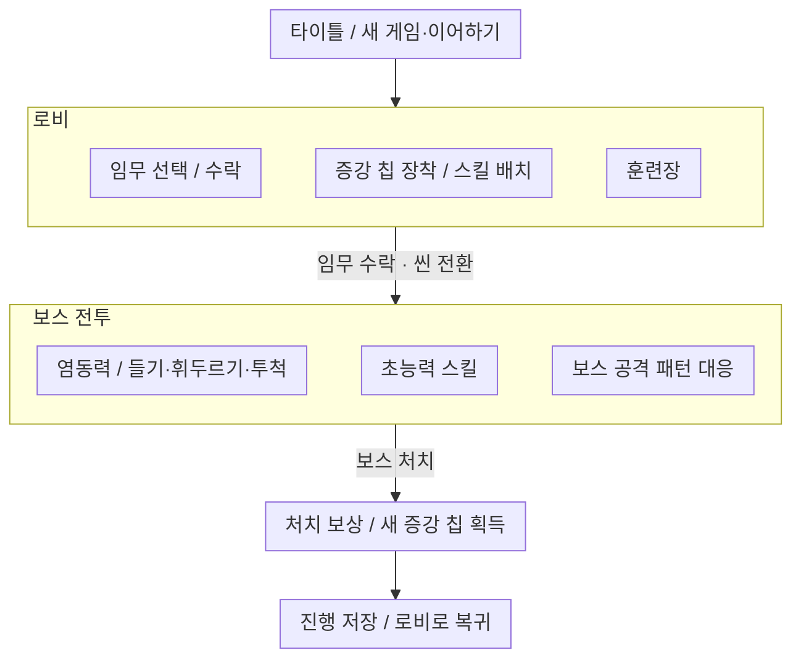

이 다이어그램은 타이틀에서 로비를 거쳐 보스 전투에 들어가고, 처치 보상을 받아 로비로 돌아오는 한 판의 흐름을 도식화한 것입니다.

- **염동력 조작:** 우클릭으로 화면 중앙의 물체를 들고, 좌클릭으로 기본 공격을 하거나 들고 있는 물체를 조준점 방향으로 던집니다. 카메라를 빠르게 돌리면 들고 있는 물체를 휘두릅니다. 플레이어의 최대 염동 질량 이하인 물체만 들 수 있고, 들고 있는 동안 스태미나를 소모합니다.
- **시간 정지:** 게임 전체가 아니라 정지 가능한 물체만 멈추므로, 플레이어는 움직이면서 멈춘 물체를 들거나 공격할 수 있습니다.
- **보스:** 대형 보스는 투하·투척·충격파, 휴머노이드는 검격·반격 패턴을 사용합니다. 피해와 별도인 무력화 피해를 입혀 무력화 게이지를 모두 깎으면 그로기에 빠집니다.
- **증강 칩:** 격자에 칩을 배치해 장착하면 공격력·최대 체력·최대 스태미나 같은 스탯이 오르고, 스킬 칩의 경우 스킬 슬롯 5칸에 들어갑니다.
- **사망과 저장:** 사망하면 사망 화면 뒤 로비로 돌아갑니다. 보유 칩·장착 배치·수락한 임무는 로컬에 저장되어 이어하기로 복원됩니다.

조작은 다음과 같습니다.

| 동작 | 조작 |
|---|---|
| 이동 | W / A / S / D |
| 달리기 | Shift (누르는 동안) |
| 구르기 | Space (구르는 동안 무적) |
| 카메라 회전 | 마우스 — 물체를 든 채 빠르게 돌리면 휘두르기 |
| 기본 공격 / 물체 던지기 | 마우스 좌클릭 |
| 물체 들기 | 마우스 우클릭 (누르는 동안) |
| 스킬 | 1 ~ 5 |
| 빠른 기상 | Space (쓰러졌을 때) |
| NPC 상호작용 | F |
| 증강 칩 관리 창 | E |
| 메뉴 | Esc |

### 1.2 기획 의도

보스 러시 액션 게임으로서의 전투 재미를 주며, 소울류·몬스터 헌터류 액션 게임과는 **차별화된 전투 경험**을 주고 싶었습니다.
플레이어가 보스가 떨어뜨리거나 던진 물체를 들어 되던지고, 여러 스킬 칩을 조합해 자신만의 빌드를 만들어 싸우는 경험을 목표로 했습니다.
첫 3D 프로젝트인 만큼 3D에서만 가능한 시스템을 구현하고자 **염동력의 자연스러운 물리 반응**을 살리는 데 집중했고, 평소 중요하게 여기는 **UI/UX**에도 특히 공을 들였습니다.
UI/UX는 공격 예고와 HUD·미니맵, 화면·UI·소리가 함께 바뀌는 씬 전환처럼 플레이어가 전투 상황과 게임 흐름을 쉽게 읽을 수 있도록 했습니다.

### 1.3 개발 환경

| 항목 | 내용 |
|---|---|
| 장르 | 3D 보스 러시 액션 |
| 기간 | 2026.10 — 2026.11, 약 3주 |
| 인원 | 4인 |
| 엔진 | Unity `6000.3.15f1`, URP `17.3.0` |
| 언어 | C#, HLSL(셰이더 연출 구현) |
| 주요 패키지 | Input System `1.19.0`, AI Navigation `2.0.12`, UniTask, DOTween, Odin Inspector |
| 데이터 | 증강 칩·보상·임무 TSV, 로컬 JSON 저장 |
| GitHub | [GitHub](https://github.com/keeeery/ODDITY) |
| 시연 영상 | [YouTube](https://youtu.be/PXWZMTSK4lk) |

### 1.4 담당 범위

팀은 4명이며, 각자 맡은 부분은 다음과 같습니다.

- **나** — 염동력·파편, 시간 정지, 보스 공격 패턴·판정, UI/UX, 셰이더 연출, 보상·저장
- **팀원 1** — 보스 상태 머신·행동 결정(Intent)·이동, 휴머노이드 보스, 전투 이벤트 기초
- **팀원 2** — 증강 칩·인벤토리·스킬, 시간 역행·감속, 크기 조절, 보호막, 회피 연출
- **팀원 3** — 플레이어 이동·카메라, 구르기·피격 모션·IK, 임무, 로비 씬

| 영역 | 직접 구현·보완한 내용 | 팀 기반과의 관계 |
|---|---|---|
| 염동력·파편 | 기본 공격, 들기·휘두르기·투척, 피해 연동, 파편 생성과 풀링 | 플레이어 이동·스탯·IK·크기 조절 스킬과 연결 |
| 시간 제어 | 시간 정지와 염동 내려찍기, 정지 대상의 상태 복원·홀로그램 연출 | 팀원의 스킬 칩 틀 위에 처음 실제로 동작한 스킬로 구현, 이 시간 체계 위에 팀원이 시간 감속을 확장 |
| 보스 전투 | 투하·투척·충격파, 공통 패턴 정리, 공격 예고, 피격·그로기·이동 보완 | 상태 머신·Intent 판단·보스 기본 패턴 위에 확장 |
| 시각 피드백 | 외곽선·화면 효과, 보스 연출, 미니맵·HUD, 카메라 시점 보완 | 플레이어·카메라 기본 구현과 결합 |
| 게임 진행 | 보상 테이블·결과 화면, 칩·임무 저장, 이어하기, 타이틀·설정·씬 전환 개선 | 칩 배치·스킬 공통 구조와 임무 기본 기능에 연결 |
| 셰이더 연출 | 시간 정지 홀로그램, 염동력 대상 외곽선, 보스·플레이어 가림 실루엣, 바닥에 붙는 공격 예고, 화면 꺼짐, 보스 피격 섬광·빛 입자, 흙먼지·굴절 고리, UV 없는 파편의 트라이플래너 돌 (§8.1) | 시간 정지 홀로그램은 도입한 홀로그램 셰이더를 바탕으로 확장 |

**AI를 활용한 곳:** 피해 수치 계산·적용(§2.8), 메시 절단 데모(§3.5), 히트스톱 구조 개선(§4.3), 보스 이동 보정 시험(§5.6), UI 통일 에디터 도구(§7.4)에 활용했습니다. 기준과 최종 결정은 모두 직접 정했습니다.

칩 배치와 스킬 전략, 공용 전투 이벤트, 플레이어 이동과 보스 판단 기반은 팀이 함께 만든 구조입니다.
아래에서는 이 기반의 전체 역할을 소개하고 직접 확장한 상호작용과 연동을 중심으로 설명합니다.

이 문서에서 깊게 다루는 것은 세 가지입니다.

1. **염동력과 파편(§2·§3):** 물체를 들어 휘두르고 던지는 물리 기반 조작과, 부서진 조각을 다시 공격 자원으로 사용하는 구조를 다룹니다.
2. **시간 정지(§4):** 게임 전체가 아니라 물체마다 따로 도는 시간과, 정지 중에도 든 물체만 움직이는 예외를 다룹니다.
3. **UI/UX와 전투 피드백(§7·§8):** 지금 할 수 있는 행동과 피격 강도를 화면에서 바로 읽게 하는 UI, 셰이더로 만든 연출을 다룹니다.

보스 전투(§5), 칩·보상·저장(§6), 씬 전환(§7.6)은 직접 만든 부분 위주로 짧게 다룹니다.

### 1.5 전체 구조

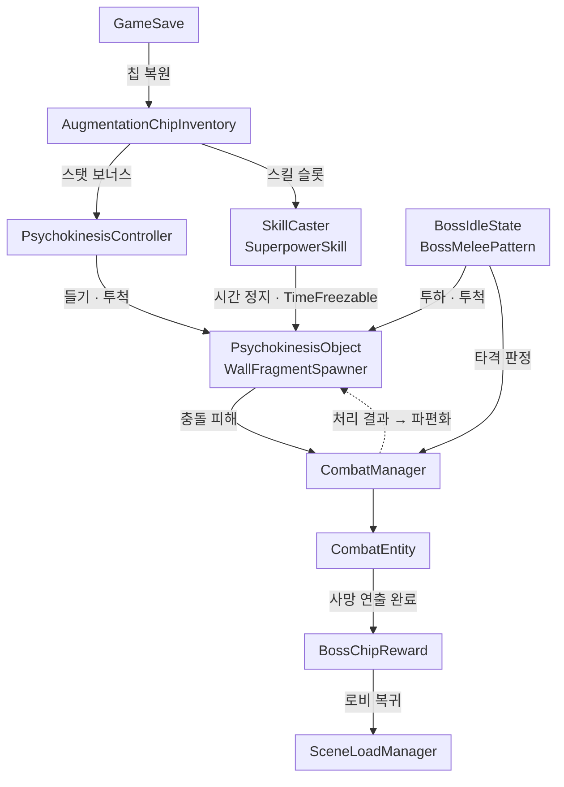

이 다이어그램은 §1.1의 게임 진행을 맡는 주요 클래스가 칩 복원부터 염동력·스킬·보스 공격, 전투 처리, 보상과 씬 전환까지 이어지는 구조를 도식화한 것입니다. 각 기능의 세부 구조는 §2~§7에서 설명합니다.

**염동력·시간 정지·보스 공격이 모두 같은 염동력 물체(`PsychokinesisObject`)를 다루고, 물체가 준 피해는 `CombatManager` 한 곳을 거쳐 그 결과가 다시 물체의 파편화로 돌아옵니다.**

**왜 이렇게 나눴나**

- **물체가 자기 원래 상태를 책임집니다.** 들기·투척·시간 정지·보스의 투하가 같은 물체의 중력·충돌·시간 상태를 바꾸므로, 바꾸기 전 값을 저장하고 되돌리는 일을 각 기능이 아니라 `PsychokinesisObject`가 맡게 했습니다(§2.6). 그래서 플레이어가 든 물체는 시간 정지가 해제되고(§4.3), 보스가 만든 파편도 그대로 들어서 던질 수 있습니다(§2.9).
- **피해는 결과를 확인한 뒤에 반영합니다.** 충돌했다는 사실과 실제로 피해가 들어갔는지는 다르므로, 공용 전투 이벤트(`CombatManager`)의 처리 결과를 받아 파편화를 결정합니다(§2.7·§5.1). 염동력·스킬·보스가 같은 결과 경로를 사용하므로, 조준점의 적중 표시(§7.2)와 피격 연출도 이 결과를 받아 움직입니다.
- **칩·저장은 플레이어가 준비된 뒤에 적용합니다.** 저장 목록을 읽는 시점에는 플레이어 스탯이 준비되지 않을 수 있어, 목록 복원과 장착 적용을 나눴습니다(§6.3).

---

## 2. 물리 기반 염동력

### 2.1 개요 — 대상을 고르고 움직이고 피해를 처리하는 과정

염동력은 화면에서 대상을 고르는 과정과 물체를 실제로 움직이는 과정, 피해를 처리하는 과정을 나눕니다.
든 물체는 단순히 손 위치로 이동시키는 장식물이 아니라 Rigidbody를 가진 공격 자원입니다.

| 클래스 | 책임 |
|---|---|
| `PsychokinesisController` | 입력, 대상 탐색, 들기·투척·휘두르기 조율 |
| `PsychokinesisObject` | 물체의 원래 물리·충돌 상태, 홀딩·투척·파편화 관리 |
| `PsychokinesisForceWave` | 기본 공격의 발사·착탄·피해와 시각 효과 |
| `CombatManager` | 피해 이벤트 큐와 처리 결과 통지 |
| `TimeFreezable` | 시간 정지와 물체 조작의 예외 상태 연결 |

`Update()`에서 입력을 예약하고 `LateUpdate()`에서 카메라 기준 대상과 조작을 처리합니다.
물체 추종은 `FixedUpdate()`에서 수행해 카메라 입력과 물리 갱신의 책임을 구분합니다.

### 2.2 조작 입력과 물체 상태

염동력은 마우스 좌우 버튼으로 들기·던지기·기본 공격을 모두 처리합니다.
같은 좌클릭이라도 물체를 들고 있는지에 따라 기본 공격과 투척 준비로 나뉩니다.

| 입력 | 물체가 없을 때 | 물체를 들고 있을 때 |
|---|---|---|
| 우클릭 누르기·유지 | 조준 중인 물체를 들어 올림 | 계속 들고 있음 |
| 우클릭 떼기 | — | 투척 피해 없이 내려놓음 |
| 좌클릭 누르기 | 기본 공격(염동파) | 투척 준비 — 물체를 손 앞으로 당겨 모음 |
| 좌클릭 떼기 | — | 화면 중앙 조준점 방향으로 투척 |
| 카메라를 빠르게 수평 회전 | — | 짧은 시간 휘두르기 판정이 켜짐 |

들기에는 조건이 있습니다. 물체 질량이 플레이어의 최대 염동 질량 이하이고, 스태미나가 최소량 이상이어야 합니다.
최대 염동 질량과 기본 공격 사거리는 기본 스탯에 증강 칩 보너스를 더한 값이라, 칩을 끼우고 빼면 바로 바뀌도록 사용할 때마다 다시 읽습니다.
들고 있는 동안에는 매 프레임 스태미나를 소모하고, 스태미나가 바닥나거나 물체가 플레이어에게서 일정 거리 이상 멀어지면 놓습니다.

```mermaid
stateDiagram-v2
    state "<div style=height:362px;line-height:362px>대기</div>" as Idle
    state "선택됨" as Focused
    state "<div style=line-height:72px>들고 있음</div>" as Held
    state "휘두르기" as Swing
    state "투척 준비" as Preparing
    state "투척" as Thrown
    Idle --> Focused: 화면 중앙 후보 선택
    Focused --> Idle: 후보 없음
    Focused --> Held: 우클릭 누름
    Held --> Swing: 빠른 카메라 회전
    Swing --> Held: 판정 종료
    Held --> Preparing: 좌클릭 누름
    Preparing --> Thrown: 좌클릭 뗌
    Preparing --> Idle: 우클릭 뗌·피격
    Swing --> Idle: 대상 적중
    Thrown --> Idle: 충돌
    Held --> Idle: 우클릭 뗌·스태미나 소진·거리 초과·피격
    %% 격자: Idle - Focused | Idle Swing Held | Idle - Preparing | Idle - Thrown
    %% 화살표 Held -> Idle: 나감=왼쪽 들어감=오른쪽 자리=위
    %% 격자 맞춤: 아래
    %% 격자 열 간격: 120
    %% 선 글자: 한 줄
```

이 다이어그램은 염동력 조작 입력에 따라 물체 상태가 바뀌는 흐름을 도식화한 것입니다.

**휘두르기는 따로 누르는 조작이 아니라, 들고 있는 동안 판정이 잠깐 켜졌다가 다시 "들고 있음"으로 돌아오는 상태입니다.**
"들고 있음"과 "휘두르기" 사이의 두 화살표는 휘두르기 판정이 켜졌다가 판정 시간이 끝나면 "들고 있음"으로 돌아오는 것을 나타냅니다.

입력에 맞춰 캐릭터의 자세도 바뀝니다. 기본 이동·구르기 애니메이션과 왼손 IK·투척 준비 자세 위에, 들고 있을 때의 왼손 IK와 상체 조준(LookAt)·기본 공격 팔 동작을 더하고 다시 정리했습니다. 조준이 팔이 닿는 범위를 벗어난 만큼만 몸을 돌리고, 투척 준비·기본 공격에서는 왼팔을 당겼다가 뻗습니다.

피격이 확정되면 대기 중인 들기·던지기·기본 공격 요청을 지우고 든 물체는 투척 피해 없이 놓습니다(`InterruptForHit()`).
팔 IK와 상체 비틀기는 마지막 자세에 남지 않도록 서서히 풀지 않고 바로 끕니다.

소스: [PlayerController.cs](https://github.com/keeeery/ODDITY/blob/main/Assets/Scripts/1.%20Player/PlayerController.cs), [Player.cs](https://github.com/keeeery/ODDITY/blob/main/Assets/Scripts/1.%20Player/Player.cs), [PsychokinesisController.cs](https://github.com/keeeery/ODDITY/blob/main/Assets/Scripts/3.%20Psychokinesis/PsychokinesisController.cs).

### 2.3 조준과 선택

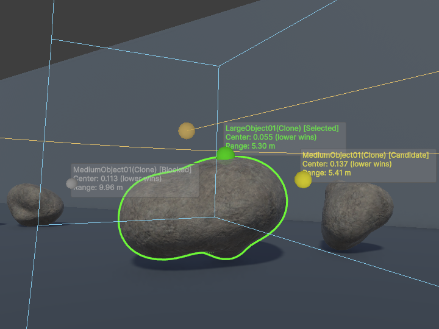

`OverlapBoxNonAlloc()`으로 카메라 방향 직육면체 범위의 후보를 수집합니다.
후보가 여러 개일 경우 화면 중심과의 거리를 우선하고, 비슷한 후보는 플레이어와의 거리로 비교합니다.
화면 비율을 반영해 중심 거리를 계산하고, 더 좋은 후보에 대해서만 가림 검사를 수행합니다.

들 수 있는지는 대상의 사용 가능 상태와 플레이어가 들 수 있는 최대 질량·스태미나 등으로 판단합니다.
이미 물체를 들고 있거나 입력이 막힌 상황에서는 불필요한 후보 탐색을 줄입니다.

이 방식은 월드에서 가장 가까운 물체보다 **플레이어가 화면으로 가리키는 물체**를 선택하는 데 맞춰져 있습니다.

타겟팅 구간은 화면 중앙에서 뻗은 카메라 광선이 **플레이어 옆을 지나는 지점부터** 앞으로 들기 거리만큼입니다.
카메라와 플레이어 사이, 즉 플레이어 뒤쪽에 있는 물체는 후보로 삼지 않습니다.

선택된 물체는 외곽선으로 표시하고, 지금 들 수 있는지에 따라 외곽선 색을 바꿉니다.
플레이어가 들 수 있는 최대 질량을 넘거나 스킬이 이미 들고 있는 물체는 "들 수 없음" 색으로 보입니다.
들 수 있는 대상이면 조준점에 외곽선과 같은 색의 링이 나타납니다(§7.2).

### 2.4 물리 추종과 휘두르기

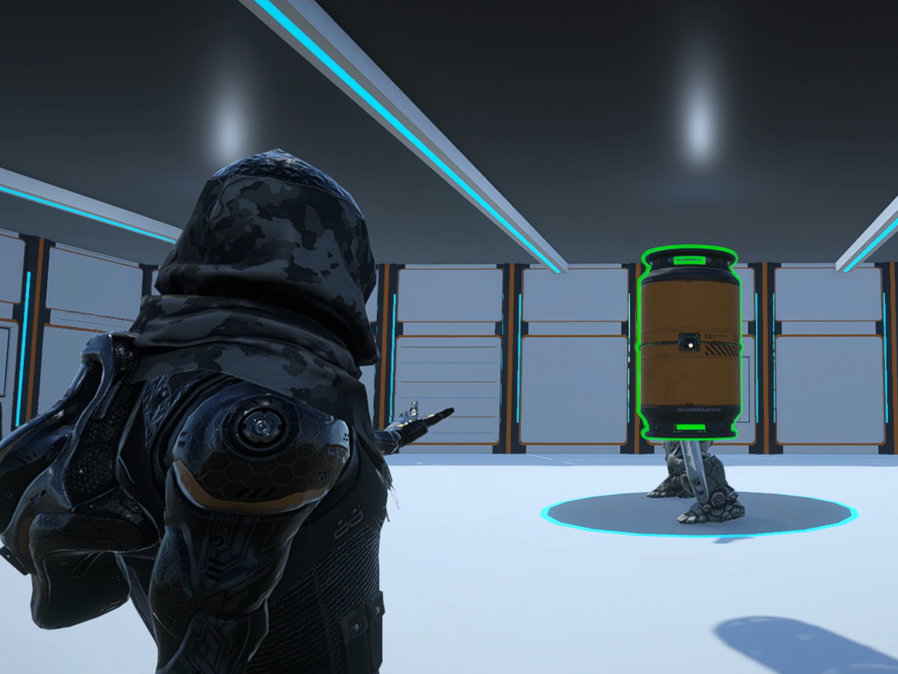

홀딩 위치와 현재 위치의 차이로 가속도를 만들고, 목표 속도와 물체 속도의 차이로 감쇠를 적용합니다.

```csharp
// PsychokinesisController.FixedUpdate() — 위치 오차로 가속도를 만들고 목표 속도와의 차이로 감쇠, 가속도·속도 상한 적용
Vector3 acceleration = offset * (followStrength * pullMultiplier)
    - (body.linearVelocity - targetVelocity) * followDamping;
acceleration = Vector3.ClampMagnitude(acceleration, maxAcceleration * pullMultiplier);
Vector3 nextVelocity = Vector3.ClampMagnitude(
    body.linearVelocity + acceleration * Time.fixedDeltaTime,
    maxHoldSpeed * pullMultiplier);
body.AddForce(
    (nextVelocity - body.linearVelocity) / Time.fixedDeltaTime,
    ForceMode.Acceleration);
```

위치 오차만 강하게 줄이면 물체가 목표를 지나치거나 심하게 흔들릴 수 있어 속도 감쇠와 상한을 함께 둡니다.
휘두르기 판정은 든 직후 바로 허용하지 않고, 목표 위치에 도착한 상태와 카메라 회전·물체의 상대 속도를 함께 사용합니다.

#### 물체를 조준점 위에 두는 홀딩 위치

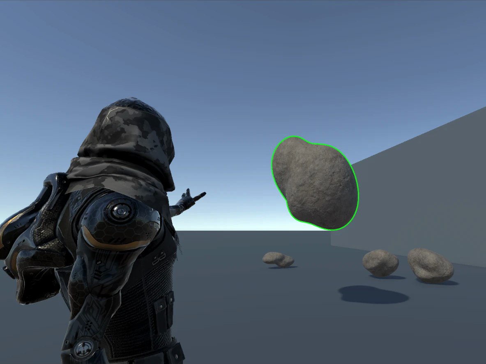 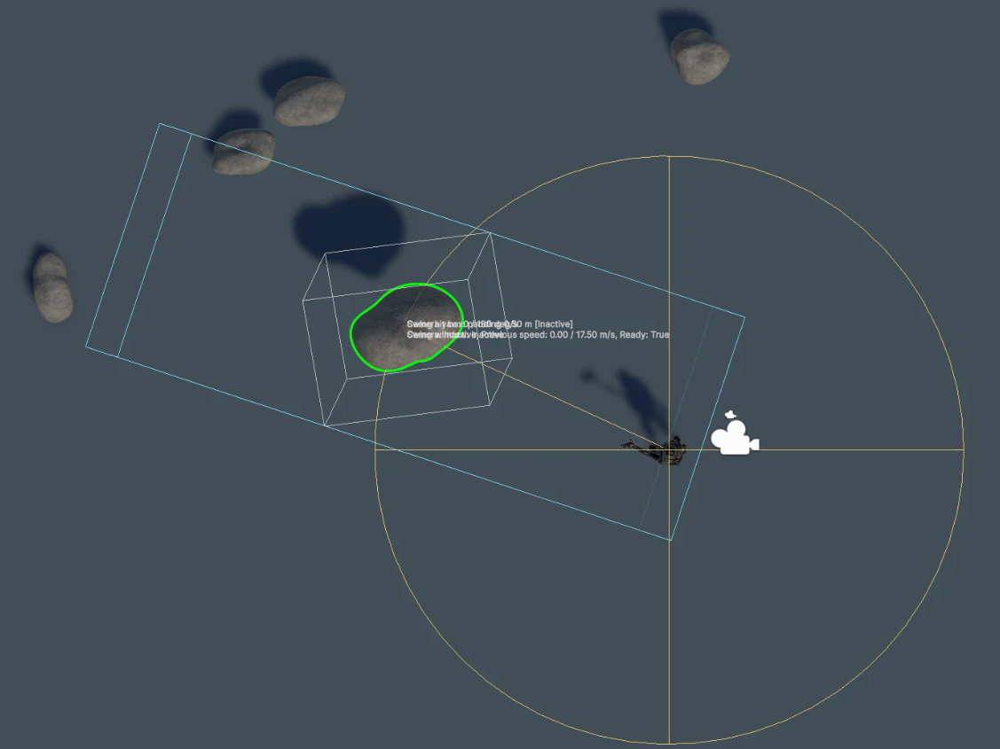

3인칭 카메라는 플레이어 어깨 쪽으로 비켜 있어 카메라 정면 방향으로 일정 거리 앞에 물체를 두면 물체가 화면 중앙의 조준점에서 벗어납니다.
홀딩 위치는 플레이어 상체 높이의 기준점을 중심으로 한 구(반지름 = 홀딩 거리)와 카메라 중앙 광선의 먼 쪽 교점으로 정합니다.
이렇게 하면 물체는 늘 조준점 위에 보이면서 플레이어와의 거리도 일정하게 유지됩니다.

```csharp
// PsychokinesisController.GetCameraAlignedDirection() — 홀딩 기준점 중심 구와 카메라 중앙 광선의 먼 쪽 교점
Vector3 toRayOrigin = cameraRay.origin - origin;
float b = Vector3.Dot(toRayOrigin, cameraRay.direction);
float c = toRayOrigin.sqrMagnitude - radius * radius;
float discriminant = b * b - c;
if (discriminant < 0f) return cameraRay.direction;   // 광선이 구를 비켜 가면 카메라 방향
float distance = -b + Mathf.Sqrt(discriminant);
if (distance <= 0f) return cameraRay.direction;
return (cameraRay.GetPoint(distance) - origin).normalized;
```

#### 회전 속도에 따라 뒤따라오는 물체

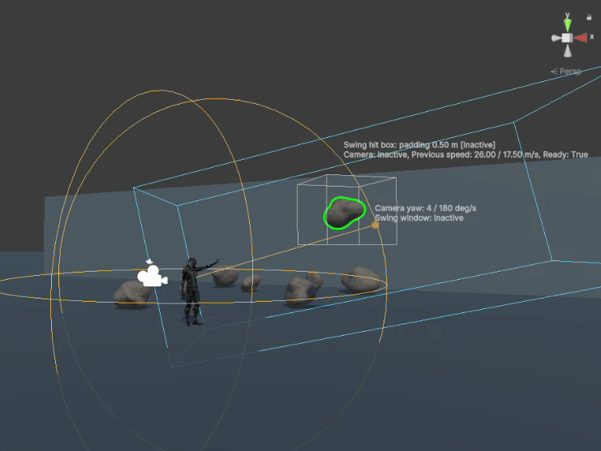 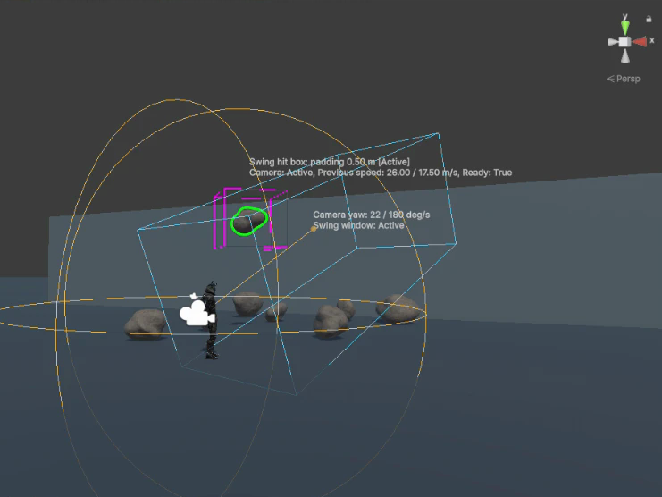

홀딩 방향은 조준 방향으로 바로 맞추지 않고 보간으로 따라가게 합니다.
카메라 회전 속도가 빠를수록 따라가는 시간을 길게 잡고, 천천히 조준할 때는 짧게 잡아 거의 바로 따라옵니다.
뒤처지는 각도에는 상한(기본 60°)을 두어 빠르게 돌려도 물체가 화면 밖으로 밀려나지 않게 합니다.
빠르게 휘두르면 물체가 무게를 가진 것처럼 뒤따라오고, 조준할 때는 정확히 따라오도록 했습니다.

휘두르기 판정은 투척 준비 중이거나 놓는 중이 아닐 때 카메라의 **수평 회전 속도**가 기준(기본 180°/s)을 넘는 순간 짧은 시간(기본 0.12초) 동안 켜집니다.
들고 있는 동안에는 물체의 타격 트리거에 여유 범위를 더해 빠르게 지나가는 물체도 대상에 닿게 하고, 피해는 휘두르기 판정이 켜져 있을 때만 줍니다.
대상에 닿으면 물체와 대상 사이를 Raycast로 다시 확인해 벽 너머의 적은 맞지 않게 하고, 피해를 요청한 뒤 그 속도 그대로 물체를 놓습니다.
피해량은 속도와 상관없이 물체의 무게 등급과 크기로 정합니다(§2.8 「무게 등급과 크기로 정하는 물체 피해」).

### 2.5 당겨 모은 뒤 조준점으로 던지기


던지기는 두 단계입니다.
좌클릭을 누르면 물체의 현재 위치에서 손 앞의 가까운 지점까지 짧은 시간 동안 `SmoothStep()`으로 당겨 모읍니다.
이 동안 추종 세기·가속 상한·속도 상한에 당김 배율(기본 최대 3배)을 곱해, 무거운 물체도 빠르게 손 앞으로 모입니다.

좌클릭을 떼면 화면 중앙 광선을 따라 처음 닿는 장애물 지점을 구하고, 물체 중심에서 그 지점을 향해 발사합니다.
카메라와 물체 사이의 가까운 장애물을 조준해 방향이 카메라 반대쪽이 되면, 카메라 방향을 그대로 사용해 물체가 뒤로 날아가지 않게 합니다.

```csharp
// PsychokinesisController.ReleaseHeld() — 투척 방향 결정
Vector3 direction = ray.GetPoint(distance) - heldObject.Body.worldCenterOfMass;
// 카메라와 물체 사이의 가까운 장애물을 조준해 역방향 발사 방지
if (Vector3.Dot(direction, ray.direction) <= 0f) direction = ray.direction;
velocity = direction.normalized * throwSpeed;
```

물체는 던진 뒤 한 번만 투척 피해를 줄 수 있습니다.
피해 크기는 휘두르기와 같이 무게 등급과 크기로 정하고(§2.8), 날아가는 속도는 피해에 반영하지 않습니다.

### 2.6 놓았을 때 물체의 원래 상태 복원

든 물체는 손 앞을 따라다니는 동안 플레이어·중력·시간 정지와 다르게 반응해야 합니다.
드는 순간 바꾼 값은 모두 원래 값을 저장해 두고, 놓을 때 되돌립니다.

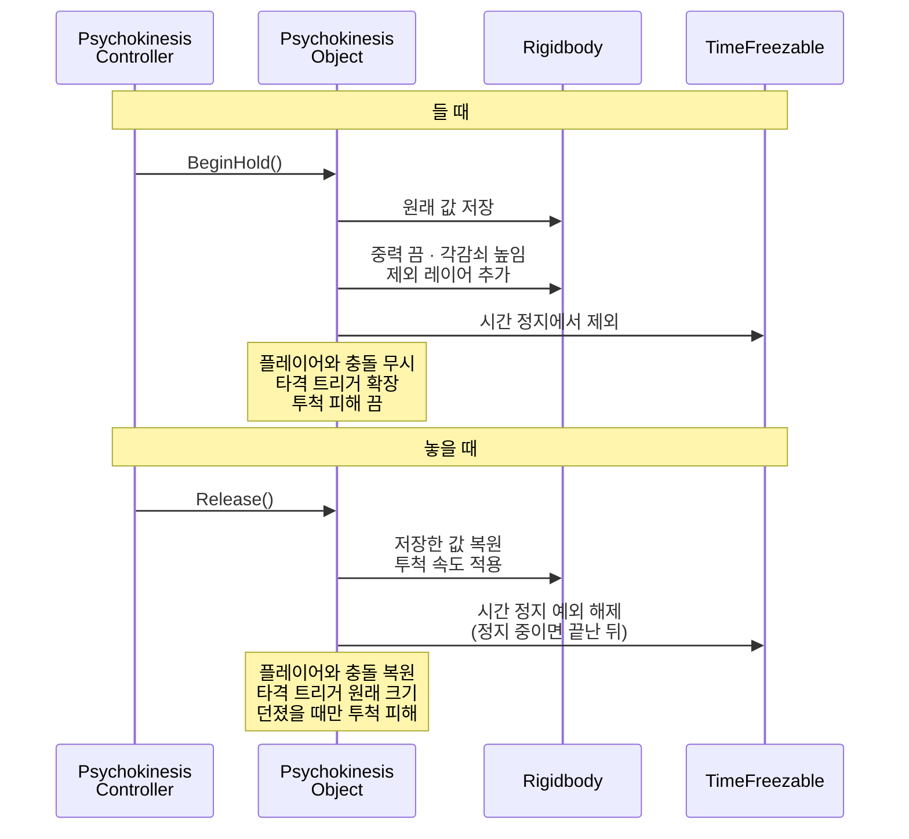

이 다이어그램은 물체를 들 때 원래 물리·충돌·시간 정지 상태를 저장해 바꾸고, 놓을 때 저장한 값으로 되돌리는 차례를 도식화한 것입니다.

**드는 순간 바꾼 값은 모두 저장해 두었다가 놓을 때 그대로 되돌리고, 시간 정지 중에 놓으면 정지 예외 해제를 정지가 끝난 뒤로 미룹니다.**

들고 있는 동안 무시한 플레이어와의 충돌은, 놓을 때 들기 전 상태 그대로 콜라이더 쌍별로 되돌립니다.

보스 Rigidbody는 염동력 물체 레이어(`Psychokinesis`)를 충돌 대상에서 빼 두어, 물체가 보스 몸에 밀리거나 보스를 밀지 않습니다.
빼 둔 레이어는 트리거로도 감지되지 않으므로, 물체의 타격 판정은 별도 레이어(`PsychokinesisHit`)의 트리거로 합니다.
이 트리거는 몬스터 레이어만 감지하도록 두어, 보스에 닿으면 밀어내지 않고 피해·파편화만 일어납니다.

### 2.7 맞혔을 때만 부서지는 물체

적에게 부딪혀 피해를 요청하는 경로에서는 `DamageEvent`를 큐에 등록합니다.
이벤트가 처리되기 전에는 보스가 무적 상태이거나 이미 쓰러져 피해가 들어가지 않을 수 있으므로, 자신이 요청한 이벤트의 결과를 확인해 실제로 피해가 들어갔을 때만 파편화합니다.

```csharp
// PsychokinesisObject.HandleDamageExecuted() — 자신이 요청한 피해 이벤트의 결과를 확인한 뒤 파편화
if (ReferenceEquals(damageEvent, pendingDamage) == false) return;
ClearPendingDamage();
if (receivedDamage <= 0) return;
Shatter();
```

같은 프레임에 다른 공격이 처리되어도 이벤트 인스턴스를 비교해 자신의 타격 결과만 사용합니다.
보스가 생성한 물체의 벽 충돌이나 외부 공격에 의한 파편화는 별도 경로로 처리합니다.

### 2.8 손을 뻗는 순간 맞는 기본 공격


기본 공격(염동파)은 손바닥에서 염동탄을 쏘아 맞히는 공격으로, 좌클릭을 누른 프레임에 즉시 피해를 주지 않습니다.
`PsychokinesisForceWave.Fire()`가 손을 당겼다 펴는 동작의 발사 지연을 예약하고,
발사 시점에 화면 중앙을 다시 검사해 손바닥 위치에서 염동탄을 쏩니다.
선택된 충돌 지점은 대상 Transform의 로컬 좌표로 보관해, 대상이 움직이면 염동탄의 도착 위치도 따라갑니다.

염동탄은 손 앞에서 잠시 머문 뒤 가속하고, 도착했을 때 전투 이벤트와 착탄 효과를 생성합니다.
피격 시 아직 발사하지 않은 예약은 취소하지만 이미 날아간 염동탄은 유지합니다.

착탄 주변 물체는 `ForcePush`로 밀어내되, `SweepTest()`로 이동 가능한 거리를 먼저 제한하고 무겁거나 공간이 없는 물체는 제자리에서 흔들기만 합니다.

소스: [PsychokinesisForceWave.cs](https://github.com/keeeery/ODDITY/blob/main/Assets/Scripts/3.%20Psychokinesis/PsychokinesisForceWave.cs), [ForcePush.cs](https://github.com/keeeery/ODDITY/blob/main/Assets/Scripts/3.%20Psychokinesis/ForcePush.cs).

#### 무게 등급과 크기로 정하는 물체 피해

던지거나 휘두른 물체의 피해는 물체의 무게 등급과 크기로 정합니다.
질량으로 소형·중형·대형 등급을 나누고, 플레이어의 현재 공격력에 등급 배율과 크기 배율을 곱합니다.
공격력은 사용할 때마다 다시 읽어 증강 칩으로 오른 공격력도 물체 피해에 반영되고, 무력화 피해 수치는 그 피해의 1.2배입니다.

처음에는 질량과 속도를 곱한 운동량으로 피해를 계산했고, 보스 전투 밸런스를 조정하면서 공격력 기반 등급 규칙으로 바꿔 확정했습니다.
속도는 휘두르기 판정을 켜는 조건에만 사용됩니다.
등급 배율과 기본 공격의 무력화 비율(기본 공격 피해의 0.27배) 같은 수치는 보스별 목표 전투 시간과 전투당 무력화 기대 횟수를 기준으로 직접 정했습니다.
그 기준에서 값을 계산해 보고 씬에 적용하는 일은 AI 코딩 에이전트에 맡겼고, 적용한 값으로 보스전을 직접 플레이해 전투 시간과 무력화 횟수가 기준에 맞는지 확인했습니다.

크기 조절 칩은 물체의 크기와 질량을 함께 바꿉니다.
질량이 커진 만큼 무게 등급이 올라가 피해가 두 번 커지지 않도록, 키운 배율을 `sizeFactor`에 따로 쌓아 두고 현재 질량을 이 배율로 나눠 원래 등급을 정한 뒤 피해에 배율을 곱합니다.
풀에서 다시 꺼낼 때는 배율을 1로 되돌려, 이전에 키운 크기가 다음 사용에 이어지지 않게 합니다.

```csharp
// PsychokinesisObject.CalculateDamage() — 현재 질량에서 원래 질량을 복원해 등급 계산 요청
controller.TryCalculateObjectDamage(body.mass / sizeFactor, sizeFactor,
    out int overriddenDamage, out groggy);
// PsychokinesisController.TryCalculateObjectDamage() — 등급별 atkScale을 고른 뒤 현재 공격력과 크기 배율 반영
damage = Mathf.Max(1, Mathf.RoundToInt(
    combatEntity.CurrentStats.Atk * atkScale * sizeFactor));
groggy = Mathf.RoundToInt(damage * objectGroggyScale);
```

### 2.9 보스·지형과 맞물리는 물체

전투 공간의 물체는 플레이어만 사용하는 소품이 아니라 보스의 이동·공격과도 반응합니다.

| 상황 | 동작 |
|---|---|
| 보스가 물체를 밟음 | 보스의 다리·발 콜라이더(`BossShatterCollider`)에 닿았을 때만 밟힌 것처럼 파편화하고, 다른 부위에는 부딪히기만 함 |
| 플레이어가 든 물체가 보스 다리에 닿음 | 들고만 있으면 통과, 휘두르는 중이면 위 규칙 적용, 피해 처리를 기다리는 중이면 그 결과를 따름 |
| 맵에 처음부터 놓인 물체를 밟음 | 파편화하지 않고 보스 진행 방향의 좌우로 밀려남(정해진 속도까지만 채움) |
| 보스 발밑에서 막 생긴 물체 | 정해진 유예 시간 동안 다리·발에 닿아도 파편화하지 않음 |
| 보스가 만든 물체를 플레이어가 던짐 | 바닥에 닿기 전 처음 부딪힌 벽에서 파편화, 바닥에 먼저 닿았으면 이후 벽 충돌은 무시 |
| 보스 충격파·점프 착지 | 범위 안의 물체를 잠깐 띄웠다가 중력으로 떨어뜨림(`BossFragmentLift`) |
| 바닥 구멍 아래로 떨어짐 | 지정한 상자 영역(`PsychokinesisFallZone`)에 들어오면 파편 없이 회수 |

생성 유예 중에 닿은 보스 부위는 한 번 떨어질 때까지 계속 무시해 유예가 끝나는 순간 발밑에 겹쳐 있던 물체가 바로 부서지지 않게 합니다.
플레이어가 물체를 들면 유예를 해제해 원래 규칙으로 돌아갑니다.

소스: [PsychokinesisObject.cs](https://github.com/keeeery/ODDITY/blob/main/Assets/Scripts/3.%20Psychokinesis/PsychokinesisObject.cs), [BossFragmentLift.cs](https://github.com/keeeery/ODDITY/blob/main/Assets/Scripts/6.%20Boss/BossFragmentLift.cs), [PsychokinesisFallZone.cs](https://github.com/keeeery/ODDITY/blob/main/Assets/Scripts/8.%20Environmental%20Mechanics/PsychokinesisFallZone.cs).

### 2.10 고민과 선택

**물체를 어떻게 손 앞에 붙들까 — Dynamic Rigidbody**

염동력으로 다루는 물체는 벽이나 다른 물체에 부딪히며 밀리고, 무게감이 느껴지고, 던진 뒤에도 자연스러운 궤적을 그리는 등 현실적인 물리 법칙을 따라 움직이도록 구현하고자 했습니다. 그래서 Transform을 손 위치로 직접 옮기지 않고, 처음부터 Dynamic Rigidbody에 위치 오차로 가속도를 주는 방식(§2.4)을 택했습니다.

성능은 에디터 Stats 창의 FPS로 확인했습니다. 테스트 씬에서 물체 하나를 든 상태로 약 300 FPS였습니다(개발 환경 기준). 게임 설계상 수많은 물체가 동시에 물리 운동을 하는 상황은 나오지 않아, 이후에도 성능 문제는 없을 것으로 판단하고 이 구조를 유지한 채 추종 수치를 튜닝했습니다.

당시에는 이 방식 하나로 정했고, 다른 방법과의 비교는 돌아보며 정리했습니다.

| 방법 | 장점 | 비용 |
|---|---|---|
| Transform을 손 위치로 직접 옮기기 | 원하는 위치에 정확히 붙음 | 벽·다른 물체에 부딪혀도 밀리지 않고 뚫고 지나가며, 던진 뒤의 궤적을 따로 만들어야 함 |
| Kinematic Rigidbody를 `MovePosition()`으로 옮기기 | 위치를 정확히 제어하면서 충돌 판정은 받음 | 다른 물체에 밀리거나 무게감이 생기지 않고, 던질 때 Dynamic으로 바꿔야 함 |
| Dynamic Rigidbody에 위치 오차로 가속도 주기 (채택) | 부딪히면 밀리고, 무게감과 던진 뒤의 자연스러운 궤적이 나옴 | 질량·감쇠·상한 튜닝과 충돌 정책이 필요 |


**그 밖의 선택**

| 선택 | 이점 | 비용 |
|---|---|---|
| 화면 중심 우선 후보 선정 | 조준 의도와 대상 선택을 연결 | 가림 검사·카메라 범위 조건 필요 |
| 실제 피해 결과 후 파편화 | 접촉과 피해 성공을 구분 | 대기 이벤트와 구독 정리 필요 |
| 들고 있는 동안 충돌·시간 예외 적용 | 플레이어와의 충돌, 정지 세계 속 조작 연결 | 해제·피격·비활성화 시 원래 상태 복원 필요 |

소스: [PsychokinesisController.cs](https://github.com/keeeery/ODDITY/blob/main/Assets/Scripts/3.%20Psychokinesis/PsychokinesisController.cs), [PsychokinesisObject.cs](https://github.com/keeeery/ODDITY/blob/main/Assets/Scripts/3.%20Psychokinesis/PsychokinesisObject.cs).

---

## 3. 부서진 조각을 다시 사용하는 파편

### 3.1 개요 — 같은 전투 공간의 파편과 물체

부서진 물체의 일부는 다시 염동력으로 사용할 수 있고, 작은 조각은 시각 효과를 담당합니다.
보스가 만든 파편과 플레이어가 던지는 물체가 같은 전투 공간에서 상호작용하도록 구성했습니다.

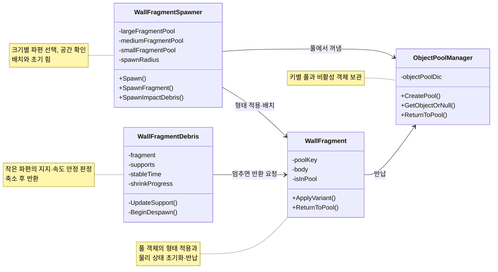

이 다이어그램은 파편 생성기가 크기별 풀에서 파편을 꺼내 형태를 입히고, 작은 파편이 멈추면 풀로 돌려보내는 클래스 사이의 역할 분담을 도식화한 것입니다.

실시간으로 원본 메시를 절단하는 방식이 아니라, 미리 만든 파편 형태를 조합해 생성합니다(선택 이유는 §3.5).
기본 생성 요청은 큰 파편 1개·중간 5개·작은 9개이며, 배치 공간을 찾지 못하면 일부가 생략됩니다.

### 3.2 미리 만들어 다시 사용하는 파편

물체가 부서질 때마다 파편을 생성하고 파괴하는 비용을 줄이기 위해, 작은 파편처럼 자주 사용하는 객체를 미리 생성해 두고 다시 사용합니다.

```csharp
// ObjectPool.Get() — 비어 있으면 확장 수량만큼 늘린 뒤 꺼냄
public IObjectPoolItem Get()
{
    if (pool.Count == 0) Expand(expandSize);
    return pool.Pop();
}
```

처음에 생성해 둘 수량과 다 사용했을 때 늘릴 수량을 따로 정해, 자주 사용하는 파편은 시작할 때 넉넉히 준비하고 모자랄 때만 조금씩 늘립니다.
`Get()`은 비활성 객체를 반환하며, 호출자가 형태·위치·회전을 적용한 뒤 활성화합니다.

`ApplyVariant()`는 선택된 형태의 Mesh·Material·BoxCollider·질량·스케일을 풀 객체에 적용합니다.
형태마다 별도 풀을 만드는 대신 크기별 객체를 여러 외형으로 재사용하는 구조입니다. 
외형을 바꾼 뒤에는 무게중심과 회전 관성을 다시 계산해, 이전 형태의 물리 값이 남지 않게 합니다.

```csharp
// WallFragmentSpawner.SpawnVariant() — 크기별 풀에서 비활성 객체를 꺼내 외형을 입힌 뒤 위치를 정하고 활성화
WallFragment fragment =
    (WallFragment)ObjectPoolManager.Instance.GetObjectOrNull(pool.Key);
if (fragment == null) return null;
fragment.ApplyVariant(prefab);
fragment.transform.SetPositionAndRotation(position, rotation);
fragment.gameObject.SetActive(true);

// WallFragment.ApplyVariant() — 고른 프리팹의 외형·충돌·질량을 복사하고 물리 값을 다시 계산
meshFilter.sharedMesh = prefab.GetComponent<MeshFilter>().sharedMesh;
meshRenderer.sharedMaterial = prefab.GetComponent<MeshRenderer>().sharedMaterial;
hitBox.center = sourceCollider.center;
hitBox.size = sourceCollider.size;
body.mass = prefab.GetComponent<Rigidbody>().mass;
transform.localScale = prefab.transform.localScale;
body.ResetCenterOfMass();
body.ResetInertiaTensor();
```

### 3.3 작은 파편의 수명과 반환

작은 파편과 금속 조각은 연출용이라 바닥(Ground 레이어)하고만 충돌해 플레이어·보스·다른 물체와 부딪히지 않습니다.
생성할 때도 다른 파편과 겹치는 것을 허용하고 빈자리를 찾는 재시도 횟수를 제한해, 연출용 파편의 연산 비용을 줄였습니다.
작은 파편은 생성 즉시 일정 시간만 기다리는 대신, 바닥 지지 여부와 선형·각속도를 검사합니다.

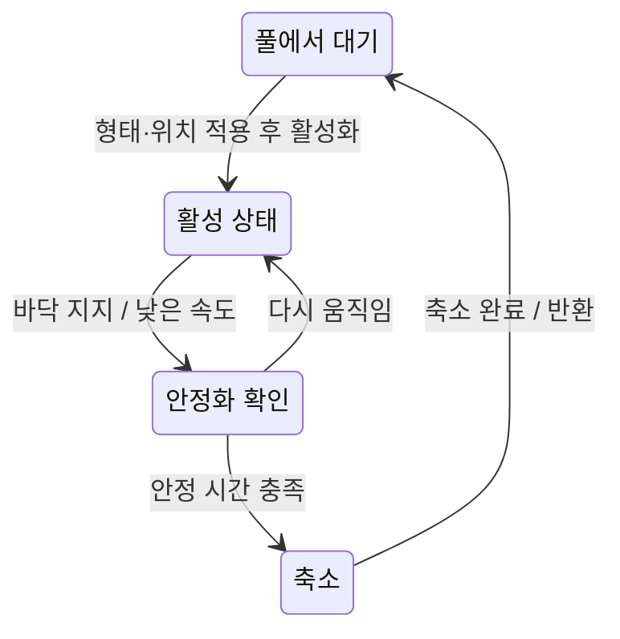

이 다이어그램은 작은 파편이 풀에서 꺼내져 바닥에 안정된 뒤 축소되어 풀로 돌아가는 상태 전이를 도식화한 것입니다.

**정해진 시간이 지나서가 아니라 바닥에 지지되고 느려진 상태가 이어져야 축소·반환되고, 다시 움직이면 처음부터 다시 확인합니다.**

활성화 시 속도와 관련 상태를 초기화하며, 파편의 중복 반납은 `WallFragment`의 상태로 방지합니다.

### 3.4 재질별 파괴

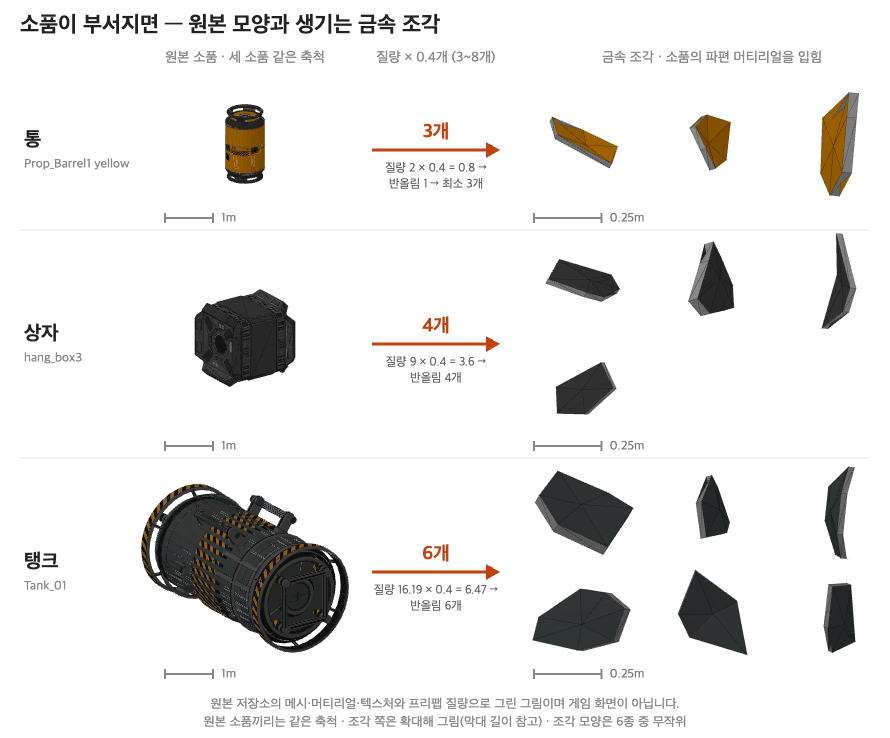

맵에 배치된 염동력 소품은 모두 금속 조각으로 부서지고, 벽에서 떨어진 파편이나 보스 패턴이 만든 물체는 돌 파편으로 부서집니다.
금속 조각은 모양 6종을 모든 소품이 함께 사용하되, 소품마다 그 소품 텍스처의 한 부분을 잘라 사용하는 조각용 머티리얼을 지정해 덮어씌워, 그 소품에서 떨어져 나온 조각처럼 보이게 했습니다.

| 구분 | 금속 조각 | 돌 파편 |
|---|---|---|
| 부서지는 물체 | 맵의 염동력 소품 27종 | 벽 파편, 보스 패턴이 만든 물체 |
| 조각 모양 | 얇고 각진 금속판 6종(지름 0.25~0.45m) | 둥근 돌덩이 5종 |
| 머티리얼 | 소품마다 지정한 조각용 머티리얼 | 공용 돌 머티리얼(트라이플래너, §8.7) |
| 조각 수 | 질량(kg) × 0.4개(최소 3, 최대 8) | 질량(kg) × 1개(최소 3, 최대 30) |
| 흩어지는 반경 | 0.5m | 0.15m |

- 벽 충돌 파편은 충돌 지점 정면을 비우고 벽의 좌우·위쪽으로 퍼뜨려, 생성 직후 서로 겹치지 않게 합니다.
- 금속 소품은 시야를 덜 가리도록 돌 파편보다 적게 흩뿌립니다.
- 금속 조각은 판 앞뒤 면의 UV를 0~1로 만들어, 어떤 소품의 머티리얼을 입혀도 원본 텍스처가 조각 면에 입혀집니다.
- 금속 조각과 작은 파편은 연출용이라 들 수 없고, §3.3의 안정 판정 → 축소 → 반환을 함께 사용합니다.
- 휴머노이드 보스가 쳐 낸 물체도 원래 물체의 재질을 복사해, 맞았을 때 같은 조각으로 부서집니다.

소스: [WallFragmentSpawner.cs](https://github.com/keeeery/ODDITY/blob/main/Assets/Scripts/8.%20Environmental%20Mechanics/WallFragmentSpawner.cs), [WallFragmentPrefabGenerator.cs](https://github.com/keeeery/ODDITY/blob/main/Assets/Scripts/8.%20Environmental%20Mechanics/WallFragmentPrefabGenerator.cs), [PsychokinesisObject.cs](https://github.com/keeeery/ODDITY/blob/main/Assets/Scripts/3.%20Psychokinesis/PsychokinesisObject.cs).

### 3.5 고민과 선택

**파편을 어떻게 만들까 — 미리 만든 파편 형태를 크기별로 조합**

| 방법 | 장점 | 비용 |
|---|---|---|
| 미리 쪼개 둔 벽 오브젝트 에셋 | 실제로 부서지는 듯한 사실적인 모습 | 에셋에 들어 있는 벽 형태에만 사용할 수 있음 |
| 실시간 메시 절단 (처음 기획) | 보스가 돌진한 벽의 메시를 잘라 그 벽에서 파편이 나옴 | 깊게 다루면 시간이 너무 많이 들고, 시험해 본 데모에서 잘린 모습이 자연스럽지 않음 |
| 미리 만든 파편 형태를 크기별로 조합 (채택) | 개발 비용이 낮음 | 파편이 원래 물체의 모양을 따르지 않음 |

실시간 메시 절단은 보스가 벽에 돌진하면 그 벽의 메시를 잘라 파편 생성하는 초기 기획의 방식이었습니다.
프로젝트 기간 안에 깊게 다루면 시간이 너무 많이 들 것 같아 먼저 보류했고, 이후 AI로 만들어 본 데모로 시험해 보니 잘린 모습이 생각보다 사실적이지 않았으며, 사실적으로 다듬는 데 다시 시간이 많이 들 것으로 판단해 기각했습니다.
크기별 조합은 개발 비용이 낮아 먼저 구현했고, 실제 전투에 붙여 보니 생각보다 어색하지 않고 잘 어울려 그대로 확정했습니다.

전투 공간의 물체는 돌 아니면 금속으로 만든 것이라, 물체마다 다른 조각을 만들지 않고 돌·금속 두 가지 조각으로만 나눴습니다(§3.4).
그래서 파편은 원래 물체의 모양을 따르지 않습니다.

---

## 4. 플레이어만 움직이는 시간 정지

시간 정지는 초능력 스킬의 일종으로, 스킬 칩 틀(슬롯·발동·쿨타임) 위에서 처음으로 실제 동작한 스킬이 시간 정지와 염동 내려찍기였습니다.
이때 만든 물체별 시간 체계(`TimeFreezable`) 위에 이후 팀원이 시간 감속을 확장했습니다.

### 4.1 개요 — 멈출 물체만 따로 정하는 시간 정지

시간 정지는 플레이어를 포함한 게임 전체의 `Time.timeScale`을 0으로 만드는 대신,
정지 가능한 객체에 `TimeFreezable`을 붙여 적용합니다.
플레이어는 움직이면서 멈춘 물체를 들거나 공격할 수 있습니다.

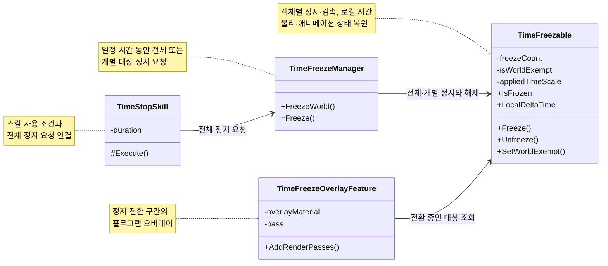

이 다이어그램은 시간 정지 스킬이 매니저를 거쳐 정지 가능한 물체마다 정지·해제를 요청하고, 오버레이가 전환 중인 대상을 조회하는 구조를 도식화한 것입니다.

개별 정지와 전체 정지는 중첩해서 적용합니다.
개별 정지 횟수가 남아 있으면 정지하고, 전체 시간 효과가 여러 개라면 가장 낮은 배율을 사용합니다.

### 4.2 시간이 풀린 뒤의 원래 움직임 복원

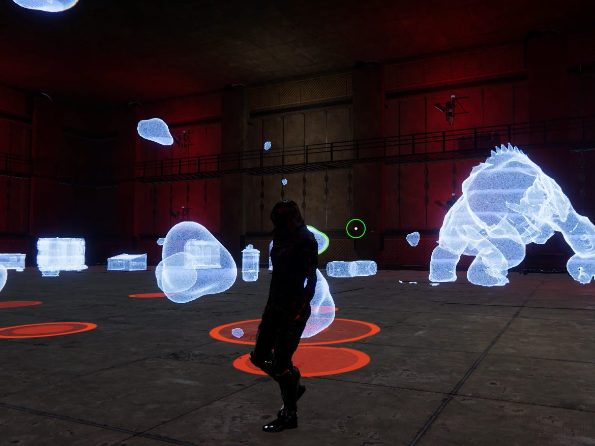

객체는 정지·감속 동안 누적된 시간 차이를 반영해 자신의 시간을 계산합니다.

```csharp
// TimeFreezable.LocalTime·LocalDeltaTime·LocalFixedDeltaTime — 정지·감속 동안의 시간 차이를 반영한 객체별 시간
public float LocalTime => Time.time - pausedDuration
    - (Time.time - pauseStartTime) * (1f - appliedTimeScale);
public float LocalDeltaTime => Time.deltaTime * appliedTimeScale;
public float LocalFixedDeltaTime => Time.fixedDeltaTime * appliedTimeScale;
```

Animator의 원래 속도와 Rigidbody의 운동 상태를 저장하고,
정지 시 Rigidbody를 Kinematic으로 전환하며 관련 DOTween을 일시정지합니다.
해제 시에는 저장된 상태를 복구합니다.
보스 행동·이동 등 시간 영향을 받아야 하는 코드는 이 로컬 시간과 배율을 사용해야 합니다.

감속 중에는 속도를 배율에 맞추고 추가 중력을 적용합니다.
이는 기존 궤적을 느리게 표현하기 위한 보정입니다.

### 4.3 멈춘 세계에서도 움직이는 든 물체

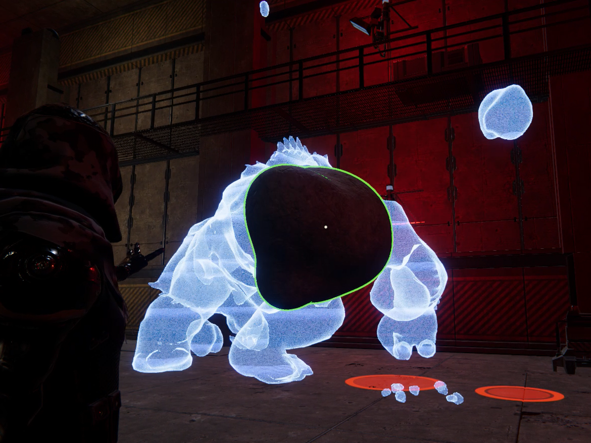

물체를 들면 전체 시간 정지에서 제외합니다.
따라서 시간 정지와 염동력은 독립된 화면 효과가 아니라 같은 물체 상태를 공유합니다.

홀로그램은 전환 중인 객체에만 덧그립니다.
완전히 덮이면 원래 `sharedMaterials`를 보관하고 홀로그램 재질로 교체해, 정지 내내 별도 오버레이를 반복해서 그리는 범위를 줄입니다.
해제할 때는 원래 재질을 복구한 뒤 오버레이가 걷히는 연출을 적용합니다.
홀로그램 셰이더는 도입한 외부 셰이더를 바탕으로 높이 마스크·글리치 표현을 확장했습니다.

#### 시간 정지 막 셰이더

`TimeFreezeHologram.shader`는 도입한 홀로그램 셰이더(Knife Hologram Shader Unlit)의 Forward 패스에 두 가지를 더했습니다.
하나는 **높이로 쓸어 올리는 마스크**로, 그리는 렌더러들의 바운드를 매 프레임 다시 재므로 움직이는 SkinnedMesh에도 맞습니다.
다른 하나는 **정지 직후의 짧은 글리치**로, 원본처럼 키워드로 켜고 끄지 않고 세기 값으로만 켭니다.

소스: [TimeFreezeHologram.shader](https://github.com/keeeery/ODDITY/blob/main/Assets/Shaders/TimeFreezeHologram.shader), [TimeFreezeOverlayFeature.cs](https://github.com/keeeery/ODDITY/blob/main/Assets/Scripts/4.%20Superpower/Time%20Control/TimeFreezeOverlayFeature.cs), [TimeFreezable.cs](https://github.com/keeeery/ODDITY/blob/main/Assets/Scripts/4.%20Superpower/Time%20Control/TimeFreezable.cs).

#### 염동 내려찍기 — 개별 정지·물리 이동·카메라 조율

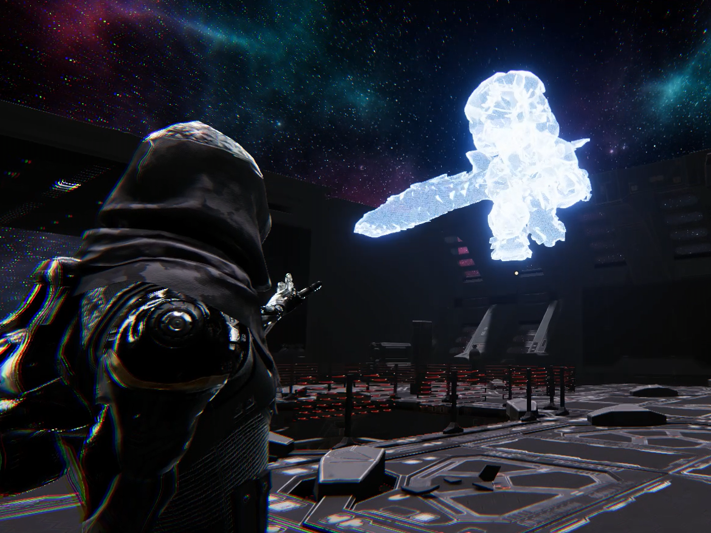

`PsychoSlamSkill`은 사거리·조준 각도 안의 가장 가까운 적을 골라 개별 정지한 뒤, Rigidbody를 `MovePosition()`으로 들어 올렸다가 내려찍습니다.
대상이 없으면 `CanExecute()`가 실패해 쿨타임이 적용되지 않습니다.
끝날 때는 저장한 운동 상태를 버리고 정지를 풀어, 들어 올리기 전 속도가 내려찍은 뒤 다시 붙지 않게 했습니다.

#### 타격 순간 멈춤(히트스톱)과 시간 정지의 차이

`HitStop`은 타격 순간 월드 전체의 `Time.timeScale`을 0으로 만드는 별도 기능입니다.
유효한 중첩 요청은 종료 시각이 더 긴 쪽으로 합치고, 종료 뒤 짧은 재요청 제한을 둡니다.
지속시간은 `unscaledTime`으로 검사하며, 종료 시 무조건 1이 아니라 `BaseTimeScale`로 돌아갑니다.
따라서 회피 슬로모션 등 전체 시간 효과와 기본 시간 배율을 공유할 수 있습니다.

이 구조 개선은 AI 코딩 에이전트에 맡겼는데, 받은 안에는 완전히 멈추는 대신 시간을 아주 느리게 흐르게 하는 선택지도 있었습니다.
그 방식은 타격감을 저하시킨다고 판단해 완전 정지(`timeScale` 0)를 유지하고, 요청 합치기와 재요청 제한만 받아들였습니다.
받아들인 구조는 연속으로 타격해 보며, 히트스톱이 겹칠 때 멈춤이 지나치게 길어지거나 끊기지 않는지 확인했습니다.

### 4.4 고민과 선택

**게임 시간을 어떻게 멈출까 — 물체마다 따로 도는 시간**

`Time.timeScale`을 직접 바꾸면 플레이어까지 모두 멈춥니다. 시간 정지 중에도 플레이어와 든 물체는 움직여야 했으므로, 객체마다 시간을 따로 다루는 별도의 시간 체계를 도입했습니다. 처음부터 이 방식이 맞다고 보고 다른 방법은 따로 견주지 않았습니다.

이후 팀원이 같은 체계 위에 시간 감속(중첩 배율·중력 보정)을 확장했습니다. 대신 `TimeFreezable`을 붙이거나 그 시계를 넘긴 요소만 멈추므로, 공격 예고 표시나 맵 환경까지 모두 멈추려면 하나씩 연결해야 합니다. 플레이어를 제외한 모든 요소가 정지·감속되는 쪽이 더 좋았을 것이라고 돌아봤습니다.

돌아보며 견준 방법은 다음과 같습니다.

| 방법 | 장점 | 비용 |
|---|---|---|
| 플레이어 전용 시간 | 플레이어 외 모든 요소를 한 번에 정지·감속해, 예고 표시·맵 환경까지 멈출 수 있음 | `timeScale` 0을 사용하는 일시정지와 겹치는 곳에 추가 조치가 필요 |
| 물체별 시간 (채택) | 멈출 대상·든 물체 예외·홀로그램 전환을 물체 단위로 다룸 | `TimeFreezable`을 붙인 객체만 멈춰, 예고 표시·맵 환경도 하나씩 붙여야 함 |

**다시 고른다면** 플레이어만 전용 시간을 사용하는 쪽을 택하고, 일시정지처럼 게임 시간 전체를 멈추는 기능과의 관계를 먼저 정하겠습니다.

**그 밖의 선택**

| 선택 | 이점 | 비용 |
|---|---|---|
| 객체별 시간 상태 | 플레이어와 일부 물체를 계속 조작 가능 | 관련 제어 코드가 로컬 시간을 사용해야 함 |
| 중첩 정지·감속 관리 | 하나의 효과가 끝나도 다른 효과 유지 | 요청·해제의 짝과 비활성화 정리 필요 |
| 전환 오버레이와 재질 교체 병행 | 전환 표현과 정지 유지 표현을 구분 | 원래 재질·프로퍼티·카메라 제외 처리 필요 |

소스: [TimeFreezable.cs](https://github.com/keeeery/ODDITY/blob/main/Assets/Scripts/4.%20Superpower/Time%20Control/TimeFreezable.cs), [TimeFreezeManager.cs](https://github.com/keeeery/ODDITY/blob/main/Assets/Scripts/4.%20Superpower/Time%20Control/TimeFreezeManager.cs), [TimeFreezeOverlayFeature.cs](https://github.com/keeeery/ODDITY/blob/main/Assets/Scripts/4.%20Superpower/Time%20Control/TimeFreezeOverlayFeature.cs).

---

## 5. 보스 패턴과 전투 판정

### 5.1 개요 — 공용 전투 구조

공용 전투 구조는 `ICombatable`과 `CombatEntity`, `DamageEvent`·`HealEvent`, `CombatManager`로 구성되어 있습니다.
피해를 요청하는 쪽은 이벤트를 큐에 등록하고, 처리 결과는 HUD·피격 연출과 염동 물체가 구독합니다.

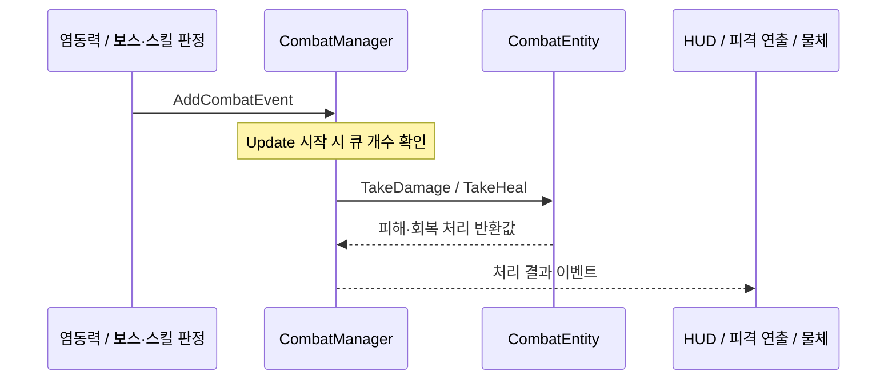

이 다이어그램은 공격 판정이 피해 이벤트를 큐에 넣고, `CombatManager`가 Update에서 처리한 결과를 HUD·피격 연출·물체에 알리는 차례를 도식화한 것입니다.

보호막·방어·가드 등은 엔티티와 팀 공통 스킬 구조가 담당하고, 염동 물체는 처리 결과의 피해가 0보다 클 때만 파편화합니다.

### 5.2 보스 판단과 직접 확장한 패턴

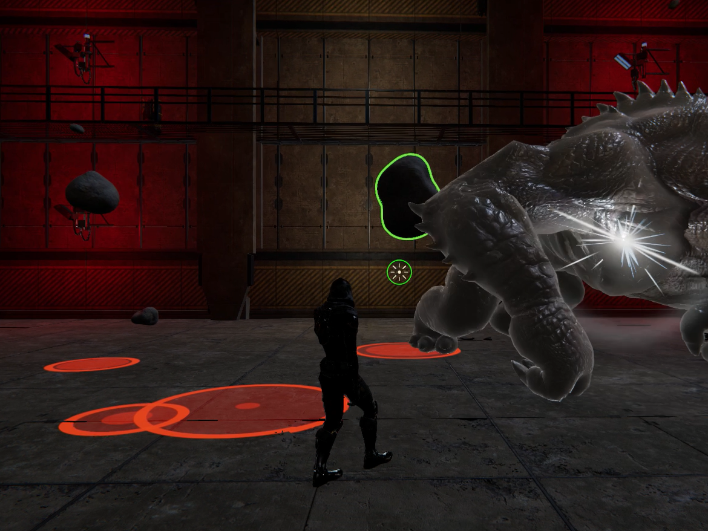

보스는 상태 머신으로 행동하고, 공격은 Intent 방식(우선 패턴 → 사거리 안 패턴 → 가중치, 쿨다운·후딜)으로 고릅니다.
이 구조 위에 투하·투척·충격파 패턴을 만들었고, 처음에는 내부 쿨타임과 발동 조건(`CanUse`)으로 사용할 수 있는 패턴을 고르는 방식(`BossCooldownPatternBase`)으로 구현했다가 Intent 방식이 들어오면서 `BossMeleePattern` 상속으로 옮겼습니다. 이후 두 보스가 근접·투하·투척·충격파 패턴을 함께 사용하도록 구조를 정리했습니다.

지금은 `BossIdleState`가 패턴의 사용 가능 조건·거리·긴급 조건과 가중치로 공격을 고르고, 거리·각도가 맞지 않으면 Chase·Turn으로 조건을 만든 뒤 실행합니다. 이 위에 직접 보완한 공통 흐름은 공격 예고, 애니메이션 발동 시점, 피격·그로기, 이동·착지와 지면 대응입니다. 패턴을 벗어날 때는 애니메이션 구독과 남은 공격 예고를 함께 정리합니다.


### 5.3 주변 물체를 떨어뜨리고 던지는 보스 공격

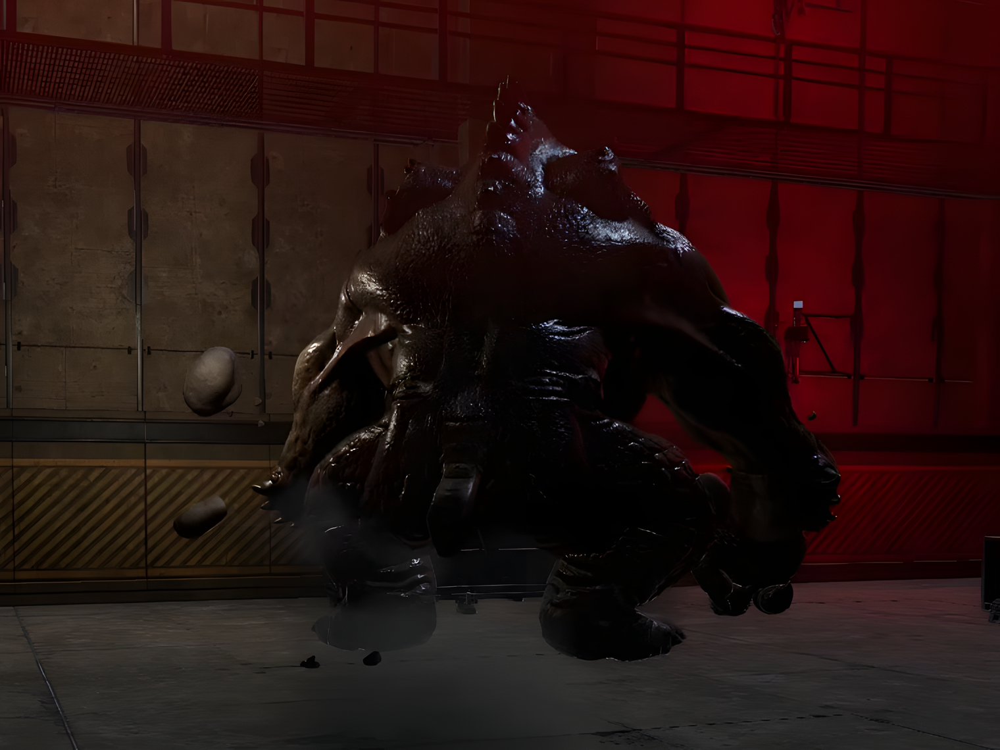 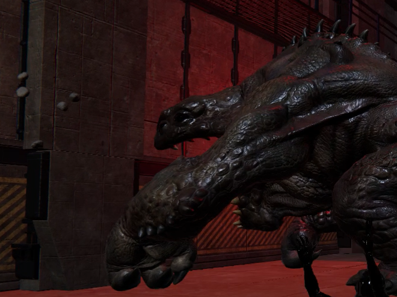

| 패턴 | 준비와 실행 | 판정과 정리 |
|---|---|---|
| 투하 (`BossPsychokinesisDropPattern`) | 애니메이션 신호에 맞춰 원형 범위 안 놓을 수 있는 위치에 파편을 떨어뜨림 | 큰·중간 파편만 착지 예고와 판정을 가지고 작은 파편은 연출용, 착지 전에 사라졌거나 플레이어가 들고 있는 파편은 판정 생략 |
| 투척 (`BossPsychokinesisThrowPattern`) | 준비하는 동안 경로를 계속 맞추다가 발사하는 순간 방향을 고정 | 날아가는 물체에 겹치면 타격, 준비 중에 취소되면 물체를 떨어뜨림 |
| 충격파 (`BossShockwavePattern`) | 예고와 실제 발동이 같은 위치·방향을 사용 | 타격과 함께 주변 염동 물체를 띄움 |
| 돌진 (`BossCharge`) | 준비한 뒤 방향을 고정하고 돌진 | 한 번의 돌진은 한 번만 타격, 정면 벽에 부딪히면 기절하고 파편 생성 |

낙하물은 보스와 따로 자기 시간 상태에 따라 떨어지고, 착지 판정은 충돌 콜백이 아니라 예상 낙하 시간 뒤의 범위 판정입니다.
보스가 만들어 낸 파편도 플레이어가 들어 던질 수 있어 공격 물체가 곧 전투 자원이 됩니다.

공격 범위는 지면에 투영한 도형으로 예고하고, 같은 도형(`TelegraphShape`)으로 공격 순간의 판정도 합니다(§8.3).

소스: [BossPsychokinesisDropPattern.cs](https://github.com/keeeery/ODDITY/blob/main/Assets/Scripts/6.%20Boss/1.%20States/Pattern/BossPsychokinesisDropPattern.cs), [BossPsychokinesisThrowPattern.cs](https://github.com/keeeery/ODDITY/blob/main/Assets/Scripts/6.%20Boss/1.%20States/Pattern/BossPsychokinesisThrowPattern.cs).


### 5.4 보스 허트박스와 그로기

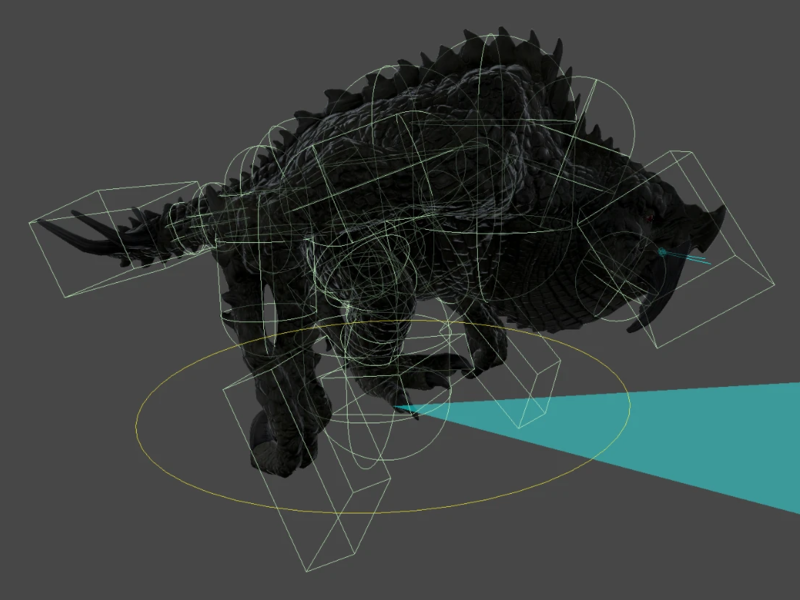 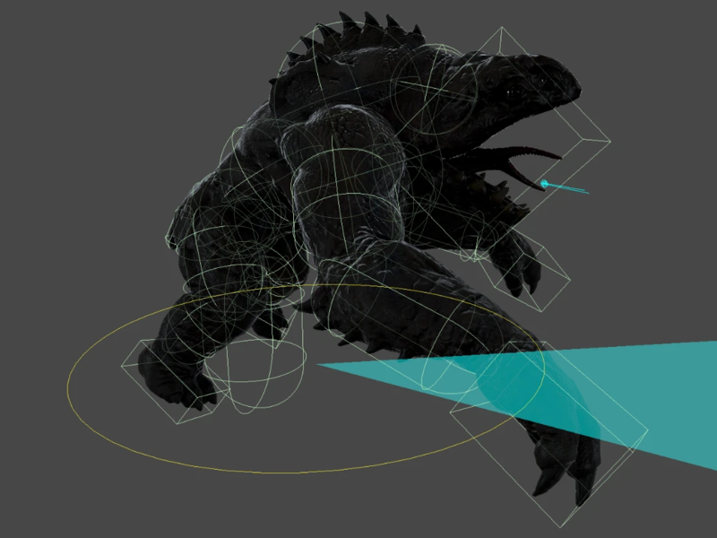

큰 보스는 몸 전체를 하나의 큰 콜라이더로 감싸면 빈 공간에도 공격이 맞기 때문에, 머리·몸통·꼬리·다리마다 허트박스(맞는 범위의 콜라이더)를 나눠 실제 몸이 있는 곳에서만 맞도록 했습니다. 
부위가 여럿이어도 체력·방어·그로기는 하나의 보스로 다뤄야 하므로, 피격 위치만 부위별로 얻고 나머지는 `BossHitboxRegistrar`가 같은 보스로 묶어 등록합니다.

피격 이펙트는 맞은 부위에 그대로 띄우면 땅에 닿아 있는 발 콜라이더에 몰리기 쉽습니다. 그래서 몸 전체 범위에서 공격 방향 쪽의 몸통 높이 지점에 이펙트를 표시합니다(§8.5).


피해가 실제로 들어갔을 때 공격마다 정한 무력화 피해만큼 그로기 수치를 깎고, 0이 되면 쓰러집니다(`BossGroggy`). 벽에 부딪혀 기절하는 것은 이와 별도의 경로입니다.


쓰러졌다 일어나는 그로기 자세와 숨 연출은 §8.5에서 설명합니다.

소스: [HitPoint.cs](https://github.com/keeeery/ODDITY/blob/main/Assets/Scripts/5.%20Combat/HitPoint.cs), [MonsterRegistry.cs](https://github.com/keeeery/ODDITY/blob/main/Assets/Scripts/5.%20Combat/2.%20Registry/MonsterRegistry.cs), [BossHitboxRegistrar.cs](https://github.com/keeeery/ODDITY/blob/main/Assets/Scripts/6.%20Boss/BossHitboxRegistrar.cs).

### 5.5 보스 가까이에서의 시점·이동 보정

보스에 가까이 붙으면 큰 몸체가 화면을 가리므로, 몸체 Collider 경계까지의 수평 거리로 근접을 판단해 카메라를 보스 근접 시점으로 바꿉니다.
진입·이탈 거리를 다르게 두어 경계에서 시점이 반복 전환되지 않게 하고, 일반·홀딩·질주 시점과 함께 오프셋·거리·FOV를 보간합니다.
벽에 닿으면 SphereCast로 즉시 거리를 당겼다가, 벽에서 벗어나면 보간해 되돌립니다.

보스의 발이나 등 위에 올라서면 몸 중심에서 바깥쪽으로 미끄러뜨려 떨어뜨립니다.
다리 사이로 떨어지면 보스가 때릴 수 없는 자리에 들어가므로, 항상 바깥쪽으로 보냅니다.

플레이어가 걸어 들어가면 보스 몸에 막히지만, 보스가 움직여 플레이어 쪽으로 들어오면 겹친 부위와의 충돌만 잠시 꺼서 통과시킵니다.
다리·꼬리처럼 금방 지나가는 부위는 그대로 통과시키고, 오래 겹친 채 남으면 보스 진행 방향의 옆으로 밀어냅니다.
앞으로 밀어내면 보스에 끌려가기 때문에 옆으로 밀어내고, 몸 안이 안전지대가 되지 않도록 이동 입력이 있거나 보스가 멈췄을 때도 밀어냅니다.


서로 반대 방향의 부위에 끼어 단순한 밀어내기로 나오지 못하면 수평 16방향을 0.25m 간격으로 검사합니다.
허용 거리 안에서 몸체와 벽을 벗어날 후보를 고른 뒤 `CharacterController.Move`로 이동합니다.

대기 자세의 발 위치와 골반 높이 보정(`PlayerCombatIdle`)도 더했습니다.

이 구조를 만들며 가장 오래 붙잡은 문제와 그 과정은 §9.1에서 설명합니다.

소스: [CameraController.cs](https://github.com/keeeery/ODDITY/blob/main/Assets/Scripts/2.%20Camera/CameraController.cs), [PlayerController.cs](https://github.com/keeeery/ODDITY/blob/main/Assets/Scripts/1.%20Player/PlayerController.cs), [PlayerCombatIdle.cs](https://github.com/keeeery/ODDITY/blob/main/Assets/Scripts/1.%20Player/PlayerCombatIdle.cs).

### 5.6 고민과 선택

보스 이동은 NavMesh로 경로만 계산하고 실제 이동은 `BossMovement`가 맡습니다.
처음 Dynamic Rigidbody였던 보스는 플레이어와 부딪혀 튀어 오르거나 플레이어를 밟고 올라서는 문제가 있어 Kinematic으로 바뀌었습니다.
단차가 없는 앞의 두 맵은 이것으로 충분했지만, 단차와 구멍이 있는 휴머노이드 맵에는 다음 보정을 제가 더했습니다.

**구멍·맵 바깥으로 나가지 않게 하려면 — NavMesh 경계에서 이동량 자르기**

| 방법 | 장점 | 비용 |
|---|---|---|
| 구멍 둘레에 보이지 않는 벽 세우기 | 기존 벽 판정(`wallMask`)으로 바로 막음 | 구멍을 넘는 도약 공격을 사용할 수 없음 |
| NavMesh 경계에서 이동량 자르기 (채택) | 뒷걸음·루트 모션 공격·돌진을 한 번에 막음<br>벽 충돌 알림은 그대로라 돌진 기절도 유지 | 도약 중에는 제한을 따로 꺼야 함<br>착지 뒤 NavMesh 위로 다시 옮겨야 함 |

**단차를 어떻게 오르내릴까 — 발밑 바닥 높이를 직접 따라가기**

| 방법 | 장점 | 비용 |
|---|---|---|
| 기존 이동 방식 그대로 사용하기 | 추가 작업 없음 | 단차를 오르내리지 못함 |
| NavMesh Step Height를 바꿔 다시 굽기 | 코드 없이 설정만으로 해결 | 다시 구워도 이동 범위가 올바르게 그려지지 않음 |
| 레이캐스트로 발밑 바닥 높이 따라가기 (채택) | `stepHeight`(1m) 이하 단차만 오르고 그보다 높으면 막음 | 맵마다 바닥 레이어를 지정해야 하고, 바닥과 벽 레이어를 구분해야 함 |

**그 밖의 선택**

| 방법 | 장점 | 비용 |
|---|---|---|
| 도약 착지 뒤 가장 가까운 NavMesh 안쪽으로 옮기기 | 기존 보스 패턴을 건드리지 않고 구현 가능, 공중에서 그로기·사망으로 끊겨도 구멍·벽 안에 남지 않음 | 착지 자리에서 6m 안의 NavMesh만 찾음 |
| 에이전트 반경 0.6 → 0.85 | NavMesh 경계가 곧 몸이 닿는 자리라 벽·구멍 가장자리를 파고들지 않음 | NavMesh가 더 깎여 좁은 통로·가장자리에 들어가지 못함 |

여러 방법은 AI와 주고받으며 시험했고, 최종 결정은 제가 직접 했습니다.


소스: [BossMeleePattern.cs](https://github.com/keeeery/ODDITY/blob/main/Assets/Scripts/6.%20Boss/1.%20States/Pattern/BossMeleePattern.cs), [CombatManager.cs](https://github.com/keeeery/ODDITY/blob/main/Assets/Scripts/5.%20Combat/CombatManager.cs), [BossMonster.cs](https://github.com/keeeery/ODDITY/blob/main/Assets/Scripts/6.%20Boss/BossMonster.cs).

---

## 6. 칩·스킬·임무와 보상·저장

### 6.1 개요 — 전체 성장 구조

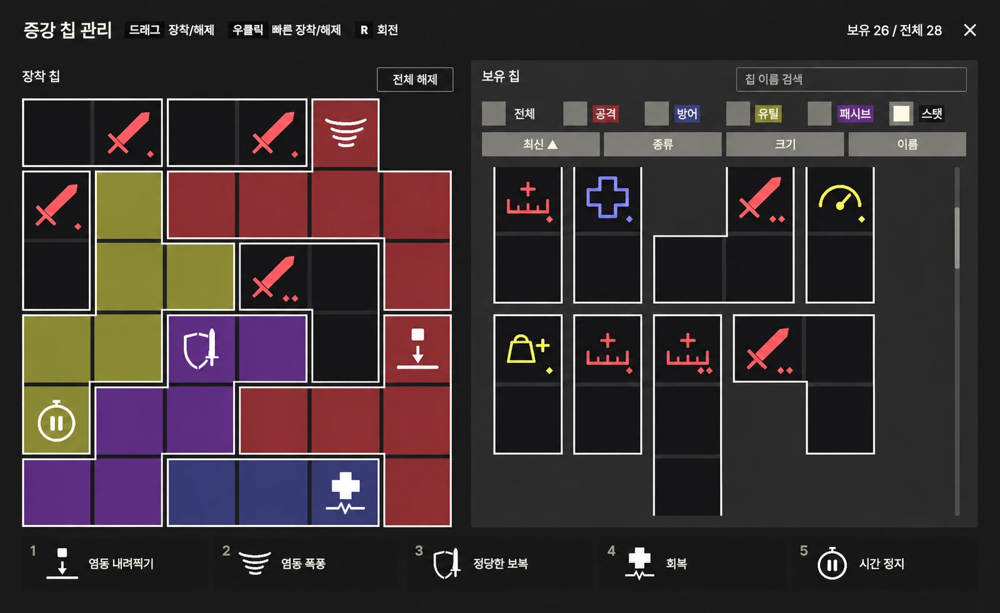

증강 칩의 배치·인벤토리·스킬 전략과 임무 기본 기능은 팀 구현입니다.
이 구조에 시간 정지·염동 내려찍기, 보상 테이블, 결과 화면, 로컬 저장과 이어하기를 연결했습니다.

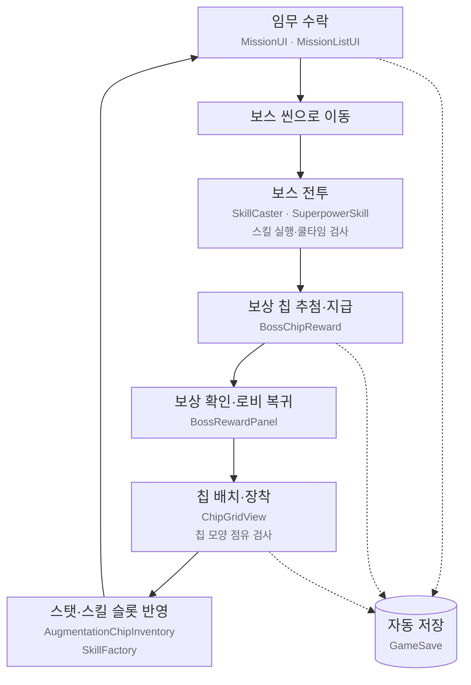

이 다이어그램은 임무를 수락해 보스를 처치하고, 보상 칩을 받아 장착한 뒤 강해진 상태로 다음 임무에 나서는 성장 흐름을 도식화한 것입니다.

**보상 칩 장착이 다음 임무의 출발점이 되고, 칩·임무가 바뀔 때마다 자동으로 저장됩니다.**
칸 아래 작은 글씨는 그 단계를 맡은 클래스이고, 점선은 보유 칩이나 수락한 임무가 바뀔 때마다 `GameSave`가 자동으로 저장하는 지점입니다.

### 6.2 임무 완료 시 정해진 칩 보상

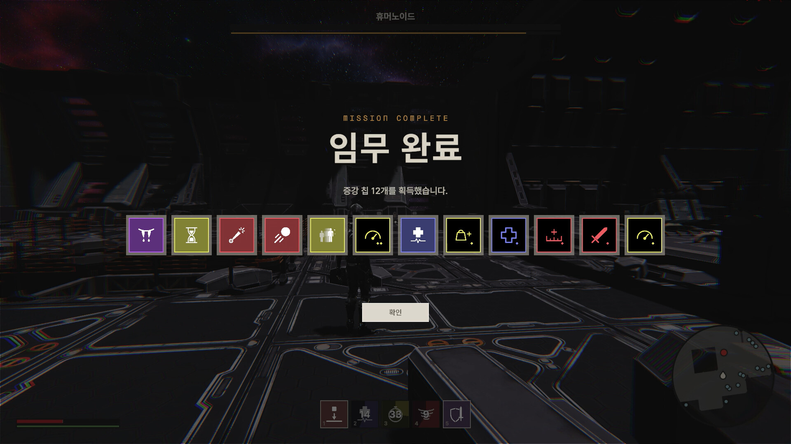

임무 데이터에는 이동할 전투 씬과 보상 ID가 있습니다.
`BossReward.tsv`는 보상 ID별로 칩 칸 수의 범위와 지급 개수를 정의합니다.

| RewardId | MinCell | MaxCell | Count |
|---|---|---|---|
| 1 | 5 | 6 | 1 |
| 1 | 3 | 4 | 2 |
| 1 | 2 | 2 | 3 |

보스 사망 상태의 완료 이벤트가 보상 지급으로 이어지고, 규칙에 맞는 칩 후보에서 중복 ID를 제외해 추첨합니다.
임무 창의 보상 안내와 실제 보상도 같은 테이블을 사용하도록 연결했습니다.
보상 확인 버튼을 누르면 해당 임무를 목록에서 제거하고 로비로 이동합니다.

#### 임무 표와 보상 표의 연결

보상을 테이블 방식으로 바꾸면서 `BossRewardDTO`(TSV 한 줄)와 `BossRewardDef`(조회용 보상 줄)를 나눴습니다.
`BossRewardTable.Load()`는 범위가 뒤집혔거나 지급 개수가 0 이하인 줄을 **지급할 때가 아니라 표를 읽을 때** 빼고, `MissionTable`은 임무의 `Reward`(RewardId)로 보상 줄을 찾아 `MissionDef.RewardRows`에 담습니다.

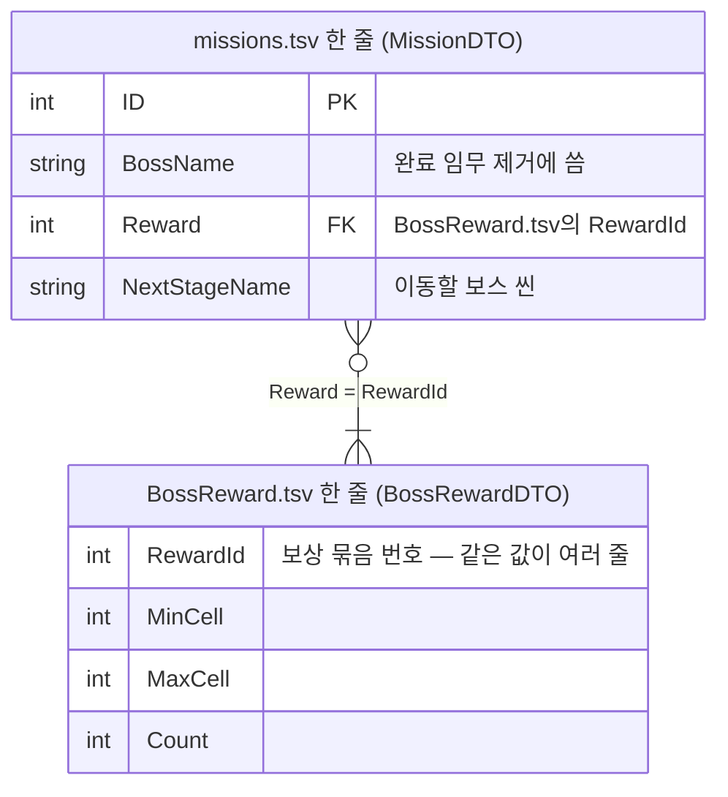

이 다이어그램은 임무 데이터의 `Reward`가 보상 표의 `RewardId`를 가리켜 보상 줄 여럿과 이어지는 임무 표와 보상 표의 연결을 도식화한 것입니다.


### 6.3 이어하기의 칩·장착 복원

저장 파일에는 칩 ID·모양 셀·장착 여부·배치 원점·회전·스킬 슬롯과 수락 임무 ID를 기록합니다.

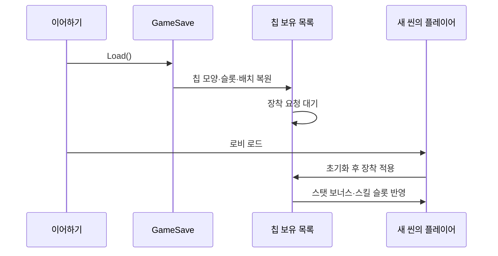

이 다이어그램은 이어하기에서 저장 파일로 칩을 복원할 때, 장착 요청을 대기 목록에 보관했다가 새 씬의 플레이어가 초기화된 뒤 스탯 보너스·스킬 슬롯에 반영하는 차례를 도식화한 것입니다.

정의 데이터와 플레이 중 보유 상태를 나눠, 저장된 ID를 테이블 기준으로 복원하고 테이블에서 사라진 항목은 건너뜁니다.
저장은 목록이 바뀔 때마다 동기 JSON으로 합니다.

환경설정 파일은 게임 진행 저장과 별개이며, 현재 영속 저장 범위는 마스터·BGM·효과음 볼륨과 각 음소거 상태, 카메라 회전 속도입니다.

소스: [AugmentationChipInventory.cs](https://github.com/keeeery/ODDITY/blob/main/Assets/Scripts/4.%20Superpower/1.%20AugmentationChip/AugmentationChipInventory.cs), [BossChipReward.cs](https://github.com/keeeery/ODDITY/blob/main/Assets/Scripts/11.%20Reward/BossChipReward.cs), [GameSave.cs](https://github.com/keeeery/ODDITY/blob/main/Assets/Scripts/12.%20Save/GameSave.cs).

---

## 7. UI/UX ① 화면 UI·조작과 씬 전환

### 7.1 개요 — UI/UX의 목표와 공통 규칙

UI/UX는 화면 위의 UI와 조작(§7), 월드 안의 전투 피드백과 비주얼 효과(§8) 두 장으로 나눕니다.
여기서 UX는 세 가지를 함께 가리킵니다.
- **조작 편의:** 플레이어가 지금 무엇을 할 수 있는지 바로 알아봅니다.
- **시인성:** 전투 중 밝은 바닥·이펙트 위에서도 정보가 읽힙니다.
- **전투 피드백과 시각 효과:** 공격이 들어갔는지, 얼마나 셌는지, 무엇이 위험한지를 화면·카메라·시간으로 전달합니다.

UI 전반에 같은 규칙 세 가지를 적용했습니다.

- **메시지·창·씬 전환 연출은 실제 시간으로 진행합니다.** 히트스톱·시간 정지·일시정지 메뉴로 게임 시간이 멈춰도 이 연출은 계속됩니다. 반대로 체력 게이지·피격 화면·조준점의 반응은 게임 시간을 따라 함께 멈춥니다.
- **HUD 크기는 1920×1080 기준입니다.** 모든 캔버스는 Scale With Screen Size(Expand)로 두고, 테두리 두께·가장자리 부드럽게 하기 같은 값은 화면 픽셀을 캔버스 단위로 바꿔 사용합니다.
- **같은 정보는 같은 생김새로 보입니다.** 키 안내는 모두 같은 키캡을 사용하고, HUD의 슬롯·게이지는 모두 같은 그림자·1px 테두리·반투명 트랙을 사용합니다.

### 7.2 조작 안내 — 조준점·키 안내·시스템 메시지

조준점·키 안내·시스템 메시지로, 지금 할 수 있는 행동과 할 수 없는 이유를 시선을 옮기지 않고 읽을 수 있게 했습니다.

#### 조준점이 지금 할 수 있는 행동을 보여 줌

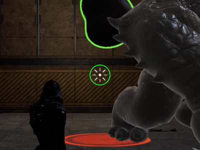

`Crosshair`는 가운데 점에 상황별 표시를 겹쳐, 화면 중앙만 보고도 지금 할 수 있는 행동을 알 수 있게 합니다.
링·짧은 선은 큰 반지름에서 투명하게 시작해 조여들며 나타나고, 색·크기·투명도는 목표값을 보간으로 따라갑니다.

<table>
<thead>
<tr><th>표시</th><th>나타나는 조건</th><th>알려 주는 것</th></tr>
</thead>
<tbody>
<tr><td>점 + 어두운 테두리</td><td>항상</td><td>밝은 바닥·벽 위에서도 보이는 기준점</td></tr>
<tr><td rowspan="2">링 (대상의 외곽선 색)</td><td>조준한 염동력 물체를 지금 들 수 있을 때</td><td>우클릭으로 들기</td></tr>
<tr><td>말을 걸 수 있는 NPC가 있을 때</td><td>F / 우클릭으로 대화</td></tr>
<tr><td>+ (상하좌우 짧은 선)</td><td>기본 공격 사거리 안에서 화면 중앙에 처음 닿는 대상이 살아 있는 적일 때</td><td>지금 기본 공격하면 적중</td></tr>
<tr><td>× (대각선 짧은 선, 짧게 퍼지며 사라짐)</td><td>기본 공격·투척·휘두르기가 실제 피해를 줬을 때</td><td>적중 확인</td></tr>
</tbody>
</table>

```csharp
// Crosshair.Update() — 조준점 링·사거리 표시 조건
PsychokinesisObject focused = PsychokinesisObject.OutlinedObject;
// 염동력 대상이 없으면 말을 걸 수 있는 NPC에도 같은 링을 띄운다 (외곽선과 같은 우선순위)
MissionNPC npc = focused == null ? MissionNPC.OutlinedNPC : null;
bool showRing = held == null && ((focused != null && focused.IsFocusAvailable) || npc != null);
bool canAttack = psychokinesis != null && psychokinesis.CanNormalAttack;
bool hasEnemy = canAttack && psychokinesis.HasAttackTarget;
```

+ 표시의 판정(`HasAttackTarget`)은 실제 기본 공격과 같은 광선·사거리를 사용하고, 여러 곳에서 읽어도 프레임마다 한 번만 Raycast하도록 결과를 보관합니다.
× 표시는 `CombatManager`의 처리 결과에서 받은 피해가 0보다 크고 보낸 쪽이 플레이어인 이벤트로만 띄웁니다.
그래서 방어·무적으로 막힌 공격에는 ×가 나타나지 않습니다.
점·링·선은 텍스처 없이 `VertexHelper`로 직접 만든 메시로 그리고, 가장자리를 화면 픽셀 단위로 부드럽게 처리합니다.

#### 같은 생김새의 키 안내

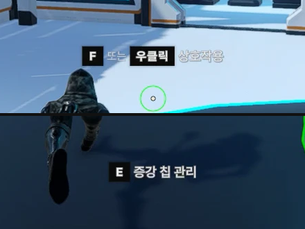

`[F] 또는 [우클릭] 상호작용`처럼 키캡과 설명을 한 줄로 늘어놓는 안내는 모두 `KeyHintBuilder`로 만들어, 같은 키캡 패널·글자색·간격을 사용합니다.
NPC 상호작용, 증강 칩 관리, 증강 칩 관리 창 조작, 조작 안내 창의 키 안내가 모두 같은 키캡을 사용합니다.

#### 시스템 메시지 — 왜 안 되는지 한 줄로 알림

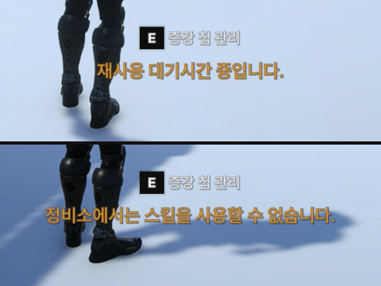

`SystemMessage`는 입력이 거절됐을 때 그 이유를 한 줄로 알려, 키가 안 눌린 것인지 조건이 안 맞은 것인지 헷갈리지 않게 합니다.

경고는 주황색과 경고 효과음으로, 퀘스트 수락·칩 획득 같은 일반 안내는 흰색으로 표시합니다.
같은 문구가 연달아 들어오면 다시 페이드 인하지 않고 살짝 튀기며 표시 시간을 처음부터 이어 줘 깜빡이지 않게 합니다.

소스: [Crosshair.cs](https://github.com/keeeery/ODDITY/blob/main/Assets/Scripts/10.%20UI/Crosshair.cs), [KeyHintBuilder.cs](https://github.com/keeeery/ODDITY/blob/main/Assets/Scripts/10.%20UI/KeyHintBuilder.cs), [SystemMessage.cs](https://github.com/keeeery/ODDITY/blob/main/Assets/Scripts/10.%20UI/SystemMessage.cs).

### 7.3 HUD 시인성 — 게이지·스킬 슬롯·미니맵·보스 정보

체력·스태미나 게이지, 스킬 슬롯, 미니맵, 보스 정보가 밝은 바닥이나 이펙트 위에서도 읽히도록 다듬었습니다.

#### 받은 피해량이 남는 게이지

체력·스태미나·보스 체력·무력화 바는 모두 `VectorBar` 하나로 그립니다.
그림자·테두리·배경 트랙·채움을 사각형 메시로 만들고, 가장자리를 화면 픽셀 단위로 부드럽게 해 어느 해상도에서도 벡터 이미지처럼 보이게 합니다.

| 기능 | 동작 | 사용하는 곳 |
|---|---|---|
| 잔상 | 값이 줄면 줄어든 구간을 잠시 남겼다가 따라 줄여 받은 피해량이 한눈에 보임 | 체력, 보스 체력·무력화 (계속 오르내리는 스태미나는 끔) |
| 차오름 | 값이 늘면 바로 채우지 않고 DOTween으로 차오름 | 회복·부활 |
| 번쩍임 | 채움이 번쩍이고 바가 좌우로 흔들림 | 플레이어가 강공격(넉다운)을 맞았을 때 |
| 덧붙임 구간 | 채움 오른쪽에 다른 색 구간을 그리며, 채움·잔상 값과 따로 움직임 | 보호막 — 체력과 보호막의 합이 최대 HP를 넘으면 기존 바를 줄이고 그 오른쪽에 보호막 구간을 붙임 |

보스 체력·무력화 바(`BossHUD`)는 씬에서 활성화된 보스를 찾아 연결해, 보스가 바뀌거나 사라져도 따라갑니다.

#### 쿨타임을 읽기 쉬운 스킬 슬롯

화면 아래 가운데의 1~5번 슬롯은 체력바와 같은 그림자·테두리·트랙으로 그린 각진 사각 슬롯입니다.
쿨타임은 남은 비율만큼 12시 방향부터 시계 방향으로 덮고, 시간이 지나며 덮개가 걷힙니다.
덮개가 사각형 모서리에서 꺾일 때 모서리 각도를 사이에 넣어 변이 곧게 유지되게 했습니다.

쿨타임 중에는 아이콘을 흐리게 하고 남은 초를 띄우며, 끝나면 슬롯이 한 번 번쩍입니다.

#### 물리 검사로 굽는 미니맵 이동 영역

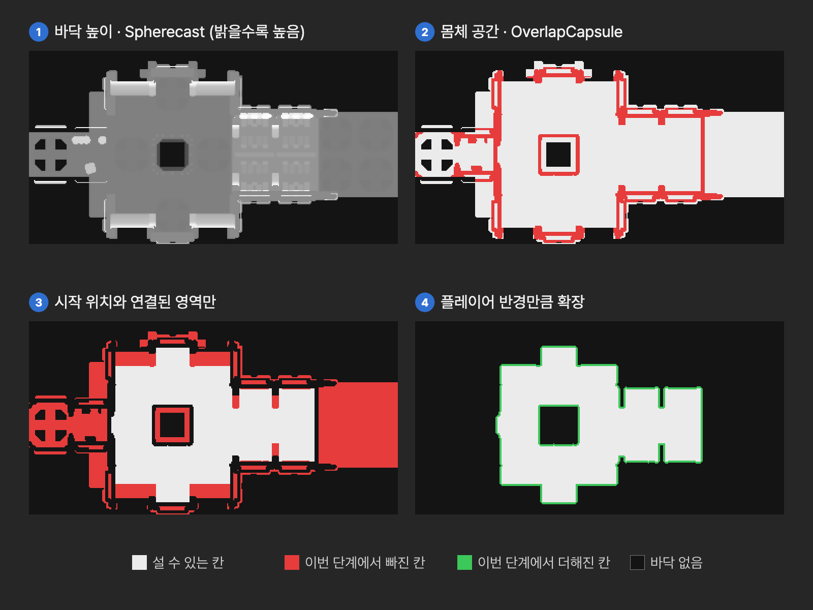

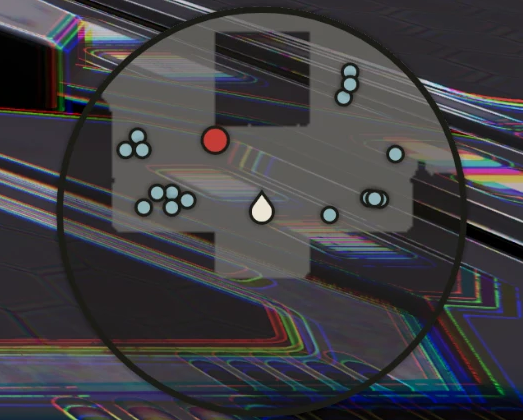

미니맵은 위에서 본 장면만 표시하지 않고, `MinimapWalkableBaker`로 플레이어가 설 수 있는 영역의 마스크를 만듭니다.

물리 검사는 `SpherecastCommand`·`OverlapCapsuleCommand` 배치 Job을 사용하고, 마스크는 씬 시작 시 한 번 굽습니다.
플레이어의 크기·머리 공간·단차를 지도에 반영합니다.
원형 지도(`Minimap`)는 카메라 Yaw에 맞춰 돌며, 메인 카메라가 `LateUpdate()`에서 회전을 마친 뒤 따라 돌도록 실행 순서를 늦췄습니다.

소스: [VectorBar.cs](https://github.com/keeeery/ODDITY/blob/main/Assets/Scripts/10.%20UI/VectorBar.cs), [SkillSlotGraphic.cs](https://github.com/keeeery/ODDITY/blob/main/Assets/Scripts/10.%20UI/SkillSlotGraphic.cs), [MinimapWalkableBaker.cs](https://github.com/keeeery/ODDITY/blob/main/Assets/Scripts/10.%20UI/MinimapWalkableBaker.cs), [BossHUD.cs](https://github.com/keeeery/ODDITY/blob/main/Assets/Scripts/10.%20UI/BossHUD.cs).

### 7.4 UI 연출 부품과 스타일 통일

창과 결과 화면의 등장 연출을 작은 부품으로 나누고, 팀원마다 달랐던 창의 생김새를 에디터 도구로 한 번에 맞췄습니다.

#### 다시 사용하는 연출 부품

창·보상창·사망 화면·결과 배너·보스 이름은 등장 연출 부품 6종(`UIPopIn`·`UILineReveal`·`UIGlitch`·`UIStaggerReveal`·`ResultBanner`·`BossIntroTitle`)을 화면마다 세기만 바꿔 조합합니다.

사망 화면은 히트스톱·슬로모션 → 채도가 빠지고 가장자리가 어두워짐 → 화면 전체와 HUD가 지직거린 뒤 HUD가 사라짐 → 화면이 가로 선으로 접혔다가 점으로 꺼짐 → 문구와 카운트다운 순서로 같은 부품을 더 강하게 사용합니다.

#### 창의 공통 규칙

| 요소 | 규칙 |
|---|---|
| 닫기 버튼<br>(`UICloseButton`) | 사각형 없이 X자 선만 보이고 주변의 투명한 영역까지 눌림<br>마우스를 올리면 X가 밝아지고 살짝 커짐<br>창마다 캔버스 배율이 달라도 화면에서 같은 크기·같은 거리로 보이도록 실행 중 크기를 맞춤 |
| 창 색 | 거의 불투명한 짙은 바탕 + 옅은 1px 외곽선 + 넓고 흐린 그림자. 안쪽 버튼은 바탕 없는 외곽선 버튼, 주 버튼만 밝게 채우고 글자를 어둡게 뒤집어 할 일이 하나로 보이게 함 |

#### 에디터 도구로 한 번에 맞춘 UI

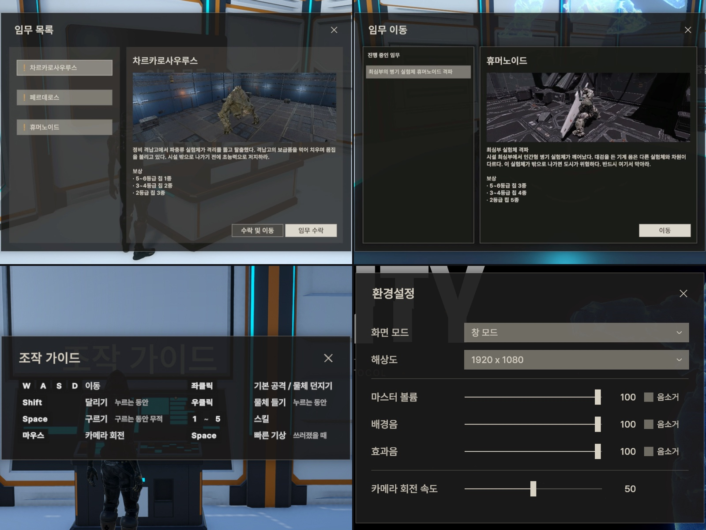

초반에 UI 규칙을 정하지 않아 팀원마다 기준 해상도(1920×1080·3840×2160)와 배율이 다른 창이 쌓였습니다.
UI가 프리팹이 아니라 여러 씬에 직접 배치되어 값도 제각각이라, 손으로 고쳤다면 씬마다 값을 하나씩 확인하느라 오래 걸렸을 것입니다.
그래서 규칙은 제가 정하고, 그 규칙을 한 번에 적용하는 아래 에디터 도구는 AI 코딩 에이전트를 활용해 만들었습니다(아래 「AI와 함께 한 과정」).
도구는 다시 실행해도 같은 결과가 되도록 이미 만든 것을 지우고 새로 만들거나, 이미 맞춰진 것은 건너뜁니다.

| 도구 | 하는 일 |
|---|---|
| `UIStyleUnifier` | Final 씬의 최상위 캔버스를 Scale With Screen Size(Expand)로, 글꼴을 Pretendard로, 단색 패널·버튼을 `VectorPanel`로 바꾸고 켜졌다 꺼지는 창에 `UIPopIn`을 붙임 |
| `HUDPrefabBuilder` | 씬마다 복사돼 있던 HUD를 프리팹으로 만들고, 씬 오브젝트 참조를 경로로 기록했다가 프리팹 인스턴스로 바꾼 뒤 다시 연결 |
| `UICanvasScaleBaker` | 배율 0.65가 걸린 임무 창의 배율을 1로 바꾸고 그만큼 안쪽 위치·크기·글자에 곱해 겉모습을 유지 |
| `WindowCloseButtonInstaller` · `WindowTitleBarUnifier` | 환경설정·임무·증강 칩 관리 창에 같은 X 버튼을 두고 제목줄을 맞춤 |

**AI와 함께 한 과정**


규칙은 제가 정했고, 팀원이 만든 창까지 바뀌는 작업이라 팀과 협의한 뒤 전체에 적용했습니다.

- **기준 스타일** — HUD 프리팹
- **해상도** — 바뀌어도 크기는 유지하고 위치만 이동
- **글꼴** — 하나로 통일
- **창** — 위의 「창의 공통 규칙」

| 단계 | AI가 한 것 | 내가 판단하고 수정한 것 |
|---|---|---|
| 범위 정하기 | 기준 해상도를 하나로 맞추려면 코드에 박힌 크기 값 100여 곳(대부분 팀원 코드)을 고쳐야 한다고 조사함 | 해상도 통일은 접고, X 버튼 크기가 창마다 다른 원인인 0.65 배율이 걸린 임무 창 세 개만 고치기로 함 |
| 첫 구현 | 도구를 만들고 "컴파일 오류 없음"이라고 보고함 | Unity 콘솔에서 오류를 찾고, AI의 컴파일 확인이 실제로는 실행되지 않았음을 확인함 |
| 적용 뒤 점검 | `UICanvasScaleBaker`로 창 배율을 1로 굽고 안쪽 값에 0.65를 곱함 | X 버튼 크기에까지 0.65가 곱해진 것을 찾아 고침 |
| HUD 프리팹 변환 | `HUDPrefabBuilder` 첫 버전으로 씬의 HUD를 프리팹으로 바꿈 | 씬에서 `DeathScreen`·`BossIntroTitle`이 빠진 것을 찾아 되돌리고, 기존 오브젝트를 그대로 프리팹 인스턴스로 바꾸도록 고침 |

소스: [UIPopIn.cs](https://github.com/keeeery/ODDITY/blob/main/Assets/Scripts/10.%20UI/UIPopIn.cs), [UIGlitch.cs](https://github.com/keeeery/ODDITY/blob/main/Assets/Scripts/10.%20UI/UIGlitch.cs), [ResultBanner.cs](https://github.com/keeeery/ODDITY/blob/main/Assets/Scripts/10.%20UI/ResultBanner.cs), [UIStyleUnifier.cs](https://github.com/keeeery/ODDITY/blob/main/Assets/Scripts/10.%20UI/Editor/UIStyleUnifier.cs), [UICanvasScaleBaker.cs](https://github.com/keeeery/ODDITY/blob/main/Assets/Scripts/10.%20UI/Editor/UICanvasScaleBaker.cs).

### 7.5 증강 칩 관리 창의 조작 편의

증강 칩 관리 창의 배치·인벤토리는 팀 구현이며(§6.1), 여기에 칩을 찾고 확인하고 정리하는 조작을 더했습니다.
칩에 마우스를 올리면 이름·등급·장착 상태와 실제 모양을 툴팁으로 보여 주고, 스킬 슬롯이 가득 차 장착하지 못하면 시스템 메시지로 알립니다.

소스: [TooltipView.cs](https://github.com/keeeery/ODDITY/blob/main/Assets/Scripts/10.%20UI/TooltipView.cs), [TooltipTrigger.cs](https://github.com/keeeery/ODDITY/blob/main/Assets/Scripts/10.%20UI/TooltipTrigger.cs), [ChipTooltip.cs](https://github.com/keeeery/ODDITY/blob/main/Assets/Scripts/10.%20UI/ChipTooltip.cs), [ChipShapeGraphic.cs](https://github.com/keeeery/ODDITY/blob/main/Assets/Scripts/10.%20UI/ChipShapeGraphic.cs), [ChipShapeBorder.cs](https://github.com/keeeery/ODDITY/blob/main/Assets/Scripts/10.%20UI/ChipShapeBorder.cs), [AugmentationChipPanel.cs](https://github.com/keeeery/ODDITY/blob/main/Assets/Scripts/4.%20Superpower/1.%20AugmentationChip/UI/AugmentationChipPanel.cs).

#### 초성으로도 찾는 칩 이름 검색

1차 시연에서 "필터가 있어도 원하는 칩을 찾기 어렵다"는 피드백을 받아(§10.2), 보유 칩 트레이에 이름 검색 칸과 자동 완성 목록을 추가했습니다.
`KoreanSearch`는 음절을 초성·중성·종성으로 나누어, 조합 중인 마지막 글자가 이름의 글자로 "가는 중"이면 맞는 것으로 봅니다.

| 검색어 | 찾는 이름(예) | 판정 근거 |
|---|---|---|
| `ㅅㄱ` | 시간 정지, 시간 역행, 시간 감속, 순간 이동 | 초성만 친 글자는 이름 글자의 초성과 비교 |
| `수` | 순간 이동 | 받침을 아직 치지 않음 |
| `호` | 회복, 보호막 | 겹모음(ㅚ)의 앞모음(ㅗ)까지만 침 |
| `상` | 사이(예시 단어, 칩 이름 아님) | 다음 글자의 초성(ㅇ)이 잠깐 받침으로 붙음 |

한글을 치는 동안에도 물리 키는 그대로 눌려 `ㄷ`은 E(증강 칩 관리 창 닫기), `ㄹ`은 F(NPC 상호작용)로 함께 실행되므로, 단축키 쪽이 `TextInputFocus.IsTyping`을 먼저 확인하게 했습니다.
같은 피드백으로 **전체 해제** 버튼과 유형 필터 글자 뒤의 칩 색 음영도 더했습니다(§10.2).

소스: [KoreanSearch.cs](https://github.com/keeeery/ODDITY/blob/main/Assets/Scripts/10.%20UI/KoreanSearch.cs), [ChipSearchField.cs](https://github.com/keeeery/ODDITY/blob/main/Assets/Scripts/4.%20Superpower/1.%20AugmentationChip/UI/ChipSearchField.cs), [TextInputFocus.cs](https://github.com/keeeery/ODDITY/blob/main/Assets/Scripts/10.%20UI/TextInputFocus.cs), [AugmentationChipPanel.cs](https://github.com/keeeery/ODDITY/blob/main/Assets/Scripts/4.%20Superpower/1.%20AugmentationChip/UI/AugmentationChipPanel.cs).

### 7.6 씬 전환 — 화면·UI·소리를 함께 끄고 켜기


새 게임·이어하기, 보상·사망 후 로비 복귀는 모두 `SceneLoadManager`를 거쳐 화면이 꺼졌다 켜집니다.

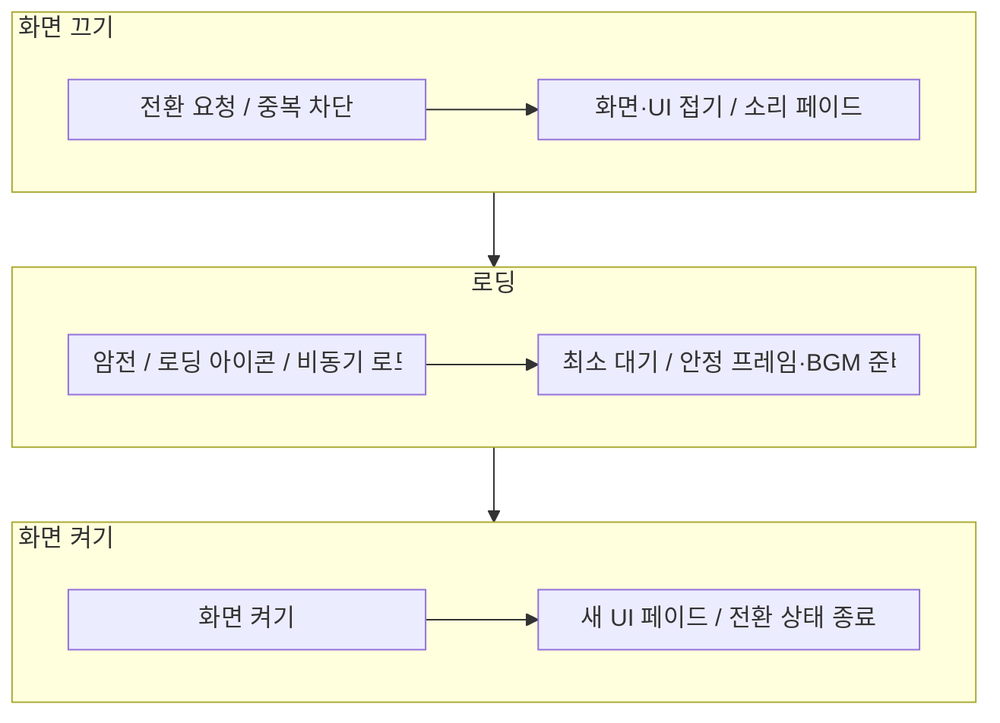

이 다이어그램은 씬 전환 요청부터 화면·UI를 접고 소리를 줄인 뒤, 비동기 로드와 안정 대기를 거쳐 화면과 새 UI를 켜는 순서를 도식화한 것입니다.

Screen Space Overlay UI는 월드의 화면 꺼짐 효과로 숨겨지지 않아, Canvas 자식을 화면 효과와 함께 압축하고 검은 띠로 바깥을 덮습니다.
새 씬은 로드가 끝나도 바로 켜지 않고, 최소 암전 0.2초, 0.05초 이하 프레임 5회 연속, BGM 준비를 확인한 뒤 켭니다(최대 2.5초).
초기 Start 처리·셰이더 준비로 생긴 긴 프레임이 켜지는 연출을 건너뛰지 않게 하기 위해서입니다.

소스: [SceneLoadManager.cs](https://github.com/keeeery/ODDITY/blob/main/Assets/Scripts/7.%20Arena/SceneLoadManager.cs), [ScreenOffEffect.cs](https://github.com/keeeery/ODDITY/blob/main/Assets/Scripts/10.%20UI/ScreenOffEffect.cs).

### 7.7 고민과 선택

**팀원마다 다른 UI를 어떻게 맞출까 — 규칙을 정하고 에디터 도구로 한 번에**

| 방법 | 장점 | 비용 |
|---|---|---|
| 씬마다 손으로 고치기 | 도구를 만들 필요가 없음 | 씬마다 값을 하나씩 확인해야 해 오래 걸리고, 다시 어긋나기 쉬움 |
| 모든 UI의 기준 해상도를 하나로 바꾸기 | 근본적으로 한 기준이 됨 | 코드에 박힌 크기 값 100여 곳(대부분 팀원 코드)을 함께 고쳐야 함 |
| 규칙을 정하고 에디터 도구로 한 번에 적용 (채택) | 팀원이 만든 창도 같은 생김새가 되고, 다시 실행해도 같은 결과 | 도구가 오브젝트 이름·경로에 의존해, 창 구조가 바뀌면 도구도 고쳐야 함 |

상황·범위를 좁힌 과정과 적용 뒤 점검은 §7.4에서 설명합니다.

**다시 고른다면** UI의 기준 해상도와 앵커 규칙, 프리팹의 계층 구조를 먼저 정하겠습니다. 기능을 만들면 UI 요소가 따라오기 때문입니다.

---

## 8. UI/UX ② 전투 피드백과 비주얼 효과

### 8.1 개요 — 전투 피드백의 갈래와 셰이더 구성

맞혔는지·맞았는지·얼마나 셌는지, 보스가 지금 어떤 상태인지, 공격이 언제 들어오는지를 HUD 숫자만이 아니라 화면 가장자리·카메라·시간 배율·보스의 몸과 주변 효과로 보여 줍니다.
전투가 흘러가는 순서대로, 보스 등장 → 공격 예고 → 플레이어 피격과 기상 → 보스가 받은 피해와 쓰러짐 순서로 설명합니다.

§7.1의 규칙대로 메시지·창·씬 전환 연출은 실제 시간으로 진행해 히트스톱 중에도 보입니다.
공격 예고·발밑 흙먼지·포효 음파·기절 효과처럼 보스에 붙은 연출은 보스의 시계를 따르고, 마무리 일격의 충격과 사망 홀로그램처럼 슬로모션에 맞춰 느려져야 하는 연출은 게임 시간으로 진행합니다.

#### 셰이더 한눈에 보기

연출에 사용한 셰이더는 여러 장에 나뉘어 있어 한곳에 모았습니다.

<table>
<thead>
<tr><th>셰이더</th><th>사용하는 연출</th><th>핵심 기법</th><th>본문</th></tr>
</thead>
<tbody>
<tr><td><code>TimeFreezeHologram</code></td><td>시간 정지 막</td><td>도입한 홀로그램 셰이더에 높이 마스크와 정지 순간 정점 글리치를 더함</td><td>§4.3</td></tr>
<tr><td><code>PsychokinesisOutline</code></td><td>염동력 대상·NPC 외곽선</td><td>4× MSAA 마스크의 커버리지로 경계 거리를 근사해 계단 없는 외곽선</td><td rowspan="2">§8.6</td></tr>
<tr><td><code>BossOcclusionOutline</code></td><td>가려진 플레이어 외곽선, 가려진 보스 실루엣</td><td>보스 전용 깊이와 장면 깊이를 비교, 거리 간격·페이드로 깜빡임을 줄임</td></tr>
<tr><td><code>BossTelegraph</code></td><td>보스 공격 범위 예고</td><td>깊이로 표면 위치를 되살리는 화면 공간 데칼, 거리 함수 도형, 차오르는 진행도</td><td rowspan="2">§8.3</td></tr>
<tr><td><code>TelegraphMask</code></td><td>예고가 몸·소품에 묻지 않게</td><td>바닥 외 물체에 스텐실 비트(128)를 표시, 색·깊이는 그대로</td></tr>
<tr><td><code>HitFlash</code></td><td>보스 피격 번쩍임</td><td>대상 메시 위에 가산 림을 덧그림, 대상별 세기</td><td>§8.6</td></tr>
<tr><td><code>ScreenGlitch</code></td><td>사망·씬 전환의 화면 꺼짐</td><td>후처리 뒤 화면을 접어 점으로 줄임, 가로 띠 밀림·RGB 분리</td><td>§8.7</td></tr>
<tr><td><code>HitImpact</code></td><td>보스 피격 섬광</td><td>시드별 빛줄기·중심 섬광·베기 형태를 절차적으로 합성</td><td rowspan="4">§8.5</td></tr>
<tr><td><code>HitDebris</code></td><td>보스가 강하게 맞을 때의 빛 입자</td><td>늘어난 빌보드 안의 빛줄기, 미리 곱한 알파로 밝은 배경에서도 보임</td></tr>
<tr><td><code>ForceRipple</code></td><td>염동파 고리, 보스 포효 음파</td><td>불투명 텍스처를 UV 오프셋으로 굴절시키는 고리와 볼록 렌즈</td></tr>
<tr><td><code>GroundDust</code></td><td>흙먼지·바닥 충격파</td><td>입자별 난수와 수명, 노이즈 침식, 빛 방향 밀도 차이로 입체감</td></tr>
<tr><td><code>TriplanarRock</code></td><td>UV 없는 생성 파편</td><td>오브젝트 공간 트라이플래너, URP Lit과 같은 조명</td><td>§8.7</td></tr>
</tbody>
</table>

보스 사망과 휴머노이드 순간이동의 홀로그램은 도입한 홀로그램 셰이더의 머티리얼을 그대로 사용하고, 지금 자세를 굽는 처리와 진행을 코드로 맡습니다(§8.5).

### 8.2 타이틀·보스 등장 연출

 


타이틀에서는 날아온 물체를 보스가 받아치는 시네마틱 뒤에 홀로그램과 메뉴가 나타나고, 보스전은 대표 패턴 하나를 보여 주며 이름을 띄우는 등장 연출로 시작합니다.
보스 등장 카메라는 보스 메시를 지금 자세로 구워 거리를 계산하므로, 크기가 다른 보스도 비슷한 구도로 잡힙니다.

소스: [TitleCinematicDirector.cs](https://github.com/keeeery/ODDITY/blob/main/Assets/Scripts/10.%20UI/Title/TitleCinematicDirector.cs), [TitleHologramPulse.cs](https://github.com/keeeery/ODDITY/blob/main/Assets/Scripts/10.%20UI/Title/TitleHologramPulse.cs), [BossIntroCinematic.cs](https://github.com/keeeery/ODDITY/blob/main/Assets/Scripts/6.%20Boss/BossIntroCinematic.cs), [BossIntroTitle.cs](https://github.com/keeeery/ODDITY/blob/main/Assets/Scripts/10.%20UI/BossIntroTitle.cs).

### 8.3 공격 예고 — 범위·박자·바닥에 붙는 표시


공격 예고는 범위만이 아니라 **언제 맞는지**도 보여 줍니다.
`AttackTelegraph`는 바닥에 범위 외곽선을 그린 뒤 안쪽을 정해진 시간 동안 차오르게 하고, 공격이 들어가는 순간 가득 채운 뒤 사라집니다.
원·부채꼴은 중심에서 바깥으로, 사각형은 시작점에서 끝으로 차오릅니다.

| 메서드 | 역할 |
|---|---|
| `Show()` | 외곽선과 함께 안쪽이 경고 시간 동안 차오름. 실제 판정 시점은 패턴의 공격 신호가 정함 |
| `Resolve()` | 공격이 들어가는 순간 안쪽을 가득 채운 뒤 사라지며 풀로 돌아감 |
| `Restart()` | 색·위치는 그대로 두고 처음부터 다시 차오름. 한 표시로 여러 번 때리는 콤보에서 다음 타격까지의 박자를 보여 줌 |

패턴이 끊기면 `Cancel()`, 대상을 따라가는 예고는 `SetPlacement()`, 공격 신호 없이 시간으로 끝나는 낙하물·투척 예고는 `ResolveWhenFilled()`로 마무리합니다.
`Show()`에 보스나 물체의 시계를 넘기면 그 시계가 멈춘 동안 차오름과 사라짐도 멈춥니다.
시간 정지로 보스를 멈춰 두면 예고도 그 진행도에서 멈춰, 정지가 풀린 뒤 남은 시간을 그대로 읽을 수 있습니다.

#### 바닥에만 붙는 표시 — 화면 공간 데칼과 스텐실 마스크

표시는 `BossTelegraph.shader`로 그리는 화면 공간 데칼로, 바닥 높이 근처를 덮는 상자 하나 안에서만 그립니다.
장면 깊이로 픽셀의 월드 위치를, 화면 미분으로 표면 방향을 구해 상자 안에서 위를 향한 면에만 모양을 그립니다.
그래서 단차 위에도 틈 없이 붙고, 벽 옆면·구멍 아래에는 그리지 않습니다.
모양은 원·부채꼴·상자의 거리 함수로 만들고, `fwidth`로 경계를 완화합니다.

예고가 몸에 묻지 않게 하는 처리는 대상마다 다릅니다.

- **플레이어:** 발바닥 위 원기둥 영역은 그리지 않되 발바닥과 같은 높이의 바닥은 남겨, 몸에는 묻지 않으면서 발밑의 예고는 보이게 합니다.
- **보스 몸체·소품:** `TelegraphMaskFeature`가 불투명 렌더 뒤 Ground 외 물체와 등록한 렌더러에 스텐실 비트 128을 기록해(색·깊이는 그대로), 예고가 그 위에 묻지 않게 합니다.

표시와 판정이 같은 `TelegraphShape`를 사용하는 구조는 §5.3에서 설명합니다.


소스: [AttackTelegraph.cs](https://github.com/keeeery/ODDITY/blob/main/Assets/Scripts/6.%20Boss/2.%20Telegraph/AttackTelegraph.cs), [BossTelegraph.shader](https://github.com/keeeery/ODDITY/blob/main/Assets/Shaders/BossTelegraph.shader).

### 8.4 플레이어 전투 피드백 — 피격 강도와 빠른 기상

플레이어가 맞았을 때는 피격 강도에 따라 연출의 겹을 늘립니다.

| 피격 | 화면 가장자리 | 체력바 | 카메라 | 히트스톱 |
|---|---|---|---|---|
| 일반·넉백 | 붉게 번쩍 → 유지 → 서서히 사라짐 | 잔상 | — | 없음 |
| 넉다운 | 더 진하게 | 번쩍이며 좌우로 흔들림 | trauma 흔들림 | 짧게(0.06초) |
| 저체력(30% 미만) | 맥박처럼 깜빡이며, 낮을수록 진해짐 | — | — | — |
| 회복 스킬 | 같은 모양을 초록색으로 한 번 | 차오름 | — | — |

`DamageVignette`는 텍스처 없이 화면 사각형을 조금씩 줄인 둥근 사각형 고리 16겹을 이어 그려, 화면 끝은 진하고 안쪽은 투명한 그라데이션을 만듭니다.
더 강한 연출이 재생 중이면 약한 연출이 덮어쓰지 않습니다.
회복의 초록은 피격 색처럼 어둡게 눌러 원색 느낌을 뺐고, 회복 스킬은 별도 이펙트 없이 이 초록 비네트로만 보여 줍니다.

#### trauma 기반 카메라 흔들림


카메라 흔들림은 충격량(trauma, 0~1)을 쌓고 그 **제곱**으로 세기를 정합니다.
약한 충격은 아주 작게, 강한 충격은 확실하게 흔들리고, 여러 충격이 겹치면 더해지되 1을 넘지 않습니다.
위치·회전 흔들림은 축마다 다른 Perlin 노이즈를 사용하고, 노이즈 시간은 실제 시간으로 진행해 히트스톱 중에도 흔들림이 이어집니다.
플레이어 피격, 보스 피격 구간, 보스 그로기·사망이 모두 같은 `AddTrauma(양, 사라지는 시간)`를 부릅니다.

```csharp
// CameraController.AddTrauma() — 충격을 trauma로 쌓고 사라지는 속도 설정
public void AddTrauma(float amount, float fadeTime = 0f)
{
    trauma = Mathf.Clamp01(trauma + amount);
    currentDecay = fadeTime > 0f ? trauma / fadeTime : traumaDecay;
}
// CameraController.UpdateTrauma() — 일부: 세기는 trauma², 노이즈 시간은 실제 시간으로 진행
float power = trauma * trauma;
noiseTime += Time.unscaledDeltaTime * shakeFrequency;
```

#### 밀려나는 거리와 빠른 기상

 

보스의 공격 판정마다 피해·반응(넉백·넉다운)과 함께 밀려나는 거리·높이·시간·방향(`HitPush`)을 정합니다.
넉다운은 구간 가운데에서 가장 높은 포물선으로 띄우고, 거리와 높이가 모두 0이면 밀지 않고 피격 모션만 재생합니다.
피격 반응 중 다시 맞으면 피해만 받고 반응은 새로 시작하지 않습니다.

넉다운 뒤에는 기상 가능 시점(애니메이션의 WakeUp 신호)부터 Space로 바로 일어날 수 있습니다.
쿨타임 중에 누르면 "빠른 기상 재사용 대기시간 중입니다."를 띄우고, 남은 쿨타임은 기상기 슬롯에 표시합니다.
무적은 기상 시작부터 정해진 시간 동안 유지되며, 기상 모션이 먼저 끝나면 무적인 채로 행동할 수 있습니다.
빠른 기상(쓰러진 동안 Space로 일어나기·쿨타임·기상 무적) 위에 쿨타임 안내 문구와 기상기 슬롯 표시, 무적 시점 조정, 밀려나는 거리(`HitPush`)를 더했습니다.

소스: [DamageVignette.cs](https://github.com/keeeery/ODDITY/blob/main/Assets/Scripts/10.%20UI/DamageVignette.cs), [PlayerHUD.cs](https://github.com/keeeery/ODDITY/blob/main/Assets/Scripts/10.%20UI/PlayerHUD.cs), [CameraController.cs](https://github.com/keeeery/ODDITY/blob/main/Assets/Scripts/2.%20Camera/CameraController.cs), [HitPush.cs](https://github.com/keeeery/ODDITY/blob/main/Assets/Scripts/5.%20Combat/HitPush.cs), [PlayerController.cs](https://github.com/keeeery/ODDITY/blob/main/Assets/Scripts/1.%20Player/PlayerController.cs).

### 8.5 보스 전투 피드백 — 피해 구간과 몸으로 보여 주는 상태

보스가 맞을 때 피해 크기에 따라 연출의 겹을 늘리고, 무력화·기절 같은 상태를 보스의 자세와 주변 효과로도 보여 줍니다.

#### 받은 피해를 공격자 공격력과 비교한 세 구간

  

`BossHitFeedback`은 보스가 맞을 때마다 피해 크기를 약·중·강 세 구간으로 나누고, 구간이 높을수록 연출의 겹을 늘립니다.

| 구간 | 기준 (기본값) | 연출 |
|---|---|---|
| 약 | 공격자 공격력의 2.5배 미만 | 윤곽 번쩍임, 충격 빌보드·점광원·입자, 약한 피격음 |
| 중 | 2.5배 이상 | 더 큰 충격과 입자, 짧은 히트스톱, 카메라 흔들림 |
| 강 | 6배 이상 또는 넉다운 반응 | 가장 큰 충격·밝은 점광원·긴 히트스톱·센 흔들림, 카메라 FOV 줌 펀치 |

구간은 받은 피해를 고정 수치가 아니라 **공격자의 현재 공격력**과 비교해 정합니다.
모든 피해가 공격력을 바탕으로 계산되므로, 칩·패시브로 공격력이 바뀌거나 보스가 달라져도 같은 종류의 공격은 같은 구간에 들어갑니다.
약한 피격은 기본 공격처럼 자주 들어오므로 히트스톱을 걸지 않아 조작 흐름을 끊지 않습니다.

```csharp
// BossHitFeedback.GetTier() — 받은 피해를 공격력 배율과 비교해 피격 단계 결정
if (damageEvent.Info.Reaction == HitReaction.Knockdown) return HitTier.Strong;
int atk = damageEvent.Sender is CombatEntity attacker && attacker != null ? attacker.CurrentStats.Atk : 0;
if (atk <= 0) atk = fallbackAtk;
if (receivedDamage >= atk * strongHitAtkScale) return HitTier.Strong;
if (receivedDamage >= atk * mediumHitAtkScale) return HitTier.Medium;
return HitTier.Weak;
```

루트 캡슐 기준으로 맞은 지점은 허공일 수 있어, 카메라에서 몸 중심을 바라봤을 때 처음 닿는 부위 표면으로 옮겨 터뜨립니다(§5.4 몸체 기준 피격 지점).
강한 피격의 빛 입자는 `HitDebris.shader`로 끝이 둥글게 흐려지는 빛줄기처럼 그리고, 미리 곱한 알파로 배경을 눌러 밝은 곳에서도 보이게 합니다.

#### 무력화·기절을 자세로 보여 줌

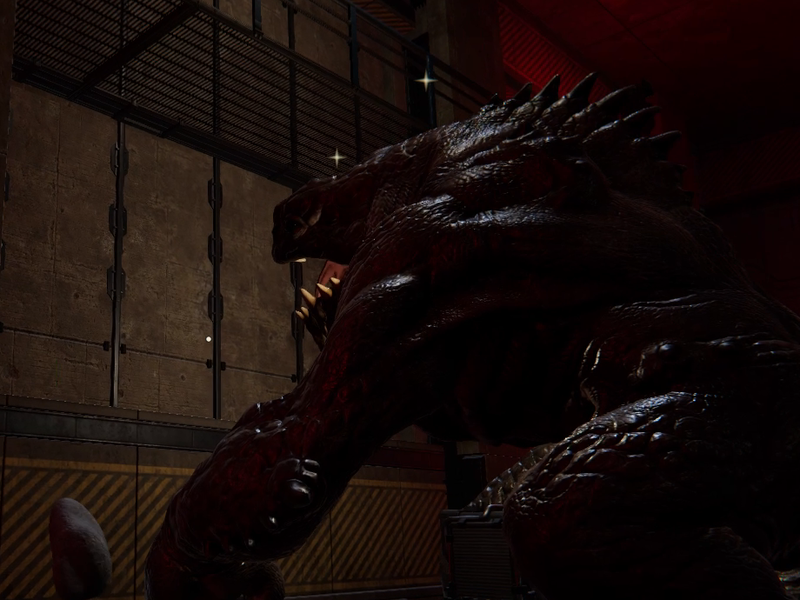 

보스가 어떤 상태인지를 HUD 숫자만이 아니라 몸의 움직임으로도 읽을 수 있게 했습니다.
`BossDizzy`는 애니메이션 위에 척추·목·머리 뼈를 덧흔드는 두 겹을 제공합니다.

| 겹 | 표현 | 사용하는 곳 | 함께 나오는 연출 |
|---|---|---|---|
| Sway | 원을 그리며 기울고 고개를 느리게 좌우로 돌림, 머리를 부딪혀 멍한 느낌 | 돌진 중 벽 충돌 기절 | 머리 위를 맴도는 반짝이(`BossDizzyStars`) |
| Slump | 고개·등이 아래로 처지고 거친 숨에 맞춰 들썩이며 잘게 떨림 | 무력화 그로기 | 숨의 가장 깊은 순간마다 입에서 뿜는 콧김(`BossDizzyBreath`) |

- 각 겹은 사용하는 쪽이 `Begin()`/`End()`를 짝지어 부르면 가중치가 서서히 오르내리고, 횟수로 세므로 겹쳐 걸어도 안전합니다.
- 모든 흔들림·반짝이·숨은 보스의 시계(`TimeFreezable`)를 따라 시간 정지 중에는 그 자세로 멈춥니다.

그로기(`BossGroggyState`)는 전용 클립이 없어 Death 클립의 구간을 네 단계로 나눠 재생하고, 단차가 있는 휴머노이드 보스 맵에서는 누운 몸이 단차에 파묻히지 않게 `BossLyingGroundFit`으로 높이를 맞춥니다.

#### 포효 음파와 발밑 흙먼지

 

몸집이 큰 보스의 무게와 공격 범위를 주변 효과로도 보여 줍니다.

| 연출 | 동작 |
|---|---|
| `BossRoarWave` | 포효 순간 발밑에서 수평으로 퍼지는 화면 굴절 고리를 시간차로 여러 겹 터뜨려 밀어내는 범위를 보여 주고, 머리에서 카메라 쪽으로 퍼지는 고리와 바닥 흙먼지를 더함 |
| `BossFootDust` | 점프·홉 착지 순간 두 발에서 고리 먼지·바닥 충격파·흙 파편·늦게 피어오르는 큰 먼지, 돌진 중에는 달린 거리마다 발을 번갈아 뒤로 차올림 |

보스는 `FixedUpdate()`에서 움직여 프레임마다 이동량이 들쭉날쭉하므로, 돌진 먼지는 속도 대신 달린 거리로 간격을 셉니다.

#### 마무리 일격과 사망 연출


보스의 숨을 끊는 순간은 한 번뿐인 장면이라 가장 긴 연출을 붙였습니다.
세 피해 구간과 별개로, 숨을 끊는 피격에는 가장 큰 충격과 많은 입자를 터뜨리고 이 충격만 슬로모션 배율에 맞춰 게임 시간으로 느리게 퍼뜨립니다.

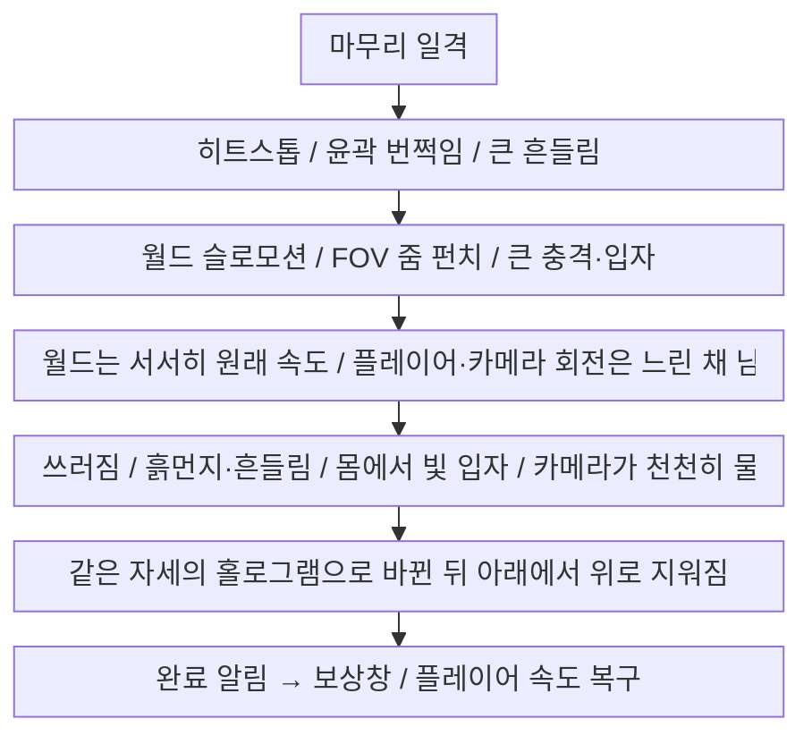

이 다이어그램은 마무리 일격의 히트스톱·슬로모션부터 쓰러짐과 홀로그램 소멸, 보상창이 열리기까지의 연출 순서를 도식화한 것입니다.

**월드가 원래 속도로 돌아온 뒤에도 플레이어·카메라 회전은 느린 채 남고, 보상창은 홀로그램 소멸이 끝난 뒤에 열립니다.**

`SlowMotion`은 `HitStop.BaseTimeScale`을 바꿔 히트스톱과 겹쳐도 서로 덮어쓰지 않고, 물리가 끊겨 보이지 않도록 `fixedDeltaTime`도 배율에 맞춰 줄였다가 되돌립니다.
`BossDeathShed`는 SkinnedMesh의 지금 자세를 메시로 구워 도입한 홀로그램 셰이더의 머티리얼로 같은 자리에 그립니다.
홀로그램이 다 나타나면 원본을 끄고 몸 콜라이더를 트리거로 바꿔, 보이지 않는 몸에 플레이어가 막히지 않으면서 사망 잔재 입자(`BossDeathResidue`)는 부위 표면에서 계속 나오게 합니다.
같은 홀로그램 굽기는 공용 클래스(`HologramShell`)로 분리해 휴머노이드의 순간이동 연출(`HumanoidHologramWarp`)에서도 재사용합니다.

소스: [BossHitFeedback.cs](https://github.com/keeeery/ODDITY/blob/main/Assets/Scripts/6.%20Boss/BossHitFeedback.cs), [BossDizzy.cs](https://github.com/keeeery/ODDITY/blob/main/Assets/Scripts/6.%20Boss/BossDizzy.cs), [BossGroggyState.cs](https://github.com/keeeery/ODDITY/blob/main/Assets/Scripts/6.%20Boss/1.%20States/BossGroggyState.cs), [SlowMotion.cs](https://github.com/keeeery/ODDITY/blob/main/Assets/Scripts/5.%20Combat/SlowMotion.cs), [HologramShell.cs](https://github.com/keeeery/ODDITY/blob/main/Assets/Scripts/6.%20Boss/HologramShell.cs).

### 8.6 외곽선과 가림 — 안 보이는 대상을 드러내기

염동력 대상과 NPC 외곽선은 URP RendererFeature로 실루엣 마스크를 만든 뒤 합성합니다.
MSAA 마스크로 가장자리 표현을 보완합니다.

#### 외곽선을 그리는 단계

| RendererFeature | 별도 처리 |
|---|---|
| `PsychokinesisOutlineFeature` | 후처리 전에 4× MSAA 실루엣을 만들고 해석된 마스크를 화면 외곽선으로 합성 |
| `BossOcclusionOutlineFeature` | 보스 깊이와 플레이어 실루엣을 따로 준비해 보스에 가려진 플레이어의 외곽선, 다른 물체에 가려진 보스의 반투명 실루엣을 합성 |
| `HitFlashFeature` | 투명 렌더 뒤 활성 피격 대상의 서브메시를 덧그리고 대상별 강도를 전달 |

소스: [PsychokinesisOutlineFeature.cs](https://github.com/keeeery/ODDITY/blob/main/Assets/Scripts/3.%20Psychokinesis/PsychokinesisOutlineFeature.cs), [PsychokinesisOutline.shader](https://github.com/keeeery/ODDITY/blob/main/Assets/Shaders/PsychokinesisOutline.shader), [HitFlash.shader](https://github.com/keeeery/ODDITY/blob/main/Assets/Shaders/HitFlash.shader).

#### 서로 가리는 보스와 플레이어 — 가려진 쪽을 드러내는 두 가지 표현

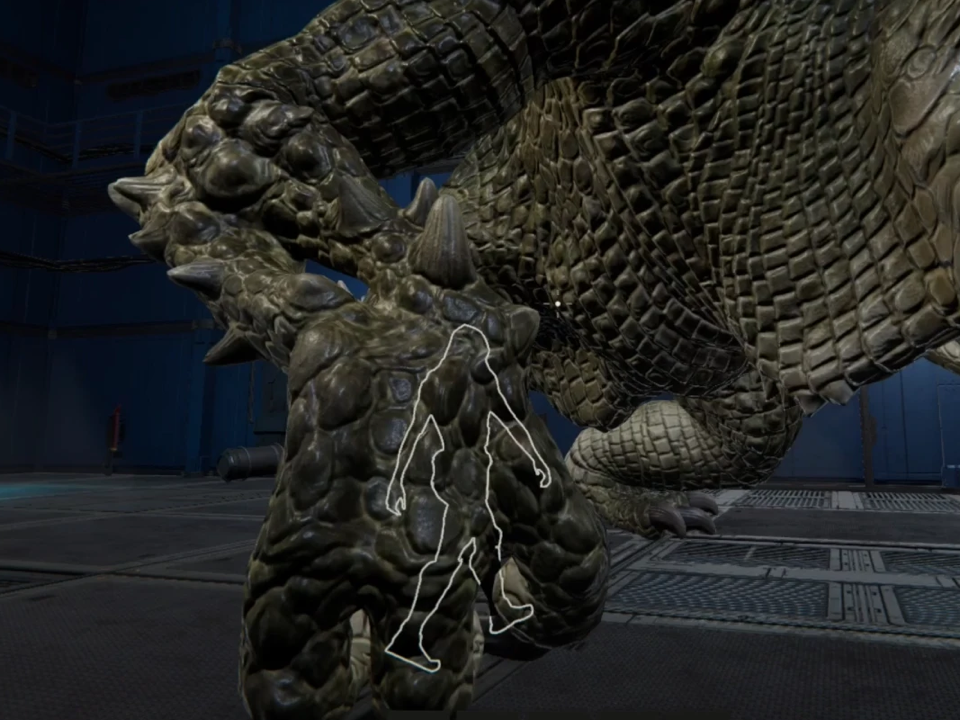 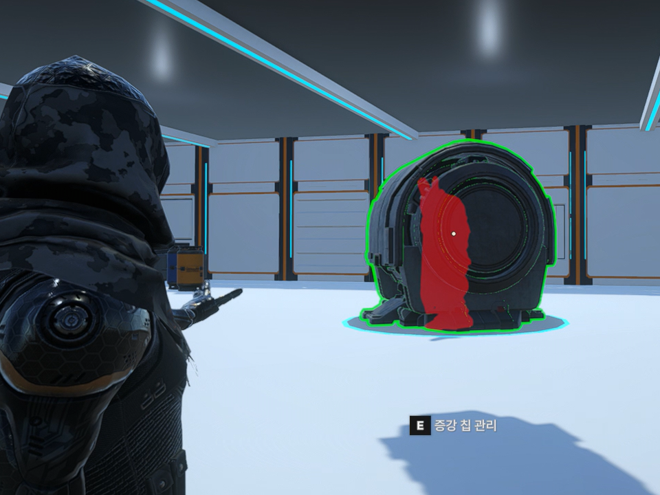

큰 보스와 싸우면 두 가지 가림이 생깁니다.
보스가 플레이어를 가리면 내 캐릭터의 위치를 놓치고, 염동력으로 들고 있는 물체나 기둥·잔해가 보스를 가리면 보스의 자세와 공격 준비를 읽지 못합니다.
1차 시연에서 가장 많이 받은 피드백도 들고 있는 물체가 보스를 가린다는 것이었습니다(§10.2).
처음에는 보스에 가려진 플레이어의 외곽선만 그렸고, 이후 같은 RendererFeature에 **다른 물체에 가려진 보스 부분을 반투명 실루엣으로 채우는 패스**를 추가했습니다.

| 상황 | 표시 | 그리는 조건 |
|---|---|---|
| 보스가 플레이어를 가림 | 가려진 부분에만 플레이어 외곽선 | 보스·플레이어의 화면 사각형이 겹칠 때만 플레이어 마스크를 만듦 |
| 다른 물체가 보스를 가림 | 가려진 보스 부분을 채우기 색으로 덮음 | 살아 있는 보스가 화면 안에 있고, 보스 실루엣의 20% 이상이 가려졌을 때(14% 아래로 내려가면 끔). 바닥과 가장 긴 변이 1.5m보다 짧은 작은 파편은 가림으로 치지 않음 |

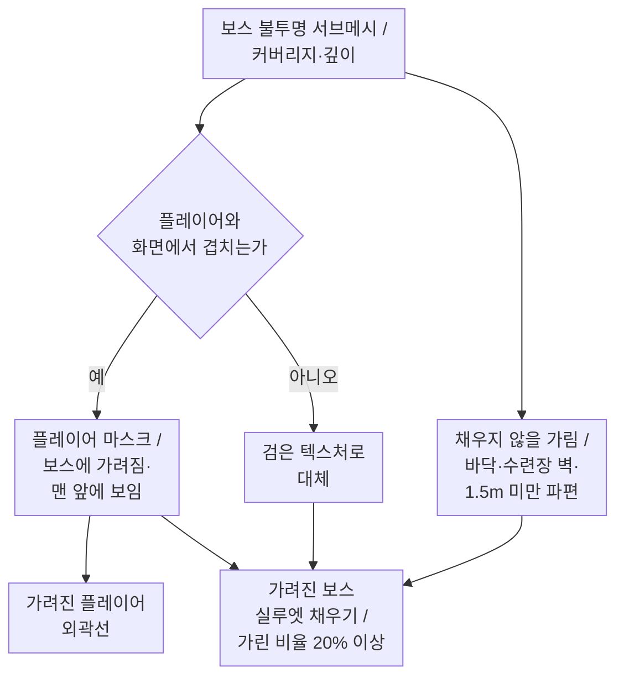

이 다이어그램은 보스 마스크와 플레이어 마스크, 채우지 않을 가림(바닥·수련장 벽의 깊이와 작은 파편 마스크)을 조합해 가려진 플레이어 외곽선과 가려진 보스 실루엣을 그리는 패스 구성을 도식화한 것입니다.

**보스와 플레이어가 화면에서 겹칠 때만 플레이어 마스크를 만들고, 바닥·수련장 벽·작은 파편에 가린 부분은 실루엣 채우기에서 뺍니다.**

채우기 패스는 보스 전용 깊이 텍스처와 카메라 깊이를 비교합니다.
보스 앞면보다 다른 물체가 `_FillMinGap`(기본 0.3m) 이상 앞에 있을 때부터 0.4m에 걸쳐 진해지게 해,
땅에 살짝 묻힌 발처럼 맞닿은 부분이 깜빡이며 칠해지는 현상을 줄였습니다.

```hlsl
// BossOcclusionOutline.shader — FillAmount(): 보스 실루엣을 채울 양(0~1)을 구하는 부분
half hidden = saturate((bossDepth - sceneDepth - _FillMinGap) / FILL_FADE_DISTANCE);
half player = SAMPLE_TEXTURE2D_X(_BossOcclusionPlayerMask, sampler_PointClamp, uv).b;
half debris = SAMPLE_TEXTURE2D_X(_BossOcclusionDebrisMask, sampler_PointClamp, uv).b;
return boss.r * hidden * (1.0 - player) * (1.0 - debris) * (1.0 - behindIgnored);

// Screen Fill 패스 — 구한 양만큼 채우기 색을 칠함
half alpha = FillAmount(uv, coverage);
return half4(_FillColor.rgb, _FillColor.a * alpha);
```

맨 앞에 보이는 면이 플레이어이거나 작은 파편인 부분은 칠하지 않고 비웁니다.
반투명 서브메시는 빼고 불투명 부분만 마스크로 그립니다.
사망한 보스는 채우지 않고(그로기로 쓰러진 보스는 채움), 바닥이나 수련장 벽처럼 의도된 가림은 칠하지 않습니다.

| 선택 | 이점 | 비용 |
|---|---|---|
| 거리 간격 + 페이드로 가림 판정 | 맞닿은 부위의 깜빡임 감소 | 아주 가까이 붙은 얇은 물체 뒤는 덜 칠해질 수 있음 |
| 무시할 레이어를 별도 깊이로 그림 | 수련장 벽처럼 의도된 가림은 그대로 둠 | 채우기를 켠 프레임마다 해당 레이어를 한 번 더 그림 |

소스: [BossOcclusionOutlineFeature.cs](https://github.com/keeeery/ODDITY/blob/main/Assets/Scripts/10.%20UI/BossOcclusionOutlineFeature.cs), [BossOcclusionOutline.shader](https://github.com/keeeery/ODDITY/blob/main/Assets/Shaders/BossOcclusionOutline.shader), [BossHUD.cs](https://github.com/keeeery/ODDITY/blob/main/Assets/Scripts/10.%20UI/BossHUD.cs).

### 8.7 그 밖의 시각 효과 — 화면 꺼짐·생성 파편 텍스처

사망·씬 전환 때 화면이 꺼지는 연출과, 생성 파편의 돌 텍스처를 다룹니다.

#### 화면 꺼짐 셰이더 — 신호가 끊기듯 접히는 화면

사망 화면과 씬 전환의 화면 꺼짐은 `ScreenGlitchFeature`가 후처리가 끝난 화면을 `ScreenGlitch.shader`로 한 번 더 그려 만듭니다.
두 연출은 글리치 → 가로선 → 점 → 소멸 구간을 `ScreenOffEffect.Insert()` 하나로 함께 사용하고, 값이 모두 0이면 패스를 넣지 않아 평소에는 비용이 없습니다.

| 값 | 셰이더 표현 |
|---|---|
| 화면 꺼짐 (0~3) | 0~1 위아래로 접혀 가로 선, 1~2 선이 가운데 점으로 줄어듦, 2~3 점이 사라짐<br>남은 범위에 화면 전체를 눌러 담고, 접힐수록 하얗게 빛남 |
| 글리치 | 굵은 가로 띠가 옆으로 밀리고 가는 줄 노이즈, RGB 색 분리, 깜빡임<br>값은 초당 20번만 바꿔 디지털 신호처럼 끊겨 보임 |
| 채도 · 가장자리 어둡기 | 휘도로 흑백에 가깝게 섞고, 화면 비율을 맞춘 거리로 가장자리를 어둡게 함 |

소스: [ScreenGlitch.shader](https://github.com/keeeery/ODDITY/blob/main/Assets/Shaders/ScreenGlitch.shader), [ScreenGlitch.cs](https://github.com/keeeery/ODDITY/blob/main/Assets/Scripts/10.%20UI/ScreenGlitch.cs), [ScreenGlitchFeature.cs](https://github.com/keeeery/ODDITY/blob/main/Assets/Scripts/10.%20UI/ScreenGlitchFeature.cs).

#### UV 없는 생성 파편의 돌 텍스처

UV가 없는 생성 돌 파편에는 `TriplanarRock.shader`가 오브젝트 공간의 세 방향 투영으로 텍스처를 입혀, 던지고 굴려도 무늬가 돌과 함께 움직이고 크기가 달라도 1m당 밀도가 같습니다.
조명은 URP Lit과 같은 `UniversalFragmentPBR`로 계산해 주변과 같은 빛·그림자를 받습니다.

소스: [TriplanarRock.shader](https://github.com/keeeery/ODDITY/blob/main/Assets/Shaders/TriplanarRock.shader).

### 8.8 고민과 선택

**카메라 흔들림을 어떻게 만들까 — 트윈에서 trauma로**

| 방법 | 장점 | 비용 |
|---|---|---|
| DOTween Punch로 위치 흔들기 (처음 방식) | 이미 사용하던 DOTween으로 몇 줄 만에 만들 수 있음 | 정해진 방향으로만 매번 같은 모양으로 왕복함<br>여러 개를 겹치려면 흔들림마다 값을 따로 두고 더해야 하고, 겹칠수록 세기에 상한이 없음 |
| 충격량(trauma)을 쌓고 노이즈로 흔들기 (채택) | 매 프레임 방향이 달라지고 회전도 흔들리며, 겹친 충격이 쌓임 | 위치·회전 세기, 떨림 빠르기, 사라지는 속도처럼 맞출 값이 늘어남 |

처음에는 DOTween의 Punch로 흔들림을 만들려 했는데, 정해진 방향(좌우)으로만 매번 같은 모양으로 왕복해 맞을 때마다 같은 흔들림이 기계적으로 보였습니다.
Punch를 여러 개 겹쳐도 같은 모양의 왕복이 더해질 뿐이라 이 문제는 남았습니다.
그래서 충격량을 값 하나로 모으고 노이즈로 방향을 정하는 방식으로 바꿨습니다(§8.4).

**보스가 받은 피해를 어떻게 세 구간으로 나눌까 — 고정 수치에서 공격력 비율로**

| 방법 | 장점 | 비용 |
|---|---|---|
| 고정 피해 수치로 나누기 (처음 방식) | 피해가 커질수록 연출도 강해져, 성장을 피격 연출로 체감할 수 있음 | 구간마다 세밀한 수치를 정해 적용하기 어려움 |
| 공격자 공격력과 비교한 배율로 나누기 (채택) | 세밀한 피해 밸런스 없이도 약·중·강이 고르게 나뉨 | 피격 연출만으로는 내가 얼마나 강해졌는지 알 수 없음 |

처음에는 고정 수치로 나눴습니다.
프로젝트 후반에 스킬을 추가하면서 피해 밸런스를 세밀하게 맞출 시간이 없었고, 그 결과 모든 피격이 강 구간 연출로만 나왔습니다.
그래서 피해를 공격자의 현재 공격력과 비교하는 방식으로 바꿨습니다(§8.5).

---

## 9. 트러블슈팅

### 9.1 가장 오래 붙잡은 문제 — 보스 몸체와 플레이어 자세

보스는 플레이어를 뚫고 지나가고, 플레이어는 보스에게 막히도록 만들려고 했습니다. 이 과정에서 다음 문제들이 함께 나왔습니다.

- 플레이어가 보스 몸 안쪽으로 들어가짐
- 겹칠 때 무작정 밀어내도록 하면 물리적으로 말이 안 되는 움직임이 나옴
- 대형 보스의 배 아래쪽으로 들어가면 무적이 됨

이 문제들을 자연스럽게 풀기 위해 많이 고민했고, §5.5의 부위별 충돌 무시·측면 이동·16방향 탈출 검사 구조로 구현했습니다(보스의 부위 콜라이더는 §5.4 이미지). 다만 지금 방식도 정답은 아니라고 생각합니다.
고친 뒤 플레이로 확인해 보니, 보스 몸에 끼는 현상은 전보다 많이 자연스러워졌지만 가끔은 아직 어색합니다.
배 아래에서 무적이 되는 상황은 차르카로사우루스에서만 나와, 이 보스에 주변을 밀어내는 포효 패턴(§8.5)을 더해 해결했습니다.
2D에서는 고려할 필요도 없던 문제였지만, 3D에서는 생각보다 고려할 문제가 많았습니다.

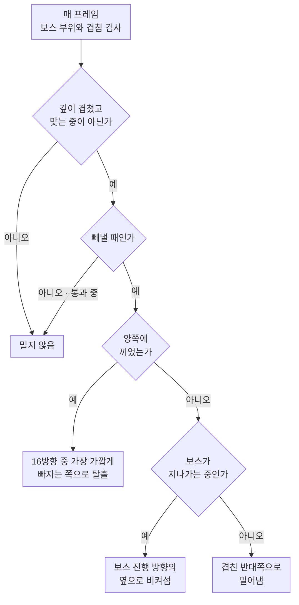

이 다이어그램은 플레이어가 보스 몸과 겹쳤을 때 매 프레임 통과시킬지, 밀어낼지, 옆으로 비켜설지, 끼인 곳에서 빠져나갈지를 고르는 판단 순서를 도식화한 것입니다(`PlayerController.PushOutOfBodies()`). 보스가 밀고 들어온 부위는 충돌을 끄고 떨어진 부위는 되돌리며, 빼낼 때는 이동 입력·보스 정지·오래 겹침 중 하나일 때입니다. 세 갈래 모두 `CharacterController.Move`로 한 프레임에 조금씩 움직여 벽은 뚫지 않습니다.

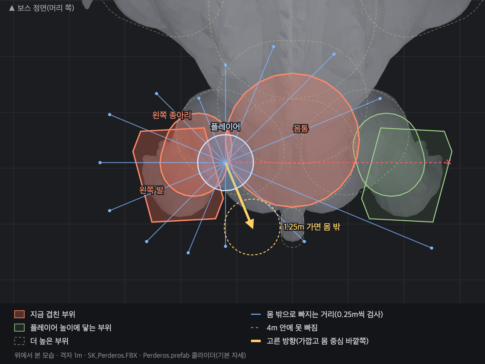

이 이미지는 페르데로스 모델(`SK_Perderos.FBX`)을 위에서 본 모습 위에 `Perderos.prefab`의 부위 콜라이더 위치(기본 자세)를 겹치고, `PlayerController`의 검사 규칙(최대 4m, 플레이어 캡슐 반경의 95%, 점수 = 빠지는 거리 − 몸 중심 바깥쪽 정도 × 0.5)으로 계산한 방향을 얹은 것입니다.

플레이어 자세도 오래 걸린 부분입니다. 플레이어 모델링과 애니메이션을 모두 상용 에셋으로 사용해 수동으로 맞춰야 하는 부분이 많았습니다.
염동력 모션을 구현하려면 IK를 사용할 수밖에 없었고, 수치를 계속 맞춰 가며 자연스러운 자세를 찾는 데 시간을 많이 들였습니다.

### 9.2 로비로 오면 플레이어가 사라지던 버그

- **증상:** 1차 시연에서 "보스 전투에서 로비로 넘어오면 플레이어가 없어 시점이 씬 카메라의 초기 위치에 고정된다"는 버그 제보를 받았습니다(§10.2).
- **원인:** 공용 `SingletonBase<T>`는 인스턴스가 없으면 찾거나 새로 만드는 정책입니다. 씬을 내리는 중 플레이어가 먼저 파괴된 뒤 다른 객체의 정리 코드가 `Player.Instance`를 조회하면, 빈 GameObject에 Player를 자동으로 붙이는 경로로 들어갈 수 있었습니다. 이 객체가 새 씬의 Player보다 먼저 싱글톤 참조를 차지하면, 씬에 올바르게 배치된 Player가 중복 객체로 제거되었습니다. `PersistAcrossScenes`를 false로 두는 것만으로는 이 조회·생성 경로를 차단하지 못합니다.
- **해결:** Player는 `[SceneOnlySingleton]`으로 씬 배치 객체만 허용하고(없으면 null), `UIManager.Start()`는 플레이어가 없는 타이틀에서 null을 허용합니다. `HumanoidClone.OnDestroy()`도 먼저 `Player.IsInitialized`를 검사해, 통과 몸체 등록을 해제하려고 새 플레이어를 찾거나 만드는 경로를 피합니다. 모든 싱글톤의 자동 생성을 없애기보다 씬 필수 구성요소를 가진 Player에 생성 제한을 적용한 선택이고, 대신 이 타입의 호출자는 Player가 없는 시점을 허용해야 합니다.
- **결과:** 고친 뒤 보스 전투에서 로비로 다시 넘어와 플레이어가 그대로 남아 있는 것을 확인했습니다.

```csharp
// SingletonBase<T>.Instance — 기존 객체 검색 직후, 자동 생성 직전
instance = FindAnyObjectByType<T>();
if (instance == null && createIfMissing == false)
    return null;
```

소스: [SingletonBase.cs](https://github.com/keeeery/ODDITY/blob/main/Assets/Scripts/99.%20Study/19.%20Legacy/9.%20Utils/SingletonBase.cs), [Player.cs](https://github.com/keeeery/ODDITY/blob/main/Assets/Scripts/1.%20Player/Player.cs), [UIManager.cs](https://github.com/keeeery/ODDITY/blob/main/Assets/Scripts/10.%20UI/UIManager.cs).

### 9.3 사망 후 로비로 갈 때 새 씬이 잠깐 비치던 문제

- **증상:** 사망 화면에서 로비로 갈 때, 다 꺼져 있어야 할 로딩 중에 새 씬이 먼저 비쳤다가 켜짐 연출 직전에 다시 꺼졌습니다(시연 중 직접 발견, §10.2).
- **원인:** 사망 화면과 씬 전환은 같은 화면 상태(`ScreenGlitch`, §8.7)를 공유합니다. 사망 화면이 내려가며 `ScreenGlitch.Clear()`로 화면 꺼짐(PowerOff) 값까지 지웠습니다. 또 타이틀 씬에는 전환용 Canvas 오브젝트가 꺼진 채 놓여 있어, 컴포넌트만 켜면 검은 화면·검은 띠·로딩 아이콘이 그려지지 않았습니다.
- **해결:** `DeathScreen`은 `SceneLoadManager`가 로딩 중이면 자신이 넣은 채도·가장자리 어둡기만 되돌리고, 화면 꺼짐·글리치는 전환 쪽에 맡깁니다. `SceneLoadManager.ShowCanvas()`에서 오브젝트까지 활성화해 셰이더 값 하나에만 의존하지 않고 검은 화면이 새 씬을 가리도록 했습니다.
- **결과:** 고친 뒤 사망 화면에서 로비로 넘어갈 때 새 씬이 먼저 비치지 않는 것을 플레이로 확인했습니다.

```csharp
// DeathScreen.OnDestroy() — 씬 전환 중이면 전환이 사용하는 화면 꺼짐은 남기고 자신의 효과만 되돌림
if (SceneLoadManager.IsInitialized && SceneLoadManager.Instance.IsLoading)
{
    ScreenGlitch.Desaturate = 0f;
    ScreenGlitch.Vignette = 0f;
}
else
{
    ScreenGlitch.Clear();
}
```

소스: [SceneLoadManager.cs](https://github.com/keeeery/ODDITY/blob/main/Assets/Scripts/7.%20Arena/SceneLoadManager.cs).

### 9.4 그 밖에 해결한 문제

#### 증강 칩 관리 창 위에 NPC 창이 겹쳐 열리던 문제

- **증상:** 1차 시연에서 "E로 증강 칩 관리 창을 열고 우클릭으로 빠른 장착·해제를 하려 했는데 NPC 대화가 먼저 열린다"는 피드백을 받았습니다(§10.2).
- **원인:** 로비에서 E로 증강 칩 관리 창을 연 채 NPC 앞에 서면, F나 우클릭이 NPC 창을 증강 칩 관리 창 위에 겹쳐 열 수 있었습니다. 우클릭은 증강 칩 관리 창에서 빠른 장착·해제 조작이기도 해서 두 창의 입력이 섞였습니다.
- **해결:** `MissionNPC`는 자기 창이 닫혀 있고 `UIManager.IsUIClose`가 참일 때만 새로 열고, 이미 열린 자기 창을 F로 닫는 동작은 그대로 둡니다. 증강 칩 관리 창의 검색 칸에 글자를 치는 동안에는 F(ㄹ)·Esc를 상호작용 키로 받지 않습니다(§7.5의 `TextInputFocus`).
- **결과:** 고친 뒤 증강 칩 관리 창을 연 채 NPC 앞에서 F·우클릭을 눌러 NPC 창이 겹쳐 열리지 않는 것을 확인했습니다.

#### 즉시 이동한 임무가 보상 확인 뒤에도 목록에 남던 문제

- **증상:** 임무를 수락한 뒤 바로 이동하면, 보상 확인 뒤에도 그 임무가 목록에 남았습니다(수정 작업 중 발견, §10.2).
- **원인:** 임무 이동에는 `MissionUI.RegisterAndMove()`의 수락 후 즉시 이동과 `StageMoveUI.MoveToStage()`의 수락 목록에서 이동하는 두 진입점이 있습니다. 즉시 이동 경로가 선택한 임무의 `BossName`을 영속 `UIManager.CurrentBossName`에 전달하지 않아, 보상 확인 시 이전 임무 이름이나 빈 이름으로 목록 제거를 요청했습니다.
- **해결:** 즉시 이동 경로에도 이 전달을 추가했습니다. 보상 확인 때 `BossRewardPanel.Close()` → `UIManager.MissionListUpdate()` → `MissionListUI.RemoveMission()`이 이름이 일치하는 임무를 지우고, `GameSave.Save()`가 남은 목록을 기록합니다.
- **결과:** 고친 뒤 수락하자마자 이동한 임무로 보스를 처치하고 보상을 확인하면, 그 임무가 목록에서 사라지는 것을 플레이로 확인했습니다.

---

## 10. 결과와 배운 점

### 10.1 구현 결과

시연 영상은 §1.3에, 1차 시연에서 받은 피드백과 반영은 §10.2에 있습니다.

| 항목 | 수치 |
|---|---|
| 보스 | 3종(차르카로사우루스 · 페르데로스 · 휴머노이드) |
| 직접 만들거나 확장한 셰이더 | 12개(§8.1) |
| 1차 시연 | 약 25명(강사 · 동료 수강생 · 지인)이 플레이. 받은 피드백 중 당장 해결할 수 있는 7건을 반영하고, 직접 찾은 문제 5건을 보완(§10.2) |

| 구현 결과 | 핵심 방법 | 자세히 | 기여 |
|---|---|---|---|
| 환경 물체를 직접 들고 휘두르고 던지는 전투 | 화면 타겟 → Rigidbody 홀딩 → 휘두르기·투척 → 전투 이벤트 | §2 | 내 기여 |
| 다시 공격에 사용하는 큰 파편과 연출용 작은 파편 | 큰·중간 물리 파편과 작은 연출물, 공유 풀과 반환 정책 | §3 | 내 기여 |
| 시간이 멈춘 세계에서도 움직이는 든 물체 | 객체별 시간 상태와 들기·투척 예외 | §4 | 내 기여 |
| 판정과 피드백이 맞물린 보스 전투 | 공용 패턴, 부위 판정·그로기, 지면 예고·카메라·HUD | §5 · §8.3 · §8.5 | 혼합(팀 기반 + 내 작업) |
| 로비에서 보상·이어하기까지 이어지는 진행 | 칩·임무·보상 테이블과 저장·씬 전환 연결 | §6 · §7.6 | 혼합(팀 기반 + 내 작업) |
| 행동 가능 여부와 피격 강도를 바로 읽는 화면 | 상황별 조준점·키 안내·시스템 메시지, 피해 구간별 히트스톱·흔들림·비네트, 차오르는 공격 예고 | §7 · §8.3 · §8.4 | 내 기여 |

혼합으로 표시한 두 결과에서 팀 기반과 제 몫의 경계는 §1.4 담당 범위 표에 있습니다.

### 10.2 1차 시연 피드백과 반영

2026.11.04 — 11.08에 1차 시연을 진행하고 강사·동료 수강생·지인에게 피드백을 받았습니다.
받은 피드백 중 밸런싱이나 보스전의 불합리한 부분처럼 바로 해결하기 어려운 것은 빼고, 당장 해결할 수 있는 부분을 11월 7일 커밋과 그 뒤 작업에서 개선했습니다. 그 과정에서 발견한 누락과 버그도 함께 보완했습니다.
가장 많이 나온 피드백은 **들고 있는 물체가 보스를 가려 움직임을 볼 수 없다**는 시야 문제였고, 강사·동료 수강생·지인 모두에게서 나왔습니다.

<table>
<thead>
<tr><th>받은 피드백</th><th>준 사람</th><th>반영</th><th>본문</th></tr>
</thead>
<tbody>
<tr><td>들고 있는 물체가 시야를 가려 보스의 움직임을 볼 수 없어 불편함</td><td>강사·동료 수강생·지인</td><td>다른 물체에 가려진 보스 부분을 반투명 실루엣으로 채워 표시</td><td>§8.6</td></tr>
<tr><td>보스 전투에서 로비로 넘어오면 플레이어가 로비에 없어, 시점이 씬 카메라의 초기 위치에 고정됨</td><td>동료 수강생</td><td>씬 정리 중 조회가 빈 Player를 만들던 경로를 막고 Player를 씬 배치 객체로만 허용</td><td>§9.2</td></tr>
<tr><td>PC의 마우스 감도에 따라 카메라 회전이 너무 빠르거나 느림</td><td>동료 수강생·지인</td><td>환경설정에 카메라 회전 속도(0.25~4배) 추가. 환경설정을 넓히며 편의 기능으로 음소거 토글도 추가</td><td>—</td></tr>
<tr><td>필터가 있어도 원하는 증강 칩을 찾기 어려움</td><td>지인</td><td>초성·조합 중인 글자까지 맞추는 이름 검색과 자동 완성</td><td rowspan="3">§7.5 칩 이름 검색</td></tr>
<tr><td>전체 해제 후 다시 배치할 일이 꽤 있는데 전체 해제 기능이 없음</td><td>동료 수강생·지인</td><td>장착한 칩을 모두 트레이로 돌려보내는 전체 해제 버튼</td></tr>
<tr><td>칩 유형을 색으로 구분했지만 필터는 글자뿐이라 직관적이지 않음</td><td>동료 수강생·지인</td><td>필터 글자 뒤에 같은 계열색 음영을 깔아 칩 색과 연결</td></tr>
<tr><td>로비에서 E로 증강 칩 관리 창을 열고 우클릭으로 빠른 장착·해제를 하려 했는데 NPC 대화가 먼저 열림</td><td>지인</td><td>다른 창이 열려 있으면 NPC 창을 새로 열지 않음</td><td>§9.4</td></tr>
</tbody>
</table>

피드백을 반영하며 직접 찾아 함께 보완한 부분은 다음과 같습니다.

| 발견한 문제 | 계기 | 보완 | 본문 |
|---|---|---|---|
| 사망 후 로비로 갈 때 새 씬이 잠깐 비쳤다가 다시 꺼짐 | 시연 중 직접 발견 | 로딩 중에는 사망 화면 자신의 효과만 되돌리고 전환 Canvas를 활성화 | §9.3 |
| 로비 훈련 공간의 물체 피해 계산이 보스전과 다름 | 수정 작업 중 누락 발견 | 로비 씬도 공격력 기반 피해 오버라이드 사용 | §2.8 |
| 수락 후 바로 이동한 임무가 보상 확인 뒤에도 목록에 남음 | 수정 작업 중 누락 발견 | 즉시 이동 경로에서도 보스 이름 전달 | §9.4 |
| 시스템 메시지·조작 가이드·환경설정의 용어가 서로 다름 | 환경설정 작업 중 정리 | "기상기" → "빠른 기상", "시점 회전" → "카메라 회전"으로 통일 | — |
| 바탕이 투명한 버튼에 마우스를 올리면 바탕이 밝아져 글자가 묻힘 | 증강 칩 관리 창 작업 중 추가 개선 | 강조를 테두리 선에만 칠함(`VectorShape.Stroke()`) | — |

### 10.3 한계와 개선 과제

- **성능 측정:** 파편 풀이 고갈되면 생성·물리·배치 검사 비용이 남고, 보스 가림 실루엣은 채우기를 켠 프레임마다 마스크와 깊이를 한 번 더 그립니다. GC·프레임 시간과 해상도별 GPU 시간은 프로파일러로 재야 합니다.
- **시간 제어 범위:** 정지·감속은 `TimeFreezable`을 연결한 물체와 로컬 시간을 사용하는 코드에만 적용됩니다(§4.4).
- **데이터와 저장:** 칩·보상·임무·씬 이름이 실제 에셋과 일치해야 하고, 저장 파일의 버전 변환·백업은 추가 과제입니다.
- **통합 확인이 남은 경로:** 플레이어가 없는 타이틀에서의 `Instance` 호출과 휴머노이드 분신이 남은 상태의 로비 복귀, 임무를 이동한 뒤의 저장 복원, 씬 전환 실패 복구와 반복 전환, 음소거·설정의 재실행 뒤 값, 시간 역행 중 입력 제한은 실제 플레이로 더 확인해야 합니다.
- **한글 입력:** 칩 검색의 조합 중 글자 처리는 입력 모듈에 의존하므로, Windows·macOS 빌드의 한글 입력기에서 각각 확인이 필요합니다.

### 10.4 배운 점과 회고

처음 목표는 소울류·몬스터 헌터류 액션 게임과는 다른 전투 경험이었고, 그 중심에 염동력의 물리 반응을 두었습니다.
의도한 재미가 가장 잘 드러난 순간은 **보스가 떨어뜨리거나 던진 물체를 들어 되던지는 장면**이었습니다(§2.9·§5.3).
여러 스킬 칩을 조합해 자기만의 빌드를 만들어 싸우는 플레이도 의도했던 재미였습니다.

시연에서는 UI와 연출, 조작감과 조작 편의, 피드백, 그리고 보스·플레이어 애니메이션의 부드러움과 자연스러움에 대해 좋은 반응을 받았습니다.
반면 보스 수와 콘텐츠 양이 적었고, 데미지 밸런스가 다소 맞지 않은 점이 아쉬움으로 남았습니다.

가장 오래 붙잡았던 문제는 **플레이어 IK를 튜닝해 자세를 자연스럽게 만드는 일**과 **큰 보스 몸과 겹쳤을 때 자연스럽게 비켜서는 회피 로직**이었습니다(§9.1).

협업에서는 UI를 처음부터 정형화하지 않고 나중에 한 번에 통일하다 보니 손이 많이 갔습니다(§7.4).
그래픽에서도 스킬 이펙트와 에셋, 연출 파티클, 홀로그램 사이의 스타일 차이로 약간의 이질감이 남았습니다.
스킬·스탯 칩의 수치도 나중에 붙이면서 데미지 밸런스가 다소 맞지 않게 되었습니다.
UI 규칙과 수치 기준을 초반에 정해 두지 않으면 나중에 맞추는 비용이 커진다는 점을 경험했습니다.

UI/UX에 공을 들인 것은 제 개발 모토가 **"플레이하기 편한 경험을 명확한 구조로 설계"**하는 것이기 때문입니다.
확실한 피드백을 주고, 원하는 행동까지 거치는 단계와 헛된 입력을 줄이는 UX를 기준으로 삼았습니다.
이 프로젝트에서는 조준점의 상황별 표시와 거절된 입력의 이유 안내(§7.2), 피해 구간별 피격 연출(§8.5)이 피드백 쪽의 기준을, 칩 이름 검색·전체 해제(§7.5)와 빠른 기상 보완(쿨타임 표시·안내, §8.4)이 단계와 헛된 입력을 줄이는 쪽의 기준을 따른 작업입니다.

첫 3D 프로젝트로서 2D와 가장 달랐던 점은 다음과 같습니다.

| 경험 | 배운 점 |
|---|---|
| 보스 상태 머신 설계 | 3D에서는 공격을 고를 때 거리뿐 아니라 시야각·회전까지 고려할 것이 2D보다 훨씬 많음(§5.2의 Chase·Turn) |
| 히트박스와 몸체 충돌 | 보스 몸이 입체라 발·등 위에 올라서거나 다리 사이에 끼는 일이 생겨, Collider를 부위별로 나누고 올라섬·끼임을 따로 처리해야 함(§5.4, §5.5) |
| 3인칭 카메라 | 어깨 시점에서는 조준점과 물체 위치를 맞추는 계산(§2.4)과 벽 충돌·보스 근접 시점 처리(§5.5)가 따로 필요함 |
| 렌더 파이프라인 | 물체가 앞뒤로 가리고 바닥에 높낮이가 있어, 가려진 대상의 실루엣과 단차에 붙는 공격 예고를 깊이를 비교해 URP RendererFeature로 직접 그려야 함(§8.3, §8.6) |

특히 **여러 셰이더를 활용해 연출을 직접 만들어 본 경험**이 인상 깊었습니다(§8.1 「셰이더 한눈에 보기」).

다음에는 맵 기믹, 휴머노이드 보스와 분신의 합동 패턴·페이즈, 세분화된 데미지 밸런싱을 더하고 싶습니다.
