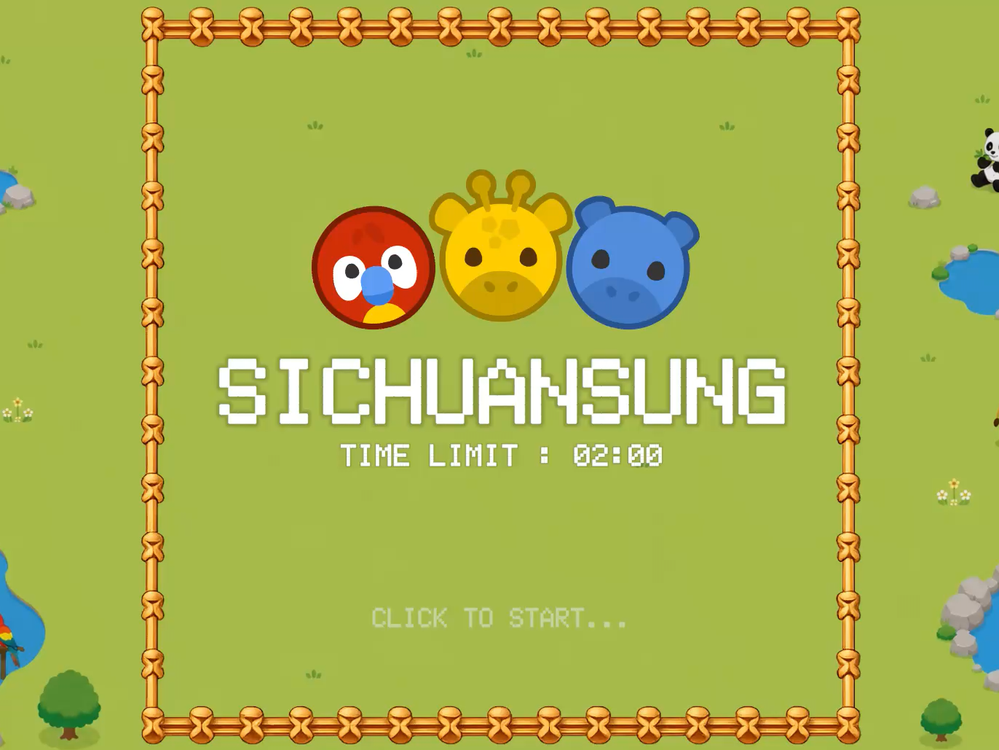
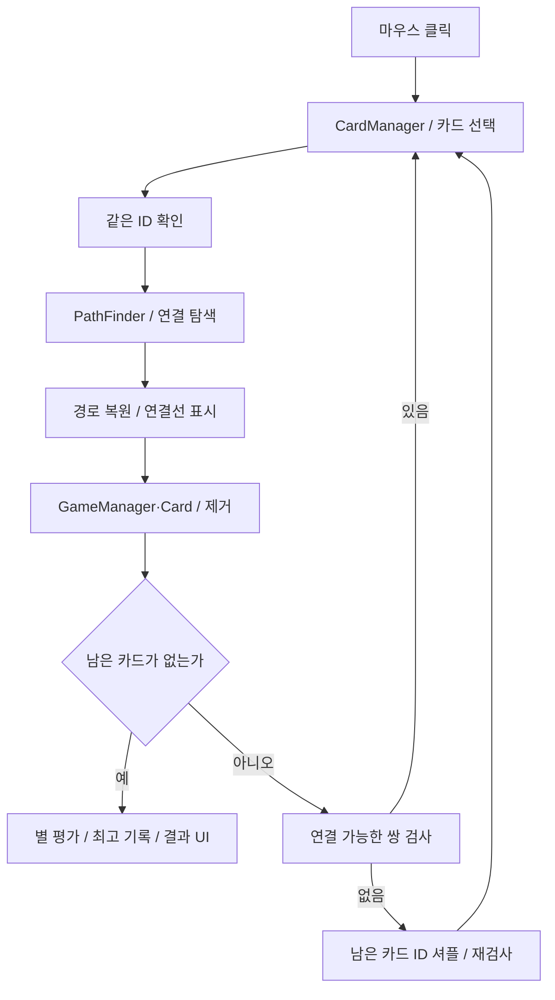
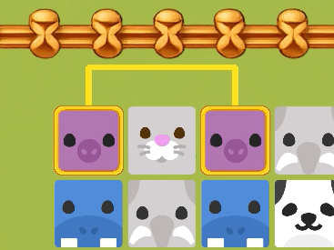
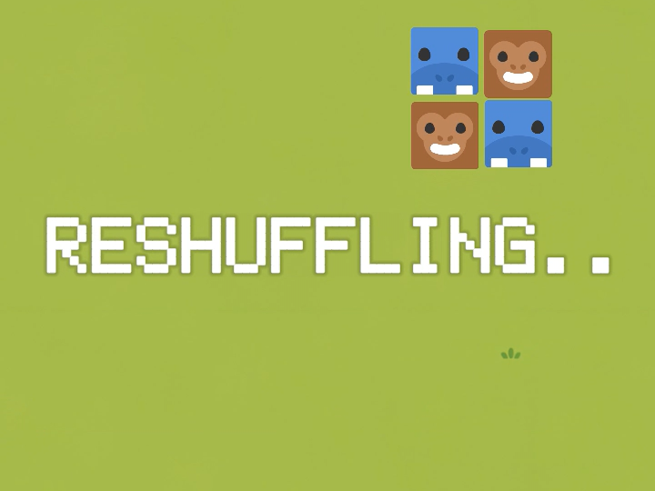
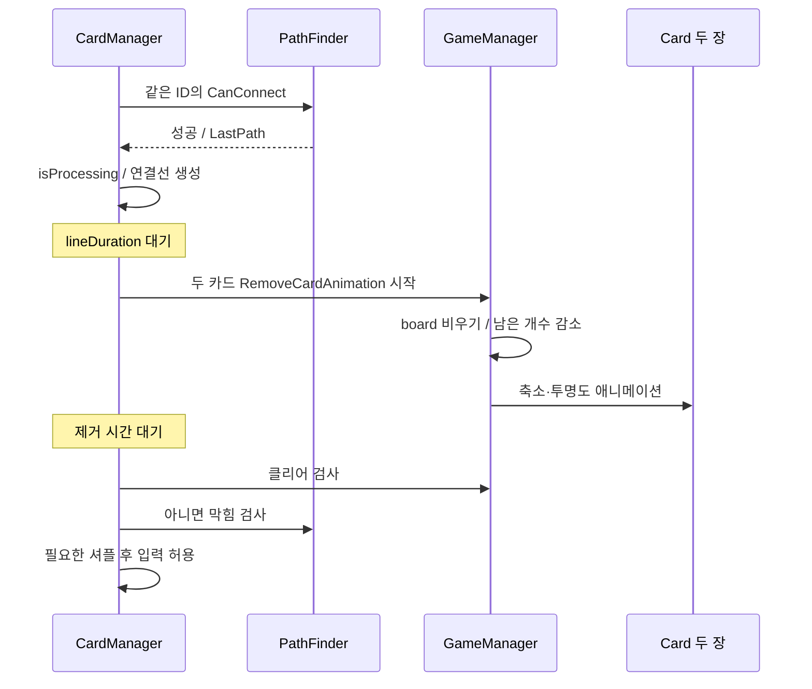
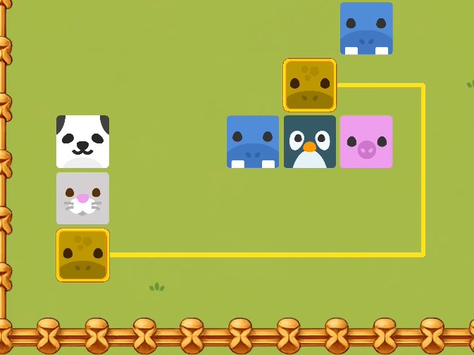
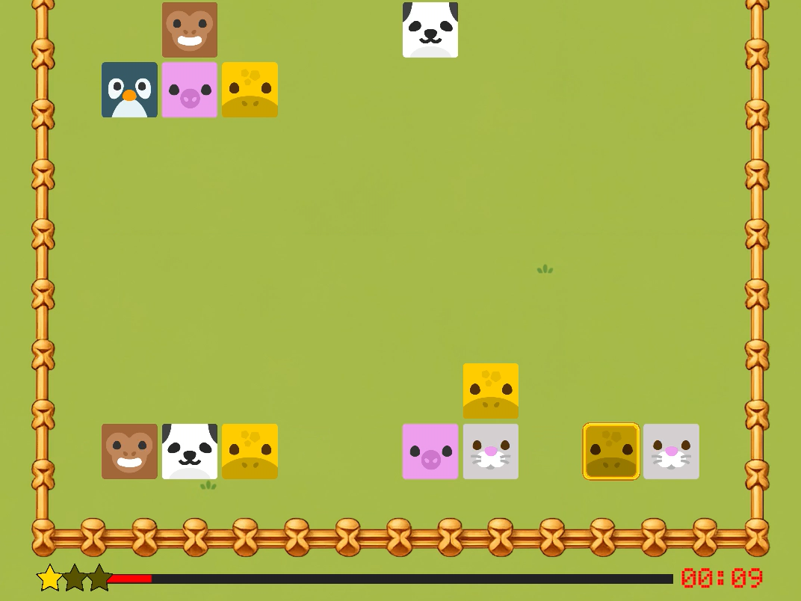
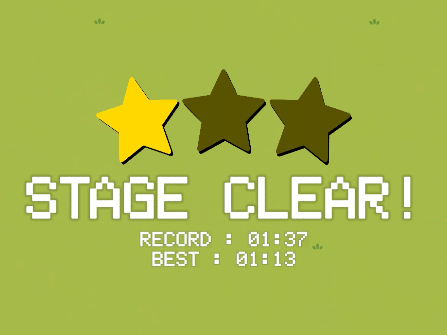

# 사천성 — 2D 퍼즐 게임 기술 문서

> **한 줄 소개**: 같은 그림의 카드 두 장을 최대 두 번까지만 꺾이는 선으로 연결해 지워나가는 짝맞추기 퍼즐 게임
> **구현 범위**: 카드 보드 생성, 연결 경로 탐색, 보드 자동 재배치, 선택·제거 연출, 제한시간·별 등급·최고 기록 저장

| 구분 | 시스템 | 핵심 내용 | 절 |
|---|---|---|---|
| 핵심 A | 연결 경로 판정 | 위치·방향·회전 횟수를 함께 관리하는 큐 기반 탐색 | §2 |
| 핵심 B | 보드 생성과 재배치 | 짝을 이루는 카드 구성, 연결 가능한 쌍 검사와 자동 셔플 | §3 |
| 보조 C | 입력과 시각 피드백 | 카드 선택, 연결선 표시, 제거 애니메이션과 처리 중 입력 제한 | §4 |
| 보조 D | 진행·평가·기록 | 시작·재시작, 타이머와 별 평가, PlayerPrefs 최고 기록 | §5 |

---

## 1. 프로젝트 개요

### 1.1 What — 무엇을 만들었나



**사천성**은 같은 그림의 카드 두 장을 연결해 제거하는 Unity 2D 퍼즐 개인 프로젝트입니다.
10×10 보드의 카드 100장을 제한시간 안에 모두 제거하며, 다른 카드를 통과하지 않고 가로·세로로 연결할 수 있어야 합니다.
연결선은 최대 두 번까지 방향을 바꿀 수 있고, 보드 바깥의 빈 테두리를 경유할 수도 있습니다.

시작 카운트다운, 카드 선택·제거, 막힌 보드의 자동 재배치, 남은 시간 표시,
클리어 시간에 따른 별 평가와 최고 기록 저장까지 하나의 플레이 흐름으로 연결했습니다.

### 1.2 Why — 왜 만들었나

평소 좋아하던 아케이드 게임인 사천성을 간단한 과제로 만든 프로젝트입니다.
핵심 규칙인 "두 번 이하로 꺾어 연결"을 정확하게 판정하기 위해 **규칙에 맞는 탐색 알고리즘(BFS)을 찾아 구현**하는 데 집중했고, 막힌 보드 재배치와 시간 평가·최고 기록 저장까지 한 판의 흐름으로 완성했습니다.

| 문제 | 구현 방향 |
|---|---|
| 위치만으로 방문 여부를 판단하면 다른 방향·회전 수의 경로를 구분하기 어려움 | 탐색 상태를 위치·진행 방향·회전 횟수로 구성 |
| 보드 안쪽에서는 막혀도 바깥으로 우회할 수 있음 | 카드 영역 주변에 빈 칸 한 겹을 추가 |
| 같은 카드가 남아 있어도 연결 가능한 쌍이 없을 수 있음 | 가능한 쌍을 검사하고 없으면 남은 카드 ID 재배치 |
| 판정 결과를 플레이어가 이해할 수 있어야 함 | 탐색 경로를 복원해 연결선으로 표시한 뒤 제거 |

### 1.3 개발 환경

| 항목 | 내용 |
|---|---|
| 장르 | 2D 퍼즐 |
| 기간 | 2025.05 (며칠간 제작) |
| 인원 | 1인 |
| Engine | Unity `6000.3.15f1`, URP `17.3.0` (2D SpriteRenderer) |
| Language | C# |
| 주요 패키지 | Input System `1.19.0`, uGUI, TextMesh Pro |
| 데이터 | PlayerPrefs의 최고 클리어 시간 |
| GitHub | [Unity_2D_SichuanSung](https://github.com/keeeery/Unity_2D_SichuanSung) |
| 시연 영상 | [YouTube](https://youtu.be/_bbqGfWJcZI) |

### 1.4 전체 구조

게임 전용 코드는 `Assets/SichuanSung/Scripts`의 5개 클래스로 구성합니다.

| 클래스 | 책임 |
|---|---|
| `GameManager` | 보드·카드 ID, 시작·종료·재시작, 셔플, 시간·평가·기록 |
| `PathFinder` | 연결 가능 판정, 경로 복원, 연결 가능한 쌍 존재 여부 |
| `CardManager` | 마우스 선택, 매칭 요청, 연결선과 제거·셔플 순서 조율 |
| `Card` | ID·격자 좌표, 선택 표시, 흔들림·제거·시각 상태 초기화 |
| `UIManager` | 시작·결과·셔플 화면, 타이머·별과 텍스트 애니메이션 |



규모가 작은 단일 씬 게임이라 세 매니저는 직접 참조와 `Instance` 접근으로 연결했습니다.

---

## 2. 기능 A — 방향과 회전 횟수를 고려한 연결 탐색

### 2.1 개요와 구조

`PathFinder.CanConnect`는 두 카드 사이를 다른 카드에 막히지 않고 두 번 이하로 꺾어 연결할 수 있는지 검사합니다.
카드 ID가 같은지는 호출자인 `CardManager`가 먼저 확인하고, 경로 함수는 연결 가능 여부만 판단합니다.

실제 카드 영역은 x·y 각각 1~10이며 배열은 12×12입니다.
0과 11 인덱스의 빈 테두리를 탐색 범위에 포함해, 보드 바깥으로 돌아가는 연결도 같은 규칙으로 처리합니다.

| API | 입력·결과 |
|---|---|
| `CanConnect(Card start, Card end)` | 경로 존재 여부와 `LastPath` 갱신 |
| `IsDeadlocked()` | 현재 연결 가능한 같은 ID 쌍이 없으면 true |
| `LastPath` | 시작부터 끝까지 표시할 격자 좌표 목록 |

### 2.2 핵심 기능 — 위치·방향·회전 수를 별도 상태로 관리

```csharp
bool[,,,] visited = new bool[width, height, 4, 3];
Node[,,,] parent = new Node[width, height, 4, 3];
Queue<Node> queue = new Queue<Node>();
```

같은 칸이라도 어느 방향으로 들어왔는지, 이미 몇 번 꺾었는지에 따라 이후 연결 가능성이 다릅니다.
이를 `visited[x, y, dir, turn]`으로 구분하고, 부모 상태도 같은 차원으로 저장합니다(12×12×4×3 = 1,728칸).

시작점에서 네 방향을 회전 수 0으로 큐에 넣습니다.
꺼낸 상태의 진행 방향으로 빈 칸을 연속 검사하고, 목표 카드 외의 카드가 있으면 그 직선 탐색을 멈춥니다.

```csharp
if (card != null && !(nx == end.x && ny == end.y))
{
    break;
}
```

직선 진행은 회전 수를 유지하고, 회전 수가 2 미만일 때만 다른 방향 상태를 `turn + 1`로 추가합니다.
목표 카드는 장애물 검사에서 통과를 허용하므로 끝점에 카드가 있다는 이유로 경로가 막히지 않습니다.
이 탐색의 목적은 최단 경로가 아니라 **규칙을 만족하는 경로가 있는지**이며, 처음 찾은 경로를 반환합니다.



### 2.3 핵심 기능 — 판정 경로 복원과 연결선 표시

`SavePath`는 부모 상태를 역으로 따라간 뒤 순서를 뒤집고,
`CompressPath`는 방향이 바뀌는 지점을 남겨 표시 목록을 줄입니다.
결과는 `LastPath`로 전달되고, `CardManager`가 이 좌표를 연결선으로 바꿉니다.

연결선은 `LineRenderer` 대신 흰 텍스처 Sprite를 늘려 표현합니다.
각 경로 구간의 중점에 선분을 놓고 방향에 맞게 회전시키며, 격자 y 증가 방향과 월드 y 방향이 반대이므로 좌표 변환에서 부호를 뒤집습니다.
판정용 탐색과 선을 그리는 책임은 나누되, 표시에는 탐색에서 얻은 경로를 그대로 사용합니다.

### 2.4 고민과 선택

| 고민 | 대안 | 선택과 이유 | 비용 |
|---|---|---|---|
| 어떤 탐색 알고리즘을 쓸까 | DFS (한 방향으로 끝까지 들어간 뒤 되돌아오기) | BFS — 가까운 상태부터 차례로 넓혀 가므로, 꺾는 횟수가 적은 경로부터 확인하는 탐색이 "두 번 이하로 꺾기" 규칙과 잘 맞는다고 판단 | 회전 수가 적은 경로를 먼저 찾지만, 이동 거리상 최단은 보장하지 않음 |
| 방문 상태를 어떻게 저장할까 | 좌표만 방문 표시 (2차원) | 위치·방향·회전 수 4차원 — 같은 칸이라도 남은 회전 수가 다른 경로를 구분해야 함 | 좌표만 저장하는 방식보다 메모리 증가 |
| 보드 바깥 우회를 어떻게 처리할까 | 보드 밖 공간을 따로 계산 | 빈 테두리 한 겹 추가 — 같은 탐색 규칙으로 처리하고 범위도 제한 | 보드·표시 좌표 범위를 함께 맞춰야 함 |
| 탐색 버퍼를 어떻게 관리할까 | 버퍼를 만들어 두고 재사용 | 매 호출 새 배열 생성 — 탐색별 초기화가 단순함 | 반복적인 막힘 검사에서 할당·GC 비용 가능 |

소스: [PathFinder.cs](https://github.com/keeeery/Unity_2D_SichuanSung/blob/main/Assets/SichuanSung/Scripts/PathFinder.cs).

---

## 3. 기능 B — 짝을 유지하는 보드 생성과 자동 재배치

### 3.1 보드 생성

보드 데이터는 `GameManager.board`가 관리하고, 각 `Card`가 자신의 ID와 격자 좌표를 갖습니다.
50쌍의 ID를 만들어 총 100장의 카드를 생성하고, ID 목록을 섞어 배치합니다.

```csharp
for (int i = 0; i < pairCount; i++)
{
    int id = i % animalSprites.Length;
    ids.Add(id);
    ids.Add(id);
}
```

### 3.2 핵심 기능 — 연결 가능한 쌍 검사와 ID 셔플

`IsDeadlocked`는 남은 카드에서 같은 ID의 쌍만 골라 `CanConnect`를 호출하고, 한 쌍이라도 연결되면 즉시 끝냅니다.
연결 가능한 쌍이 없으면 남은 카드의 **위치는 그대로 두고 ID만 섞습니다.**
ID의 전체 구성은 유지되므로 기존 짝도 유지됩니다.



```csharp
do
{
    for (int repeat = 0; repeat < shuffleRepeatCount; repeat++)
    {
        // 흔들기 → 대기 → ID 셔플·적용 → 짧은 대기
    }
}
while (PathFinder.Instance.IsDeadlocked());
```

위 코드는 제어 흐름을 요약한 발췌입니다. 한 묶음(현재 3회) 동안 카드를 흔들고 ID를 바꾼 뒤 다시 검사하며,
여전히 막혀 있으면 묶음을 반복합니다.
초기 보드도 이 과정을 거치므로 처음부터 한 수 이상 둘 수 있는 배치에서 플레이가 시작됩니다.

### 3.3 고민과 선택

| 고민 | 대안 | 선택과 이유 |
|---|---|---|
| 막힌 보드를 어떻게 풀까 | 카드 오브젝트를 새로 만들어 다시 배치 | 남은 카드의 ID만 교체 — 보드 좌표·남은 개수·빈 칸을 그대로 유지하기 쉬움 |
| 무엇을 검사할까 | 끝까지 풀 수 있는지 미리 푸는 해결기 | 지금 한 수를 둘 수 있는지만 검사 — 작은 보드에 맞춘 단순한 기준 |

남은 카드 수를 N이라 하면 쌍 후보 검사는 최대 N(N−1)/2개이며, 재시도 횟수에는 상한이 없습니다.

소스: [GameManager.cs](https://github.com/keeeery/Unity_2D_SichuanSung/blob/main/Assets/SichuanSung/Scripts/GameManager.cs).

---

## 4. 기능 C — 선택·연결선·제거 연출의 순서 제어

### 4.1 선택 흐름

마우스 클릭 위치를 월드 좌표로 바꾼 뒤 `Physics2D.Raycast`로 카드를 찾습니다.
첫 카드에는 외곽선과 색상 변화를 적용하고, 두 번째 카드의 ID와 연결 경로를 확인합니다.
매칭에 실패하면 첫 카드를 해제하고 두 번째 카드를 다음 첫 카드로 넘겨, 새 카드 하나만 고르면 다시 시도할 수 있습니다.

```csharp
firstCard.Deselect();
firstCard = secondCard;
secondCard = null;
firstCard.Select();
```

### 4.2 핵심 기능 — 연결선을 먼저 보여준 뒤 제거



논리 보드는 제거 애니메이션 시작 시 먼저 비우고, 시각 오브젝트는 축소·투명도 변화가 끝난 뒤 제거합니다.
다음 막힘 검사에서 사라질 카드를 장애물로 쓰지 않기 위한 순서입니다.
`isProcessing`은 연결선 생성 전에 켜서 제거·셔플 중 새 선택을 막습니다.
연결선을 보여 주는 동안과 제거 연출 동안에도 카드에는 콜라이더가 남아 있어 클릭이 됩니다. 잠금이 없으면 다음 문제가 생길 수 있습니다.

| 잠금 없이 클릭할 때 | 생길 수 있는 문제 |
|---|---|
| 사라지는 중인 카드를 다시 선택 | 논리 보드에서는 이미 지운 카드가 다시 매칭되어 남은 카드 수가 두 번 줄어듦 |
| 셔플 중인 카드를 선택 | 선택한 뒤에 카드 ID가 바뀜 |
| 연결선 표시 중 다른 카드를 선택 | 제거 코루틴이 끝나며 `firstCard`를 `null`로 덮어써, 선택 표시는 남았는데 선택 상태는 풀림 |



연출 완료는 각 코루틴을 추적하는 대신 설정 시간만큼 기다리는 방식으로 단순하게 구성했습니다.

### 4.3 고민과 선택

| 고민 | 대안 | 선택과 이유 | 비용 |
|---|---|---|---|
| 논리 보드를 언제 비울까 | 제거 연출이 끝난 뒤 보드를 비우기 | 연출 시작 시 먼저 비움 — 연출 이후에 비우면 그 사이의 클리어·막힘 검사에서 사라질 카드가 남은 카드·장애물로 계산되므로 적절하지 않다고 판단 | 연출 중에는 화면의 카드와 논리 보드의 상태가 잠시 다름 |
| 연출 중 입력을 어떻게 다룰까 | 연출 중에도 클릭을 받기 | `isProcessing` 잠금 — 연출 중에도 카드 콜라이더가 남아 있어, 사라지는 카드의 재선택이나 선택 상태 덮어쓰기를 막아야 함 | 연결선·제거·셔플이 끝날 때까지 입력을 받지 않음 |

소스: [CardManager.cs](https://github.com/keeeery/Unity_2D_SichuanSung/blob/main/Assets/SichuanSung/Scripts/CardManager.cs), [Card.cs](https://github.com/keeeery/Unity_2D_SichuanSung/blob/main/Assets/SichuanSung/Scripts/Card.cs).

---

## 5. 기능 D — 한 판의 진행·시간 평가와 최고 기록

단일 씬 안에서 시작 화면 → 카운트다운 → 보드 준비 → 플레이 → 결과 → 재시작으로 이어집니다.
재시작은 씬 재로드 대신 상태·UI·보드를 초기화하는 방식입니다.

| 경과 시간 | 평가 |
|---|---|
| 60초 이하 | 별 3개 |
| 60초 초과~90초 이하 | 별 2개 |
| 90초 초과~120초 이하 | 별 1개 |
| 120초 초과 | 게임 오버 |

남은 시간은 분·초 텍스트와 줄어드는 타이머 바로 보여 주고, 10초 이하에서는 빨간색과 흔들림으로 경고합니다.



최고 기록은 기록이 없거나 더 빠르게 완료했을 때만 갱신합니다.

```csharp
float bestRecord = PlayerPrefs.GetFloat(BestRecordKey, 0f);
if (bestRecord == 0f || clearTime < bestRecord)
{
    bestRecord = clearTime;
    PlayerPrefs.SetFloat(BestRecordKey, bestRecord);
    PlayerPrefs.Save();
}
```



단일 수치 저장이라 별도 파일 구조 없이 PlayerPrefs를 사용했습니다.

소스: [GameManager.cs](https://github.com/keeeery/Unity_2D_SichuanSung/blob/main/Assets/SichuanSung/Scripts/GameManager.cs), [UIManager.cs](https://github.com/keeeery/Unity_2D_SichuanSung/blob/main/Assets/SichuanSung/Scripts/UIManager.cs).

#### 고민과 선택 — 진행 흐름을 상태 머신 대신 bool과 코루틴으로

진행은 시작 화면 → 카운트다운 → 보드 준비 → 플레이 → 결과 → 재시작의 여섯 단계이고,
`GameManager`는 이를 `isGameClear`·`IsGameStarted`·`isCountingDown`·`canClick` 네 개의 bool과
`StartGameSequence`·`RestartGameSequence`·`GameOverSequence` 코루틴으로 조율합니다.

처음 끝까지 만들어 본 게임이었기 때문에, 당시 다룰 수 있던 bool과 코루틴으로 진행 흐름을 구성했습니다.
지금 돌아봐도, 단계가 여섯 개뿐이고 씬도 하나인 게임에 상태 머신을 따로 두는 것은 규모에 비해 과하다고 판단합니다.

다만 bool 조합으로 상태를 나타내다 보니, 게임 오버 뒤에도 재시작 입력을 받으려고 `isGameClear`를 `true`로 두는 것처럼
값 하나가 클리어와 게임 오버를 함께 나타내게 되었습니다.
6.2의 「시간 초과와 제거·재배치가 겹칠 때 코루틴을 한꺼번에 취소하는 경로가 없음」도 같은 구조에서 남은 과제입니다.

---

## 6. 결과와 배운 점

### 6.1 구현 결과

| 구현 결과 | 기술적으로 다룬 내용 |
|---|---|
| 사천성의 연결 규칙 | 방향·회전 횟수를 포함한 탐색 상태와 외곽 우회 |
| 판정 결과의 시각화 | 부모 경로 복원과 월드 선분 생성 |
| 막힌 보드에서 플레이 이어가기 | 같은 ID 쌍 검사, 남은 ID 구성 유지와 자동 셔플 |
| 시작부터 재도전까지의 한 판 | 입력 제한, 제거·셔플·결과 UI의 순서 제어 |
| 시간 기반 피드백과 기록 | 경고 UI·별 평가·최고 기록의 로컬 저장 |

### 6.2 한계와 개선 과제

- 자동 셔플은 지금 연결 가능한 쌍이 있는지만 확인하며, 끝까지 풀 수 있는지는 보장하지 않습니다. 재시도 상한과 확정 배치 대안을 추가할 수 있습니다.
- 탐색마다 4차원 배열과 노드를 새로 만듭니다. 존재 여부 검사와 표시용 경로 탐색을 나누고 버퍼를 재사용할 수 있습니다.
- 시간 초과와 카드 제거·재배치가 겹칠 때 진행 중 코루틴을 한꺼번에 취소하는 경로가 없습니다.
- 카드 배치와 연결선이 서로 다른 간격 값을 사용합니다. 보드 크기를 바꾸려면 하나의 좌표 변환 기준으로 합쳐야 합니다.
