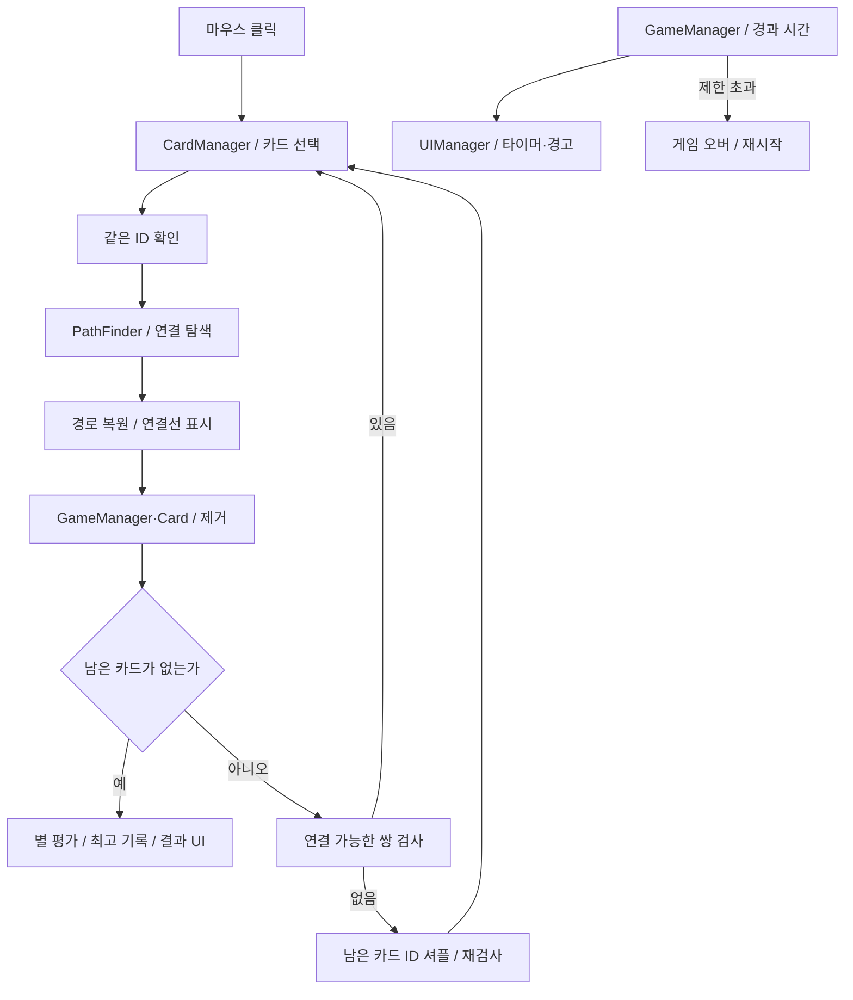
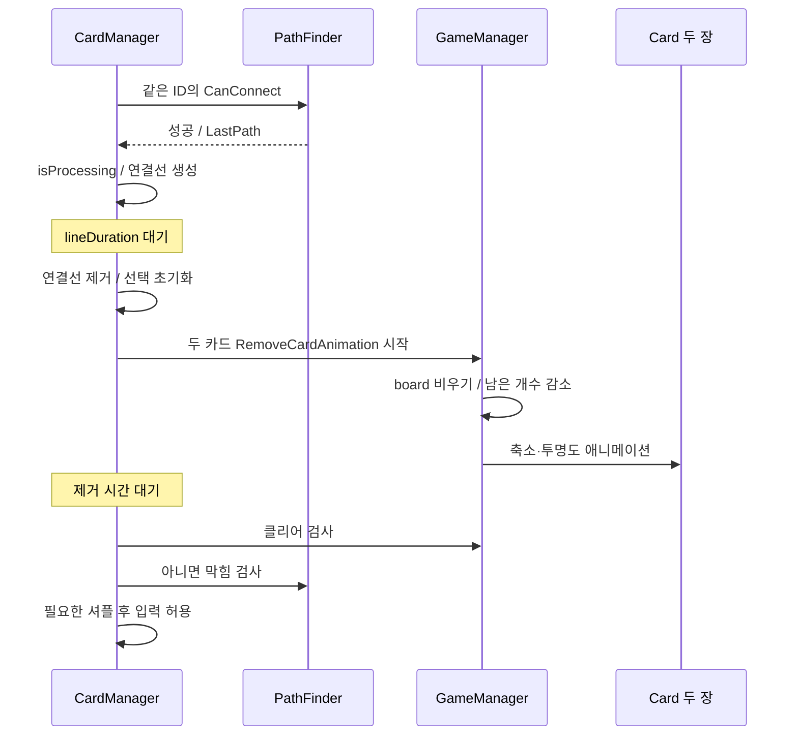

# 사천성 — 2D 퍼즐 게임 기술 문서

> **구현 영역**: 카드 보드 생성, 두 번 이하로 꺾이는 연결 경로 탐색, 막힌 보드 자동 재배치, 선택·제거 연출, 제한시간·별 평가·최고 기록 저장

| 구분 | 시스템 | 핵심 내용 |
|---|---|---|
| 핵심 A | 연결 경로 판정 | 위치·방향·회전 횟수를 함께 관리하는 큐 기반 탐색 |
| 핵심 B | 보드 생성과 재배치 | 짝을 이루는 카드 구성, 연결 가능한 쌍 검사와 자동 셔플 |
| 기능 C | 입력과 시각 피드백 | 카드 선택, 연결선 표시, 제거 애니메이션과 처리 중 입력 제한 |
| 기능 D | 진행·평가·기록 | 시작·재시작, 타이머와 별 평가, PlayerPrefs 최고 기록 |

---

## 1. 프로젝트 개요

### 1.1 What — 무엇을 구현했나

**사천성**은 같은 그림의 카드 두 장을 연결해 제거하는 Unity 2D 퍼즐 개인 프로젝트입니다.
10×10 보드의 카드 100장을 제한시간 안에 모두 제거하며, 다른 카드를 통과하지 않고 가로·세로로 연결할 수 있어야 합니다.
연결선은 최대 두 번까지 방향을 바꿀 수 있고, 보드 바깥의 빈 테두리를 경유할 수도 있습니다.

게임의 핵심 규칙과 함께 시작 카운트다운, 카드 선택·제거, 막힌 보드의 자동 재배치,
남은 시간 표시, 클리어 시간에 따른 별 평가와 최고 기록 저장까지 하나의 플레이 흐름으로 연결했습니다.

### 1.2 Why — 다루는 문제와 구현 방향

평소 좋아하던 아케이드 게임인 사천성을 간단한 과제로 만든 프로젝트입니다.
핵심 규칙인 "두 번 이하로 꺾어 연결"을 정확하게 판정하기 위해 **규칙에 맞는 탐색 알고리즘(BFS)을 찾아 구현**하는 데 집중했고, 막힌 보드 재배치와 시간 평가·최고 기록 저장까지 한 판의 흐름으로 완성했습니다.

| 문제 | 구현 방향 |
|---|---|
| 위치만으로 방문 여부를 판단하면 다른 방향·회전 수의 경로를 구분하기 어려움 | 탐색 상태를 위치·진행 방향·회전 횟수로 구성 |
| 보드 안쪽에서는 막혀도 바깥으로 우회할 수 있음 | 카드 영역 주변에 빈 칸 한 겹을 추가 |
| 같은 카드가 남아 있어도 연결 가능한 쌍이 없을 수 있음 | 가능한 쌍을 검사하고 없으면 남은 카드 ID 재배치 |
| 판정 결과를 플레이어가 이해할 수 있어야 함 | 탐색 경로를 복원해 연결선으로 표시한 뒤 제거 |
| 제거·셔플 연출 중 추가 클릭이 들어올 수 있음 | 일반 클릭 경로에서 처리 중 상태 확인 |
| 한 판을 끝낸 뒤 결과와 재도전 동기를 전달해야 함 | 시간별 별 평가와 로컬 최고 기록 표시 |

### 1.3 개발 환경과 범위

| 항목 | 내용 |
|---|---|
| Engine | Unity `6000.3.15f1` |
| Rendering | URP `17.3.0`, 2D SpriteRenderer |
| Language | C# |
| Input | Input System `1.19.0`, 마우스 입력 |
| UI | uGUI, TextMesh Pro |
| 연출 | Coroutine, 스케일·색상·위치 보간 |
| 저장 | PlayerPrefs의 최고 클리어 시간 |
| 형태 | 단일 게임 씬의 개인 퍼즐 프로젝트 |
| 기간 | 2025.05 (며칠간 제작) |
| 저장소 | [Unity_2D_SichuanSung](https://github.com/keeeery/Unity_2D_SichuanSung) |

게임 전용 코드는 `Assets/SichuanSung/Scripts`의 5개 클래스로 구성합니다.
TextMesh Pro 예제와 외부 그래픽 에셋은 직접 구현한 게임 로직과 구분합니다.

### 1.4 전체 구조

| 클래스 | 책임 |
|---|---|
| `GameManager` | 보드·카드 ID, 시작·종료·재시작, 셔플, 시간·평가·기록 |
| `PathFinder` | 연결 가능 판정, 경로 복원, 연결 가능한 쌍 존재 여부 |
| `CardManager` | 마우스 선택, 매칭 요청, 연결선과 제거·셔플 순서 조율 |
| `Card` | ID·격자 좌표, 선택 표시, 흔들림·제거·시각 상태 초기화 |
| `UIManager` | 시작·결과·셔플 화면, 타이머·별과 텍스트 애니메이션 |



세 매니저의 연결은 직접 참조와 `Instance` 접근으로 구성합니다.
`GameManager`·`PathFinder`는 `Awake`에서 정적 필드에 자신을 대입하며,
씬을 넘어 유지하는 싱글톤이나 중복 인스턴스 방지 기반을 구현한 구조는 아닙니다.

---

## 2. 기능 A — 방향과 회전 횟수를 고려한 연결 탐색

### 2.1 개요와 구조

`PathFinder.CanConnect`는 두 카드 사이를 다른 카드에 막히지 않고 두 번 이하로 꺾어 연결할 수 있는지 검사합니다.
카드 ID의 동일 여부는 호출자인 `CardManager`가 먼저 확인합니다.
따라서 경로 함수 자체는 그림 비교까지 책임지는 함수가 아닙니다.

실제 카드 영역은 x·y 각각 1~10이며 배열은 12×12입니다.
0과 11 인덱스의 빈 테두리를 탐색 범위에 포함해 보드 바깥 우회를 처리합니다.
무한한 외부 공간을 탐색하지 않고 필요한 테두리 한 겹으로 범위를 제한합니다.

### 2.2 핵심 기능 — 위치·방향·회전 수를 별도 상태로 관리

```csharp
bool[,,,] visited = new bool[width, height, 4, 3];
Node[,,,] parent = new Node[width, height, 4, 3];
Queue<Node> queue = new Queue<Node>();
```

같은 칸이라도 어느 방향으로 들어왔는지, 이미 몇 번 꺾었는지에 따라 이후 연결 가능성이 다릅니다.
이를 `visited[x, y, dir, turn]`으로 구분하고, 부모 상태도 같은 차원으로 저장합니다.
회전 수 인덱스는 0·1·2를 사용합니다.

시작점에서 네 방향을 회전 수 0으로 큐에 넣습니다.
꺼낸 상태의 진행 방향으로 빈 칸을 연속 검사하고, 목표 카드 외의 카드가 있으면 그 직선 탐색을 멈춥니다.

```csharp
if (card != null && !(nx == end.x && ny == end.y))
{
    break;
}
```

진행 중인 빈 칸에서 회전 수가 2 미만이면 다른 방향으로의 상태를 추가합니다.
현재 방향과 같은 방향은 제외하며, 반대 방향도 후보에 포함하는 구현입니다.
목표에 도착하면 탐색을 끝내고 경로를 복원합니다.

이 탐색의 목적은 **규칙을 만족하는 경로의 존재 여부**입니다.
직선 구간을 연속 확장하고 처음 찾은 경로를 반환하므로, 일반적인 한 칸 단위 BFS의 최단 거리 보장이나
최소 회전 경로 보장을 그대로 적용하지 않습니다.

### 2.3 핵심 기능 — 판정 경로 복원과 표시 데이터

`SavePath`는 부모 상태를 역으로 따라간 뒤 순서를 뒤집습니다.
`CompressPath`는 인접 경로 좌표의 차이를 비교해 방향 변화 지점을 남기는 방식으로 표시 목록을 줄입니다.
결과는 `LastPath`로 전달되고, `CardManager`가 이 좌표를 연결선으로 변환합니다.

판정용 탐색과 선을 그리는 책임을 나누되, 표시에는 탐색에서 얻은 경로를 사용합니다.
`LastPath`는 다음 탐색에서 지워지거나 교체되는 공유 결과이므로 장기간 보관하는 불변 경로 데이터는 아닙니다.
현재 매칭 흐름에서는 성공 직후 선을 생성하고, 제거 뒤에 다음 보드 검사를 수행합니다.

### 2.3.1 보충 — 탐색 API의 계약과 상태 수

| API | 입력·결과 | 호출할 때 주의할 점 |
|---|---|---|
| `CanConnect(Card start, Card end)` | 경로 존재 여부와 `LastPath` 갱신 | ID 동일성은 호출자가 검사 |
| `IsDeadlocked()` | 현재 연결 가능한 같은 ID 쌍이 없으면 true | 검사 중 `CanConnect`를 재사용하므로 마지막 경로도 바뀜 |
| `LastPath` | 시작부터 끝까지 표시할 격자 좌표 목록 | 다음 탐색 전에 즉시 표시 데이터로 사용 |

12×12×4×3 상태 공간은 총 1,728칸입니다. 이것은 배열의 상태 슬롯 수이며 실제 생성 Node 수나 연산 횟수가 아닙니다.
한 상태에서 직선으로 여러 칸을 검사하므로 큐에서 하나를 꺼내는 비용까지 상수라고 볼 수는 없습니다.
직선 진행 상태는 회전 횟수를 그대로 유지하고, 방향 전환 상태만 `turn + 1`로 넣습니다.
목표 카드는 장애물 검사에서 특별히 통과를 허용하므로, 끝점에 카드가 있다는 이유로 경로를 막지 않습니다.

부모 배열은 좌표뿐 아니라 진행 방향·회전 수를 다시 사용해 역추적합니다.
회전 상태를 만들 때 같은 좌표의 이전 방향 노드를 부모로 저장하므로 복원 경로에는 같은 좌표가 연속할 수 있습니다.
현재 압축 함수는 벡터 정규화나 중복 좌표 제거를 먼저 수행하지 않으며, 화면용 경로의 최소 점 개수를 보장하는 알고리즘과는 구분됩니다.


### 2.4 고민과 선택

| 선택 | 이점 | 비용·제약 |
|---|---|---|
| 4차원 방문 상태 | 방향·회전 수가 다른 경로 구분 | 좌표만 저장하는 방식보다 메모리 사용 증가 |
| 외곽 빈 테두리 | 바깥 우회를 같은 탐색 규칙으로 처리 | 보드·표시 좌표의 범위를 함께 맞춰야 함 |
| 부모 상태 저장 | 연결선을 위한 경로 복원 가능 | 연결 가능 여부만 필요할 때도 복원 비용 발생 |
| 매 호출 새 배열·노드 생성 | 탐색별 상태 초기화가 단순함 | 반복적인 막힘 검사에서 할당·GC 비용 발생 가능 |

현재 크기의 단일 퍼즐 보드에 맞춘 구현이며, 대형 보드에서의 성능 개선량을 측정한 구조는 아닙니다.

소스: [PathFinder.cs](https://github.com/keeeery/Unity_2D_SichuanSung/blob/main/Assets/SichuanSung/Scripts/PathFinder.cs).

---

## 3. 기능 B — 짝을 유지하는 보드 생성과 자동 재배치

### 3.1 개요와 구조

보드의 실제 데이터는 `GameManager.board`가 관리하고, 각 `Card`가 자신의 ID와 격자 좌표를 갖습니다.
초기에는 50쌍의 ID를 만들어 총 100장의 카드를 생성합니다.
카드 종류는 `animalSprites` 배열을 순환해 선택하므로, 같은 그림이 두 장보다 많이 등장할 수도 있습니다.

```csharp
for (int i = 0; i < pairCount; i++)
{
    int id = i % animalSprites.Length;
    ids.Add(id);
    ids.Add(id);
}
```

이렇게 종류별 짝수를 구성하고, 이후 ID 목록을 섞어 배치합니다.
보드는 가운데 정렬한 로컬 좌표에 생성하며, 재시작 시 기존 카드를 제거하고 새 보드를 만듭니다.

### 3.2 핵심 기능 — 연결 가능한 쌍이 있는지 검사

`IsDeadlocked`는 남은 카드 목록에서 같은 ID의 쌍만 골라 `CanConnect`를 호출합니다.
한 쌍이라도 연결 가능하면 즉시 막히지 않은 보드로 판단합니다.
남은 카드가 없으면 막힌 보드로 보지 않으며, 클리어는 별도 남은 개수 검사로 처리합니다.

이 검사는 **현재 한 수를 둘 수 있는가**를 판단합니다.
끝까지 제거할 수 있는 배치인지 미리 풀어보는 전체 퍼즐 해결기는 아닙니다.

### 3.3 핵심 기능 — 남은 위치는 유지하고 ID만 셔플

연결 가능한 쌍이 없으면 남은 카드들의 ID 목록을 섞습니다.
카드 오브젝트를 새로 만들거나 빈 칸을 채우는 것이 아니라, 남은 위치의 그림·ID를 바꿉니다.
ID의 전체 구성은 유지되므로 기존 짝도 유지합니다.

셔플은 현재 인덱스부터 끝 사이에서 임의의 인덱스를 골라 교환합니다.

```csharp
for (int i = 0; i < ids.Count; i++)
{
    int rand = Random.Range(i, ids.Count);
    (ids[i], ids[rand]) = (ids[rand], ids[i]);
}
```

한 묶음에서 설정 횟수만큼 흔들기·ID 교체를 수행하고, 여전히 막혀 있으면 묶음을 반복합니다.
초기 보드도 이 과정을 거친 뒤 게임을 시작합니다.
현재 소스와 게임 씬의 반복 설정은 3회이며, 첫 교체에서 연결 가능한 쌍이 생겼다고 즉시 중단하는 방식은 아닙니다.

### 3.3.1 보충 — 셔플 한 묶음의 실제 실행 순서

1. 남은 Card 객체를 행 순서로 모으고 같은 순서의 ID 목록을 만듭니다.
2. 모든 카드에 흔들림 코루틴을 시작하고 `shuffleAnimationDuration`만큼 기다립니다.
3. ID 목록을 섞고 각 Card에 `SetData`와 `ResetVisual`을 적용합니다.
4. 0.05초를 기다린 뒤 설정된 반복 횟수까지 다시 진행합니다.
5. 한 묶음이 끝나야 연결 가능한 쌍을 검사하고, 필요하면 묶음 전체를 반복합니다.

```csharp
do
{
    for (int repeat = 0; repeat < shuffleRepeatCount; repeat++)
    {
        // 흔들기 → 대기 → ID 셔플·적용 → 짧은 대기
    }
}
while (PathFinder.Instance.IsDeadlocked());
```

위 코드는 제어 흐름을 요약한 발췌입니다. 초기 보드 생성 직후에도 이 경로를 사용하므로,
처음부터 매칭을 한 수 이상 진행할 수 있는 배치에서 플레이가 시작됩니다.
빈 보드에 대한 `IsDeadlocked()`는 false지만, 클리어 여부는 이 함수가 아니라 `remainCardCount`로 결정합니다.


### 3.4 고민과 선택

남은 카드를 재사용하며 ID만 바꾸면 보드 좌표·남은 개수·빈 칸을 유지하기 쉽습니다.
다만 랜덤 재배치의 재시도 횟수에는 상한이 없고, 확정적으로 연결 가능한 쌍을 배치하는 대체 경로는 없습니다.

남은 카드 수를 N이라 하면 쌍 후보 검사는 최대 N(N−1)/2개를 비교합니다.
같은 ID일 때만 경로를 찾고 성공하면 조기에 끝내지만, 경로 탐색을 여러 번 호출하는 비용은 남습니다.
막힘 검사에서는 경로 표시가 필요하지 않아도 `CanConnect`의 배열 생성·경로 복원이 함께 수행됩니다.

소스: [GameManager.cs](https://github.com/keeeery/Unity_2D_SichuanSung/blob/main/Assets/SichuanSung/Scripts/GameManager.cs), [PathFinder.cs](https://github.com/keeeery/Unity_2D_SichuanSung/blob/main/Assets/SichuanSung/Scripts/PathFinder.cs).

---

## 4. 기능 C — 선택·연결선·제거 연출의 순서 제어

### 4.1 개요와 구조

마우스 클릭 위치를 월드 좌표로 바꾼 뒤 `Physics2D.Raycast`로 카드를 찾습니다.
첫 카드에는 외곽선과 색상 변화를 적용하고, 두 번째 카드의 ID와 연결 경로를 확인합니다.
같은 카드를 다시 클릭하면 유지하고, 매칭에 실패하면 두 번째 카드를 새 첫 선택으로 남깁니다.

### 4.2 핵심 기능 — 연결선을 먼저 보여준 뒤 제거



논리 보드는 제거 애니메이션 시작 시 먼저 비우고, 시각 오브젝트는 축소·투명도 변화가 끝난 뒤 제거합니다.
두 카드의 애니메이션은 각각 코루틴으로 시작해 동시에 진행합니다.

### 4.3 핵심 기능 — 격자 경로를 스프라이트 선분으로 변환

연결선은 `LineRenderer` 대신 흰 텍스처로 만든 Sprite를 늘려 표현합니다.
각 경로 구간의 중점에 선분을 놓고, 방향에 맞게 회전시키며 길이·폭·색상을 적용합니다.
양끝에 padding을 두어 카드와 겹치는 정도를 조정합니다.

격자 y 증가 방향과 월드 y 방향이 반대이므로 좌표 변환에서 부호를 뒤집습니다.
선분은 필요할 때 생성하고 표시 후 `Destroy`하며, 별도 오브젝트 풀을 사용하지 않습니다.
선의 `cellSize`와 보드 Transform의 실제 간격을 맞춰야 합니다.

### 4.3.1 보충 — 입력 경계와 데이터 변경 시점

`SelectCard`는 첫 선택이 없으면 등록, 같은 카드면 유지, 다른 카드면 즉시 매칭 검사로 분기합니다.
매칭 실패 시 첫 카드를 해제하고 두 번째를 다음 첫 카드로 승계하므로, 한 번의 실패 뒤 새 카드 하나만 고르면 됩니다.

```csharp
firstCard.Deselect();
firstCard = secondCard;
secondCard = null;
firstCard.Select();
```

성공 경로는 `isProcessing = true`를 연결선 생성 전에 설정합니다.
제거 시작 시 보드 칸을 null로 만들고 개수를 먼저 줄이는 것은 다음 논리 검사에서 사라질 카드를 장애물로 사용하지 않기 위한 구성입니다.
다만 타이머는 별도 Update에서 계속 진행하므로, 입력 차단과 게임 전체 시간 정지는 서로 다른 상태입니다.

선분 길이는 `max(0, 구간 길이 - 2 × padding)`으로 계산합니다.
짧거나 중복된 좌표 구간은 길이 0이 될 수 있으며, 선분을 만드는 경로 자체에서 그런 구간을 미리 걸러내지는 않습니다.


### 4.4 고민과 선택

일반 클릭 경로는 `isProcessing`과 `IsGameStarted`를 확인해 제거·셔플 중 새 선택을 막습니다.
다만 공개 함수 `SelectCard` 자체에는 같은 상태 검사가 없으며, 다른 코드에서 직접 호출할 경우까지 공통으로 차단하는 구조는 아닙니다.

연결선 표시와 제거 애니메이션은 순서대로 진행하지만, 완료 통지는 각각의 코루틴을 모두 추적하는 대신 설정 시간만큼 기다리는 방식입니다.
제한시간 종료와 제거·셔플이 겹칠 때의 취소·종료 처리는 별도 통합 확인이 필요합니다.

소스: [CardManager.cs](https://github.com/keeeery/Unity_2D_SichuanSung/blob/main/Assets/SichuanSung/Scripts/CardManager.cs), [Card.cs](https://github.com/keeeery/Unity_2D_SichuanSung/blob/main/Assets/SichuanSung/Scripts/Card.cs).

---

## 5. 기능 D — 한 판의 진행·시간 평가와 최고 기록

### 5.1 개요와 진행 흐름

단일 씬 안에서 시작 화면 → 카운트다운 → 보드 준비 → 플레이 → 결과 → 재시작으로 이어집니다.
카운트다운은 3·2·1을 각각 0.5초 표시하고, 초기 셔플까지 마친 뒤 시간을 0으로 맞춰 플레이를 시작합니다.
시작 화면과 결과 화면에서는 1초의 입력 대기를 둡니다.
재시작은 씬 재로드 대신 상태·UI·보드를 초기화하는 방식입니다.

### 5.2 핵심 기능 — 시간에 따른 별 평가와 실패

| 경과 시간 | 평가 |
|---|---|
| 60초 이하 | 별 3개 |
| 60초 초과~90초 이하 | 별 2개 |
| 90초 초과~120초 이하 | 별 1개 |
| 120초 초과 | 게임 오버 |

위 값은 소스 기본값과 게임 씬의 설정입니다.
플레이 중 경과 시간은 `Time.deltaTime`으로 증가하며, 자동 셔플·연결선·제거 연출 중에도 별도로 멈추지 않습니다.
마지막 매칭은 제거 대기 뒤 클리어를 확인하므로 완료 시간에도 그 구간이 포함됩니다.

시간 초과 시 게임 진행을 중지하고, 남은 카드를 흔든 뒤 축소해 제거합니다.
이후 별 0개의 결과 화면과 기존 최고 기록을 표시합니다.

### 5.3 핵심 기능 — 상황을 전달하는 UI

| 피드백 | 구현 |
|---|---|
| 남은 시간 | 분·초 텍스트, 가로 스케일로 줄어드는 타이머 바 |
| 시간 경고 | 10초 이하 빨간색, 남은 정수 초가 3·2·1·0으로 바뀔 때 흔들림 |
| 평가 변화 | 별 tint 갱신과 타이머 텍스트 흔들림 |
| 시작·결과 안내 | TMP Rich Text, 사인 함수 기반 알파 점멸 |
| 카운트다운·제목 | 확대 상태에서 원래 크기로 돌아오는 보간 |
| 재배치 | `Reshuffling..` 안내와 카드 흔들림 |

텍스트 확대·흔들림은 `Time.unscaledDeltaTime`, 점멸은 `Time.unscaledTime`을 사용합니다.
카드 제거와 게임 시간은 scaled time을 사용하며, 저장소에 별도 일시정지 기능이 구현되어 있는 것은 아닙니다.
화면을 바꿀 때 관련 UI 코루틴을 정리하고, 타이머의 경고 색은 다음 게임을 위해 원래 색으로 복원합니다.

### 5.4 핵심 기능 — 최고 클리어 시간 저장

```csharp
float bestRecord = PlayerPrefs.GetFloat(BestRecordKey, 0f);
if (bestRecord == 0f || clearTime < bestRecord)
{
    bestRecord = clearTime;
    PlayerPrefs.SetFloat(BestRecordKey, bestRecord);
    PlayerPrefs.Save();
}
```

최고 기록이 없거나 더 빠르게 완료했을 때만 값을 갱신합니다.
저장 범위는 `BestRecord` 키의 시간 값이며, 진행 중 보드·별 이력·랭킹이나 이어하기 데이터까지 저장하지는 않습니다.

### 5.4.1 보충 — 진행 상태와 UI 애니메이션의 생명주기

| 상태 값 | 담당하는 제한 |
|---|---|
| `canClick` | 시작·결과 화면에서 다시 클릭하기까지의 대기 |
| `isCountingDown` | 시작 카운트다운 중 중복 시작 방지 |
| `IsGameStarted` | 카드 클릭과 경과 시간 진행 허용 |
| `isGameClear` | 클리어와 게임 오버 뒤 재시작 진입 |
| `CardManager.isProcessing` | 매칭 제거·자동 셔플 동안 카드 재선택 차단 |

클리어와 시간 초과는 모두 `isGameClear = true`, `IsGameStarted = false`로 전환하지만,
클리어만 최고 기록 갱신을 호출합니다. 게임 오버 화면에는 기존 성공 기록만 표시합니다.
시작 화면의 제한시간 문구 `02:00`은 문자열이고, 실제 종료 기준은 `oneStarTime`입니다.
따라서 Inspector에서 제한시간을 바꾸면 안내 문구도 별도로 맞춰야 합니다.

타이머 바는 Image.fillAmount 대신 RectTransform.localScale.x를 줄입니다.
경고 애니메이션은 이전 정수 초를 기록해 같은 초 안에서 매 프레임 다시 시작하지 않습니다.
UIManager는 점멸·제목 확대·안내 확대·타이머 흔들림의 Coroutine 참조를 따로 보관합니다.
화면 초기화 시 해당 코루틴을 멈추고, 경고색은 캐시한 원래 색으로 복원합니다.
반면 진행 중 카드 애니메이션을 이 UI 정리 함수가 취소하는 구조는 아닙니다.


### 5.5 고민과 선택

간단한 단일 수치 저장에는 PlayerPrefs를 사용해 별도 파일 구조 없이 기록을 유지했습니다.
게임 진행은 여러 bool과 코루틴으로 조율하며, 전용 상태 머신이나 공용 이벤트 버스는 도입하지 않았습니다.
구조가 작은 만큼 흐름을 직접 따라가기 쉽지만, 시간 초과처럼 여러 동작을 중단해야 하는 상황에는 상태와 코루틴의 정리를 함께 고려해야 합니다.

소스: [GameManager.cs](https://github.com/keeeery/Unity_2D_SichuanSung/blob/main/Assets/SichuanSung/Scripts/GameManager.cs), [UIManager.cs](https://github.com/keeeery/Unity_2D_SichuanSung/blob/main/Assets/SichuanSung/Scripts/UIManager.cs).

---

## 6. 구현 결과와 개선 과제

### 6.1 구현 결과

| 구현 결과 | 기술적으로 다룬 내용 |
|---|---|
| 사천성의 연결 규칙 | 방향·회전 횟수를 포함한 탐색 상태와 외곽 우회 |
| 판정 결과의 시각화 | 부모 경로 복원과 월드 선분 생성 |
| 막힌 보드에서 플레이 이어가기 | 같은 ID 쌍 검사, 남은 ID 구성 유지와 자동 셔플 |
| 시작부터 재도전까지의 한 판 | 입력 제한, 제거·셔플·결과 UI의 순서 제어 |
| 시간 기반 피드백과 기록 | 경고 UI·별 평가·최고 기록의 로컬 저장 |

### 6.2 구현에서 다룬 문제와 선택

| 다루는 문제 | 반영한 구성 |
|---|---|
| 같은 칸에 도달해도 남은 회전 수가 다름 | 방향·회전 수별 방문 상태 |
| 외곽 경유 연결도 허용해야 함 | 카드 영역을 둘러싼 빈 테두리 |
| 매칭 실패 뒤 다시 두 장을 고르는 번거로움 | 두 번째 카드를 다음 첫 선택으로 유지 |
| 연결 가능한 쌍이 없는 상황 | 재배치 후 다시 연결 가능 여부 검사 |
| 판정과 시각 제거의 시점 차이 | 보드 데이터 제거 후 애니메이션, 처리 중 클릭 제한 |
| 기록의 지속 보관 | 더 빠른 성공 기록만 PlayerPrefs 갱신 |

### 6.3 한계와 개선 과제

- 자동 셔플은 현재 연결 가능한 쌍의 존재만 확인하며, 전체 퍼즐의 해결 가능성은 보장하지 않습니다. 재시도 상한과 확정 배치 대안을 추가할 수 있습니다.
- 탐색마다 4차원 배열과 노드를 생성합니다. 존재 여부 검사와 표시용 경로 탐색을 구분하고 버퍼를 재사용하는 개선 여지가 있습니다.
- 시간 초과와 카드 제거·재배치가 겹칠 때 진행 중 코루틴을 일괄 취소하는 경로는 없습니다. 마지막 쌍 제거와 시간 초과, 자동 셔플 중 종료를 우선 확인해야 합니다.
- 실패 후 재시작할 때 `CardManager`의 선택 상태를 명시적으로 초기화하는 공용 경로가 없습니다. 남은 선택과 처리 중 상태를 게임 상태 초기화에 함께 연결할 수 있습니다.
- `CompressPath`는 좌표 차이 벡터를 직접 비교합니다. 중복 좌표와 같은 방향의 서로 다른 길이 구간까지 정규화하는 처리는 없어, 경로 표시가 최소 꺾임점만으로 구성된다고 단정하지 않습니다.
- 카드 배치는 로컬 단위 간격, 연결선은 별도 `cellSize`를 사용합니다. 보드 크기·스케일 변경 시 하나의 좌표 변환 기준으로 통합할 수 있습니다.
- 난이도·보드 크기·여러 스테이지, 힌트, 사운드·일시정지·진행 저장은 현재 게임 전용 코드의 구현 범위에 포함하지 않습니다.
