# Nutrifit — 영양소 기반 음식 추천과 앱·서버 연동 기술 문서

> **한 줄 소개**: 신체 정보와 식사 기록으로 남은 영양소를 계산해 다음 식사 후보를 추천하는 Android 애플리케이션
>
> **구현 범위**: 추천 서버(데이터 정제·영양소 목표 계산·코사인 유사도 추천·Flask API)와 Android 홈·주간 통계·두 식단 추천 화면

| 구분 | 시스템 | 핵심 내용 | 절 |
|---|---|---|---|
| 핵심 A | 영양소 기반 추천 | 사용자 정보·섭취 기록으로 오늘 부족한 영양소를 계산하고, 영양소 구성이 그와 비슷한 음식을 다음 식사 후보로 고름 | §2 |
| 핵심 B | 앱·서버 연동 | 앱에 쌓인 식사 기록을 추천 서버로 보내고, 받은 추천을 두 식단으로 나눠 보여 줌, 주간 통계 차트 | §3 |

---

## 1. 프로젝트 개요

### 1.1 애플리케이션 소개

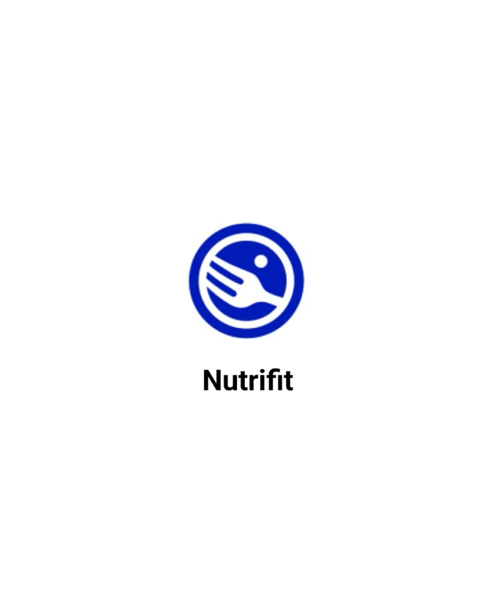 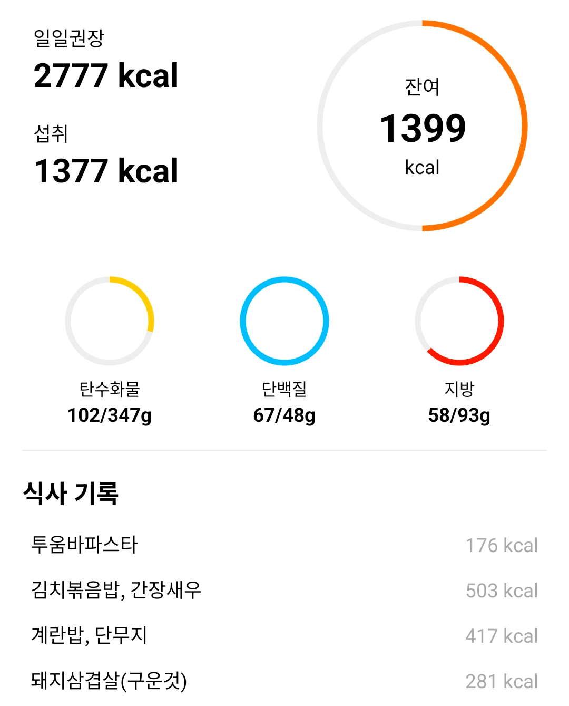

**Nutrifit**은 신체 정보와 식사 기록을 바탕으로 영양소 섭취 현황과 다음 식사의 후보를 제공하는 Android 헬스케어 애플리케이션입니다.
앱은 음식 사진을 찍으면 종류와 양을 자동으로 인식하는 기능(FoodLens SDK)과 수동 입력을 제공하고, 기록을 휴대폰 안에 저장합니다.
별도 추천 서버는 공공데이터포털의 「전국통합식품영양성분정보(음식) 표준데이터」와 앱에서 받은 사용자·식사 정보를 이용해 추천을 계산합니다.
이름은 Nutrition(영양)과 Fit(맞추다)을 합친 말로, 사용자에게 맞춘 식단을 제안한다는 뜻을 담았습니다.

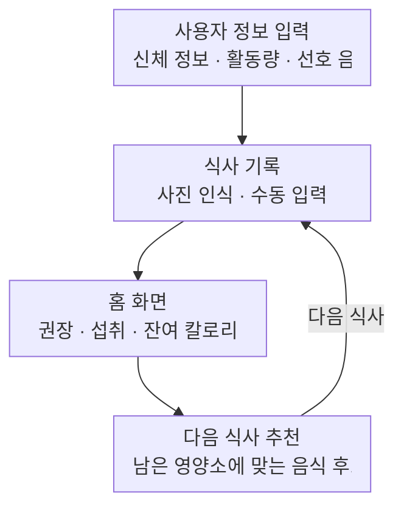

이 다이어그램은 사용자 정보를 입력한 뒤 식사 기록 → 홈 화면 → 다음 식사 추천을 반복하는 앱 사용 흐름을 도식화한 것입니다.

- **사용자 정보:** 키·몸무게·나이·성별·활동량으로 하루 영양소 목표를 계산하고, 선호 음식 종류는 추천 가중치에 씁니다.
- **식사 기록:** 사진을 찍으면 FoodLens SDK가 음식 종류와 양을 인식하고, 수동 입력은 앱의 음식 목록에서 골라 중량과 아침·점심·저녁을 입력합니다.
- **홈과 통계:** 홈에서 일일 권장·섭취·잔여 칼로리와 3대 영양소 섭취량을 보고, 주간 통계 페이지에서 날짜별 기록을 차트로 봅니다.
- **추천:** 목표에서 오늘 섭취량을 뺀 남은 영양소와 영양소 구성이 가장 비슷한 음식을 후보로 고르고, 두 식단으로 나눠 보여 줍니다.

### 1.2 기획 의도

바쁜 현대인이 건강을 위해 균형 잡힌 식단을 찾고 **챙겨 먹는 데 드는 시간을 줄이고자** 했습니다.
음식 사진을 찍으면 FoodLens SDK로 **음식의 종류와 양을 자동으로 인식**해 기록의 번거로움을 덜고, 신체 정보와 식사 기록으로 목표 대비 남은 영양소를 계산해 다음 식사로 먹을 음식 후보를 추천하는 데 집중했습니다.

### 1.3 개발 환경

| 항목 | 내용 |
|---|---|
| 장르 | Android 헬스케어 애플리케이션 |
| 기간 | 2024.09 — 2025.06 |
| 인원 | 5인 |
| 플랫폼 | Android |
| 언어 | Java (앱), Python (서버) |
| 주요 패키지 | OkHttp `4.10.0`, Gson `2.10`, FoodLens SDK |
| 서버 | Flask, pandas, NumPy, scikit-learn — AWS에서 실행 |
| GitHub | [GitHub(앱)](https://github.com/keeeery/Nutrifit), [GitHub(서버)](https://github.com/keeeery/Nutrifit_Recommendation) |
| 시연 영상 | [YouTube](https://youtube.com/shorts/G1EEo4VVekM) |

### 1.4 담당 범위

팀은 5명이며, 각자 맡은 부분은 다음과 같습니다. 코드 작업은 저장소의 커밋 기록을 기준으로 적었습니다.

- **나** — 추천 서버, 앱의 식사 기록·주간 통계·두 식단 추천 화면과 서버 연동
- **팀원 1** — Autoencoder 모델 실험, README, 버튼·레이아웃 수정
- **팀원 2** — 음식 사진 인식 API 연동, 사용자 정보 입력과 SQLite 저장, 선호 음식 입력, 사용자 수동 입력과 입력 데이터의 JSON 저장, 시작 화면
- **팀원 3** — 카메라·메인·추천·통계 화면의 레이아웃 개선
- **팀원 4** — 앱과 서버가 주고받는 JSON 키·형식 정의

| 영역 | 직접 구현·보완한 내용 | 팀 기반과의 관계 |
|---|---|---|
| 추천 서버 | 식품 데이터 정제, 영양소 목표 계산, 코사인 유사도 추천, Flask `server.py`와 JSON 응답 | 팀원 1의 Autoencoder 실험과 별도로, 수치 벡터 유사도 계산을 서버로 옮김(§2.3) |
| 앱 화면·서버 연동 | 홈의 식사 기록 표시, 주간 통계 차트, 두 식단 추천 화면과 서버 요청 | 팀원 2가 저장한 사용자 정보·식사 기록 JSON을 읽어 표시하고 서버로 보냄(§1.5) |

이 문서에서 깊게 다루는 것은 두 가지입니다.

1. **영양소 기반 추천(§2):** 사용자 정보·섭취 기록으로 오늘 부족한 영양소를 계산하고, 영양소 구성이 그와 비슷한 음식을 다음 식사 후보로 고르는 계산을 다룹니다.
2. **앱·서버 연동(§3):** 앱에 쌓인 식사 기록을 추천 서버로 보내고, 받은 추천을 두 식단으로 나눠 보여 주는 연결을 다룹니다.

### 1.5 전체 구조

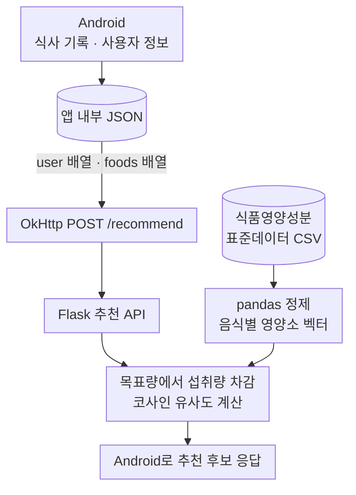

이 다이어그램은 앱의 식사 기록과 사용자 정보가 JSON으로 서버에 전달되고, 서버가 정제한 식품 데이터와 비교해 추천 후보를 돌려주는 전체 흐름을 도식화한 것입니다.

**앱은 기록을 저장하고 결과를 보여 주며, 추천 계산은 모두 서버가 맡습니다(홈의 일일 권장 칼로리만 앱이 같은 식으로 직접 계산합니다).**

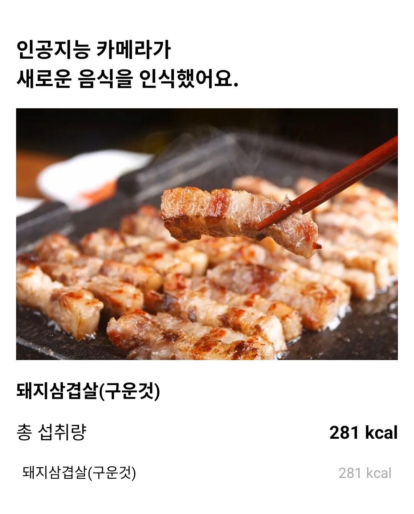

앱은 사진 인식과 수동 입력을 모두 내부 저장소의 식사 파일에 기록합니다. 사진 인식은 `CameraActivity`가 FoodLens SDK에서 결과를 받아 파일에 저장한 뒤 `CameraResultActivity`를 엽니다. 수동 입력은 `UserFoodCalculate`가 앱의 SQLite 음식 목록을 조회해 입력한 중량에 맞게 영양소를 계산합니다. 사용자 정보는 `UserInformActivity`가 SQLite에 저장한 뒤 `user_data.json`으로 내보냅니다. 이 가운데 `CameraActivity`·`CameraResultActivity`·`UserInformActivity`는 이후 일부를 고쳤습니다.

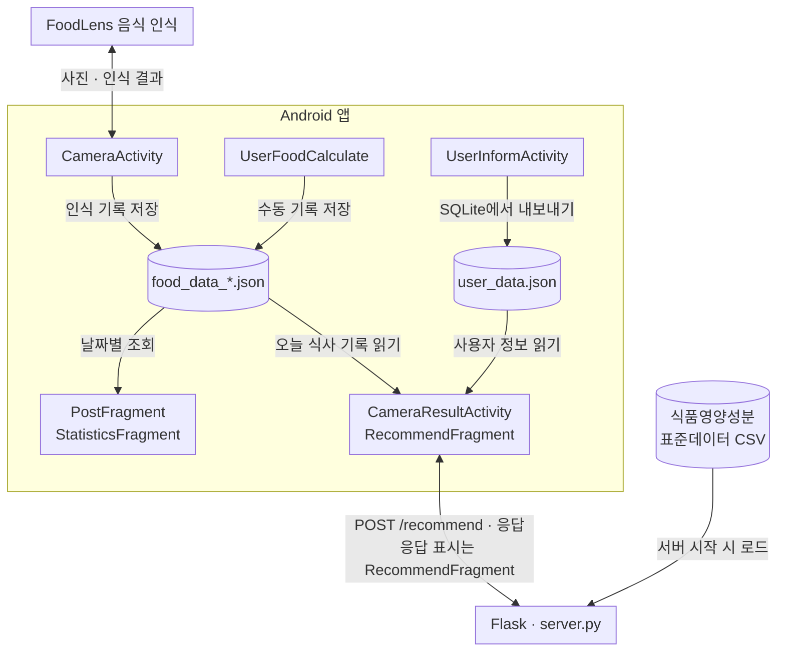

이 다이어그램은 앱 안에서 사진 인식·수동 입력·사용자 정보가 각각의 JSON 파일에 저장되고, 화면과 추천 요청이 그 파일을 읽어 서버와 주고받는 구성을 도식화한 것입니다.

**앱의 기능들이 서로 직접 부르지 않고, JSON 파일을 통해 데이터를 주고받습니다.**

`CameraResultActivity`는 화면에 최근 수정된 식사 파일을 표시하고, 추천을 요청할 때는 오늘 날짜의 식사 파일을 모두 합칩니다. 다만 받은 응답은 `MainActivity`로 넘길 뿐 화면에 쓰지 않습니다. 추천 결과를 보여 주는 곳은 `RecommendFragment`입니다. `RecommendFragment`는 오늘 날짜로 검색된 첫 파일의 배열만 전송하며, 응답 JSON에 음식이 10개 이상 있으면 두 식단으로 나눠 표시합니다. 공개 서버의 응답 형식과 후보 수는 §4.2에 정리했습니다.

식사 파일은 저장 시각을 넣은 `food_data_yyyyMMdd_HHmmss.json` 이름을 사용하며, 최상위 값은 음식 배열입니다. `foodID`는 사진 인식 항목에, `servingSize`와 `mealType`은 수동 입력 항목에 들어갑니다. 수동 입력의 `mealType` 값은 아침·점심·저녁입니다.

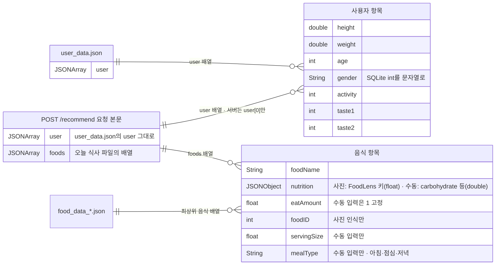

이 다이어그램은 앱 내부 JSON과 추천 요청의 구조를 도식화한 것입니다. `nutrition`은 음식 항목 안의 객체입니다. 사진 인식은 FoodLens 응답의 키를 유지하고 수동 입력은 `carbohydrate`, `fiber`, `vitaminA`, `vitaminC` 등을 사용합니다. Flask는 `user[0]`과 `foods`를 읽고 `nutrition`과 `eatAmount`로 섭취량을 차감합니다.

소스: [CameraActivity.java](https://github.com/keeeery/Nutrifit/blob/21991464c454283cf069188a4f5b7351b37b458e/app/src/main/java/com/nutrifit/CameraActivity.java#L183-L269), [UserFoodCalculate.java](https://github.com/keeeery/Nutrifit/blob/21991464c454283cf069188a4f5b7351b37b458e/app/src/main/java/com/nutrifit/UserFoodCalculate.java#L72-L119), [UserInformActivity.java](https://github.com/keeeery/Nutrifit/blob/21991464c454283cf069188a4f5b7351b37b458e/app/src/main/java/com/nutrifit/UserInformActivity.java#L193-L237), [CameraResultActivity.java](https://github.com/keeeery/Nutrifit/blob/21991464c454283cf069188a4f5b7351b37b458e/app/src/main/java/com/nutrifit/CameraResultActivity.java#L126-L188), [RecommendFragment.java](https://github.com/keeeery/Nutrifit/blob/21991464c454283cf069188a4f5b7351b37b458e/app/src/main/java/com/nutrifit/RecommendFragment.java#L57-L133), [server.py](https://github.com/keeeery/Nutrifit_Recommendation/blob/5b5e78c33435370b8980b64656b5418ba254b184/server.py#L110-L155).

---

## 2. 부족한 영양소에 맞춘 다음 식사 추천

### 2.1 개요 — 식품 데이터로 만든 추천 후보 테이블

서버는 시작할 때 CSV를 한 번 읽어 음식명·대분류와 11개 영양소를 선택하고,
결측 행을 제거한 뒤 같은 대표식품명·대분류의 영양소 평균으로 후보 테이블을 만듭니다.
요청이 오면 사용자 정보로 목표 영양소를 계산하고, 섭취량을 차감한 남은 영양소와 각 음식의 코사인 유사도를 비교합니다.

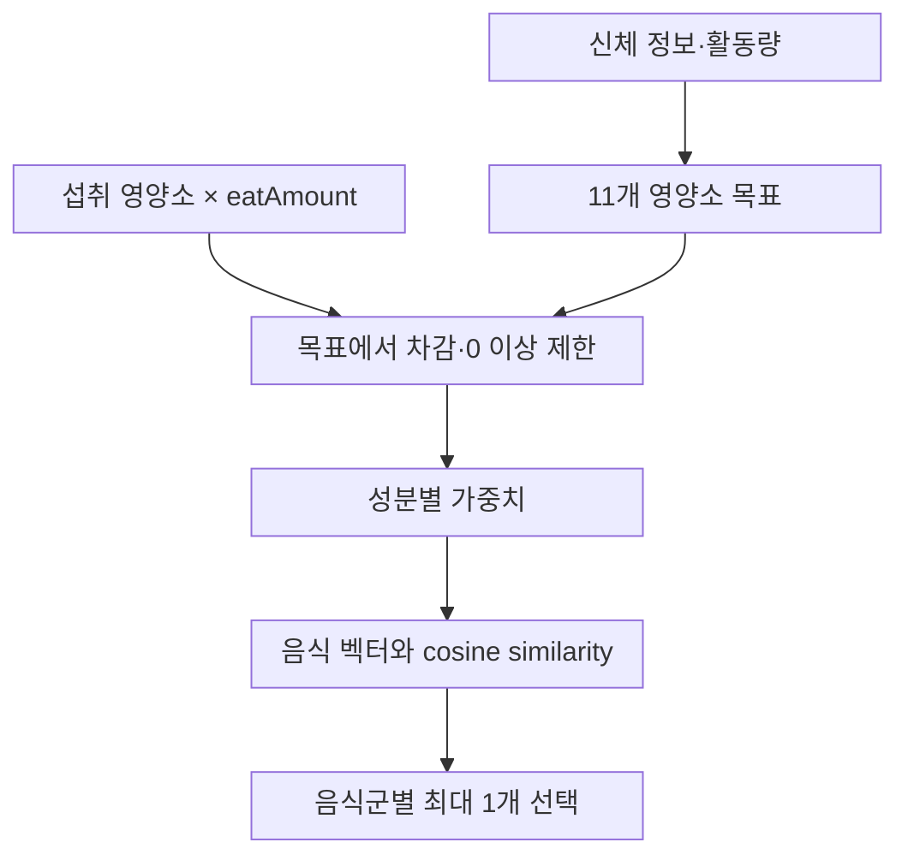

이 다이어그램은 신체 정보로 계산한 영양소 목표에서 섭취량을 빼고 가중치를 곱한 뒤, 음식 벡터와의 코사인 유사도로 음식군별 후보를 고르는 순서를 도식화한 것입니다.

```python
# server.py — 서버 시작 때 영양 데이터를 대표식품명·식품대분류명별 평균으로 묶기
nutrition_data = data[selected_columns].dropna()
nutrition_data_grouped = nutrition_data.groupby(
    ["대표식품명", "식품대분류명"], as_index=False
).mean()
```

### 2.2 남은 영양소 계산과 비슷한 음식 찾기

| API | 입력 | 결과 |
|---|---|---|
| `calculate_daily_intake(user)` | 체중·키·나이·성별·활동량 | 영양소 목표 Dictionary |
| `recommend_foods(deficiencies, taste1, taste2)` | 잔여 영양소와 선호 코드 | 음식명·영양소·추천점수 DataFrame |

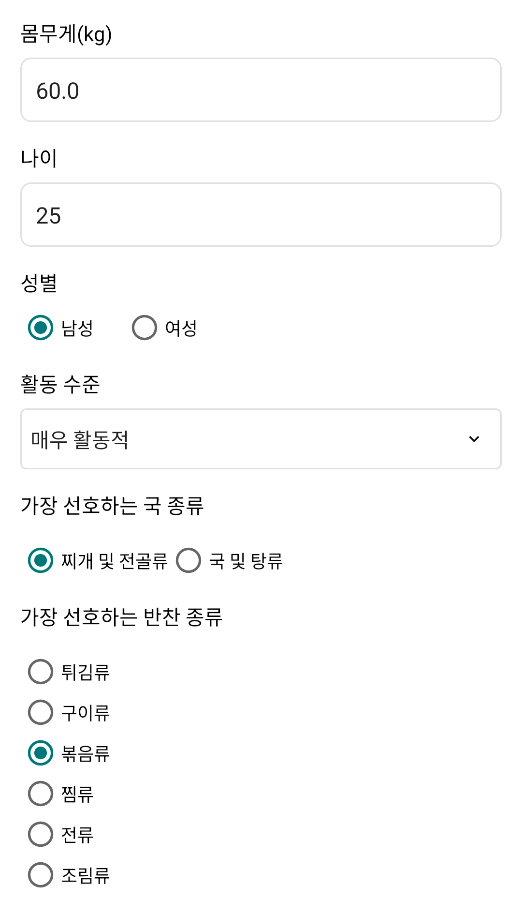

에너지 목표는 기초대사량에 활동계수를 곱해 계산하고, 단백질·탄수화물 등은 체중·에너지 비율로 정합니다.

```python
# server.calculate_daily_intake() — 기초대사량(BMR)에 활동계수를 곱해 하루 에너지 목표 계산
bmr = 10 * weight + 6.25 * height - 5 * age + (5 if gender == "1" else -161)
tdee = bmr * (1.0 + 0.2 * (activity - 1))
```

섭취 영양소에 `eatAmount`를 곱해 차감하고 음수 잔여량은 0으로 제한한 뒤,
성분별 가중치(단백질·식이섬유 1.5, 철 1.4, 칼슘 1.3, 나트륨 0.7 등)를 곱한 잔여 벡터와 음식 벡터의 유사도를 점수로 씁니다.

```python
# server.recommend_foods() 안의 select_top() — 가중 영양 벡터와의 cosine similarity로 점수를 매겨 가장 높은 1개 선택
features = df.drop(columns=["대표식품명", "식품대분류명"]).values
# boost — 선호 가중치(1.1)
scores = cosine_similarity(features, weighted_vector.reshape(1, -1)).flatten() * boost
df = df.copy()
df["추천점수"] = scores
return df.sort_values(by="추천점수", ascending=False).head(1)
```

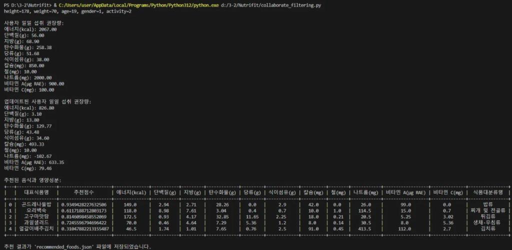

밥류 1개, 조건부 국·찌개 1개, 반찬 세 군에서 각각 1개를 골라 최대 5개 음식을 반환합니다.
시연 영상의 배포 서버는 두 식단을 만들 수 있게 10개를 돌려주지만, 그 코드는 저장소에 올라가 있지 않습니다(§4.2).

### 2.3 고민과 선택

**무엇을 기준으로 추천할까 — 음식 영양소 벡터의 유사도**

평점 이력이 없어도 계산할 수 있어, 음식 영양소 벡터의 유사도를 추천 기준으로 골랐습니다.

| 방법 | 장점 | 비용 |
|---|---|---|
| 사용자 평점 이력 기반 협업 필터링 | — | — |
| 음식 영양소 벡터의 유사도 (채택) | 평점 이력이 없어도 계산 가능 | kcal·g·mg 원본 단위의 스케일 영향 |

**모델을 쓸까 — 수치 벡터 유사도를 API 경로로**

추천을 휴대폰에서 돌릴지 서버에서 돌릴지 고민할 때(§3.4), 휴대폰에서 학습 모델을 돌리기 어려워 모델 기반 방식을 배제했습니다.
추천 계산을 서버로 옮긴 뒤에도 모델 방식으로 돌아가지 않았습니다. 서버는 pandas·numpy·scikit-learn만으로 동작했는데, 모델을 쓰려면 TensorFlow를 서버에 올리고 실행할 때마다 학습하거나 학습한 모델을 저장해 불러오는 과정을 더해야 했기 때문입니다.

| 방법 | 장점 | 비용 |
|---|---|---|
| Autoencoder로 음식 특징 학습 (팀원 1의 별도 실험) | — | 휴대폰에서 학습 모델을 돌리기 어렵고, 서버에서도 TensorFlow와 모델 학습·저장 과정을 더해야 함 |
| 수치 벡터 유사도를 API 경로로 사용 (채택) | 서버가 pandas·numpy·scikit-learn만으로 동작 | 추천 품질은 미측정 |

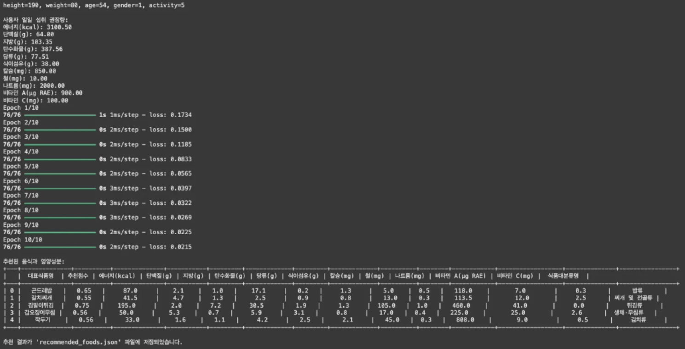

Autoencoder 실험(`model_based_filtering.py`)은 팀원 1이 작성했습니다.
이 실험 안에서도 인코더 출력은 추천에 쓰이지 않았고, 추천 점수는 정규화한 원래 영양소 벡터의 코사인 유사도로 계산했습니다.

**그 밖의 선택**

| 선택 | 이점 | 비용 |
|---|---|---|
| 음식군별 1개 선택 (식사 전체의 중량·열량을 제약식으로 최적화하는 대신) | 밥·국·반찬 형태로 구성 | 다섯 음식 합의 영양소 총합은 최적화하지 않음 |

소스: [server.py](https://github.com/keeeery/Nutrifit_Recommendation/blob/main/server.py).

---

## 3. 앱과 추천 서버 연결·주간 통계

### 3.1 개요 — 요청과 응답

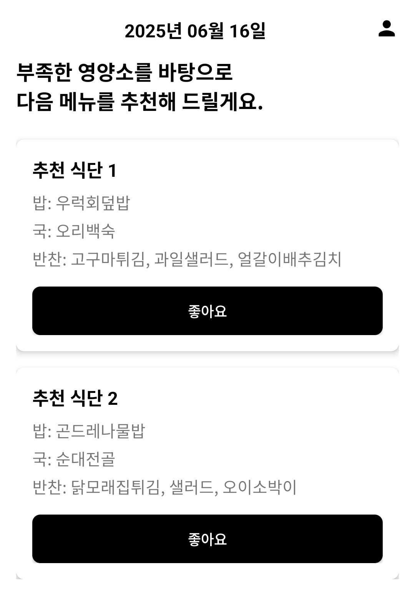

앱은 `user_data.json`과 식사 파일을 읽어 `{ "user": [...], "foods": [...] }`로 전송합니다. 두 요청 화면의 식사 파일 선택 방식은 §1.5와 같습니다.
Flask의 `POST /recommend`는 `user[0]`과 `foods`로 추천을 계산합니다. 공개 코드의 응답 형식은 요청의 `Content-Type`에 따라 JSON 배열 또는 HTML 표로 달라집니다(§4.2).

```java
// RecommendFragment.sendRecommendationRequest() — user·foods를 담은 JSON(merged)을 서버에 POST
RequestBody body = RequestBody.create(
        merged.toString(),
        MediaType.get("application/json; charset=utf-8")
);
Request request = new Request.Builder()
        .url(SERVER_URL)
        .post(body)
        .build();
```

`enqueue()`로 비동기 요청하고, 응답 문자열은 UI 스레드로 넘겨 파싱한 뒤 두 식단 UI에 나누어 표시합니다.
응답 배열은 밥(0·1)·국(2·3)·반찬(4~9) 순서로 두 개씩 와야 하며, 앱이 이를 두 식단으로 나눕니다(§3.3).
오류 응답은 앱에서 성공 여부를 확인해 Toast로 알립니다.

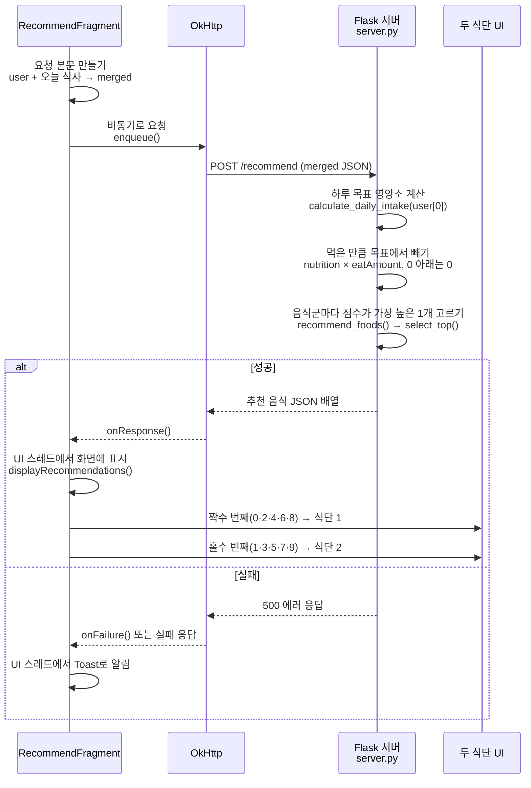

이 다이어그램은 앱이 사용자 정보와 식사 기록을 서버에 보내고, 받은 추천을 두 식단으로 나누어 표시하는 요청과 응답의 순서를 도식화한 것입니다.

### 3.2 주간 통계 차트

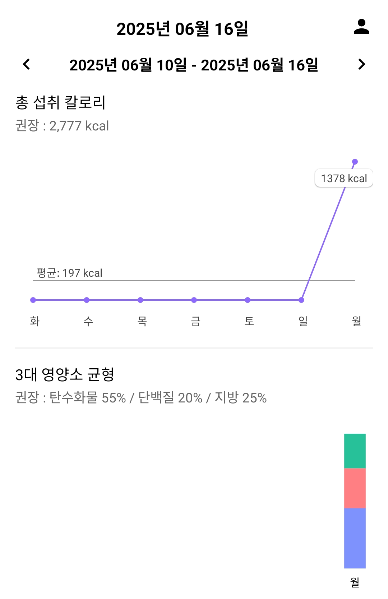

`StatisticsFragment`는 6일 전부터 오늘까지 7일을 순회해 날짜별 기록을 집계하고, 차트 View에는 목록만 전달합니다.

```java
// StatisticsFragment.updateCharts() — 집계한 7일 목록만 차트 View에 전달
calorieChart.setData(labels, calorieData);
nutritionChart.setData(labels, nutritionData);
```

`CustomLineChart`는 Canvas·Path로 선과 점, 평균선을 그리고, 터치한 위치와 가까운 날의 kcal 말풍선을 화면 안쪽으로 보정해 띄웁니다.
`CustomBarChart`는 하루 탄수화물·단백질·지방의 g 구성비를 누적 막대로 그립니다.
앱의 의존성에는 차트 라이브러리가 한 번도 추가되지 않았고, 두 차트는 직접 그립니다.
막대의 x 위치는 꺾은선과 같은 `padding + i * xStep`으로 계산해, 두 차트가 같은 날짜를 같은 x 위치에 놓습니다.

소스: [RecommendFragment.java](https://github.com/keeeery/Nutrifit/blob/main/app/src/main/java/com/nutrifit/RecommendFragment.java), [StatisticsFragment.java](https://github.com/keeeery/Nutrifit/blob/main/app/src/main/java/com/nutrifit/StatisticsFragment.java).

### 3.3 두 식단 칸에 같은 추천이 들어가던 문제

- **증상:** 추천 화면의 식단 칸 두 개가 모두 같은 결과(같은 밥·국·반찬)로 채워졌습니다.
- **원인:** 서버가 음식군마다 1개씩 식단 한 벌만 돌려주었고, 앱은 그 한 벌에서 만든 밥·국·반찬 문자열을 식단 1과 식단 2의 칸에 똑같이 넣었습니다.
- **해결:** 서버 결과 10개를 받아 짝수 번째(0·2·4·6·8)는 식단 1, 홀수 번째(1·3·5·7·9)는 식단 2로 나눴습니다. 결과가 10개보다 적으면 표시하지 않고, 「추천 없음」으로 온 음식은 빈칸으로 둡니다.
- **결과:** 시연 영상(2025.06.16)의 추천 화면에 서로 다른 두 식단이 표시됩니다(§4.2).

소스: [두 가지 식단 추천 변경 커밋](https://github.com/keeeery/Nutrifit/commit/bcb61d40f72cb790dc1dad6255bad8436bf45521).

### 3.4 고민과 선택

**추천 계산을 어디서 돌릴까 — 휴대폰 대신 서버(AWS EC2)**

첫 학기에는 추천 계산을 휴대폰 안에서 돌릴지, 따로 서버를 두고 돌릴지 정하지 못해 개발 과정에 혼선이 있었습니다.
다음 학기에 서버에서 돌리기로 정하고 AWS EC2에 Ubuntu 서버를 구축했습니다.
식품 데이터와 `user_data.json`·`food_data.json` 세 파일을 입력받아 결과를 출력하던 Python 추천 코드는 Flask로 바꿔 서버에서 동작하게 하고, 식품 데이터 CSV는 서버에 올려 두었습니다.
그래서 앱은 사용자 정보와 식사 기록만 POST로 보내고, 서버가 계산한 추천 결과를 받아 화면에 보여 줍니다(§1.5).
대신 앱과 서버가 주고받는 키·형식·결과 개수를 양쪽에서 함께 맞춰야 하는 비용이 생겼습니다(§4.2).

---

## 4. 결과와 배운 점

### 4.1 구현 결과

시연 영상(2025.06.16)의 추천 화면에 서로 다른 두 식단이 표시됩니다(§3.3). 다만 시연 영상의 배포 서버 최종 코드는 저장소에 올라가지 않았습니다(§4.2).

아래는 제가 맡은 부분의 결과입니다. 사진 인식·사용자 정보 입력 같은 팀원의 부분은 §1.4에 있습니다.

| 구현 결과 | 핵심 방법 | 자세히 |
|---|---|---|
| 음식 데이터를 정리한 추천 후보 테이블 | 결측 제거·분류별 평균 | §2.1 |
| 오늘 먹은 것을 반영한 다음 식사 추천 | 남은 영양소·가중치·코사인 유사도 | §2.2 |
| 앱에서 추천 서버로 요청하고 결과를 받는 연결 | OkHttp 비동기 요청·Flask API | §3.1 |
| 한 주의 섭취량을 보여 주는 통계 차트 | Canvas 기반 꺾은선·누적 막대 차트 | §3.2 |

### 4.2 한계와 개선 과제

- **배포 서버 코드가 저장소에 없음:** 시연 영상(2025.06.16)의 AWS 서버는 음식 10개를 JSON으로 돌려주어 추천 식단 두 개가 표시됩니다. 앱은 같은 날 두 식단(결과 10개)을 기대하도록 바뀌었지만, 서버 저장소의 마지막 커밋은 2025.04.19입니다. 공개된 `server.py`로는 이 화면이 나오지 않으므로, 배포 서버의 최종 코드는 저장소에 올라가지 않은 상태입니다. 공개 코드를 그대로 실행하면 다음 세 곳에서 앱과 맞지 않습니다.
  - **MIME:** 서버는 `Content-Type`이 정확히 `application/json`일 때만 JSON을 돌려주고 나머지는 HTML 표로 돌려줍니다. OkHttp는 `application/json; charset=utf-8`을 보내므로 HTML이 돌아오고, 앱의 JSON 파싱이 실패합니다.
  - **결과 개수:** 서버는 음식군마다 1개씩 최대 5개를 고르지만, 앱은 10개보다 적으면 「추천 결과가 부족합니다」를 띄우고 표시하지 않습니다.
  - **영양소 키:** 수동 입력 기록은 `carbohydrate`·`fiber`·`vitaminA`·`vitaminC`로 저장되는데, 서버는 `carbonhydrate`·`dietrayfiber`·`vitamina`·`vitaminc`를 읽어 키를 찾지 못합니다.
  
  → 배포한 서버 코드를 저장소에 올리고, MIME·개수·키 계약을 양쪽에서 통일해 실행으로 확인하는 것이 다음 과제입니다.
- **선호도 반영:** 선호 가중치(`boost=1.1`)가 같은 분류의 모든 점수에 똑같이 곱해져 실제 순위를 바꾸지 못합니다. → 선호도 효과 개선이 필요합니다.
- **추천 품질:** 단위 표준화와 가중치 효과, 추천 결과의 품질은 측정하지 않았습니다. → 단위 표준화와 데이터 품질·표본 평가가 다음 과제입니다.

### 4.3 배운 점과 회고

이 프로젝트는 데이터 계산을 API로 제공하고 클라이언트에서 사용하도록 연결한 경험입니다.
앱과 서버를 나누면 화면과 계산을 따로 바꿀 수 있지만, 그만큼 입력 키·배율·MIME·결과 배열 순서 같은 **계약을 양쪽에서 함께 관리해야 한다**는 점이 남았습니다.

§1.2에서 목표한 "챙겨 먹는 데 드는 시간과 기록의 번거로움을 줄이는 것"이 실제로 이루어졌는지는, 실사용 테스트를 하지 못해 확인하지 못했습니다.
