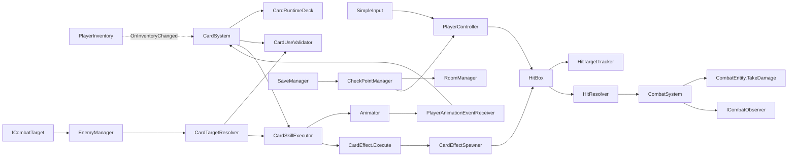
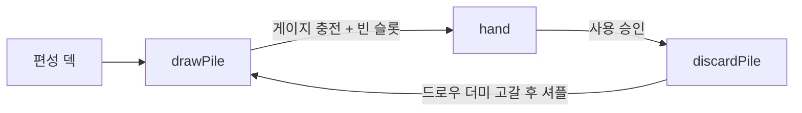
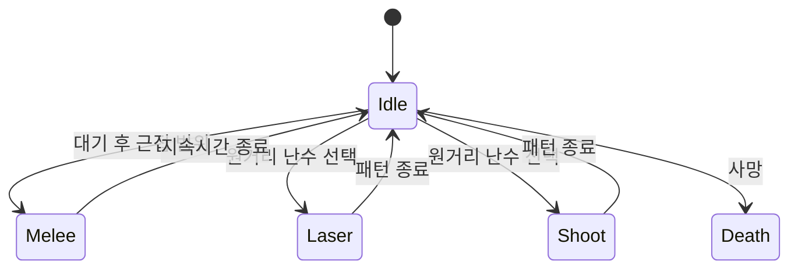
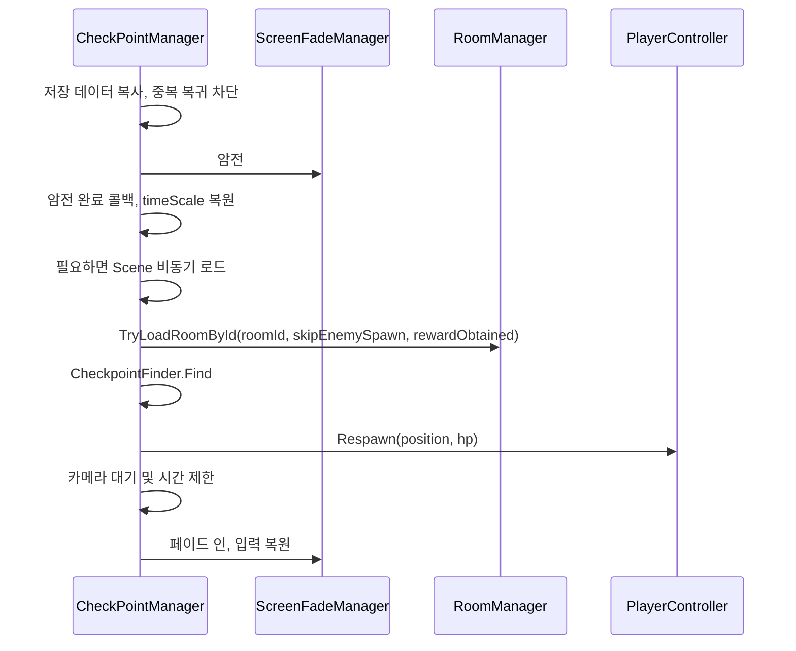

# Arcanist — 2D 카드 액션 게임 기술 문서

| 시스템 | 핵심 역할 | 구현 방식 |
|---|---|---|
| A. 전투와 패링 | 충돌 판정, 중복 타격 방지, 피해 전달, 패링 보상 | HitBox/HurtBox, 중재자, Observer |
| B. 카드 전투 | 덱 순환, 사용 가능 조건, 모션 후 효과 실행 | ScriptableObject, 실행 컨텍스트 |
| C. 인벤토리와 보상 | 보유 목록·편성 덱 구분, 편성 제약, 보상 추첨 | 변경 이벤트, 카드별 가중치 |
| D. 이동과 AI | 이동 자원·연출, 일반 적 감지·상태·반응, 골렘 패턴 | 런타임 책임 분리, 상태 머신 |
| E. 방과 체크포인트 | 방 로드, 사망 복구, 클리어 여부에 따른 적 재생성 | ID 기반 복원, 코루틴 |

이 문서의 중심은 다음 세 구현입니다.

| 핵심 구현 | 기술적으로 보여주는 내용 | 상세 절 |
|---|---|---|
| **전투·패링과 카드 수급** | 타격 중복 제어, 피해 전 패링 해결, 성공 보상으로 이어지는 플레이 흐름 | 2절 |
| **카드 실행 구조** | 런타임 덱·사용 검증·애니메이션 발동·효과 데이터의 책임 분리 | 3절 |
| **씬 전환과 체크포인트 복귀** | 유지 객체의 작업 소유, 로드 후 참조 갱신, 저장 상태와 방 복구 연결 | 6~7절 |

인벤토리·보상·이동·AI는 이 세 흐름을 뒷받침하는 구현 자료로 함께 정리했습니다.
전투 판정·공통 타겟, 이동 자원·연출, 적 AI, 카드·인벤토리·보상 UI도 직접 구현하고 책임별로 분리했습니다.

---

## 1. 프로젝트 개요

### 1.1 What — 무엇을 구현했나

처음으로 개인 게임 개발을 경험한 프로젝트입니다.
전투·패링·카드·인벤토리·보상·보스·저장과 복구를 연결하며, 개별 기능을 하나의 플레이 흐름으로 구성했습니다.
핵심은 **패링 성공으로 카드 게이지를 얻고, 카드를 사용해 전투를 이어가는 흐름**입니다.

`Arcanist` 네임스페이스의 2D 액션 코드에 실시간 카드 사용을 결합한 프로젝트입니다.
플레이어는 이동·점프·공격·패링을 수행하며, 충전된 게이지로 카드를 뽑아 Q/W/E 슬롯에서 사용합니다.
카드는 투사체 공격뿐 아니라 피해 증가·받는 피해 조절·회복·일회 부활 등에도 사용됩니다.
방의 전투와 보상을 진행하고, 체크포인트를 통해 저장된 위치와 체력으로 복귀합니다.

### 1.2 기술적으로 다루는 문제

| 구현에서 다루는 문제 | 현재 구조 |
|---|---|
| 여러 충돌체 접촉으로 같은 공격이 반복 적용될 수 있음 | 공격별 `HashSet<HurtBox>` 또는 타격 시각 Dictionary |
| 카드마다 모션·생성 위치·타겟 요구 조건이 다름 | `CardData`와 `CardEffect` 분리, `CardEffectContext` 전달 |
| 보유 카드와 편성 덱, 전투 중 카드 위치가 서로 다름 | 인벤토리와 런타임 카드 목록 분리 |
| 애니메이션 도중 공격 타이밍을 맞춰야 함 | 애니메이션 이벤트 수신기에서 HitBox·투사체 제어 |
| 사망 복구 시 적·방·플레이어 상태를 함께 복원해야 함 | 체크포인트 스냅샷 → 방 로드 → 플레이어 리셋 |

### 1.3 개발 환경

| 항목 | 내용 |
|---|---|
| Engine | Unity `6000.3.15f1` |
| Rendering | Universal RP `17.3.0` |
| Input | Input System `1.19.0`, 프로젝트 입력 래퍼 `SimpleInput` |
| 기타 패키지 | Cinemachine `3.1.7`, LDtkUnity `6.12.3`, 2D Animation `13.0.4` |
| GitHub | [https://github.com/KooHoo-Dev/3rd-2D-Project-keeeery](https://github.com/KooHoo-Dev/3rd-2D-Project-keeeery) |

환경 설정: `ProjectVersion.txt`, `manifest.json`.

### 1.4 전체 흐름



전투는 `CombatSystem.To` 호출 안에서 즉시 피해를 적용하고 결과를 알리는 방식입니다.
HitResolver는 넉백·스턴을, HitBox는 피격 FX와 타격 연출을 담당합니다. Observer는 전투 결과를 통지받습니다.

---

## 2. 기능 A — 충돌 기반 전투와 패링

공격 충돌체가 감지한 대상을 검증하고, 단발·다단 공격의 중복 적용을 제어한 뒤 패링 또는 피해로 해결합니다.
판정은 `HitBox`, 타격 기록은 `HitTargetTracker`, 전투 결과 적용은 `HitResolver`가 담당합니다.

### 2.1 시스템 구조 — 충돌·중복 기록·결과 적용 분리

| 클래스 | 책임 |
|---|---|
| `HitBox` | 충돌 진입, 사용 불가 대상 제외, 결과별 연출 |
| `HitTargetTracker` | HurtBox별 단발 기록·다단 타격 간격 |
| `HitResolver` | 패링, 피해 이벤트, 넉백·스턴 적용 |
| `ICombatTarget` | 일반 적·보스의 타겟 속성 계약 |
| `IStunnable` | 문자열 메시지 대신 스턴 적용 계약 |
| `CombatSystem` | 피해 전달 및 Observer 통지 |

소스: `HitBox.cs`, `HitResolver.cs`, `HitTargetTracker.cs`.

### 2.2 핵심 구현 — 한 공격의 중복 타격 제어

```csharp
if (allowMultiHit == false)
    return hitTargets.Add(hurtBox);

if (lastHitTimes.TryGetValue(hurtBox, out float lastHitTime)
    && Time.time - lastHitTime < multiHitInterval)
    return false;

lastHitTimes[hurtBox] = Time.time;
return true;
```

현재 `HitTargetTracker.TryRegister`는 허용 여부 판단과 기록을 한 번에 수행합니다.
단발 공격은 HashSet 추가 성공 여부를, 다단 공격은 마지막 타격 이후 시간을 사용합니다.
`HitBox.OnEnable/Initialize`에서 기록을 비워 풀 재사용 시 이전 공격의 기록이 남지 않게 합니다.
기준은 개체가 아닌 HurtBox이므로 한 개체의 여러 HurtBox는 별도 기록됩니다.

### 2.3 핵심 구현 — 패링을 피해 전달 전에 해결

```csharp
PlayerController playerController = receiver.GetComponent<PlayerController>();
if (playerController != null && playerController.IsParryWindowOpen)
{
    playerController.SuccessParry();
    return new HitResolution(HitResolutionStatus.Parried);
}
```

현재 순서는 **대상 검증 → TryRegister → Resolve → Applied일 때 타격 연출**입니다.
패링은 피해 전달 전에 반환하지만 중복 기록 뒤에 발생합니다.
따라서 단발 공격은 패링된 HurtBox도 기록되어 같은 활성 구간에서 다시 피해를 주지 않습니다.
다단 공격은 `multiHitInterval` 이후 재시도가 가능하므로 방어 후 재접촉 동작을 따로 검증해야 합니다.
`SuccessParry`는 패링 창을 닫고 게이지를 추가하며 성공 애니메이션·화면 효과를 실행합니다.
패링을 카드 수급과 연결한 핵심 플레이 흐름입니다.

`HitResolutionStatus`는 Ignored/Parried/Applied를 구분합니다.
Applied가 아니면 일반 피격 FX·히트스톱·카메라 흔들림·적중 폭발 경로로 진행하지 않습니다.
넉백·스턴은 수신자의 `CanReceiveKnockback/CanReceiveStun`을 확인하며, 스턴은 `IStunnable.ApplyStun`으로 호출합니다.

### 2.4 핵심 기능 — 피해 전달과 결과 구독

| 작업 | API | 동작 |
|---|---|---|
| 피해·회복 이벤트 전달 | `CombatSystem.To(sender, receiver, combatEvent)` | 이벤트 종류에 따라 즉시 처리 |
| 결과 수신 등록 | `Subscribe(ICombatObserver observer)` | 중복 등록 제외 |
| 결과 수신 해제 | `UnSubscribe(ICombatObserver observer)` | 등록된 Observer 제거 |
| 공격 소유자 재설정 | `HitBox.Initialize(CombatEntity owner)` | 타격 기록과 연출 상태 초기화 |

```csharp
private void HandleDamageEvent(CombatEntity sender, CombatEntity receiver, CombatEvent @event)
{
    receiver.TakeDamage(@event.Amount);

    for (int i = 0; i < observerList.Count; ++i)
        observerList[i].OnDamageTaken(sender, receiver, @event);
}
```

피해는 수신자에게 먼저 적용되고 Observer에 통지됩니다.
`HandleHealEvent`는 Observer 통지만 수행합니다. 회복 적용은 `Player.TakeHeal` 등 별도 호출 경로에 있습니다.

### 2.5 고민과 선택

| 선택 | 현재 구현의 이점 | 비용·제약 |
|---|---|---|
| 직접 호출 대신 `CombatSystem.To` 경유 | 피해 전달과 알림 지점을 모음 | FX는 HitBox, 넉백·스턴은 HitResolver에 연결 |
| 콜라이더 Dictionary 등록 | 등록된 충돌체는 바로 조회 | 누락 시 `GetComponentInParent/Children` 검색 발생 |
| 단발·다단 판정을 같은 HitBox에 제공 | 공격 프리팹 설정으로 구분 | HurtBox 단위 중복 정책을 이해해야 함 |

---

### 2.6 보충 — 피격 수치와 UI 피드백의 분리

`BaseStat`의 수치 변경과 Player·Enemy의 피격 반응은 엔티티가 처리하고,
`DamagePopupFeedback`·`HealPopupFeedback`은 `ICombatObserver`로 전투 결과를 받아 숫자를 표시합니다.
팝업 컴포넌트는 `ComponentPool<FloatingText>`로 비활성 객체를 재사용하고, `FloatingText`는 위치·투명도 트윈을 재시작합니다.
이 경로는 전투 적용 함수가 화면의 개별 텍스트 오브젝트를 생성·배치하는 책임을 갖지 않도록 합니다.

체력바는 즉시 줄어드는 본체와 잠시 뒤 따라오는 지연 바를 구분합니다.
연속 피격 시 이전 지연 Sequence를 Kill하고 새 피격 전후 비율로 다시 구성합니다.
회복 시에는 지연 바를 현재 체력에 맞추고 녹색에서 기본색으로 돌아오는 효과를 실행합니다.
비활성화·초기화에서 트윈을 정리하므로 리스폰 시 이전 감소 연출을 이어가지 않습니다.

UI·체력바·피격·패링의 수동 시간 보간을 DOTween으로 옮기는 과정에서,
‘새 효과가 오면 이전 효과를 끝내고 다시 시작하는가’와 ‘비활성화할 때 정리하는가’를 각 컴포넌트 생명주기에 연결했습니다.
이는 코드 반복을 줄이는 선택이지만 트윈 대상의 상태 초기화 책임까지 자동으로 해결해 주지는 않습니다.

`HitStopController`는 `Time.timeScale = 0` 후 `WaitForSecondsRealtime`로 대기하고 1로 복구합니다.
이 구현은 직전 배율을 저장하지 않으므로, 메뉴 일시정지와 겹치는 경우의 배율 소유 정책은 추가 확인 대상입니다.

소스: `HealthBarUI.cs`, `FloatingTextPool.cs`, `HitStopController.cs`.

---


## 3. 기능 B — 카드 순환과 모션 연계 스킬

보유 카드·편성 덱과 전투 중 카드 위치를 나누고, 사용 조건 검증과 실제 효과 발동을 분리합니다.
카드 데이터는 ScriptableObject로 정의하고 실행 시 플레이어·생성 위치·방향·타겟을 전달합니다.

### 3.1 데이터와 실행 책임 분리

`CardData`는 ID·이름·아이콘·분류·등급·모션 트리거·효과 참조를 보유합니다.
`CardEffect`는 `Execute(CardEffectContext)` 계약을 제공하는 ScriptableObject이며, 투사체와 버프 효과가 이를 상속합니다.
카드 사용자는 실제 효과 종류를 분기하지 않고 같은 실행 진입점을 호출할 수 있습니다.

소스: `CardData.cs`, `CardEffect.cs`, `CardSystem.cs`.

### 3.2 시스템 구조 — 카드의 런타임 위치

| 목록 | 의미 |
|---|---|
| `ownedCards` | 보유 카드의 런타임 복사 |
| `playerDeck` | 현재 편성 덱 |
| `drawPile` | 아직 뽑지 않은 카드 |
| `hand` | 손패 |
| `discardPile` | 사용한 카드 |



게이지 충전 외에도 덱 초기화 여부, `CardHandUI.IsBusy`, 빈 슬롯 유무를 확인합니다.
현재는 드로우 시도 직전에 `BeginNextGaugeCycle()`을 호출해 다음 게이지 주기를 시작합니다.
덱 동기화 시 기존 손패를 통째로 초기화하지 않고 드로우·버림 목록에서 빠진 카드를 제거합니다.

### 3.3 핵심 기능 — 사용 승인과 실제 실행의 분리

카드 처리 책임을 다음 순수 C# 클래스로 분리하고, 타겟 계약과 손패 UI도 별도 구성했습니다.

| 클래스 | 역할 |
|---|---|
| `CardSystem` | 입력, 게이지, 인벤토리와 UI 조율 |
| `CardRuntimeDeck` | 보유·편성·드로우·손패·버림 목록, 셔플과 순환 |
| `CardUseValidator` | 회복 가능 여부와 필수 타겟 검증, 실패 enum 반환 |
| `CardSkillExecutor` | 대기 카드, 애니메이션 시작, 발동 시 실제 효과 실행 |
| `CardTargetResolver` | 카드별 타겟 필요 여부와 공통 타겟 조회 |

| 외부 진입점 | 용도 |
|---|---|
| `CardSystem.OnGaugeFull()` | 충전 완료를 기록하고 드로우 조건 검사 |
| `CardSystem.ExecutePendingCardSkill()` | 애니메이션 이벤트에서 대기 효과 실행 |
| `CardSystem.ResetRuntimeCardsForRespawn()` | 대기 효과·덱·손패 UI·게이지 초기화 |

소스: `CardRuntimeDeck.cs`, `CardSkillExecutor.cs`, `CardUseValidator.cs`.

사용 시에는 회복 가능 여부·타겟 존재 여부를 검사하고 `CardSkillExecutor.pendingCard`를 저장합니다.
이후 애니메이션 트리거를 재생하고 슬롯에서 카드를 제거하며 버림 더미로 이동합니다.
실제 효과는 `CardSkillExecutor.ExecutePending()`에서 발생합니다.
유효한 Animator 트리거가 없으면 즉시 실행하는 경로도 있습니다.

```csharp
CardEffectContext context = new(
    card, playerController, resolvedCastPoint, facingDirection, target);
card.Effect.Execute(context);
return new CardSkillExecutionResult(CardSkillExecutionStatus.Executed, card);
```

실행 시점에 타겟을 다시 찾기 때문에, 입력 시점과 애니메이션 발동 시점 사이에 적이 죽은 경우를 구분합니다.
다만 이미 슬롯·손패에서 소비된 뒤 실행이 취소될 수 있으며, 해당 경로에는 카드 환불 처리가 없습니다.
타겟 소멸 시 소비 정책은 현재 환불 없는 방식입니다.

### 3.4 투사체를 프리팹 설정으로 확장

`ProjectileCardEffect`는 생성 위치(`CastPoint`, `TargetPosition`)와 조준 방식(`Forward`, `Target`, `None`)을 조합합니다.
목표 위치 생성이나 목표 조준을 선택하면 `RequiresTarget`이 true가 됩니다.
풀에서 얻은 객체에 방향·소유자를 주입하고 자식 HitBox도 초기화합니다.
이 구조로 전방 발사체와 적 위치에 생성되는 공격을 같은 효과 클래스에서 구성합니다.

소스: `ProjectileCardEffect.cs`.

### 3.5 타겟 선정 정책

`EnemyManager`는 일반 적과 보스를 하나의 `List<ICombatTarget>`으로 관리합니다.
조회 중 파괴된 Unity 객체를 제거하고 `IsTargetable`과 `IsDead`를 확인합니다.
`CardTargetResolver`는 `TryFindBestTarget` 결과의 TargetPoint만 사용하므로 구체 EnemyController/BossController 분기를 갖지 않습니다.
사망·비활성 대상을 제외하고 **등급 우선, 같은 등급에서는 거리 우선**으로 선택합니다.
따라서 가장 가까운 일반 적보다 멀리 있는 보스가 우선될 수 있습니다.
거리 비교에는 `sqrMagnitude`를 사용합니다. 시야·벽·화면 범위 검사는 이 함수에 없습니다.

### 3.6 버프 중첩과 지속시간 갱신

단일 배율 필드 대신 `List<ActiveBuff>`로 활성 효과를 관리하도록 변경했습니다.
`BuffId + ActiveBuffType`이 같으면 새 항목을 쌓지 않고 값과 종료 시각을 Refresh합니다.
서로 다른 ID의 버프는 함께 적용됩니다.

| 계산 | 현재 규칙 | 예시 |
|---|---|---|
| 주는 피해 증가 | 각 `Value - 1`의 양수 증가분 합산 | 1.2배와 1.3배 → 1.5배 |
| 받는 피해 증가 | 증가분 합산 | 1.2배와 1.3배 → 1.5배 |
| 받는 피해 감소 | `(1 - Clamp01(Value))` 누적 곱 | 20%, 30% 감소 → 0.56배 |
| 카드 충전 속도 | 증가분 합산으로 시간을 나눔 | 합산 1.5배 → 기준시간 / 1.5 |
| 무적 | 유효한 무적 항목이 있으면 피해 0 | 일회 부활 소모 뒤 일정 시간 적용 |

동일 버프 갱신은 남은 시간에 더하는 방식이 아니라 `현재 시각 + 새 지속시간`으로 종료 시점을 대체합니다.
만료 항목은 피해·충전 계산 또는 버프 추가 시 역순으로 제거합니다. 매 프레임 제거 루프는 없습니다.
일회 부활 대기는 별도 플래그로 관리하고, 소모 후 `ActiveBuffType.Invincibility`를 등록합니다.
소스: `BuffController.cs`, `ActiveBuff.cs`.

### 3.7 고민과 선택 — 효과 재사용

`CardEffectSpawner`는 프리팹별 `ComponentPool<Transform>`을 Dictionary로 보유합니다.
반환은 비활성화, 획득은 비활성 객체의 재활성화로 수행합니다.
현재 `ComponentPool.Get()`은 List를 순회하고, 여유 객체가 없으면 `Instantiate`합니다.
획득 비용은 생성된 객체 수에 비례하며, 풀 고갈 시 런타임 생성이 발생합니다.

| 접근 | 장점 | 현재 구현에서 고려할 점 |
|---|---|---|
| 효과마다 생성·파괴 | 생명주기가 단순 | 반복 생성 비용 발생 |
| 현재의 비활성 객체 재사용 | 생성된 효과를 다음 사용에 재활용 | 검색 O(n), 고갈 시 생성, 초기 상태 복구 필요 |
| 효과를 ScriptableObject로 분리 | 데이터 조합과 공통 실행 계약 | 씬의 플레이어·타겟 정보는 실행 컨텍스트로 전달 필요 |

객체 재사용 경로는 구현되어 있으며, GC와 프레임 시간 개선량은 미측정입니다.

---

### 3.8 보충 — 게이지 초과분과 손패의 작업 상태

패링 보상 `AddCells`는 현재 게이지에 더한 칸이 최대치를 넘으면 `overflowCells`로 남깁니다.
다음 드로우 주기의 `BeginNextGaugeCycle`은 이 초과분을 가져와 게이지를 채운 상태로 재충전합니다.
다만 이미 `isGaugeFull`이면 `AddCells`가 바로 반환하므로, 가득 찬 뒤 추가로 받은 보상을 계속 누적하는 구조는 아닙니다.

```csharp
int totalCells = currentCell + amount;
overflowCells = Mathf.Max(0, totalCells - gaugeCells.Length);
currentCell = Mathf.Min(totalCells, gaugeCells.Length);
```

버프가 바꾸는 초당 충전 속도는 `ChargeLoop`가 각 칸의 대기를 시작할 때 읽습니다.
이미 시작된 `WaitForSeconds`를 버프 갱신 즉시 다시 계산하지는 않습니다.

`CardHandState`는 Idle/Drawing/Using을 구분합니다.
드로우 시작에 빈 슬롯을 예약하고 Drawing으로, 사용 시작에 Using으로 전환하며 완료 시 Idle로 돌아갑니다.
따라서 IsBusy는 드로우뿐 아니라 사용 연출도 포함합니다.
상태는 CardHandState, UI 오브젝트 생성·배치는 CardHandView,
드로우·사용·사용 FX 보간은 각 Motion 클래스가 나눠 담당합니다.
`ClearAllSlots`는 코루틴과 슬롯 상태를 함께 정리하는 리스폰 진입점입니다.

### 3.9 보충 — 투사체의 생성·이동·폭발·반납

`ProjectileController.OnEnable`은 수명·폭발 상태를 초기화하고 충돌체를 켭니다.
`Initialize`에서 방향과 공격 소유자를 전달하며, 생성 애니메이션 뒤 `StartMove` 이벤트로 이동을 시작할 수 있습니다.
이동은 FixedUpdate의 Rigidbody2D.MovePosition을 우선 사용하고 Rigidbody가 없으면 Transform을 이동합니다.

적중 후 동작은 설정에 따라 즉시 비활성화하거나, 이동·충돌을 멈추고 Explode 트리거를 실행합니다.
수명 초과와 폭발 종료는 `DestroySelf`를 경유하지만 실제 처리는 `CardEffectSpawner.Despawn`의 비활성화입니다.
따라서 이름의 Destroy와 실제 객체 파괴를 구분해야 하며, 재활성화 때의 상태 초기화가 재사용 조건입니다.

소스: `CardGaugeController.cs`, `CardHandState.cs`, `ProjectileController.cs`.

---


## 4. 기능 C — 인벤토리·덱 편성과 카드 보상

획득한 카드를 보유 목록에 추가하고, 편성 규칙을 만족하는 덱으로 전투에 사용할 카드를 선택합니다.
보상 추첨은 보유·중복 카드를 제외한 후보에 카드별 등급 가중치를 적용합니다.

### 4.1 시스템 구조

`PlayerInventory`는 보유 카드와 편성 카드를 분리하고 `OnInventoryChanged`로 변경을 알립니다.
`CardSystem`은 `OnEnable`에서 구독하고 `OnDisable`에서 해제하여 런타임 덱과 동기화합니다.
보상을 받았다고 즉시 덱에 자동 편성하지는 않습니다. `GrantReward`는 `AddCard(selectedCard, false)`를 호출합니다.

소스: `PlayerInventory.cs`, `RewardController.cs`.

### 4.2 핵심 기능 — 편성 규칙

소스 기본값은 최소 6장, 덱 비용 8~14, 최대 20장입니다.
실제 값은 Inspector 직렬화 설정이 우선하므로 이 수치를 모든 씬의 확정 규칙으로 취급하지 않습니다.
`CardData.Cost`는 Common/Rare/Epic/Legendary에 각각 1/2/4/6을 반환합니다.
`CanCompleteDeckEdit`에서 최소 장수와 비용 범위를 함께 판단합니다.
`DeckEditFailure`와 `CanAddToDeck/TryAddToDeck`은 추가 가능 여부와 실패 이유를 모읍니다.
InventoryWindow는 선택(`InventorySelection`), 정렬(`InventoryCardSorter`), 조건 표시(`DeckConditionView`), 슬롯 목록(`InventorySlotList`)을 조합합니다.

추가·검증 API는 실패 이유를 `DeckEditFailure`로 반환합니다.

| API | 용도 |
|---|---|
| `CanAddToDeck(CardData cardData)` | 편성 가능 여부만 검사 |
| `TryAddToDeck(CardData cardData)` | 검사 후 실제 추가, 결과 반환 |
| `CanCompleteDeckEdit()` | 최소 장수와 비용 범위 충족 여부 반환 |
| `AddCard(CardData cardData, bool addToDeck = true)` | 보유 목록 추가 및 선택적 덱 편성 |

### 4.3 핵심 기능 — 보상 추첨

보유 카드와 같은 보상 화면에서 이미 뽑힌 카드는 제외합니다.
추첨은 `RewardCardSelector`가 담당하고, 남은 카드 각각에 등급 가중치를 부여합니다.
보상 표시를 `RewardCardListView`, 선택 연출을 `RewardSelectionMotion`으로 추가 분리했습니다.
소스 기본 가중치는 Common 70, Rare 22, Epic 7, Legendary 1입니다.

```csharp
int randomWeight = Random.Range(0, totalWeight);
int accumulatedWeight = 0;

foreach (CardData card in candidates)
{
    accumulatedWeight += gradeWeights.Get(card.Grade);
    if (randomWeight < accumulatedWeight)
        return card;
}
```

이 값은 **등급 자체의 고정 확률**이 아니라 **카드 한 장당 가중치**입니다.
예를 들어 일반 2장과 희귀 1장만 남으면 희귀 확률은 `22 / (70 + 70 + 22)`입니다.
이미 획득한 카드 수와 각 등급의 남은 카드 수에 따라 실제 등급 분포가 달라집니다.

### 4.4 고민과 선택

보유 목록과 덱을 분리하면 수집과 전투 편성을 독립적으로 다룰 수 있습니다.
이벤트 동기화는 UI나 보상 코드가 CardSystem 내부 목록을 직접 수정하는 경로를 줄입니다.
다만 런타임 덱 동기화는 `Contains` 기반으로 카드 존재 여부를 판단하므로 동일 CardData의 중복 장수를 별도로 추적하지 않습니다.

---

### 4.5 보충 — 편집 입력과 데이터 변경 경로

전체 카드 목록은 보유하되 덱에 없는 카드 → 덱에 있는 카드 → 미보유 카드 순으로 나눠 표시합니다.
미보유 카드도 도감처럼 확인할 수 있으나, 드래그 시작과 편성은 보유 여부를 검사합니다.
슬롯의 단일 클릭은 선택, 더블 클릭은 편성 전환이며 드래그 드롭도 같은 InventoryWindow의 추가·제거 함수로 연결합니다.

드래그 아이콘은 처음 필요할 때 하나 만들고 이후 비활성화해 재사용합니다.
드래그 중에는 원본 슬롯의 blocksRaycasts를 끄므로 드롭 영역이 입력을 받을 수 있고,
종료·비활성화에서는 원본 투명도와 입력 상태를 복구합니다.
`InventorySlotList`도 표시 슬롯을 재사용하여 목록 갱신마다 전부 파괴·생성하는 경로를 줄입니다.

기존 인벤토리 작업에서는 슬롯 목록·안내 메시지 책임을 분리하고, 카드 데이터 조회의 리플렉션을 공개 목록 API로 바꾸었습니다.
정적 데이터 접근을 명시적인 `CardDatabase.AllCards`로 노출하는 선택은 데이터 추가 기능보다 조회 경로를 단순화하는 변화입니다.
덱 최대 슬롯 수도 UI의 별도 수치 대신 PlayerInventory 설정에 맞추도록 연결했습니다.

### 4.6 보충 — 편집 위치 제한과 종료 조건

일반 인벤토리 열기에서는 출구 영역에 있는지에 따라 `SetDeckEditMode`를 설정합니다.
오벨리스크 안에서는 아래 방향키로 편집 모드를 열 수 있습니다.
편집 가능 모드의 종료는 최소 장수와 비용 조건을 만족해야 하며, 실패하면 경고와 흔들림을 보여 줍니다.
열람 전용 모드는 이 편성 검사 없이 닫을 수 있습니다.

툴팁은 카드 정보와 미획득 상태를 전달받고, 커서의 남은 화면 여유에 따라 pivot을 바꾼 뒤 Canvas 경계 안으로 보정합니다.
Tooltip CanvasGroup은 raycast를 막지 않으며, 슬롯이 비활성화되거나 마우스가 나가면 숨깁니다.
새 카드 표시는 내부 HashSet으로 관리하고, 현재 키는 CardData.CardId가 아니라 asset 이름입니다.

보상 선택은 `isSelectingReward`로 중복 입력을 막고 비선택 카드를 페이드한 뒤 중앙 이동·퇴장 연출 후 지급합니다.
한 라운드의 선택이 끝나야 남은 라운드를 줄이고 다음 후보를 추첨합니다.
다음 라운드에서는 이전 UI를 지우고 한 프레임을 사이에 둬 레이아웃을 갱신합니다.
후보 부족과 연출 컴포넌트 누락 시의 분기는 정상 후보가 충분한 경로와 함께 Editor에서 확인해야 합니다.

소스: `InventorySlotList.cs`, `CardDragHandler.cs`, `TooltipController.cs`, `OverlayInputHandler.cs`.

---


## 5. 기능 D — 이동·일반 적·보스의 행동 책임

플레이어의 입력과 이동 규칙·자원·연출을 분리하고, 일반 적은 감지·상태·반응을 조합합니다.
골렘 보스는 Inspector 참조가 필요한 패턴을 MonoBehaviour 상태로 구성합니다.

### 5.1 시스템 구조 — 이동과 일반 적 AI

이동 규칙을 `PlayerLocomotionRuntime`으로 옮기고, `PlayerSprintRuntime`과 `PlayerMovementFeedback`을 조합했습니다.
입력 장치 조회는 PlayerController에 남고, 이동 런타임은 전달받은 입력과 차단 상태를 처리합니다.

| 클래스 | 담당 책임 |
|---|---|
| `PlayerLocomotionRuntime` | 방향·이동·점프·대시 규칙과 대시 쿨다운 |
| `PlayerSprintRuntime` | 스태미나 소비·회복 지연·입력 유예 시간 |
| `PlayerMovementFeedback` | Animator·방향 표시·이동 FX |
| `EnemyMovement` / `EnemyCombat` | 일반 적의 이동과 공격 수행 |
| `EnemySensor` | 거리·같은 층 여부의 감지 결과 캐시 |
| `EnemyStateMachine` | Idle/Patrol/Attack 상태 전이와 진행 |
| `EnemyReaction` | 피격·기절·사망 반응 |

`EnemySensor`는 기본 0.1초 간격(설정 하한 0.02초)으로 감지하고 초기 감지 시점을 무작위 분산합니다.
이는 모든 적이 같은 프레임에 검사하는 집중을 줄이는 구조이며 실제 CPU 개선량을 측정한 결과는 아닙니다.
피격·기절 반응을 우선 처리하고, 일반 적 행동은 순수 C# 상태 진행으로 분리한 반면 보스는 아래 컴포넌트 상태 구조를 유지합니다.
소스: `PlayerLocomotionRuntime.cs`, `EnemySensor.cs`, `EnemyStateMachine.cs`.

### 5.2 핵심 기능 — 골렘 상태 전이

`BossController.Awake()`에서 자식 `BossBaseState`들을 수집하고 `Type`을 키로 등록합니다.
상태를 바꿀 때 이전 GameObject를 비활성화하고 다음 상태 GameObject를 활성화합니다.
각 상태는 `OnEnable/OnDisable`을 진입·종료 생명주기로 사용합니다.



다이어그램은 주요 전이를 요약한 것입니다. 사망 진입은 Idle에만 제한되지 않고 `BossController.Dead()`에서 처리합니다.
Idle 기본 대기시간은 1.2초, 근접 X축 거리 기준은 3입니다.
근접 범위 밖에서는 레이저와 팔 발사를 `Random.Range(0, 2)`로 선택합니다.

### 5.3 핵심 구현 — 애니메이션 이벤트와 종료 정리

`BossAnimationEventReceiver`는 근접 HitBox 활성/비활성, 레이저 발사, 팔 발사를 호출하는 진입점입니다.
근접 상태는 진입 때 판정을 끄고 애니메이션을 시작하며, 종료 때 코루틴 정지와 판정 비활성화를 수행합니다.
정상 애니메이션 종료 외의 상태 이탈에서도 판정이 남는 문제를 줄이는 구조입니다.

```csharp
protected override void OnDisable()
{
    if (BossController == null)
        return;

    if (coroutine != null)
        StopCoroutine(coroutine);

    meleeHitBox.enabled = false;
}
```

### 5.4 고민과 선택

| 구조 | 이점 | 비용·제약 |
|---|---|---|
| 이동 규칙·자원·연출 분리 | 스태미나 규칙과 FX의 수정 지점을 구분 | 조합과 의존성 전달 필요 |
| 일반 적 감지 결과 캐시 | 매 프레임 감지 계산을 반복하지 않음 | 감지 간격만큼 판단 지연 가능 |
| 컴포넌트 기반 보스 상태 | 상태별 Collider·연출 참조를 Inspector에서 설정 | 프리팹 구성과 상태 타입 등록 규칙 필요 |

상태가 컴포넌트이므로 Collider·프리팹·지속시간을 Inspector에서 직접 연결하기 쉽습니다.
대신 상태별 GameObject가 필요하며 동일 타입 상태를 여러 개 등록하면 Dictionary 키가 중복됩니다.
또한 대기 상태의 `SelectPattern`은 플레이어 참조를 직접 역참조하므로 타겟 연결이 전제됩니다.
패턴 종료는 일부 시간 기반이고 공격 발동은 애니메이션 이벤트 기반입니다. 모든 전이가 이벤트로만 이루어지는 FSM은 아닙니다.

소스: `BossController.cs`, `GolemMeleeState.cs`.

---

### 5.5 보충 — 입력 명령과 2D 충돌 이동

`CharacterController2D`는 Rigidbody2D를 Kinematic으로 설정하고 자체 중력·점프 횟수·대시 타이머를 관리합니다.
외부 입력은 `SetMoveInput`, `RequestJump`, `RequestDash`, `AddExternalMovement`로 받고 실제 이동은 FixedUpdate에 모읍니다.
점프 요청은 다음 물리 갱신에 소비되며, 착지 후 점프 횟수를 초기화합니다.

수평·수직 이동량을 각각 BoxCast로 검사하고 `skinWidth`를 남겨 이동을 제한한 뒤 MovePosition을 호출합니다.
지면 확인도 BoxCast를 사용합니다. 대시 중에는 수직 속도를 끄고 시작 y 위치를 유지합니다.
이는 Dynamic Rigidbody의 힘·마찰을 그대로 이용하는 이동과 다른, 명령 기반 충돌 이동 구조입니다.

방향·대시 쿨다운은 이동 런타임이, 달리기 자원·회복 지연은 SprintRuntime이 맡습니다.
이처럼 플레이어 조율 컴포넌트에서 계산과 연출을 분리하면 입력 차단·사망·리스폰에서 같은 초기화 진입점을 사용할 수 있습니다.
다만 콜라이더 크기·collisionLayer·skinWidth 설정과 경사·모서리 통과 동작은 실제 맵에서 확인해야 합니다.

소스: `CharacterController2D.cs`.

---


### 5.6 보충 — 콤보 입력 창과 패링 판정 창

플레이어 공격 상태는 Animator의 normalizedTime을 읽어 입력 창을 구분합니다.
시작 0.35 미만에서는 이전 공격 예약을 지우고, 0.35 초과~0.75 미만에서 다음 D 입력을 받습니다.
이는 초 단위 고정 타이머가 아니라 애니메이션 진행률 기준이며, 실제 상태 전이는 Animator 설정과 함께 동작합니다.
공격 중 이동은 일반 이동의 0.75배로 전달해 모션과 이동을 동시에 조율합니다.

패링 상태는 Enter에서 판정 창을 열고 이동을 멈춥니다.
normalizedTime 0.8 이상에서 판정 창을 닫으며, Exit에서도 다시 닫아 다른 상태로 빠져나갈 때 열려 있는 판정을 정리합니다.
이 0.8은 초가 아니라 진행률 기준입니다.

### 5.7 보충 — 일반 적의 순찰·추적·공격

Idle은 대기 후 Patrol로 이동하고, 감지된 대상이 있으면 Attack으로 전환합니다.
Patrol은 출발 지점 A와 순찰 지점 B를 번갈아 목표로 사용하며, 목적지에 도착하면 잠시 Idle로 돌아갑니다.
Attack 상태는 ‘공격 애니메이션 재생 중’만을 뜻하지 않고 추적까지 포함합니다.
추적 범위 안에서 공격 거리에 들어오면 정지·방향 전환 후 EnemyCombat.TryAttack을 호출하고, 멀면 대상에게 이동합니다.

EnemyCombat은 공격 쿨타임과 2종 공격 인덱스를 선택하고 Animator 트리거를 설정합니다.
원거리 발사는 애니메이션 이벤트에서 전달되며, 대상의 x 위치에 따라 좌우 방향으로 풀 투사체를 초기화합니다.
피격·기절은 상태 머신 Tick보다 앞에서 처리해 이동·공격 진행을 잠시 막습니다.
기절 종료를 소비한 뒤 Idle로 돌려보내 행동 재개 지점을 명시합니다.

이동은 Rigidbody가 있으면 수평 속도만 바꾸고 수직 속도는 유지합니다.
없을 때만 Transform.Translate를 사용하며, 이동 여부가 바뀔 때만 Animator의 이동 bool을 갱신합니다.
이는 매 프레임 같은 애니메이션 값을 반복 설정하는 경로를 줄이는 구성입니다.

소스: `AttackState.cs`, `ParryState.cs`, `EnemyStateMachine.cs`, `EnemyCombat.cs`.

---

## 6. 기능 E — 방 전환과 체크포인트 복원

체크포인트 식별자와 플레이 상태를 저장하고, 복귀 시 씬·방·플레이어를 순서대로 복구합니다.
전투 클리어와 보상 획득을 별도로 기록해 적 생성과 방 상태 초기화에 사용합니다.

### 6.1 시스템 구조 — 저장 데이터와 복원 순서

`SaveManager`는 `Application.persistentDataPath/save_data.json`에 `JsonUtility`로 저장합니다.
체크포인트는 씬·방·체크포인트 ID, 체력, 플레이어만 복구할지 여부, 방 클리어 여부, 보상 획득 여부(`rewardObtained`)를 기록합니다.
인벤토리 ID 목록과 `SaveInventory` API는 정의되어 있으나, 현재 스크립트에서 해당 API 호출 경로와 인벤토리 복원 연결은 확인되지 않습니다.



### 6.2 핵심 구현 — 방 클리어 상태에 따른 적 복구

```csharp
bool skipEnemySpawn = data.respawnPlayerOnly && data.roomCleared;
bool loadedRoom = roomManager.TryLoadRoomById(
    data.roomId, skipEnemySpawn, data.rewardObtained);
```

두 플래그를 함께 검사해 플레이어만 복구할 상황과 적도 다시 생성할 상황을 구분합니다.
`rewardObtained`는 방 초기화에도 전달되어 전투 클리어와 보상 획득 상태를 따로 복원합니다.
`RoomController.CompleteReward`는 동일 씬·방의 저장 체크포인트에 `MarkCheckpointRewardObtained`를 적용합니다.
방 생성은 `RoomFactory.CreateRoom`이 생성→위치 설정→구성을 묶고 `PrefabRoomFactory`가 Instantiate를 구현합니다.
현재 제공되는 생성 구현은 `PrefabRoomFactory` 하나입니다.
복귀 시작 시 저장 객체를 새 `CheckpointSaveData`로 복사하므로 코루틴 도중 공유 데이터가 변경되어도 복원 대상 값은 유지됩니다.
씬 로드·리스폰 직후에는 일정 시간 체크포인트 저장을 차단합니다.

### 6.3 핵심 기능 — 복귀 API와 플레이어 리셋

`CheckPointManager.ReturnToCheckpoint(Action onFadeToBlackCompleted = null)`은 bool로 요청 수락 여부를 반환합니다.
암전 완료 후 콜백으로 Overlay를 정리하고 `timeScale`을 복원하므로, 보이는 화면에서 먼저 UI를 닫는 순서와 구분됩니다.
`PlayerController.Respawn`은 사망·피격·스킬·패링 플래그를 초기화하고 이동 런타임의 복귀 초기화를 호출합니다.
Animator를 재바인딩하고 체력을 복원하며 `ResetRuntimeCardsForRespawn`을 호출합니다.
카드 시스템은 대기 스킬과 손패·드로우·버림 목록을 지우고 편성 덱으로 재구성합니다.
따라서 위치만 옮기는 복귀가 아니라 플레이어의 전투 상태도 함께 정리합니다.

### 6.4 고민과 선택

ID 기반 복원은 실행 중 GameObject 참조를 파일에 직접 저장하지 않는 장점이 있습니다.
대신 방·체크포인트 ID와 씬 이름이 실제 콘텐츠와 일치해야 합니다.
현재 파일 입출력에는 예외 처리나 세이브 버전 마이그레이션이 없으므로 손상 파일 대응을 보장하지 않습니다.
파일 읽기·쓰기는 단순 JSON 방식이며 손상 파일 복구와 저장 버전 변경 대응은 남은 과제입니다.

소스: `SaveManager.cs`, `CheckPointManager.cs`.

---

### 6.5 보충 — 전투 완료와 보상 완료의 방 상태

RoomController는 Ready/Combat/Reward/Cleared를 구분합니다.
`IsRoomCleared`는 Reward와 Cleared 모두 true지만, `IsRewardObtained`와 `CanExit`는 Cleared에서만 true입니다.
따라서 ‘적 전멸’과 ‘보상을 받고 다음 방으로 갈 수 있음’은 같은 상태가 아닙니다.

일반 적 전멸 또는 보스 사망 판정은 Combat → Reward로 이동하고 출구 잠금을 풉니다.
출구 상호작용은 Reward 상태에서 먼저 보상 창을 열고, 보상 완료 뒤에 다음 방 전환을 허용합니다.
복귀 초기화도 두 저장 플래그를 이용해 보상을 다시 받을 수 있는 방과 이미 마친 방을 구분합니다.

오벨리스크는 플레이어 Collider를 HashSet으로 관리합니다.
플레이어의 여러 충돌체 중 하나만 나가도 ‘영역 밖’으로 판단하지 않고 남은 Collider 수를 사용합니다.
활성 상태를 다시 적용할 때는 진행 중 파괴 코루틴을 정지하고 Break 트리거를 초기화합니다.
씬 복귀에서 방 클리어와 오벨리스크 활성 상태를 함께 보완한 이유가 이 상태 연결에 있습니다.

### 6.6 보충 — 메뉴·옵션·인트로와 시간 기준

Pause·Inventory·Reward는 timeScale을 0으로 하고 키보드 입력을 차단합니다.
OverlayMotion과 보상 선택은 unscaled time으로 진행하여 정지된 게임 안에서도 UI 연출을 완료합니다.
Overlay 종료와 체크포인트 복귀는 입력·timeScale 복원을 함께 처리합니다.

옵션은 전체화면 여부·창모드 해상도 인덱스와 마스터 볼륨을 PlayerPrefs에 저장합니다.
전체화면은 현재 디스플레이 해상도의 FullScreenWindow, 창모드는 설정 목록의 해상도를 사용합니다.
AudioManager는 AudioListener.volume으로 마스터 음량을 적용하고, BGM 교체 시 기존 곡을 내린 뒤 새 곡을 올립니다.
BGM 보간은 scaled time이므로 게임 일시정지 중에도 계속 페이드되는 구조는 아닙니다.

인트로는 그림·자막 배열을 차례대로 재생하고 마지막 장면에서 진행 입력을 기다립니다.
스킵은 즉시 전투 씬으로 이동하지 않고 마지막 장면과 진행 안내로 보내는 방식입니다.
체크포인트가 있는 씬에서는 초기 연출을 생략할 수 있고, 보스 씬은 별도 항상 재생 목록으로 구분합니다.

소스: `RoomController.cs`, `Obelisk.cs`, `OptionWindowController.cs`, `IntroSceneController.cs`.

---


### 6.7 보충 — 입력 차단 플래그의 적용 범위

메뉴와 복귀 경로는 `SimpleInput.IsKeyBoardInputBlocked`를 설정하지만,
현재 래퍼에서 이 값을 검사하는 함수는 수평·수직 축 입력입니다.
`GetKeyDown/GetKey/GetKeyUp`은 차단 플래그를 공통 검사하지 않고 Keyboard 상태를 반환합니다.
따라서 플래그 설정만으로 카드·대시·패링 등 모든 키 입력이 일괄 차단된다고 보장할 수 없습니다.
게임 정지는 timeScale과 개별 상태 조건도 함께 사용하므로, 메뉴에서 실제로 허용되는 입력은 통합 확인이 필요합니다.

그림자·카메라·배경은 별도 시각 계층으로 동작합니다.
그림자는 부모에서 분리한 뒤 아래 방향 NonAlloc Raycast의 지면 위치에 놓고 높이에 따라 가로 크기를 줄입니다.
카메라는 플레이어의 프레임 간 이동량으로 방향과 이동 여부를 얻고, 앞보기 위치와 이동/정지 줌 크기를 보간합니다.
ParallaxLayer는 카메라 이동 차이에 비율을 적용하고 자식 배경 조각을 전체 폭만큼 재배치합니다.
이들은 게임 판정용 충돌 이동과 다른 표시 책임이며, 순간이동·일시정지·카메라 타겟 변경 시 동작을 함께 확인해야 합니다.

소스: `SimpleInput.cs`, `PlayerShadowProjector.cs`, `PlayerCameraController.cs`, `ParallaxLayer.cs`.

---

## 7. 대표 문제 해결 — 씬 전환과 객체 생명주기

### 7.1 전투 시스템 문제와 싱글톤 종료 상태의 분리

싱글톤으로 구현한 전투 시스템이 씬 전환 후 작동하지 않는 문제를 겪었습니다. 당시에는 씬이 바뀔 때 오브젝트의 생명주기를 제대로 이해하지 못해 원인을 찾는 데 오랜 시간이 걸렸습니다.

당시 `SingletonBase<T>`는 현재 인스턴스의 `OnDestroy()`에서 `applicationIsQuitting = true`를 설정했습니다.
`Instance`는 이 값이 true이면 객체 검색·생성에 앞서 null을 반환하므로, 인스턴스가 한 번 파괴되면 애플리케이션이 실행 중이어도 이후 접근이 차단되는 구조였습니다.

| 구분 | 변경 전 | 변경 후 |
|---|---|---|
| 일반 인스턴스 파괴 | 참조·초기화 상태 정리와 종료 플래그 설정 | 참조·초기화 상태만 정리 |
| 애플리케이션 종료 | `OnApplicationQuit()`에서도 종료 플래그 설정 | 종료 플래그는 이 콜백에서 설정 |
| 인스턴스 파괴 후 접근 | 종료 플래그 때문에 null 반환 | 종료 중이 아니면 기존 객체 검색 또는 새 인스턴스 생성 가능 |

다음과 같이 일반 소멸과 애플리케이션 종료의 처리를 분리했습니다.

```csharp
protected virtual void OnApplicationQuit()
{
    applicationIsQuitting = true;
}

protected virtual void OnDestroy()
{
    if (instance != this)
        return;

    OnDispose();
    instance = null;
    isInitialized = false;
}
```

`DontDestroyOnLoad`는 변경 전에도 적용되어 있었습니다. 따라서 위 수정은 유지 설정의 추가가 아니라 **일반 객체 파괴를 애플리케이션 종료로 취급하던 상태 처리의 수정**입니다.
씬 전환 당시 인스턴스가 실제로 파괴된 경로와 증상의 단일 원인은 추가 재현이 필요합니다.

같은 시기에 HurtBox 등록도 보완했습니다. `OnEnable`에서 한 번만 등록을 시도하던 방식에 `Start` 재시도와 등록 완료까지의 코루틴을 추가하고, 대상 조회에는 컴포넌트 검색 경로를 추가했습니다.
이 변경은 초기화·등록 시점 차이에 대응하는 보완이며, 싱글톤 종료 상태 수정과는 별도의 처리입니다.

소스: `SingletonBase.cs`, `HurtBox.cs`.

### 7.2 체크포인트 복귀의 작업 소유와 참조 갱신

체크포인트 복귀에서도 씬 전환을 넘어 실행할 작업과 새 씬에서 사용할 참조를 구분해야 했습니다. 복귀 흐름은 **작업의 소유자와 참조 갱신 방식**을 다음과 같이 분리했습니다.

| 변경 전 | 변경 후 | 의미 |
|---|---|---|
| `OverlayController`가 체크포인트 복귀 코루틴을 실행 | `CheckPointManager`에 복귀 처리를 옮기고 Overlay는 호출만 수행 | UI 객체의 생명주기와 복귀 작업의 실행 주체를 분리 |
| `RoomManager`가 씬의 `transitionFadeGroup`을 직접 참조 | `ScreenFadeManager`가 공용 Canvas를 생성·관리하고 페이드 수행 | 방 전환·씬 전환·복귀에서 같은 화면 전환 경로 사용 |
| 기존 복귀에서 플레이어 참조가 null일 때만 재검색 | 새 복귀 루틴은 씬 로드 후 플레이어·카메라를 다시 검색 | 로드 완료 후 새 씬의 객체를 기준으로 후속 작업 진행 |
| 저장 객체를 직접 코루틴에 전달 | 체크포인트 값을 새 객체로 복사해 전달 | 비동기 진행 중 복원 기준 값의 변경을 방지 |

새 `CheckPointManager`는 중복 인스턴스를 제거하고 `DontDestroyOnLoad`를 적용합니다.
`ScreenFadeManager`도 루트로 분리하고 유지 객체로 설정하며, 자기 자식으로 페이드 Canvas를 관리합니다.
즉 씬을 넘어서 완료해야 하는 코루틴은 유지 객체가 맡고, 씬에 속한 플레이어와 방은 로드 뒤 다시 찾는 구조입니다.

### 7.3 체크포인트 복귀의 핵심 변경 코드

Overlay는 복귀 작업을 관리자에 위임하고, 암전이 끝난 뒤 실행할 UI 정리 콜백을 전달합니다.

```csharp
public void ReturnToCheckpoint()
{
    CheckPointManager.Instance.ReturnToCheckpoint(HideOverlayForRespawn);
}
```

새 관리자의 초기화에는 다음 생명주기 처리가 있습니다.

```csharp
if (instance != null && instance != this)
{
    Destroy(gameObject);
    return;
}

instance = this;
DontDestroyOnLoad(gameObject);
```

복귀 전체를 유지 객체가 실행하도록 하여, 씬 전환을 넘어 완료해야 하는 작업의 소유자를 구분했습니다.
Unity에서 코루틴은 실행 주체의 생명주기 영향을 받으므로, 씬 UI가 복귀 전체를 소유하면 해당 객체가 파괴되는 전환과 충돌할 수 있습니다.

소스: `OverlayController.cs`, `ScreenFadeManager.cs`.

### 7.4 연관된 실제 버그 보완 — 클리어 상태를 다시 저장하기

적을 모두 처치한 방의 체크포인트로 다른 씬에서 복귀할 때 적이 다시 생성되는 문제를 보완했습니다.
적 전멸 여부를 저장하고 복귀 시 적 생성 조건에 반영했습니다.
당시에는 `saveOnce && isSaved`이면 추가 저장을 막던 조건에 `savedRoomCleared`를 추가했습니다.
이후 보상 상태 복원 보완까지 반영된 현재는 `savedRewardObtained`까지 확인합니다.
또한 `OnTriggerStay2D`에서 플레이어가 체크포인트 안에 있는 동안 방이 클리어되면 갱신 저장합니다.
다음은 보상 획득 전까지 갱신하도록 보완된 현재 코드 발췌입니다.

```csharp
if (savedRewardObtained)
    return;

if (!IsCurrentRoomCleared())
    return;

if (!other.TryGetComponent(out PlayerController player))
    return;

Save(player);
```

이 변경은 **처음 접촉한 시점의 상태와 전투가 끝난 뒤 상태가 다를 수 있다**는 문제를 저장 정책에 반영합니다.
저장된 `roomCleared`는 복귀 루틴의 `skipEnemySpawn` 판단으로 이어집니다.
저장 시점의 상태 갱신과 복구 시점의 생성 조건을 연결한 수정입니다.
소스: `CheckPoint.cs`.

---

## 8. 결과와 배운 점

### 8.1 구현 결과와 한계

| 결과 | 핵심 구현 | 한계 |
|---|---|---|
| 공격 판정과 피해 전달의 공통 경로 | HitBox → HitResolver → CombatSystem → CombatEntity | FX는 HitBox, 넉백·스턴은 Resolver |
| 카드 사용과 효과 실행 시점 분리 | CardSkillExecutor, 애니메이션 콜백 | 실행 실패 시 환불 없음 |
| 수집·편성·전투 중 카드 상태 분리 | PlayerInventory와 CardSystem의 목록 | 중복 장수 정책 추가 확인 필요 |
| 골렘 패턴별 컴포넌트 분리 | BossBaseState 상속, Type Dictionary | 타겟·프리팹 연결 전제 |
| 체크포인트에서 복합 상태 복원 | 방 로드, 체력·Animator·카드 리셋 | 손상 파일 복구·통합 동작 확인 필요 |

### 8.2 첫 개인 게임 개발의 회고

처음에는 **카드 덱 빌딩과 2D 액션을 결합한 로그라이트 게임**을 만들고자 했습니다.
카드 조합에 따라 전투 방식이 달라지고, 매번 다른 덱을 구성하며 플레이하는 재미를 주는 것이 목표였습니다.

다만 처음부터 구현 범위를 너무 넓게 잡아 여러 시스템을 만드는 데 많은 시간을 사용했고, 실제 플레이 콘텐츠를 충분히 늘리지 못했습니다.
그 결과 **카드를 획득하고 덱을 구성해 여러 스테이지를 이어서 클리어하는 재미**를 충분히 제공하지 못한 점이 아쉬웠습니다.
여러 시스템을 연결하는 경험을 얻었지만, 개별 시스템의 구현을 넘어 이를 반복해서 활용할 콘텐츠와 진행 흐름까지 완성하는 것이 과제로 남았습니다.

스킬을 사용할 때 강력한 느낌과 타격감을 전달하기 위해 파티클 시스템과 조명을 활용했습니다. Shader Graph를 활용한 화면 흑백 반전은 강공격을 시각적으로 강조하기 위한 연출이었습니다.
플레이어들에게 시스템의 완성도와 이러한 연출에 대해 칭찬을 받았던 점은 만족스러웠습니다. 콘텐츠의 부족함은 아쉬움으로 남았지만, 구현과 연출에 들인 노력을 플레이어들이 알아봐 주었던 경험이 기억에 남습니다.

가장 큰 성장은 **여러 시스템을 직접 구현하고 하나의 게임으로 연결하면서 Unity의 오브젝트 생명주기와 시스템 간 연결 구조를 이해하게 된 점**입니다. 개별 기능을 만드는 데서 나아가, 씬 전환과 게임 진행 속에서 각 객체와 시스템이 어떻게 이어져 동작하는지 경험할 수 있었습니다.

| 경험 | 구현·경험에서 배운 점 |
|---|---|
| 전투와 패링을 직접 연결한 핵심 플레이 | HitResolver의 피해 전 패링 처리와 성공 시 카드 게이지 보상 연결 |
| 여러 시스템을 하나의 게임 흐름으로 연결 | 카드 → 보상 → 편성, 방 → 체크포인트 → 복귀의 연결 경험 |
| 씬 전환 후 싱글톤 전투 시스템이 작동하지 않던 경험 | 객체 소멸과 애플리케이션 종료 상태를 분리하고, 초기화·등록 시점을 함께 고려해야 함 |
| 시스템 구현에 비해 부족했던 콘텐츠 | 카드 획득·덱 구성·연속 스테이지 진행의 재미를 충분히 보여주지 못한 아쉬움 |

### 8.3 추가 확인 사항

다음 통합 동작은 Editor에서 추가 확인이 필요합니다.

- 카드 발동 중 타겟 사망, 동시 입력, 단발·다단 패링 성공 뒤 같은 공격의 재접촉.
- 풀 재사용 시 HitBox 기록·투사체 수명·이펙트 상태가 초기화되는지.
- 보스 애니메이션 이벤트와 Collider·레이저 참조 연결.
- 서로 다른 씬 및 클리어/미클리어 방에서 체크포인트 복귀와 적 생성 여부.
- 실제 Inspector 값에 따른 덱 편성 조건과 보상 후보 고갈 시 UI 동작.
