# Folk Sack — 멀티플레이 채굴 게임 기술 문서

> **한 줄 소개**: 지하에서 채굴하여 자원을 모으고, 지형 붕괴·매몰 위험 속에서 경쟁하는 멀티플레이 채굴 게임
> **구현 범위**: 시드 기반 절차적 맵 데이터 생성, 채굴·붕괴 서버 확정, 낙하 지형 충돌·매몰, 인벤토리·상점 연결, 탐험 지도

| 구분 | 시스템 | 핵심 내용 | 절 |
|---|---|---|---|
| 핵심 A | 시드 기반 절차적 맵 데이터 생성 | 깊이·동굴·광물 규칙과 시드 생성, TSV → DTO → Def 데이터 경로, 클라이언트/서버 규칙 일치 | §2 |
| 핵심 B | 채굴·붕괴 권위 동기화 | Revision, 요청별 대기, CollapseID별 소유권과 연쇄 처리 | §3 · §8.1 |
| 핵심 C | 낙하 지형·매몰 상호작용 | 물리 충돌, 탈출·매몰 상태, Collider 재생성 시점 | §4 · §8.2 |
| 보조 D | 인벤토리·아이템·상점 | 서버 확정 상태를 모델과 HUD로 전달하는 흐름 | §5 |
| 보조 E | 탐험·시야·지도 | 탐험 이력과 현재 관측 분리, 지형 변경과 조명 반영 | §6 |
| 보조 F | 로비·게임 진행·표시 | 접속 준비, 카운트다운, 원격 플레이어, 결과와 사용자 피드백 | §7 |

---

## 1. 프로젝트 개요

### 1.1 게임 소개


**Folk Sack**은 2D 멀티플레이 채굴 게임입니다. 플레이어는 지하 지형을 채굴하고 광물을 수집하며,
지상에서 자원을 판매하거나 장비와 사용 아이템을 구매합니다.
지지 구조가 사라진 지형은 물리 청크로 낙하하고, 플레이어는 충돌 피해나 매몰 위험에 노출됩니다.
제한 시간과 보유 골드 등 게임 진행 조건은 서버 상태를 기준으로 공유합니다.

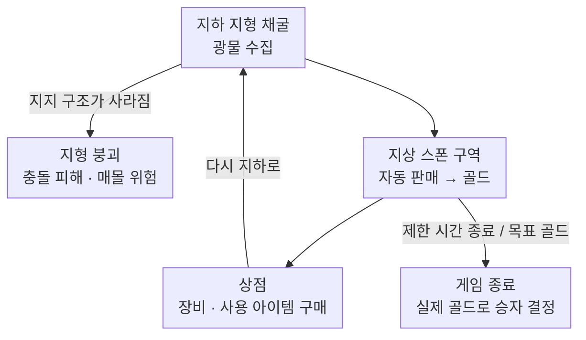

이 다이어그램은 지하에서 채굴하고 지상에서 판매·구매한 뒤 다시 내려가는 게임 루프와, 붕괴 위험과 게임 종료 조건을 도식화한 것입니다.

- **진행:** 로비에서 방에 들어가 준비를 마치면 카운트다운 뒤 시작합니다. 제한 시간이 끝나거나 목표 골드에 이르면 끝나고, 실제 보유 골드로 승자를 정합니다.
- **맵:** 같은 시드로 모든 플레이어에게 같은 맵이 생성됩니다. 깊이에 따라 Ground·Dirt·Stone·DeepStone 구간이 있고, 동굴·변칙 지형·광물 군집이 배치됩니다.
- **채굴과 판매:** 장착한 곡괭이로 타일을 캐면 광물이 떨어집니다. 인벤토리에는 무게 제한이 있고, 지상 스폰 구역에 돌아오면 자동으로 판매됩니다.
- **상점:** 골드로 장비와 다이너마이트 같은 사용 아이템을 삽니다.
- **붕괴와 매몰:** 지지 구조가 사라진 지형은 덩어리째 떨어집니다. 깔리면 피해를 받거나 매몰되고, 사망하면 그 칸에 사망 보관함이 생기며 골드 절반과 아이템을 떨어뜨립니다.
- **지도:** 미니맵과 Tab 전체 지도에서 이미 가 본 곳과 지금 보이는 곳을 나눠 보여 줍니다.

조작은 다음과 같습니다.

| 동작 | 조작 |
|---|---|
| 이동 | A / D (벽을 오르는 중에는 W / S) |
| 점프 | Space |
| 벽 잡기 | Shift |
| 채굴 | 마우스 왼쪽 버튼 누르고 있기 |
| 사용 아이템 | 마우스 오른쪽 버튼 — 누르면 조준, 떼면 사용, 조준 중 왼쪽 클릭은 취소 |
| 슬롯 고르기 | 숫자 1~0, 마우스 휠 |
| 아이템 버리기 | Q 누르고 있기 |
| 전체 지도 | Tab 누르는 동안 (휠로 확대·축소, 가운데 버튼을 끌어 이동) |
| 채팅 | Enter 또는 T로 열기, Esc로 닫기 |
| 메뉴 | Esc |
| 상점 | 상점 NPC 클릭 또는 B |

### 1.2 개발 의도

직접 땅을 파면서 자원을 찾는 재미와, **지형 붕괴·매몰의 위험** 때문에 긴장하며 탐험하는 경험을 주고 싶었습니다.
또한 지형을 의도적으로 무너뜨려 다른 플레이어를 매몰시키는 **간접 PvP**도 목표로 삼았습니다.

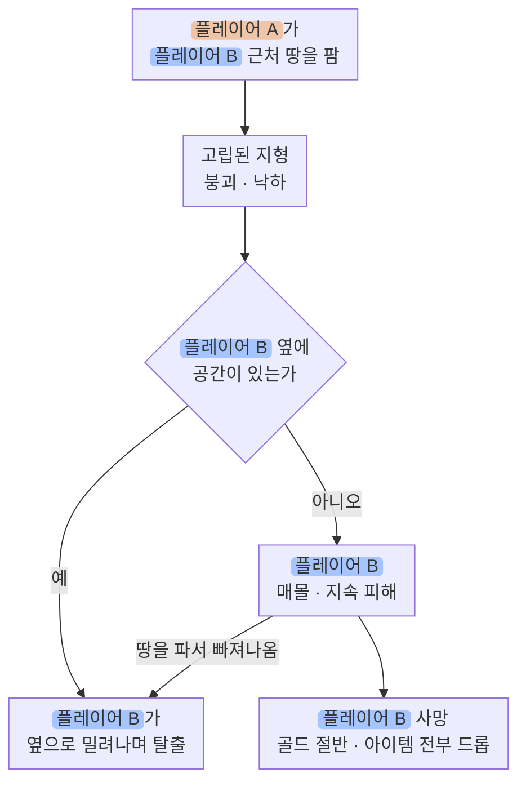

이 다이어그램은 간접 PvP가 일어나는 흐름을 도식화한 것입니다.

이 장면이 여러 플레이어 화면에서 똑같이 보이도록, 지형 변화는 서버가 확정하는 구조로 만들었습니다.
그 과정에서 푼 문제는 다음과 같습니다.

- **같은 칸을 여러 명이 동시에 팜** → 서버가 검증하고 순서 번호(Revision)를 붙여 확정합니다(§3).
- **여러 덩어리가 동시에 떨어짐** → 덩어리마다 번호(`CollapseID`)와 담당 플레이어를 따로 둡니다(§3.3).
- **떨어진 덩어리가 자리 잡자마자 다시 무너질 수 있음** → 서버가 배치를 확정한 뒤 다시 검사합니다(§3.4).
- **땅을 파서 공간을 만들었는데 깔림이 풀리지 않음** → 물리 충돌 정보가 갱신될 때까지 기다린 뒤 다시 판정합니다(§8.2).
- **서버가 거절한 아이템을 쓴 것처럼 보임** → 거절되면 쿨타임을 취소하고 서버 상태로 되돌립니다(§5.3).
- **이미 가 본 곳과 지금 보이는 곳이 섞임** → 탐험 기록과 현재 시야를 따로 저장합니다(§6).

### 1.3 개발 환경

| 항목 | 내용 |
|---|---|
| 장르 | 2D 멀티플레이 채굴 |
| 기간 | 2026.08 — 2026.09, 약 2주 |
| 인원 | 3인 |
| 엔진 | Unity `6000.3.15f1`, URP `17.3.0` |
| 언어 | C# |
| 주요 패키지 | Input System `1.19.0`, Newtonsoft Json `3.2.2`, Cinemachine `3.1.7`, DOTween 소스 |
| 서버 | ASP.NET Core (.NET `10.0`) |
| 통신 | `ClientWebSocket` / ASP.NET Core WebSocket, JSON 메시지 |
| 데이터 | 클라이언트 StreamingAssets TSV, 서버 Data TSV 및 설정 |
| GitHub | [GitHub(클라이언트)](https://github.com/keeeery/Folk-Sack), [GitHub(서버)](https://github.com/KooHoo-Dev/3rd-TeamProject-KH-Server) |
| 시연 영상 | [YouTube](https://youtu.be/XQi-Hra-ywg) |

### 1.4 담당 범위

지형 생성·채굴·붕괴·멀티플레이 동기화를 전담하여 설계·구현했습니다.
시드 기반 절차적 맵 데이터 생성부터 충돌·매몰, 서버 연결, 상태 변경·송신 분리,
청크 소유권과 연쇄 붕괴 안정화까지 연결했습니다.
초기 맵을 시드로 공유하는 구조와 채굴 요청 정책(요청의 Revision 대조를 없애고 Batch의 Revision으로 순서를 맞추는 방식)은 강사님과 같은 개선안을 제안했고, 구현 방향은 강사님의 도움을 받았습니다(§8.1).
서버는 수업에서 배운 ASP.NET Core WebSocket 기본 틀 위에 게임 로직을 구현했습니다.

3인 팀의 역할은 다음과 같이 나눴습니다.

- **나** — 맵 생성·채굴·지형 붕괴와 멀티플레이 동기화(서버 로비·패킷 처리 포함), 낙하 지형 충돌·매몰, 플레이어 조작 책임 분리, UI 스크립트(HUD 연결·로비·메뉴·설정·채팅), 탐험·시야·지도
- **팀원 1** — 아이템·상점·곡괭이 슬롯·쿨타임·리스폰, 캐릭터 조작 초기 구현(벽 잡기·회피), 밸런스 수치
- **팀원 2** — 그래픽·UI 그래픽·애니메이션·사운드·타격 연출, 캐릭터 이동 충돌 초기 구현, 서버 초기 구조

강사님은 서버 리팩토링에서 채굴 요청의 Revision 대조를 없애는 작업과, 굴착 요청별 대기, 낙하 취소·매몰 정리를 도와주셨습니다.

**AI를 활용한 곳:** 붕괴 동작을 먼저 확인한 첫 프로토타입(§2.6), 매몰 판정의 코드 반영(§4.4). 판정 기준과 최종 결정은 직접 정했습니다.

이 문서에서 깊게 다루는 것은 세 가지입니다 — 같은 시드로 모두에게 같은 맵을 만드는 생성(§2), 여럿이 캐고 무너뜨리는 지형의 동기화(§3·§8.1), 낙하 지형의 충돌과 매몰(§4). 인벤토리·지도·로비 흐름(§5~§7)은 짧게 다룹니다.

### 1.5 전체 구조

클라이언트는 입력·물리·표시를, 서버는 방과 게임 세션의 공유 상태 확정을 맡습니다.
특히 지형 붕괴에서는 **낙하 물리 시뮬레이션과 최종 타일 배치 확정의 책임이 다릅니다.**
소유 클라이언트가 낙하 결과를 제안하고 서버가 예약 및 배치 규칙을 검사하여 결과를 방송합니다.

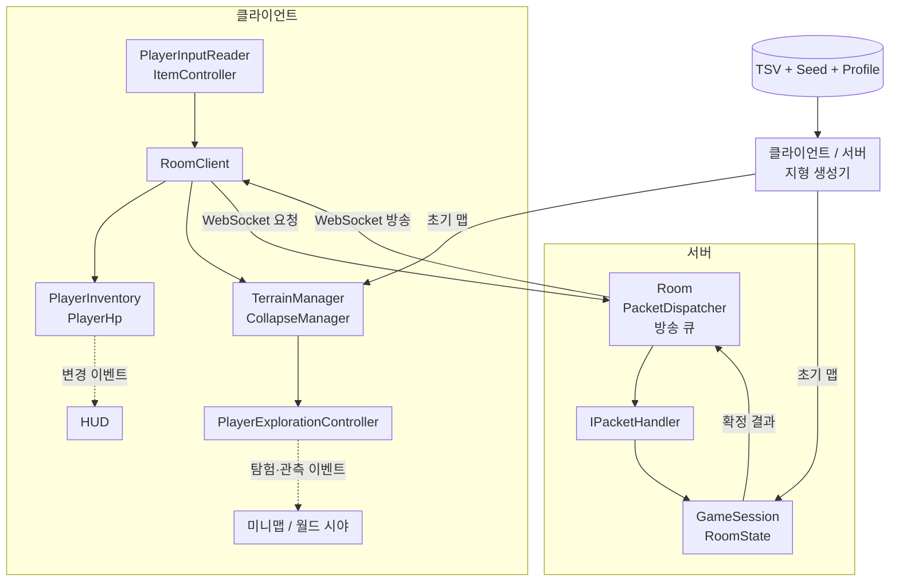

이 다이어그램은 클라이언트가 입력·물리·표시를, 서버가 공유 상태 확정을 맡고, 두 쪽이 같은 TSV·시드로 초기 맵을 만드는 전체 구조를 도식화한 것입니다.

이 그림에서 볼 것은 두 가지입니다. 지형·인벤토리를 바꾸는 요청은 모두 서버의 `GameSession`이 확정하고 클라이언트는 방송받은 결과만 반영한다는 점, 그리고 클라이언트와 서버가 **같은 TSV·시드로 각자 초기 맵을 만든다**는 점입니다.

---

## 2. 같은 시드로 모두에게 같은 맵 생성

### 2.1 같은 시드와 규칙의 절차적 맵 데이터 생성

같은 시드와 규칙으로 클라이언트와 서버가 같은 맵 데이터를 절차적으로 생성합니다.
생성 규칙은 TSV 테이블 데이터로 관리하며, 시드 프로필, 깊이 구간, 동굴, 변칙 지형 군집, 광물 테이블로 나눕니다.
`TerrainTableSeedGenerator`는 이 규칙을 적용해 `TerrainMapFile`을 생성합니다.
서버에는 대응하는 `ServerTerrainGenerator`가 있습니다.

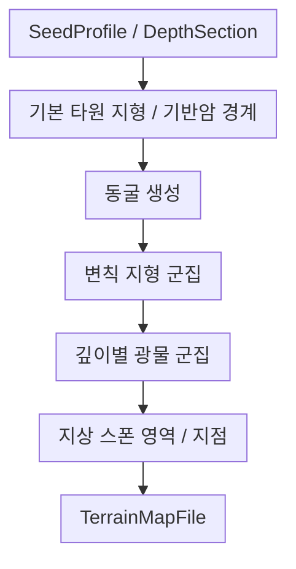

이 다이어그램은 시드 프로필과 깊이 구간에서 시작해 동굴·변칙 지형·광물·스폰 영역을 차례로 적용해 맵 파일을 만드는 생성 순서를 도식화한 것입니다.

생성 순서 자체가 결과를 결정하는 규칙입니다.
동굴을 뚫은 후 광물을 붙이는 순서나 난수 호출 순서가 달라지면 같은 시드여도 맵이 달라질 수 있습니다.
맵 형태와 게임 플레이 중 수정되는 셀 상태도 구분합니다.

### 2.2 지형 칸 저장·표시와 이어진 공간 탐색

| 구성 요소 | 책임 |
|---|---|
| `TerrainGridData` | 비어 있지 않은 셀을 `Dictionary<Vector2Int, TerrainCell>`로 보관하고 Revision 관리 |
| `TerrainGridWorld` | 기본 지형의 Chunk Mesh와 경계 Collider 생성·갱신 |
| `TerrainManager` | 지형 조회·변경 API와 기반 지지 여부 탐색 |
| `TerrainCollapseCoordinator` | 지형 변경 뒤 부유 그룹의 낙하 시작 요청 조정 |

기본 지형은 셀마다 GameObject를 만들지 않고 32×32 셀 단위 Mesh로 표현합니다(선택 이유는 2.6).
셀 변경은 `dirtyChunks`와 `colliderDirty`에 기록됩니다.
`LateUpdate()`에서 변경 Chunk의 Mesh를 갱신하고, Collider가 dirty이면 외곽선 Collider를 재생성합니다.
Mesh는 변경된 Chunk 단위로, Collider는 별도 dirty 표시로 다시 만들므로 두 갱신 범위는 다릅니다.

`FindFloatingGroups()`는 상하좌우로 연결된 일반 지형을 Queue 기반으로 탐색합니다.
탐색 중 `Bedrock`이나 `SpawnPlatform`과 인접하면 지지된 그룹으로 판단하고,
지지점이 없는 그룹만 반환합니다. 점유 셀과 결과 그룹을 정렬해 탐색·요청 순서를 맞춥니다.
이 탐색은 변경 셀 주변만이 아니라 호출할 때마다 점유 셀 전체를 순회합니다.

| 사용 목적 | API | 호출 결과 |
|---|---|---|
| 초기 맵 생성 | `TerrainSeedGenerator.Generate(profileID, seed)` | `TerrainMapFile` |
| 월드 좌표를 셀로 변환 | `TerrainManager.TryWorldToCell(position, out cell)` | 성공 여부와 Grid 좌표 |
| 지형 존재·내구도 조회 | `HasTerrain(cell)`, `TryGetDurability(cell, out durability)` | 현재 런타임 Grid 상태 |
| 기반에서 분리된 그룹 탐색 | `FindFloatingGroups()` | 부유 셀 그룹 목록 |
| 서버 확정 변경 적용 | `ApplyAuthoritativeBatch(batch, reason, out error)` | 성공 시 적용 이벤트와 지형 변경 이벤트 |

### 2.3 접속 시 같은 맵 재생성

클라이언트는 `map_session`에서 받은 프로필·시드와 테이블 버전을 확인하고 초기 맵을 재생성합니다.
`TerrainNetworkAdapter.FromGeneratedMap()`이 생성 결과를 Revision 0의 런타임 스냅샷으로 변환합니다.
게임 중 채굴·재배치 변경은 이후 서버 Batch로 적용됩니다.
여기서 `TerrainSnapshot`은 생성한 초기 맵을 런타임 모델에 넘기는 로컬 형식으로, 예전에 서버가 보내던 전체 지형 복구 Snapshot과는 역할이 다릅니다.
인벤토리·HP·월드 드롭은 지금도 각자의 Snapshot으로 초기화·동기화합니다.


```csharp
// RoomClient.HandleMapSession() — 맵 세션의 프로필 ID·시드로 초기 맵 생성
TerrainMapFile map = TerrainSeedGenerator.Generate(
    MapSession.ProfileID,
    MapSession.Seed);

ApplyTerrainSnapshot(TerrainNetworkAdapter.FromGeneratedMap(map));
```

테이블 버전은 TSV 파일들을 정렬하여 읽고 SHA-256으로 계산한 값의 앞 12자입니다.
`ReadNormalizedTsvBytes()`는 BOM을 제거하고 CRLF·CR을 LF로 바꾸며, 파일 끝 LF 한 개를 지웁니다.
클라이언트와 서버가 같은 규칙으로 정규화하므로, Windows와 macOS에서 내용이 같은 TSV가 다른 버전으로 판단되지 않습니다.
이 정규화는 데이터가 완전히 같은데도 Windows와 macOS에서 서로 다른 해시가 생성되는 것을 에디터 로그에서 발견한 뒤, 원인(BOM·줄바꿈 차이)을 찾아 넣은 것입니다.

### 2.4 세부 구현

#### 동굴로 끊긴 지형의 복원

`TerrainCaveGenerator`는 깊이 범위와 경계 여유를 만족하는 시작점을 찾고,
수평 방향에 작은 수직 변화를 누적하며 원형 셀들을 이어 동굴 후보를 만듭니다.
후보를 바로 확정하지 않고 기존 타일 종류를 백업한 뒤 비우고, 지형 연결성 검사에 실패하면 복원합니다.

```csharp
// TerrainCaveGenerator.TryApplyCandidate() — 기존 타일을 백업하고 비운 뒤, 연결성 검사에 실패하면 복원
foreach (Vector2Int coord in candidateCells)
{
    TerrainTileType previousType = map.GetTile(coord);
    backups.Add(new CaveTileBackup(coord, previousType));
    map.SetTile(coord, TerrainTileType.Empty);
}

if (TerrainMapConnectivityValidator.HasFloatingGroup(map) == false) return true;
RestoreTiles(map, backups);
return false;
```

이 방식은 동굴 모양을 먼저 정한 후 생긴 고립 지형을 무조건 제거하는 대신,
기존 지형을 유지할 수 있는 후보만 채택합니다. 시도 횟수와 시작점 조건 때문에
요청한 동굴 수보다 적게 생성될 수 있습니다.

생성용 `TerrainMapConnectivityValidator`는 그룹 셀의 **바로 아래 기반암**을 지지 조건으로 검사합니다.
게임 중 `TerrainManager.FindFloatingGroups()`는 상하좌우 탐색에서 기반암이나 스폰 플랫폼과의 인접을 검사합니다.
두 경로는 쓰이는 시점과 지지 조건이 다른 별개의 판정입니다.

#### 광물의 양과 뭉침 크기

`TerrainMineralClusterGenerator`는 깊이 섹션과 광물 규칙을 순서대로 읽고,
적합한 바탕 셀에서 `ClusterDensity` 확률로 군집 생성을 시작합니다.
시작하면 최소·최대 크기 안에서 목표 크기를 뽑고,
기존 군집의 상하좌우 이웃 중 유효한 후보를 확장합니다.

| 데이터·조건 | 역할 |
|---|---|
| 깊이 섹션·경계 오프셋 | 어느 영역에 광물 규칙을 적용할지 결정 |
| `ClusterDensity` | 군집 생성 시작을 시도할 확률 |
| `MinClusterSize`·`MaxClusterSize` | 시작한 군집의 목표 크기 |
| 자원 ID | 바탕 타일에 부가되는 광물 종류 |
| 확장 가능한 이웃 | 연결된 군집의 실제 성장 범위 |

따라서 `ClusterDensity`는 최종 광물 점유율이 아니라 군집 생성을 시작할 확률입니다.
주변 후보가 없으면 목표 크기에 도달하기 전에 확장을 멈춥니다.
확률·성장 순서·난수 소비가 함께 결과를 결정하므로 서버와 클라이언트의 순회 순서를 맞춰야 합니다.

소스: [TerrainCaveGenerator.cs](https://github.com/keeeery/Folk-Sack/blob/main/Assets/02.%20Scripts/TerrainCollapse/Generation/TerrainCaveGenerator.cs), [TerrainMapConnectivityValidator.cs](https://github.com/keeeery/Folk-Sack/blob/main/Assets/02.%20Scripts/TerrainCollapse/Generation/TerrainMapConnectivityValidator.cs), [TerrainMineralClusterGenerator.cs](https://github.com/keeeery/Folk-Sack/blob/main/Assets/02.%20Scripts/TerrainCollapse/Generation/TerrainMineralClusterGenerator.cs).

### 2.5 같은 시드, 같은 맵의 보장

지형 테이블은 값을 읽은 뒤 참조와 적용 순서를 확정합니다. 깊이 섹션은 `SectionOrder`로 정렬하고 첫 구간 0, 마지막 구간 1, 인접 구간의 연속성을 검사합니다. 광물은 섹션별 `ResourceOrder`, 변칙 군집은 섹션·`VariantOrder`, 동굴은 `CaveOrder` 순서로 적용합니다. 중복 ID·순서와 없는 타일·자원 참조는 로딩 오류로 처리합니다.

맵 생성용 `System.Random`은 동굴·변칙 지형·광물 생성이 공유합니다. 같은 시드라도 앞 단계의 반복 순서나 난수 호출 횟수가 달라지면 뒤 단계 결과도 달라집니다. 스폰 후보 셔플은 같은 시드로 새 `System.Random`을 만들어 별도로 수행하며, 중앙 후보 열에서 최대 네 좌표를 선택합니다.

테이블 버전(§2.3)과 별도로 클라이언트·서버의 규칙 적용 순서와 반올림 방식도 맞아야 합니다. 서버의 동굴 좌표 반올림은 `Math.Round(double)`의 기본 중간값 짝수 반올림을 사용하여 Unity의 대응 연산과 맞춥니다.

#### 표(TSV)로 관리하는 지형 규칙

지형 테이블 7종(타일·자원·시드 프로필·깊이 구간·구간별 광물·변칙 군집·동굴)은 모두 같은 경로로 읽습니다.
**DTO는 TSV에 저장된 값, Def는 게임이 실제로 조회해 사용하는 값**으로 구분했습니다.

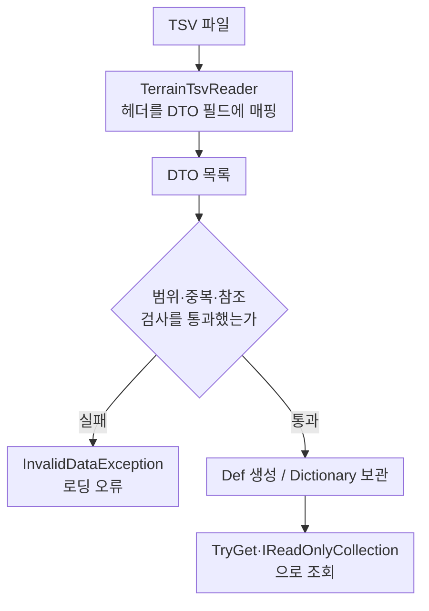

이 다이어그램은 TSV 파일을 DTO로 읽고 검사를 통과한 값만 Def로 만들어 조회하는 데이터 경로와, 검사에 실패하면 로딩 오류로 처리하는 갈림을 도식화한 것입니다.

| 구분 | DTO | Def |
|---|---|---|
| 의미 | TSV 한 줄에 저장된 값 그대로 | 검증을 통과해 게임이 조회하는 값 |
| 형태 | `[Serializable]` public 필드 (CsvHelper가 헤더 이름으로 채움) | 읽기 전용 속성(`{ get; }`), 생성자에서 DTO 값을 복사 |
| 사용 시점 | 테이블을 읽는 동안만 | 로딩 이후 게임 내내 |

```csharp
// TerrainTileTable.Load() — DTO를 Def로 바꾸며 잘못된 값 거르기
foreach (TerrainTileDTO dto in rows)
{
    if (dto.IsMineable && dto.MaxDurability <= 0)
        throw new InvalidDataException($"채굴 가능한 타일의 MaxDurability는 1 이상이어야 합니다: {dto.TileType}");

    if (defs.ContainsKey(dto.TileType))
        throw new InvalidDataException($"중복 TileType입니다: {dto.TileType}");

    defs.Add(dto.TileType, new TerrainTileDef(dto));
}
```

잘못된 값은 DTO에서 Def로 바꾸는 순간에 걸러 내고, 통과한 값만 읽기 전용 Def로 만들어 실행 중에 바뀌지 않게 막았습니다.
다른 테이블을 참조하는 테이블은 참조 대상을 먼저 읽습니다. 예를 들어 깊이 구간은 시드 프로필·타일 테이블을 받은 뒤 `ProfileID`·`BaseTileType`이 등록되어 있는지 검사하고, 찾은 Def를 함께 담아 생성합니다.

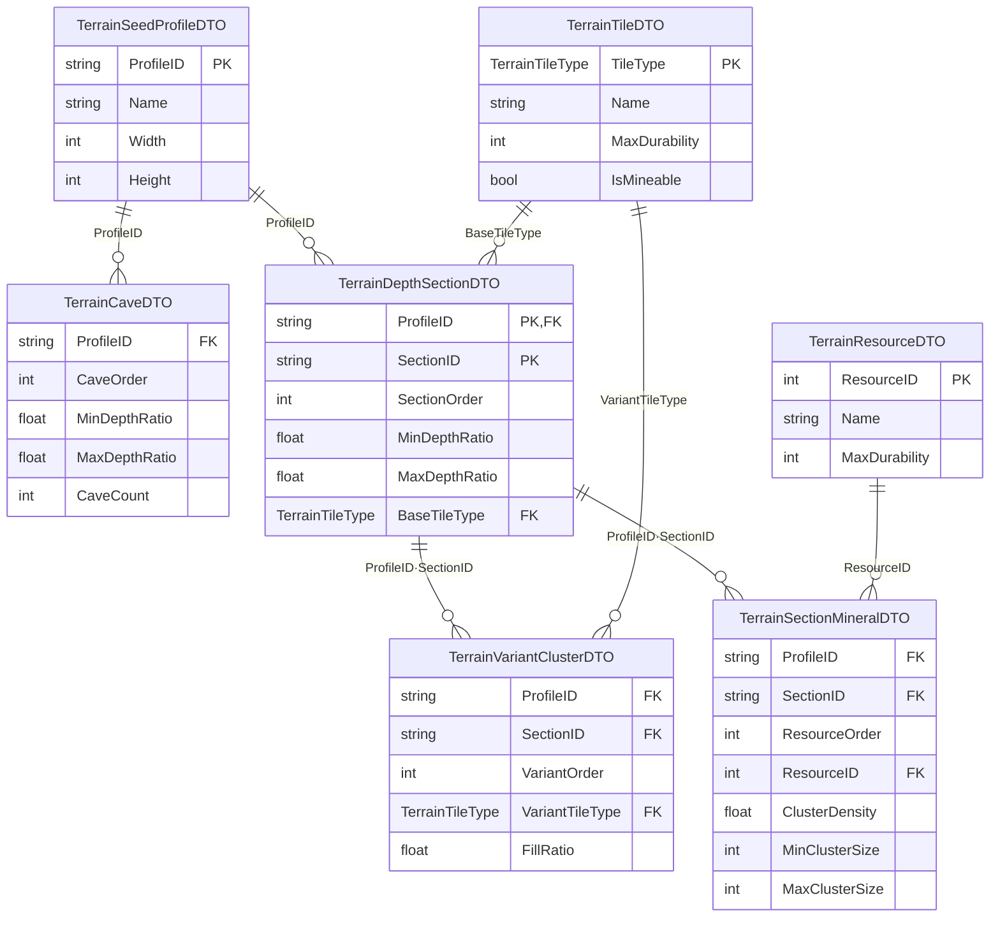

이 다이어그램은 지형 테이블 7종(타일·자원·시드 프로필·깊이 구간·구간별 광물·변칙 군집·동굴)이 ID로 서로를 참조하는 관계를 도식화한 것입니다.

소스: [TerrainTsvReader.cs](https://github.com/keeeery/Folk-Sack/blob/main/Assets/02.%20Scripts/TerrainCollapse/Data/TerrainTsvReader.cs), [TerrainTileDef.cs](https://github.com/keeeery/Folk-Sack/blob/main/Assets/02.%20Scripts/TerrainCollapse/Data/TerrainTileDef.cs), [TerrainDataTables.cs](https://github.com/keeeery/Folk-Sack/blob/main/Assets/02.%20Scripts/TerrainCollapse/Data/TerrainDataTables.cs), [TerrainTableSeedGenerator.cs](https://github.com/keeeery/Folk-Sack/blob/main/Assets/02.%20Scripts/TerrainCollapse/Generation/TerrainTableSeedGenerator.cs), [RoomClient.Terrain.cs](https://github.com/keeeery/Folk-Sack/blob/main/Assets/02.%20Scripts/Networking/RoomClient.Terrain.cs).

### 2.6 고민과 선택

**지형 표현 — 셀마다 객체 대신 Chunk Mesh**

> **결정 대상**: 약 1만 셀(프로토타입 시험 맵 100×105)의 지형을 어떤 단위로 그리고, 충돌을 어떻게 줄 것인가?

지형 붕괴는 팀 프로젝트에 넣기 전에 별도 프로젝트에서 기술 검증용 프로토타입으로 먼저 만들었습니다.
지형 일부 파괴 → 공중에 뜬 덩어리 탐색 → Rigidbody2D로 실제 낙하 → 멈춘 위치를 Grid 셀로 다시 기록하는 흐름과 상하좌우 연결 기준은 제가 정해 AI에게 작업 지시서로 정리하게 했고, 그 지시서를 확인하고 일부 고쳐 AI 코딩 에이전트에 넘겨 Unity Tilemap으로 만들었습니다.
직접 플레이하며 확인해, 덩어리를 직사각형으로 묶는 바람에 옆 칸에 다시 기록되던 문제는 덩어리를 셀 모양 그대로 만들게 하고, 꼭짓점끼리만 맞닿은 타일은 떨어지도록 기준을 정해 고치게 했습니다.
AI로 빠르게 만든 프로토타입으로 붕괴 동작을 먼저 확인하고, 실제 게임에 쓸 표현 방식은 비용을 따져 다시 골랐습니다.

이후 수업에서 배운 데이터 기반 Grid 구조로 Tilemap을 바꾸는 리팩터링을 맡겼는데, 첫 버전은 셀마다 GameObject와 Collider를 만들어 플레이를 누르면 로딩이 오래 걸렸고, 이를 최적화하게 해 아래 C 방식이 되었습니다.
리팩터링 결과는 참고한 수업 코드와 무엇이 같고 다른지 설명을 들으며 확인했고, 그 과정에서 빠져 있던 데이터 기반 맵 생성을 찾아 추가하게 했습니다.
처음 만든 코드에서 저와 팀원이 순환 참조 문제를 발견한 뒤에는 고칠 곳을 짚게 해 직접 고쳤습니다.

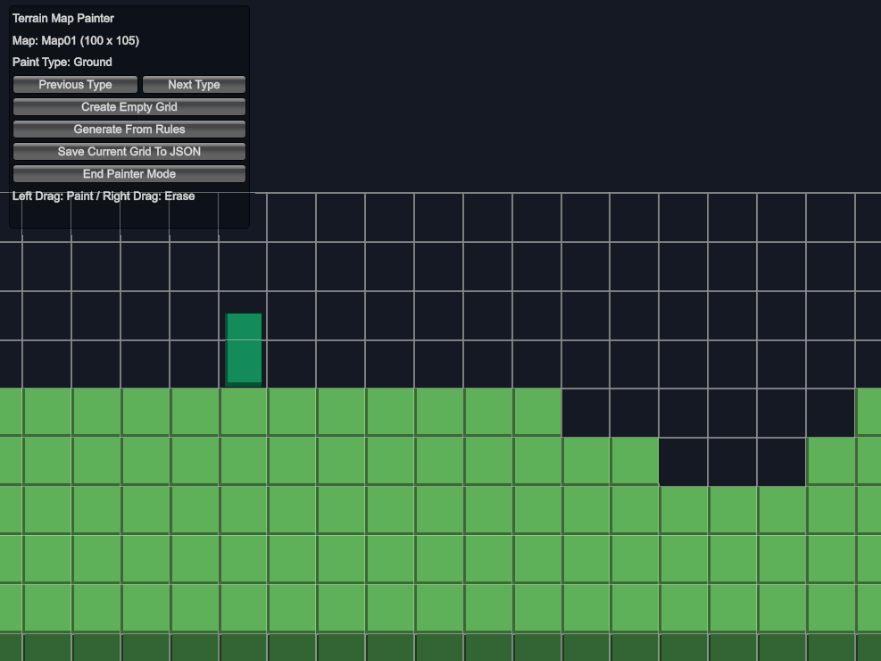

| 구분 | [A] Unity Tilemap | [B] 셀마다 GameObject·Collider | [C] 32×32 Chunk Mesh + 외곽선 EdgeCollider ✓ |
|---|---|---|---|
| 거친 과정 | AI를 활용해 만든 첫 프로토타입의 방식 | 셀 하나에 객체와 Collider 하나 | 프로토타입을 리팩터링하며 채택, 팀 프로젝트로 포팅 |
| 문제·비용 | 사용하기 다소 불편 | 팀원 개발 환경에서 로드 시간이 길고 프레임이 떨어짐 | 정점·UV·외곽선 Collider를 직접 만들고 갱신해야 함 |

**[최종 결정]** C를 선택했습니다. 셀마다 객체와 Collider를 두는 방식은 팀원 개발 환경에서 로드 시간이 길고 프레임이 떨어져, 세부 측정 없이 버렸습니다.
채굴과 붕괴로 셀이 계속 바뀌는 게임이라 개발이 이어질수록 문제가 커질 것으로 판단해, 상대적으로 비용이 저렴한 Chunk Mesh와 EdgeCollider를 택했습니다.
이 과정에서 사용이 다소 불편했던 Tilemap도 자연스럽게 쓰지 않게 되었습니다.

**[얻은 것]** 셀이 바뀌면 그 셀이 속한 Chunk의 Mesh만 다시 만들고, 그리는 지형 객체는 셀 수가 아니라 Chunk 수(프로토타입 맵에서 최대 16개)가 됩니다.

**[감수한 대가]** 셀의 정점·UV·외곽선 Collider를 직접 만들어야 하고, 셀 하나를 흔드는 연출도 정점을 직접 옮겨야 합니다(§4.3).

**[아쉬운 점]** 문제는 팀원 환경에서 확인했지만, 두 방식을 수치로 측정해 비교하지는 않았습니다.

**그 밖의 선택**

| 선택 | 이점 | 남는 비용 |
|---|---|---|
| 생성 규칙을 TSV와 단계별 생성기로 분리 | 깊이별 지형·광물 배치를 데이터로 조절 | 유효한 ID·참조·범위 검증 필요 |
| TSV 값(DTO)과 조회용 값(Def) 분리 | 잘못된 값은 로딩 때 오류로 드러나고, 게임 중에는 읽기 전용 값만 사용 | 테이블마다 DTO·Def·검증 코드를 함께 추가해야 함 |
| 시드와 프로필로 초기 맵 재생성 | 초기 전체 맵 전송 부담을 줄이는 구조 | 생성기·난수 순서·데이터를 양쪽에서 동기화해야 함 |
| 정규화한 TSV 해시 검사 | OS별 BOM/줄바꿈 차이로 인한 접속 실패 완화 | 해시는 테이블 차이만 감지하고, 생성 코드 차이는 감지하지 못함 |

---

## 3. 여럿이 함께 캐고 무너뜨리는 지형

### 3.1 서버에서 확정하는 채굴과 낙하 배치

채굴과 낙하 배치의 공유 결과는 서버에서 확정하고, 클라이언트가 순서대로 런타임 지형에 적용합니다.
물리 청크가 정착한 시점과 서버 배치가 확정된 시점을 나누어 다중 청크와 연쇄 붕괴를 처리합니다.

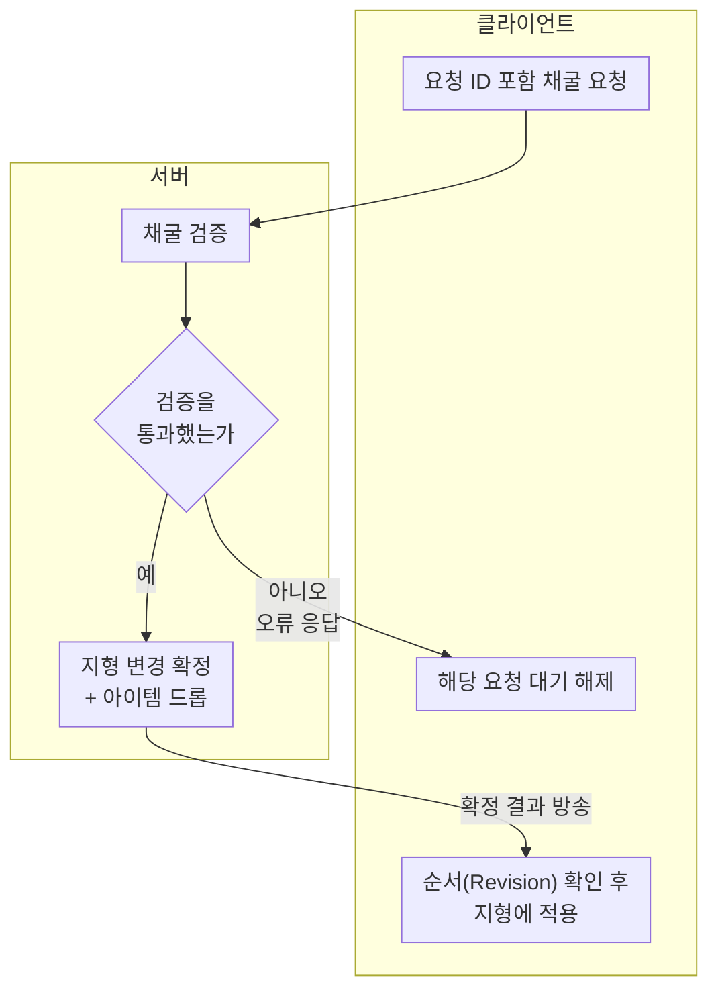

이 다이어그램은 클라이언트의 채굴 요청을 서버가 검증해 확정 결과를 방송하거나, 오류 응답으로 그 요청의 대기를 해제하는 흐름을 도식화한 것입니다.

| 계층 | 역할 |
|---|---|
| `TerrainManager` | 좌표 조회·굴착 접근, 권위 Batch 적용, 지형 변경 이벤트 |
| `TerrainCollapseCoordinator` | 부유 그룹 탐색과 연쇄 재검사 시점 관리 |
| `CollapseManager` / `FallingChunk` | 낙하 청크 생성·물리 표현·최종 배치 제안 |
| `RoomClient` | 요청 ID, Batch Revision, 소유권, 네트워크 전달 |
| `GameSession` | 채굴·붕괴 예약·배치 검증과 서버 상태 갱신 |
| `Room` | 지형 명령 순서와 확정 메시지 방송 큐 관리 |

이 파이프라인을 만들며 겪은 멀티플레이 멈춤 문제와 해결 과정은 8.1에 있습니다.

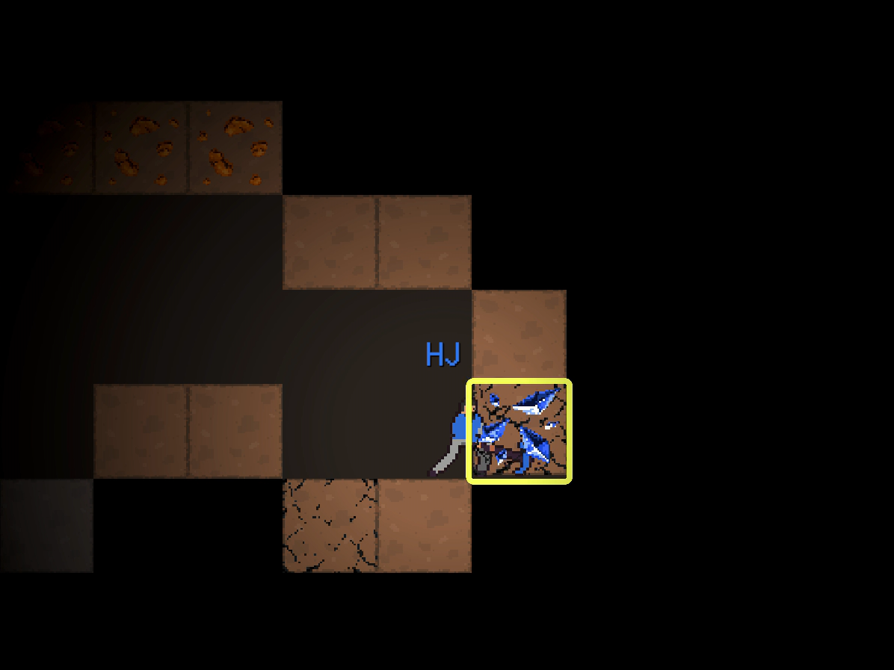

### 3.2 모두에게 같은 순서로 반영되는 채굴 결과

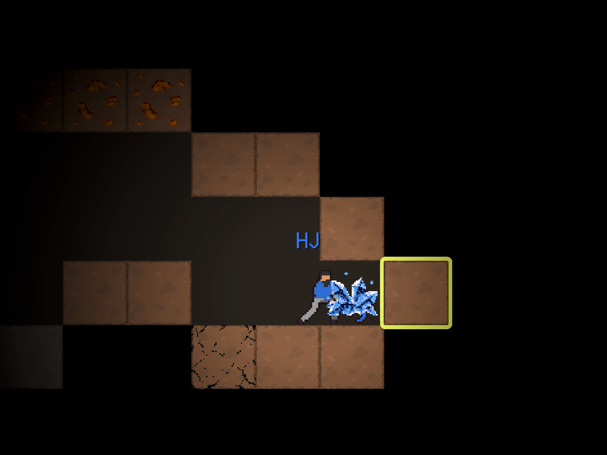

| 사용 목적 | API 또는 메시지 | 주의점 |
|---|---|---|
| 채굴 요청 등록 | `RoomClient.RequestExcavation(targetCell, itemId)` | `true`는 송신 큐 등록 성공이며 채굴 성공 확정은 아님 |
| 채굴 확정 | `GameSession.TryExcavate(...)` | 성공 시 셀 변경 Batch와 드롭 메시지 반환 |
| 낙하 시작 요청 | `TerrainCollapseCoordinator.CollapseStartRequested` | 서버 승인 후 CollapseID·소유자 수신 |
| 낙하 배치 제안 | `CollapseManager.PlacementProposed` | 소유 클라이언트만 최종 배치 요청 송신 |
| 결과 적용 | `TerrainGridData.TryApplyAuthoritativeBatch(batch, out error)` | BaseRevision 일치·증가 Revision·좌표 중복 검사 |

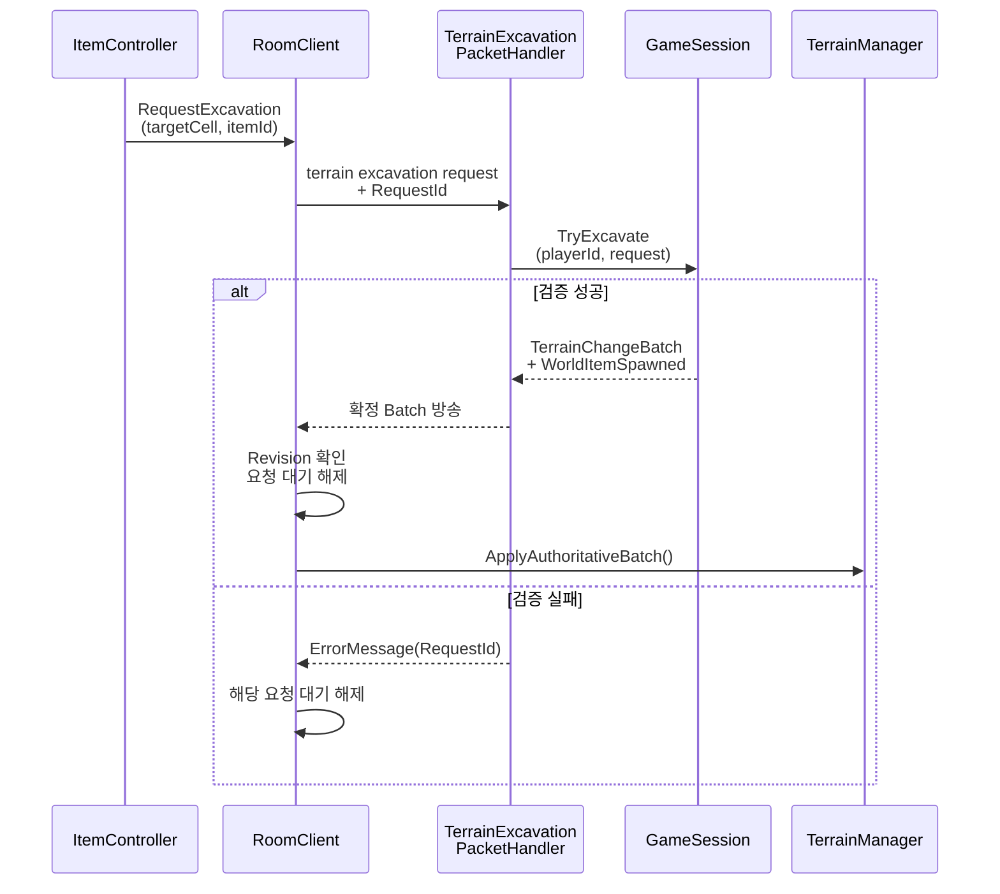

이 다이어그램은 채굴 요청이 `RoomClient`에서 서버 `GameSession`까지 전달되어, 성공하면 확정 Batch를 받아 지형에 적용하고 실패하면 그 요청의 대기만 해제하는 차례를 도식화한 것입니다.

Batch는 `BaseRevision`, `ResultRevision`, 셀 변경 목록을 가집니다.
앞선 변경이 아직 적용되지 않은 Batch는 `SortedDictionary`에 보관하고 연속 적용을 시도합니다.
이미 처리한 결과나 계약에 맞지 않는 과거 기준 Batch는 구분하여 무시합니다.
앞선 Batch가 영구히 오지 않으면 버퍼만으로는 진행을 복구할 수 없습니다.

```csharp
// RoomClient.DrainBufferedTerrainBatches() — 현재 지형 Revision에서 바로 이어지는 Batch만 꺼내 적용
while (bufferedTerrainBatches.TryGetValue(
           terrainManager.Revision,
           out TerrainChangeBatchMessage next))
{
    bufferedTerrainBatches.Remove(terrainManager.Revision);

    if (ApplyTerrainBatch(next) == false) return;
}
```

버퍼의 키는 다음 Batch의 `BaseRevision`입니다. 현재 지형 Revision에서 바로 이어지는 Batch만 꺼냅니다.
`TerrainGridData`는 적용 전 BaseRevision과 중복 좌표를 검사한 뒤 셀 목록을 반영하고,
마지막에 `Revision = batch.ResultRevision`을 수행합니다.

### 3.3 여러 덩어리의 동시 낙하

여러 청크가 동시에 정착할 때 하나의 대기 플래그를 사용하면 먼저 보낸 요청 때문에
다음 청크의 배치 제안이 버려질 수 있습니다.
그래서 `pendingCollapsePlacementIds`에 `RequestId → CollapseID`를 저장해,
같은 청크의 중복 요청만 막고 다른 청크는 독립적으로 보냅니다.


```csharp
// RoomClient.HandlePlacementProposed() — 배치 담당일 때 같은 청크의 중복 요청만 막고 전송
if (proposal == null || IsAuthoritativeTerrainMode == false) return;
if (proposal.IsPlacementOwner == false) return;
if (pendingCollapsePlacementIds.ContainsValue(proposal.CollapseId))
{
    Debug.LogWarning($"[RoomClient] 이미 낙하 {proposal.CollapseId}의 배치 확정을 기다리고 있습니다.", this);
    return;
}
```

굴착 대기는 셀 단위 중복을 막고 최대 동시 요청 수와 시간 제한을 둡니다.
반면 낙하 배치 요청은 단순 시간 초과로 지우지 않습니다.
늦게 도착한 확정 Batch의 소유권을 식별해야 하므로 성공·오류·취소에 연결해 정리합니다.

### 3.4 떨어진 지형이 다시 일으키는 연쇄 붕괴

`RebuildCompleted`는 정착·만료된 로컬 청크의 제안 처리와 제거, 물리 프레임 대기 후 발생합니다.
그 순간 서버가 최종 배치를 확정한 것은 아니므로, 권위 모드에서는 이 이벤트로 연쇄 탐색을 시작하지 않습니다.
서버가 확정한 `CollapsePlacement` Batch가 적용된 다음에 후속 부유 그룹을 검사합니다.

동시에 다른 플레이어의 변경이 들어와도 내 연쇄의 소유권을 덮지 않도록
`HashSet<long> locallyOwnedCollapseIds`로 소유 중인 청크를 추적합니다.
연쇄 단계마다 카운터를 초기화하지 않아 `maximumChainCount` 제한이 실제로 누적됩니다.

```csharp
// TerrainCollapseCoordinator.HandleTerrainChanged() — 내가 맡은 배치가 반영되면 연쇄 붕괴 이어 가기
if (reason == TerrainChangeReason.CollapsePlacement)
{
    if (isLocallyOwnedPlacementApplied)
        ContinueAuthoritativeChain();
    return;
}
```

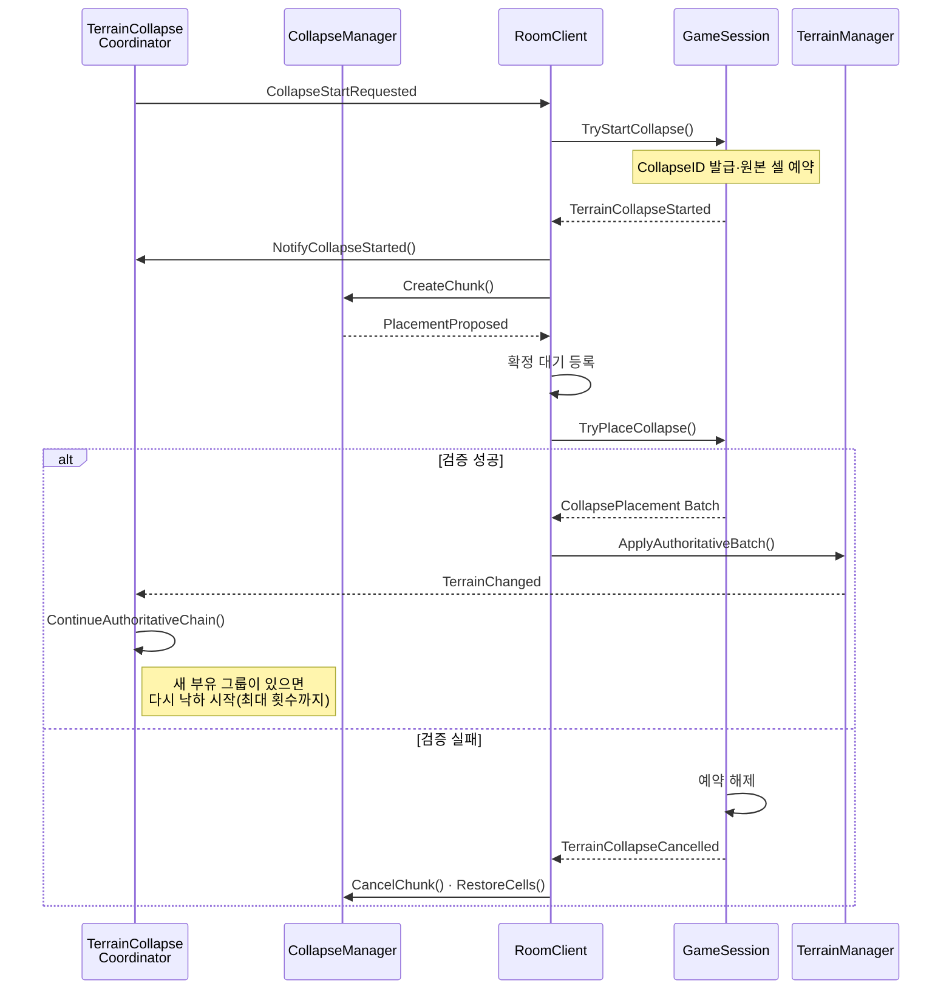

이 다이어그램은 떨어진 지형의 낙하 시작 요청부터 서버의 배치 확정, 확정된 배치가 반영된 뒤 이어지는 연쇄 붕괴와 검증 실패 시 원본 복원까지를 도식화한 것입니다.

### 3.5 서버 검증과 순서 보장

서버 `TryExcavate()`는 장착 곡괭이 ID와 테이블의 채굴력·거리를 확인하고 내구도와 드롭을 확정합니다.
`TryStartCollapse()`는 요청 그룹들을 검증한 뒤 소유자와 원본 셀을 예약합니다.
`TryPlaceCollapse()`는 소유자·예약 원본·중복 셀·맵 범위·기존 지형과의 충돌을 확인하고,
원본 제거와 새 배치를 하나의 변경 목록 및 Revision으로 반영합니다.
예약은 시간 초과·퇴장·실패 경로에서 취소하지만 실제 낙하 목적지 계산은 클라이언트가 맡습니다.

`Room`의 `terrainPipelineGate`는 지형 상태 변경과 방송 큐 등록을 하나의 명령 구간으로 묶습니다.
방송은 단일 reader `Channel`이 순서대로 읽습니다.
같은 소켓의 동시 송신은 멤버별 `SendLock`으로 직렬화하고 송신 시간 제한을 둡니다.

### 3.6 세부 구현

#### 떨어진 지형의 일괄 확정

서버의 낙하 시작 요청에는 여러 그룹이 들어갈 수 있습니다.
`TryStartCollapse()`는 먼저 그룹 내부 중복과 그룹 사이의 셀 중복을 확인하고,
모든 원본 셀에 대해 존재 여부·기존 예약·고정 타일 여부를 검사합니다.
전체 검증을 통과한 다음 그룹마다 `CollapseID`와 소유자를 발급합니다.
앞 그룹만 예약된 뒤 뒤 그룹의 오류로 요청 전체가 실패하는 부분 처리 상태를 막는 순서입니다.

낙하 중에도 서버의 원본 셀은 남고 예약 목록에 들어갑니다.
클라이언트는 정적 표현에서 원본을 제거하고 물리 청크로 보여 주지만,
서버는 최종 배치가 확정되기 전까지 원본 상태와 예약을 보관합니다.
예약 셀을 채굴하려는 요청은 `terrain.collapse_pending`으로 거절합니다.

최종 배치는 원본 제거와 목적지 배치가 겹칠 수 있습니다.
서버는 좌표별 `Dictionary<GridCoord, TerrainCellChangeDto>`에 원본 삭제를 먼저 넣고,
목적지 셀을 덮어 써서 좌표당 최종 상태 하나를 만듭니다.
그 결과 전체가 하나의 Revision 전이와 Batch로 방송됩니다.

```csharp
// GameSession.TryPlaceCollapse() — 원본 삭제 상태 구성
Dictionary<GridCoord, TerrainCellChangeDto> finalChanges = new();
foreach (GridCoord sourceCell in sourceCells)
{
    State.Terrain.Cells.Remove(sourceCell);
    finalChanges[sourceCell] = new TerrainCellChangeDto
    {
        Coord = sourceCell,
        TileTypeID = (int)ServerTerrainTileType.Empty,
        Durability = 0,
        ResourceID = 0,
        LootEntries = Array.Empty<TerrainLootEntryDto>(),
    };
}
```

서버는 원본 영역과 겹치는 목적지는 허용하지만 원본이 아닌 기존 지형과 겹치면 거절합니다.
플레이어 위치와 목적지가 겹치면 디버그 진단 로그만 남기고, 배치를 거절하거나 플레이어를 밀어내지는 않습니다.

#### 확정되지 않은 낙하의 취소·원본 복구

| 상황 | 서버 처리 | 클라이언트 처리 |
|---|---|---|
| 정상 확정 | 원본 제거·목적지 반영·예약 해제 | 서버 Batch 적용 |
| 소유자 요청의 배치 검증 실패 | 실패 경로에서 예약 해제와 취소 상태 생성 | 해당 청크·대기 상태 제거 및 원본 셀 복원 |
| 소유자 퇴장 | 소유한 낙하 예약 정리 | 취소 메시지의 원본 상태 복원 |
| 확정 요청이 오지 않음 | 경과 시간이 제한을 넘은 예약 회수 | 취소된 낙하 표시와 소유권 정리 |

`SweepExpiredCollapses()`는 `Environment.TickCount64`로 예약 경과 시간을 계산합니다.
서버 제한은 30초이며, 로컬 물리 청크의 수명 제한과 별도입니다.
클라이언트가 멈추거나 청크가 만료되어 제안을 보내지 않아도 예약을 정리할 경로를 둡니다.
소유자가 아닌 잘못된 요청만으로 다른 플레이어의 예약을 해제하지 않도록
소유 확인을 통과한 배치 실패 경로에서 `FailAndRelease()`를 사용합니다.

이 정리는 변경 결과를 재전송하는 기능과 다릅니다.
서버의 예약 원본이 남아 있다는 전제에서 취소 메시지로 화면과 예약 상태를 되돌리는 방식입니다.

소스: [GameSession.Terrain.cs](https://github.com/KooHoo-Dev/3rd-TeamProject-KH-Server/blob/main/HelloServer/Game/GameSession.Terrain.cs), [RoomClient.Terrain.cs](https://github.com/keeeery/Folk-Sack/blob/main/Assets/02.%20Scripts/Networking/RoomClient.Terrain.cs).

#### 변경 알림 전송과 입장 중 대기

일반 지형 명령은 `terrainPipelineGate` 안에서 상태 변경과 방송 등록 순서를 맞춘 뒤 실제 송신을 큐에서 처리합니다. 초기 입장의 `JoinAsync()`는 별도 경로로, welcome·맵 세션·아이템·체력 상태를 보내는 동안에도 이 Gate를 유지합니다. 따라서 입장 처리 중에는 그 송신이 끝날 때까지 지형 명령이 기다립니다.

방송 큐는 `Unbounded Channel`의 단일 reader가 처리하며, 한 방송의 수신자 송신을 `Task.WhenAll`로 기다립니다. 다음 방송은 그 작업 이후에 처리됩니다. 느린 연결 하나도 다음 방송을 늦출 수 있으며, 연결별 실제 송신에는 3초 제한이 있지만 `SendLock.WaitAsync()` 대기 자체에는 별도 제한이 없습니다.

예약 만료 회수는 독립 타이머가 아니라, 지형 명령 처리 뒤에 호출되는 `SweepExpiredCollapses()`가 맡습니다. 그래서 30초가 지나도 다음 지형 명령이 올 때까지는 취소 메시지가 나가지 않습니다.

방 생성에서도 초기 지형 전체를 전역 잠금 안에서 만들지 않습니다. `RoomHub.EnterAsync()`는 잠금 밖에서 후보 방을 만들고 다시 확인한 뒤 등록합니다. 같은 방 코드의 생성 경쟁에서 이미 등록된 방이 있으면 새 후보는 `StopAsync()`로 정리합니다.

소스: [Room.cs](https://github.com/KooHoo-Dev/3rd-TeamProject-KH-Server/blob/main/HelloServer/Network/Room.cs), [RoomHub.cs](https://github.com/KooHoo-Dev/3rd-TeamProject-KH-Server/blob/main/HelloServer/Network/RoomHub.cs).

### 3.7 고민과 선택

| 선택 | 얻는 점 | 비용·제약 |
|---|---|---|
| 서버가 공유 셀 상태 확정 | 채굴·드롭·배치의 기준 상태 통일 | 요청 왕복 지연과 실패 처리 필요 |
| 클라이언트가 낙하 결과 제안 | Unity 물리 표현을 활용 가능 | 클라이언트마다 물리 궤적이 다를 수 있음 |
| CollapseID별 예약·소유권 | 다중 청크·동시 플레이어의 상태 간섭 완화 | 취소·퇴장·스냅샷 교체 시 정리가 필요 |
| 방송 큐와 지형 명령 Gate | 상태 변경 순서와 방송 등록 순서 연결 | 무제한 큐의 적체·backpressure 정책은 별도 과제 |

서버 권위 구조는 제가 제안했습니다. 클라이언트가 손댈 수 없는 곳에서 결정하고, 클라이언트는 그 결정을 받는 구조가 맞다고 판단했습니다.
다만 낙하 물리까지 서버에서 재현하지는 않았습니다. 서버는 **"지형의 변경"만 알도록** 하는 것이 멀티플레이 레이턴시를 줄일 수 있다고 판단했기 때문입니다.
그래서 물리 궤적은 소유 클라이언트가 계산해 결과를 제안하고, 서버는 예약·배치 규칙만 검사해 확정합니다(위 표 2행).

---

## 4. 낙하 지형 충돌·탈출·매몰 상태

### 4.1 낙하 청크 접촉과 매몰 상태

`FallingTerrainInteraction`은 캐릭터와 낙하 청크의 접촉 결과, 탈출 위치 탐색,
매몰 상태와 지속 피해 요청을 담당합니다.
`FallingTerrainContracts`의 계약과 이벤트를 통해 캐릭터 이동·피해 계층에 연결됩니다.
`PlayerController` 하나에 지형 판정과 피해 로직을 모두 넣지 않는 방향으로 분리했습니다.

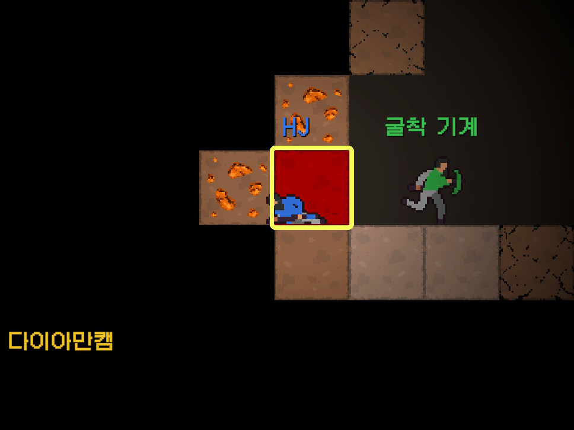

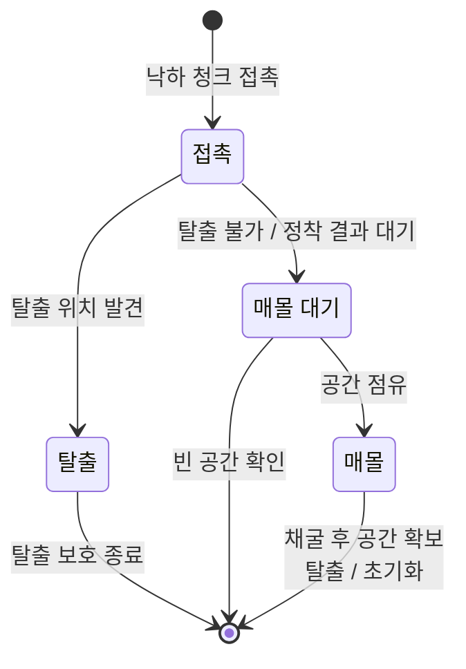

이 다이어그램은 `FallingTerrainInteraction`이 여러 값과 처리 순서로 나타내는 상황과 흐름을 도식화한 것입니다. 맨 아래의 끝 점은 다시 평소 상태로 돌아감을 뜻합니다.

### 4.2 탈출·깔림 결정과 피해 전달

| API·이벤트 | 역할 |
|---|---|
| `ResolveFallingTerrainContact(...)` | 접촉 청크의 탈출·매몰 후보 결과 판정 |
| `BurialStateChanged` | 매몰 상태 전이 알림 |
| `CollisionImpactRequested`, `BurialImpactRequested`, `BurialDamageRequested` | 충돌·매몰 피해를 외부 어댑터로 전달 |
| `ResetState()` | 리스폰 등에서 접촉·매몰 상태 정리 |

논리 셀 삭제와 Collider 재생성 시점이 달라 생긴 매몰 판정 문제와 해결은 8.2에 있습니다.

### 4.3 세부 구현

#### 떨어진 덩어리가 멈출 칸 선택

`FallingChunk`는 저속이라는 조건만으로 정착하지 않습니다.
지형 접촉의 지지 방향·폭과 최근 접촉 여부를 확인하고,
선형·각속도가 낮거나 Rigidbody가 잠든 상태가 유지되면 일반 정착 시간을 누적합니다.
별도로 정적 지형에 닿은 채 위치가 셀 크기 비례 오차 안에서 유지되는 fallback을 둡니다.

| 완료 조건 | 의미 |
|---|---|
| 지지 접촉·저속 상태의 유지 | 일반적인 낙하 후 정착 |
| 정적 지형 접촉·위치 안정 유지 | 속도가 흔들려 일반 정착에 도달하지 못하는 상황의 보완 |
| 최대 수명·최저 높이 초과 | 정착이 아닌 만료로 완료 |

완료된 청크는 Kinematic으로 전환합니다.
`CollapseManager`는 만료되지 않은 청크에서만 배치 제안을 계산하고,
청크를 제거한 뒤 물리 프레임 대기와 Transform 동기화를 거쳐 완료 이벤트를 보냅니다.
플레이어와 옆면이 닿거나 청크 위에 선 일반 접촉까지 매몰·탈출로 처리하지 않도록,
접촉 후보를 `IsBurialCandidate()`로 걸러 정상 물리 접촉과 구분합니다.

`TerrainSampler`는 청크의 각 셀을 독립적으로 반올림하지 않습니다.
물리 Bounds 주변에서 **모든 로컬 셀에 동일한 offset을 더하는 후보**를 평가합니다.
연결된 청크의 셀 배치를 통째로 옮기는 방식입니다.

| 비교 순서 | 우선 기준 |
|---|---|
| 1 | 기존 지형과 충돌하지 않는 후보 |
| 2 | 목적지 셀 중심이 실제 청크 Collider 안에 들어가는 수 |
| 3 | 원래 물리 셀 중심과 Grid 중심의 평균 제곱 정렬 오차가 작은 후보 |
| 4 | 기존 지형과 인접하는 셀 수 |
| 5 | 충돌 셀 수 |

```csharp
// TerrainSampler.IsBetterPlacement() — 배치 종류 → 닿는 수 → 정렬 오차 순으로 후보 비교
// 1. 기존 지형과 충돌하지 않는 후보
if (placementClass != bestPlacementClass) 
    return placementClass > bestPlacementClass;
// 2. 목적지 셀 중심이 실제 청크 Collider 안에 들어가는 수가 많은 후보
if (hitCount != bestHitCount) 
    return hitCount > bestHitCount;
// 3. 원래 물리 셀 중심과 Grid 중심의 평균 제곱 정렬 오차가 작은 후보
if (Mathf.Approximately(alignmentError, bestAlignmentError) == false)
    return alignmentError < bestAlignmentError;
// 4. 기존 지형과 인접하는 셀 수가 많은 후보
if (connectionCount != bestConnectionCount) 
    return connectionCount > bestConnectionCount;
// 5. 충돌 셀 수가 적은 후보
return collisionCount < bestCollisionCount;
```

이 계산은 물리 결과에 가까운 정적 Grid 후보를 고를 뿐이고, 확정은 서버가 합니다.
충돌 없는 후보가 없더라도 후보를 반환할 수 있고, 맵 범위·정적 지형 충돌 등은 서버 검증에서 거절될 수 있습니다.
정착·후보 계산·서버 승인을 분리한 만큼 실패 시 원본 복구가 함께 필요합니다.

소스: [FallingChunk.cs](https://github.com/keeeery/Folk-Sack/blob/main/Assets/02.%20Scripts/TerrainCollapse/FallingChunk.cs), [TerrainSampler.cs](https://github.com/keeeery/Folk-Sack/blob/main/Assets/02.%20Scripts/TerrainCollapse/TerrainSampler.cs), [CollapseManager.cs](https://github.com/keeeery/Folk-Sack/blob/main/Assets/02.%20Scripts/TerrainCollapse/CollapseManager.cs).

#### 플레이어 이동과 지형 충돌

충돌을 고려한 이동(`Collider2D.Cast`)은 팀원 2가, 벽 잡기는 팀원 1이 처음 구현했습니다.
이후 제가 `PlayerController`에 몰려 있던 이동·충돌·생명주기·지형 상태 처리를 아래 구성 요소로 나눴습니다.

`PlayerController`는 플레이어 루트의 실행 순서를 조정하고,
입력·속도·충돌·지형 상태·생명주기를 별도 객체에 위임합니다.

| 구성 요소 | 소유하는 상태·처리 |
|---|---|
| `PlayerInputReader` | Update에서 키 입력 수집, 채팅·모달 UI 입력 차단 |
| `PlayerMovement` | 수평 이동·점프·중력·등반 속도 계산 |
| `PlayerCollisionMove` | 실제 BoxCollider2D Cast를 이용한 X축·Y축 분리 이동 |
| `TerrainPenetrationResolver` | 정적 지형에 실제로 겹친 경우의 분리 보정 |
| `PlayerTerrainState` | 매몰·위치 잠금·탈출·등반 상태 |
| `PlayerLifeCycle` | 사망 여부와 죽은 뒤 낙하를 계속할지 여부 |

플레이어 Rigidbody2D는 Kinematic이고 엔진 중력은 끕니다.
`PlayerMovement`가 계산한 속도로 이동할 거리를 구하고,
`PlayerCollisionMove`가 충돌 면의 법선과 skin을 고려해 허용 거리를 제한합니다.
Cast 결과 목록은 재사용하지만, 플레이어 처리 전체의 할당을 없앤 것은 아닙니다.

`TerrainPenetrationResolver`는 겹친 정적 지형 중 깊은 침투를 반복 보정합니다.
Dynamic·Kinematic 낙하 청크는 이 보정 대상에서 제외해,
청크 상호작용과 정적 지형 복구가 같은 대상에 서로 다른 위치 보정을 걸지 않도록 합니다.

스폰 플랫폼 통과는 일반 이동과 다른 예외 상태입니다.
하향 입력과 점프로 플랫폼 아래를 통과하는 동안 아래 방향 Cast를 무시하고,
위로 등반해 통과하는 동안에는 위 방향 Cast와 침투 보정을 조정합니다.
플랫폼 폭 안으로 수평 위치를 제한하고 몸 전체가 경계를 지날 때까지 상태를 유지합니다.
플랫폼 안에서 등반을 취소한 경우 아래로 통과시키는 경로도 둡니다.

#### 낙하 피해와 벽 오르기

`FallDamageDetector`는 현재 수직 속도만으로 피해를 계산하지 않습니다.
마지막 정적 지면의 높이와 착지 높이 차이를 타일 수로 바꾸고,
안전 높이를 넘는 부분에 피해 계수를 적용합니다.
낙하 중 등반을 시작하면 그 지점을 착지처럼 취급해 등반 피해 배율을 적용하고,
등반 해제 시점은 새 낙하 시작 높이로 기록합니다.

```csharp
// FallDamageDetector.ApplyFallDamage() — 안전 높이를 넘은 칸 수만큼 낙하 피해 계산
float fallenTileCount = Mathf.Max(0f, startY - landingY) / cellSize;
if (fallenTileCount <= safeFallDistanceInTiles) return;
int baseDamage = Mathf.CeilToInt(
    (fallenTileCount - safeFallDistanceInTiles) * damagePerTile);
int damage = Mathf.CeilToInt(baseDamage * damageMultiplier);
```

`PlayerHp.ReportOrApplyDamage()`는 온라인이면 서버에 보고하고,
오프라인이면 로컬 체력을 변경합니다.
온라인 `TakeDamage()`는 로컬 확정을 건너뛰고 서버 체력·사망 메시지를 반영합니다.
즉 최종 체력은 서버가 바꾸지만, 낙하 높이와 피해량의 근거는 클라이언트가 감지해 보고합니다.

사망 후의 위치 처리는 상황에 따라 다릅니다.
매몰이나 사망 보관함에 의해 위치가 잠겼으면 정지하고,
그 외에는 수평 입력을 끈 채 수직 낙하만 진행할 수 있습니다.
팀원 1이 구현한 `RespawnController`는 지연 후 온라인에서는 리스폰 요청을 보내고,
서버 응답에서 위치·지형 상태·체력을 복구합니다.

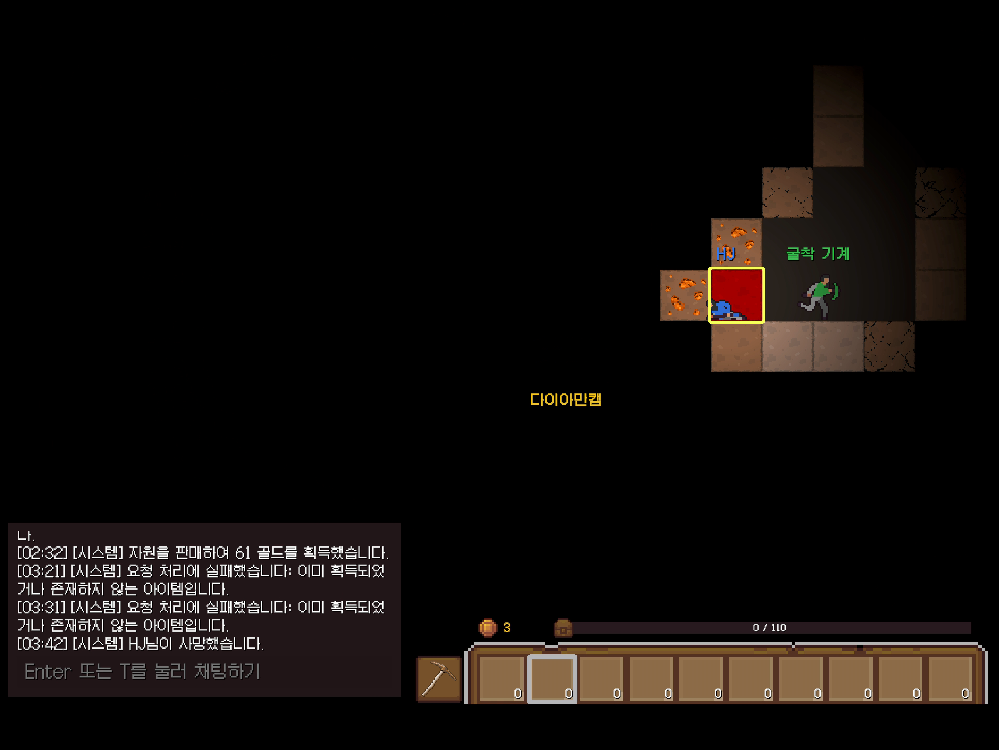

소스: [PlayerController.cs](https://github.com/keeeery/Folk-Sack/blob/main/Assets/02.%20Scripts/Player/PlayerController.cs), [PlayerCollisionMove.cs](https://github.com/keeeery/Folk-Sack/blob/main/Assets/02.%20Scripts/Player/PlayerCollisionMove.cs), [PlayerTerrainState.cs](https://github.com/keeeery/Folk-Sack/blob/main/Assets/02.%20Scripts/Player/PlayerTerrainState.cs), [FallDamageDetector.cs](https://github.com/keeeery/Folk-Sack/blob/main/Assets/02.%20Scripts/Character/Health/FallDamageDetector.cs), [PlayerHp.cs](https://github.com/keeeery/Folk-Sack/blob/main/Assets/02.%20Scripts/Character/Health/PlayerHp.cs).

#### 필드 아이템도 붕괴에서 탈출시키기

`WorldItemDrop`도 `IFallingTerrainEscapeTarget`을 구현합니다. 청크가 아이템 위를 덮는 경우 같은 CollapseID의 처리를 중복하지 않고, 현재 열에서 좌우로 거리를 늘려 빈 후보를 찾습니다. 후보는 아이템 Bounds가 Grid와 겹치지 않고 청크의 수직 낙하 경로에서도 벗어나야 합니다. 낙하 중 탈출에는 이동 경로의 빈 공간도 검사합니다.

탈출 중에는 Trigger와 무중력 상태로 `SmoothDamp` 이동하고, 도착 위치가 여전히 비어 있으면 중력과 일반 충돌을 복원합니다. 서버 Batch로 지형이 새로 배치된 뒤 이미 아이템이 겹쳤다면 다음 물리 갱신에서 다시 빈 위치를 찾아 즉시 분리합니다. 아이템의 물리 이동은 클라이언트 표시에서만 일어나며, 서버와 연속으로 동기화하지 않습니다.

소스: [TerrainGridWorld.cs](https://github.com/keeeery/Folk-Sack/blob/main/Assets/02.%20Scripts/TerrainCollapse/TerrainGridWorld.cs), [WorldItemDrop.cs](https://github.com/keeeery/Folk-Sack/blob/main/Assets/02.%20Scripts/Item/WorldItemDrop.cs).

### 4.4 고민과 선택

단순히 충돌할 때마다 플레이어를 밀어내면 같은 청크와 반복 충돌하거나,
공중에서 플레이어가 청크를 밀어 올리는 식의 부작용이 생길 수 있습니다.
그래서 청크별 처리 결과를 기억하고, 제한된 범위에서 실제 이동 가능한 공간을 찾으며,
정착 대기와 매몰 진입을 구분합니다.

밀어낼지 매몰할지를 가르는 판정 기준과 `escapeXOffset` 필드의 의미는 직접 정하고, 코드 반영은 AI 코딩 에이전트에 맡겼습니다.
`escapeXOffset`은 밀어내기를 허용할 거리를 칸 크기 대비 비율로 나타내며, 그 거리 안에 빈 칸이 있으면 밀어내고 없으면 매몰됩니다.
반영 결과는 플레이로 확인했고, 밀려나지 않거나 무조건 밀려나는 결과가 이어지자 플레이어 중심이 낙하 경로 안이면 옆 칸을, 밖이면 현재 칸을 검사해야 한다는 원인을 직접 찾아 바로잡았습니다.

피해도 이동/접촉 컴포넌트가 HP를 직접 여러 번 차감하는 대신 이벤트와 어댑터로 전달합니다.
네트워크 모드에서는 서버의 HP 변경 메시지와 초기 HP 스냅샷을 표시 상태에 반영하지만,
물리 접촉의 감지 자체는 클라이언트가 맡는다는 한계가 있습니다.

---

## 5. 인벤토리·아이템·상점

이 장은 게임에 어떤 아이템이 있고 플레이어가 무엇을 하는지(§5.1), 아이템 요청을 서버가 어떻게 확정하고 화면에 반영하는지(§5.2)를 정리합니다.

### 5.1 아이템 구성과 역할

아이템은 세 갈래입니다. 캐는 데 쓰는 **장비(곡괭이)**, 탐험을 돕는 **사용 아이템**, 캐서 모아 파는 **광물·원석**입니다.
아이템 종류와 효과·수치는 팀원 1이 정했고(§1.4), 이 장에서 제가 다루는 부분은 이 아이템들의 수량·무게·장착 상태를 서버가 확정하고 화면에 반영하는 연결입니다.

| 갈래 | 아이템 | 플레이어가 하는 일 | 인벤토리에서 |
|---|---|---|---|
| 장비 | 낡은·청동·은·금 채굴 키트 | 장착한 곡괭이로 타일을 캡니다. 등급이 오를수록 채굴력(1·2·4·8)과 사거리(2~3칸), 수용량 보너스(+0~100)가 커집니다 | 수량이 아니라 장착한 하나만 있고, 상점에서 더 좋은 장비로 바꿉니다 |
| 사용 | 다이너마이트 | 던지면 3초 뒤 반경 2.5칸의 타일을 부수고, 가까운 플레이어에게도 피해를 줍니다 | 수량만큼 쓰고, 아이템마다 쿨타임이 있습니다 |
| 사용 | 지뢰 | 설치 1.5초 뒤부터 반경 1.5칸 안에 누가 다가오면 터져, 주변 타일과 플레이어에게 피해를 줍니다 | 〃 |
| 사용 | 포션 | 체력을 20 회복합니다 | 〃 |
| 사용 | 탐지기 | 반경 6칸 안의 자원 위치를 파동으로 4초 동안 보여 줍니다 | 〃 |
| 사용 | 횃불 | 설치하면 바로 켜져 어두운 지하를 밝힙니다 | 〃 |
| 광물·원석 | 석탄·황동·은광석·금광석, 사파이어·루비·다이아몬드 원석 | 타일을 캐면 떨어지고, 지상 스폰 구역으로 돌아오면 자동으로 팔려 골드가 됩니다 | 종류마다 무게(2~5)가 있어, 무게 제한까지만 들고 다닐 수 있습니다 |

골드로 장비를 바꾸고 사용 아이템을 사서 더 깊이 내려가는 것이 §1.1 게임 루프의 "판매 → 상점" 부분입니다.

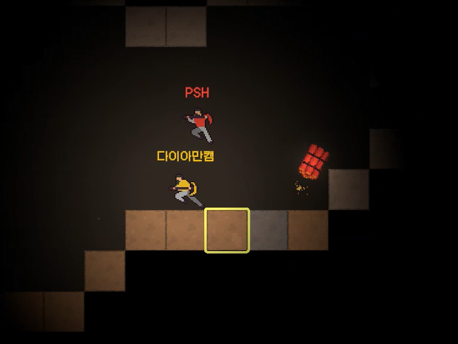

### 5.2 아이템 요청과 서버 전체 상태로 교체

아이템을 줍고, 버리고, 팔고, 사고, 쓰는 모든 행동은 클라이언트(`RoomClient`)가 서버에 요청하고 서버가 검사해 확정합니다.
요청과 그 역할은 아래와 같습니다.

| 요청 (`RoomClient`) | 플레이어 행동 | 서버 처리 | 돌려받는 것 |
|---|---|---|---|
| `RequestWorldItemPickup` | 떨어진 광물·아이템 줍기 | `GameSession.TryPickup` | `InventorySnapshot` / `Error` |
| `RequestWorldItemDrop` | 아이템 버리기 | `GameSession.TryDropWorldItem` | `InventorySnapshot` / `Error` |
| `RequestInventorySell` | 지상 스폰 구역에서 자동 판매 | `GameSession.TrySellInventory` | `InventorySnapshot` / `Error` |
| `RequestShop` (begin · purchase · undo) | 상점 열기 · 구매 · 구매 취소 | `GameSession.TryHandleShopRequest` | `InventorySnapshot` / `Error` |
| `RequestUsableItemUse` | 포션 · 탐지기 사용 | `GameSession.TryUseUsableItem` | `UsableItemUsed` → `InventorySnapshot` / `Error` |
| `RequestDynamiteThrow` · `RequestMinePlacement` · `RequestTorchPlacement` | 다이너마이트 던지기 · 지뢰 · 횃불 설치 | `DynamiteThrowPacketHandler` | 던짐·설치 방송 + `InventorySnapshot` / `Error` |
| `RequestDynamiteExplosion` | 다이너마이트 · 지뢰 폭발 | `DynamiteExplodePacketHandler` | 지형 Batch · 체력 변경 · 폭발 방송 / `Error` |

인벤토리를 바꾸는 요청의 응답은 모두 `InventorySnapshot`, 곧 서버가 확정한 인벤토리 전체 상태입니다.
클라이언트는 바뀐 부분을 계산하지 않고 이 전체 상태로 교체합니다.

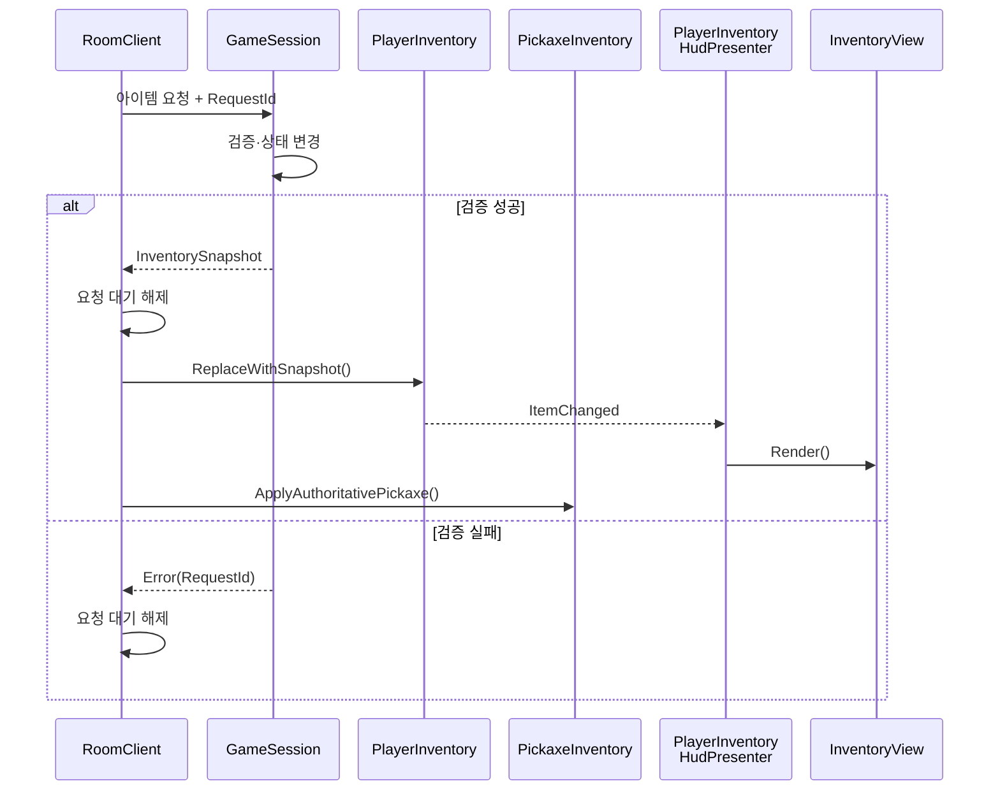

이 다이어그램은 획득·버리기·판매·구매·사용 요청을 서버가 검증·확정한 뒤, 받은 인벤토리 전체 상태로 수량·무게와 장착 곡괭이를 교체하고 HUD에 다시 표시하는 흐름을 도식화한 것입니다.

`PlayerInventory`는 ItemID별 수량과 무게를 관리합니다.
`ReplaceWithSnapshot()`은 서버 전체 상태를 수신해 교체하고, 실제 수량이 바뀐 아이템의 이벤트를 발생시킵니다.
서버가 확정한 상태를 클라이언트의 로컬 무게 제한으로 거절하지 않도록 처리합니다.
장착 곡괭이도 `EquippedPickaxeItemID`로 별도 적용합니다.

HUD는 `ItemChanged`를 구독해 목록 전체를 다시 그립니다.
서버 스냅샷을 모델에 반영하는 경로와 `PlayerInventoryHudPresenter`는 제가 구현했고, `InventoryView`는 팀원 2가 처음 만든 것을 대부분 고쳐 썼습니다. HUD 그래픽과 체력 바는 팀원 2가, 곡괭이 슬롯과 쿨타임 표시는 팀원 1이 만들었습니다.
판매·구매·획득도 같은 경로입니다. 가격과 구역·거리·수용량 검사는 서버가 확정하고, 클라이언트의 할인 표시도 같은 규칙을 씁니다.

소스: [GameSession.cs](https://github.com/KooHoo-Dev/3rd-TeamProject-KH-Server/blob/main/HelloServer/Game/GameSession.cs), [PlayerSellController.cs](https://github.com/keeeery/Folk-Sack/blob/main/Assets/02.%20Scripts/Item/Inventory/PlayerSellController.cs).

### 5.3 아이템 사용 거절과 쿨타임

아이템 쿨타임(`ItemController`)은 팀원 1이 만들었고, 서버가 사용을 거절하면 예상 쿨타임을 취소하는 처리는 제가 더했습니다.

온라인 사용 요청을 보낼 때 화면의 쿨타임은 먼저 시작할 수 있습니다.
`pendingCooldowns`는 해당 요청 ID와 아이템·준비 시각을 연결합니다.
성공 응답은 대기를 제거하고 효과를 재생하며,
`RequestFailed`는 대응하는 아이템의 예상 쿨타임을 제거합니다.

```csharp
// ItemController.HandleRequestFailed() — 실패한 요청의 예상 쿨타임 제거
if (message == null || string.IsNullOrEmpty(message.RequestId) ||
    pendingCooldowns.Remove(message.RequestId, out PendingCooldown pending) == false)
    return;

itemReadyTime.Remove(pending.ItemID);
```

### 5.4 고민과 선택

| 선택 | 이유 | 확인할 제약 |
|---|---|---|
| 수량과 무게를 서버 스냅샷으로 교체 | 획득·판매·사망 등 여러 경로의 결과를 하나의 기준으로 복원 | 전체 스냅샷 전송/재구성 비용 |
| 로컬 예상 쿨타임 + 거절 시 취소 | 사용 직후 반응성과 서버 규칙 동시 유지 | 늦은 응답과 연속 요청의 상관관계 관리 |
| 아이템 데이터와 표시 분리 | ItemID와 공통 데이터로 슬롯·상점 표현 | 클라이언트/서버 Item 테이블 버전 일치 필요 |

인벤토리는 지형 데이터에 비해 크기가 작아, 바뀐 부분만 보내지 않고 서버 스냅샷을 통째로 교체해도 문제가 없다고 판단했습니다.
표시도 아이템 한 종류만 바뀌면 전체 목록을 `ItemID` 순으로 정렬해 다시 그립니다(§5.2).
플레이어가 슬롯 순서를 직접 바꾸는 기능을 넣지 않아 지켜야 할 순서가 없으므로, 이 방식을 문제 삼지 않았습니다.
슬롯 변경 기능을 넣지 않은 것은, 아래로 파 내려가는 플레이에서 화면 아래의 인벤토리 슬롯을 마우스로 다루게 하면 의도치 않은 클릭 실수가 나올 수 있다고 보았기 때문입니다.
슬롯은 숫자 키(1~0) 또는 마우스 휠 스크롤로 고릅니다.

---

## 6. 가 본 곳과 지금 보이는 곳을 보여 주는 지도

### 6.1 누적 탐험 정보와 지금 관측되는 셀

`ExplorationMapData`는 누적 탐험 정보를 보관하고,
`PlayerExplorationController.CurrentObservedCells`는 지금 관측되는 셀을 보관합니다.
미니맵과 월드 안개는 같은 지형·탐험 상태를 참조하되 서로 다른 표시 역할을 맡습니다.

### 6.2 이동·지형 변경 때만 하는 재계산

```csharp
// PlayerExplorationController.RefreshPlayerVision() — 같은 셀이고 갱신 요청이 없으면 계산 생략
if (hasLastExplorationCell &&
    playerCell == lastExplorationCell &&
    needsVisionRefresh == false) return;

lastExplorationCell = playerCell;
hasLastExplorationCell = true;
needsVisionRefresh = false;
ExploreVisionRadius(playerCell);
```

캐릭터가 같은 셀에 있고 지형/횃불 상태도 바뀌지 않았다면 계산을 생략합니다.
타일을 채굴한 뒤에는 플레이어가 정지해 있어도 `needsVisionRefresh`가 설정되어 다시 관측합니다.
누적 탐험은 반경과 지형 차폐를 검사하며, 현재 시야는 플레이어 및 배치 횃불의 영역을 합칩니다.
현재 시야의 통로 확산과 탐험 기록의 직선 시야 검사는 서로 다른 알고리즘입니다.

### 6.3 세부 구현

누적 탐험은 시야 반경 안의 셀을 직선 시야(`HasLineOfSight`)로 검사해 새로 본 셀만 기록하고, 현재 관측은 플레이어와 횃불에서 상하좌우로 뻗어 통로를 따라 넓힙니다.
월드 안개는 탐험 이력과 현재 시야를 두 겹 Mesh로 그리고, Tab 전체 지도는 커서 아래 지점을 유지하며 확대합니다.
미니맵은 셀이 바뀔 때마다 텍스처 전체를 GPU로 다시 올리는 비용이 남아 있습니다.


소스: [PlayerExplorationController.cs](https://github.com/keeeery/Folk-Sack/blob/main/Assets/02.%20Scripts/Exploration/PlayerExplorationController.cs), [ExplorationMapData.cs](https://github.com/keeeery/Folk-Sack/blob/main/Assets/02.%20Scripts/Exploration/ExplorationMapData.cs), [ExplorationForWorldView.cs](https://github.com/keeeery/Folk-Sack/blob/main/Assets/02.%20Scripts/Exploration/ExplorationForWorldView.cs), [MinimapView.cs](https://github.com/keeeery/Folk-Sack/blob/main/Assets/03.%20UI/Scripts/MinimapView.cs).

### 6.4 고민과 선택

| 구분 | 누적 탐험 | 현재 관측 |
|---|---|---|
| 수명 | 이미 확인한 셀을 유지 | 갱신할 때 재구성 |
| 의미 | 이전에 방문·관측한 곳 | 현재 플레이어·조명으로 볼 수 있는 곳 |
| 표시 활용 | 미니맵·전체 지도 이력 | 월드 암흑/현재 관측 강조 |
| 갱신 원인 | 이동·지형 변화 등 | 이동·지형 변화·횃불 변화 |

같은 크기의 스냅샷을 다시 받으면 탐험 정보를 유지합니다.
다만 크기만 비교하므로, 크기가 같은 다른 맵 세션이면 이전 탐험 정보가 남을 수 있습니다.
갱신할 때마다 List·HashSet을 새로 만들므로, 이동·지형 변경이 잦을 때의 할당 비용은 확인해야 합니다.

---

## 7. 로비부터 결과 화면까지의 흐름

### 7.1 로비와 준비 완료

로비 WebSocket은 방 목록·입장·준비·채팅·호스트 추방 등 대기 상태를 관리합니다.
인게임 `RoomClient`는 로비 세션 정보를 적용해 게임 방에 연결합니다.
서버 `/room` 경로는 해당 로비가 시작되었는지 검사한 뒤 게임 방 연결을 허용합니다.

클라이언트의 게임 입력 조건은 연결, 핸드셰이크, 지형 초기화, 게임 시작 상태를 함께 확인합니다.
이동 활성화와 실제 게임 플레이 활성화 조건도 분리해 시작 시각 전 행동을 구분합니다.

### 7.2 남은 시간·다른 플레이어 표시·알림

서버 기준 시작/종료 시각과 로컬 시각 보정값으로 카운트다운과 경과 시간을 표시합니다.
원격 플레이어는 위치 외에도 속도·접지·등반·매몰 상태와 행동 메시지를 이용해 표현합니다.
`positionSendRate` 기본값은 10Hz입니다. 상태가 달라진 경우 정기 송신하고,
획득·판매처럼 위치 검사가 필요한 요청 직전에는 최신 이동 상태를 강제 송신할 수 있습니다.

네트워크 수신은 `ConcurrentQueue<Action>`을 통해 Unity 메인 스레드 처리로 연결됩니다.
송신은 `ConcurrentQueue<string>`과 `SemaphoreSlim`을 사용한 루프로 처리합니다.
메시지 수신 스레드에서 Unity 오브젝트를 직접 수정하지 않기 위한 경계입니다.

### 7.3 세부 구현

이 절의 로비·대기방·채팅·승자 표시 코드는 제가 구현했고, 이 화면들의 그래픽과 레이아웃은 팀원 2가 만들었습니다.

#### 모두 준비돼야 시작하는 로비

로비 참가자 목록에도 상태 번호를 붙여 오래된 목록이 최신 화면을 덮지 않게 하고, 호스트의 시작·추방에는 HostToken을 씁니다.

인게임 준비 완료는 WebSocket 연결 직후가 아니라 다음 조건이 충족된 뒤 보냅니다.

1. 핸드셰이크가 완료되고 연결이 열려 있음
2. 맵 세션의 데이터 버전 검사를 통과함
3. 로컬 초기 지형 Snapshot이 적용됨
4. 아직 `player.ready`를 보내지 않음

서버 `MarkPlayerReady()`는 준비 ID를 집합에 넣고 기대 인원이 모였을 때
준비 지연과 카운트다운을 더한 미래 시작 시각을 확정합니다.
끝나는 시각은 시작 시각에 게임 길이를 더해 정합니다.


#### 다른 플레이어의 움직임 표시

원격 상태는 목표 위치·속도·접지·등반·매몰·사망 표시로 분리됩니다.
`RemotePlayerView.Update()`는 목표 위치로 지수 보간하며,
리스폰처럼 순간 이동이 필요한 경로는 `Teleport()`로 즉시 위치를 맞춥니다.

```csharp
// RemotePlayerView.Update() — 목표 위치로 지수 보간
float t = smooth <= 0f ? 1f : 1f - Mathf.Exp(-smooth * Time.deltaTime);
Vector2 next = Vector2.Lerp(new Vector2(current.x, current.y), targetPosition, t);
transform.position = new Vector3(next.x, next.y, current.z);
```

서버 timestamp 기반 보간 버퍼나 이동 예측 없이, 최신 목표 위치로 다가가는 단순한 표시 방식입니다.

소스: [LobbyHub.cs](https://github.com/KooHoo-Dev/3rd-TeamProject-KH-Server/blob/main/HelloServer/Network/LobbyHub.cs), [LobbySocketClient.cs](https://github.com/keeeery/Folk-Sack/blob/main/Assets/02.%20Scripts/Networking/LobbySocketClient.cs), [RemotePlayerView.cs](https://github.com/keeeery/Folk-Sack/blob/main/Assets/02.%20Scripts/Networking/RemotePlayerView.cs), [RemotePlayerAnimationView.cs](https://github.com/keeeery/Folk-Sack/blob/main/Assets/02.%20Scripts/Networking/RemotePlayerAnimationView.cs).

#### 대기방 프리뷰·채팅·승자 표시

대기방 아바타는 게임용 Prefab을 Animator만 켠 채 재사용해 보여 주고, 채팅은 최근 100개만 보관하며 꺾쇠를 이스케이프해 마크업으로 해석되지 않게 합니다.
시간 종료 승자는 팔지 않은 광물을 빼고 실제 골드로 정하며, 골드가 같으면 모두 승자로 표시합니다.

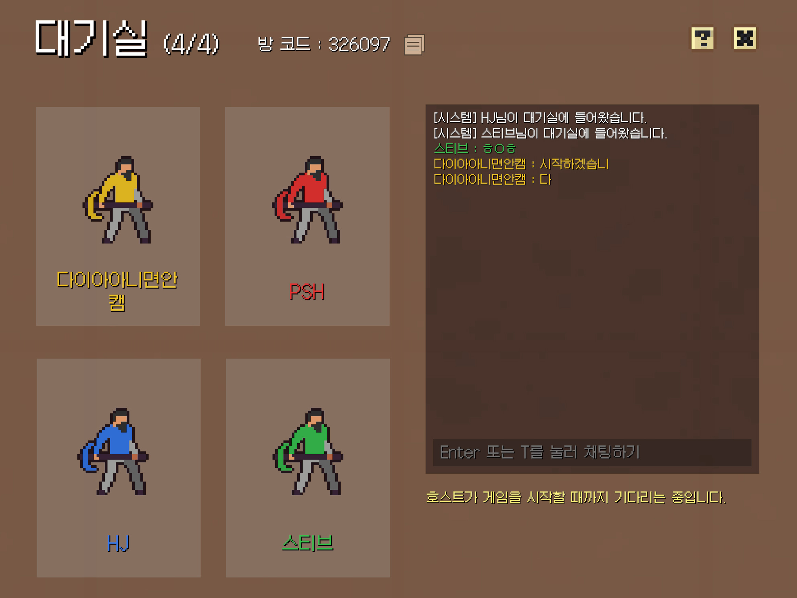

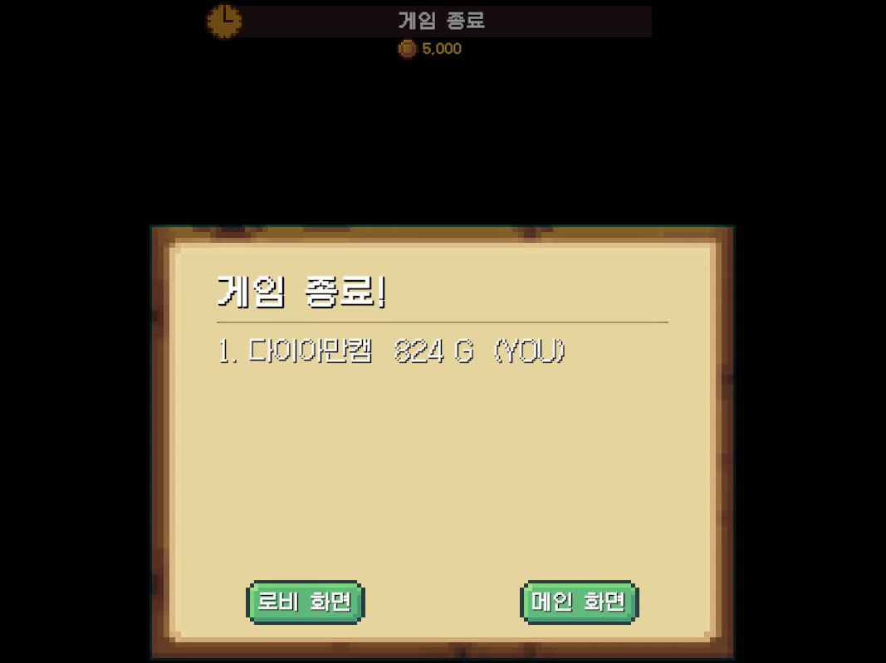

소스: [LobbyPlayerSlotView.cs](https://github.com/keeeery/Folk-Sack/blob/main/Assets/02.%20Scripts/Networking/LobbyPlayerSlotView.cs), [ChatPanelView.cs](https://github.com/keeeery/Folk-Sack/blob/main/Assets/03.%20UI/Scripts/ChatPanelView.cs), [GameTimerBarView.cs](https://github.com/keeeery/Folk-Sack/blob/main/Assets/03.%20UI/Scripts/GameTimerBarView.cs).

### 7.4 고민과 선택

서버 확정 지연과 실패는 내부 로그만으로는 사용자가 이해하기 어렵습니다.
로딩 오버레이, 시스템 메시지, 상점 알림, 쿨타임 복원과 같은 피드백을 함께 연결했습니다.
반복 과중량 메시지에는 출력 간격을 두고 내부 지형 진단 오류는 디버그 여부에 따라 노출을 조절합니다.

---

## 8. 트러블슈팅

### 8.1 여럿이 하면 멈추던 멀티플레이

#### 8.1.1 증상과 초기 선택

| 단계 | 내용 |
|---|---|
| 증상 | 처음 멀티플레이 테스트에서 한 명이 땅을 조금만 파도 게임이 멈췄고, 한참 지나서야 복구됨 |
| 처음 의심 | lock 안에서 너무 많은 처리를 하는 것이 주원인이라고 의심 |
| 확인한 주원인 | lock 안의 과도한 처리도 문제였지만, 주원인은 **지형 전체 스냅샷**이 자주 오가며 데이터 용량이 너무 커진 것. 채굴 요청의 Revision이 서버와 조금만 어긋나도 요청을 거절하고 전체 스냅샷을 다시 보냈음 |
| 해결 | 전체 스냅샷을 주고받지 않고, 서버가 보내는 변경 Batch의 Revision(`BaseRevision → ResultRevision`)만 비교해 순서대로 적용하도록 바꿔 테스트한 뒤 해결. 이 방향은 강사님과 같은 개선안을 제안했고, 구현은 강사님의 도움을 받음 |
| 함께 고친 것 | 처음 의심한 lock 구간은 직접 상태 변경과 송신을 분리해 줄임(§8.1.3) |
| 걸린 시간 | 하루 |

개선 후에는 여러 클라이언트가 원활하게 플레이되는 것을 직접 확인했습니다.

초기 구조도 플레이 중 일반 변경은 셀 목록을 담은 `TerrainChangeBatch`로 방송했습니다.
하지만 채굴 요청에 `ExpectedTerrainRevision`을 붙여, 서버 Revision과 다르면 `terrain.revision_mismatch`로 거절하고 요청한 클라이언트에 전체 지형 Snapshot을 다시 보냈습니다(§8.1.4).
연달아 파면 앞 요청이 Revision을 올리므로 이 경로를 자주 타게 되었고, 그래서 땅을 조금만 파도 큰 전체 지형 데이터가 오갔습니다. lock 안의 처리와 송신 대기(§8.1.2)는 그 비용을 더 키웠습니다.

#### 8.1.2 원인 분석 — 전체 상태 처리와 송신 대기가 묶인 구간

리팩터링 전 서버에는 상태 접근을 보호하는 동기 lock과 비동기 명령을 직렬화하는 Gate가 있었습니다.

| 구간 | 잠금 안에서 수행하던 작업 | 대기·처리 비용의 영향 |
|---|---|---|
| `GameSession.stateGate`의 C# `lock` | 전체 셀을 DTO로 복사하고 `OrderBy`·`ToList`로 Snapshot 생성 | 복사·정렬·할당이 끝날 때까지 같은 상태 잠금을 사용하는 작업 대기 |
| `Room.terrainPipelineGate`의 `SemaphoreSlim` | 지형 명령 실행 후 오류·전체 Snapshot 송신 또는 Batch·드롭 방송 완료까지 `await` | 느린 소켓 송신이 다음 지형 명령 시작을 지연시킬 수 있음 |
| `Room.gate`의 `SemaphoreSlim` | 입장 시 welcome·맵·전체 지형·아이템·인벤토리 메시지 송신과 Join 방송 | 초기 동기화 송신이 입퇴장 처리의 잠금 유지 시간에 포함 |

```csharp
// Room.ExecuteTerrainCommandAsync() — 리팩터링 전, 지형 명령을 게이트로 하나씩 실행
await terrainPipelineGate.WaitAsync();
try
{
    await command();
}
finally
{
    terrainPipelineGate.Release();
}
```

과거 `TerrainExcavationPacketHandler`는 위 `command` 안에서
`await context.BroadcastAsync(batch)`와 드롭 방송을 실행했습니다.
Revision 오류가 나면 오류 메시지와 전체 지형 Snapshot의 송신도 이 안에서 기다렸습니다.
`BroadcastAsync()`는 모든 멤버의 송신을 `Task.WhenAll()`로 기다리고,
`SendRawAsync()`는 `CancellationToken.None`으로 WebSocket 송신을 수행했습니다.
따라서 한 연결의 지연이 방의 지형 처리 잠금 해제까지 길어지는 경로가 있었습니다.

정리하면 동기 `lock`에는 전체 Snapshot 복사·정렬 비용이, 비동기 Gate에는 송신 대기 시간이 들어 있었습니다(동기 lock 안에서 직접 `await`한 것은 아님).
그래서 교착 상태가 아니라, 앞 작업의 처리 지연이 뒤 작업의 대기로 이어지는 문제였습니다.
전체 Snapshot은 매 틱이 아니라 입장·특정 오류 복구·예약 복구 때 보냈습니다.

#### 8.1.3 해결 — 상태 변경·방송 등록과 실제 송신을 분리

방 단위 FIFO 방송 큐를 도입하고,
지형 명령 구간에서는 상태 변경과 결과의 큐 등록까지만 수행하도록 수정했습니다.
실제 WebSocket 송신은 별도 방송 루프가 담당합니다.

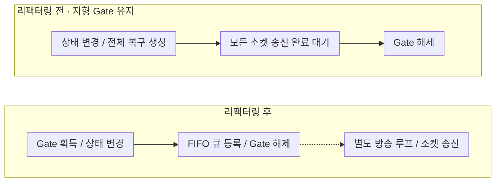

이 다이어그램은 리팩터링 전에는 지형 Gate가 모든 소켓 송신이 끝날 때까지 유지됐고, 리팩터링 후에는 큐에 등록한 뒤 Gate를 풀고 별도 방송 루프가 송신하도록 바뀐 차이를 도식화한 것입니다.

| 수정 | 변경한 처리 | 결과 구조 |
|---|---|---|
| 지형 처리와 송신 분리 | `ExecuteTerrainCommandAsync(Action)`·`EnqueueBroadcast()` | 지형 Gate가 소켓 송신 완료를 기다리지 않음 |
| Batch 순서 유지 | 단일 reader `Channel`로 방송 순서 관리 | 상태 변경과 결과 큐 등록 순서를 연결 |
| 입퇴장 송신 구간 분리 | `Room.JoinAsync()`의 상태 처리와 송신 분리 | 멤버 상태 작업과 네트워크 대기의 임계 구간 분리 |
| Snapshot 생성 비용 범위 축소 | 당시 `CreateTerrainSnapshotMessage()`의 복사·정렬 분리 | 잠금 안에서 상태 복사, 정렬은 잠금 밖으로 이동 |
| 전체 복구 조건 축소 | 낙하 예약 검증과 오류별 복구 조건 조정 | 예약 충돌 등에서 불필요한 전체 Snapshot 복구를 줄이는 정책 조정 |
| 송신 시간 제한 | `SendTimeoutMilliseconds = 3000` | 느리거나 실패한 연결의 송신에 취소·정리 경로 부여 |

핵심 효과는 **소켓 대기가 지형 상태 변경 구간을 붙잡던 결합을 끊은 것**입니다.
Snapshot 생성의 상태 복사는 여전히 잠금이 필요하고, 방송 큐도 한 메시지를 모든 멤버에게 보낼 때까지 기다리는 비용은 남습니다.

#### 8.1.4 후속 개선 — 변경 셀 Batch와 전역 Revision의 역할 정리

과거에는 요청의 `ExpectedTerrainRevision`이 방 전체 Revision과 다르면 채굴을 거절했습니다.
서로 다른 셀을 동시에 파도 먼저 처리한 요청이 방 Revision을 올리면 나중 요청은 거절될 수 있었습니다.
당시 클라이언트는 이 오류에서 `hasTerrainSnapshot = false`로 바꾸고 전체 Snapshot을 기다렸으며,
수신 후 지형 복원과 플레이어 재배치를 수행했습니다.
이 경로가 땅을 조금만 파도 전체 지형을 주고받게 만든 주원인이었습니다(§8.1.1).

현재는 채굴 유효성을 셀·예약·장착 곡괭이·거리·채굴 가능 여부로 검사하고,
성공 결과를 변경 셀 Batch로 확정합니다. 게임 진행 여부는 `PacketDispatcher`가 확인합니다.

“셀 단위 동기화”는 **바뀐 셀만 전송·적용하는 단위**입니다.
셀별 버전 번호는 없으며 `TerrainGridData.Revision`과 서버 `State.Terrain.Revision`은 방 지형 전체에 하나입니다.
한 번의 채굴 또는 여러 셀을 포함한 낙하 배치를 확정하면 하나의 `BaseRevision → ResultRevision` 전이가 생깁니다.
클라이언트는 이 순서를 따라 결과를 적용하고, 낙하 충돌은 `CollapseID`·소유자·원본 셀 예약으로 구분합니다.

| 개선 대상 | 개선 후 처리 |
|---|---|
| 앞선 Revision보다 먼저 도착한 Batch | `RoomClient`가 미래 Batch를 버퍼링하고 연속 적용 |
| 동시에 진행되는 낙하 | 서버의 원본 셀 예약과 소유자 검증 |
| 무관한 셀 변경으로 인한 채굴 거절 | 요청의 전역 Revision 검사 대신 현재 셀·아이템·거리 검사 |
| 초기 전체 지형 전송 | 프로필·시드·데이터 버전 공유 후 클라이언트에서 생성 |
| 다중 청크와 연쇄 처리 | 요청별 대기·CollapseID별 소유권 추적, 서버 확정 뒤 연쇄 검사 |

#### 8.1.5 결과와 남은 비용

지형 Gate와 송신을 분리하고 전체 복구 경로를 줄인 뒤,
여러 클라이언트에서 원활하게 플레이되는 것을 확인했습니다.
지연 시간과 처리량의 개선 폭은 별도로 측정하지 않았습니다.

지금은 초기 맵을 시드·프로필·테이블 버전으로 생성하고 일반 변경은 Batch로 공유합니다.
전체 지형 Snapshot 전송을 없앤 대신, 게임 도중 재접속·중간 참여 때의 지형 복원은 따로 설계해야 합니다.
무제한 방송 큐가 쌓이거나 느린 연결이 다른 방송을 늦추는 상황도 부하 테스트로 확인해야 합니다.

### 8.2 채굴해도 풀리지 않던 매몰

| 단계 | 내용 |
|---|---|
| 증상 | 채굴하여 공간을 만들었는데 매몰이 풀리지 않음 |
| 원인 | 이전 EdgeCollider가 남은 시점의 검사 |
| 해결 | 렌더/물리 갱신 순서 뒤 재검사 |

지형 Batch 적용과 `TerrainGridWorld`의 Mesh·EdgeCollider 재생성은 같은 순간에 끝나지 않습니다.
논리 셀 삭제 직후 물리 공간을 검사하면 이전 Collider 때문에 아직 갇혔다고 판단할 수 있습니다.
그래서 프레임 종료까지 기다린 뒤 물리 Transform을 동기화하고 매몰 판정을 이어 갑니다.

```csharp
// FallingTerrainInteraction.ResolvePendingBurialsAfterTerrainSettled() — 프레임 끝까지 기다린 뒤 물리 동기화하고 매몰 판정
yield return new WaitForEndOfFrame();
Physics2D.SyncTransforms();

if (IsCurrentSpaceEmpty())
{
    ReleasePendingBurials(collapseIds);
}
else if (TryFindDownwardReleasePosition(out Vector2 releasePosition))
{
    character.SetPosition(releasePosition);
    Physics2D.SyncTransforms();
    ReleasePendingBurials(collapseIds);
}
else
{
    EnterBuriedState();
}
```

### 8.3 여러 청크가 동시에 떨어지면 뒤 청크가 확정되지 않던 문제

| 단계 | 내용 |
|---|---|
| 발견 | 플레이 테스트와 1차 시연 중 |
| 증상 | 여러 청크 중 뒤 청크가 확정되지 않음 |
| 원인 | 클라이언트가 낙하 배치 확정을 기다리는 상태를 하나(`pendingCollapsePlacementId`)만 두어서, 먼저 보낸 요청을 기다리는 동안 함께 정착한 뒤 청크의 배치 제안은 경고 로그만 남기고 버려짐. 서버의 원본 셀 예약은 시간 초과로 취소되고 원본이 복구됨 |
| 해결 | 대기 상태를 요청 ID → CollapseID 사전(`pendingCollapsePlacementIds`)으로 바꾸고, 같은 CollapseID의 중복 요청만 막음. 성공·오류·취소 때는 해당 요청만 정리(§3.3) |
| 시점 | 서버 권위 지형 동기화를 도입(9월 1일)한 뒤 생겼고, 9월 9일에 수정 |

### 8.4 연쇄 붕괴 제한이 소진되지 않고 다른 플레이어가 내 연쇄를 덮어쓰던 문제

| 단계 | 내용 |
|---|---|
| 발견 | 플레이 테스트와 1차 시연 중 |
| 증상 | 연쇄 제한 횟수가 소진되지 않음. 다른 플레이어 변경 이후 내 연쇄가 중단되거나 잘못 이어짐 |
| 원인 | 서버가 확정한 낙하 배치를 일반 지형 변경처럼 처리해, 연쇄의 한 단계가 끝날 때마다 `chainCount`가 0으로 돌아감. 연쇄의 소유 여부도 마지막에 받은 배치의 값 하나(`placementOwnerForCurrentChain`)로만 기억해, 다른 플레이어의 배치가 내 연쇄의 소유권을 덮어씀 |
| 해결 | 낙하 배치(`CollapsePlacement`)를 일반 변경과 분리해 진행 중인 연쇄의 다음 단계로 잇고, 내가 소유한 낙하를 CollapseID 집합(`locallyOwnedCollapseIds`)으로 추적. 낙하 취소·스냅샷 갱신 때 소유 상태를 정리(§3.4) |
| 시점 | 9월 16일에 수정 |

### 8.5 그 밖에 해결한 문제

| 증상 | 원인·코드상 경로 | 소스에 반영된 대응 |
|---|---|---|
| 같은 TSV인데 다른 OS에서 버전 불일치 | BOM·CRLF/LF의 바이트 차이 | 클라이언트/서버 해시 입력 정규화 |
| 아이템 사용 거절 뒤 쿨타임만 남음 | 요청과 예상 쿨타임의 연결 누락 | RequestId별 대기·실패 시 취소 |

---

## 9. 결과와 배운 점

### 9.1 구현 결과

| 목표 | 구현 결과 | 핵심 클래스·처리 | 담당 |
|---|---|---|---|
| 긴 지형 임계 구간 축소 | 상태 변경·FIFO 등록과 WebSocket 송신 분리 | `Room.ExecuteTerrainCommandAsync`·방송 큐 | 내 기여 (강사님이 정리) |
| 셀 작업이 전체 지형 복구로 확대되는 결합 완화 | 채굴 요청의 전역 Revision 검사 제거와 변경 셀 Batch 적용 | 8.1의 과거·현재 비교 | 강사님 |
| 같은 공유 상태를 기준으로 채굴 | 서버 검증과 전역 Revision Batch 적용 경로 | `TryExcavate`, `ApplyAuthoritativeBatch` | 팀 (`ApplyAuthoritativeBatch`는 내 기여) |
| 동시 낙하의 전역 단일 요청 대기 제거 | RequestId별 배치 대기 및 CollapseID별 소유권 | `RoomClient`·`TerrainCollapseCoordinator` | 내 기여 (굴착 요청별 대기는 강사님) |
| 서버 확정 전 연쇄 재검사 방지 | 권위 모드의 물리 완료 콜백과 연쇄 검사 분리 | `TerrainCollapseCoordinator` | 내 기여 |
| 타일 제거와 물리 재생성 순서 보완 | 프레임 종료 대기와 물리 동기화 후 매몰 재검사 | `FallingTerrainInteraction` | 내 기여 (지형 정착 뒤 매몰 정리는 강사님) |
| 아이템 거절과 HUD 상태 연결 | 요청 실패의 예상 쿨타임 취소, 권위 인벤토리 적용 | `ItemController`·`ReplaceWithSnapshot` | 내 기여 |
| 정지 상태의 지형 변경도 시야에 반영 | 지형 변경 플래그 기반 시야 재계산 | `PlayerExplorationController` | 내 기여 |

### 9.2 한계와 개선 과제

- **부분 권위 구조**: 플레이어 좌표·피해 근거와 낙하 결과 일부를 클라이언트가 보고합니다. 이동 거리·실제 물리 궤적을 서버에서 재현하는 검증은 없습니다.
- **결정적 생성 유지 비용**: 테이블 해시 일치 외에 생성 코드·연산·난수 순서의 일치를 별도 확인해야 합니다.
- **채굴 검증 범위**: 서버 `TryExcavate()`는 셀·장비·거리 조건을 검사하지만 사망 여부 검사는 별도로 없습니다.
- **Revision 누락 복구**: 미래 Batch 버퍼링만으로 영구 누락을 해결할 수 없습니다. 재접속·재동기화 시나리오 검증이 필요합니다.
- **방송 적체**: 무제한 `Channel`의 큐 길이와 느린 연결에 대한 운영 정책을 측정해야 합니다.
- **UI·시야 할당**: 전체 인벤토리 표시 재구성과 시야 컬렉션 생성이 있습니다. 병목 여부는 Profiler에서 판단해야 합니다.
- **상점 되돌리기 순서**: 서버가 되돌리기 기록을 먼저 꺼낸 뒤 수량·환불을 검사해, 검사에 실패하면 같은 되돌리기를 다시 할 수 없습니다(§5).
- **다이너마이트 로컬 지형 변경**: 서버 폭발 확정 뒤에도 로컬 지형을 다시 바꿀 수 있는 경로가 남아 있습니다(§5).
- **지형 표현 방식의 근거**: 셀마다 객체를 두던 방식의 로드 시간·프레임 저하는 팀원 환경에서 확인했지만 수치로 남기지 않았습니다(§2.6).
- **추가 검증**: 소유자 퇴장, 늦은 확정·취소 메시지, 장시간 부하에서의 안정성 검증이 필요합니다.

### 9.3 배운 점과 회고

지형 시스템과 멀티플레이 동기화는 직접 해보고 싶었던 분야였고, 팀의 역할 분담에 따라 맡은 영역이기도 했습니다.

목표는 지형을 자원 탐색의 대상이면서 위험과 경쟁을 만드는 요소로 활용하는 것이었습니다(§1.2).

실제 다인 플레이에서는 예상하지 못한 붕괴로 갑자기 위험에 놓이거나 즉사하면서 유리하던 상황이 뒤집히는 장면이 있었습니다. 일부러 다른 플레이어 쪽 지형을 무너뜨리며 서로 방해하기도 했습니다. 이런 상황에서 의도했던 탐험의 긴장감과 간접 PvP의 재미가 나왔다고 느꼈습니다.

협업에서는 초기에 역할 분담이 명확하지 않았고, 공용으로 사용하는 인터페이스의 시그니처를 사전 소통 없이 수정해 다른 팀원이 코드를 추가로 수정해야 하는 상황을 만들었습니다. 내 작업에서 편리한 변경이 함께 사용하는 코드에는 수정 부담이 될 수 있다는 점을 경험했습니다.
이 일로 공용 메서드나 인터페이스를 바꿀 때뿐 아니라, 팀 프로젝트 전반에서 소통이 중요하다는 것을 배웠습니다.

팀원들이 구현한 기능을 멀티플레이에 연결할 때는 **클라이언트에서 즉시 처리할 부분과 서버의 확정을 기다릴 부분**을 구분하는 것이 어려웠습니다. 기존 기능을 서버 확정 흐름에 맞추는 과정에서 같은 처리를 두 번 구현하거나 다시 수정해야 할 수 있어, 기능 구현과 네트워크 연동 사이의 책임을 맞추는 작업이 필요했습니다.

이 프로젝트에서 얻은 기준은 데이터 구조를 나누는 것을 넘어 **언제 어떤 상태를 확정하는가**를 정하는 것입니다.
물리 정착과 서버 배치 확정, 셀 삭제와 Collider 재생성, 사용 요청과 사용 성공은 서로 다른 시점입니다.
이 경계를 이벤트·요청 ID·Revision·CollapseID로 드러내면 동시성 문제를 구체적으로 추적할 수 있습니다.
