# Folk Sack — 멀티플레이 채굴 게임 기술 문서

> **한 줄 소개**: 지하에서 채굴하여 자원을 모으고, 지형 붕괴·매몰 위험 속에서 경쟁하는 멀티플레이 채굴 게임
>
> **구현 범위**: 시드 기반 절차적 맵 데이터 생성, 채굴·붕괴 서버 확정, 낙하 지형 충돌·매몰, 인벤토리·상점 연결, 탐험 지도

| 구분 | 시스템 | 핵심 내용 | 절 |
|---|---|---|---|
| 핵심 A | 시드 기반 절차적 맵 데이터 생성 | 깊이·동굴·광물 규칙을 데이터 테이블로 관리하고, 같은 시드로 모든 플레이어와 서버가 같은 맵을 만듦 | §2 |
| 핵심 B | 채굴·붕괴 권위 동기화 | 여럿이 같은 땅을 캐고 무너뜨려도 서버가 순서를 정해 모두에게 같은 결과를 보여 줌, 여러 덩어리의 동시 낙하와 연쇄 붕괴 | §3 · §8.1 · §8.3 · §8.4 |
| 핵심 C | 낙하 지형·매몰 상호작용 | 떨어지는 지형과의 충돌, 옆으로 밀려나 탈출하거나 깔려 매몰되는 판정 | §4 · §8.2 |
| 보조 D | 인벤토리·아이템·상점 | 서버가 확정한 아이템·골드를 인벤토리와 화면에 반영 | §5 |
| 보조 E | 탐험·시야·지도 | 가 본 곳과 지금 보이는 곳을 나눠 지도에 표시, 무너진 지형도 반영 | §6 |
| 보조 F | 로비·게임 진행·표시 | 로비 준비부터 카운트다운, 다른 플레이어 움직임 표시, 결과 화면까지 | §7 |

---

## 1. 프로젝트 개요

### 1.1 게임 소개

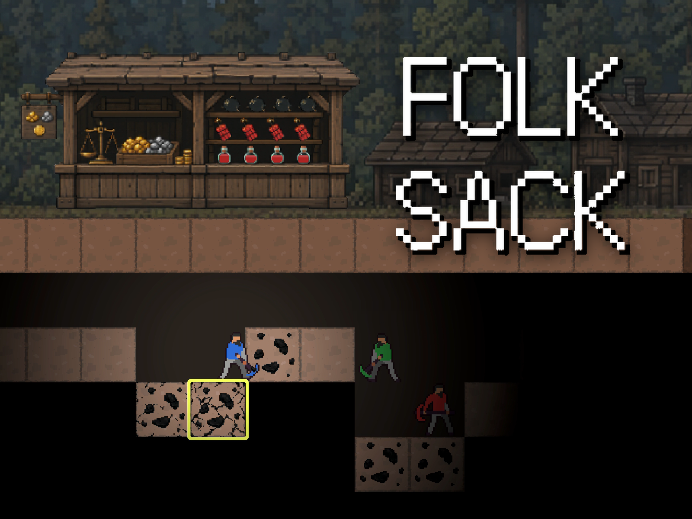

**Folk Sack**은 지하에서 채굴하여 자원을 모으고, 지형 붕괴·매몰 위험 속에서 경쟁하는 2D 멀티플레이 채굴 게임입니다. 플레이어는 지하 지형을 채굴하고 광물을 수집하며,
지상에서 자원을 판매하여 장비와 사용 아이템을 구매합니다.
지지 구조가 사라진 지형은 물리 청크로 낙하하고, 플레이어는 충돌 피해나 매몰 위험에 노출됩니다.
제한 시간과 보유 골드 등 게임 진행 조건은 서버 상태를 기준으로 공유합니다.

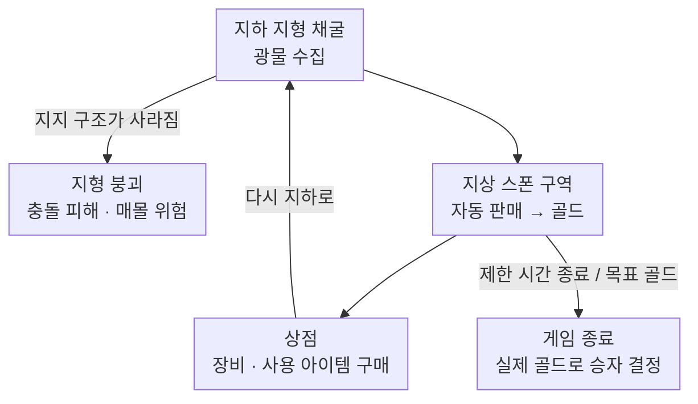

이 다이어그램은 지하에서 채굴하고 지상에서 판매·구매한 뒤 다시 내려가는 게임 루프와, 붕괴 위험과 게임 종료 조건을 도식화한 것입니다.

핵심 시스템은 다음과 같습니다.

- **진행:** 로비에서 방에 들어가 호스트가 시작하고, 모든 플레이어가 지형 준비를 마치면 카운트다운 뒤 시작합니다. 제한 시간이 끝나거나 목표 골드에 이르면 끝나고, 실제 보유 골드로 승자를 정합니다.
- **절차적 맵 생성:** 같은 시드로 모든 플레이어에게 같은 맵이 생성됩니다. 깊이에 따라 Ground·Dirt·Stone·DeepStone 구간이 있고, 동굴·변칙 지형·광물 군집이 배치됩니다.
- **채굴과 판매:** 장착한 곡괭이로 타일을 캐면 광물이 떨어집니다. 인벤토리에는 무게 제한이 있고, 지상 스폰 구역에 돌아오면 자동으로 판매됩니다.
- **상점:** 골드로 장비와 다이너마이트 같은 사용 아이템을 삽니다.
- **붕괴와 매몰:** 지지 구조가 사라진 지형은 덩어리째 떨어집니다. 깔리면 피해를 받거나 매몰되고, 사망하면 그 칸에 사망 보관함이 생기며 골드 절반과 아이템을 떨어뜨립니다.
- **지도:** 미니맵과 전체 지도에서 이미 가 본 곳과 지금 보이는 곳을 나눠 보여 줍니다.

조작은 다음과 같습니다.

| 동작 | 조작 |
|---|---|
| 이동 | A / D (벽을 오르는 중에는 W / A / S / D) |
| 점프 | Space |
| 벽 잡기 | Shift |
| 채굴 | 마우스 좌클릭 |
| 사용 아이템 | 마우스 우클릭 — 누르면 조준, 떼면 사용, 조준 중 좌클릭은 취소 |
| 아이템 슬롯 선택 | 숫자 1~0, 마우스 휠 스크롤 |
| 아이템 버리기 | Q (짧게 누르면 1개, 길게 누르면 전부 버리기) |
| 전체 지도 보기 | Tab (휠 스크롤로 확대·축소, 휠 클릭·드래그로 이동) |
| 채팅 | Enter 또는 T로 열기, Enter로 보내기, Esc로 닫기 |
| 메뉴 | Esc |
| 상점 | 상점 NPC 클릭 / B |

### 1.2 기획 의도

직접 땅을 파면서 자원을 찾는 재미와, **지형 붕괴·매몰의 위험** 때문에 긴장하며 탐험하는 경험을 주고 싶었습니다.
또한 지형을 의도적으로 무너뜨려 다른 플레이어를 매몰시키는 **간접 PvP**도 목표로 삼았습니다.

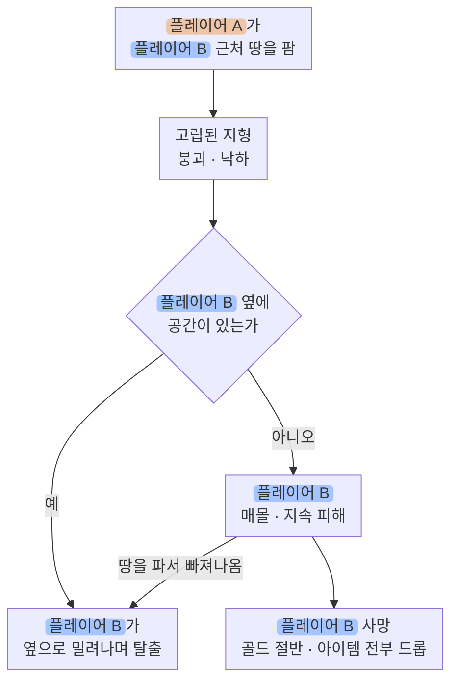

이 다이어그램은 간접 PvP가 일어나는 흐름을 도식화한 것입니다.

**플레이어 B가 매몰되는지는 A가 판 결과로 정해지고, 매몰돼도 땅을 파서 빠져나올 수 있습니다.**

이 장면이 여러 플레이어 화면에서 똑같이 보이도록, 지형 변화는 서버가 확정하는 구조로 만들었습니다.
그 과정에서 푼 문제는 다음과 같습니다.

- **같은 칸을 여러 명이 동시에 팜:** 서버가 검증하고 순서 번호(Revision)를 붙여 확정합니다(§3).
- **여러 덩어리가 동시에 떨어짐:** 덩어리마다 번호(`CollapseID`)와 담당 플레이어를 따로 둡니다(§3.4).
- **떨어진 덩어리가 자리 잡자마자 다시 무너질 수 있음:** 서버가 배치를 확정한 뒤 다시 검사합니다(§3.5).
- **땅을 파서 공간을 만들었는데 깔림이 풀리지 않음:** 물리 충돌 정보가 갱신될 때까지 기다린 뒤 다시 판정합니다(§8.2).
- **서버가 거절한 아이템을 쓴 것처럼 보임:** 거절되면 쿨타임을 취소하고 서버 상태로 되돌립니다(§5.2).
- **이미 가 본 곳과 지금 보이는 곳이 섞임:** 탐험 기록과 현재 시야를 따로 저장합니다(§6).

### 1.3 개발 환경

| 항목 | 내용 |
|---|---|
| 장르 | 2D 멀티플레이 채굴 |
| 기간 | 2026.08 — 2026.09, 약 2주 |
| 인원 | 3인 |
| 엔진 | Unity `6000.3.15f1`, URP `17.3.0` |
| 언어 | C# |
| 주요 패키지 | Input System `1.19.0`, Newtonsoft Json `3.2.2`, Cinemachine `3.1.7`, DOTween |
| 서버 | ASP.NET Core (.NET `10.0`) |
| 통신 | `ClientWebSocket` / ASP.NET Core WebSocket, JSON 메시지 |
| 데이터 | 클라이언트 StreamingAssets TSV, 서버 Data TSV 및 설정 |
| GitHub | [GitHub(클라이언트)](https://github.com/keeeery/Folk-Sack), [GitHub(서버)](https://github.com/KooHoo-Dev/3rd-TeamProject-KH-Server) |
| 시연 영상 | [YouTube](https://youtu.be/XQi-Hra-ywg) |

### 1.4 담당 범위

팀은 3명이며, 각자 맡은 부분은 다음과 같습니다.

- **나** — 맵 생성·채굴·지형 붕괴와 멀티플레이 동기화(서버 로비·패킷 처리 포함), 낙하 지형 충돌·매몰, 플레이어 조작 책임 분리, UI 스크립트(HUD 연결·로비·메뉴·설정·채팅), 탐험·시야·지도
- **팀원 1** — 아이템·상점·곡괭이 슬롯·쿨타임·리스폰, 캐릭터 조작 초기 구현(벽 잡기·회피), 밸런스 수치
- **팀원 2** — 그래픽·UI 그래픽·애니메이션·사운드·타격 연출, 캐릭터 이동 충돌 초기 구현, 서버 초기 구조

| 영역 | 직접 구현·보완한 내용 | 팀 기반과의 관계 |
|---|---|---|
| 맵 생성·지형 동기화 | 시드 기반 절차적 맵 데이터 생성, 채굴·붕괴의 서버 확정, 상태 변경·송신 분리, 여러 덩어리의 동시 낙하와 연쇄 붕괴 안정화 | 팀원 2의 서버 초기 구조 위에 구현. 채굴 요청 검사 제거·굴착 요청별 대기·낙하 취소와 매몰 정리는 강사님의 도움 |
| 낙하 지형·매몰 | 낙하 청크 충돌, 탈출·매몰 판정, 플레이어 조작 책임 분리 | 이동 충돌을 실제 콜라이더 모양 Cast로 고친 것은 팀원 2, 벽 잡기는 팀원 1이 처음 구현(§4.3) |
| 인벤토리·아이템 연결 | 서버가 확정한 상태를 인벤토리·HUD에 반영, 거절된 사용의 쿨타임 취소 | 아이템·상점·쿨타임은 팀원 1, `InventoryView`는 팀원 2(§5.2) |
| 탐험·지도 | 누적 탐험과 현재 관측, 월드 안개·미니맵·전체 지도 | — |
| 로비·UI | 로비·대기방·채팅·승자 표시와 HUD·메뉴·설정 코드 | 화면 그래픽과 레이아웃은 팀원 2(§7.3) |

**AI를 활용한 곳:** 붕괴 동작을 먼저 확인한 첫 프로토타입(§2.7)과 매몰 판정의 코드 반영(§4.4)에 활용했습니다. 판정 기준과 최종 결정은 직접 정했습니다.

초기 맵을 시드로 공유하는 구조와 채굴 결과를 모두에게 같은 순서로 반영하는 방식은 강사님과 같은 개선안을 제안했고, 구현 방향은 강사님의 도움을 받았습니다(§8.1).
서버는 강의에서 익힌 ASP.NET Core WebSocket 기본 구조 위에 게임 로직을 구현했습니다.

이 문서에서 깊게 다루는 것은 세 가지입니다.

1. **같은 시드의 맵 생성(§2):** 깊이·동굴·광물 규칙을 데이터 테이블로 관리하고, 같은 시드로 모든 플레이어와 서버가 같은 맵을 만드는 구조를 다룹니다.
2. **채굴·붕괴 동기화(§3·§8.1):** 여럿이 같은 땅을 캐고 무너뜨려도 서버가 순서를 정해 모두에게 같은 결과를 보여 주는 구조와, 여러 덩어리의 동시 낙하·연쇄 붕괴를 다룹니다.
3. **낙하 지형과 매몰(§4):** 떨어지는 지형과의 충돌, 옆으로 밀려나 탈출하거나 깔려 매몰되는 판정을 다룹니다.

인벤토리·지도·로비 흐름(§5~§7)은 짧게 다룹니다.

### 1.5 전체 구조

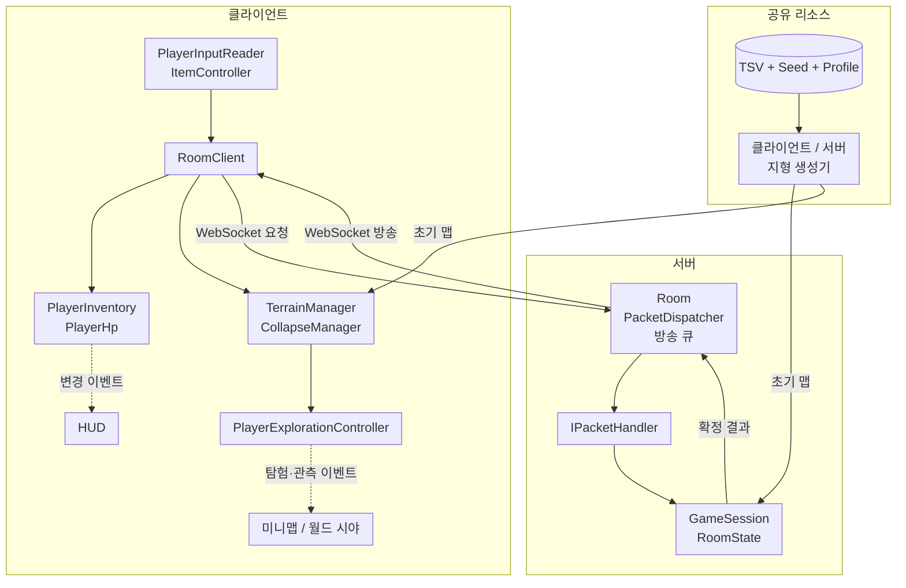

이 다이어그램은 클라이언트가 입력·물리·표시를, 서버가 공유 상태 확정을 맡고, 두 쪽이 같은 TSV·시드로 초기 맵을 만드는 전체 구조를 도식화한 것입니다.

**왜 이렇게 나눴나**

- **지형 변경은 서버가 확정하고, 낙하 물리는 클라이언트가 제안합니다.** 서버가 지형의 변경만 알도록 해 멀티플레이 레이턴시를 줄이고, 낙하 궤적은 소유 클라이언트가 계산해 제안하면 서버가 예약·배치 규칙을 검사해 확정합니다(§3.7).
- **초기 맵은 보내지 않고 양쪽에서 같은 시드로 다시 만듭니다.** 초기 전체 맵 전송 부담을 줄이는 대신 생성기·난수 순서·데이터를 양쪽에서 맞춰야 하므로, 정규화한 TSV 해시로 테이블 차이를 검사합니다(§2.2·§2.7).
- **인벤토리는 서버 스냅샷으로 통째로 교체합니다.** 지형보다 크기가 작아, 획득·판매·사망 등 여러 경로의 결과를 하나의 기준으로 복원합니다(§5.3).

---

## 2. 같은 시드로 모두에게 같은 맵 생성

### 2.1 개요 — 같은 시드와 규칙의 절차적 맵 데이터 생성

같은 시드와 규칙으로 클라이언트와 서버가 같은 맵 데이터를 절차적으로 생성합니다.
생성 규칙은 TSV 데이터 테이블로 관리하며, 시드 프로필, 깊이 구간, 동굴, 변칙 지형 군집, 광물 테이블로 나눕니다.
`TerrainTableSeedGenerator`는 이 규칙을 적용해 `TerrainMapFile`을 생성합니다.
서버에는 대응하는 `ServerTerrainGenerator`가 있습니다.

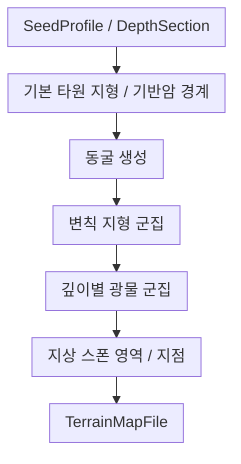

이 다이어그램은 시드 프로필과 깊이 구간에서 시작해 동굴·변칙 지형·광물·스폰 영역을 차례로 적용해 맵 파일을 만드는 생성 순서를 도식화한 것입니다.

**생성 단계의 순서가 고정되어 있어, 같은 시드면 동굴·광물이 같은 자리에 생깁니다.**

생성 순서 자체가 결과를 결정하는 규칙입니다.
동굴을 뚫은 후 광물을 붙이는 순서나 난수 호출 순서가 달라지면 같은 시드여도 맵이 달라질 수 있습니다.
맵 형태와 게임 플레이 중 수정되는 셀 상태도 구분합니다.

### 2.2 같은 시드, 같은 맵의 보장

지형 테이블은 값을 읽은 뒤 참조와 적용 순서를 확정합니다. 깊이 섹션은 `SectionOrder`로 정렬하고 첫 구간 0, 마지막 구간 1, 인접 구간의 연속성을 검사합니다. 광물은 섹션별 `ResourceOrder`, 변칙 군집은 섹션·`VariantOrder`, 동굴은 `CaveOrder` 순서로 적용합니다. 중복 ID·순서와 없는 타일·자원 참조는 로딩 오류로 처리합니다.

맵 생성용 `System.Random`은 동굴·변칙 지형·광물 생성이 공유합니다. 같은 시드라도 앞 단계의 반복 순서나 난수 호출 횟수가 달라지면 뒤 단계 결과도 달라집니다. 스폰 후보 셔플은 같은 시드로 새 `System.Random`을 만들어 별도로 수행하며, 중앙 후보 열에서 최대 네 좌표를 선택합니다.

### 2.3 표(TSV)로 관리하는 지형 규칙

지형 테이블 7종(타일·자원·시드 프로필·깊이 구간·구간별 광물·변칙 군집·동굴)은 모두 같은 경로로 읽습니다.
**DTO는 TSV에 저장된 값, Def는 게임이 실제로 조회해 사용하는 값**으로 구분했습니다.

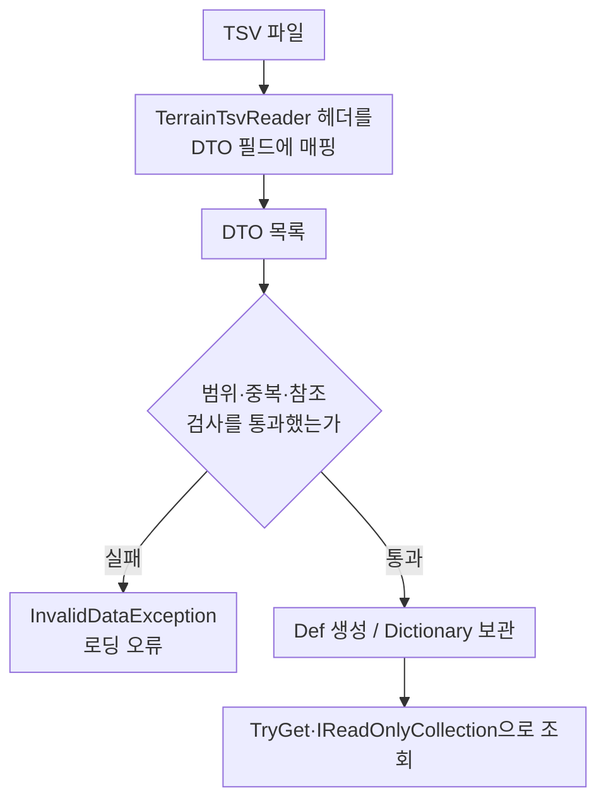

이 다이어그램은 TSV 파일을 DTO로 읽고 검사를 통과한 값만 Def로 만들어 조회하는 데이터 경로와, 검사에 실패하면 로딩 오류로 처리하는 갈림을 도식화한 것입니다.

```csharp
// TerrainTileTable.Load() — DTO를 Def로 바꾸며 잘못된 값 거르기
foreach (TerrainTileDTO dto in rows)
{
    if (dto.IsMineable && dto.MaxDurability <= 0)
        throw new InvalidDataException(
            $"채굴 가능한 타일의 MaxDurability는 1 이상이어야 합니다: {dto.TileType}");

    if (defs.ContainsKey(dto.TileType))
        throw new InvalidDataException(
            $"중복 TileType입니다: {dto.TileType}");

    defs.Add(dto.TileType, new TerrainTileDef(dto));
}
```

다른 테이블을 참조하는 테이블은 참조 대상을 먼저 읽습니다. 예를 들어 깊이 구간은 시드 프로필·타일 테이블을 받은 뒤 `ProfileID`·`BaseTileType`이 등록되어 있는지 검사하고, 찾은 Def를 함께 담아 생성합니다.

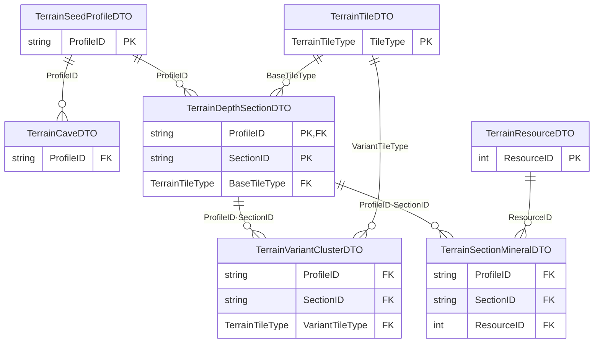

이 다이어그램은 지형 테이블 7종(타일·자원·시드 프로필·깊이 구간·구간별 광물·변칙 군집·동굴)이 ID로 서로를 참조하는 관계를 도식화한 것입니다.

**깊이 구간이 시드 프로필과 타일을 참조하고, 광물·변칙 군집은 다시 깊이 구간을 참조합니다.**

소스: [TerrainTsvReader.cs](https://github.com/keeeery/Folk-Sack/blob/main/Assets/02.%20Scripts/TerrainCollapse/Data/TerrainTsvReader.cs), [TerrainTileDef.cs](https://github.com/keeeery/Folk-Sack/blob/main/Assets/02.%20Scripts/TerrainCollapse/Data/TerrainTileDef.cs), [TerrainDataTables.cs](https://github.com/keeeery/Folk-Sack/blob/main/Assets/02.%20Scripts/TerrainCollapse/Data/TerrainDataTables.cs), [TerrainTableSeedGenerator.cs](https://github.com/keeeery/Folk-Sack/blob/main/Assets/02.%20Scripts/TerrainCollapse/Generation/TerrainTableSeedGenerator.cs), [RoomClient.Terrain.cs](https://github.com/keeeery/Folk-Sack/blob/main/Assets/02.%20Scripts/Networking/RoomClient.Terrain.cs).

### 2.4 접속 시 같은 맵 재생성

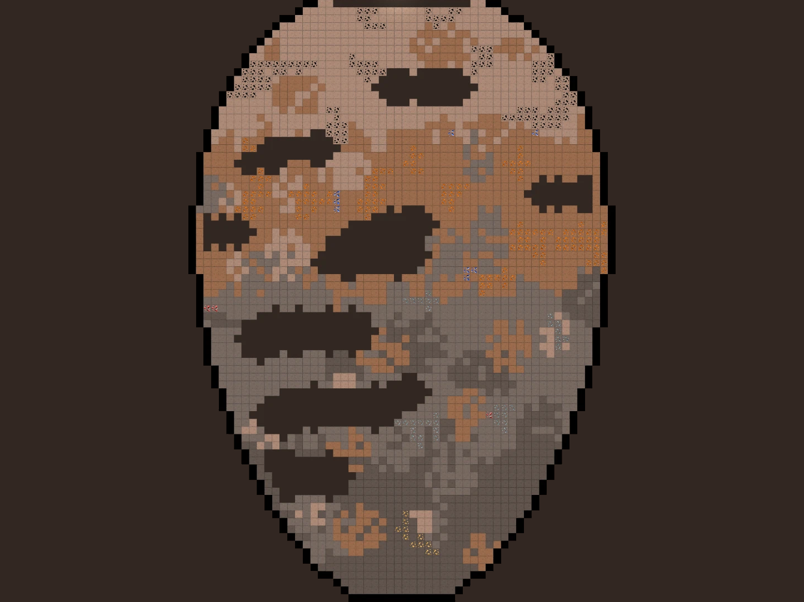

클라이언트는 `map_session`에서 받은 프로필·시드와 테이블 버전을 확인하고 초기 맵을 재생성합니다.
`TerrainNetworkAdapter.FromGeneratedMap()`이 생성 결과를 Revision 0의 런타임 스냅샷으로 변환합니다.
게임 중 채굴·재배치 변경은 이후 서버 Batch로 적용됩니다.

```csharp
// RoomClient.HandleMapSession() — 맵 세션의 프로필 ID·시드로 초기 맵 생성
TerrainMapFile map = TerrainSeedGenerator.Generate(
    MapSession.ProfileID,
    MapSession.Seed);

ApplyTerrainSnapshot(TerrainNetworkAdapter.FromGeneratedMap(map));
```

테이블 버전은 TSV 파일들을 정렬하여 읽고 SHA-256으로 계산한 값의 앞 12자입니다.
`ReadNormalizedTsvBytes()`는 BOM을 제거하고 CRLF·CR을 LF로 바꾸며, 파일 끝 LF 한 개를 지웁니다.
클라이언트와 서버가 같은 규칙으로 정규화하므로, Windows와 macOS에서 내용이 같은 TSV가 다른 버전으로 판단되지 않습니다(§8.5).

### 2.5 동굴과 광물 — 끊긴 지형 복원과 뭉침 크기

생성 단계 중 동굴을 이어 만들고 광물 군집을 배치하는 두 처리입니다.

#### 동굴로 끊긴 지형의 복원

`TerrainCaveGenerator`는 깊이 범위와 경계 여유를 만족하는 시작점을 찾고,
수평 방향에 작은 수직 변화를 누적하며 원형 셀들을 이어 동굴 후보를 만듭니다.
후보를 바로 확정하지 않고 기존 타일 종류를 백업한 뒤 비우고, 지형 연결성 검사에 실패하면 복원합니다.

```csharp
// TerrainCaveGenerator.TryApplyCandidate() — 기존 타일을 백업하고 비운 뒤, 연결성 검사에 실패하면 복원
foreach (Vector2Int coord in candidateCells)
{
    TerrainTileType previousType = map.GetTile(coord);
    backups.Add(new CaveTileBackup(coord, previousType));
    map.SetTile(coord, TerrainTileType.Empty);
}

if (TerrainMapConnectivityValidator.HasFloatingGroup(map) == false) return true;
RestoreTiles(map, backups);
return false;
```

이 방식은 동굴 모양을 먼저 정한 후 생긴 고립 지형을 무조건 제거하는 대신,
기존 지형을 유지할 수 있는 후보만 채택합니다. 시도 횟수와 시작점 조건 때문에
요청한 동굴 수보다 적게 생성될 수 있습니다.

생성용 `TerrainMapConnectivityValidator`는 그룹 셀의 **바로 아래 기반암**을 지지 조건으로 검사합니다.
게임 중 `TerrainManager.FindFloatingGroups()`는 상하좌우 탐색에서 기반암이나 스폰 플랫폼과의 인접을 검사합니다.
두 경로는 쓰이는 시점과 지지 조건이 다른 별개의 판정입니다.

#### 광물의 양과 뭉침 크기

`TerrainMineralClusterGenerator`는 깊이 섹션과 광물 규칙을 순서대로 읽고,
적합한 바탕 셀에서 `ClusterDensity` 확률로 군집 생성을 시작합니다.
시작하면 최소·최대 크기 안에서 목표 크기를 뽑고,
기존 군집의 상하좌우 이웃 중 유효한 후보를 확장합니다.

| 데이터·조건 | 역할 |
|---|---|
| 깊이 섹션·경계 오프셋 | 어느 영역에 광물 규칙을 적용할지 결정 |
| `ClusterDensity` | 군집 생성 시작을 시도할 확률 |
| `MinClusterSize`·`MaxClusterSize` | 시작한 군집의 목표 크기 |
| 자원 ID | 바탕 타일에 부가되는 광물 종류 |
| 확장 가능한 이웃 | 연결된 군집의 실제 성장 범위 |

`ClusterDensity`는 최종 광물 점유율이 아니라 군집 생성을 시작할 확률입니다.
주변 후보가 없으면 목표 크기에 도달하기 전에 확장을 멈춥니다.
확률·성장 순서·난수 소비가 함께 결과를 결정하므로 서버와 클라이언트의 순회 순서를 맞춰야 합니다.

소스: [TerrainCaveGenerator.cs](https://github.com/keeeery/Folk-Sack/blob/main/Assets/02.%20Scripts/TerrainCollapse/Generation/TerrainCaveGenerator.cs), [TerrainMapConnectivityValidator.cs](https://github.com/keeeery/Folk-Sack/blob/main/Assets/02.%20Scripts/TerrainCollapse/Generation/TerrainMapConnectivityValidator.cs), [TerrainMineralClusterGenerator.cs](https://github.com/keeeery/Folk-Sack/blob/main/Assets/02.%20Scripts/TerrainCollapse/Generation/TerrainMineralClusterGenerator.cs).

### 2.6 지형 칸 저장·표시와 이어진 공간 탐색

| 클래스 | 책임 |
|---|---|
| `TerrainGridData` | 비어 있지 않은 셀을 `Dictionary<Vector2Int, TerrainCell>`로 보관하고 Revision 관리 |
| `TerrainGridWorld` | 기본 지형의 Chunk Mesh와 경계 Collider 생성·갱신 |
| `TerrainManager` | 지형 조회·변경 API와 기반 지지 여부 탐색 |
| `TerrainCollapseCoordinator` | 지형 변경 뒤 부유 그룹의 낙하 시작 요청 조정 |

기본 지형은 셀마다 GameObject를 만들지 않고 32×32 셀 단위 Mesh로 표현합니다(선택 이유는 §2.7).
셀 변경은 `dirtyChunks`와 `colliderDirty`에 기록됩니다.
`LateUpdate()`에서 변경 Chunk의 Mesh를 갱신하고, Collider가 dirty이면 외곽선 Collider를 재생성합니다.

`FindFloatingGroups()`는 상하좌우로 연결된 일반 지형을 Queue 기반으로 탐색합니다.
탐색 중 `Bedrock`이나 `SpawnPlatform`과 인접하면 지지된 그룹으로 판단하고,
지지점이 없는 그룹만 반환합니다. 점유 셀과 결과 그룹을 정렬해 탐색·요청 순서를 맞춥니다.
이 탐색은 변경 셀 주변만이 아니라 호출할 때마다 점유 셀 전체를 순회합니다.

### 2.7 고민과 선택

**지형을 어떤 단위로 그릴까 — 셀마다 객체 대신 Chunk Mesh**

약 1만 셀(프로토타입 시험 맵 100×105)의 지형을 어떤 단위로 그리고, 충돌을 어떻게 줄지 정해야 했습니다.
채굴과 붕괴로 셀이 계속 바뀌는 게임이라, 셀 하나가 바뀔 때 다시 만드는 범위와 지형 객체 수가 중요했습니다.

| 방법 | 장점 | 비용 |
|---|---|---|
| Unity Tilemap (처음 방식) | AI를 활용해 첫 프로토타입을 빠르게 만듦 | 사용하기 다소 불편 |
| 셀마다 GameObject·Collider (리팩터링 첫 버전) | 정점·Collider를 직접 만들 필요 없이 Unity 기본 컴포넌트로 처리<br>셀 하나를 흔드는 연출도 오브젝트만 움직이면 됨 | 팀원 개발 환경에서 로드 시간이 길고 프레임이 떨어짐 |
| 32×32 Chunk Mesh + 외곽선 EdgeCollider (채택) | 셀이 바뀌면 그 셀이 속한 Chunk의 Mesh만 다시 만듦<br>그리는 지형 객체가 셀 수가 아니라 Chunk 수(프로토타입 맵에서 최대 16개) | 셀의 정점·UV·외곽선 Collider를 직접 만들고 갱신해야 함<br>셀 하나를 흔드는 연출도 정점을 직접 옮겨야 함 |

개발이 이어질수록 셀 단위 객체의 비용이 커질 것으로 판단해, 상대적으로 비용이 낮은 Chunk Mesh와 EdgeCollider를 택했고, 프로토타입에서 채택한 이 방식을 팀 프로젝트로 포팅했습니다.
다만 문제는 팀원 환경에서 확인했고, 두 방식을 수치로 측정해 비교하지는 않았습니다.

**프로토타입에서 Chunk Mesh까지**


지형 붕괴는 팀 프로젝트에 넣기 전, 별도 프로젝트에서 기술 검증용 프로토타입으로 먼저 만들었습니다.
AI로 빠르게 만든 프로토타입으로 붕괴 동작을 먼저 확인하고, 실제 게임에 사용할 표현 방식은 비용을 따져 다시 골랐습니다(아래 「AI와 함께 한 과정」).

**AI와 함께 한 과정**

붕괴 흐름과 연결 기준은 제가 정했고, 구현과 리팩터링은 AI 코딩 에이전트에 맡긴 뒤 직접 플레이하고 코드를 확인하며 고치게 했습니다.

| 단계 | AI가 한 것 | 내가 판단하고 수정한 것 |
|---|---|---|
| 프로토타입 | 작업 지시서를 정리하고 Unity Tilemap으로 구현함 | 붕괴 흐름과 상하좌우 연결 기준을 정하고 지시서를 보완함 |
| 플레이 확인 | 덩어리를 직사각형으로 묶어 옆 칸에 다시 기록함 | 덩어리를 셀 모양 그대로 만들고, 꼭짓점만 닿은 타일은 떨어지게 함 |
| Grid 리팩터링 | 셀마다 GameObject·Collider를 만들어 로딩이 길어짐 | 최적화하게 해 Chunk Mesh 방식으로 바꿈 |
| 결과 확인 | 기존 Grid 구조와의 차이를 설명함 | 빠져 있던 데이터 기반 맵 생성을 찾아 추가하게 함 |
| 순환 참조 수정 | 고칠 곳을 짚음 | 팀원과 함께 발견하고 직접 고침 |

**그 밖의 선택**

| 선택 | 이점 | 비용 |
|---|---|---|
| 생성 규칙을 TSV와 단계별 생성기로 분리 | 깊이별 지형·광물 배치를 데이터로 조절 | 유효한 ID·참조·범위 검증 필요 |
| TSV 값(DTO)과 조회용 값(Def) 분리 | 잘못된 값은 로딩 때 오류로 드러나고, 게임 중에는 읽기 전용 값만 사용 | 테이블마다 DTO·Def·검증 코드를 함께 추가해야 함 |
| 시드와 프로필로 초기 맵 재생성 | 초기 전체 맵 전송 부담을 줄이는 구조 | 생성기·난수 순서·데이터를 양쪽에서 동기화해야 함 |
| 정규화한 TSV 해시 검사 | OS별 BOM/줄바꿈 차이로 인한 접속 실패 완화 | 해시는 테이블 차이만 감지하고, 생성 코드 차이는 감지하지 못함 |

---

## 3. 여럿이 함께 캐고 무너뜨리는 지형

### 3.1 개요 — 서버에서 확정하는 채굴과 낙하 배치

여러 플레이어가 같은 지형을 동시에 캡니다.
땅을 파다 보면 주변과 이어지지 않고 떠 있는 덩어리가 생기고, 이 덩어리는 아래로 떨어져 새 자리에 쌓입니다.
그 뒤 또 떠 있는 지형이 생기면 이어서 무너집니다(연쇄 붕괴).

지형 동기화는 이 결과가 플레이어마다 달라지지 않게 하는 일입니다.
지형이 어떻게 바뀌었는지는 서버 한 곳에서 정하고, 각 클라이언트는 서버가 보낸 결과를 순서대로 자기 지형에 적용합니다.
덩어리가 떨어지는 모습(물리)은 클라이언트가 계산하고, 어디에 놓일지는 서버가 검사해 확정합니다.


- **Batch:** 서버가 확정한 지형 변경 묶음입니다. 바뀐 칸 목록과 Revision을 담습니다.
- **Revision:** 지형이 몇 번째로 바뀌었는지 나타내는 번호입니다. 클라이언트는 지금 번호에서 바로 이어지는 Batch만 적용합니다.
- **부유 그룹:** 다른 지형과 이어지지 않아 떠 있는 칸들입니다.
- **청크:** 떨어지는 지형 덩어리 하나입니다. 서버가 `CollapseID`를 붙여 구분합니다.
- **소유자:** 그 청크의 낙하를 계산하고, 놓일 자리를 서버에 제안하는 플레이어입니다.
- **예약:** 낙하가 확정될 때까지 서버가 원래 칸을 잠가 두는 것입니다. 그동안 그 칸은 캘 수 없습니다.

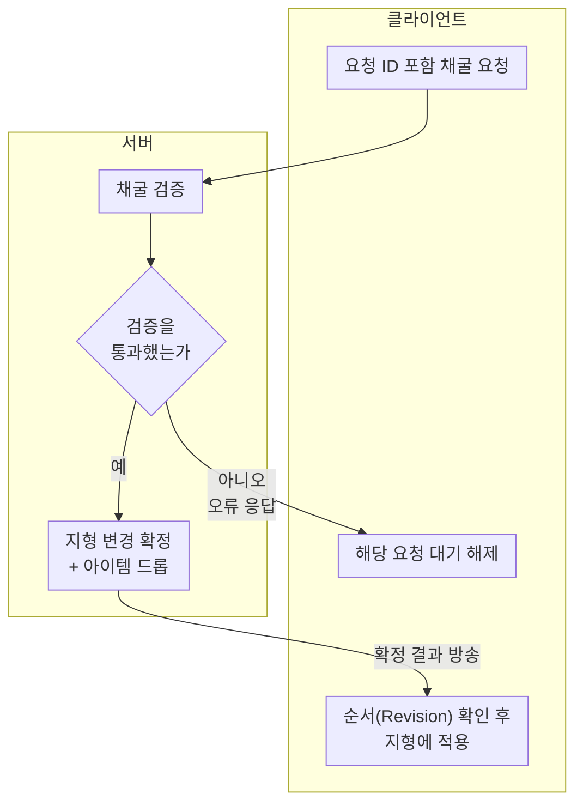

이 다이어그램은 클라이언트의 채굴 요청을 서버가 검증해 확정 결과를 방송하거나, 오류 응답으로 그 요청의 대기를 해제하는 흐름을 도식화한 것입니다.

| 클래스 | 책임 |
|---|---|
| `TerrainManager` | 좌표 조회·굴착 접근, 서버가 확정한 Batch 적용, 지형 변경 이벤트 |
| `TerrainCollapseCoordinator` | 부유 그룹 탐색과 연쇄 재검사 시점 관리 |
| `CollapseManager` / `FallingChunk` | 낙하 청크 생성·물리 표현·최종 배치 제안 |
| `RoomClient` | 요청 ID·Revision·소유권 관리와 네트워크 전달 |
| `GameSession` | 채굴·붕괴 예약·배치 검증과 서버 상태 갱신 |
| `Room` | 지형 명령 순서와 확정 메시지 방송 큐 관리 |

아래에서는 채굴(§3.2), 덩어리 하나의 낙하(§3.3), 여러 덩어리의 동시 낙하(§3.4), 연쇄 붕괴(§3.5), 변경 알림을 보내는 순서(§3.6) 차례로 설명합니다.
이 구조를 만들며 겪은 멀티플레이 멈춤 문제와 해결 과정은 §8.1에서 설명합니다.

### 3.2 모두에게 같은 순서로 반영되는 채굴 결과

 

플레이어가 곡괭이로 칸을 치면 클라이언트는 서버에 채굴 요청을 보냅니다.
요청마다 번호(`RequestId`)를 붙여, 돌아온 답이 어느 요청의 것인지 구분합니다.
서버 `TryExcavate()`는 장착한 곡괭이 ID와 테이블의 채굴력·거리를 확인하고, 내구도와 드롭을 확정합니다.
검증을 통과하면 바뀐 칸을 Batch로 묶어 방송하고, 실패하면 오류 응답을 보내 그 요청의 대기만 풀어 줍니다.

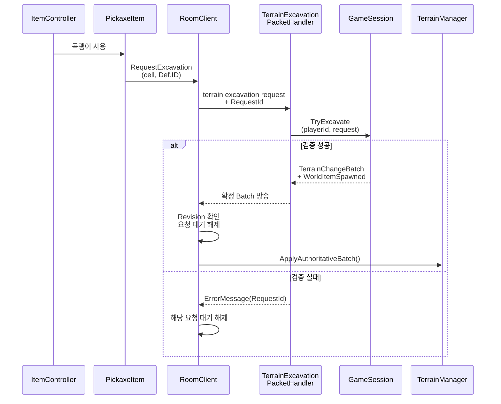

이 다이어그램은 채굴 요청이 `RoomClient`에서 서버 `GameSession`까지 전달되어, 성공하면 확정 Batch를 받아 지형에 적용하고 실패하면 그 요청의 대기만 해제하는 차례를 도식화한 것입니다.

Batch는 `BaseRevision`, `ResultRevision`, 셀 변경 목록을 가집니다.
`BaseRevision`은 이 변경이 기준으로 삼은 지형 번호이고, `ResultRevision`은 적용한 뒤의 번호입니다.
앞선 변경보다 먼저 도착한 Batch는 바로 적용하지 않고 `SortedDictionary`에 보관했다가, 앞 번호가 채워지면 이어서 적용합니다.
이미 적용한 Batch나, 지금보다 오래된 번호를 기준으로 해 규칙에 맞지 않는 Batch는 따로 구분해 무시합니다.
앞선 Batch가 영구히 오지 않으면 버퍼만으로는 진행을 복구할 수 없습니다.

```csharp
// RoomClient.DrainBufferedTerrainBatches() — 현재 지형 Revision에서 바로 이어지는 Batch만 꺼내 적용
while (bufferedTerrainBatches.TryGetValue(
           terrainManager.Revision,
           out TerrainChangeBatchMessage next))
{
    bufferedTerrainBatches.Remove(terrainManager.Revision);

    if (ApplyTerrainBatch(next) == false) return;
}
```

보관함의 키는 각 Batch의 `BaseRevision`입니다. 그래서 지금 지형 Revision과 같은 키의 Batch를 꺼내면 바로 다음 차례가 됩니다.
`TerrainGridData`는 적용하기 전에 BaseRevision과 중복 좌표를 검사한 뒤 셀 목록을 반영하고,
마지막에 `Revision = batch.ResultRevision`으로 번호를 올립니다.

코드에서 쓰는 이름과 주의점은 다음과 같습니다.

| 사용 목적 | API 또는 메시지 | 주의점 |
|---|---|---|
| 채굴 요청 등록 | `RoomClient.RequestExcavation(targetCell, itemId)` | `true`는 송신 큐 등록 성공이며 채굴 성공 확정은 아님 |
| 채굴 확정 | `GameSession.TryExcavate(...)` | 성공 시 셀 변경 Batch와 드롭 메시지 반환 |
| 결과 적용 | `TerrainGridData.TryApplyAuthoritativeBatch(batch, out error)` | BaseRevision 일치·증가 Revision·좌표 중복 검사 |

### 3.3 덩어리 하나가 떨어져 자리 잡기까지

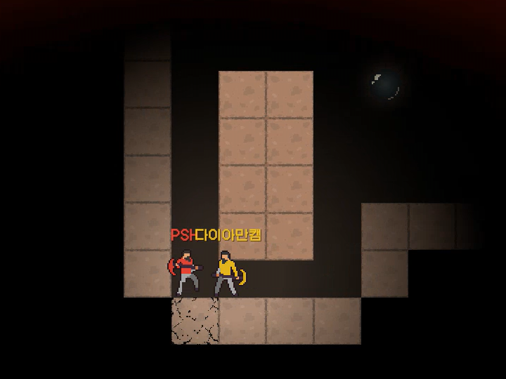

떠 있는 지형이 생기면 덩어리 하나는 네 단계를 거쳐 새 자리에 놓입니다.

1. **낙하 시작:** 클라이언트가 부유 그룹을 찾아 서버에 낙하 시작을 요청합니다. 서버는 그룹을 검증한 뒤 `CollapseID`와 소유자를 정하고 원래 칸을 예약합니다.
2. **물리 낙하:** 클라이언트는 그 칸들을 물리 청크로 바꿔 떨어뜨립니다.
3. **배치 제안:** 청크가 멈추면 소유자만 최종 자리를 서버에 보냅니다.
4. **확정 또는 취소:** 서버가 자리를 검사해 통과하면 원래 칸 삭제와 새 자리 배치를 Batch 하나로 방송합니다. 실패하면 예약을 풀고 원래 칸을 되돌립니다.

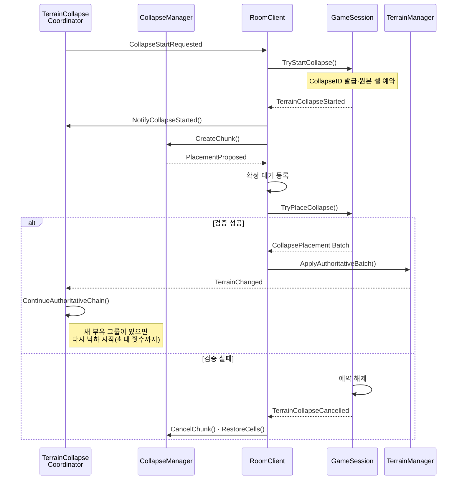

이 다이어그램은 떨어진 지형의 낙하 시작 요청부터 서버의 배치 확정, 확정된 배치가 반영된 뒤 이어지는 연쇄 붕괴와 검증 실패 시 원본 복원까지를 도식화한 것입니다.

**연쇄 붕괴는 물리 정착이 아니라 서버가 확정한 배치가 반영된 뒤에 이어지고, 검증에 실패하면 원본 셀로 되돌립니다.**

#### 낙하 시작 — 여러 그룹을 한 번에 검증하고 예약

낙하 시작 요청 하나에 부유 그룹이 여러 개 들어갈 수 있습니다.
서버 `TryStartCollapse()`는 먼저 그룹 안과 그룹 사이에 겹치는 칸이 없는지 보고,
모든 원래 칸이 실제로 있는지, 이미 예약되지 않았는지, 고정 타일이 아닌지 검사합니다.
모든 검사를 통과한 뒤에야 그룹마다 `CollapseID`와 소유자를 발급합니다.
앞 그룹만 예약된 상태에서 뒤 그룹의 오류로 요청 전체가 실패하는, 어중간한 상태를 막기 위한 순서입니다.

낙하하는 동안 클라이언트 화면에서는 원래 칸이 사라지고 물리 청크가 떨어집니다.
하지만 서버는 배치가 확정될 때까지 원래 칸을 지우지 않고 예약해 둡니다.
예약된 칸을 채굴하려는 요청은 `terrain.collapse_pending`으로 거절합니다.

#### 배치 확정 — 원래 칸 삭제와 새 자리를 한 번에

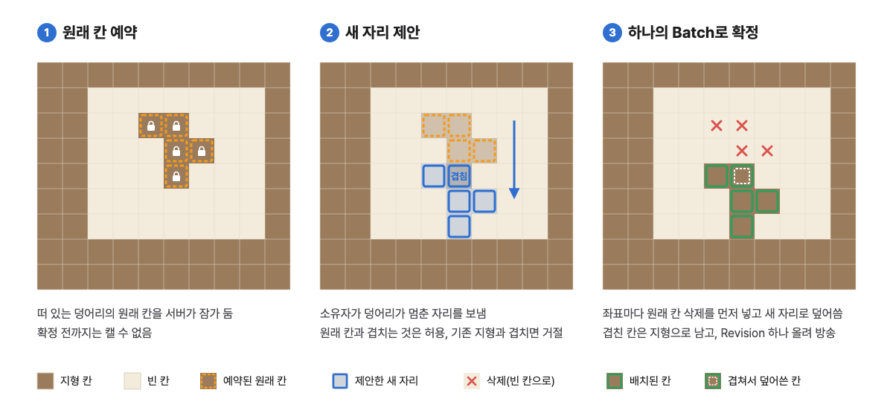

떨어지는 궤적과 놓일 자리는 소유 클라이언트가 계산하고, 서버 `TryPlaceCollapse()`는 그 자리가 규칙에 맞는지만 검사합니다.

- 요청한 플레이어가 그 청크의 소유자인지
- 보낸 원래 칸이 예약해 둔 칸과 같은지
- 새 자리 칸끼리 겹치지 않는지
- 맵 범위 안인지
- 원래 칸이 아닌 기존 지형과 부딪히지 않는지(원래 칸과 겹치는 것은 허용)

플레이어 위치와 새 자리가 겹치면 디버그 진단 로그만 남기고, 배치를 거절하거나 플레이어를 밀어내지는 않습니다.

새 자리는 원래 자리와 겹칠 수 있습니다.
그래서 서버는 좌표별 `Dictionary<GridCoord, TerrainCellChangeDto>`에 원래 칸 삭제를 먼저 넣고, 그 위에 새 자리 칸을 덮어써서 좌표마다 최종 상태가 하나만 남게 합니다.
이렇게 만든 변경 전체를 Revision 하나를 올리는 Batch 하나로 방송합니다.

#### 확정되지 않은 낙하의 취소·원본 복구

| 상황 | 서버 처리 | 클라이언트 처리 |
|---|---|---|
| 정상 확정 | 원본 제거·목적지 반영·예약 해제 | 서버 Batch 적용 |
| 소유자 요청의 배치 검증 실패 | 실패 경로에서 예약 해제와 취소 상태 생성 | 해당 청크·대기 상태 제거 및 원본 셀 복원 |
| 소유자 퇴장 | 소유한 낙하 예약 정리 | 취소 메시지의 원본 상태 복원 |
| 확정 요청이 오지 않음 | 경과 시간이 제한을 넘은 예약 회수 | 취소된 낙하 표시와 소유권 정리 |

배치 요청이 끝내 오지 않을 때를 대비해, 서버는 예약에 30초 제한을 두어 클라이언트가 멈추거나 청크가 만료되어 제안을 보내지 않아도 예약이 정리됩니다.
`SweepExpiredCollapses()`가 `Environment.TickCount64`로 경과 시간을 계산하며, 이 제한은 로컬 물리 청크의 수명 제한과 별개입니다.
다만 만료 회수는 독립 타이머가 아니라 지형 명령을 처리한 뒤에 `SweepExpiredCollapses()`를 부르는 방식입니다.

예약을 푸는 `FailAndRelease()`는 소유 확인을 통과한 배치 실패 경로에서만 부릅니다.
소유자가 아닌 플레이어의 잘못된 요청 때문에 다른 플레이어의 예약이 풀리지 않게 하기 위해서입니다.

이 처리는 변경 결과를 다시 보내 주는 기능이 아닙니다.
서버에 예약된 원래 칸이 남아 있으므로, 취소 메시지로 화면과 예약 상태를 되돌리는 방식입니다.

소스: [GameSession.Terrain.cs](https://github.com/KooHoo-Dev/3rd-TeamProject-KH-Server/blob/main/HelloServer/Game/GameSession.Terrain.cs), [RoomClient.Terrain.cs](https://github.com/keeeery/Folk-Sack/blob/main/Assets/02.%20Scripts/Networking/RoomClient.Terrain.cs).

### 3.4 여러 덩어리의 동시 낙하

덩어리 여러 개가 동시에 멈추면 배치 요청도 여러 개를 보내야 합니다.
처음에는 확정을 기다리는 상태를 하나만 두어서, 먼저 보낸 요청을 기다리는 동안 다음 청크의 배치 제안이 버려졌습니다(§8.3).
그래서 `pendingCollapsePlacementIds`에 `RequestId → CollapseID`를 저장해,
같은 청크의 요청이 두 번 나가는 것만 막고 다른 청크는 따로 보냅니다.

```csharp
// RoomClient.HandlePlacementProposed() — 배치 담당일 때 같은 청크의 중복 요청만 막고 전송
if (proposal == null || IsAuthoritativeTerrainMode == false) return;
if (proposal.IsPlacementOwner == false) return;
if (pendingCollapsePlacementIds.ContainsValue(proposal.CollapseId))
{
    Debug.LogWarning($"[RoomClient] 이미 낙하 {proposal.CollapseId}의 " +
        "배치 확정을 기다리고 있습니다.", this);
    return;
}
```

채굴 요청과 낙하 배치 요청은 대기를 정리하는 방식이 다릅니다.
채굴 대기는 칸 단위로 중복을 막고, 동시에 보낼 수 있는 요청 수와 시간 제한을 둡니다.
낙하 배치 요청은 시간이 지났다고 지우지 않습니다.
늦게 도착한 확정 Batch가 누구의 낙하인지 알아야 하므로, 성공·오류·취소 응답이 왔을 때 정리합니다.

### 3.5 떨어진 지형이 다시 일으키는 연쇄 붕괴

덩어리가 떨어지면 다른 지형이 새로 공중에 뜰 수 있어, 낙하가 끝날 때마다 부유 그룹을 다시 검사합니다.
다만 내 화면에서 덩어리가 멈췄을 때 오는 `RebuildCompleted`는 서버가 배치를 확정하기 전입니다.
서버가 배치를 거절하면 덩어리가 원래 자리로 돌아가므로, 연쇄 검사는 서버가 확정한 `CollapsePlacement` Batch가 반영된 뒤에 시작합니다(§3.3 다이어그램의 마지막 단계).

그동안 다른 플레이어의 변경이 들어와도 내 연쇄를 덮어쓰지 않도록,
내가 맡은 청크를 `HashSet<long> locallyOwnedCollapseIds`로 따로 기억합니다.
연쇄 횟수 카운터는 단계마다 초기화하지 않습니다. 그래서 `maximumChainCount` 제한이 실제로 쌓여 정해진 횟수에서 멈춥니다.
이 두 가지를 고친 과정은 §8.4에서 설명합니다.

```csharp
// TerrainCollapseCoordinator.HandleTerrainChanged() — 내가 맡은 배치가 반영되면 연쇄 붕괴 이어 가기
if (reason == TerrainChangeReason.CollapsePlacement)
{
    if (isLocallyOwnedPlacementApplied)
        ContinueAuthoritativeChain();
    return;
}
```

### 3.6 변경 알림을 보내는 순서

서버가 지형을 바꾼 순서와 그 결과를 알리는 순서는 같아야 합니다.
`Room`의 `terrainPipelineGate`는 지형 상태를 바꾸는 일과 알림을 방송 큐에 넣는 일을 한 구간으로 묶습니다.
실제 전송은 큐에서 따로 처리합니다.

- 방송 큐(`Unbounded Channel`)는 읽는 쪽이 하나뿐이라, 넣은 순서대로 꺼내 보냅니다.
- 한 방송은 받는 사람 모두에게 보낼 때까지(`Task.WhenAll()`) 기다린 뒤 다음 방송으로 넘어갑니다.
- 같은 연결로 동시에 보내야 할 때는 멤버마다 둔 `SendLock`으로 하나씩 차례로 보내고, 한 번 보내는 데 3초 제한을 둡니다.

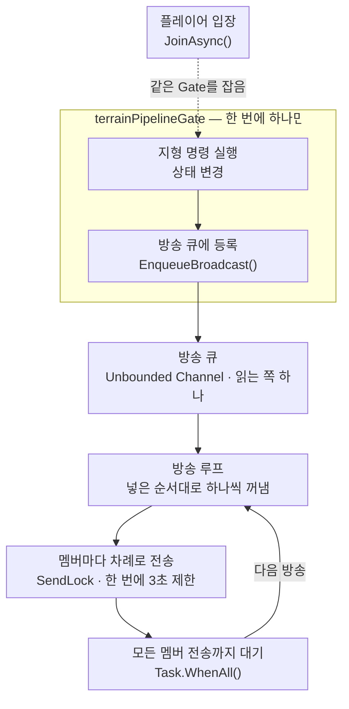

이 다이어그램은 지형 상태 변경과 방송 큐 등록을 Gate 한 구간으로 묶고, 큐에서 넣은 순서대로 꺼내 멤버마다 차례로 보내는 흐름을 도식화한 것입니다.

플레이어 입장도 같은 Gate를 씁니다.
`JoinAsync()`가 새로 들어온 플레이어에게 welcome·맵 세션·아이템·체력 상태를 보내는 동안 Gate를 잡고 있어서, 그 사이 지형 명령은 기다립니다.

이 방식에는 한계가 있습니다.

- 느린 연결 하나가 다음 방송 전체를 늦출 수 있습니다. 보내기 자체에는 3초 제한이 있지만, `SendLock.WaitAsync()`로 차례를 기다리는 시간에는 제한이 없습니다.
- 큐 크기에 제한이 없어서, 알림이 쌓일 때의 처리(backpressure) 정책이 아직 없습니다.

소스: [Room.cs](https://github.com/KooHoo-Dev/3rd-TeamProject-KH-Server/blob/main/HelloServer/Network/Room.cs).

### 3.7 고민과 선택

**지형 변경을 누가 확정할까 — 서버가 확정하고, 낙하 물리는 클라이언트가 제안**

서버 권위 구조는 제가 제안했습니다. 클라이언트가 손댈 수 없는 곳에서 결정하고, 클라이언트는 그 결정을 받는 구조가 맞다고 판단했습니다.
다만 낙하 물리까지 서버에서 재현하지는 않았습니다. 서버는 **"지형의 변경"만 알도록** 하는 것이 서버와 클라이언트의 책임을 명확히 나눌 수 있고, 멀티플레이 레이턴시를 줄일 수 있을 것이라 판단했기 때문입니다.
그래서 물리 궤적은 소유 클라이언트가 계산해 결과를 제안하고, 서버는 예약·배치 규칙만 검사해 확정합니다.

| 방법 | 장점 | 비용 |
|---|---|---|
| 클라이언트가 지형 변경을 확정 | 서버를 거치지 않아 요청 왕복 지연과 실패 처리가 필요 없음 | 클라이언트가 손댈 수 있는 곳에서 결정됨 |
| 낙하 물리까지 서버에서 재현 | 서버 한 곳에서 계산해 모든 클라이언트의 낙하 궤적이 같음 | 서버가 지형의 변경 외에 물리까지 다뤄 멀티플레이 레이턴시가 늘어남 |
| 서버가 셀 상태를 확정하고 낙하 결과는 클라이언트가 제안 (채택) | 지형의 기준 상태를 통일하고, 낙하는 Unity 물리 표현을 활용 | 요청 왕복 지연과 실패 처리가 필요하고, 클라이언트마다 물리 궤적이 다를 수 있음 |

채택하지 않은 두 방식은 구현해 보지 않았으므로, 클라이언트가 손댈 수 있는 곳에서 결정되는 문제와 서버가 물리까지 다뤄 멀티플레이 레이턴시가 늘어나는 문제가 실제로 생기는지는 확인하지 못했습니다.

**그 밖의 선택**

| 선택 | 이점 | 비용 |
|---|---|---|
| CollapseID별 예약·소유권 | 다중 청크·동시 플레이어의 상태 간섭 완화 | 취소·퇴장·스냅샷 교체 시 정리가 필요 |
| 방송 큐와 지형 명령 Gate | 상태 변경 순서와 방송 등록 순서 연결 | 무제한 큐의 적체·backpressure 정책은 별도 과제 |

---

## 4. 낙하 지형 충돌·탈출·매몰 상태

### 4.1 개요 — 낙하 청크 접촉과 매몰 상태


`FallingTerrainInteraction`은 캐릭터와 낙하 청크의 접촉 결과, 탈출 위치 탐색,
매몰 상태와 지속 피해 요청을 담당합니다.
`FallingTerrainContracts`의 계약과 이벤트를 통해 캐릭터 이동·피해 계층에 연결됩니다.
`PlayerController` 하나에 지형 판정과 피해 로직을 모두 넣지 않는 방향으로 분리했습니다.

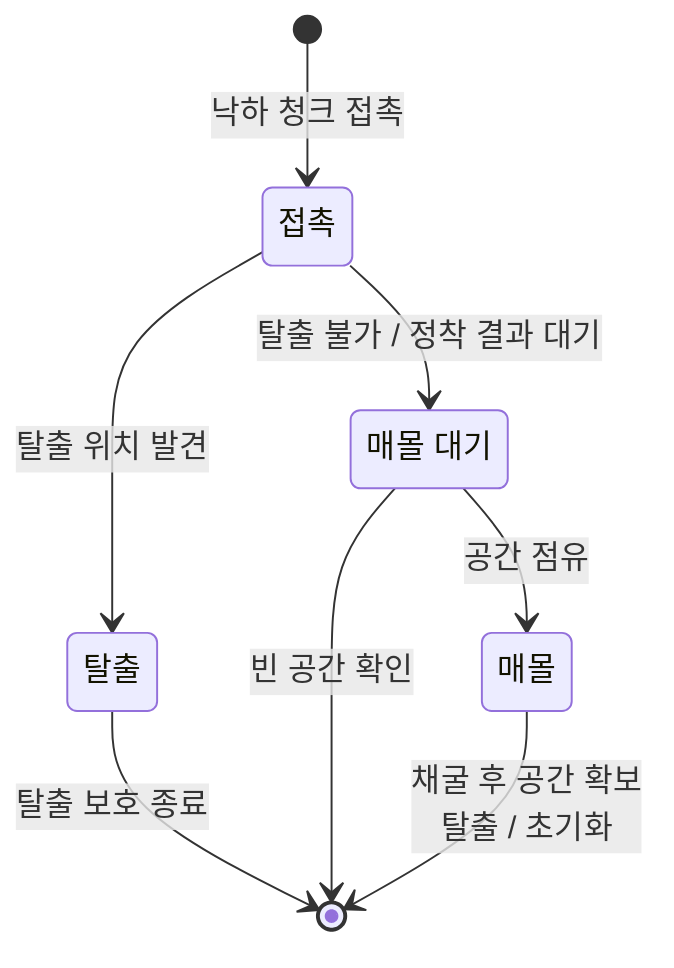

이 다이어그램은 `FallingTerrainInteraction`이 여러 값과 처리 순서로 나타내는 상황과 흐름을 도식화한 것입니다. 맨 아래의 끝 점은 다시 평소 상태로 돌아감을 뜻합니다.

**닿자마자 매몰시키지 않고, 탈출 위치가 없을 때만 정착 결과를 기다렸다가 공간이 막혀 있을 때 매몰시킵니다.**

### 4.2 탈출·깔림 결정과 피해 전달

| API·이벤트 | 역할 |
|---|---|
| `ResolveFallingTerrainContact(...)` | 접촉 청크의 탈출·매몰 후보 결과 판정 |
| `BurialStateChanged` | 매몰 상태 전이 알림 |
| `CollisionImpactRequested`, `BurialImpactRequested`, `BurialDamageRequested` | 충돌·매몰 피해를 외부 어댑터로 전달 |
| `ResetState()` | 리스폰 등에서 접촉·매몰 상태 정리 |

논리 셀 삭제와 Collider 재생성 시점이 달라 생긴 매몰 판정 문제와 해결은 §8.2에서 설명합니다.

### 4.3 낙하 지형과 맞물리는 움직임 — 멈출 칸·이동 충돌·낙하 피해

떨어진 덩어리가 멈출 칸을 고르는 처리와, 플레이어·필드 아이템이 지형과 부딪히고 빠져나오는 처리입니다.

#### 떨어진 덩어리가 멈출 칸 선택

`FallingChunk`는 저속이라는 조건만으로 정착하지 않습니다.
지형 접촉의 지지 방향·폭과 최근 접촉 여부를 확인하고,
선형·각속도가 낮거나 Rigidbody가 잠든 상태가 유지되면 일반 정착 시간을 누적합니다.
별도로 정적 지형에 닿은 채 위치가 셀 크기 비례 오차 안에서 유지되는 fallback을 둡니다.

| 완료 조건 | 의미 |
|---|---|
| 지지 접촉·저속 상태의 유지 | 일반적인 낙하 후 정착 |
| 정적 지형 접촉·위치 안정 유지 | 속도가 흔들려 일반 정착에 도달하지 못하는 상황의 보완 |
| 최대 수명·최저 높이 초과 | 정착이 아닌 만료로 완료 |

완료된 청크는 Kinematic으로 전환합니다.
`CollapseManager`는 만료되지 않은 청크에서만 배치 제안을 계산하고,
청크를 제거한 뒤 물리 프레임 대기와 Transform 동기화를 거쳐 완료 이벤트를 보냅니다.
플레이어와 옆면이 닿거나 청크 위에 선 일반 접촉까지 매몰·탈출로 처리하지 않도록,
접촉 후보를 `IsBurialCandidate()`로 걸러 정상 물리 접촉과 구분합니다.

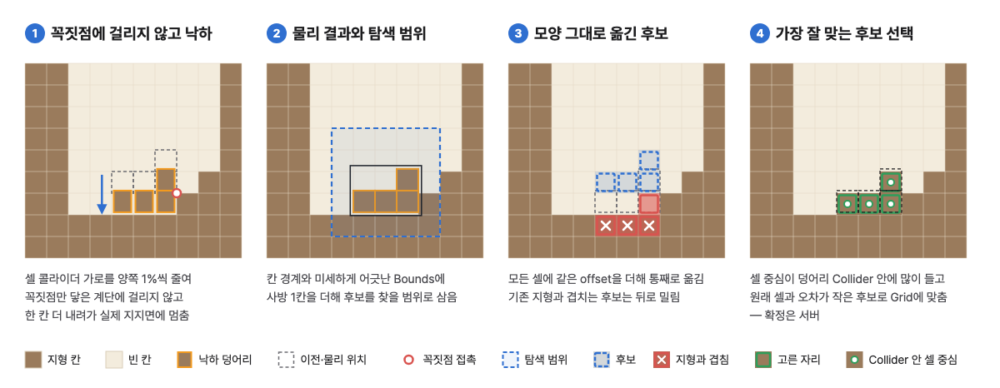

물리로 멈춘 청크는 칸 경계와 미세하게 어긋나 있을 수 있어, 정적 Grid의 어느 칸에 기록할지 다시 정해야 합니다.
`TerrainSampler`는 셀마다 가장 가까운 칸을 따로 고르지 않고, **모든 셀에 같은 offset을 더해 덩어리를 통째로 옮긴 후보** 중에서 가장 잘 맞는 자리를 고릅니다.

```csharp
// TerrainSampler.IsBetterPlacement() — 배치 종류 → 닿는 수 → 정렬 오차 순으로 후보 비교
// 1. 기존 지형과 충돌하지 않는 후보
if (placementClass != bestPlacementClass) 
    return placementClass > bestPlacementClass;

// 2. 목적지 셀 중심이 실제 청크 Collider 안에 들어가는 수가 많은 후보
if (hitCount != bestHitCount) 
    return hitCount > bestHitCount;

// 3. 원래 물리 셀 중심과 Grid 중심의 평균 제곱 정렬 오차가 작은 후보
if (Mathf.Approximately(alignmentError, bestAlignmentError) == false)
    return alignmentError < bestAlignmentError;

// 4. 기존 지형과 인접하는 셀 수가 많은 후보
if (connectionCount != bestConnectionCount) 
    return connectionCount > bestConnectionCount;

// 5. 충돌 셀 수가 적은 후보
return collisionCount < bestCollisionCount;
```

이 계산은 물리 결과에 가까운 정적 Grid 후보를 고를 뿐이고, 확정은 서버가 합니다.
충돌 없는 후보가 없더라도 후보를 반환할 수 있고, 맵 범위·정적 지형 충돌 등은 서버 검증에서 거절될 수 있습니다.
정착·후보 계산·서버 승인을 분리한 만큼 실패 시 원본 복구가 함께 필요합니다.

소스: [FallingChunk.cs](https://github.com/keeeery/Folk-Sack/blob/main/Assets/02.%20Scripts/TerrainCollapse/FallingChunk.cs), [TerrainSampler.cs](https://github.com/keeeery/Folk-Sack/blob/main/Assets/02.%20Scripts/TerrainCollapse/TerrainSampler.cs), [CollapseManager.cs](https://github.com/keeeery/Folk-Sack/blob/main/Assets/02.%20Scripts/TerrainCollapse/CollapseManager.cs).

#### 플레이어 이동과 지형 충돌

플레이어는 실제 콜라이더 모양의 Cast(`Collider2D.Cast()`)와 법선 검사로 지형 충돌을 처리하며 이동하고, 벽을 잡을 수 있습니다.
이후 `PlayerController`에 몰려 있던 이동·충돌·생명주기·지형 상태 처리를 아래 구성 요소로 나눴습니다.

| 클래스 | 책임 |
|---|---|
| `PlayerInputReader` | Update에서 키 입력 수집, 채팅·모달 UI 입력 차단 |
| `PlayerMovement` | 수평 이동·점프·중력·등반 속도 계산 |
| `PlayerCollisionMove` | 실제 BoxCollider2D Cast를 이용한 X축·Y축 분리 이동 |
| `TerrainPenetrationResolver` | 정적 지형에 실제로 겹친 경우의 분리 보정 |
| `PlayerTerrainState` | 매몰·위치 잠금·탈출·등반 상태 |
| `PlayerLifeCycle` | 사망 여부와 죽은 뒤 낙하를 계속할지 여부 |

플레이어는 Kinematic Rigidbody2D로, `PlayerCollisionMove`가 Cast 결과로 이동 거리를 제한하고 `TerrainPenetrationResolver`는 낙하 청크를 뺀 정적 지형의 겹침만 보정합니다.
스폰 플랫폼 통과는 Cast 방향을 따로 조정하는 예외 상태로 둡니다.

#### 낙하 피해와 벽 오르기

`FallDamageDetector`는 현재 수직 속도만으로 피해를 계산하지 않습니다.
마지막 정적 지면의 높이와 착지 높이 차이를 타일 수로 바꾸고,
안전 높이를 넘는 부분에 피해 계수를 적용합니다.
낙하 중 등반을 시작하면 그 지점을 착지처럼 취급해 피해 감소 배율을 적용하고,
등반 해제 시점은 새 낙하 시작 높이로 기록합니다.
최종 체력은 서버가 바꾸지만, 낙하 높이와 피해량의 근거는 클라이언트가 감지해 보고합니다.

소스: [PlayerController.cs](https://github.com/keeeery/Folk-Sack/blob/main/Assets/02.%20Scripts/Player/PlayerController.cs), [PlayerCollisionMove.cs](https://github.com/keeeery/Folk-Sack/blob/main/Assets/02.%20Scripts/Player/PlayerCollisionMove.cs), [PlayerTerrainState.cs](https://github.com/keeeery/Folk-Sack/blob/main/Assets/02.%20Scripts/Player/PlayerTerrainState.cs), [FallDamageDetector.cs](https://github.com/keeeery/Folk-Sack/blob/main/Assets/02.%20Scripts/Character/Health/FallDamageDetector.cs), [PlayerHp.cs](https://github.com/keeeery/Folk-Sack/blob/main/Assets/02.%20Scripts/Character/Health/PlayerHp.cs).

#### 필드 아이템도 붕괴에서 탈출시키기

필드 아이템(`WorldItemDrop`)도 같은 탈출 계약(`IFallingTerrainEscapeTarget`)을 구현해, 청크가 덮으면 좌우로 빈 칸을 찾아 옮깁니다.

소스: [FallingChunk.cs](https://github.com/keeeery/Folk-Sack/blob/main/Assets/02.%20Scripts/TerrainCollapse/FallingChunk.cs), [FallingTerrainContracts.cs](https://github.com/keeeery/Folk-Sack/blob/main/Assets/02.%20Scripts/Player/FallingTerrainContracts.cs), [WorldItemDrop.cs](https://github.com/keeeery/Folk-Sack/blob/main/Assets/02.%20Scripts/Item/WorldItemDrop.cs).

### 4.4 고민과 선택

**떨어지는 청크와 부딪힌 플레이어를 어떻게 처리할까 — 이동할 공간을 찾아 밀어내거나 매몰**

매몰은 게임의 위험 요소이자 다른 플레이어를 노리는 간접 PvP 수단입니다(§1.2).
충돌할 때마다 플레이어를 밀어내면 매몰 자체가 생기지 않습니다.
반대로 닿자마자 매몰시키는 것도 맞지 않다고 판단했습니다.
지형은 칸 단위의 그리드지만 플레이어는 칸에 묶이지 않고 자유롭게 움직이기 때문에 플레이어가 칸의 경계에 걸쳐 있을 때 바로 매몰시키면 판정이 직관적이지 않을 것이라고 생각했습니다.
그래서 정해진 거리 안에 빈 칸이 있으면 밀어내고, 없을 때만 정착을 기다렸다가 매몰시킵니다.
같은 청크와의 처리 결과는 청크별로 기억해 반복 충돌을 막습니다.

| 방법 | 장점 | 비용 |
|---|---|---|
| 충돌할 때마다 플레이어를 밀어내기 | 플레이어가 지형에 갇히지 않음 | 매몰이 생기지 않아 매몰 위험과 간접 PvP가 사라짐 |
| 닿자마자 매몰 | 탈출 위치를 찾지 않아 판정이 단순함 | 플레이어가 칸의 경계에 걸쳐 있으면, 옆 빈 칸으로 빠져나갈 수 있어 보여도 매몰되어 판정이 직관적이지 않음 |
| 정해진 거리 안에 빈 칸이 있으면 밀어내고, 없으면 매몰 (채택) | 피할 공간이 있으면 빠져나가고 막히면 매몰되어 매몰 위험이 남음<br>청크별 처리 결과를 기억해 반복 충돌을 막음 | 밀어내기를 허용할 거리(`escapeXOffset`)와 검사할 칸의 기준을 정하고 맞춰야 함 |

밀어낼지 매몰할지를 가르는 판정 기준과 `escapeXOffset` 필드의 의미는 직접 정하고, 코드 반영은 AI 코딩 에이전트에 맡겼습니다.
`escapeXOffset`은 밀어내기를 허용할 거리를 칸 크기 대비 비율로 나타내며, 그 거리 안에 빈 칸이 있으면 밀어내고 없으면 매몰됩니다.
반영 결과는 플레이로 확인했고, 밀려나지 않거나 무조건 밀려나는 결과가 이어지자 플레이어 중심이 낙하 경로 안이면 옆 칸을, 밖이면 현재 칸을 검사해야 한다는 원인을 직접 찾아 바로잡았습니다.

---

## 5. 인벤토리·아이템·상점


### 5.1 개요 — 아이템 구성과 역할

 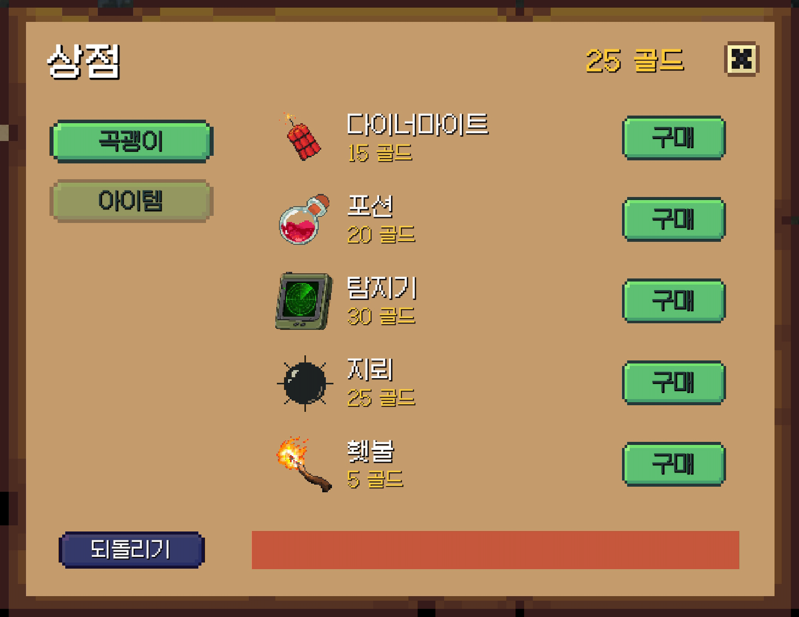

아이템은 세 갈래입니다. 캐는 데 쓰는 **장비(곡괭이)**, 탐험을 돕는 **사용 아이템**, 캐서 모아 파는 **광물·원석**입니다.
아이템의 종류·효과와 사용 구조는 팀원이 구현했고, 저는 그 위에 수량·무게·장착 상태를 서버가 확정하고 화면에 반영하도록 연결했습니다.

| 갈래 | 아이템 | 플레이어가 하는 일 | 인벤토리에서 |
|---|---|---|---|
| 장비 | 네 가지 등급의 채굴 키트 | 장착한 곡괭이로 타일 채굴, 등급이 오를수록 채굴력·수용량 증가, 사거리는 은 등급부터 늘어남 | 하나만 장착 |
| 사용 | 다이너마이트·지뢰·포션·탐지기·횃불 | 던지기·설치·사용 | 수량만큼 사용, 아이템별 쿨타임 |
| 광물·원석 | 석탄·황동·은·금광석, 사파이어·루비·다이아몬드 | 캐면 드롭, 지상에 돌아오면 자동 판매 | 종류별 무게, 무게 제한까지만 보유 |

골드로 장비를 바꾸고 사용 아이템을 사서 더 깊이 내려가는 것이 §1.1 게임 루프의 "판매 → 상점" 부분입니다.

### 5.2 서버가 확정하는 아이템 요청

아이템을 줍고, 버리고, 팔고, 사고, 쓰는 모든 행동은 클라이언트(`RoomClient`)가 서버에 요청하고 서버가 검사해 확정합니다.
인벤토리를 바꾸는 요청의 응답은 모두 `InventorySnapshot`, 곧 서버가 확정한 인벤토리 전체 상태입니다.
클라이언트는 바뀐 부분을 계산하지 않고 이 전체 상태로 교체합니다.

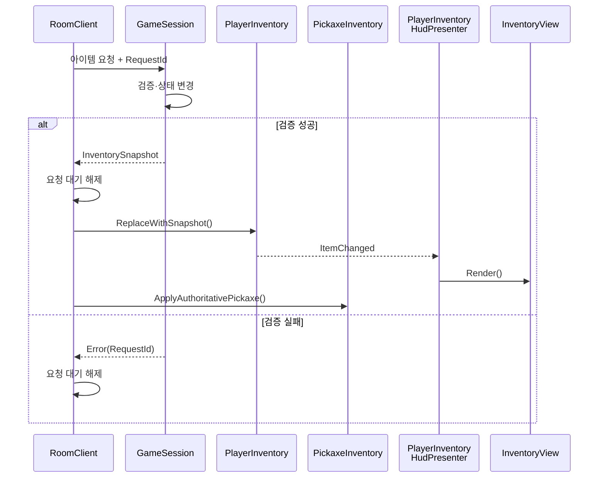

이 다이어그램은 획득·버리기·판매·구매·사용 요청을 서버가 검증·확정한 뒤, 받은 인벤토리 전체 상태로 수량·무게와 장착 곡괭이를 교체하고 HUD에 다시 표시하는 흐름을 도식화한 것입니다.

#### 확정된 인벤토리로 통째로 교체

`PlayerInventory`는 ItemID별 수량과 무게를 관리합니다.
`ReplaceWithSnapshot()`은 서버 전체 상태를 수신해 교체하고, 실제 수량이 바뀐 아이템의 이벤트를 발생시킵니다.
서버가 확정한 상태를 클라이언트의 로컬 무게 제한으로 거절하지 않도록 처리합니다.
장착 곡괭이도 `EquippedPickaxeItemID`로 별도 적용합니다.

`PlayerInventoryHudPresenter`는 `ItemChanged`를 구독해, 인벤토리가 바뀔 때마다 `InventoryView`의 목록 전체를 다시 그립니다.

상점에서도 가격과 스폰 구역·판매 품목·골드·무게는 서버가 검사해 확정합니다. 클라이언트가 보여 주는 할인 가격도 서버와 같은 규칙으로 계산합니다.

소스: [GameSession.cs](https://github.com/KooHoo-Dev/3rd-TeamProject-KH-Server/blob/main/HelloServer/Game/GameSession.cs), [PlayerSellController.cs](https://github.com/keeeery/Folk-Sack/blob/main/Assets/02.%20Scripts/Item/Inventory/PlayerSellController.cs).

#### 거절된 사용의 쿨타임 취소

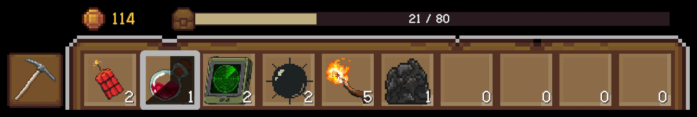

아이템을 쓰면 서버의 응답을 기다리지 않고 화면의 쿨타임을 먼저 시작합니다.
그래서 서버가 사용을 거절하면 이미 시작한 쿨타임을 취소해야 합니다.
`pendingCooldowns`는 요청 ID마다 어느 아이템을 언제 다시 쓸 수 있는지 기억합니다.
성공 응답이 오면 대기를 지우고 효과를 재생하고, `RequestFailed`가 오면 그 아이템의 예상 쿨타임을 지웁니다.

```csharp
// ItemController.HandleRequestFailed() — 실패한 요청의 예상 쿨타임 제거
if (message == null || string.IsNullOrEmpty(message.RequestId) ||
    pendingCooldowns.Remove(
        message.RequestId, out PendingCooldown pending) == false)
    return;

itemReadyTime.Remove(pending.ItemID);
```

소스: [ItemController.cs](https://github.com/keeeery/Folk-Sack/blob/main/Assets/02.%20Scripts/Item/ItemController.cs).

### 5.3 고민과 선택

**인벤토리 변경을 어떻게 반영할까 — 서버 스냅샷으로 통째로 교체**

인벤토리는 지형 데이터에 비해 크기가 작아, 바뀐 부분만 보내지 않고 서버 스냅샷을 통째로 교체해도 문제가 없다고 판단했습니다.
표시도 아이템 한 종류만 바뀌면 전체 목록을 `ItemID` 순으로 정렬해 다시 그립니다(§5.2).
플레이어가 슬롯 순서를 직접 바꾸는 기능을 넣지 않아 지켜야 할 순서가 없으므로, 이 방식을 문제 삼지 않았습니다.
슬롯 변경 기능을 넣지 않은 것은, 아래로 파 내려가는 플레이에서 화면 아래의 인벤토리 슬롯을 마우스로 다루게 하면 의도치 않은 클릭 실수가 나올 수 있다고 보았기 때문입니다.

| 방법 | 장점 | 비용 |
|---|---|---|
| 바뀐 부분만 보내 적용 | 보내는 데이터가 적고, 바뀐 슬롯만 다시 그릴 수 있음 | 경로마다 변경분을 따로 만들어야 하고, 하나라도 어긋나면 서버와 달라짐 |
| 서버 스냅샷으로 통째로 교체 (채택) | 획득·판매·사망 등 여러 경로의 결과를 하나의 기준으로 복원 | 전체 스냅샷 전송·재구성 비용(인벤토리는 지형보다 작아 문제 삼지 않음) |

**그 밖의 선택**

| 선택 | 이점 | 비용 |
|---|---|---|
| 로컬 예상 쿨타임 + 거절 시 취소 | 사용 직후 반응성과 서버 규칙 동시 유지 | 늦은 응답과 연속 요청의 상관관계 관리 |
| 아이템 데이터와 표시 분리 | ItemID와 공통 데이터로 슬롯·상점 표현 | 클라이언트/서버 Item 테이블 버전 일치 필요 |

---

## 6. 가 본 곳과 지금 보이는 곳을 보여 주는 지도

### 6.1 개요 — 누적 탐험 정보와 지금 관측되는 셀

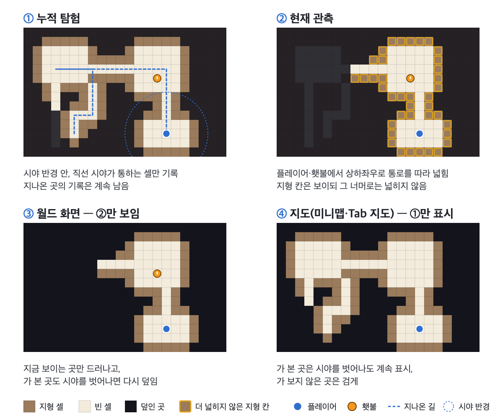

지하에서는 플레이어와 설치한 횃불이 지금 비추는 통로만 보이고, 시야를 벗어난 곳은 이미 지나온 곳이라도 다시 어둠에 덮입니다. 대신 한 번 본 곳은 지도에 계속 남아, 지금 보이는 곳은 화면으로, 가 본 곳은 지도로 확인합니다.

`ExplorationMapData`는 누적 탐험 정보를 보관하고,
`PlayerExplorationController.CurrentObservedCells`는 지금 관측되는 셀을 보관합니다.
미니맵과 월드 안개는 같은 지형·탐험 상태를 참조하되 서로 다른 표시 역할을 맡습니다.

| 구분 | 누적 탐험 | 현재 관측 |
|---|---|---|
| 수명 | 이미 확인한 셀을 유지 | 갱신할 때 재구성 |
| 의미 | 이전에 방문·관측한 곳 | 현재 플레이어·조명으로 볼 수 있는 곳 |
| 표시 활용 | 미니맵·전체 지도 이력 | 월드 암흑/현재 관측 강조 |
| 갱신 원인 | 이동·지형 변화 등 | 이동·지형 변화·횃불 변화 |

### 6.2 이동·지형 변경 때만 하는 재계산

시야 계산은 `Update()`에서 매 프레임 불리지만, 한 번 계산할 때마다 반경 안의 셀마다 직선 시야를 검사합니다.
그래서 플레이어가 같은 셀에 있고 다시 계산할 이유가 없으면 바로 돌아갑니다.

```csharp
// PlayerExplorationController.RefreshPlayerVision() — 같은 셀이고 갱신 요청이 없으면 계산 생략
if (hasLastExplorationCell &&
    playerCell == lastExplorationCell &&
    needsVisionRefresh == false) return;

lastExplorationCell = playerCell;
hasLastExplorationCell = true;
needsVisionRefresh = false;
ExploreVisionRadius(playerCell);
```

플레이어가 멈춰 있어도 보이는 범위가 바뀌는 경우에는 `needsVisionRefresh`를 세워 다시 관측합니다.

| 계기 | 받는 이벤트 | 예 |
|---|---|---|
| 지형 변경 | `TerrainManager.TerrainChanged` | 채굴, 서버 확정 Batch, 붕괴 덩어리 배치 |
| 횃불 변경 | `TorchLight.TorchesChanged` | 횃불 설치, 지형에 묻혀 파괴됨 |
| 지형 재동기화 | `RoomClient.TerrainSnapshotLoaded` | 같은 크기 맵이면 탐험 기록은 두고 다시 관측만 |

다시 계산한 뒤에는 새로 탐험한 셀만 `CellsExplored`로 알려, 월드 안개는 그 셀이 속한 청크만 다시 그립니다.

### 6.3 안개와 지도 — 직선 시야 검사와 두 겹 표시

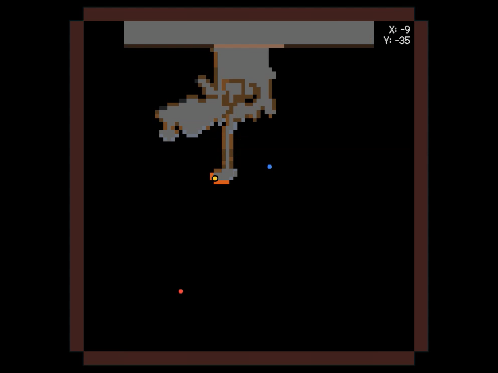

누적 탐험은 시야 반경 안의 셀을 직선 시야(`HasLineOfSight()`)로 검사해 새로 본 셀만 기록하고, 현재 관측은 플레이어와 횃불에서 상하좌우로 뻗어 통로를 따라 넓힙니다.

| 구분 | 누적 탐험 | 현재 관측 |
|---|---|---|
| 방법 | 중심에서 대상 셀까지 직선을 따라가며 검사 | 상하좌우로 뻗고, 갈림길에서 직각으로 최대 두 번 꺾임 |
| 범위 | 반경 4칸 원 | 플레이어 14칸, 횃불 4칸 |
| 지형 칸 | 시야를 막는 칸은 기록하고 그 뒤만 제외<br>양옆이 막힌 대각선 틈은 통과하지 않음 | 지형에 닿으면 그 칸까지 보이고 멈춤 |

월드 안개는 탐험 이력과 현재 시야를 두 겹 Mesh로 그립니다.
아래 겹은 가 보지 않은 곳을, 위 겹은 지금 보이지 않는 곳을 덮고, 게임에서는 위 겹을 불투명하게 두어 지금 보이는 곳만 드러나게 했습니다.
Mesh는 32×32 청크로 나누어, 시야가 바뀐 청크만 `LateUpdate()`에서 한 번 다시 만듭니다.
지상과 기반암, 스폰 발판은 안개로 덮지 않습니다.

지도는 셀 하나를 텍스처의 픽셀 하나로 칠하고, 미니맵과 Tab 전체 지도가 같은 텍스처를 사용합니다.
탐험한 셀만 칠하고, 지금 보이는 셀만 다시 칠하므로 가 본 곳은 마지막으로 본 모습으로 남습니다.
전체 지도는 커서 아래 지점을 유지하며 확대합니다.

소스: [PlayerExplorationController.cs](https://github.com/keeeery/Folk-Sack/blob/main/Assets/02.%20Scripts/Exploration/PlayerExplorationController.cs), [ExplorationMapData.cs](https://github.com/keeeery/Folk-Sack/blob/main/Assets/02.%20Scripts/Exploration/ExplorationMapData.cs), [ExplorationForWorldView.cs](https://github.com/keeeery/Folk-Sack/blob/main/Assets/02.%20Scripts/Exploration/ExplorationForWorldView.cs), [MinimapView.cs](https://github.com/keeeery/Folk-Sack/blob/main/Assets/03.%20UI/Scripts/MinimapView.cs).

---

## 7. 로비부터 결과 화면까지의 흐름

### 7.1 개요 — 로비와 준비 완료

로비에서 방에 들어가 채팅하며 호스트가 게임을 시작하기를 기다립니다.
호스트가 게임을 시작하면 게임 화면으로 넘어가 모든 플레이어가 지상에 모이고, 모두 준비되면 카운트다운 뒤 채굴을 시작합니다.
누군가 목표 골드를 모으거나 제한 시간이 끝나면 게임이 끝나고, 골드가 가장 많은 플레이어가 승자가 됩니다.

로비 WebSocket은 방 만들기·방 코드로 입장·채팅·호스트 추방·호스트 시작 같은 대기 상태를 관리합니다.
게임이 시작되면 `RoomClient`가 로비 세션 정보로 게임 방에 연결하고, 서버 `/room`은 그 로비가 실제로 시작됐는지 검사한 뒤 연결을 허용합니다.

### 7.2 모두 준비돼야 시작하는 게임

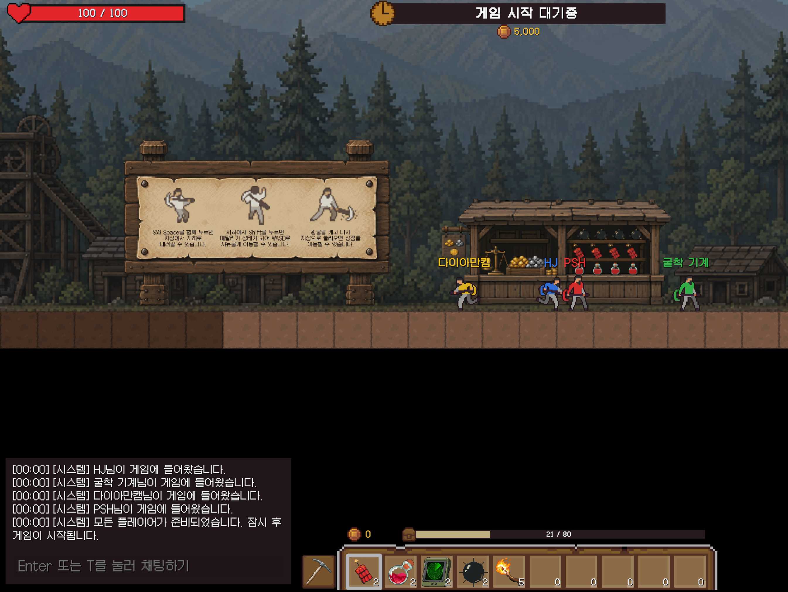

준비 완료(`player.ready`)는 연결 직후가 아니라, 서버의 입장 정보(welcome)를 받고 맵 데이터 버전을 확인한 뒤 초기 지형까지 만든 다음 한 번 보냅니다.
서버 `MarkPlayerReady()`는 기대 인원이 모두 준비되면, 준비 지연과 카운트다운을 더한 미래 시각을 시작 시각으로 확정하고 여기에 게임 길이를 더해 끝나는 시각을 정합니다.
클라이언트는 이 서버 기준 시각과 로컬 시각 보정값으로 카운트다운과 경과 시간을 표시합니다.

소스: [LobbyHub.cs](https://github.com/KooHoo-Dev/3rd-TeamProject-KH-Server/blob/main/HelloServer/Network/LobbyHub.cs), [LobbySocketClient.cs](https://github.com/keeeery/Folk-Sack/blob/main/Assets/02.%20Scripts/Networking/LobbySocketClient.cs).

### 7.3 로비부터 결과까지의 화면 — 다른 플레이어·대기방·결과

#### 다른 플레이어의 움직임 표시

다른 플레이어는 위치와 함께 속도·접지·등반·매몰 상태와 행동 메시지를 받아 표현합니다.
위치는 기본 10Hz(`positionSendRate`)로, 상태가 달라졌을 때 보냅니다.
`RemotePlayerView`는 보간 버퍼나 이동 예측 없이 최신 목표 위치로 보간하고, 리스폰처럼 순간 이동이 필요하면 `Teleport()`로 맞춥니다.

소스: [RemotePlayerView.cs](https://github.com/keeeery/Folk-Sack/blob/main/Assets/02.%20Scripts/Networking/RemotePlayerView.cs), [RemotePlayerAnimationView.cs](https://github.com/keeeery/Folk-Sack/blob/main/Assets/02.%20Scripts/Networking/RemotePlayerAnimationView.cs).

#### 대기방 프리뷰·채팅·승자 표시


대기방 아바타는 게임용 Prefab을 Animator만 켠 채 재사용해 보여 주고, 채팅은 최근 100개만 보관하며 꺾쇠를 이스케이프해 마크업으로 해석되지 않게 합니다.
시간 종료 승자는 팔지 않은 광물을 빼고 실제 골드로 정하며, 골드가 같으면 모두 승자로 표시합니다.

소스: [LobbyPlayerSlotView.cs](https://github.com/keeeery/Folk-Sack/blob/main/Assets/02.%20Scripts/Networking/LobbyPlayerSlotView.cs), [ChatPanelView.cs](https://github.com/keeeery/Folk-Sack/blob/main/Assets/03.%20UI/Scripts/ChatPanelView.cs), [GameTimerBarView.cs](https://github.com/keeeery/Folk-Sack/blob/main/Assets/03.%20UI/Scripts/GameTimerBarView.cs).

---

## 8. 트러블슈팅

### 8.1 여럿이 하면 멈추던 멀티플레이

#### 조금만 파도 멈추던 게임 — 전체 지형 스냅샷이 주원인

- **증상:** 처음 멀티플레이 테스트에서 한 명이 땅을 조금만 파도 게임이 멈췄고, 한참 지나서야 복구됐습니다.
- **처음 생각:** lock 안에서 너무 많은 처리를 하는 것이 주원인이라고 의심했습니다.
- **원인:** lock 안의 과도한 처리도 문제였지만, 주원인은 **지형 전체 스냅샷**이 자주 오가며 데이터 용량이 너무 커진 것이었습니다. 채굴 요청의 Revision이 서버와 조금만 어긋나도 요청을 거절하고 전체 스냅샷을 다시 보냈습니다.
- **해결:** 전체 스냅샷을 주고받지 않고, 서버가 보내는 변경 Batch의 Revision(`BaseRevision → ResultRevision`)만 비교해 순서대로 적용하도록 바꿔 테스트한 뒤 해결했습니다. 이 방향은 강사님과 같은 개선안을 제안했고, 구현은 강사님의 도움을 받았습니다.
- **함께 고친 것:** 처음 의심한 lock 구간은 직접 상태 변경과 송신을 분리해 줄였습니다(아래 「상태 변경·방송 등록과 실제 송신을 분리」).
- **걸린 시간:** 하루가 걸렸습니다.
- **배운 점:** 개발 비용이 낮은 lock 처리 줄이기를 먼저 해 보고 테스트했지만 문제가 완전히 해결되지 않았습니다. 서버와 틱당 주고받는 데이터의 크기가 중요함을 알게 됐습니다.

#### 전체 지형 대신 변경된 칸만 순서대로 적용

과거에는 요청의 `ExpectedTerrainRevision`이 방 전체 Revision과 다르면 채굴을 거절했습니다.
서로 다른 셀을 동시에 파도 먼저 처리한 요청이 방 Revision을 올리면 나중 요청은 거절될 수 있었습니다.
당시 클라이언트는 이 오류에서 `hasTerrainSnapshot = false`로 바꾸고 전체 Snapshot을 기다렸으며,
수신 후 지형 복원과 플레이어 재배치를 수행했습니다.
이 경로가 땅을 조금만 파도 전체 지형을 주고받게 만든 주원인이었습니다(위 「조금만 파도 멈추던 게임」).

#### 상태 처리와 송신 대기가 한 구간에 묶인 서버

리팩터링 전 서버에는 상태 접근을 보호하는 동기 lock과 비동기 명령을 직렬화하는 Gate가 있었습니다.

| 구간 | 잠금 안에서 수행하던 작업 | 대기·처리 비용의 영향 |
|---|---|---|
| `GameSession.stateGate`의 C# `lock` | 전체 셀을 DTO로 복사하고 `OrderBy()`·`ToList()`로 Snapshot 생성 | 복사·정렬·할당이 끝날 때까지 같은 상태 잠금을 사용하는 작업 대기 |
| `Room.terrainPipelineGate`의 `SemaphoreSlim` | 지형 명령 실행 후 오류·전체 Snapshot 송신 또는 Batch·드롭 방송 완료까지 `await` | 느린 소켓 송신이 다음 지형 명령 시작을 지연시킬 수 있음 |
| `Room.gate`의 `SemaphoreSlim` | 입장 시 welcome·맵·전체 지형·아이템·인벤토리 메시지 송신과 Join 방송 | 초기 동기화 송신이 입퇴장 처리의 잠금 유지 시간에 포함 |

이 때문에 한 연결의 지연이 방의 지형 처리 잠금 해제까지 길어지는 경로가 있었습니다.
교착 상태가 아니라, 앞 작업의 처리 지연이 뒤 작업의 대기로 이어지는 문제였습니다.

#### 상태 변경·방송 등록과 실제 송신을 분리

방 단위 FIFO 방송 큐를 도입하고,
지형 명령 구간에서는 상태 변경과 결과의 큐 등록까지만 수행하도록 수정했습니다.
실제 WebSocket 송신은 별도 방송 루프가 담당합니다.

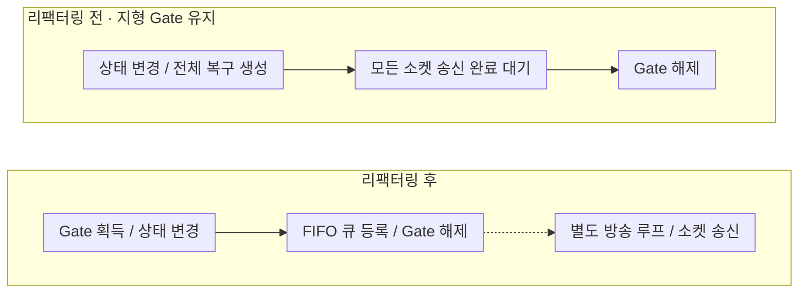

이 다이어그램은 리팩터링 전에는 지형 Gate가 모든 소켓 송신이 끝날 때까지 유지됐고, 리팩터링 후에는 큐에 등록한 뒤 Gate를 풀고 별도 방송 루프가 송신하도록 바뀐 차이를 도식화한 것입니다.

| 수정 | 변경한 처리 | 결과 구조 |
|---|---|---|
| 지형 처리와 송신 분리 | `ExecuteTerrainCommandAsync(Action)`·`EnqueueBroadcast()` | 지형 Gate가 소켓 송신 완료를 기다리지 않음 |
| Batch 순서 유지 | 단일 reader `Channel`로 방송 순서 관리 | 상태 변경과 결과 큐 등록 순서를 연결 |
| 입퇴장 송신 구간 분리 | 당시 `Room.JoinAsync()`의 상태 처리와 송신 분리 | 이후 입장 때 보내는 상태와 방송을 받기 시작하는 시점 사이에 지형이 바뀌지 않도록 입장 송신은 다시 Gate 안에서 처리(§3.6) |
| Snapshot 생성 비용 범위 축소 | 당시 `CreateTerrainSnapshotMessage()`의 복사·정렬 분리 | 잠금 안에서 상태 복사, 정렬은 잠금 밖으로 이동 |
| 전체 복구 조건 축소 | 당시 낙하 예약 검증과 오류별 복구 조건 조정 | 예약 충돌 등에서 불필요한 전체 Snapshot 복구를 줄이는 정책 조정 |
| 송신 시간 제한 | `SendTimeoutMilliseconds = 3000` | 느리거나 실패한 연결의 송신에 취소·정리 경로 부여 |

핵심 효과는 **소켓 대기가 지형 상태 변경 구간을 붙잡던 결합을 끊은 것**입니다.
방송 큐가 한 메시지를 모든 멤버에게 보낼 때까지 기다리는 비용은 남습니다.
지형 전체 Snapshot 메시지는 이후 서버 리팩토링에서 시드만 보내고 클라이언트가 다시 만드는 구조(§2.4)로 바뀌며 없어졌습니다.

#### 원활해진 다인 플레이와 남은 비용

지형 Gate와 송신을 분리하고 전체 복구 경로를 줄인 뒤,
여러 클라이언트에서 원활하게 플레이되는 것을 확인했습니다.
지연 시간과 처리량의 개선 폭은 별도로 측정하지 않았습니다.

### 8.2 채굴해도 풀리지 않던 매몰

- **증상:** 채굴하여 공간을 만들었는데 매몰이 풀리지 않았습니다.
- **원인:** 지형이 바뀌면 프레임 끝까지 기다린 뒤 매몰을 다시 판정했지만, 해제 판정이 논리 셀과 물리 Collider 겹침을 함께 봤습니다. `TerrainGridWorld`의 EdgeCollider가 다시 만들어지는 시점이 달라 이전 Collider가 한 프레임 더 남았고, 그 때문에 아직 갇혔다고 판단했습니다.
- **해결:** 매몰 해제는 물리 Collider 겹침(`IsCurrentSpaceEmpty()`) 대신 논리 셀(`IsGridSpaceEmpty()`)만 보고 판정하도록 바꿨습니다.
- **결과:** 그 뒤로 채굴해 공간을 만들면 매몰이 풀립니다.
- **배운 점:** 셀 삭제와 Collider 재생성은 서로 다른 시점입니다(§9.3).

```csharp
// FallingTerrainInteraction.RecheckBurialAfterTerrainRefresh() — 지형이 바뀐 뒤 매몰을 다시 판정
yield return new WaitForEndOfFrame();
Physics2D.SyncTransforms();

// 이전 프레임의 엣지콜라이더가 남아 있어도 매몰 상태를 유지하지 않음
if (IsGridSpaceEmpty(character.CollisionBounds) || TryFindNearbyBurialExit())
    ExitBuriedState();

// FallingTerrainInteraction.ExitBuriedState() — 매몰 해제도 같은 그리드 기준으로 판정
if (isBuried == false || IsGridSpaceEmpty(character.CollisionBounds) == false) return;
```

### 8.3 여러 청크가 동시에 떨어지면 뒤 청크가 확정되지 않던 문제

- **발견:** 플레이 테스트 중에 발견했습니다.
- **증상:** 여러 청크 중 뒤 청크가 확정되지 않았습니다.
- **원인:** 클라이언트가 낙하 배치 확정을 기다리는 상태를 하나(`pendingCollapsePlacementId`)만 두었습니다. 그래서 먼저 보낸 요청을 기다리는 동안 함께 정착한 뒤 청크의 배치 제안은 경고 로그만 남기고 버려졌습니다. 서버의 원본 셀 예약은 시간 초과로 취소되고 원본이 복구됐습니다.
- **해결:** 대기 상태를 요청별로 나누고 같은 낙하의 중복 요청만 막았습니다(§3.4).
- **결과:** 그 뒤로 여러 청크가 함께 떨어져도 모두 확정됩니다.
- **시점:** 서버 권위 지형 동기화를 도입(9월 1일)한 뒤 생겼고, 1차 시연 전인 9월 9일에 수정했습니다.
- **배운 점:** 물리 정착과 서버 배치 확정은 서로 다른 시점입니다(§9.3).

### 8.4 연쇄 붕괴 제한이 소진되지 않고 다른 플레이어가 내 연쇄를 덮어쓰던 문제

- **발견:** 플레이 테스트와 1차 시연 중에 발견했습니다.
- **증상:** 연쇄 제한 횟수가 소진되지 않았습니다. 다른 플레이어 변경 이후 내 연쇄가 중단되거나 잘못 이어졌습니다.
- **원인:** 두 가지였습니다.
  - 서버가 확정한 낙하 배치를 일반 지형 변경처럼 처리해, 연쇄의 한 단계가 끝날 때마다 `chainCount`가 0으로 돌아갔습니다.
  - 연쇄의 소유 여부도 마지막에 받은 배치의 값 하나(`placementOwnerForCurrentChain`)로만 기억해, 다른 플레이어의 배치가 내 연쇄의 소유권을 덮어썼습니다.
- **해결:** 낙하 배치를 일반 변경과 분리해 연쇄의 다음 단계로 잇고, 내가 맡은 낙하를 따로 추적했습니다(§3.5).
- **결과:** 그 뒤로 연쇄가 제한 횟수에서 멈추고, 다른 플레이어의 변경이 들어와도 내 연쇄가 이어집니다.
- **시점:** 1차 시연 뒤 9월 16일에 수정했습니다.

### 8.5 그 밖에 해결한 문제

#### 같은 TSV인데 다른 OS에서 버전이 맞지 않던 문제

- **증상:** 같은 TSV인데 다른 OS에서 버전이 일치하지 않았습니다.
- **원인:** BOM·CRLF/LF의 바이트 차이였습니다.
- **해결:** 클라이언트와 서버 모두 해시에 넣기 전에 입력을 정규화했습니다(§2.4).
- **결과:** 그 뒤로 Windows와 macOS에서 내용이 같은 TSV가 같은 버전으로 판단됩니다.
- **배운 점:** OS가 다른 환경에서 함께 개발할 때는 데이터를 해시로 만들기 전에 BOM·줄바꿈을 맞춰야 한다는 것을 배웠습니다.

#### 아이템 사용이 거절된 뒤 쿨타임만 남던 문제

- **증상:** 서버가 아이템 사용을 거절한 뒤에도 쿨타임만 남았습니다.
- **원인:** 요청과 예상 쿨타임이 연결되어 있지 않았습니다.
- **해결:** RequestId별로 대기하고, 실패하면 쿨타임을 취소했습니다(§5.2).
- **결과:** 서버가 사용을 거절하면 화면의 쿨타임도 함께 사라집니다.
- **배운 점:** 사용 요청과 사용 성공은 서로 다른 시점입니다(§9.3).

---

## 9. 결과와 배운 점

### 9.1 구현 결과

여러 클라이언트에서 채굴·붕괴·매몰이 같은 결과로 원활하게 플레이되는 것을 확인했습니다(§8.1). 시연 영상은 §1.3에 있습니다.

| 구현 결과 | 핵심 방법 | 자세히 | 기여 |
|---|---|---|---|
| 여러 명이 동시에 캐도 모두에게 같은 지형 | 서버 검증 뒤 Revision 순서대로 Batch 적용 | §3.2 | 팀 (`ApplyAuthoritativeBatch()`는 내 기여) |
| 땅을 조금 파도 멈추지 않는 멀티플레이 | 채굴 요청의 전역 Revision 검사 제거, 바뀐 칸만 적용 | §8.1 | 원인 분석·개선안은 내 기여, 구현은 강사님 |
| 느린 연결이 지형 처리를 붙잡지 않는 서버 | 상태 변경·큐 등록과 WebSocket 송신 분리 | §3.6 · §8.1 | 내 기여 (강사님 도움) |
| 여러 덩어리가 동시에 떨어져도 모두 확정 | 요청별 배치 대기, CollapseID별 소유권 | §3.4 | 내 기여 (강사님 도움) |
| 서버가 확정한 뒤에만 이어지는 연쇄 붕괴 | 물리 완료 콜백과 연쇄 검사 분리 | §3.5 | 내 기여 |
| 땅을 파면 풀리는 매몰 | 매몰 해제를 Collider 겹침 대신 논리 셀 기준으로 판정 | §8.2 | 내 기여 (강사님 도움) |
| 거절된 아이템 사용을 되돌리는 HUD | 실패한 요청의 예상 쿨타임 취소, 서버 인벤토리로 교체 | §5.2 | 내 기여 |
| 멈춰 있어도 지형이 바뀌면 갱신되는 시야 | 지형 변경 플래그로 시야 재계산 | §6.2 | 내 기여 |

### 9.2 한계와 개선 과제

- **부분 권위 구조:** 서버는 셀 상태만 확정하고, 낙하 결과와 플레이어 좌표·피해 근거 일부는 클라이언트가 보고합니다(§3.7). 클라이언트마다 물리 궤적이 다를 수 있고, 이동 거리·낙하 궤적을 서버에서 재현해 검증하지는 않습니다.
- **결정적 생성 유지 비용:** 맵을 시드로 다시 만들기 때문에 클라이언트와 서버의 생성 코드·난수 순서·데이터가 같아야 합니다. TSV 해시 검사는 테이블 차이만 감지하고 생성 코드 차이는 감지하지 못합니다(§2.7).
- **방송 적체:** 느린 연결 하나가 다음 방송 전체를 늦출 수 있고, 큐 크기에 제한이 없어 알림이 쌓일 때의 처리(backpressure) 정책이 아직 없습니다(§3.6).
- **성능 측정:** 셀마다 객체를 두던 방식의 로드 시간·프레임 저하(§2.7)와 멀티플레이 개선 뒤의 지연 시간·처리량(§8.1)을 수치로 남기지 못했습니다. 셀이 바뀔 때마다 미니맵 텍스처 전체를 GPU로 다시 올리는 비용(§6.3)도 Profiler로 재지 못했습니다.
- **예외 상황 검증:** 소유자 퇴장, 늦은 확정·취소 메시지, Revision 누락 뒤 재접속·재동기화, 장시간 부하에서의 안정성은 아직 검증하지 않았습니다.

### 9.3 배운 점과 회고

지형 시스템과 멀티플레이 동기화는 직접 해보고 싶었던 분야였고, 팀의 역할 분담에 따라 맡은 영역이기도 했습니다.

목표는 지형을 자원 탐색의 대상이면서 위험과 경쟁을 만드는 요소로 활용하는 것이었습니다(§1.2).

실제 다인 플레이에서는 예상하지 못한 붕괴로 갑자기 위험에 놓이거나 즉사하면서 유리하던 상황이 뒤집히는 장면이 있었습니다. 일부러 다른 플레이어 쪽 지형을 무너뜨리며 서로 방해하기도 했습니다. 이런 상황에서 의도했던 탐험의 긴장감과 간접 PvP의 재미가 나왔다고 느꼈습니다.

협업에서는 초기에 역할 분담이 명확하지 않았고, 공용으로 사용하는 인터페이스의 시그니처를 사전 소통 없이 수정해 다른 팀원이 코드를 추가로 수정해야 하는 상황을 만들었습니다. 내 작업에서 편리한 변경이 함께 사용하는 코드에는 수정 부담이 될 수 있다는 점을 경험했습니다.
다음 팀 프로젝트에서는 공용 인터페이스나 메서드를 바꾸기 전에, 바뀌는 시그니처와 영향받는 곳을 팀 채널에 먼저 알리겠습니다.

팀원들이 구현한 기능을 멀티플레이에 연결할 때는 **클라이언트에서 즉시 처리할 부분과 서버의 확정을 기다릴 부분**을 구분하는 것이 어려웠습니다. 기존 기능을 서버 확정 흐름에 맞추는 과정에서 같은 처리를 두 번 구현하거나 다시 수정해야 할 수 있어, 기능 구현과 네트워크 연동 사이의 책임을 맞추는 작업이 필요했습니다.
다음에는 처음부터 서버 요청 → 확정 흐름을 염두에 두고 기능의 틀을 만들어 팀원과 공유하겠습니다.

이 프로젝트에서 얻은 기준은 데이터 구조를 나누는 것을 넘어 **언제 어떤 상태를 확정하는가**를 정하는 것입니다.
물리 정착과 서버 배치 확정, 셀 삭제와 Collider 재생성, 사용 요청과 사용 성공은 서로 다른 시점입니다.
이 경계를 이벤트·요청 ID·Revision·CollapseID로 드러내면 동시성 문제를 구체적으로 추적할 수 있습니다.
