# Arcanist — 2D 카드 액션 게임 기술 문서

> **한 줄 소개**: 던전을 돌파하며 카드를 획득하여 카드 덱을 구성하고, 패링으로 카드 게이지를 얻고, 카드를 사용하여 전투를 이어 가는 플랫포머 액션 게임
>
> **구현 범위**: 전투와 패링, 카드 덱 순환·사용 조건·효과 실행, 인벤토리와 보상, 이동과 적 AI, 방과 체크포인트

| 구분 | 시스템 | 핵심 내용 | 절 |
|---|---|---|---|
| 핵심 A | 전투와 패링 | 충돌 판정, 중복 타격 방지, 피해 전달, 패링 보상 — HitBox/HurtBox, 중재자 | §2 |
| 핵심 B | 카드 전투 | 덱 순환, 사용 가능 조건, 모션 후 효과 실행 — ScriptableObject, 실행 컨텍스트 | §3 |
| 보조 C | 인벤토리와 보상 | 보유 목록·편성 덱 구분, 편성 제약, 보상 추첨 — 변경 이벤트, 카드별 가중치 | §4 |
| 보조 D | 이동과 AI | 이동 자원·연출, 일반 적 감지·상태·반응, 골렘 패턴 — 런타임 책임 분리, 상태 머신 | §5 |
| 핵심 E | 방과 체크포인트 | 방 로드, 사망 복구, 클리어 여부에 따른 적 재생성 — ID 기반 복원, 코루틴 | §6 · §7 |

---

## 1. 프로젝트 개요

### 1.1 게임 소개

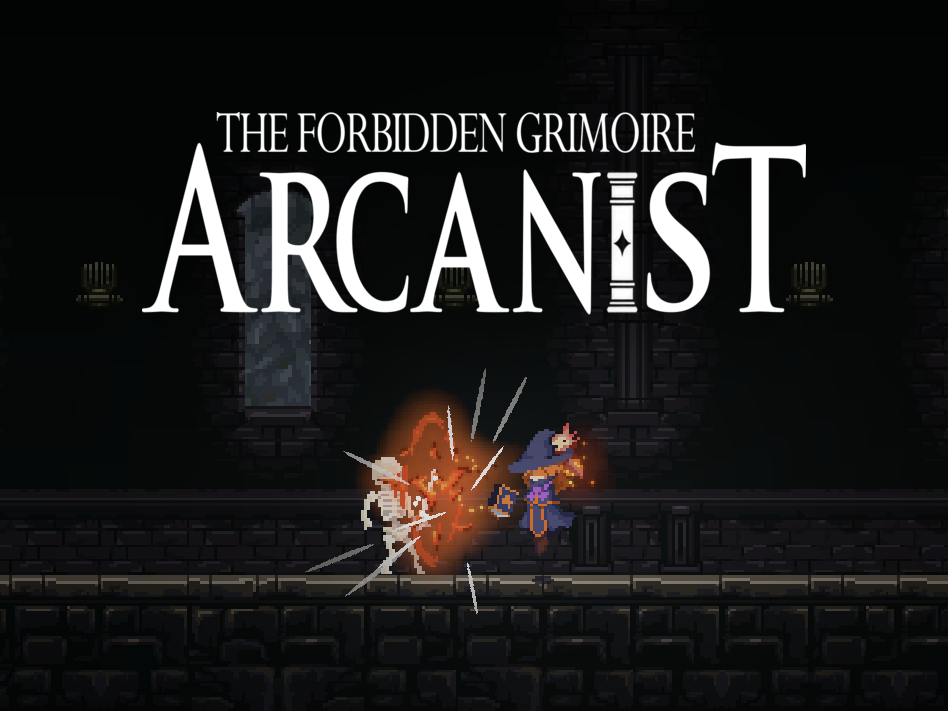

**Arcanist**는 2D 액션에 실시간 카드 사용을 결합한 게임입니다.
플레이어는 이동·점프·공격·패링을 하며, 충전된 게이지로 카드를 뽑아 Q/W/E 슬롯에서 사용합니다.
카드는 투사체 공격뿐 아니라 피해 증가·받는 피해 조절·회복·일회 부활에도 쓰입니다.
방마다 전투와 보상을 진행하고, 체크포인트에 저장된 위치와 체력으로 복귀합니다.
전투·패링·카드·인벤토리·보상·보스·저장과 복구를 하나의 플레이 흐름으로 연결했습니다.

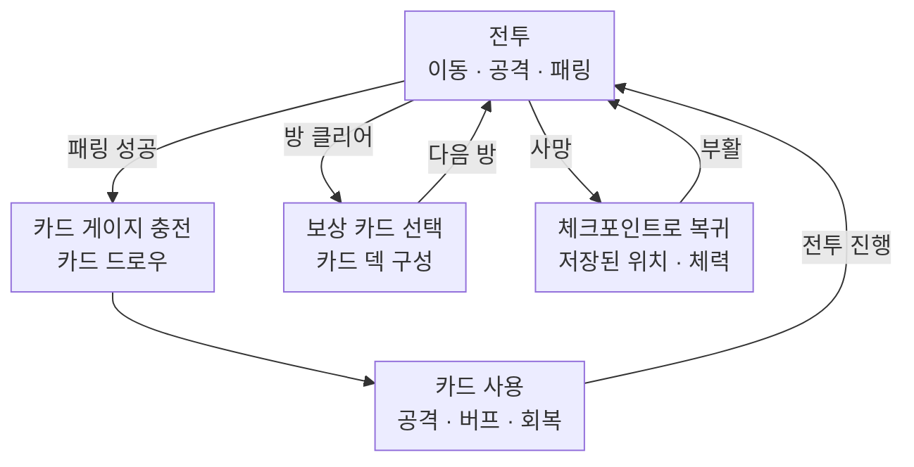

이 다이어그램은 전투 중 패링으로 카드 게이지를 얻어 카드를 쓰고, 방을 클리어하면 보상 카드로 덱을 구성하며, 사망하면 체크포인트로 돌아오는 게임 루프를 도식화한 것입니다.

**모든 화살표가 전투로 돌아오고, 패링 성공이 카드 게이지와 카드 사용을 거쳐 다시 전투를 이어 가는 수단이 됩니다.**

- **진행:** 타이틀 → 인트로 → 일반 방 2개 → 보스 방(고대 수호 골렘) 순서로 진행합니다. 방의 적을 모두 쓰러뜨리면 출구의 오벨리스크가 열리고, 보상 카드 3장 중 1장을 고른 뒤 오벨리스크 안에서 덱을 편성합니다.
- **카드 게이지:** 시간이 지나면 한 칸씩 차고, 패링에 성공하면 칸이 더해집니다. 가득 차고 빈 슬롯이 있으면 덱에서 카드 1장을 뽑습니다.
- **카드:** 공격 효과 카드 9장·버프 효과 카드 13장을 구현했습니다(기획한 30장 중 22장, 게임 안 종류 표시로는 공격 11장·방어 5장·유틸리티 6장). 등급은 Common·Rare·Epic·Legendary 4종이고 덱 비용은 1·2·4·6입니다.
- **덱 편성:** 보상으로 얻은 카드로 덱을 편성하며, 장수와 비용 합에 제한이 있습니다(§4.1).
- **사망:** 일반 방마다 체크포인트가 2곳 있습니다(보스 방에는 없음). 복귀하면 손패·게이지를 비우고 편성 덱으로 다시 시작합니다.

조작은 다음과 같습니다.

| 동작 | 조작 |
|---|---|
| 이동 | ← / → |
| 점프 | Space (공중에서 한 번 더 누르면 더블 점프) |
| 대시 | A |
| 달리기 | 왼쪽 Shift (누르는 동안) |
| 기본 공격 | D (연속 입력으로 콤보) |
| 패링 | S |
| 카드 사용 | Q / W / E |
| 출구 사용 / 사망 후 부활 | ↑ |
| 덱 편성 | ↓ (오벨리스크에서) |
| 인벤토리 | I |
| 일시정지 | Esc |

### 1.2 개발 의도

본격적으로 만든 첫 개인 게임 프로젝트로, 카드 덱 빌딩과 2D 액션을 결합해 **카드 조합에 따라 전투 방식이 달라지는 게임**을 만들고자 했습니다.
그 중심에는 **패링에 성공해 카드 게이지를 얻고**, 그 게이지로 카드를 사용해 전투를 이어 가는 흐름을 두었습니다.
처음 목표는 매번 다른 덱을 구성하며 플레이하는 로그라이트였고, 프로젝트 기간 내에는 보상으로 얻은 카드로 덱을 바꾸며 방을 이어 가는 흐름까지 구현했습니다(§8.4).

| 문제 | 구현 방향 |
|---|---|
| 여러 충돌체 접촉으로 같은 공격이 반복 적용될 수 있음 | 공격별 `HashSet<HurtBox>` 또는 타격 시각 Dictionary |
| 카드마다 모션·생성 위치·타겟 요구 조건이 다름 | `CardData`와 `CardEffect` 분리, `CardEffectContext` 전달 |
| 보유 카드와 편성 덱, 전투 중 카드 위치가 서로 다름 | 인벤토리와 런타임 카드 목록 분리 |
| 애니메이션 도중 공격 타이밍을 맞춰야 함 | 애니메이션 이벤트 수신기에서 HitBox·투사체 제어 |
| 사망 복구 시 적·방·플레이어 상태를 함께 복원해야 함 | 체크포인트 스냅샷 → 방 로드 → 플레이어 리셋 |

### 1.3 개발 환경

| 항목 | 내용 |
|---|---|
| 장르 | 2D 액션 플랫포머 |
| 기간 | 2026.06 — 2026.07, 약 2주 |
| 인원 | 1인 |
| 엔진 | Unity `6000.3.15f1`, URP `17.3.0` |
| 언어 | C# |
| 주요 패키지 | Input System `1.19.0`(프로젝트 입력 래퍼 `SimpleInput`), Cinemachine `3.1.7`, LDtkUnity `6.12.3`, 2D Animation `13.0.4`, DOTween |
| 리소스 | 외부 에셋: 캐릭터·적 스프라이트, 입력 키 아이콘, UI 패널, 아이콘, 배경, 이펙트 팩, DOTween·LDtkUnity / 직접 제작: 스크립트, 화면 흑백 반전 셰이더(`SG_ScreenInvert`) |
| GitHub | [GitHub](https://github.com/keeeery/Arcanist) |
| 시연 영상 | [YouTube](https://youtu.be/8hEJXeohnA8) |

### 1.4 전체 구조

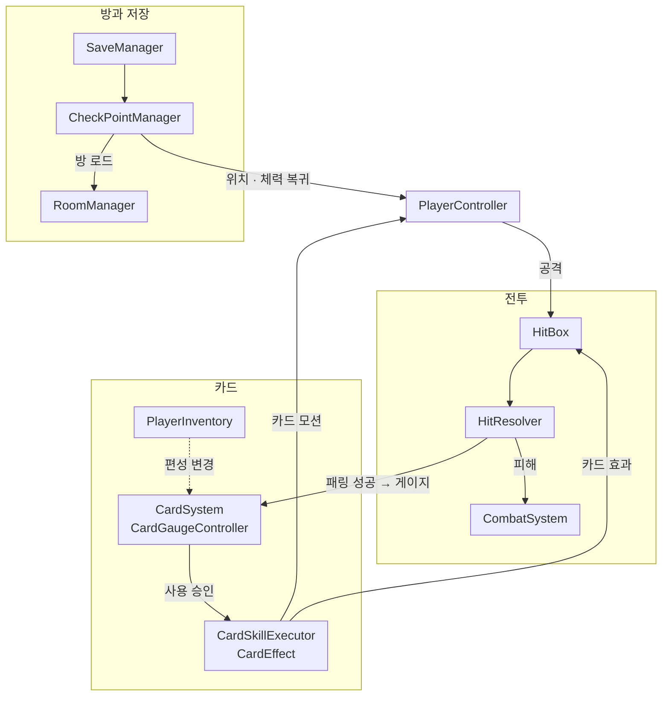

이 다이어그램은 §1.1의 게임 진행을 맡는 주요 클래스를 전투·카드·방과 저장 세 묶음으로 나누고, 공격·카드 효과·패링 보상·체크포인트 복귀로 이어지는 관계를 도식화한 것입니다. 각 묶음의 세부 구조는 §2.1(전투)·§3.3(카드)·§6.1(방과 저장)에 있습니다.

**기본 공격과 카드 효과가 모두 같은 `HitBox → HitResolver` 경로로 피해를 주고, 패링에 성공하면 그 결과가 `CardGaugeController`의 카드 게이지로 이어지고, 게이지가 차면 `CardSystem`이 카드를 뽑습니다.**

**AI를 활용한 곳:** 인벤토리 코드 정리(§4.4)에 활용했습니다. 나눌 파일과 기준값은 직접 정하고, 코드를 옮기는 일만 맡겼습니다.

이 문서에서 깊게 다루는 것은 세 가지입니다.

1. **전투와 패링(§2):** 충돌 판정과 중복 타격 방지, 피해 전달, 패링에 성공하면 피해를 막고 카드 게이지를 주는 연결을 다룹니다.
2. **카드 순환과 스킬(§3):** 덱·손패·버림 더미의 순환과 사용 가능 조건, 모션에 맞춘 효과 발동을 다룹니다.
3. **방 전환과 체크포인트 복원(§6·§7):** 방 로드와 사망 복구, 클리어 여부에 따른 적 재생성을 다룹니다.

인벤토리·보상(§4)과 이동·적 행동(§5)은 짧게 다룹니다.

---

## 2. 충돌 기반 전투와 패링

### 2.1 개요 — 기본 공격과 패링 판정

플레이어는 D로 기본 공격을 하고, 공격 모션 중간에 D를 다시 누르면 다음 공격으로 이어집니다.
적의 공격이 닿기 직전에 패링 자세를 취하면, 판정 창이 열려 있는 동안 닿은 공격은 피해를 주지 않고 패링으로 처리됩니다.
패링에 성공하면 화면 가장자리가 보라색으로 번쩍이고 히트스톱·카메라 흔들림이 들어가며, **카드 게이지를 획득해 카드를 더 빨리 뽑습니다.**
패링에 실패하면 그대로 피해를 받아 체력이 줄어듭니다. 일반 적과 보스(고대 수호 골렘)의 공격 모두 같은 판정으로 패링할 수 있습니다.
즉 패링은 방어이면서 카드를 얻는 수단이라, 카드 사용(§3)으로 이어집니다.

전투 판정은 공격 충돌체가 감지한 대상을 검증하고, 단발·다단 공격의 중복 적용을 제어한 뒤 패링 또는 피해로 해결합니다.
판정은 `HitBox`, 타격 기록은 `HitTargetTracker`, 전투 결과 적용은 `HitResolver`가 담당합니다.

| 클래스 | 책임 |
|---|---|
| `HitBox` | 충돌 진입, 사용 불가 대상 제외, 결과별 연출 |
| `HitTargetTracker` | HurtBox별 단발 기록·다단 타격 간격 |
| `HitResolver` | 패링, 피해 이벤트, 넉백·스턴 적용 |
| `ICombatTarget` | 일반 적·보스의 타겟 속성 계약 |
| `IStunnable` | 문자열 메시지 대신 스턴 적용 계약 |
| `CombatSystem` | 피해 이벤트 전달, HurtBox 등록·조회 |

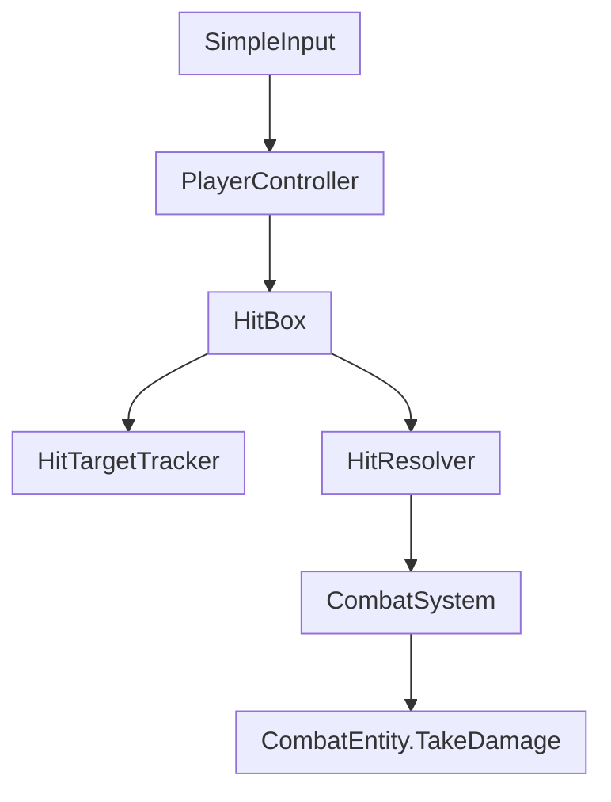

이 다이어그램은 입력에서 피해 적용까지 전투 판정이 이어지는 구조를 도식화한 것입니다.
전투는 `CombatSystem.To()` 호출 안에서 즉시 피해를 적용하는 방식입니다(이 방식을 고른 이유는 §2.5).
HitResolver는 넉백·스턴을, HitBox는 피격 FX와 타격 연출을 담당합니다.

**`HitBox`가 맞은 대상을 `HitTargetTracker`에 먼저 기록해 중복 타격을 거르고, 통과한 공격만 `HitResolver`가 패링 또는 피해로 해결합니다.**

소스: [HitBox.cs](https://github.com/keeeery/Arcanist/blob/main/Assets/02.%20Scripts/03.%20CombatSystem/HitBox.cs), [HitResolver.cs](https://github.com/keeeery/Arcanist/blob/main/Assets/02.%20Scripts/03.%20CombatSystem/HitResolver.cs), [HitTargetTracker.cs](https://github.com/keeeery/Arcanist/blob/main/Assets/02.%20Scripts/03.%20CombatSystem/HitTargetTracker.cs).

### 2.2 한 공격의 중복 타격 제어

여러 충돌체가 닿으면 같은 공격이 한 대상에게 여러 번 들어갈 수 있습니다(§1.2). 아래 코드는 단발 공격은 대상마다 한 번만, 다단 공격은 정해진 간격마다 다시 맞도록 거르는 부분입니다.

```csharp
// HitTargetTracker.TryRegister() — 다단 히트 여부에 따라 허용 판단과 기록을 한 번에
if (allowMultiHit == false)
    return hitTargets.Add(hurtBox);

if (lastHitTimes.TryGetValue(hurtBox, out float lastHitTime)
    && Time.time - lastHitTime < multiHitInterval)
    return false;

lastHitTimes[hurtBox] = Time.time;
return true;
```

`HitTargetTracker.TryRegister()`는 허용 여부 판단과 기록을 한 번에 수행합니다.
단발 공격은 HashSet 추가 성공 여부를, 다단 공격은 마지막 타격 이후 시간을 사용합니다.
`HitBox.OnEnable/Initialize`에서 기록을 비워 풀 재사용 시 이전 공격의 기록이 남지 않게 합니다.

### 2.3 패링 성공 시 피해 무효화

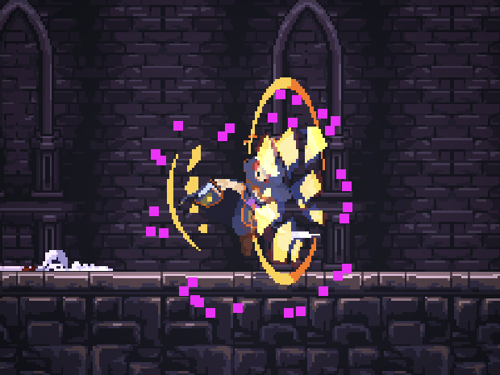

공격이 닿은 순간 플레이어의 패링 판정 창이 열려 있으면, 피해를 전달하기 전에 패링으로 처리하고 끝냅니다. 아래 코드가 그 갈림길입니다.

```csharp
// HitResolver.Resolve() — 패링 창이 열려 있으면 피해 전달 전에 패링으로 처리
PlayerController playerController = receiver.GetComponent<PlayerController>();
if (playerController != null && playerController.IsParryWindowOpen)
{
    playerController.SuccessParry();
    return new HitResolution(HitResolutionStatus.Parried);
}
```

처리 순서는 다음과 같습니다.

1. 대상을 검증합니다.
2. `TryRegister()`로 중복 타격을 기록합니다(§2.2).
3. `Resolve()`로 패링 또는 피해를 처리합니다.
4. 결과가 Applied일 때만 타격 연출을 재생합니다.

- **패링은 피해 전달 전에 반환하지만 중복 기록 뒤에 발생합니다.** 따라서 단발 공격은 패링된 HurtBox도 기록되어 같은 활성 구간에서 다시 피해를 주지 않습니다.
- **`SuccessParry()`가 패링을 카드 게이지로 이어 줍니다(성공 연출은 §2.4).** 패링을 카드 수급과 연결한 핵심 플레이 흐름입니다.

`HitResolutionStatus`는 Ignored/Parried/Applied를 구분합니다.
Applied가 아니면 일반 피격 FX·히트스톱·카메라 흔들림·적중 폭발 경로로 진행하지 않습니다.
넉백·스턴은 수신자의 `CanReceiveKnockback/CanReceiveStun`을 확인하며, 스턴은 `IStunnable.ApplyStun()`으로 호출합니다.

### 2.4 체력바와 화면 연출

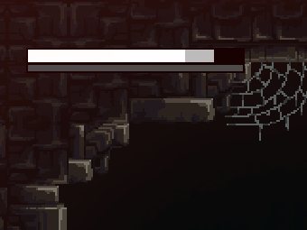

체력바는 즉시 줄어드는 본체와 잠시 뒤 따라오는 지연 바로 나누고, 연속 피격·회복·비활성화 때 이전 트윈을 정리해 연출이 겹치지 않게 했습니다.

강의에서 익힌 DOTween을 실제 프로젝트에 적용해, 컴포넌트마다 반복되던 UI·체력바·피격·패링의 수동 시간 보간을 트윈으로 정리했습니다. 이 과정에서
‘새 효과가 오면 이전 효과를 끝내고 다시 시작하는가’와 ‘비활성화할 때 정리하는가’를 각 컴포넌트 생명주기에 연결했습니다.
DOTween으로 코드 반복은 줄었지만, 트윈 대상의 상태 초기화는 여전히 각 컴포넌트가 맡습니다.

`HitStopController`는 `Time.timeScale = 0` 후 `WaitForSecondsRealtime`로 대기하고 1로 복구합니다.

소스: [HealthBarUI.cs](https://github.com/keeeery/Arcanist/blob/main/Assets/02.%20Scripts/03.%20CombatSystem/HealthBarUI.cs), [HitStopController.cs](https://github.com/keeeery/Arcanist/blob/main/Assets/02.%20Scripts/10.%20VFX/HitStopController.cs).

#### 패링 성공 연출 — 번쩍임·히트스톱·화면 흔들림

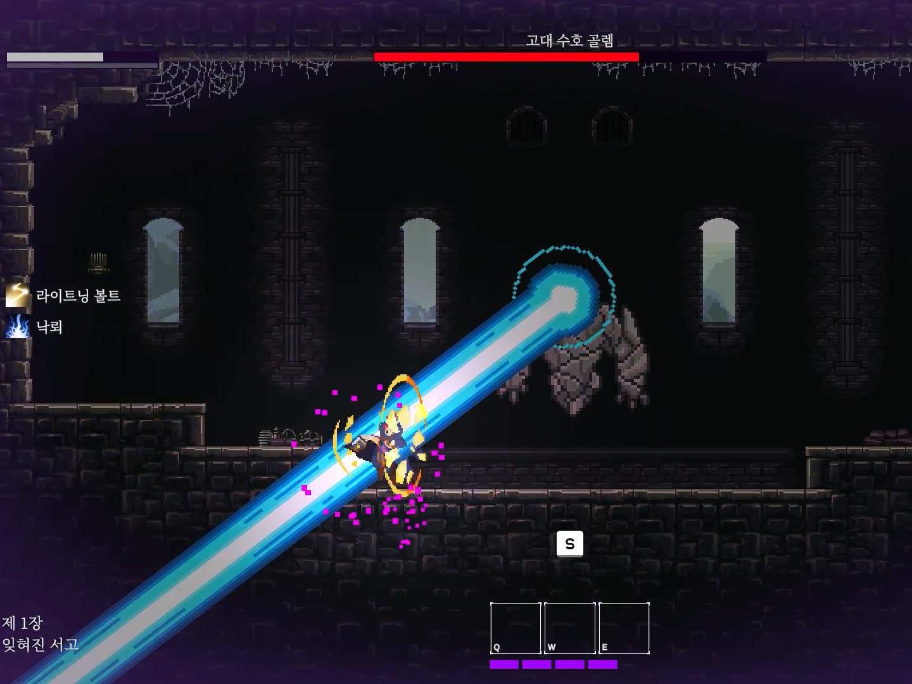

패링이 성공하면 `PlayerController.SuccessParry()`가 패링 창을 닫고 카드 게이지 칸을 더한 뒤 `PlayParrySuccessEffects()`를 호출합니다.
이 함수가 부르는 것은 `ParryLightEffect.Play()`와 `ScreenEffectController.PlayParryGlow()` 두 가지뿐입니다. 파티클·히트스톱·카메라 흔들림·조명은 `ParryLightEffect` 안에서 함께 시작합니다.

| 구성 | 동작 |
|---|---|
| 파티클 | 패링 파티클을 재생하고, 게이지 방향으로 회전시킨 게이지 FX를 생성한 뒤 지연 후 제거 |
| 히트스톱 | `HitStopController.Play()` |
| 카메라 흔들림 | Cinemachine Impulse를 지연 호출(`DOVirtual.DelayedCall()`, 시간 배율 무시) |
| 조명 | `Light2D`의 세기·반경을 DOTween으로 키웠다가 되돌림(`SetUpdate(true)`) |
| 화면 가장자리 | 비네트 이미지를 보라색으로 번쩍임(`PlayParryGlow()`) |

히트스톱 중에도 조명 트윈과 카메라 흔들림 예약은 시간 배율을 무시하고 이어집니다.

#### 죽음 선고 — 화면 흑백 반전과 느려지는 시간

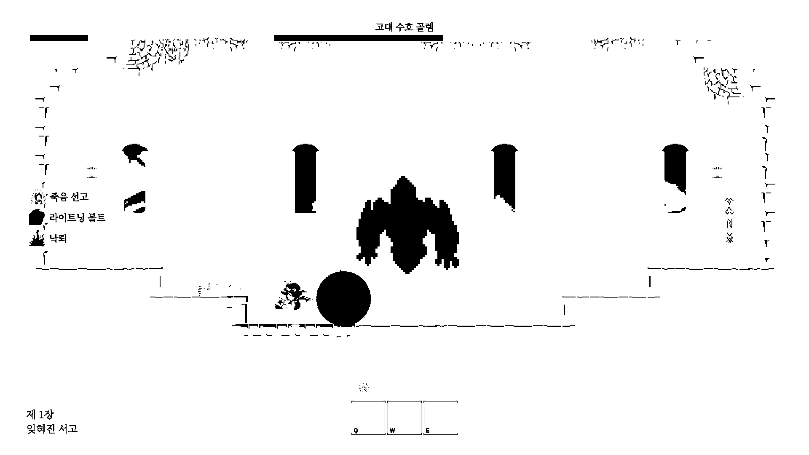

전설 등급 카드 ‘죽음 선고’의 이펙트 프리팹에는 `DeathSentenceEffectController`가 있고, 활성화될 때 `ScreenEffectController.PlayDeathSentenceFlash()`를 호출합니다.
이 함수는 Shader Graph로 만든 화면 흑백 반전 머티리얼(`SG_ScreenInvert`)의 `_Blend`를 켜는 동안 `Time.timeScale`을 낮춥니다.
`HitStopController`가 복구 값을 1로 고정하는 것과 달리, 이 연출은 직전 `timeScale`·`fixedDeltaTime`을 저장했다가 되돌립니다.

소스: [PlayerController.cs](https://github.com/keeeery/Arcanist/blob/main/Assets/02.%20Scripts/01.%20Player/PlayerController.cs), [ParryLightEffect.cs](https://github.com/keeeery/Arcanist/blob/main/Assets/02.%20Scripts/10.%20VFX/ParryLightEffect.cs), [ScreenEffectController.cs](https://github.com/keeeery/Arcanist/blob/main/Assets/02.%20Scripts/10.%20VFX/ScreenEffectController.cs), [CameraImpulseController.cs](https://github.com/keeeery/Arcanist/blob/main/Assets/02.%20Scripts/10.%20VFX/CameraImpulseController.cs), [DeathSentenceEffectController.cs](https://github.com/keeeery/Arcanist/blob/main/Assets/02.%20Scripts/10.%20VFX/DeathSentenceEffectController.cs).

### 2.5 고민과 선택

**피해를 어디서 적용할까 — `CombatSystem` 한곳으로**

강의에서 익힌 중재자 구조를 실제 전투에 적용해, 피해 적용을 `CombatSystem` 한곳으로 모았습니다.
한 공격이 같은 HurtBox를 한 번만 치게 하는 중복 타격 방지 위에, 일정 간격마다 같은 대상을 다시 칠 수 있는 다단 히트(`allowMultiHit`, 소스 기본 간격 0.25초)를 나중에 더했습니다.

당시에는 이 방식 하나로 정했고, 다른 방법과의 비교는 돌아보며 정리했습니다.

| 방법 | 장점 | 비용 |
|---|---|---|
| 공격 쪽이 대상의 피해 함수를 직접 부르기 | 호출 경로가 짧고 구조가 단순함 | 패링·중복 타격 방지 같은 공통 처리를 공격마다 따로 넣어야 하고, 피해를 전달하는 지점이 흩어짐 |
| `CombatSystem.To()`를 거쳐 전달 (채택) | 피해 전달 지점을 한곳에 모음 | FX는 HitBox, 넉백·스턴은 HitResolver에 연결 |

**패링을 어떻게 판정할까 — 애니메이션 진행도에 맞춘 판정 창**

| 방법 | 장점 | 비용 |
|---|---|---|
| 패링용 Collider(`ParryCollider`)가 투사체 Collider와 닿는 타이밍으로 판정 (기획서 예시) | — | 패링 판정이 애니메이션 진행도와 따로 움직임 |
| 공격이 닿았을 때 패링 판정 창이 열려 있는지(`IsParryWindowOpen`) 확인 (채택) | 패링 타이밍을 애니메이션 진행도와 맞출 수 있음 | 판정 창을 닫는 진행률을 플레이 테스트로 직접 맞춰야 함(§5.4) |

패링용 Collider 방식은 컨셉 기획서에서 개발 전에 "이런 식으로 하면 되지 않을까" 하고 든 예시였고, 실제 구현은 처음부터 판정 창 방식으로 했습니다.
패링 타이밍은 애니메이션 진행도와 맞추는 것이 맞다고 판단해, 공격이 닿았을 때 `HitResolver`가 플레이어의 패링 판정 창이 열려 있는지 확인하게 했습니다(§2.3).

**그 밖의 선택**

| 선택 | 이점 | 비용 |
|---|---|---|
| 콜라이더 Dictionary 등록 | 등록된 충돌체는 바로 조회 | 누락 시 `GetComponentInParent/Children` 검색 발생 |
| 단발·다단 판정을 같은 HitBox에 제공 | 공격 프리팹 설정으로 구분 | HurtBox 단위 중복 정책을 이해해야 함 |

---

## 3. 카드 순환과 모션 연계 스킬

### 3.1 개요 — Q/W/E 슬롯과 카드 게이지

화면 아래의 Q/W/E 슬롯에 카드가 한 장씩 들어옵니다.
카드 게이지는 시간이 지나면 차고 패링에 성공하면 더 빨리 차며(§2), 가득 차면 편성한 덱에서 카드 1장을 빈 슬롯으로 뽑습니다.
슬롯의 키를 누르면 플레이어가 그 카드의 모션을 취하고, 모션 중 정해진 순간에 효과가 나갑니다.
공격 카드는 앞으로 날아가거나, 가장 우선순위가 높은 적의 위치나 시전한 자리에 생기고, 버프 카드는 일정 시간 능력치를 바꾸며 화면 왼쪽 위에 아이콘으로 표시됩니다.
대상이 필요한 카드는 노릴 적이 없으면, 회복 카드는 회복할 수 없는 상태면 사용되지 않습니다.
어떤 카드가 손에 들어오는지는 편성한 덱에 따라 달라지므로, 보상으로 얻은 카드로 덱을 바꾸면 전투 방식도 달라집니다(§4).

카드 시스템은 보유 카드·편성 덱과 전투 중 카드 위치를 나누고, 사용 조건 검증과 실제 효과 발동을 분리합니다.
카드 데이터는 ScriptableObject로 정의하고 실행 시 플레이어·생성 위치·방향·타겟을 전달합니다.

`CardData`는 ID·이름·아이콘·분류·등급·모션 트리거·효과 참조를 보유합니다.
`CardEffect`는 `Execute(CardEffectContext)` 계약을 제공하는 ScriptableObject이며, 투사체와 버프 효과가 이를 상속합니다.
카드 사용자는 실제 효과 종류를 분기하지 않고 같은 실행 진입점을 호출할 수 있습니다.

카드 에셋 30개 중 효과를 연결한 22장을 구현했고, 나머지 8장은 미뤘습니다(이유는 §3.8). 효과 클래스는 두 종류뿐이며 카드마다 에셋 값과 연결한 이펙트 프리팹이 다릅니다.

| 효과 클래스 | 카드 수 | 등급 분포 | 카드 |
|---|---|---|---|
| `ProjectileCardEffect` | 9장 | Common 2 · Rare 4 · Epic 2 · Legendary 1 | 화염구, 블랙홀, 죽음 선고 외 6장 |
| `BuffCardEffect` | 13장 | Common 2 · Rare 4 · Epic 5 · Legendary 2 | 철벽, 회복, 불사의 축복 외 10장 |

`BuffCardEffect`는 `BuffEffectType` 여섯 가지(주는 피해 증가, 받는 피해 감소, 받는 피해 증가, 카드 충전 속도 증가, 회복 비율, 일회 부활)를 조합합니다.

소스: [CardData.cs](https://github.com/keeeery/Arcanist/blob/main/Assets/02.%20Scripts/04.%20CardSystem/CardData.cs), [CardEffect.cs](https://github.com/keeeery/Arcanist/blob/main/Assets/02.%20Scripts/04.%20CardSystem/CardEffect.cs), [CardSystem.cs](https://github.com/keeeery/Arcanist/blob/main/Assets/02.%20Scripts/04.%20CardSystem/CardSystem.cs).

### 3.2 덱·손패·버림 더미를 도는 카드 순환

카드는 아래 다섯 목록 사이를 옮겨 다닙니다. 보유 카드와 편성 덱은 전투 밖의 목록이고, 뽑을 카드·손패·사용한 카드가 전투 중에 도는 목록입니다.

| 목록 | 의미 |
|---|---|
| `ownedCards` | 보유 카드의 런타임 복사 |
| `playerDeck` | 현재 편성 덱 |
| `drawPile` | 아직 뽑지 않은 카드 |
| `hand` | 손패 |
| `discardPile` | 사용한 카드 |

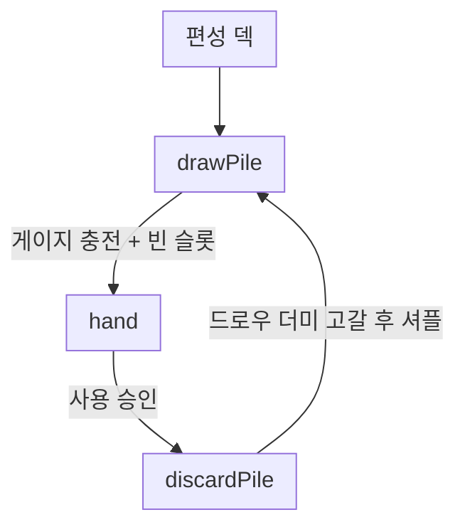

이 다이어그램은 편성 덱의 카드가 드로우 더미 → 손패 → 버림 더미를 돌고, 드로우 더미가 바닥나면 버림 더미를 섞어 되돌리는 카드 순환을 도식화한 것입니다.

게이지 충전 외에도 덱 초기화 여부, `CardHandUI.IsBusy`, 빈 슬롯 유무를 확인합니다.
드로우 시도 직전에 `BeginNextGaugeCycle()`을 호출해 다음 게이지 주기를 시작합니다.
덱 동기화 시 기존 손패를 통째로 초기화하지 않고 드로우·버림 목록에서 빠진 카드를 제거합니다.

### 3.3 사용 가능 확인과 모션에 맞춘 발동

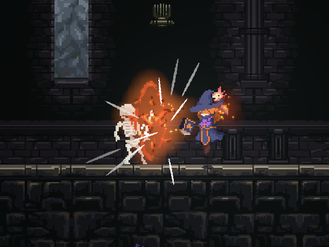

카드 처리 책임을 다음 클래스로 분리하고, 타겟 계약과 손패 UI도 별도 구성했습니다.

| 클래스 | 책임 |
|---|---|
| `CardSystem` | 입력, 게이지, 인벤토리와 UI 조율 |
| `CardRuntimeDeck` | 보유·편성·드로우·손패·버림 목록, 셔플과 순환 |
| `CardUseValidator` | 회복 가능 여부와 필수 타겟 검증, 실패 enum 반환 |
| `CardSkillExecutor` | 대기 카드, 애니메이션 시작, 발동 시 실제 효과 실행 |
| `CardTargetResolver` | 카드별 타겟 필요 여부와 공통 타겟 조회 |

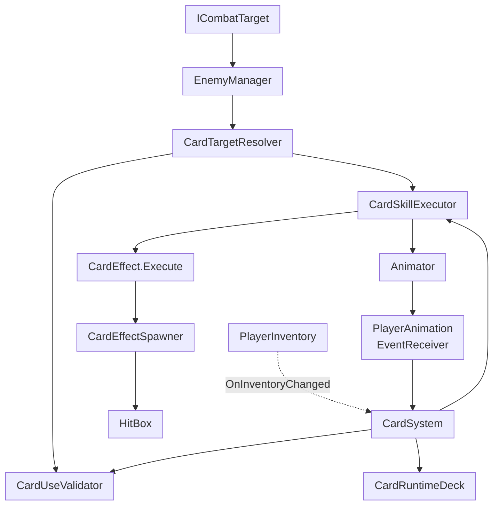

이 다이어그램은 카드 사용과 대상 선택의 구조를 도식화한 것입니다. 카드 효과는 §2의 `HitBox`로 이어집니다.

**쓸 수 있는지 확인하는 `CardUseValidator`와 효과를 실행하는 `CardSkillExecutor`가 나뉘어 있고, 둘 다 같은 `CardTargetResolver`로 대상을 찾습니다.**

소스: [CardRuntimeDeck.cs](https://github.com/keeeery/Arcanist/blob/main/Assets/02.%20Scripts/04.%20CardSystem/CardRuntimeDeck.cs), [CardSkillExecutor.cs](https://github.com/keeeery/Arcanist/blob/main/Assets/02.%20Scripts/04.%20CardSystem/CardSkillExecutor.cs), [CardUseValidator.cs](https://github.com/keeeery/Arcanist/blob/main/Assets/02.%20Scripts/04.%20CardSystem/CardUseValidator.cs).

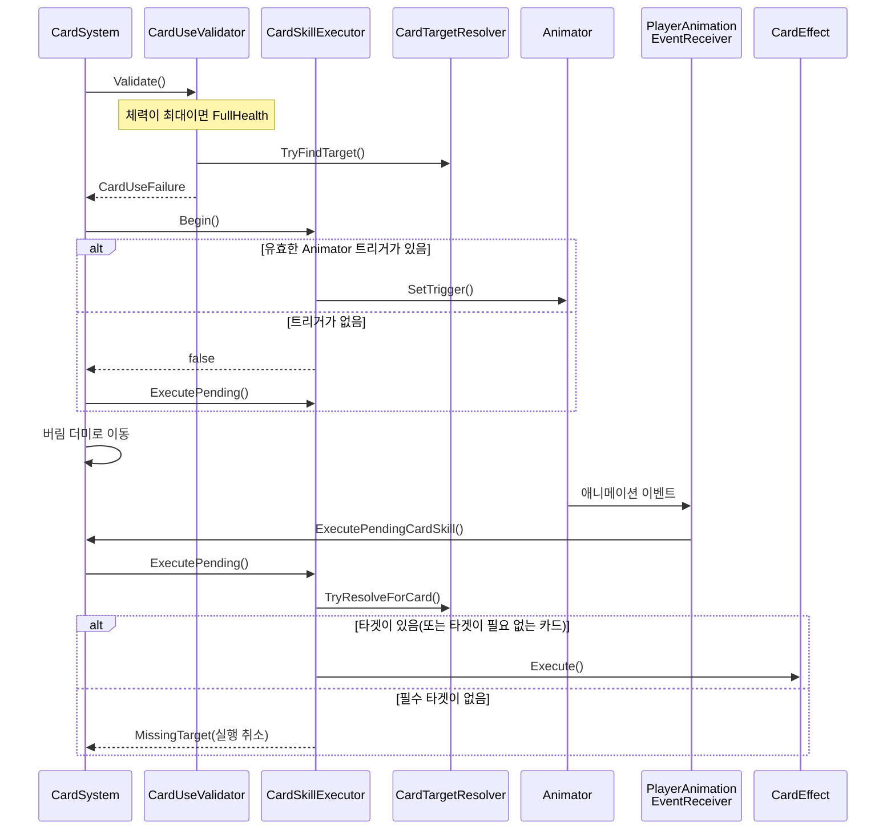

이 다이어그램은 카드 사용 시 사용 가능 여부를 확인한 뒤 애니메이션 이벤트 시점에 효과를 발동하는 차례를 도식화한 것입니다.

**카드는 사용이 승인된 순간 버림 더미로 가지만, 효과는 애니메이션 이벤트가 온 뒤에야 나가고 그때 대상을 다시 찾습니다.**

효과를 입력 시점이 아니라 애니메이션 이벤트 시점에 실행하도록 나눈 이유는 연출입니다.
시전 모션이 지나고 실제로 주문을 내뻗는 순간에 효과가 나가야 어색하지 않고 자연스럽다고 판단했습니다.

```csharp
// CardSkillExecutor.ExecutePending() — 발동 시점의 시전 위치·대상으로 카드 효과 실행
CardEffectContext context = new(
    card, playerController, resolvedCastPoint, facingDirection, target);
card.Effect.Execute(context);
return new CardSkillExecutionResult(CardSkillExecutionStatus.Executed, card);
```

실행 시점에 타겟을 다시 찾기 때문에, 입력 시점과 애니메이션 발동 시점 사이에 적이 죽은 경우를 구분합니다.

### 3.4 코드 수정 없는 새 투사체 카드 추가

`ProjectileCardEffect`는 생성 위치(`CastPoint`, `TargetPosition`)와 조준 방식(`Forward`, `Target`, `None`)을 조합합니다.
목표 위치 생성이나 목표 조준을 선택하면 `RequiresTarget`이 true가 됩니다.
풀에서 얻은 객체에 방향·소유자를 주입하고 자식 HitBox도 초기화합니다.
이 구조로 전방 발사체와 적 위치에 생성되는 공격을 같은 효과 클래스에서 구성합니다.

소스: [ProjectileCardEffect.cs](https://github.com/keeeery/Arcanist/blob/main/Assets/02.%20Scripts/04.%20CardSystem/ProjectileCardEffect.cs).

### 3.5 등급 우선, 같은 등급에서는 거리 우선

`EnemyManager`는 일반 적과 보스를 하나의 `List<ICombatTarget>`으로 관리합니다.
조회 중 파괴된 Unity 객체를 제거하고 `IsTargetable`과 `IsDead`를 확인합니다.

- **사망·비활성 대상을 제외하고 등급 우선, 같은 등급에서는 거리 우선으로 선택합니다.** 따라서 보스와 일반 적이 함께 있다면 가장 가까운 일반 적보다 멀리 있는 보스가 우선될 수 있습니다. 지금 레벨에는 둘이 함께 나오지 않습니다.
- **일반 적과 보스를 나누는 분기가 필요 없습니다.** `CardTargetResolver`는 `TryFindBestTarget()` 결과의 TargetPoint만 사용하기 때문입니다.
- **거리 비교에는 `sqrMagnitude`를 사용합니다.** 시야·벽·화면 범위 검사는 이 함수에 없습니다.

### 3.6 버프 중첩과 지속시간 갱신

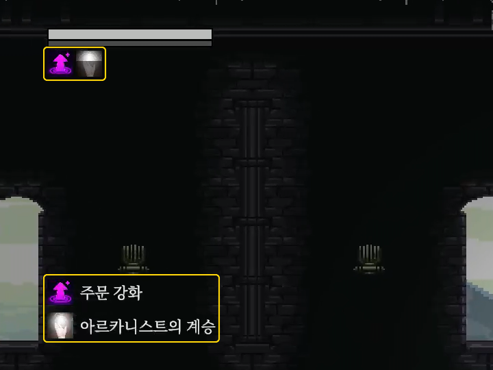

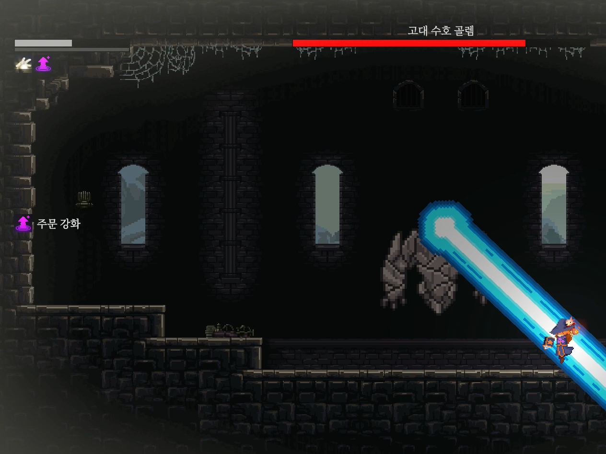

단일 배율 필드 대신 `List<ActiveBuff>`로 활성 효과를 관리하도록 변경했습니다.
`BuffId + ActiveBuffType`이 같으면 새 항목을 쌓지 않고 값과 종료 시각을 Refresh합니다.
서로 다른 ID의 버프는 함께 적용됩니다.

<table>
<thead>
<tr><th>계산</th><th>규칙</th><th>예시</th></tr>
</thead>
<tbody>
<tr><td>주는 피해 증가</td><td>각 <code>Value - 1</code>의 양수 증가분 합산</td><td rowspan="2">1.2배와 1.3배 → 1.5배</td></tr>
<tr><td>받는 피해 증가</td><td>증가분 합산</td></tr>
<tr><td>받는 피해 감소</td><td><code>(1 - Clamp01(Value))</code> 누적 곱</td><td>20%, 30% 감소 → 0.56배</td></tr>
<tr><td>카드 충전 속도</td><td>증가분 합산으로 시간을 나눔</td><td>합산 1.5배 → 기준시간 / 1.5</td></tr>
<tr><td>무적</td><td>유효한 무적 항목이 있으면 피해 0</td><td>일회 부활 소모 뒤 일정 시간 적용</td></tr>
</tbody>
</table>

동일 버프 갱신은 남은 시간에 더하는 방식이 아니라 `현재 시각 + 새 지속시간`으로 종료 시점을 대체합니다.
만료 항목은 피해·충전 계산 또는 버프 추가 시 역순으로 제거합니다. 매 프레임 제거 루프는 없습니다.
일회 부활 대기는 별도 플래그로 관리하고, 소모 후 `ActiveBuffType.Invincibility`를 등록합니다.

소스: [BuffController.cs](https://github.com/keeeery/Arcanist/blob/main/Assets/02.%20Scripts/04.%20CardSystem/BuffController.cs), [ActiveBuff.cs](https://github.com/keeeery/Arcanist/blob/main/Assets/02.%20Scripts/04.%20CardSystem/ActiveBuff.cs).

### 3.7 넘친 게이지와 투사체의 생성·반납

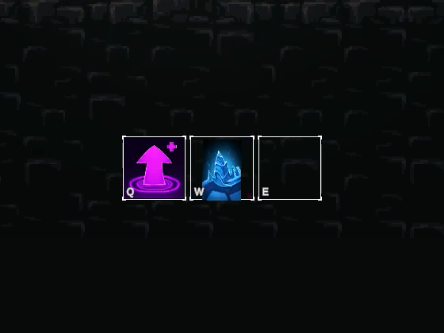

패링 보상 `AddCells()`는 현재 게이지에 더한 칸이 최대치를 넘으면 `overflowCells`로 남깁니다.
다음 드로우 주기의 `BeginNextGaugeCycle()`은 이 초과분을 가져와 게이지를 채운 상태로 재충전합니다.
다만 이미 `isGaugeFull`이면 `AddCells()`가 바로 반환하므로, 가득 찬 뒤에 받은 보상은 쌓이지 않습니다.

손패 상태 `CardHandState`(`CardHandOperation`의 Idle/Drawing/Using)는 드로우뿐 아니라 사용 연출 중에도 바쁨(`IsBusy`)으로 잡혀, 그동안 새로 뽑지 않습니다.

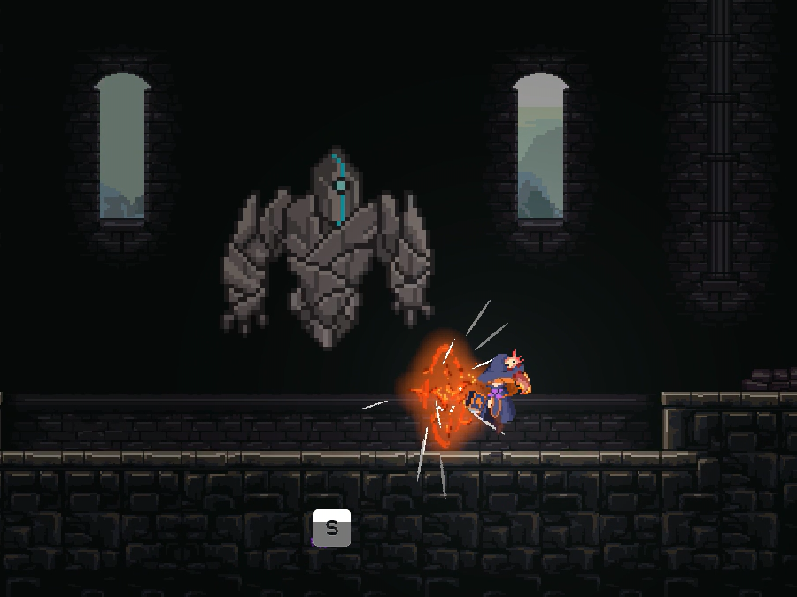

투사체(보스 팔 투사체 제외)·효과·인벤토리 슬롯·버프 아이콘은 같은 `ComponentPool<T>`으로 비활성 객체를 다시 씁니다. 다시 켤 때 `OnEnable()`에서 상태를 초기화하고, 여유 객체가 없으면 새로 만듭니다(GC 개선량은 측정하지 않음).

소스: [CardGaugeController.cs](https://github.com/keeeery/Arcanist/blob/main/Assets/02.%20Scripts/04.%20CardSystem/CardGaugeController.cs), [CardHandState.cs](https://github.com/keeeery/Arcanist/blob/main/Assets/02.%20Scripts/04.%20CardSystem/CardHandState.cs), [ProjectileController.cs](https://github.com/keeeery/Arcanist/blob/main/Assets/02.%20Scripts/04.%20CardSystem/ProjectileController.cs).

### 3.8 고민과 선택

카드 시스템에서는 아래 세 가지를 정했습니다. 처음에는 카드마다 클래스를 하나씩 두는 방식을 생각했고, 데이터 형식은 1인 개발에 맞는 쪽을 골랐습니다.

| 고민 | 고른 방법 (대신 쓰지 않은 방법) | 이유 | 비용 |
|---|---|---|---|
| 30장의 카드 차이를 어디에 담을까 | 효과 클래스 + ScriptableObject 에셋 (카드마다 클래스) | 여러 종의 카드를 관리하기 편함 | 두 효과 클래스로 표현할 수 없는 카드는 새 효과 클래스가 필요 |
| 카드 데이터를 어떤 형식으로 정의할까 | ScriptableObject 에셋 (표(TSV) 데이터) | 카드마다 아이콘·효과·이펙트 프리팹 같은 에셋 참조가 많아 Inspector에서 바로 연결 | 카드 수치를 표 한 곳에서 비교·수정하기 어려움 |
| 기획한 카드를 모두 구현할까 | 필수 시스템 먼저, 구현된 22장으로 흐름 완성 (30장 모두 구현) | 패링 → 카드 사용 → 보상 → 덱 빌딩의 흐름을 완성 | 효과가 비어 있는 카드 8장이 남음 |

이후 Folk Sack·ODDITY에서는 TSV → DTO → Def 파이프라인을 익혀, 데이터를 표로 관리하고 불러올 때 검증하는 방식으로 넓혔습니다.

---

## 4. 인벤토리·덱 편성과 카드 보상

### 4.1 개요 — 보상 카드 3장 중 1장과 덱 편성 화면

방의 적을 모두 쓰러뜨리면 출구의 오벨리스크가 열리고, 무작위로 뽑힌 보상 카드 3장 중 1장을 고릅니다.
고른 카드는 보유 목록에만 들어가고, 덱에는 자동으로 들어가지 않습니다.
오벨리스크 안에서 아래 방향키를 누르면 덱 편성 화면이 열리고, 보유한 카드를 더블 클릭하거나 끌어다 놓아 덱에 넣고 뺍니다.
아직 얻지 못한 카드도 도감처럼 볼 수 있지만 편성할 수는 없습니다.
카드마다 등급에 따른 비용(Common 1 · Rare 2 · Epic 4 · Legendary 6)이 있고, 덱은 최소 6장·최대 20장, 비용 합 8~14를 지켜야 합니다(소스 기본값).
조건을 맞추지 못하면 경고와 흔들림이 나오고 편성 화면을 닫을 수 없습니다. 오벨리스크 밖에서 연 인벤토리는 보기만 할 수 있습니다.
여기서 편성한 덱에서 전투 중 카드가 뽑히므로(§3), 어떤 보상을 고르고 어떻게 편성하느냐에 따라 전투 방식이 달라집니다.

획득한 카드를 보유 목록에 추가하고, 편성 규칙을 만족하는 덱으로 전투에 사용할 카드를 선택합니다.
보상 추첨은 보유·중복 카드를 제외한 후보에 카드별 등급 가중치를 적용합니다.

`PlayerInventory`는 보유 카드와 편성 카드를 분리하고 `OnInventoryChanged`로 변경을 알립니다.
전투 덱(`CardSystem`)과 인벤토리 화면(`InventoryWindow`)이 이 알림을 각각 구독해 따라옵니다.

소스: [PlayerInventory.cs](https://github.com/keeeery/Arcanist/blob/main/Assets/02.%20Scripts/06.%20Inventory/PlayerInventory.cs), [CardSystem.cs](https://github.com/keeeery/Arcanist/blob/main/Assets/02.%20Scripts/04.%20CardSystem/CardSystem.cs), [InventoryWindow.cs](https://github.com/keeeery/Arcanist/blob/main/Assets/02.%20Scripts/06.%20Inventory/InventoryWindow.cs), [RewardController.cs](https://github.com/keeeery/Arcanist/blob/main/Assets/02.%20Scripts/08.%20Reward/RewardController.cs).

### 4.2 편성 규칙

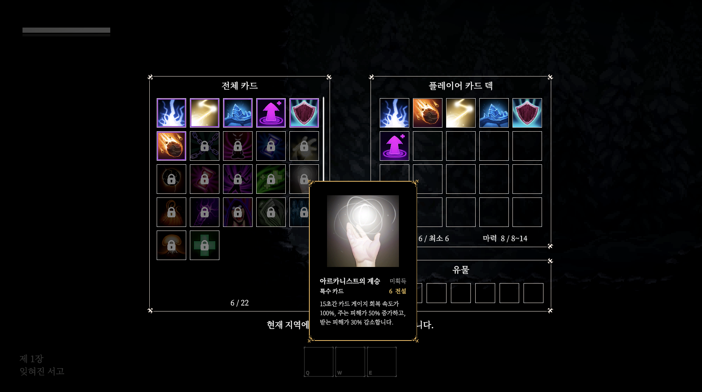

`CanCompleteDeckEdit()`가 최소 장수와 비용 범위를 함께 검사하고, 추가에 실패하면 이유를 `DeckEditFailure`로 돌려줍니다.
씬의 실제 값은 Inspector에 저장된 설정을 따릅니다.

### 4.3 보상 추첨

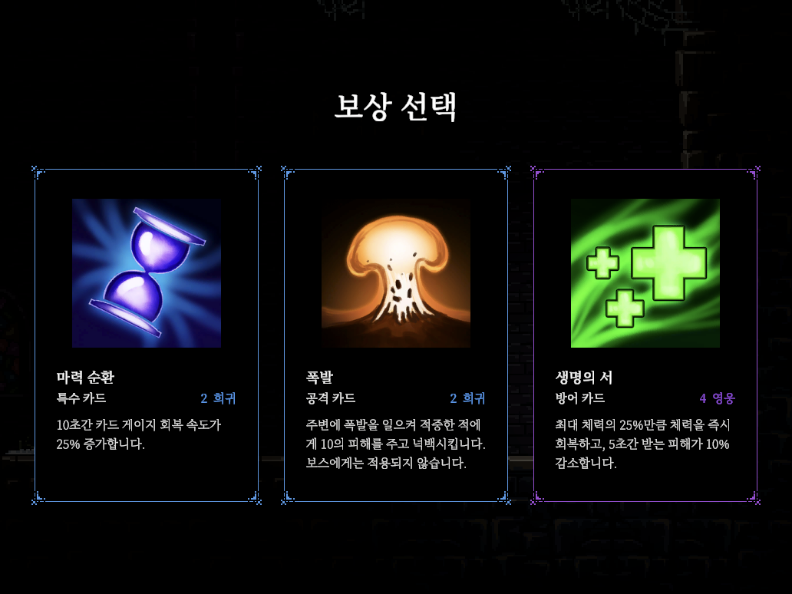

보유 카드와 같은 보상 화면에서 이미 뽑힌 카드는 제외합니다.
추첨은 `RewardCardSelector`가 담당하고, 남은 카드 각각에 등급 가중치를 부여합니다.
보상 표시를 `RewardCardListView`, 선택 연출을 `RewardSelectionMotion`으로 추가 분리했습니다.
소스 기본값은 Common 70, Rare 22, Epic 7, Legendary 1이지만, 게임에 쓰는 인스펙터 값은 Common 42, Rare 25, Epic 19, Legendary 14입니다. 보스 방 보상은 Rare 이상에서만 뽑습니다.

```csharp
// RewardCardSelector.Draw() — 카드 한 장당 등급 가중치로 누적 추첨
int randomWeight = Random.Range(0, totalWeight);
int accumulatedWeight = 0;

foreach (CardData card in candidates)
{
    accumulatedWeight += gradeWeights.Get(card.Grade);
    if (randomWeight < accumulatedWeight)
        return card;
}
```

이 값은 **등급 자체의 고정 확률**이 아니라 **카드 한 장당 가중치**입니다.
예를 들어 일반 2장과 희귀 1장만 남으면 희귀 확률은 `25 / (42 + 42 + 25)`입니다.
이미 획득한 카드 수와 각 등급의 남은 카드 수에 따라 실제 등급 분포가 달라집니다.

### 4.4 전체 카드 목록과 더블 클릭·드래그 드롭 편성

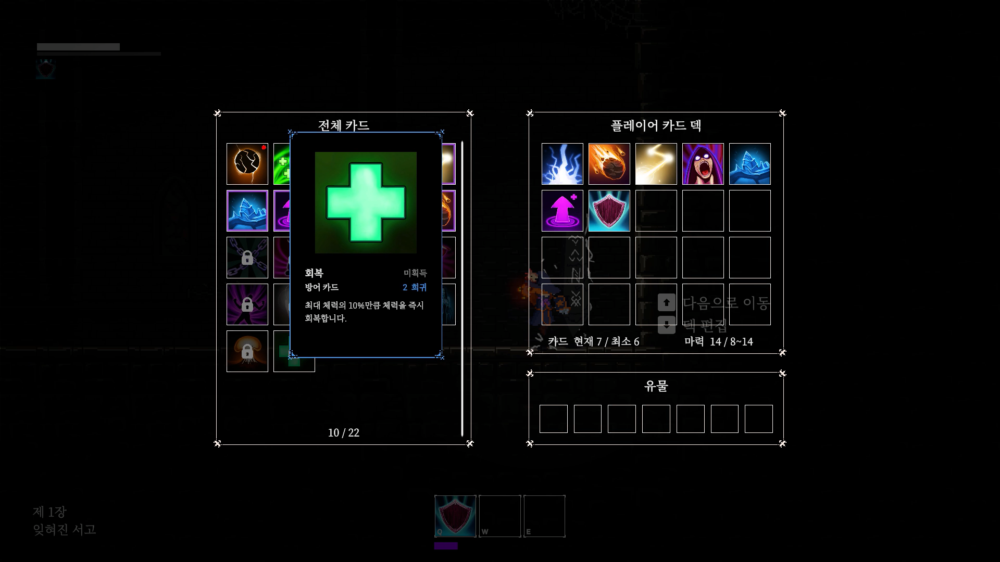

전체 카드 목록은 보유하되 덱에 없는 카드 → 덱에 있는 카드 → 미보유 카드 순으로 보여 주고, 더블 클릭과 끌어 놓기 모두 같은 추가·제거 함수로 편성합니다.
슬롯과 드래그 아이콘은 재사용해 목록을 갱신할 때마다 전부 만들고 지우지 않습니다. 오벨리스크 밖에서 연 인벤토리는 열람 전용이라 편성 검사 없이 닫힙니다.
슬롯 목록·안내 메시지를 나누는 정리에서 나눌 파일과 최대 덱 장수 기준(`PlayerInventory.MaxDeckCardCount`)은 직접 정했고, 코드를 새 파일로 옮기는 일은 AI 코딩 에이전트에 맡겼습니다.
옮긴 뒤에는 편성 화면을 직접 써 보며 더블 클릭·끌어 놓기 편성과 장수·비용 제한 경고가 정리 전과 같게 동작하는지 확인했습니다.

소스: [InventorySlotList.cs](https://github.com/keeeery/Arcanist/blob/main/Assets/02.%20Scripts/06.%20Inventory/InventorySlotList.cs), [CardDragHandler.cs](https://github.com/keeeery/Arcanist/blob/main/Assets/02.%20Scripts/06.%20Inventory/CardDragHandler.cs), [TooltipController.cs](https://github.com/keeeery/Arcanist/blob/main/Assets/02.%20Scripts/07.%20Tooltip/TooltipController.cs), [OverlayInputHandler.cs](https://github.com/keeeery/Arcanist/blob/main/Assets/02.%20Scripts/05.%20Overlay/OverlayInputHandler.cs).

### 4.5 고민과 선택

**보유 카드와 덱 목록을 어디에 둘까 — `PlayerInventory`에 두고 `CardSystem`이 구독**

처음에는 `CardSystem`이 보유 카드와 덱 목록을 자기 안에 따로 가지고, 나중에 저장·보상 같은 외부 시스템이 그 목록을 넣어 주는 구조로 두었습니다. `PlayerInventory`에 변경 이벤트는 있었지만 `CardSystem`은 이를 구독하지 않았습니다.
이후 `PlayerInventory`를 `DontDestroyOnLoad()`로 유지하고, `CardSystem`이 그 변경 이벤트를 구독해 목록을 맞추며 카드 추가도 `PlayerInventory`를 거치도록 바꾸었습니다.
런타임 중 씬이 이동되더라도 데이터를 서로 주고받을 수 있게 하기 위해서였습니다.

- 보유 목록과 덱을 분리하면 수집과 전투 편성을 독립적으로 다룰 수 있습니다.
- 이벤트 동기화는 UI나 보상 코드가 CardSystem 내부 목록을 직접 수정하는 경로를 줄입니다.
- 보상·편성 코드는 `PlayerInventory`만 바꾸고, 덱과 화면은 각자 알림을 받아 따라오므로 새 구독자를 더해도 변경하는 쪽 코드는 그대로입니다.

다만 런타임 덱 동기화는 `Contains()`로 카드가 있는지만 보므로, 중복 편성(`allowDuplicateCards`)을 허용하도록 바꾸면 같은 카드의 장수는 따로 세지 않습니다. 지금은 중복 편성이 막혀 있어 이런 경우가 생기지 않습니다.

---

## 5. 플레이어 이동과 적·보스의 행동

### 5.1 개요 — 플레이어 이동, 일반 적의 순찰과 골렘의 패턴

플레이어는 좌우 이동·점프(더블 점프)·대시·달리기로 움직이고, 달리는 동안에는 스태미나를 씁니다.
일반 적은 방마다 해골 병사 두 종과 투사체를 쏘는 원거리 골렘 중에서 무작위로 생성되며, 두 지점 사이를 순찰하다가 플레이어를 감지하면 쫓아오고, 공격 거리에 들어오면 멈춰 공격합니다.
공격에 맞으면 잠시 피격·기절 상태가 되어 이동과 공격이 멈춥니다.
보스인 고대 수호 골렘은 대기한 뒤 플레이어가 가까우면 근접 공격을, 멀면 레이저와 팔 발사 중 하나를 무작위로 쓰고, 패턴이 끝나면 다시 대기로 돌아갑니다.
일반 적과 보스의 공격은 모두 패링(§2)으로 받아낼 수 있습니다.

`EnemySensor`는 기본 0.1초 간격(설정 하한 0.02초)으로 감지하고 초기 감지 시점을 무작위 분산합니다.
모든 적이 같은 프레임에 감지 검사를 몰아서 하지 않도록 나눈 구조입니다(CPU 개선량은 측정하지 않았습니다).

소스: [PlayerLocomotionRuntime.cs](https://github.com/keeeery/Arcanist/blob/main/Assets/02.%20Scripts/01.%20Player/PlayerLocomotionRuntime.cs), [EnemySensor.cs](https://github.com/keeeery/Arcanist/blob/main/Assets/02.%20Scripts/02.%20Enemy/EnemySensor.cs), [EnemyStateMachine.cs](https://github.com/keeeery/Arcanist/blob/main/Assets/02.%20Scripts/02.%20Enemy/EnemyStateMachine.cs).

### 5.2 골렘 상태 전이

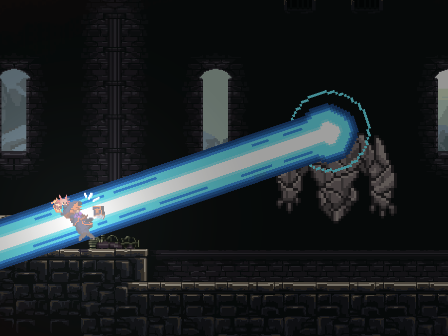

`BossController.Awake()`에서 자식 `BossBaseState`들을 수집하고 `Type`을 키로 등록합니다.
상태를 바꿀 때 이전 GameObject를 비활성화하고 다음 상태 GameObject를 활성화합니다.
각 상태는 `OnEnable/OnDisable`을 진입·종료 생명주기로 사용합니다.

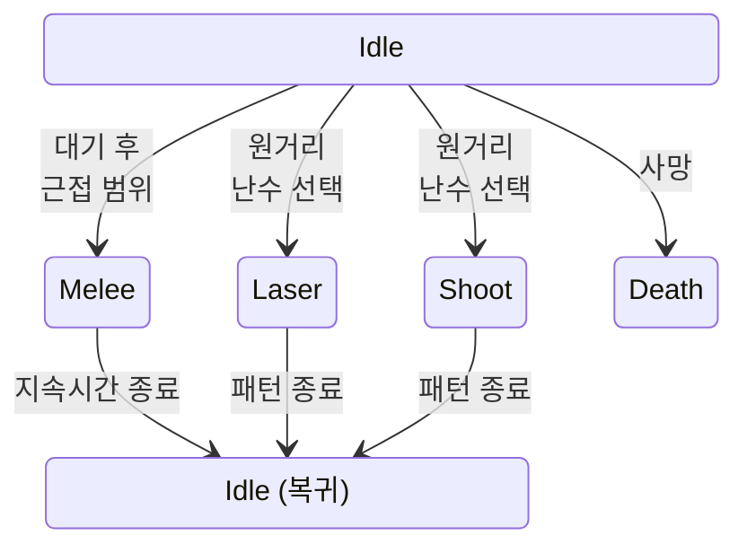

이 다이어그램은 골렘의 상태 전이를 도식화한 것입니다. 아래쪽의 `Idle (복귀)`는 공격 패턴이 끝난 뒤 처음의 `Idle` 상태로 돌아감을 뜻합니다. `BossController.Dead()`는 현재 상태와 관계없이 사망 진입을 처리합니다.
Idle 기본 대기시간은 1.2초, 근접 X축 거리 기준은 인스펙터 값 1(소스 기본값 3)입니다.
근접 범위 밖에서는 레이저와 팔 발사를 `Random.Range(0, 2)`로 선택합니다.

**모든 공격 패턴이 끝나면 Idle로 돌아오고, 다음 패턴은 Idle에서 플레이어와의 거리로 고릅니다.**

### 5.3 모션에 맞춘 공격 판정

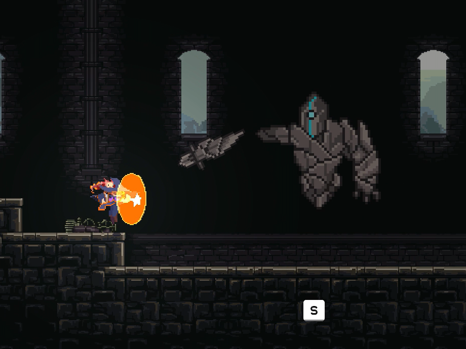

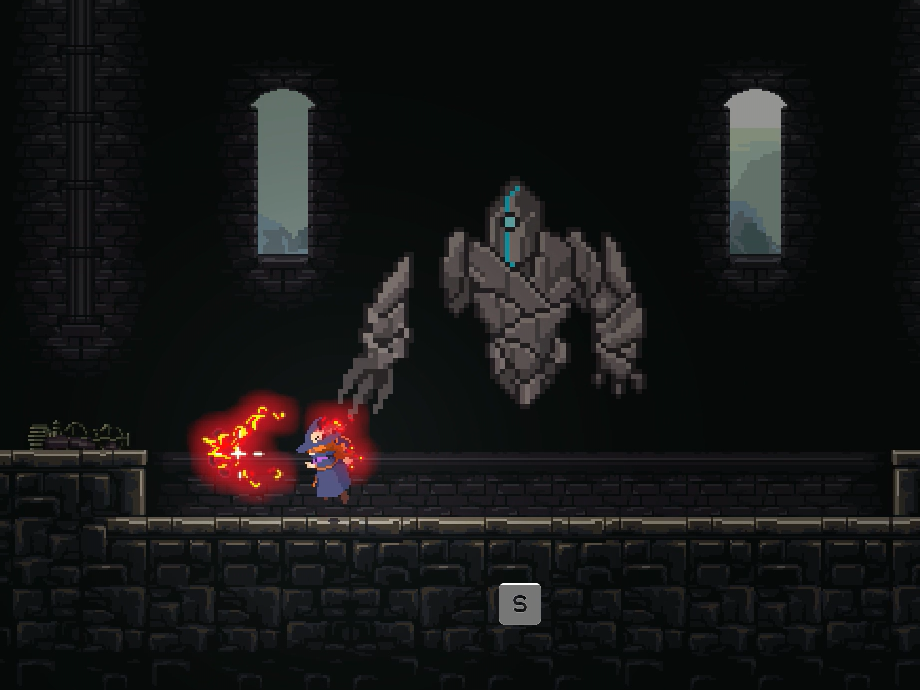

`BossAnimationEventReceiver`는 근접 HitBox 활성/비활성과 팔 발사를 애니메이션 이벤트로 호출하는 진입점입니다.
레이저는 애니메이션 이벤트 없이 `GolemLaserState`의 코루틴이 준비 시간(`readyTime`)이 지나면 플레이어 쪽으로 돌려 켭니다.
근접 상태는 진입 때 판정을 끄고 애니메이션을 시작하며, 종료 때 코루틴 정지와 판정 비활성화를 수행합니다.
정상 애니메이션 종료 외의 상태 이탈에서도 판정이 남는 문제를 줄이는 구조입니다.

### 5.4 벽·바닥 충돌·콤보 입력 창·적 순찰

플레이어 이동의 벽·바닥 충돌, 콤보와 패링을 받는 입력 창, 일반 적의 순찰·추적·공격 처리입니다.

#### 플레이어 이동과 벽·바닥 충돌

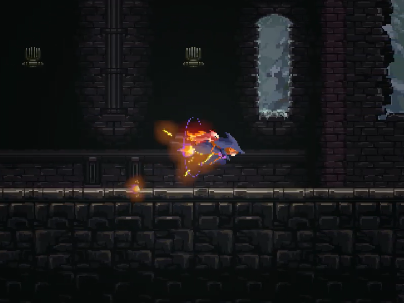

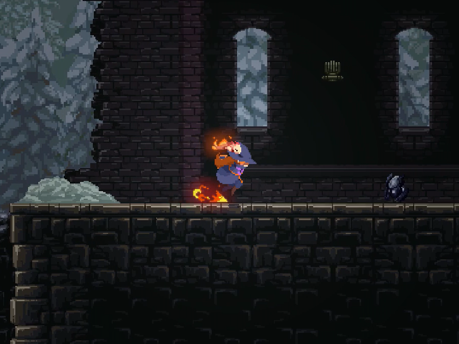

`CharacterController2D`는 Rigidbody2D를 Kinematic으로 두고 자체 중력·점프 횟수·대시 타이머를 관리하며, 수평·수직 이동량을 각각 BoxCast로 검사하고 `skinWidth`를 남겨 이동을 제한한 뒤 MovePosition을 호출합니다(선택 이유는 §5.5).
방향·대시 쿨타임은 이동 런타임이, 달리기 자원은 SprintRuntime이 맡아 입력 차단·사망·리스폰에서 같은 초기화 진입점을 씁니다.

소스: [CharacterController2D.cs](https://github.com/keeeery/Arcanist/blob/main/Assets/02.%20Scripts/99.%20Utilities/CharacterController2D.cs).

#### 콤보 입력 창과 패링 판정 창

공격·패링 상태는 초 단위 타이머 대신 Animator의 진행률(normalizedTime)로 입력 창을 나눕니다. 콤보는 진행률 0.35~0.75 사이에서 다음 입력을 받습니다.
패링 판정 창은 진행률 0.8에서 닫는데, 이 값은 직접 플레이 테스트를 하며 애니메이션과 어긋나 보이지 않으면서 난이도가 적절한 값을 찾아 정했습니다.

#### 일반 적의 순찰·추적·공격

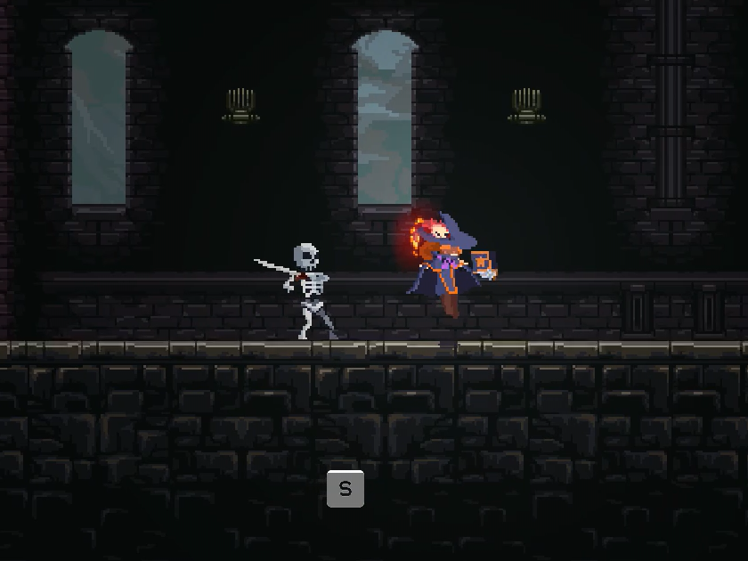

Idle은 대기 후 Patrol로 이동하고, 감지된 대상이 있으면 Attack으로 전환합니다.
Patrol은 출발 지점 A와 순찰 지점 B를 번갈아 목표로 사용하며, 목적지에 도착하면 잠시 Idle로 돌아갑니다.
Attack 상태는 ‘공격 애니메이션 재생 중’만을 뜻하지 않고 추적까지 포함합니다.
추적 범위 안에서 공격 거리에 들어오면 정지·방향 전환 후 EnemyCombat.TryAttack을 호출하고, 멀면 대상에게 이동합니다.

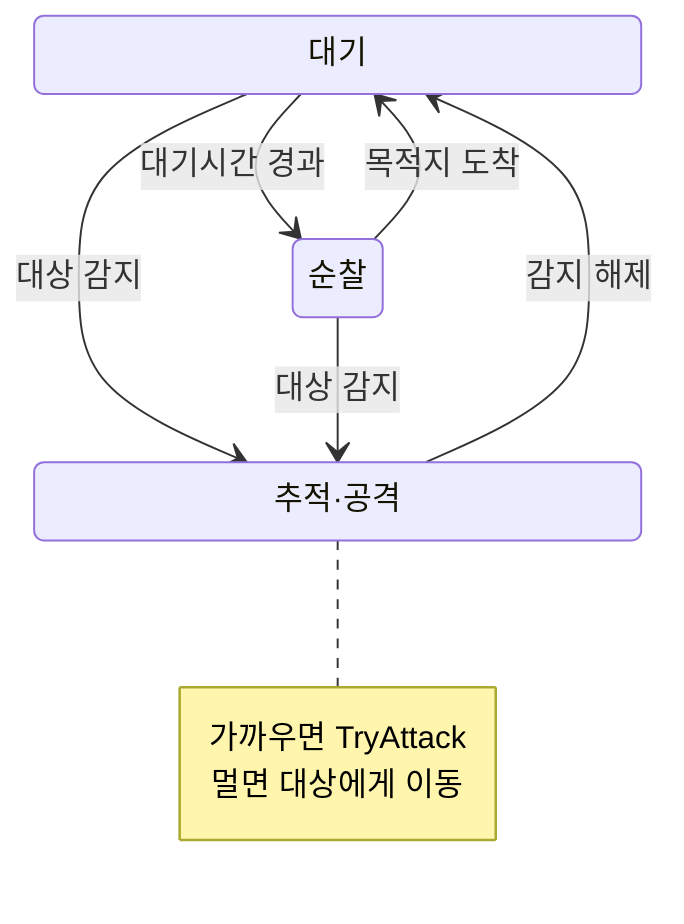

이 다이어그램은 일반 적이 `EnemyStateMachine`에서 Idle·Patrol·Attack 사이를 오가는 상태 전이를 도식화한 것입니다. 피격·기절 중에는 상태 머신 진행이 멈추고, 기절이 끝나면 Idle로 돌아갑니다.

**추적과 공격이 한 상태(Attack) 안에 있어, 감지가 풀리기 전까지는 거리에 따라 쫓거나 공격하기를 반복합니다.**

소스: [AttackState.cs](https://github.com/keeeery/Arcanist/blob/main/Assets/02.%20Scripts/01.%20Player/States/AttackState.cs), [ParryState.cs](https://github.com/keeeery/Arcanist/blob/main/Assets/02.%20Scripts/01.%20Player/States/ParryState.cs), [EnemyStateMachine.cs](https://github.com/keeeery/Arcanist/blob/main/Assets/02.%20Scripts/02.%20Enemy/EnemyStateMachine.cs), [EnemyCombat.cs](https://github.com/keeeery/Arcanist/blob/main/Assets/02.%20Scripts/02.%20Enemy/EnemyCombat.cs).

### 5.5 고민과 선택

**플레이어 이동을 어떻게 계산할까 — 물리 엔진 대신 직접 계산**

| 방법 | 장점 | 비용 |
|---|---|---|
| Dynamic Rigidbody2D | 중력·힘·마찰을 물리 엔진이 계산 | 더블 점프·대시처럼 물리 법칙을 벗어난 움직임을 원하는 대로 다듬기 어려움 |
| Kinematic + BoxCast 직접 이동 (채택) | 더블 점프·대시 같은 동작을 원하는 움직임과 조작감으로 다듬을 수 있음 | 수평·수직 이동과 지면 확인을 모두 BoxCast로 직접 검사하고, skinWidth를 남겨 벽에 끼지 않게 해야 함(§5.4) |

**그 밖의 선택**

| 선택 | 이점 | 비용 |
|---|---|---|
| 이동 규칙·자원·연출 분리 | 스태미나 규칙과 FX의 수정 지점을 구분 | 조합과 의존성 전달 필요 |
| 일반 적 감지 결과 캐시 | 매 프레임 감지 계산을 반복하지 않음 | 감지 간격만큼 판단 지연 가능 |
| 컴포넌트 기반 보스 상태 | 상태별 Collider·연출 참조를 Inspector에서 설정 | 프리팹 구성과 상태 타입 등록 규칙 필요 |

일반 적은 거리만으로 Idle/Patrol/Attack을 오가고 공격은 두 동작 중 하나를 무작위로 고르는 정도라 상태마다 오브젝트가 필요 없는 순수 C# 상태 머신(`EnemyStateMachine`)으로 만들었습니다.
보스는 근접·레이저·팔 발사처럼 패턴이 여럿이라, 패턴마다 상태 컴포넌트를 두고 Collider·프리팹·지속시간을 Inspector에서 연결하는 쪽이 관리에 유리하다고 판단했습니다.

소스: [BossController.cs](https://github.com/keeeery/Arcanist/blob/main/Assets/02.%20Scripts/02.%20Enemy/Boss/BossController.cs), [GolemMeleeState.cs](https://github.com/keeeery/Arcanist/blob/main/Assets/02.%20Scripts/02.%20Enemy/Boss/Golem/GolemMeleeState.cs).

---

## 6. 방 전환과 체크포인트 복원

### 6.1 개요 — 체크포인트 저장과 부활

일반 방마다 체크포인트가 두 곳 있고(보스 방에는 없음), 플레이어가 체크포인트 영역에 들어서면 그 위치와 체력이 저장됩니다.
죽으면 화면이 어두워지고, 위 방향키를 누르면 마지막 체크포인트에서 저장된 체력으로 부활합니다.
부활하면 손패·게이지를 비우고 편성한 덱으로 카드를 다시 뽑기 시작합니다.
체크포인트는 방을 처음부터 다시 시작하는 곳과 플레이어만 되살리는 곳으로 나뉩니다.
적을 모두 쓰러뜨린 뒤 플레이어만 되살리는 체크포인트로 돌아오면, 적은 다시 나오지 않고 출구의 오벨리스크가 켜진 채로 시작합니다.
보상을 받기 전이었다면 오벨리스크에서 보상을 고른 뒤, 받은 뒤였다면 바로 다음 방으로 넘어갈 수 있습니다.

체크포인트 식별자와 플레이 상태를 저장하고, 복귀 시 씬·방·플레이어를 순서대로 복구합니다.
전투 클리어와 보상 획득을 별도로 기록해 적 생성과 방 상태 초기화에 사용합니다.

`SaveManager`는 `Application.persistentDataPath/save_data.json`에 `JsonUtility`로 저장합니다.
체크포인트는 씬·방·체크포인트 ID, 체력, 플레이어만 복구할지 여부, 방 클리어 여부, 보상 획득 여부(`rewardObtained`)를 기록합니다.
인벤토리 ID 목록과 `SaveInventory()` API는 정의만 되어 있고, 아직 호출·복원 경로에 연결하지 않았습니다.

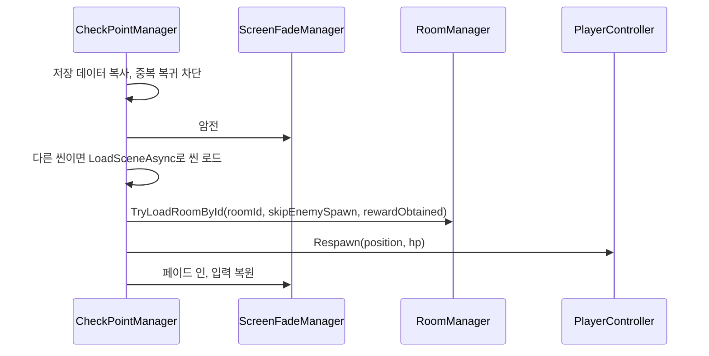

이 다이어그램은 체크포인트로 돌아갈 때 `CheckPointManager`가 암전 → (다른 씬이면) 씬 로드 → 방 로드 → 플레이어 리스폰 → 페이드 인 순서로 복구하는 차례를 도식화한 것입니다.

**방 로드와 플레이어 리스폰이 모두 화면이 어두워진 사이에 끝나고, 페이드 인과 함께 입력이 돌아옵니다.**

### 6.2 클리어한 방의 적 재생성 생략

적을 모두 쓰러뜨린 뒤 플레이어만 되살리는 체크포인트로 돌아오면 적을 다시 만들지 않습니다(§6.1). 아래 코드는 저장된 두 값으로 이를 정하는 부분입니다.

```csharp
// CheckPointManager.ReturnToCheckpointRoutine() — 방 클리어·플레이어만 복구 플래그로 적 생성 여부 결정
bool skipEnemySpawn = data.respawnPlayerOnly && data.roomCleared;
bool loadedRoom = roomManager.TryLoadRoomById(
    data.roomId, skipEnemySpawn, data.rewardObtained);
```

- 복귀 시작 시 저장 객체를 새 `CheckpointSaveData`로 복사하므로 코루틴 도중 공유 데이터가 변경되어도 복원 대상 값은 유지됩니다.
- 씬 로드·리스폰 직후에는 일정 시간 체크포인트 저장을 차단합니다.

적 전멸과 보상 선택은 서로 다른 단계이므로, ‘적 전멸’(`roomCleared`)과 ‘보상 완료’(`rewardObtained`)를 따로 저장하고, 복귀할 때 두 값으로 보상을 다시 받을 방과 이미 마친 방을 구분합니다(§7.3).
일반 방은 출구에 체크포인트가 함께 있어, 보상을 받으러 출구에 도착하면 그때 `roomCleared`가 저장되고, 보상을 고르면 같은 방 체크포인트에 `rewardObtained`까지 바로 저장됩니다.

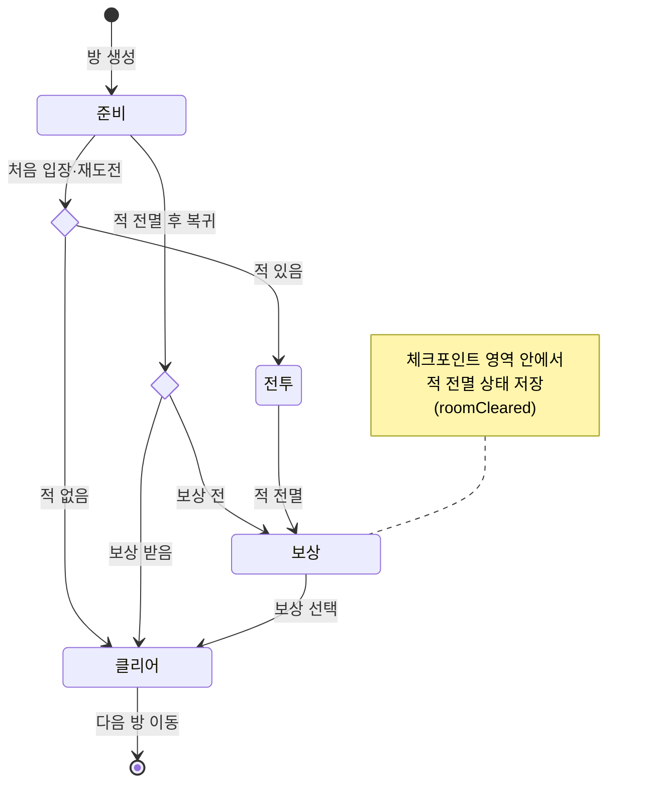

이 다이어그램은 방의 진행 상태(Ready → Combat → Reward → Cleared)와, 전투 클리어(`roomCleared`)가 참인 상태와 보상 획득(`rewardObtained`)이 저장되는 때를 도식화한 것입니다.

**적 전멸(Reward)과 보상 선택(Cleared)이 서로 다른 단계라서, 적을 모두 쓰러뜨린 뒤 돌아와도 보상 전이면 보상 단계부터 다시 시작합니다.**

### 6.3 부활 시 체력·카드 초기화

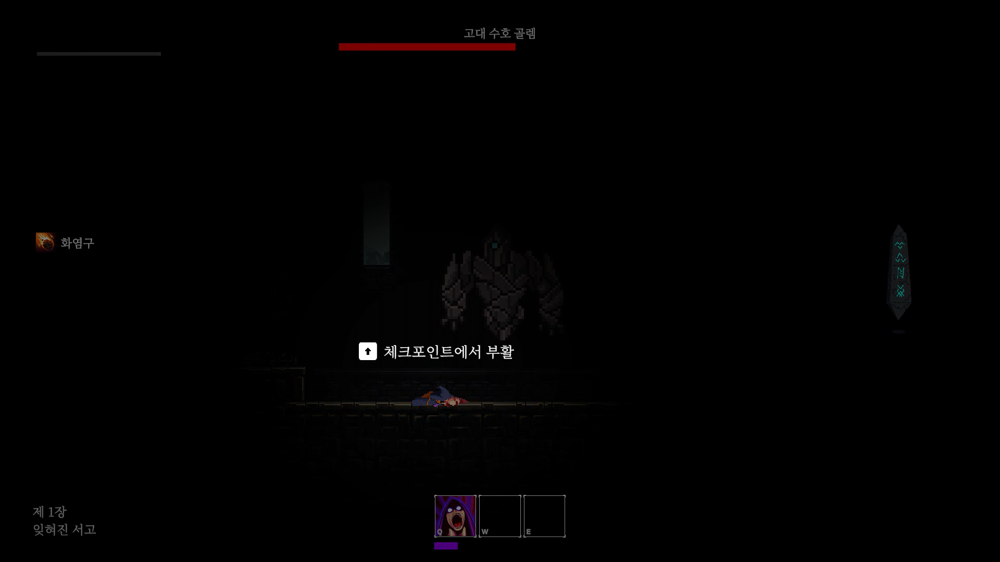

`PlayerController.Respawn()`이 하는 일은 다음과 같습니다.

- 사망·피격·스킬·패링 플래그를 초기화하고 이동 런타임의 복귀 초기화를 호출합니다.
- Animator를 재바인딩하고 체력을 복원합니다.
- `ResetRuntimeCardsForRespawn()`을 호출합니다. 카드 시스템은 대기 스킬과 손패·드로우·버림 목록을 지우고 편성 덱으로 재구성합니다.

따라서 위치만 옮기는 복귀가 아니라 플레이어의 전투 상태도 함께 정리합니다.

### 6.4 일시정지·인벤토리·보상 화면의 입력 차단과 UI 연출

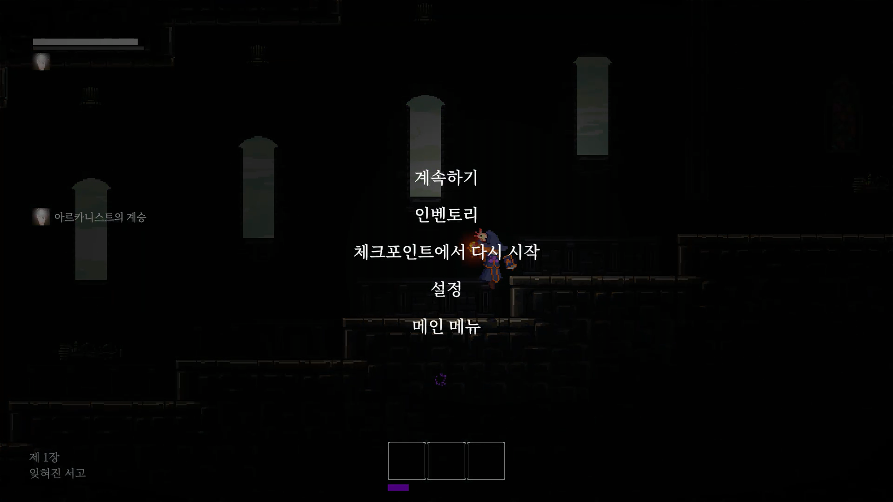

Pause·Inventory·Reward는 timeScale을 0으로 하고 이동(축) 입력을 막습니다.
OverlayMotion과 보상 선택은 unscaled time으로 진행하여 정지된 게임 안에서도 UI 연출을 완료합니다.
Overlay 종료와 체크포인트 복귀는 입력·timeScale 복원을 함께 처리합니다.

소스: [RoomController.cs](https://github.com/keeeery/Arcanist/blob/main/Assets/02.%20Scripts/09.%20Room/RoomController.cs), [Obelisk.cs](https://github.com/keeeery/Arcanist/blob/main/Assets/02.%20Scripts/09.%20Room/Obelisk.cs).

### 6.5 고민과 선택

**체크포인트를 어떻게 찾아 복원할까 — 씬·방·체크포인트 ID**

체크포인트를 씬·방·체크포인트 ID로 찾아 복원한 것은 한 방에 체크포인트를 두 개 이상 둘 것을 고려했기 때문입니다.
실제로 방마다 체크포인트가 두 개씩 있습니다(Room_01: CP_01·CP_02, Room_02: CP_03·CP_04).
ID 기반 복원은 실행 중 GameObject 참조를 파일에 직접 저장하지 않는 장점이 있습니다.
대신 방·체크포인트 ID와 씬 이름이 실제 콘텐츠와 일치해야 합니다.

**방 생성 순서를 어디에 둘까 — `RoomFactory` 한곳에**

방 생성은 `RoomFactory.CreateRoom()`이 만들기 → 위치 → 구성 순서를 정하고, 실제 생성만 `PrefabRoomFactory`가 맡는 구조입니다.
생성 순서를 한곳에 묶어 두었기 때문에, 클리어한 방으로 복귀할 때 적 컨트롤러를 끄는 일을 생성 직후의 구성 단계에 끼울 수 있었습니다(§7.3).
생성 방식을 바꿀 때는 `RoomManager`의 `CreateRoomFactory()`만 재정의하면 되지만, 지금 제공되는 생성 구현은 `PrefabRoomFactory` 하나입니다.

소스: [SaveManager.cs](https://github.com/keeeery/Arcanist/blob/main/Assets/02.%20Scripts/11.%20Save/SaveManager.cs), [CheckPointManager.cs](https://github.com/keeeery/Arcanist/blob/main/Assets/02.%20Scripts/11.%20Save/CheckPointManager.cs), [RoomFactory.cs](https://github.com/keeeery/Arcanist/blob/main/Assets/02.%20Scripts/09.%20Room/RoomFactory.cs), [RoomManager.cs](https://github.com/keeeery/Arcanist/blob/main/Assets/02.%20Scripts/09.%20Room/RoomManager.cs).

---

## 7. 트러블슈팅

### 7.1 보스 씬에서 전투가 작동하지 않던 문제

싱글톤으로 구현한 전투 시스템이 씬 전환 후 작동하지 않는 문제를 겪었습니다.

- **증상:** 보스 씬으로 넘어가면 플레이어와 보스 사이의 전투가 작동하지 않았습니다.
- **처음 생각:** `CombatSystem`에 `DontDestroyOnLoad()`를 적용했으니 그대로 다음 씬으로 넘어가 동작할 것이라고 예상했습니다.
- **확인한 원인:** 보스 씬의 `CombatSystem`은 중복 인스턴스로 파괴되고, 이전 씬의 `CombatSystem`만 남아 있었습니다.
- **시간이 걸린 이유:** `DontDestroyOnLoad()`만으로 씬 사이의 유지가 보장된다고 가정했고, 씬 전환 때 중복 인스턴스가 어떻게 처리되는지는 확인하지 않았습니다. 이 가정을 검증하는 데 시간이 걸렸습니다.
- **해결:** 일반 인스턴스 파괴와 애플리케이션 종료 상태를 분리했습니다(아래).
- **함께 고친 것:** 같은 커밋에서 보스 씬에 따로 두었던 `CombatSystem` 오브젝트를 없애고, HurtBox 등록이 늦어도 다시 시도하도록(`RegisterWhenReadyRoutine()`) 하며, `GetHurtBoxOrNull()`이 부모·자식에서도 HurtBox를 찾도록 보강했습니다.
- **결과:** 그 뒤로 보스 씬에서 플레이어와 보스의 전투가 정상 동작합니다.

코드에서 확인한 구조 문제는 다음과 같습니다. 당시 `SingletonBase<T>`는 현재 인스턴스의 `OnDestroy()`에서 `applicationIsQuitting = true`를 설정했습니다.
`Instance`는 이 값이 true이면 객체 검색·생성에 앞서 null을 반환하므로, 인스턴스가 한 번 파괴되면 애플리케이션이 실행 중이어도 이후 접근이 차단되는 구조였습니다.

다음과 같이 일반 소멸과 애플리케이션 종료의 처리를 분리했습니다.

```csharp
// SingletonBase<T>.OnApplicationQuit()·OnDestroy() — 애플리케이션 종료와 일반 소멸 처리 분리
protected virtual void OnApplicationQuit()
{
    applicationIsQuitting = true;
}

protected virtual void OnDestroy()
{
    if (instance != this)
        return;

    OnDispose();
    instance = null;
    isInitialized = false;
}
```

`DontDestroyOnLoad()`는 변경 전에도 적용되어 있었으므로, 핵심은 **일반 객체 파괴를 애플리케이션 종료로 취급하던 상태 처리**를 바로잡은 것입니다.
다만 종료 플래그가 어떤 파괴 경로에서 켜졌는지는 다시 재현해 확인하지 못했습니다.

소스: [SingletonBase.cs](https://github.com/keeeery/Arcanist/blob/main/Assets/02.%20Scripts/99.%20Utilities/SingletonBase.cs).

### 7.2 이전 씬의 체크포인트로 돌아가면 첫 방부터 다시 시작

- **증상:** 같은 씬 안의 복귀는 동작했지만, 보스 씬에서 죽어 이전 씬의 체크포인트로 돌아가면 그 씬이 첫 방부터 다시 시작되어 체크포인트 위치·체력이 이어지지 않았습니다.
- **원인:** 1차 시연 시점에는 씬에 속한 `OverlayController`가 복귀 코루틴을 실행했고, 방을 ID로 불러오는 경로도 없었습니다.
- **해결:** 복귀를 씬이 바뀌어도 유지되는 `CheckPointManager`로 옮기고, 방을 ID로 불러온 뒤 플레이어·카메라를 다시 찾게 했습니다(아래 표).
- **결과:** 고친 뒤에는 보스 씬에서 죽어도 이전 씬의 체크포인트 위치·체력으로 이어지는 것을 확인했습니다.

체크포인트 복귀에서도 씬 전환을 넘어 실행할 작업과 새 씬에서 사용할 참조를 구분해야 했습니다. 복귀 흐름은 **작업의 소유자와 참조 갱신 방식**을 다음과 같이 분리했습니다.

| 변경 전 | 변경 후 | 의미 |
|---|---|---|
| `OverlayController`가 체크포인트 복귀 코루틴을 실행 | `CheckPointManager`에 복귀 처리를 옮기고 Overlay는 호출만 수행 | UI 객체의 생명주기와 복귀 작업의 실행 주체를 분리 |
| `RoomManager`가 씬의 `transitionFadeGroup`을 직접 참조 | `ScreenFadeManager`가 공용 Canvas를 생성·관리하고 페이드 수행 | 방 전환·씬 전환·복귀에서 같은 화면 전환 경로 사용 |
| 기존 복귀에서 플레이어 참조가 null일 때만 재검색 | 새 복귀 루틴은 씬 로드 후 플레이어·카메라를 다시 검색 | 로드 완료 후 새 씬의 객체를 기준으로 후속 작업 진행 |
| 저장 객체를 직접 코루틴에 전달 | 체크포인트 값을 새 객체로 복사해 전달 | 비동기 진행 중 복원 기준 값의 변경을 방지 |

새 `CheckPointManager`는 중복 인스턴스를 제거하고 `DontDestroyOnLoad()`를 적용합니다.
`ScreenFadeManager`도 루트로 분리하고 유지 객체로 설정하며, 자기 자식으로 페이드 Canvas를 관리합니다.
즉 씬을 넘어서 완료해야 하는 코루틴은 유지 객체가 맡고, 씬에 속한 플레이어와 방은 로드 뒤 다시 찾는 구조입니다.
Unity에서 코루틴은 실행 주체의 생명주기 영향을 받으므로, 씬 UI가 복귀 전체를 소유하면 해당 객체가 파괴되는 전환과 충돌할 수 있습니다.

소스: [OverlayController.cs](https://github.com/keeeery/Arcanist/blob/main/Assets/02.%20Scripts/05.%20Overlay/OverlayController.cs), [ScreenFadeManager.cs](https://github.com/keeeery/Arcanist/blob/main/Assets/02.%20Scripts/11.%20Save/ScreenFadeManager.cs).

### 7.3 클리어한 방의 적이 다시 나오던 문제

적을 모두 처치한 방의 체크포인트로 다른 씬에서 복귀할 때 적이 다시 생성되는 문제를 보완했습니다.
적 전멸 여부를 저장하고 복귀 시 적 생성 조건에 반영했습니다.
`OnTriggerStay2D()`에서 플레이어가 체크포인트 안에 있는 동안 방이 클리어되면, 보상 획득 전까지 갱신 저장합니다.

```csharp
// Checkpoint.OnTriggerStay2D() — 보상 획득 전까지 방이 클리어되면 갱신 저장
if (savedRewardObtained)
    return;

if (!IsCurrentRoomCleared())
    return;

if (!other.TryGetComponent(out PlayerController player))
    return;

Save(player);
```

이 변경은 **처음 접촉한 시점의 상태와 전투가 끝난 뒤 상태가 다를 수 있다**는 문제를 저장 정책에 반영합니다.

**이어서 생긴 문제 — 클리어한 방으로 복귀할 때 오벨리스크가 켜지지 않음**

- **증상:** 클리어한 방으로 복귀할 때 오벨리스크가 켜지지 않았습니다.
- **원인:** 로그로 추적해 보니, `RoomFactory`가 적 컨트롤러 GameObject를 끄면서, 같은 오브젝트에 있는 `RoomController`까지 `Start()` 전에 꺼져 `StartRoom()`이 실행되지 않았습니다.
- **해결:** 적 컨트롤러 컴포넌트만 끄도록 고쳤습니다.
- **결과:** 클리어한 방으로 돌아오면 오벨리스크가 켜지고 보상·출구 흐름이 이어지는 것을 확인했습니다.

소스: [CheckPoint.cs](https://github.com/keeeery/Arcanist/blob/main/Assets/02.%20Scripts/11.%20Save/CheckPoint.cs), [RoomFactory.cs](https://github.com/keeeery/Arcanist/blob/main/Assets/02.%20Scripts/09.%20Room/RoomFactory.cs).

### 7.4 그 밖에 해결한 문제

#### 죽은 적이 카드 타겟으로 지정되던 문제

- **증상:** 카드 효과의 타겟을 고르는 `EnemyManager`가 이미 사망한 적을 후보로 지정했습니다.
- **원인:** 후보 조건이 객체가 없는지와 활성 여부만 확인해, 사망했어도 오브젝트가 활성이면 후보에 남았습니다. 사망 처리에도 목록 등록 해제가 없었습니다.
- **해결:** 후보 조건에 `IsDead`를 추가하고, 사망 처리에서 `EnemyManager.Unregister()`를 호출해 목록에서 직접 제거했습니다. 이 검사는 현재 §3.5의 `IsTargetable`·`IsDead` 확인으로 이어집니다.
- **결과:** 사망한 적은 타겟 후보에서 빠집니다. 당시 증상의 재현 기록이 남아 있지 않아, 이 사례는 커밋의 코드 변경을 기준으로 정리했습니다.

소스: [EnemyManager.cs](https://github.com/keeeery/Arcanist/blob/main/Assets/02.%20Scripts/02.%20Enemy/EnemyManager.cs), [EnemyController.cs](https://github.com/keeeery/Arcanist/blob/main/Assets/02.%20Scripts/02.%20Enemy/EnemyController.cs).

---

## 8. 결과와 배운 점

### 8.1 구현 결과

1차 시연 때 전투·패링, 카드 뽑기와 사용, 보상과 덱 편성, 일반 적과 골렘까지 동작했고, 이후 씬을 넘는 체크포인트 복귀 등을 보완했습니다(§8.2). 시연 영상은 §1.3에 있습니다.

| 항목 | 수치 |
|---|---|
| 방 | 일반 방 2개 · 보스 방 1개(고대 수호 골렘) |
| 카드 | 22장(공격 효과 9 · 버프 효과 13, 기획한 30장 중) |
| 카드 등급 | 4종(Common · Rare · Epic · Legendary) |

| 구현 결과 | 핵심 방법 | 자세히 |
|---|---|---|
| 모든 공격이 같은 경로로 처리되는 판정과 패링 | HitBox → HitResolver → CombatSystem → CombatEntity | §2.1~§2.3 |
| 모션에 맞춰 발동하는 카드 스킬 | CardSkillExecutor, 애니메이션 콜백 | §3.3 |
| 수집·편성·전투에서 따로 관리되는 카드 | PlayerInventory와 CardSystem의 목록 | §3.2 · §4 |
| 패턴마다 나뉜 골렘 보스 | BossBaseState 상속, Type Dictionary | §5.2 |
| 방·체력·카드까지 되돌리는 체크포인트 부활 | 방 로드, 체력·Animator·카드 리셋 | §6 |

### 8.2 1차 시연 이후 추가 작업

7월 7일 커밋까지의 상태로 1차 시연을 진행했습니다.
시연 때는 전투·패링, 카드 뽑기와 사용, 보상과 덱 편성, 일반 적과 골렘, 같은 씬 안의 체크포인트 복귀까지 동작했습니다.
이후 작업에서 시연까지 마무리하지 못한 기능과 누락을 보완하고, 기능별 책임을 나누는 리팩터링을 이어 갔습니다.

| 시연 시점의 문제 | 보완 | 본문 |
|---|---|---|
| 이전 씬의 체크포인트로 돌아가면 첫 방부터 다시 시작됨 | 복귀를 씬이 바뀌어도 유지되는 `CheckPointManager`로 옮기고, 방을 ID로 불러오며 클리어·보상 상태를 저장. 이어서 클리어한 방 복귀 때 오벨리스크가 켜지지 않는 문제도 수정 | §7.2, §7.3 |
| 보스에 기절·넉백 면역이 빠져 있음 | 보스에 기절·넉백 면역 적용 | — |
| 카드 게이지를 채우는 순간 최대치를 넘긴 칸이 사라짐 | 넘친 칸을 다음 게이지로 넘기고, 게이지 재충전을 카드 드로우 시작 시점으로 변경 | §3.7 |
| 같은 버프를 다시 쓰거나 다른 카드로 겹쳐 쓸 때의 규칙이 없음 | 같은 카드는 지속시간 갱신, 다른 카드의 같은 계열은 중첩 | §3.6 |

기능별 책임을 나눈 리팩터링은 다음과 같습니다.

| 대상 | 리팩터링 | 본문 |
|---|---|---|
| 전투 판정 | `HitBox`에서 중복 타격 기록(`HitTargetTracker`)과 패링·피해 처리(`HitResolver`)를 분리 | §2.1~§2.3 |
| 카드 실행 | 사용 검증·타겟 탐색·실행을 각각의 클래스로 분리 | §3.3 |
| 인벤토리·보상 | 슬롯·드래그 아이콘 재사용, 선택·정렬·조건 표시와 보상 연출 분리 | §4.3, §4.4 |
| 이동·적 AI | 플레이어 이동 규칙과 적의 감지·상태·반응을 각각 분리 | §5.1, §5.4 |
| UI 연출 | 체력바·피격·패링·안내 연출을 DOTween으로 전환 | §2.4, §6.4 |

### 8.3 한계와 개선 과제

- **인벤토리 저장:** `SaveInventory()` API는 있지만 아직 호출·복원 경로에 연결하지 않았습니다.
- **저장 파일:** 손상 파일 복구와 저장 형식 변경 대응이 없습니다.
- **체크포인트 저장 빈도:** 클리어된 방의 체크포인트 영역 안에 있는 동안 `OnTriggerStay2D()`가 보상 획득 전까지 저장을 반복하고, 저장은 매번 파일에 씁니다. 호출 빈도를 줄이는 방안은 아직 적용하지 않았습니다.
- **카드 데이터:** 카드 에셋 30개 중 8개는 효과 참조가 비어 있습니다. 필수 시스템을 먼저 완성하기 위해 구현을 미룬 카드로, 다음 콘텐츠 확장 과제입니다(§3.1).
- **입력 차단 범위:** 메뉴가 쓰는 `SimpleInput.IsKeyBoardInputBlocked`는 수평·수직 축 입력에만 걸려, 카드·대시·패링 같은 키 입력은 timeScale과 각 상태 조건으로 막히는지 따로 확인해야 합니다.
- **히트스톱과 일시정지:** `HitStopController`가 직전 시간 배율을 저장하지 않고 1로 복구하므로, 메뉴 일시정지와 겹칠 때 어느 쪽이 배율을 되돌릴지 정해 두어야 합니다(§2.4).
- **카드 환불:** 애니메이션 발동 시점에 타겟이 사라져 실행이 취소되면 카드를 돌려받지 못합니다. 테스트·시연에서 재현되지 않아 우선순위를 낮췄고, 진입점이 확인되면 처리할 과제입니다(§3.3).
- **통합 확인이 남은 동작:** 다음은 Editor에서 더 확인해야 합니다.
  - 카드 발동 중 타겟 사망, 동시 입력, 단발·다단 패링 성공 뒤 같은 공격의 재접촉.
  - 풀 재사용 시 HitBox 기록·투사체 수명·이펙트 상태가 초기화되는지.
  - 보스 애니메이션 이벤트와 Collider·레이저 참조 연결.
  - 실제 Inspector 값에 따른 덱 편성 조건과 보상 후보 고갈 시 UI 동작.

### 8.4 배운 점과 회고

처음 목표는 **카드 덱 빌딩과 2D 액션을 결합한 로그라이트 게임**, 즉 매번 다른 덱을 구성하며 플레이하는 재미였습니다.

다만 처음부터 구현 범위를 너무 넓게 잡아 여러 시스템을 만드는 데 많은 시간을 사용했고, 실제 플레이 콘텐츠를 충분히 늘리지 못했습니다.
그 결과 **카드를 획득하고 덱을 구성해 여러 스테이지를 이어서 클리어하는 재미**를 충분히 제공하지 못한 점이 아쉬웠습니다.
체크포인트 기능도 1차 시연까지 완성하지 못해, 씬을 넘는 복귀는 시연 이후 추가 작업으로 마무리했습니다(§7.2).

여러 시스템을 연결하는 경험을 얻었지만, 개별 시스템의 구현을 넘어 이를 반복해서 활용할 콘텐츠와 진행 흐름까지 완성하는 것이 과제로 남았습니다.
이 경험 뒤로는 필수 루프의 완성이 시스템 구현 때문에 밀릴 것 같으면, 기획한 기능이라도 덜어낼 것과 남길 것을 가리는 판단을 하게 되었습니다.
이후 Folk Sack에서는 기획 단계에서 생각한 물·가스 시스템을 시간상 곁가지라 폐기했고, ODDITY에서는 벽 메시의 실시간 절단을 기각했습니다.

스킬을 사용할 때 강력한 느낌과 타격감을 전달하기 위해 파티클 시스템과 조명을 활용했습니다. Shader Graph를 활용한 화면 흑백 반전은 전설 등급 카드 ‘죽음 선고’를 시각적으로 강조하기 위한 연출이었습니다(§2.4).
플레이어들에게 시스템의 완성도와 연출을 칭찬받은 점은 만족스러웠고, 구현과 연출에 들인 노력을 알아봐 준 경험이 기억에 남습니다.

가장 큰 성장은 **여러 시스템을 직접 구현하고 하나의 게임으로 연결하면서 Unity의 오브젝트 생명주기와 시스템 간 연결 구조를 이해하게 된 점**입니다. 개별 기능을 만드는 데서 나아가, 씬 전환과 게임 진행 속에서 각 객체와 시스템이 어떻게 이어져 동작하는지 경험할 수 있었습니다.

| 경험 | 배운 점 |
|---|---|
| 전투와 패링을 직접 연결한 핵심 플레이 | HitResolver의 피해 전 패링 처리와 성공 시 카드 게이지 보상 연결 |
| 여러 시스템을 하나의 게임 흐름으로 연결 | 카드 → 보상 → 편성, 방 → 체크포인트 → 복귀의 연결 경험 |
| 씬 전환 후 싱글톤 전투 시스템이 작동하지 않던 경험 | 객체 소멸과 애플리케이션 종료 상태를 분리하고, 초기화·등록 시점을 함께 고려해야 함 |
| 시스템 구현에 비해 부족했던 콘텐츠 | 카드 획득·덱 구성·연속 스테이지 진행의 재미를 충분히 보여주지 못한 아쉬움 |
