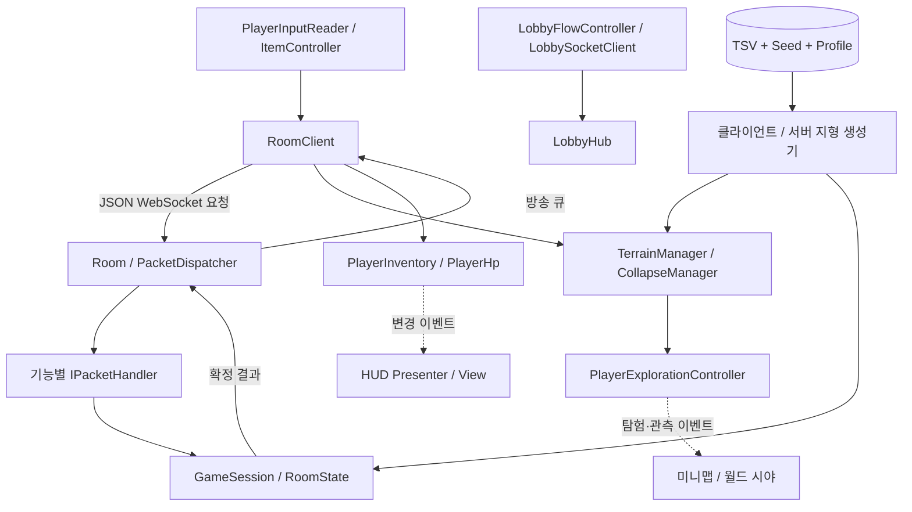
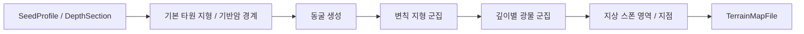
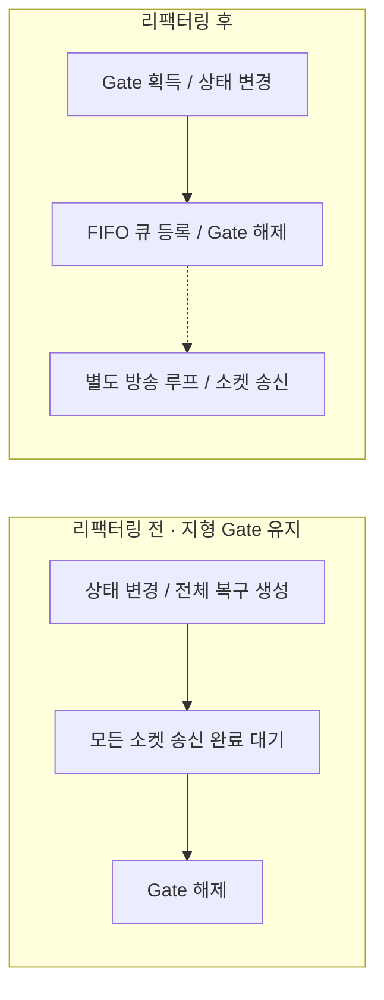
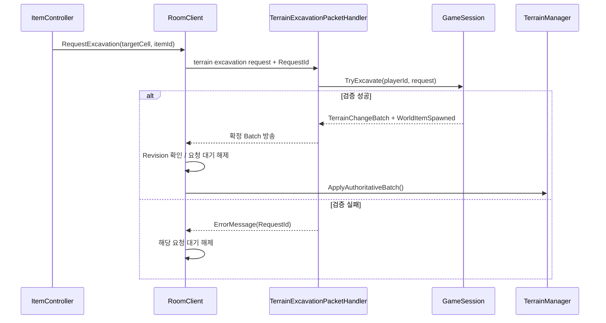
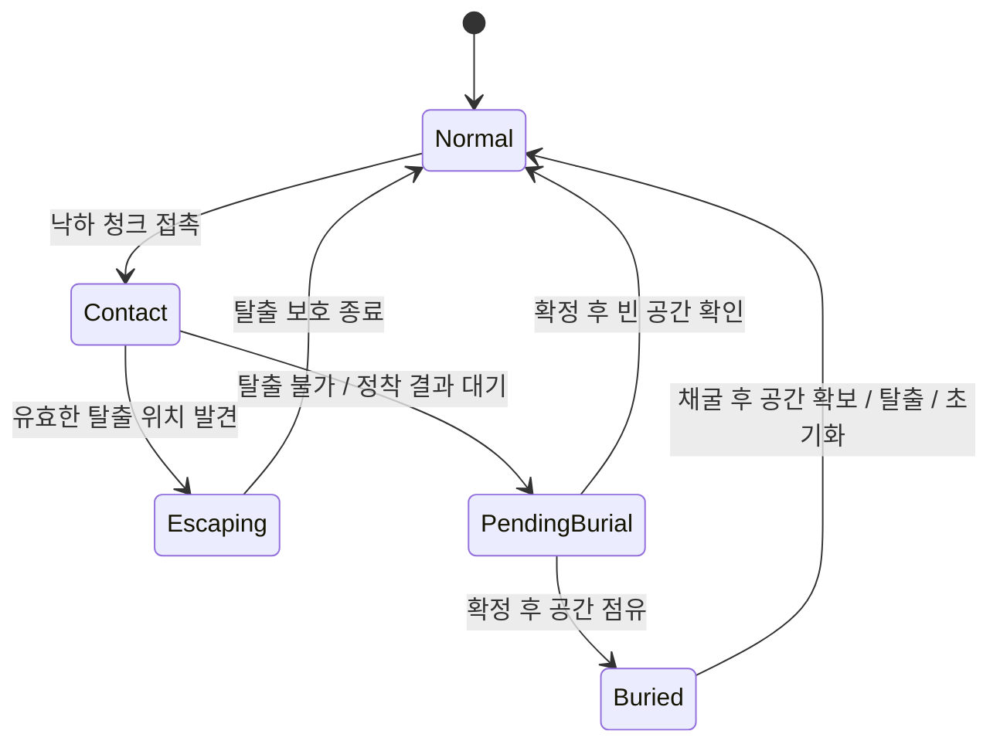
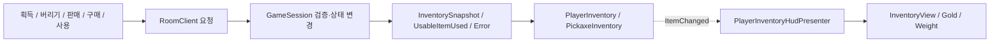

# Folk Sack — 멀티플레이 채굴 게임 기술 문서

> **한 줄 소개**: 지하를 채굴해 자원을 모으고, 지형 붕괴·매몰 위험 속에서 경쟁하는 Unity 2D 멀티플레이 채굴 게임
> **구현 범위**: 지형 생성·채굴·붕괴·멀티플레이 동기화 전담 설계·구현

| 구분 | 시스템 | 핵심 내용 | 절 |
|---|---|---|---|
| 핵심 A | 데이터 기반 지형 생성 | 깊이·동굴·광물 규칙과 시드 생성, 클라이언트/서버 규칙 일치 | §2 |
| 핵심 B | 채굴·붕괴 권위 동기화 | Revision, 요청별 대기, CollapseID별 소유권과 연쇄 처리 | §3 |
| 핵심 C | 낙하 지형·매몰 상호작용 | 물리 충돌, 탈출·매몰 상태, Collider 재생성 시점 | §4 |
| 보조 D | 인벤토리·아이템·상점 | 서버 확정 상태를 모델과 HUD로 전달하는 흐름 | §5 |
| 보조 E | 탐험·시야·지도 | 탐험 이력과 현재 관측 분리, 지형 변경과 조명 반영 | §6 |
| 보조 F | 로비·게임 진행·표시 | 접속 준비, 카운트다운, 원격 플레이어, 결과와 사용자 피드백 | §7 |

---

## 1. 프로젝트 개요

### 1.1 What — 무엇을 만들었나

**Folk Sack**은 Unity 2D 멀티플레이 채굴 게임입니다. 플레이어는 지하 지형을 채굴하고 광물을 수집하며,
지상에서 자원을 판매하거나 장비와 사용 아이템을 구매합니다.
지지 구조가 사라진 지형은 물리 청크로 낙하하고, 플레이어는 충돌 피해나 매몰 위험에 노출됩니다.
제한 시간과 보유 골드 등 게임 진행 조건은 서버 상태를 기준으로 공유합니다.

클라이언트는 입력·물리·표시를, 서버는 방과 게임 세션의 공유 상태 확정을 맡습니다.
특히 지형 붕괴에서는 **낙하 물리 시뮬레이션과 최종 타일 배치 확정의 책임이 다릅니다.**
소유 클라이언트가 낙하 결과를 제안하고 서버가 예약 및 배치 규칙을 검사하여 결과를 방송합니다.

### 1.2 Why — 왜 만들었나

직접 땅을 파면서 자원을 찾는 재미와, **지형 붕괴·매몰의 위험** 때문에 긴장하며 탐험하는 경험을 주고 싶었습니다.
또한 지형을 의도적으로 무너뜨려 다른 플레이어를 매몰시키는 **간접 PvP**도 목표로 삼았습니다.
그래서 여러 플레이어가 같은 지형을 파고 무너뜨려도 모두에게 같은 결과가 보이도록, 지형 변화를 서버가 확정하는 구조에 집중했습니다.

| 문제 | 구현 방향 |
|---|---|
| 여러 플레이어가 동일 타일을 채굴 (공유 상태를 확정할 한 곳 필요) | 서버 검증과 Revision 기반 지형 Batch |
| 동시에 여러 청크가 떨어짐 (청크별 소유권·완료 요청을 구분) | `CollapseID`, 요청별 대기 사전, 소유권 집합 |
| 청크 정착 직후 다시 붕괴 검사 (서버 확정과 로컬 물리 종료를 구분) | 서버 배치 적용 이후 연쇄 재검사 |
| 타일은 지웠지만 매몰 판정이 유지 (논리 Grid와 물리 Collider의 갱신 순서 일치) | 프레임 종료 대기·`Physics2D.SyncTransforms()` |
| 서버가 거절했는데 아이템은 사용한 것처럼 보임 (예측 표시와 확정 상태의 경계 필요) | 요청 ID에 연결한 쿨타임 취소와 서버 스냅샷 적용 |
| 이미 탐험한 곳과 지금 보이는 곳이 섞임 (장기 이력과 현재 시야의 데이터 분리) | `ExplorationMapData`와 `CurrentObservedCells` |

### 1.3 개발 환경

| 항목 | 내용 |
|---|---|
| 장르 | 2D 멀티플레이 채굴 |
| 기간 | 2026.08 — 2026.09 |
| 인원 | 3인 |
| Engine | Unity `6000.3.15f1`, URP `17.3.0` |
| Language | C# (클라이언트·서버) |
| 주요 패키지 | Input System `1.19.0`, Newtonsoft Json `3.2.2`, UniTask `2.5.11`, Cinemachine `3.1.7`, 2D Tilemap, DOTween 소스 |
| 서버 | ASP.NET Core, target framework `net10.0` |
| 통신 | `ClientWebSocket` / ASP.NET Core WebSocket, JSON 메시지 |
| 데이터 | 클라이언트 StreamingAssets TSV, 서버 Data TSV 및 설정 |
| GitHub | 클라이언트 [https://github.com/KooHoo-Dev/3rd-TeamProject-KH](https://github.com/KooHoo-Dev/3rd-TeamProject-KH), 서버 [https://github.com/KooHoo-Dev/3rd-TeamProject-KH-Server](https://github.com/KooHoo-Dev/3rd-TeamProject-KH-Server) |
| 시연 영상 | [YouTube](https://youtu.be/6BlW58UlKig) |

### 1.4 담당 범위

지형 생성·채굴·붕괴·멀티플레이 동기화를 전담하여 설계·구현했습니다.
데이터 기반 지형 생성부터 충돌·매몰, 서버 연결, 상태 변경·송신 분리,
청크 소유권과 연쇄 붕괴 안정화까지 연결했습니다.
초기 맵을 시드로 공유하는 구조와 채굴 요청 정책은 후속 협업을 통해 개선했습니다.

### 1.5 전체 구조



---

## 2. 기능 A — 테이블 기반 지형 생성과 동일 맵 구성

### 2.1 개요와 구조

맵 규칙을 시드 프로필, 깊이 구간, 동굴, 변칙 지형 군집, 광물 테이블로 나눕니다.
`TerrainTableSeedGenerator`는 이 규칙을 적용해 `TerrainMapFile`을 생성합니다.
서버에는 대응하는 `ServerTerrainGenerator`가 있습니다.



생성 순서 자체가 결과를 결정하는 규칙입니다.
동굴을 뚫은 후 광물을 붙이는 순서나 난수 호출 순서가 달라지면 같은 시드여도 맵이 달라질 수 있습니다.
맵 형태와 게임 플레이 중 수정되는 셀 상태도 구분합니다.

### 2.2 지형 데이터·화면 표현·연결성 탐색

| 구성 요소 | 책임 |
|---|---|
| `TerrainGridData` | 비어 있지 않은 셀을 `Dictionary<Vector2Int, TerrainCell>`로 보관하고 Revision 관리 |
| `TerrainGridWorld` | 기본 지형의 Chunk Mesh와 경계 Collider 생성·갱신 |
| `TerrainManager` | 지형 조회·변경 API와 기반 지지 여부 탐색 |
| `TerrainCollapseCoordinator` | 지형 변경 뒤 부유 그룹의 낙하 시작 요청 조정 |

기본 지형은 셀마다 GameObject를 만들지 않고 32×32 셀 단위 Mesh로 표현합니다.
셀 변경은 `dirtyChunks`와 `colliderDirty`에 기록됩니다.
`LateUpdate()`에서 변경 Chunk의 Mesh를 갱신하고, Collider가 dirty이면 외곽선 Collider를 재생성합니다.
Mesh는 변경된 Chunk 단위로, Collider는 별도 dirty 표시로 다시 만들므로 두 갱신 범위는 다릅니다.

`FindFloatingGroups()`는 상하좌우로 연결된 일반 지형을 Queue 기반으로 탐색합니다.
탐색 중 `Bedrock`이나 `SpawnPlatform`과 인접하면 지지된 그룹으로 판단하고,
지지점이 없는 그룹만 반환합니다. 점유 셀과 결과 그룹을 정렬해 탐색·요청 순서를 맞춥니다.
이 탐색은 변경 셀 주변만이 아니라 호출할 때마다 점유 셀 전체를 순회합니다.

| 사용 목적 | API | 호출 결과 |
|---|---|---|
| 초기 맵 생성 | `TerrainSeedGenerator.Generate(profileID, seed)` | `TerrainMapFile` |
| 월드 좌표를 셀로 변환 | `TerrainManager.TryWorldToCell(position, out cell)` | 성공 여부와 Grid 좌표 |
| 지형 존재·내구도 조회 | `HasTerrain(cell)`, `TryGetDurability(cell, out durability)` | 현재 런타임 Grid 상태 |
| 기반에서 분리된 그룹 탐색 | `FindFloatingGroups()` | 부유 셀 그룹 목록 |
| 서버 확정 변경 적용 | `ApplyAuthoritativeBatch(batch, reason, out error)` | 성공 시 적용 이벤트와 지형 변경 이벤트 |

### 2.3 핵심 기능 — 초기 맵을 공유하는 계약

클라이언트는 `map_session`에서 받은 프로필·시드와 테이블 버전을 확인하고 초기 맵을 재생성합니다.
`TerrainNetworkAdapter.FromGeneratedMap()`이 생성 결과를 Revision 0의 런타임 스냅샷으로 변환합니다.
게임 중 채굴·재배치 변경은 이후 서버 Batch로 적용됩니다.
여기서 `TerrainSnapshot`은 생성한 초기 맵을 런타임 모델에 넘기는 로컬 형식으로, 예전에 서버가 보내던 전체 지형 복구 Snapshot과는 역할이 다릅니다.
인벤토리·HP·월드 드롭은 지금도 각자의 Snapshot으로 초기화·동기화합니다.

```csharp
// RoomClient.Terrain.cs, HandleMapSession() 발췌
TerrainMapFile map = TerrainSeedGenerator.Generate(
    MapSession.ProfileID,
    MapSession.Seed);

ApplyTerrainSnapshot(TerrainNetworkAdapter.FromGeneratedMap(map));
```

테이블 버전은 TSV 파일들을 정렬하여 읽고 SHA-256으로 계산한 값의 앞 12자입니다.
`ReadNormalizedTsvBytes()`는 BOM을 제거하고 CRLF·CR을 LF로 바꾸며, 파일 끝 LF 한 개를 지웁니다.
클라이언트와 서버가 같은 규칙으로 정규화하므로, Windows와 macOS에서 내용이 같은 TSV가 다른 버전으로 판단되지 않습니다.

### 2.4 세부 구현 — 동굴 후보를 적용한 뒤 연결성 검증과 복원

`TerrainCaveGenerator`는 깊이 범위와 경계 여유를 만족하는 시작점을 찾고,
수평 방향에 작은 수직 변화를 누적하며 원형 셀들을 이어 동굴 후보를 만듭니다.
후보를 바로 확정하지 않고 기존 타일 종류를 백업한 뒤 비우고, 지형 연결성 검사에 실패하면 복원합니다.

```csharp
// TerrainCaveGenerator.TryApplyCandidate() 발췌
foreach (Vector2Int coord in candidateCells)
{
    TerrainTileType previousType = map.GetTile(coord);
    backups.Add(new CaveTileBackup(coord, previousType));
    map.SetTile(coord, TerrainTileType.Empty);
}

if (TerrainMapConnectivityValidator.HasFloatingGroup(map) == false) return true;
RestoreTiles(map, backups);
return false;
```

이 방식은 동굴 모양을 먼저 정한 후 생긴 고립 지형을 무조건 제거하는 대신,
기존 지형을 유지할 수 있는 후보만 채택합니다. 시도 횟수와 시작점 조건 때문에
요청한 동굴 수보다 적게 생성될 수 있습니다.

생성용 `TerrainMapConnectivityValidator`는 그룹 셀의 **바로 아래 기반암**을 지지 조건으로 검사합니다.
게임 중 `TerrainManager.FindFloatingGroups()`는 상하좌우 탐색에서 기반암이나 스폰 플랫폼과의 인접을 검사합니다.
두 경로는 쓰이는 시점과 지지 조건이 다른 별개의 판정입니다.

### 2.5 세부 구현 — 광물 밀도와 군집 크기의 분리

`TerrainMineralClusterGenerator`는 깊이 섹션과 광물 규칙을 순서대로 읽고,
적합한 바탕 셀에서 `ClusterDensity` 확률로 군집 생성을 시작합니다.
시작하면 최소·최대 크기 안에서 목표 크기를 뽑고,
기존 군집의 상하좌우 이웃 중 유효한 후보를 확장합니다.

| 데이터·조건 | 역할 |
|---|---|
| 깊이 섹션·경계 오프셋 | 어느 영역에 광물 규칙을 적용할지 결정 |
| `ClusterDensity` | 군집 생성 시작을 시도할 확률 |
| `MinClusterSize`·`MaxClusterSize` | 시작한 군집의 목표 크기 |
| 자원 ID | 바탕 타일에 부가되는 광물 종류 |
| 확장 가능한 이웃 | 연결된 군집의 실제 성장 범위 |

따라서 `ClusterDensity`는 최종 광물 점유율이 아니라 군집 생성을 시작할 확률입니다.
주변 후보가 없으면 목표 크기에 도달하기 전에 확장을 멈춥니다.
확률·성장 순서·난수 소비가 함께 결과를 결정하므로 서버와 클라이언트의 순회 순서를 맞춰야 합니다.

소스: `TerrainCaveGenerator.cs`, `TerrainMapConnectivityValidator.cs`, `TerrainMineralClusterGenerator.cs`.

### 2.6 세부 구현 — 결정적 생성의 데이터 검증과 난수 경계

지형 테이블은 값을 읽은 뒤 참조와 적용 순서를 확정합니다. 깊이 섹션은 `SectionOrder`로 정렬하고 첫 구간 0, 마지막 구간 1, 인접 구간의 연속성을 검사합니다. 광물은 섹션별 `ResourceOrder`, 변칙 군집은 섹션·`VariantOrder`, 동굴은 `CaveOrder` 순서로 적용합니다. 중복 ID·순서와 없는 타일·자원 참조는 로딩 오류로 처리합니다.

맵 생성용 `System.Random`은 동굴·변칙 지형·광물 생성이 공유합니다. 같은 시드라도 앞 단계의 반복 순서나 난수 호출 횟수가 달라지면 뒤 단계 결과도 달라집니다. 스폰 후보 셔플은 같은 시드로 새 `System.Random`을 만들어 별도로 수행하며, 중앙 후보 열에서 최대 네 좌표를 선택합니다.

테이블 버전(§2.3)과 별도로 클라이언트·서버의 규칙 적용 순서와 반올림 방식도 맞아야 합니다. 서버의 동굴 좌표 반올림은 `Math.Round(double)`의 기본 중간값 짝수 반올림을 사용하여 Unity의 대응 연산과 맞춥니다.

소스: `TerrainDataTables.cs`, `TerrainTableSeedGenerator.cs`, `RoomClient.Terrain.cs`.

### 2.7 고민과 선택

| 선택 | 이점 | 남는 비용 |
|---|---|---|
| 생성 규칙을 TSV와 단계별 생성기로 분리 | 깊이별 지형·광물 배치를 데이터로 조절 | 유효한 ID·참조·범위 검증 필요 |
| 시드와 프로필로 초기 맵 재생성 | 초기 전체 맵 전송 부담을 줄이는 구조 | 생성기·난수 순서·데이터를 양쪽에서 동기화해야 함 |
| 정규화한 TSV 해시 검사 | OS별 BOM/줄바꿈 차이로 인한 접속 실패 완화 | 해시는 테이블 차이만 감지하고, 생성 코드 차이는 감지하지 못함 |

---

## 3. 기능 B — 채굴·지형 붕괴의 서버 확정 파이프라인

### 3.1 개요와 책임 분리

채굴과 낙하 배치의 공유 결과는 서버에서 확정하고, 클라이언트가 순서대로 런타임 지형에 적용합니다.
물리 청크가 정착한 시점과 서버 배치가 확정된 시점을 나누어 다중 청크와 연쇄 붕괴를 처리합니다.

| 계층 | 역할 |
|---|---|
| `TerrainManager` | 좌표 조회·굴착 접근, 권위 Batch 적용, 지형 변경 이벤트 |
| `TerrainCollapseCoordinator` | 부유 그룹 탐색과 연쇄 재검사 시점 관리 |
| `CollapseManager` / `FallingChunk` | 낙하 청크 생성·물리 표현·최종 배치 제안 |
| `RoomClient` | 요청 ID, Batch Revision, 소유권, 네트워크 전달 |
| `GameSession` | 채굴·붕괴 예약·배치 검증과 서버 상태 갱신 |
| `Room` | 지형 명령 순서와 확정 메시지 방송 큐 관리 |

### 3.2 대표 문제 해결 — 큰 스냅샷과 긴 잠금 구간으로 멈추던 멀티플레이

#### 3.2.1 증상과 초기 선택

초기 서버 권위 방식에서 한 번에 처리하는 지형 데이터가 컸고,
lock 안의 작업이 끝나지 않아 플레이가 멈추는 문제를 겪었습니다.
개선 후에는 여러 클라이언트가 원활하게 플레이되는 것을 직접 확인했습니다.

초기 구조는 서버 상태를 기준으로 전체 지형 `TerrainSnapshot`을 수신·복원하고,
플레이 중 일반 변경은 셀 목록을 담은 `TerrainChangeBatch`로 적용했습니다.
즉 Batch와 전역 Revision은 처음부터 있었고,
문제의 핵심은 **전체 복구 비용과 네트워크 대기까지 포함한 임계 구간**이었습니다.

#### 3.2.2 원인 분석 — 전체 상태 처리와 송신 대기가 묶인 구간

리팩터링 전 서버에는 상태 접근을 보호하는 동기 lock과 비동기 명령을 직렬화하는 Gate가 있었습니다.

| 구간 | 잠금 안에서 수행하던 작업 | 대기·처리 비용의 영향 |
|---|---|---|
| `GameSession.stateGate`의 C# `lock` | 전체 셀을 DTO로 복사하고 `OrderBy`·`ToList`로 Snapshot 생성 | 복사·정렬·할당이 끝날 때까지 같은 상태 잠금을 사용하는 작업 대기 |
| `Room.terrainPipelineGate`의 `SemaphoreSlim` | 지형 명령 실행 후 오류·전체 Snapshot 송신 또는 Batch·드롭 방송 완료까지 `await` | 느린 소켓 송신이 다음 지형 명령 시작을 지연시킬 수 있음 |
| `Room.gate`의 `SemaphoreSlim` | 입장 시 welcome·맵·전체 지형·아이템·인벤토리 메시지 송신과 Join 방송 | 초기 동기화 송신이 입퇴장 처리의 잠금 유지 시간에 포함 |

```csharp
// 리팩터링 전 Room.ExecuteTerrainCommandAsync() 발췌
await terrainPipelineGate.WaitAsync();
try
{
    await command();
}
finally
{
    terrainPipelineGate.Release();
}
```

과거 `TerrainExcavationPacketHandler`는 위 `command` 안에서
`await context.BroadcastAsync(batch)`와 드롭 방송을 실행했습니다.
Revision 오류가 나면 오류 메시지와 전체 지형 Snapshot의 송신도 이 안에서 기다렸습니다.
`BroadcastAsync()`는 모든 멤버의 송신을 `Task.WhenAll()`로 기다리고,
`SendRawAsync()`는 `CancellationToken.None`으로 WebSocket 송신을 수행했습니다.
따라서 한 연결의 지연이 방의 지형 처리 잠금 해제까지 길어지는 경로가 있었습니다.

정리하면 동기 `lock`에는 전체 Snapshot 복사·정렬 비용이, 비동기 Gate에는 송신 대기 시간이 들어 있었습니다(동기 lock 안에서 직접 `await`한 것은 아님).
그래서 교착 상태가 아니라, 앞 작업의 처리 지연이 뒤 작업의 대기로 이어지는 문제였습니다.
전체 Snapshot은 매 틱이 아니라 입장·특정 오류 복구·예약 복구 때 보냈습니다.

#### 3.2.3 해결 — 상태 변경·방송 등록과 실제 송신을 분리

방 단위 FIFO 방송 큐를 도입하고,
지형 명령 구간에서는 상태 변경과 결과의 큐 등록까지만 수행하도록 수정했습니다.
실제 WebSocket 송신은 별도 방송 루프가 담당합니다.



| 수정 | 변경한 처리 | 결과 구조 |
|---|---|---|
| 지형 처리와 송신 분리 | `ExecuteTerrainCommandAsync(Action)`·`EnqueueBroadcast()` | 지형 Gate가 소켓 송신 완료를 기다리지 않음 |
| Batch 순서 유지 | 단일 reader `Channel`로 방송 순서 관리 | 상태 변경과 결과 큐 등록 순서를 연결 |
| 입퇴장 송신 구간 분리 | `Room.JoinAsync()`의 상태 처리와 송신 분리 | 멤버 상태 작업과 네트워크 대기의 임계 구간 분리 |
| Snapshot 생성 비용 범위 축소 | 당시 `CreateTerrainSnapshotMessage()`의 복사·정렬 분리 | 잠금 안에서 상태 복사, 정렬은 잠금 밖으로 이동 |
| 전체 복구 조건 축소 | 낙하 예약 검증과 오류별 복구 조건 조정 | 예약 충돌 등에서 불필요한 전체 Snapshot 복구를 줄이는 정책 조정 |
| 송신 시간 제한 | `SendTimeoutMilliseconds = 3000` | 느리거나 실패한 연결의 송신에 취소·정리 경로 부여 |

핵심 효과는 **소켓 대기가 지형 상태 변경 구간을 붙잡던 결합을 끊은 것**입니다.
Snapshot 생성의 상태 복사는 여전히 잠금이 필요하고, 방송 큐도 한 메시지를 모든 멤버에게 보낼 때까지 기다리는 비용은 남습니다.

#### 3.2.4 후속 개선 — 변경 셀 Batch와 전역 Revision의 역할 정리

과거에는 요청의 `ExpectedTerrainRevision`이 방 전체 Revision과 다르면 채굴을 거절했습니다.
서로 다른 셀을 동시에 파도 먼저 처리한 요청이 방 Revision을 올리면 나중 요청은 거절될 수 있었습니다.
당시 클라이언트는 이 오류에서 `hasTerrainSnapshot = false`로 바꾸고 전체 Snapshot을 기다렸으며,
수신 후 지형 복원과 플레이어 재배치를 수행했습니다.
이 경로는 무관한 셀 변경이 큰 전체 복구 작업으로 이어질 수 있는 추가 요인이었습니다.

현재는 채굴 유효성을 셀·예약·장착 곡괭이·거리·채굴 가능 여부로 검사하고,
성공 결과를 변경 셀 Batch로 확정합니다. 게임 진행 여부는 `PacketDispatcher`가 확인합니다.

“셀 단위 동기화”는 **바뀐 셀만 전송·적용하는 단위**입니다.
셀별 버전 번호는 없으며 `TerrainGridData.Revision`과 서버 `State.Terrain.Revision`은 방 지형 전체에 하나입니다.
한 번의 채굴 또는 여러 셀을 포함한 낙하 배치를 확정하면 하나의 `BaseRevision → ResultRevision` 전이가 생깁니다.
클라이언트는 이 순서를 따라 결과를 적용하고, 낙하 충돌은 `CollapseID`·소유자·원본 셀 예약으로 구분합니다.

| 개선 대상 | 개선 후 처리 |
|---|---|
| 앞선 Revision보다 먼저 도착한 Batch | `RoomClient`가 미래 Batch를 버퍼링하고 연속 적용 |
| 동시에 진행되는 낙하 | 서버의 원본 셀 예약과 소유자 검증 |
| 무관한 셀 변경으로 인한 채굴 거절 | 요청의 전역 Revision 검사 대신 현재 셀·아이템·거리 검사 |
| 초기 전체 지형 전송 | 프로필·시드·데이터 버전 공유 후 클라이언트에서 생성 |
| 다중 청크와 연쇄 처리 | 요청별 대기·CollapseID별 소유권 추적, 서버 확정 뒤 연쇄 검사 |

#### 3.2.5 결과와 남은 비용

지형 Gate와 송신을 분리하고 전체 복구 경로를 줄인 뒤,
여러 클라이언트에서 원활하게 플레이되는 것을 확인했습니다.
지연 시간과 처리량의 개선 폭은 별도로 측정하지 않았습니다.

지금은 초기 맵을 시드·프로필·테이블 버전으로 생성하고 일반 변경은 Batch로 공유합니다.
전체 지형 Snapshot 전송을 없앤 대신, 게임 도중 재접속·중간 참여 때의 지형 복원은 따로 설계해야 합니다.
무제한 방송 큐가 쌓이거나 느린 연결이 다른 방송을 늦추는 상황도 부하 테스트로 확인해야 합니다.

### 3.3 핵심 API와 채굴 변경 순서

| 사용 목적 | API 또는 메시지 | 주의점 |
|---|---|---|
| 채굴 요청 등록 | `RoomClient.RequestExcavation(targetCell, itemId)` | `true`는 송신 큐 등록 성공이며 채굴 성공 확정은 아님 |
| 채굴 확정 | `GameSession.TryExcavate(...)` | 성공 시 셀 변경 Batch와 드롭 메시지 반환 |
| 낙하 시작 요청 | `TerrainCollapseCoordinator.CollapseStartRequested` | 서버 승인 후 CollapseID·소유자 수신 |
| 낙하 배치 제안 | `CollapseManager.PlacementProposed` | 소유 클라이언트만 최종 배치 요청 송신 |
| 결과 적용 | `TerrainGridData.TryApplyAuthoritativeBatch(batch, out error)` | BaseRevision 일치·증가 Revision·좌표 중복 검사 |



Batch는 `BaseRevision`, `ResultRevision`, 셀 변경 목록을 가집니다.
앞선 변경이 아직 적용되지 않은 Batch는 `SortedDictionary`에 보관하고 연속 적용을 시도합니다.
이미 처리한 결과나 계약에 맞지 않는 과거 기준 Batch는 구분하여 무시합니다.
앞선 Batch가 영구히 오지 않으면 버퍼만으로는 진행을 복구할 수 없습니다.

```csharp
// RoomClient.cs, DrainBufferedTerrainBatches() 발췌
while (bufferedTerrainBatches.TryGetValue(
           terrainManager.Revision,
           out TerrainChangeBatchMessage next))
{
    bufferedTerrainBatches.Remove(terrainManager.Revision);

    if (ApplyTerrainBatch(next) == false) return;
}
```

버퍼의 키는 다음 Batch의 `BaseRevision`입니다. 현재 지형 Revision에서 바로 이어지는 Batch만 꺼냅니다.
`TerrainGridData`는 적용 전 BaseRevision과 중복 좌표를 검사한 뒤 셀 목록을 반영하고,
마지막에 `Revision = batch.ResultRevision`을 수행합니다.

### 3.4 다중 낙하 — 전역 대기 대신 요청·청크별 상태

여러 청크가 동시에 정착할 때 하나의 대기 플래그를 사용하면 먼저 보낸 요청 때문에
다음 청크의 배치 제안이 버려질 수 있습니다.
그래서 `pendingCollapsePlacementIds`에 `RequestId → CollapseID`를 저장해,
같은 청크의 중복 요청만 막고 다른 청크는 독립적으로 보냅니다.

```csharp
// RoomClient.cs, HandlePlacementProposed() 발췌
if (proposal == null || IsAuthoritativeTerrainMode == false) return;
if (proposal.IsPlacementOwner == false) return;
if (pendingCollapsePlacementIds.ContainsValue(proposal.CollapseId))
{
    Debug.LogWarning($"[RoomClient] 이미 낙하 {proposal.CollapseId}의 배치 확정을 기다리고 있습니다.", this);
    return;
}
```

굴착 대기는 셀 단위 중복을 막고 최대 동시 요청 수와 시간 제한을 둡니다.
반면 낙하 배치 요청은 단순 시간 초과로 지우지 않습니다.
늦게 도착한 확정 Batch의 소유권을 식별해야 하므로 성공·오류·취소에 연결해 정리합니다.

### 3.5 연쇄 붕괴 — 물리 완료와 서버 확정을 구분

`RebuildCompleted`는 정착·만료된 로컬 청크의 제안 처리와 제거, 물리 프레임 대기 후 발생합니다.
그 순간 서버가 최종 배치를 확정한 것은 아니므로, 권위 모드에서는 이 이벤트로 연쇄 탐색을 시작하지 않습니다.
서버가 확정한 `CollapsePlacement` Batch가 적용된 다음에 후속 부유 그룹을 검사합니다.

동시에 다른 플레이어의 변경이 들어와도 내 연쇄의 소유권을 덮지 않도록
`HashSet<long> locallyOwnedCollapseIds`로 소유 중인 청크를 추적합니다.
연쇄 단계마다 카운터를 초기화하지 않아 `maximumChainCount` 제한이 실제로 누적됩니다.

```csharp
// TerrainCollapseCoordinator.cs, HandleTerrainChanged() 발췌
if (reason == TerrainChangeReason.CollapsePlacement)
{
    if (isLocallyOwnedPlacementApplied)
        ContinueAuthoritativeChain();
    return;
}
```

### 3.6 서버 검증과 순서 보장

서버 `TryExcavate()`는 장착 곡괭이 ID와 테이블의 채굴력·거리를 확인하고 내구도와 드롭을 확정합니다.
`TryStartCollapse()`는 요청 그룹들을 검증한 뒤 소유자와 원본 셀을 예약합니다.
`TryPlaceCollapse()`는 소유자·예약 원본·중복 셀·맵 범위·기존 지형과의 충돌을 확인하고,
원본 제거와 새 배치를 하나의 변경 목록 및 Revision으로 반영합니다.
예약은 시간 초과·퇴장·실패 경로에서 취소하지만 실제 낙하 목적지 계산은 클라이언트가 맡습니다.

`Room`의 `terrainPipelineGate`는 지형 상태 변경과 방송 큐 등록을 하나의 명령 구간으로 묶습니다.
방송은 단일 reader `Channel`이 순서대로 읽습니다.
같은 소켓의 동시 송신은 멤버별 `SendLock`으로 직렬화하고 송신 시간 제한을 둡니다.

### 3.7 세부 구현 — 낙하 예약과 최종 변경을 하나의 Batch로 확정

서버의 낙하 시작 요청에는 여러 그룹이 들어갈 수 있습니다.
`TryStartCollapse()`는 먼저 그룹 내부 중복과 그룹 사이의 셀 중복을 확인하고,
모든 원본 셀에 대해 존재 여부·기존 예약·고정 타일 여부를 검사합니다.
전체 검증을 통과한 다음 그룹마다 `CollapseID`와 소유자를 발급합니다.
앞 그룹만 예약된 뒤 뒤 그룹의 오류로 요청 전체가 실패하는 부분 처리 상태를 막는 순서입니다.

낙하 중에도 서버의 원본 셀은 남고 예약 목록에 들어갑니다.
클라이언트는 정적 표현에서 원본을 제거하고 물리 청크로 보여 주지만,
서버는 최종 배치가 확정되기 전까지 원본 상태와 예약을 보관합니다.
예약 셀을 채굴하려는 요청은 `terrain.collapse_pending`으로 거절합니다.

최종 배치는 원본 제거와 목적지 배치가 겹칠 수 있습니다.
서버는 좌표별 `Dictionary<GridCoord, TerrainCellChangeDto>`에 원본 삭제를 먼저 넣고,
목적지 셀을 덮어 써서 좌표당 최종 상태 하나를 만듭니다.
그 결과 전체가 하나의 Revision 전이와 Batch로 방송됩니다.

```csharp
// GameSession.TryPlaceCollapse() 발췌: 원본 삭제 상태 구성
Dictionary<GridCoord, TerrainCellChangeDto> finalChanges = new();
foreach (GridCoord sourceCell in sourceCells)
{
    State.Terrain.Cells.Remove(sourceCell);
    finalChanges[sourceCell] = new TerrainCellChangeDto
    {
        Coord = sourceCell,
        TileTypeID = (int)ServerTerrainTileType.Empty,
        Durability = 0,
        ResourceID = 0,
        LootEntries = Array.Empty<TerrainLootEntryDto>(),
    };
}
```

서버는 원본 영역과 겹치는 목적지는 허용하지만 원본이 아닌 기존 지형과 겹치면 거절합니다.
플레이어 위치와 목적지가 겹치면 디버그 진단 로그만 남기고, 배치를 거절하거나 플레이어를 밀어내지는 않습니다.

### 3.8 세부 구현 — 확정되지 않은 낙하의 취소·원본 복구

| 상황 | 서버 처리 | 클라이언트 처리 |
|---|---|---|
| 정상 확정 | 원본 제거·목적지 반영·예약 해제 | 서버 Batch 적용 |
| 소유자 요청의 배치 검증 실패 | 실패 경로에서 예약 해제와 취소 상태 생성 | 해당 청크·대기 상태 제거 및 원본 셀 복원 |
| 소유자 퇴장 | 소유한 낙하 예약 정리 | 취소 메시지의 원본 상태 복원 |
| 확정 요청이 오지 않음 | 경과 시간이 제한을 넘은 예약 회수 | 취소된 낙하 표시와 소유권 정리 |

`SweepExpiredCollapses()`는 `Environment.TickCount64`로 예약 경과 시간을 계산합니다.
서버 제한은 30초이며, 로컬 물리 청크의 수명 제한과 별도입니다.
클라이언트가 멈추거나 청크가 만료되어 제안을 보내지 않아도 예약을 정리할 경로를 둡니다.
소유자가 아닌 잘못된 요청만으로 다른 플레이어의 예약을 해제하지 않도록
소유 확인을 통과한 배치 실패 경로에서 `FailAndRelease()`를 사용합니다.

이 정리는 변경 결과를 재전송하는 기능과 다릅니다.
서버의 예약 원본이 남아 있다는 전제에서 취소 메시지로 화면과 예약 상태를 되돌리는 방식입니다.

소스: `GameSession.Terrain.cs`, `RoomClient.Terrain.cs`.

### 3.9 세부 구현 — 방송 큐와 초기 입장의 잠금 범위

일반 지형 명령은 `terrainPipelineGate` 안에서 상태 변경과 방송 등록 순서를 맞춘 뒤 실제 송신을 큐에서 처리합니다. 초기 입장의 `JoinAsync()`는 별도 경로로, welcome·맵 세션·아이템·체력 상태를 보내는 동안에도 이 Gate를 유지합니다. 따라서 입장 처리 중에는 그 송신이 끝날 때까지 지형 명령이 기다립니다.

방송 큐는 `Unbounded Channel`의 단일 reader가 처리하며, 한 방송의 수신자 송신을 `Task.WhenAll`로 기다립니다. 다음 방송은 그 작업 이후에 처리됩니다. 느린 연결 하나도 다음 방송을 늦출 수 있으며, 연결별 실제 송신에는 3초 제한이 있지만 `SendLock.WaitAsync()` 대기 자체에는 별도 제한이 없습니다.

예약 만료 회수는 독립 타이머가 아니라, 지형 명령 처리 뒤에 호출되는 `SweepExpiredCollapses()`가 맡습니다. 그래서 30초가 지나도 다음 지형 명령이 올 때까지는 취소 메시지가 나가지 않습니다.

방 생성에서도 초기 지형 전체를 전역 잠금 안에서 만들지 않습니다. `RoomHub.EnterAsync()`는 잠금 밖에서 후보 방을 만들고 다시 확인한 뒤 등록합니다. 같은 방 코드의 생성 경쟁에서 이미 등록된 방이 있으면 새 후보는 `StopAsync()`로 정리합니다.

소스: `Room.cs`, `RoomHub.cs`.

### 3.10 고민과 선택

| 선택 | 얻는 점 | 비용·제약 |
|---|---|---|
| 서버가 공유 셀 상태 확정 | 채굴·드롭·배치의 기준 상태 통일 | 요청 왕복 지연과 실패 처리 필요 |
| 클라이언트가 낙하 결과 제안 | Unity 물리 표현을 활용 가능 | 클라이언트마다 물리 궤적이 다를 수 있음 |
| CollapseID별 예약·소유권 | 다중 청크·동시 플레이어의 상태 간섭 완화 | 취소·퇴장·스냅샷 교체 시 정리가 필요 |
| 방송 큐와 지형 명령 Gate | 상태 변경 순서와 방송 등록 순서 연결 | 무제한 큐의 적체·backpressure 정책은 별도 과제 |

---

## 4. 기능 C — 낙하 지형 충돌·탈출·매몰 상태

### 4.1 개요와 구조

`FallingTerrainInteraction`은 캐릭터와 낙하 청크의 접촉 결과, 탈출 위치 탐색,
매몰 상태와 지속 피해 요청을 담당합니다.
`FallingTerrainContracts`의 계약과 이벤트를 통해 캐릭터 이동·피해 계층에 연결됩니다.
`PlayerController` 하나에 지형 판정과 피해 로직을 모두 넣지 않는 방향으로 분리했습니다.



상태명은 `FallingTerrainInteraction`의 플래그와 처리 흐름을 요약한 논리 상태입니다.

### 4.2 핵심 API와 문제 해결 — Grid와 Collider의 갱신 시점

| API·이벤트 | 역할 |
|---|---|
| `ResolveFallingTerrainContact(...)` | 접촉 청크의 탈출·매몰 후보 결과 판정 |
| `BurialStateChanged` | 매몰 상태 전이 알림 |
| `CollisionImpactRequested`, `BurialImpactRequested`, `BurialDamageRequested` | 충돌·매몰 피해를 외부 어댑터로 전달 |
| `ResetState()` | 리스폰 등에서 접촉·매몰 상태 정리 |

지형 Batch 적용과 `TerrainGridWorld`의 Mesh·EdgeCollider 재생성은 같은 순간에 끝나지 않습니다.
논리 셀 삭제 직후 물리 공간을 검사하면 이전 Collider 때문에 아직 갇혔다고 판단할 수 있습니다.
그래서 프레임 종료까지 기다린 뒤 물리 Transform을 동기화하고 매몰 판정을 이어 갑니다.

```csharp
// FallingTerrainInteraction.cs, ResolvePendingBurialsAfterTerrainSettled() 발췌
yield return new WaitForEndOfFrame();
Physics2D.SyncTransforms();

if (IsCurrentSpaceEmpty())
{
    ReleasePendingBurials(collapseIds);
}
else if (TryFindDownwardReleasePosition(out Vector2 releasePosition))
{
    character.SetPosition(releasePosition);
    Physics2D.SyncTransforms();
    ReleasePendingBurials(collapseIds);
}
else
{
    EnterBuriedState();
}
```

### 4.3 세부 구현 — 물리 정착과 Grid 배치 후보 선택

`FallingChunk`는 저속이라는 조건만으로 정착하지 않습니다.
지형 접촉의 지지 방향·폭과 최근 접촉 여부를 확인하고,
선형·각속도가 낮거나 Rigidbody가 잠든 상태가 유지되면 일반 정착 시간을 누적합니다.
별도로 정적 지형에 닿은 채 위치가 셀 크기 비례 오차 안에서 유지되는 fallback을 둡니다.

| 완료 조건 | 의미 |
|---|---|
| 지지 접촉·저속 상태의 유지 | 일반적인 낙하 후 정착 |
| 정적 지형 접촉·위치 안정 유지 | 속도가 흔들려 일반 정착에 도달하지 못하는 상황의 보완 |
| 최대 수명·최저 높이 초과 | 정착이 아닌 만료로 완료 |

완료된 청크는 Kinematic으로 전환합니다.
`CollapseManager`는 만료되지 않은 청크에서만 배치 제안을 계산하고,
청크를 제거한 뒤 물리 프레임 대기와 Transform 동기화를 거쳐 완료 이벤트를 보냅니다.
플레이어와 옆면이 닿거나 청크 위에 선 일반 접촉까지 매몰·탈출로 처리하지 않도록,
접촉 후보를 `IsBurialCandidate()`로 걸러 정상 물리 접촉과 구분합니다.

`TerrainSampler`는 청크의 각 셀을 독립적으로 반올림하지 않습니다.
물리 Bounds 주변에서 **모든 로컬 셀에 동일한 offset을 더하는 후보**를 평가합니다.
연결된 청크의 셀 배치를 통째로 옮기는 방식입니다.

| 비교 순서 | 우선 기준 |
|---|---|
| 1 | 기존 지형과 충돌하지 않는 후보 |
| 2 | 목적지 셀 중심이 실제 청크 Collider 안에 들어가는 수 |
| 3 | 원래 물리 셀 중심과 Grid 중심의 평균 제곱 정렬 오차가 작은 후보 |
| 4 | 기존 지형과 인접하는 셀 수 |
| 5 | 충돌 셀 수 |

```csharp
// TerrainSampler.IsBetterPlacement() 발췌
if (placementClass != bestPlacementClass) return placementClass > bestPlacementClass;
if (hitCount != bestHitCount) return hitCount > bestHitCount;
if (Mathf.Approximately(alignmentError, bestAlignmentError) == false)
    return alignmentError < bestAlignmentError;
if (connectionCount != bestConnectionCount) return connectionCount > bestConnectionCount;
return collisionCount < bestCollisionCount;
```

이 계산은 물리 결과에 가까운 정적 Grid 후보를 고를 뿐이고, 확정은 서버가 합니다.
충돌 없는 후보가 없더라도 후보를 반환할 수 있고, 맵 범위·정적 지형 충돌 등은 서버 검증에서 거절될 수 있습니다.
정착·후보 계산·서버 승인을 분리한 만큼 실패 시 원본 복구가 함께 필요합니다.

소스: `FallingChunk.cs`, `TerrainSampler.cs`, `CollapseManager.cs`.

### 4.4 연동 구현 — 속도 계산·충돌 이동·지형 상태의 분리

`PlayerController`는 플레이어 루트의 실행 순서를 조정하고,
입력·속도·충돌·지형 상태·생명주기를 별도 객체에 위임합니다.

| 구성 요소 | 소유하는 상태·처리 |
|---|---|
| `PlayerInputReader` | Update에서 키 입력 수집, 채팅·모달 UI 입력 차단 |
| `PlayerMovement` | 수평 이동·점프·중력·등반 속도 계산 |
| `PlayerCollisionMove` | 실제 BoxCollider2D Cast를 이용한 X축·Y축 분리 이동 |
| `TerrainPenetrationResolver` | 정적 지형에 실제로 겹친 경우의 분리 보정 |
| `PlayerTerrainState` | 매몰·위치 잠금·탈출·등반 상태 |
| `PlayerLifeCycle` | 사망 여부와 죽은 뒤 낙하를 계속할지 여부 |

플레이어 Rigidbody2D는 Kinematic이고 엔진 중력은 끕니다.
`PlayerMovement`가 계산한 속도로 이동할 거리를 구하고,
`PlayerCollisionMove`가 충돌 면의 법선과 skin을 고려해 허용 거리를 제한합니다.
Cast 결과 목록은 재사용하지만, 플레이어 처리 전체의 할당을 없앤 것은 아닙니다.

`TerrainPenetrationResolver`는 겹친 정적 지형 중 깊은 침투를 반복 보정합니다.
Dynamic·Kinematic 낙하 청크는 이 보정 대상에서 제외해,
청크 상호작용과 정적 지형 복구가 같은 대상에 서로 다른 위치 보정을 걸지 않도록 합니다.

스폰 플랫폼 통과는 일반 이동과 다른 예외 상태입니다.
하향 입력과 점프로 플랫폼 아래를 통과하는 동안 아래 방향 Cast를 무시하고,
위로 등반해 통과하는 동안에는 위 방향 Cast와 침투 보정을 조정합니다.
플랫폼 폭 안으로 수평 위치를 제한하고 몸 전체가 경계를 지날 때까지 상태를 유지합니다.
플랫폼 안에서 등반을 취소한 경우 아래로 통과시키는 경로도 둡니다.

### 4.5 연동 구현 — 낙하 높이·등반과 서버 체력의 경계

`FallDamageDetector`는 현재 수직 속도만으로 피해를 계산하지 않습니다.
마지막 정적 지면의 높이와 착지 높이 차이를 타일 수로 바꾸고,
안전 높이를 넘는 부분에 피해 계수를 적용합니다.
낙하 중 등반을 시작하면 그 지점을 착지처럼 취급해 등반 피해 배율을 적용하고,
등반 해제 시점은 새 낙하 시작 높이로 기록합니다.

```csharp
// FallDamageDetector.ApplyFallDamage() 발췌
float fallenTileCount = Mathf.Max(0f, startY - landingY) / cellSize;
if (fallenTileCount <= safeFallDistanceInTiles) return;
int baseDamage = Mathf.CeilToInt(
    (fallenTileCount - safeFallDistanceInTiles) * damagePerTile);
int damage = Mathf.CeilToInt(baseDamage * damageMultiplier);
```

`PlayerHp.ReportOrApplyDamage()`는 온라인이면 서버에 보고하고,
오프라인이면 로컬 체력을 변경합니다.
온라인 `TakeDamage()`는 로컬 확정을 건너뛰고 서버 체력·사망 메시지를 반영합니다.
즉 최종 체력은 서버가 바꾸지만, 낙하 높이와 피해량의 근거는 클라이언트가 감지해 보고합니다.

사망 후의 위치 처리는 상황에 따라 다릅니다.
매몰이나 사망 보관함에 의해 위치가 잠겼으면 정지하고,
그 외에는 수평 입력을 끈 채 수직 낙하만 진행할 수 있습니다.
`RespawnController`는 지연 후 온라인에서는 리스폰 요청을 보내고,
서버 응답에서 위치·지형 상태·체력을 복구합니다.

소스: `PlayerController.cs`, `PlayerCollisionMove.cs`, `PlayerTerrainState.cs`, `FallDamageDetector.cs`, `PlayerHp.cs`.

### 4.6 세부 구현 — 타격 연출과 지형 확정 상태의 분리

`TerrainGridWorld.TrySetCellVisualOffset()`은 셀의 Mesh 정점·자원 표시·균열 표시 위치만 움직입니다. `TerrainGridData` 좌표와 내구도, 경계 Collider는 바꾸지 않습니다. Chunk마다 셀의 시작 정점 인덱스를 캐시하고, 연출로 바뀐 정점은 `visualDirtyChunks`에 모아 `LateUpdate()`에서 반영합니다.

`TerrainTileHitEffect`는 셀별 Tween을 관리하고 같은 셀의 이전 연출을 종료한 뒤 새 타격을 재생합니다. Tween 초기화 전후 `UnityEngine.Random.state`를 보관·복원하여 흔들림 연출이 전역 난수 상태에 영향을 남기지 않도록 합니다. 이는 맵 생성용 `System.Random`과는 별도 난수 경계입니다.

균열은 손상률 20·40·60·80% 중 통과한 가장 높은 단계로 표시합니다. `TerrainCrackOverlayManager`는 손상 셀만 `SpriteRenderer`를 가지며, 회복·제거되어 표시가 필요 없으면 비활성화해 Stack에 반환합니다. 기본 지형 Mesh와 달리 광물 자원과 균열은 별도 View를 사용합니다.

### 4.7 세부 구현 — 필드 아이템도 붕괴에서 탈출시키기

`WorldItemDrop`도 `IFallingTerrainEscapeTarget`을 구현합니다. 청크가 아이템 위를 덮는 경우 같은 CollapseID의 처리를 중복하지 않고, 현재 열에서 좌우로 거리를 늘려 빈 후보를 찾습니다. 후보는 아이템 Bounds가 Grid와 겹치지 않고 청크의 수직 낙하 경로에서도 벗어나야 합니다. 낙하 중 탈출에는 이동 경로의 빈 공간도 검사합니다.

탈출 중에는 Trigger와 무중력 상태로 `SmoothDamp` 이동하고, 도착 위치가 여전히 비어 있으면 중력과 일반 충돌을 복원합니다. 서버 Batch로 지형이 새로 배치된 뒤 이미 아이템이 겹쳤다면 다음 물리 갱신에서 다시 빈 위치를 찾아 즉시 분리합니다. 아이템의 물리 이동은 클라이언트 표시에서만 일어나며, 서버와 연속으로 동기화하지 않습니다.

소스: `TerrainGridWorld.cs`, `TerrainTileHitEffect.cs`, `TerrainCrackOverlayManager.cs`, `WorldItemDrop.cs`.

### 4.8 고민과 선택

단순히 충돌할 때마다 플레이어를 밀어내면 같은 청크와 반복 충돌하거나,
공중에서 플레이어가 청크를 밀어 올리는 식의 부작용이 생길 수 있습니다.
그래서 청크별 처리 결과를 기억하고, 제한된 범위에서 실제 이동 가능한 공간을 찾으며,
정착 대기와 매몰 진입을 구분합니다.

피해도 이동/접촉 컴포넌트가 HP를 직접 여러 번 차감하는 대신 이벤트와 어댑터로 전달합니다.
네트워크 모드에서는 서버의 HP 변경 메시지와 초기 HP 스냅샷을 표시 상태에 반영하지만,
물리 접촉의 감지 자체는 클라이언트가 맡는다는 한계가 있습니다.

---

## 5. 기능 D — 서버 인벤토리와 아이템·상점의 연결

### 5.1 개요와 구조



`PlayerInventory`는 ItemID별 수량과 무게를 관리합니다.
`ReplaceWithSnapshot()`은 서버 전체 상태를 수신해 교체하고, 실제 수량이 바뀐 아이템의 이벤트를 발생시킵니다.
서버가 확정한 상태를 클라이언트의 로컬 무게 제한으로 거절하지 않도록 처리합니다.
장착 곡괭이도 `EquippedPickaxeItemID`로 별도 적용합니다.

### 5.2 핵심 기능 — 권위 스냅샷을 UI 모델로 변환

```csharp
// RoomClient.cs, HandleInventorySnapshot() 발췌
playerInventory.ReplaceWithSnapshot(
    quantities,
    message.CurrentWeight,
    message.MaxWeight);

// 장착 상태는 별도 장비 모델에 적용
localPickaxeInventory.ApplyAuthoritativePickaxe(message.EquippedPickaxeItemID);
```

HUD Presenter는 `ItemChanged`를 구독해 표시 데이터를 정렬하고 `InventoryView.Render()`로 전달합니다.
아이템 한 종류만 바뀌어도 변경 이벤트마다 전체 목록을 정렬해 다시 표시합니다.

### 5.3 아이템 사용 거절과 쿨타임

온라인 사용 요청을 보낼 때 화면의 쿨타임은 먼저 시작할 수 있습니다.
`pendingCooldowns`는 해당 요청 ID와 아이템·준비 시각을 연결합니다.
성공 응답은 대기를 제거하고 효과를 재생하며,
`RequestFailed`는 대응하는 아이템의 예상 쿨타임을 제거합니다.

```csharp
// ItemController.cs, HandleRequestFailed() 발췌
if (message == null || string.IsNullOrEmpty(message.RequestId) ||
    pendingCooldowns.Remove(message.RequestId, out PendingCooldown pending) == false)
    return;

itemReadyTime.Remove(pending.ItemID);
```

### 5.4 경제 기능의 서버 확정

지상 스폰 구역의 자동 판매, 사망 보관함·골드 드롭, 인벤토리 무게 제한,
상점 구매·장비 강화·수용량 변경이 서버 인벤토리 상태와 연결됩니다.
클라이언트의 할인 표시와 실제 서버 가격 계산에 같은 규칙을 적용합니다.
서버 획득 처리는 DropID·대기 시간·거리·수량·수용량을 검사하고 성공 시 드롭 제거와 인벤토리를 확정합니다.
판매는 스폰 구역·생존·게임 진행 조건과 금액 overflow를 검사합니다.
상점은 기존 장비와의 차액과 구매 기록을 서버에서 처리하고, 가격도 서버가 확정합니다.

### 5.5 세부 구현 — 장착 장비와 수집 수량·가격의 분리

서버는 장착 곡괭이를 일반 소모 아이템의 수량과 구분해 `EquippedPickaxeItemID`로 관리합니다.
구매 시 다음 장비의 채굴력이 현재보다 높아야 하며,
차액은 `Math.Max(0, 새 장비 가격 - 현재 장비 가격)`으로 계산합니다.
일반 아이템은 수량과 무게에 추가하지만 장비는 장착 ID를 교체합니다.
획득 가능 무게도 장착 장비 기준으로 검사하므로 강화와 수용량 증가가 같은 상태에 연결됩니다.

상점 세션 시작은 되돌리기 기록을 비웁니다.
일반 아이템 구매 기록은 실제 지불한 금액과 수량을 Stack에 저장하며,
되돌리기 때 현재 테이블 가격을 다시 계산하지 않고 저장한 금액을 반환합니다.
장비 구매는 일반 소모품의 되돌리기 기록에 넣지 않습니다.

서버는 Undo 처리에서 기록을 먼저 `TryPop()`한 다음 아이템 수량과 환불 overflow를 검사합니다.
그래서 검사에 실패하면 그 기록은 이미 빠져 있어, 같은 되돌리기를 다시 시도할 수 없습니다.
UI의 구매 취소 표시와 서버가 허용하는 범위를 함께 맞출 필요가 있습니다.

자동 판매는 스폰 구역에 들어가는 상태 변화를 기준으로 요청합니다.
`PlayerSellController`는 판매 요청 직전에 `SendLocalPlayerStateNow()`를 같은 송신 큐에 넣어,
서버가 이전 위치로 구역 검사를 하는 차이를 줄입니다.
판매·획득이 서버 권위라고 해도 플레이어 좌표 자체는 클라이언트 보고값이라는 경계는 유지됩니다.

소스: `GameSession.cs`, `PlayerSellController.cs`.

### 5.6 팀 아이템 연동 — 미리보기와 서버 확정 결과의 분리

아이템 고유 동작과 연출은 팀 구현을 포함하며,
온라인 경로에서는 요청 전 입력·미리보기와 서버 확정 뒤 피드백을 연결합니다.

| 아이템 | 로컬 준비·표시 | 확정 결과 연결 |
|---|---|---|
| 다이너마이트 | 조준 방향·중력으로 점선 궤적과 끝점 표시 | 투척 메시지의 초기 속도로 물리 비행, 소유 클라이언트가 퓨즈 후 폭발 위치 요청 |
| 지뢰 | 셀 설치와 감지 활성화 지연·점멸 | 온라인 감지에서 로컬 플레이어 거리를 보고 폭발 요청, 거절 시 재시도 허용 |
| 포션 | 사망·최대 체력 등 사용 가능 조건 확인 | 사용 성공 뒤 효과음과 회복 팝업 표시 |
| 탐지기 | 파동·자원 마커 표시 | 서버가 반환한 셀을 월드 위치로 바꾸어 거리순으로 연출 |
| 횃불 | 셀 설치와 Light2D 표시 | 활성 횃불 목록·변경 이벤트로 시야 갱신 연결 |

다이너마이트의 미리보기는 일정 시간 간격의 등가속도 계산입니다.
궤적 계산에 지형 충돌 반사나 첫 충돌 위치 검사가 없으므로,
강조점은 실제 착탄점이 아니라 표시 시간 구간의 끝점입니다.

`Detector`는 서버 확정 응답마다 별도 파동 코루틴을 시작합니다.
오프라인 프리뷰용 코루틴 슬롯을 공유하지 않아,
연속된 확정 응답이 앞 응답의 표시를 취소하는 문제를 피합니다.
자원 결과가 없어도 파동을 재생하고 별도 시스템 메시지를 표시합니다.

`GridOccupancy<T>`는 타입별 셀 점유 테이블입니다.
지뢰끼리·횃불끼리의 중복을 추적하며, 다른 타입끼리는 같은 셀에 있을 수 있습니다.
`TorchLight`는 지형 변경 이벤트에서 설치 셀이 다시 지형으로 막혔는지 확인해 제거하고,
점유 등록·활성 광원 목록·시야 변경 알림을 정리합니다.

### 5.7 남은 구현 차이 — 다이너마이트 확정 뒤 로컬 지형 변경

지뢰의 `ExplodeFromServer()`는 폭발 표시만 생성하지만,
다이너마이트의 같은 메서드는 `ExplosiveBase.Detonate()`를 호출합니다.
이 공통 함수는 표시 외에 `TerrainManager.RequestRemoveCell()`을 통한 로컬 지형 손상도 실행합니다.
해당 지형 API에는 온라인 모드 차단 조건이 없으므로,
서버 폭발 Batch와 별개로 로컬 지형을 다시 변경할 가능성이 있습니다.

체력은 온라인 `PlayerHp.TakeDamage()`가 로컬 확정을 막으므로 중복으로 깎이지 않습니다.
남는 문제는 폭발 확정 뒤 지뢰는 표시 전용 경로를, 다이너마이트는 지형 손상까지 하는 경로를 쓴다는 차이입니다.
여러 클라이언트의 폭발 Batch 적용 순서·타일 내구도 차이를 함께 검증할 부분입니다.

소스: `DynamiteItem.cs`, `DynamiteExplosive.cs`, `ExplosiveBase.cs`, `Detector.cs`, `GridOccupancy.cs`.

### 5.8 세부 구현 — 요청별로 다른 서버 검증 범위

필드 아이템 획득은 서버가 DropID와 수량·획득 대기 시간·수용량을 관리합니다. 거리 판정은 요청에 담긴 아이템 좌표와 서버가 보관한 플레이어 좌표 사이에서 수행합니다. 서버는 드롭 생성 좌표와 요청 좌표를 대조하지 않으므로, 클라이언트 물리로 움직인 드롭 위치를 그대로 믿습니다.

다이너마이트 폭발 요청은 소유자, 퓨즈 종료 시각의 허용 오차, 투척 속도·퓨즈로 계산한 최대 이동 범위를 검사합니다. 서버가 탄도를 재현하지는 않습니다. 지뢰는 설치자 대신 요청한 감지자의 생존 여부와 감지 범위에 여유 거리를 더한 조건을 확인합니다. 회복량과 낙하 피해량에는 클라이언트가 보고한 값이 들어가므로, 피해 근거는 지형·인벤토리만큼 서버가 확정하지 않습니다.

온라인 아이템 사용의 소모량은 서버 결과로 반영하지만, 연결이 끊어진 경우의 로컬 대체 경로는 기능마다 다릅니다. `PickaxeItem`은 RoomClient가 존재하면 준비·연결 전 로컬 지형 확정을 막는 반면, `ItemController`의 액티브 아이템은 연결 여부로 온라인·오프라인 경로를 선택합니다. 연결이 끊긴 뒤의 입력 정책은 하나로 정리해 검증해야 합니다.

소스: `GameSession.cs`, `ItemController.cs`, `PickaxeItem.cs`.

### 5.9 고민과 선택

| 선택 | 이유 | 확인할 제약 |
|---|---|---|
| 수량과 무게를 서버 스냅샷으로 교체 | 획득·판매·사망 등 여러 경로의 결과를 하나의 기준으로 복원 | 전체 스냅샷 전송/재구성 비용 |
| 로컬 예상 쿨타임 + 거절 시 취소 | 사용 직후 반응성과 서버 규칙 동시 유지 | 늦은 응답과 연속 요청의 상관관계 관리 |
| 아이템 데이터와 표시 분리 | ItemID와 공통 데이터로 슬롯·상점 표현 | 클라이언트/서버 Item 테이블 버전 일치 필요 |

---

## 6. 기능 E — 탐험 기록과 현재 시야를 분리한 지도

### 6.1 개요와 구조

`ExplorationMapData`는 누적 탐험 정보를 보관하고,
`PlayerExplorationController.CurrentObservedCells`는 지금 관측되는 셀을 보관합니다.
미니맵과 월드 안개는 같은 지형·탐험 상태를 참조하되 서로 다른 표시 역할을 맡습니다.

### 6.2 핵심 기능 — 이동 셀과 지형 변경을 기준으로 갱신

```csharp
// PlayerExplorationController.cs, RefreshPlayerVision() 발췌
if (hasLastExplorationCell &&
    playerCell == lastExplorationCell &&
    needsVisionRefresh == false) return;

lastExplorationCell = playerCell;
hasLastExplorationCell = true;
needsVisionRefresh = false;
ExploreVisionRadius(playerCell);
```

캐릭터가 같은 셀에 있고 지형/횃불 상태도 바뀌지 않았다면 계산을 생략합니다.
타일을 채굴한 뒤에는 플레이어가 정지해 있어도 `needsVisionRefresh`가 설정되어 다시 관측합니다.
누적 탐험은 반경과 지형 차폐를 검사하며, 현재 시야는 플레이어 및 배치 횃불의 영역을 합칩니다.
현재 시야의 통로 확산과 탐험 기록의 직선 시야 검사는 서로 다른 알고리즘입니다.

### 6.3 세부 구현 — 탐험 이력과 현재 관측의 계산 경로

누적 탐험은 `visionRadius` 안의 원형 후보를 순회하며 `HasLineOfSight()`로 차폐를 검사합니다.
새로 탐험한 셀만 `CellsExplored`에 전달합니다.
현재 관측은 플레이어와 활성 횃불 각각에서 상하좌우 광선을 뻗고,
빈 셀에서는 제한된 횟수로 직각 방향을 전환해 통로를 따라 영역을 더합니다.
지형이 있는 셀은 표시 영역에 넣은 뒤 그 방향의 확장을 멈춥니다.

`currentObservedCells`는 갱신할 때 새 관측 결과로 교체하고,
이미 탐험한 정보는 `ExplorationMapData.TryExplore()`가 유지합니다.

| 갱신 신호 | 필요한 이유 |
|---|---|
| 플레이어의 Grid 셀 이동 | 같은 셀 안의 미세 이동마다 전체 재계산하지 않음 |
| `TerrainChanged` | 정지 중 채굴·낙하로 열린 시야 반영 |
| 횃불 변경 | 광원 배치 결과를 현재 관측에 반영 |
| 탐험 초기화·복원 | 표시 계층이 새 데이터와 다시 연결될 시점 알림 |

관측 반경과 방향 전환 횟수는 이 방식의 범위 제한입니다.
횃불마다 시야를 추가하므로 비용은 광원 수·반경·통로 형상에 영향을 받습니다.

소스: `PlayerExplorationController.cs`, `ExplorationMapData.cs`.

### 6.4 세부 구현 — 두 겹의 안개 Mesh와 전체 지도 조작

월드 안개는 탐험 이력과 현재 시야를 두 Mesh 계층으로 표현합니다. `ExplorationForWorldView`는 32×32 셀 Chunk를 사용하고, 이전·새 관측 셀이 속한 Chunk를 dirty 집합에 모읍니다. 관측 범위를 떠난 탐험 지역도 현재 시야 안개에는 다시 가려지며, 지상과 기반암·스폰 플랫폼은 표시 예외로 둡니다.

미니맵은 같은 Grid를 색상 배열로 바꿔 Texture2D에 표시합니다. 셀이 바뀌면 CPU 색상을 갱신하지만, `MinimapView.ApplyPixels()`는 전체 배열을 `SetPixels32()`·`Apply()`로 올리므로 GPU에는 매번 전체 텍스처가 전송됩니다.

Tab 전체 지도는 프레임 Mask와 지도 콘텐츠의 RectTransform을 구분하고, 원래 앵커·피벗·위치를 보관했다가 복원합니다. 확대 시 커서 아래 지점이 유지되도록 줌 전후 배율로 pan을 보정하며, 이동 범위는 확대된 콘텐츠 크기로 제한합니다. 전체 지도는 원격 플레이어 마커를 탐험 여부와 별개로 표시하고, 결과 화면의 어둡게 표시 상태도 Tab 개폐와 별도로 관리합니다.

소스: `ExplorationForWorldView.cs`, `TerrainMinimapPresenter.cs`, `MinimapView.cs`.

### 6.5 고민과 선택

| 구분 | 누적 탐험 | 현재 관측 |
|---|---|---|
| 수명 | 이미 확인한 셀을 유지 | 갱신할 때 재구성 |
| 의미 | 이전에 방문·관측한 곳 | 현재 플레이어·조명으로 볼 수 있는 곳 |
| 표시 활용 | 미니맵·전체 지도 이력 | 월드 암흑/현재 관측 강조 |
| 갱신 원인 | 이동·지형 변화 등 | 이동·지형 변화·횃불 변화 |

같은 크기의 스냅샷을 다시 받으면 탐험 정보를 유지합니다.
다만 크기만 비교하므로, 크기가 같은 다른 맵 세션이면 이전 탐험 정보가 남을 수 있습니다.
갱신할 때마다 List·HashSet을 새로 만들므로, 이동·지형 변경이 잦을 때의 할당 비용은 확인해야 합니다.

---

## 7. 기능 F — 로비에서 게임 결과까지 연결하는 통합 계층

### 7.1 개요 — 로비와 준비 완료

로비 WebSocket은 방 목록·입장·준비·채팅·호스트 추방 등 대기 상태를 관리합니다.
인게임 `RoomClient`는 로비 세션 정보를 적용해 게임 방에 연결합니다.
서버 `/room` 경로는 해당 로비가 시작되었는지 검사한 뒤 게임 방 연결을 허용합니다.

클라이언트의 게임 입력 조건은 연결, 핸드셰이크, 지형 초기화, 게임 시작 상태를 함께 확인합니다.
이동 활성화와 실제 게임 플레이 활성화 조건도 분리해 시작 시각 전 행동을 구분합니다.

### 7.2 시간·원격 표시·피드백

서버 기준 시작/종료 시각과 로컬 시각 보정값으로 카운트다운과 경과 시간을 표시합니다.
원격 플레이어는 위치 외에도 속도·접지·등반·매몰 상태와 행동 메시지를 이용해 표현합니다.
`positionSendRate` 기본값은 10Hz입니다. 상태가 달라진 경우 정기 송신하고,
획득·판매처럼 위치 검사가 필요한 요청 직전에는 최신 이동 상태를 강제 송신할 수 있습니다.

네트워크 수신은 `ConcurrentQueue<Action>`을 통해 Unity 메인 스레드 처리로 연결됩니다.
송신은 `ConcurrentQueue<string>`과 `SemaphoreSlim`을 사용한 루프로 처리합니다.
메시지 수신 스레드에서 Unity 오브젝트를 직접 수정하지 않기 위한 경계입니다.

### 7.3 세부 구현 — 로비 상태 순서와 게임 시작 준비 장벽

로비의 참가자 상태에도 Revision이 있지만 지형 Revision과는 별개입니다.
`LobbyHub.BroadcastStateAsync()`는 참가자 목록과 수신 대상을 잠금 안에서 구성하고,
방송할 상태 번호를 증가시킨 뒤 잠금 밖에서 각 소켓에 송신합니다.
클라이언트는 `lastStateRevision`보다 낮은 상태를 버려 오래된 목록이 최신 UI를 덮지 않도록 합니다.
비교가 `<`이므로 같은 Revision은 다시 처리될 수 있습니다.

호스트의 시작·추방 권한에는 HostToken을 사용합니다.
상태 메시지에서 토큰은 호스트에게만 넣고,
게임 종료 뒤 재대기방에서는 참가자 목록과 현재 WebSocket 연결 상태를 구분해 고스트 슬롯을 표시합니다.
호스트 추방은 로비 슬롯 정리와 인게임 연결 종료까지 연결합니다.

인게임 준비 완료는 WebSocket 연결 직후가 아니라 다음 조건이 충족된 뒤 보냅니다.

1. 핸드셰이크가 완료되고 연결이 열려 있음.
2. 맵 세션의 데이터 버전 검사를 통과함.
3. 로컬 초기 지형 Snapshot이 적용됨.
4. 아직 `player.ready`를 보내지 않음.

서버 `MarkPlayerReady()`는 준비 ID를 집합에 넣고 기대 인원이 모였을 때
준비 지연과 카운트다운을 더한 미래 시작 시각을 확정합니다.
끝나는 시각은 시작 시각에 게임 길이를 더해 정합니다.
같은 준비 통지가 다시 와도 집합이므로 인원 수가 중복 증가하지 않습니다.

### 7.4 세부 구현 — 원격 플레이어는 표시 계층으로 유지

원격 상태는 목표 위치·속도·접지·등반·매몰·사망 표시로 분리됩니다.
`RemotePlayerView.Update()`는 목표 위치로 지수 보간하며,
리스폰처럼 순간 이동이 필요한 경로는 `Teleport()`로 즉시 위치를 맞춥니다.

```csharp
// RemotePlayerView.Update() 발췌
float t = smooth <= 0f ? 1f : 1f - Mathf.Exp(-smooth * Time.deltaTime);
Vector2 next = Vector2.Lerp(new Vector2(current.x, current.y), targetPosition, t);
transform.position = new Vector3(next.x, next.y, current.z);
```

서버 timestamp 기반 보간 버퍼나 이동 예측 없이, 최신 목표 위치로 다가가는 단순한 표시 방식입니다.
원격 채굴 애니메이션 이벤트는 지형·인벤토리를 다시 변경하지 않고 효과음만 재생합니다.
판정과 원격 연출이 같은 애니메이션 신호를 통해 중복 실행되지 않도록 경계를 둡니다.

소스: `LobbyHub.cs`, `LobbySocketClient.cs`, `RemotePlayerView.cs`, `RemotePlayerAnimationView.cs`.

### 7.5 세부 구현 — 멀티플레이에서의 모달 입력과 환경설정

`PauseMenuController`는 메뉴·설정·결과 창의 활성 상태를 모달 입력 차단 조건으로 제공합니다.
`PlayerInputReader`는 채팅 입력 중이거나 모달이 열리면 빈 입력을 전달합니다.
메뉴를 열 때 게임 전체 `Time.timeScale`을 0으로 바꾸지는 않으므로,
화면을 연 플레이어의 입력 차단과 서버 게임 진행의 정지는 별개입니다.
상점을 Esc로 닫은 같은 프레임에 일시정지 메뉴가 다시 열리지 않도록 상점의 닫힘 상태도 확인합니다.

`SettingsController`는 UI가 처음 열리는 시점과 설정 적용 시점을 분리합니다.
비활성 설정 창의 Awake를 기다리지 않고 `BeforeSceneLoad`에서 저장된 화면·볼륨 값을 적용합니다.
창 모드에서만 선택한 해상도를 사용하고, 전체화면 계열은 현재 모니터 해상도를 사용합니다.

PlayerPrefs 키에는 `Application.dataPath`의 Hash128을 접두어로 넣습니다.
같은 제품명의 여러 빌드를 다른 경로에서 실행할 때 설정이 섞이는 문제를 줄이는 방식입니다.
같은 경로의 빌드를 덮어쓰면 설정을 유지하며,
같은 실행 파일을 다른 폴더로 옮기면 별도 설정 키를 사용하게 됩니다.

### 7.6 팀 오디오 연동 — 위치 효과음·변형 클립·볼륨 적용

`GameSound`는 `SoundCue`를 Resources 클립 또는 변형 클립 폴더에 연결합니다.
변형이 여러 개면 바로 이전 인덱스를 제외하고 선택해 같은 소리의 연속 재생을 줄입니다.
붕괴 효과음에는 짧은 재생 간격을 두어 같은 종류가 동시에 과하게 겹치는 것을 제한합니다.

효과음 위치의 Z를 활성 AudioListener 평면에 맞추고,
월드 XY 거리의 선형 감쇠를 사용합니다.
메뉴·로비·인게임별 배경음은 씬 로드 이벤트에서 선택하며,
배경음 AudioSource는 씬을 넘어 유지합니다.
마스터·음악·효과음 볼륨은 별도 값으로 적용합니다.

일반 효과음은 매번 임시 GameObject·AudioSource를 생성하고 재생 후 제거합니다.
파편 등 다른 객체와 달리 오디오 보이스는 풀링하지 않습니다.
반복음은 반환받은 AudioSource를 `StopLoop()`로 종료하는 별도 수명 경로를 가집니다.

소스: `PauseMenuController.cs`, `SettingsController.cs`, `PlayerInputReader.cs`, `GameSound.cs`.

### 7.7 세부 구현 — 대기방 프리뷰·채팅·승자 표시

대기방 아바타는 게임용 Prefab을 비활성 부모 아래 생성한 뒤 MonoBehaviour·물리·AudioSource를 끄고 Animator만 Idle로 표시합니다. 게임용 Prefab 재사용과 게임플레이 진입을 분리한 경로입니다. 슬롯 색상은 `MaterialPropertyBlock`으로 적용하고 같은 팔레트를 인게임 플레이어와 공유합니다.

채팅은 로비·인게임 연결을 선택해 보내며 입력을 200자로 제한합니다. `ChatPanelView`는 최근 100개 메시지를 Queue로 보관하고 닉네임·본문의 꺾쇠를 이스케이프해 텍스트 마크업으로 해석되는 것을 막습니다. 입력 중·포인터가 올라간 상태는 화면 페이드 및 게임 입력 차단에 별도로 연결됩니다.

시간 종료 승자는 판매되지 않은 광물의 평가액을 포함하지 않고 실제 골드로 결정합니다. 최고 골드가 같으면 해당 플레이어를 모두 승자로 지정합니다. 결과 UI의 순위도 같은 골드에는 같은 순위를 주고 다음 순위를 건너뛰는 방식으로 표시합니다. 목표 골드 종료 역시 골드 아이템 수량을 기준으로 합니다.

소스: `LobbyPlayerSlotView.cs`, `ChatPanelView.cs`, `GameTimerBarView.cs`.

### 7.8 고민과 선택

서버 확정 지연과 실패는 내부 로그만으로는 사용자가 이해하기 어렵습니다.
로딩 오버레이, 시스템 메시지, 상점 알림, 쿨타임 복원과 같은 피드백을 함께 연결했습니다.
반복 과중량 메시지에는 출력 간격을 두고 내부 지형 진단 오류는 디버그 여부에 따라 노출을 조절합니다.

---

## 8. 결과와 배운 점

### 8.1 구현 결과

| 목표 | 구현 결과 | 핵심 클래스·처리 |
|---|---|---|
| 긴 지형 임계 구간 축소 | 상태 변경·FIFO 등록과 WebSocket 송신 분리 | `Room.ExecuteTerrainCommandAsync`·방송 큐 |
| 셀 작업이 전체 지형 복구로 확대되는 결합 완화 | 채굴 요청의 전역 Revision 검사 제거와 변경 셀 Batch 적용 | 3.2의 과거·현재 비교 |
| 같은 공유 상태를 기준으로 채굴 | 서버 검증과 전역 Revision Batch 적용 경로 | `TryExcavate`, `ApplyAuthoritativeBatch` |
| 동시 낙하의 전역 단일 요청 대기 제거 | RequestId별 배치 대기 및 CollapseID별 소유권 | `RoomClient`·`TerrainCollapseCoordinator` |
| 서버 확정 전 연쇄 재검사 방지 | 권위 모드의 물리 완료 콜백과 연쇄 검사 분리 | `TerrainCollapseCoordinator` |
| 타일 제거와 물리 재생성 순서 보완 | 프레임 종료 대기와 물리 동기화 후 매몰 재검사 | `FallingTerrainInteraction` |
| 아이템 거절과 HUD 상태 연결 | 요청 실패의 예상 쿨타임 취소, 권위 인벤토리 적용 | `ItemController`·`ReplaceWithSnapshot` |
| 정지 상태의 지형 변경도 시야에 반영 | 지형 변경 플래그 기반 시야 재계산 | `PlayerExplorationController` |

### 8.2 대표 문제 해결

| 증상 | 원인·코드상 경로 | 소스에 반영된 대응 |
|---|---|---|
| 멀티플레이 진행이 멈춤 | 전체 Snapshot 복사·정렬, 지형 Gate 안의 전체 복구/방송 송신 대기 | 상태 변경·송신 분리, FIFO 큐, 복구 조건 축소·초기 시드 동기화 |
| 여러 청크 중 뒤 청크가 확정되지 않음 | 단일 전역 배치 대기 | 청크별 요청 추적, 같은 CollapseID만 중복 방지 |
| 다른 플레이어 변경 이후 내 연쇄가 중단되거나 잘못 이어짐 | 마지막 Batch 소유자 하나로 상태를 대표 | 소유 CollapseID 집합과 확정 배치별 연쇄 검사 |
| 연쇄 제한 횟수가 소진되지 않음 | 재배치도 일반 변경으로 처리하여 카운터 초기화 | `CollapsePlacement` 원인 분리 |
| 채굴하여 공간을 만들었는데 매몰이 풀리지 않음 | 이전 EdgeCollider가 남은 시점의 검사 | 렌더/물리 갱신 순서 뒤 재검사 |
| 같은 TSV인데 다른 OS에서 버전 불일치 | BOM·CRLF/LF의 바이트 차이 | 클라이언트/서버 해시 입력 정규화 |
| 아이템 사용 거절 뒤 쿨타임만 남음 | 요청과 예상 쿨타임의 연결 누락 | RequestId별 대기·실패 시 취소 |

### 8.3 한계와 개선 과제

- **부분 권위 구조**: 플레이어 좌표·피해 근거와 낙하 결과 일부를 클라이언트가 보고합니다. 이동 거리·실제 물리 궤적을 서버에서 재현하는 검증은 없습니다.
- **결정적 생성 유지 비용**: 테이블 해시 일치 외에 생성 코드·연산·난수 순서의 일치를 별도 확인해야 합니다.
- **채굴 검증 범위**: 서버 `TryExcavate()`는 셀·장비·거리 조건을 검사하지만 사망 여부 검사는 별도로 없습니다.
- **Revision 누락 복구**: 미래 Batch 버퍼링만으로 영구 누락을 해결할 수 없습니다. 재접속·재동기화 시나리오 검증이 필요합니다.
- **방송 적체**: 무제한 `Channel`의 큐 길이와 느린 연결에 대한 운영 정책을 측정해야 합니다.
- **UI·시야 할당**: 전체 인벤토리 표시 재구성과 시야 컬렉션 생성이 있습니다. 병목 여부는 Profiler에서 판단해야 합니다.
- **다이너마이트 로컬 지형 변경**: 서버 폭발 확정 뒤에도 로컬 지형을 다시 바꿀 수 있는 경로가 남아 있습니다(§5.7).
- **추가 검증**: 소유자 퇴장, 늦은 확정·취소 메시지, 장시간 부하에서의 안정성 검증이 필요합니다.

### 8.4 배운 점과 회고

지형 시스템과 멀티플레이 동기화는 직접 해보고 싶었던 분야였고, 팀의 역할 분담에 따라 맡은 영역이기도 했습니다.

목표는 지형을 자원 탐색의 대상이면서 위험과 경쟁을 만드는 요소로 활용하는 것이었습니다(§1.2).

실제 다인 플레이에서는 예상하지 못한 붕괴로 갑자기 위험에 놓이거나 즉사하면서 유리하던 상황이 뒤집히는 장면이 있었습니다. 일부러 다른 플레이어 쪽 지형을 무너뜨리며 서로 방해하기도 했습니다. 이런 상황에서 의도했던 탐험의 긴장감과 간접 PvP의 재미가 나왔다고 느꼈습니다.

협업에서는 초기에 역할 분담이 명확하지 않았고, 공용으로 사용하는 인터페이스의 시그니처를 사전 소통 없이 수정해 다른 팀원이 코드를 추가로 수정해야 하는 상황을 만들었습니다. 내 작업에서 편리한 변경이 함께 사용하는 코드에는 수정 부담이 될 수 있다는 점을 경험했습니다.

팀원들이 구현한 기능을 멀티플레이에 연결할 때는 **클라이언트에서 즉시 처리할 부분과 서버의 확정을 기다릴 부분**을 구분하는 것이 어려웠습니다. 기존 기능을 서버 확정 흐름에 맞추는 과정에서 같은 처리를 두 번 구현하거나 다시 수정해야 할 수 있어, 기능 구현과 네트워크 연동 사이의 책임을 맞추는 작업이 필요했습니다.

이 프로젝트에서 얻은 기준은 데이터 구조를 나누는 것을 넘어 **언제 어떤 상태를 확정하는가**를 정하는 것입니다.
물리 정착과 서버 배치 확정, 셀 삭제와 Collider 재생성, 사용 요청과 사용 성공은 서로 다른 시점입니다.
이 경계를 이벤트·요청 ID·Revision·CollapseID로 드러내면 동시성 문제를 구체적으로 추적할 수 있습니다.
