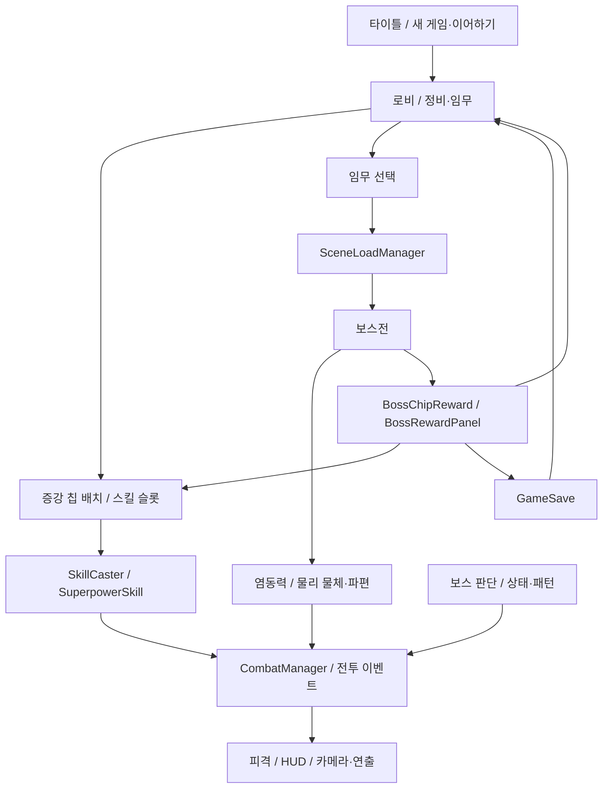
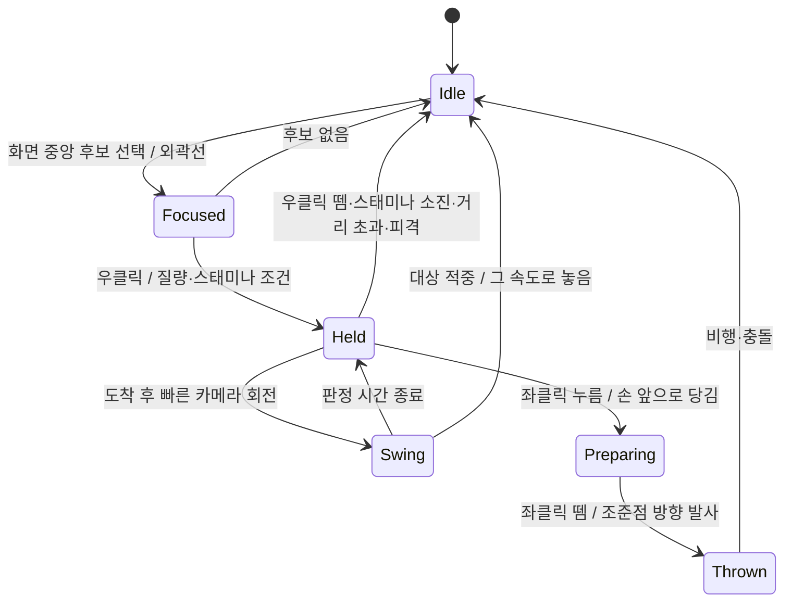
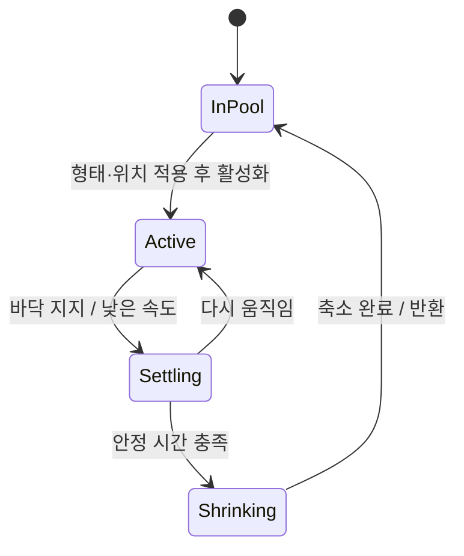
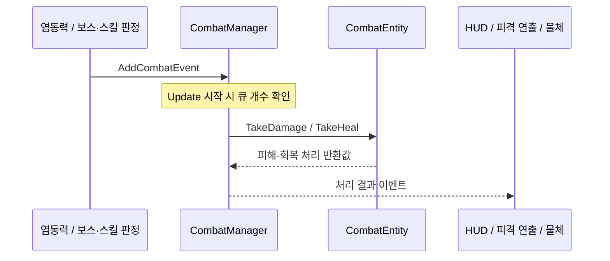
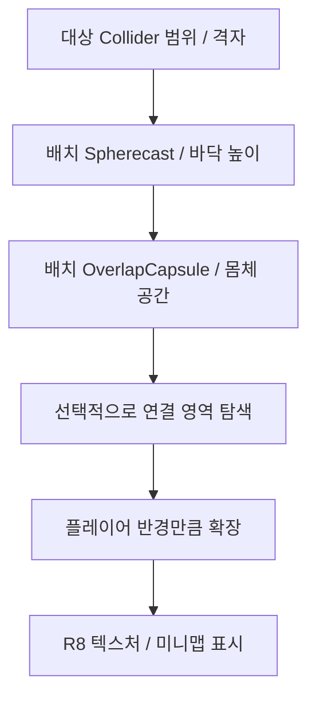
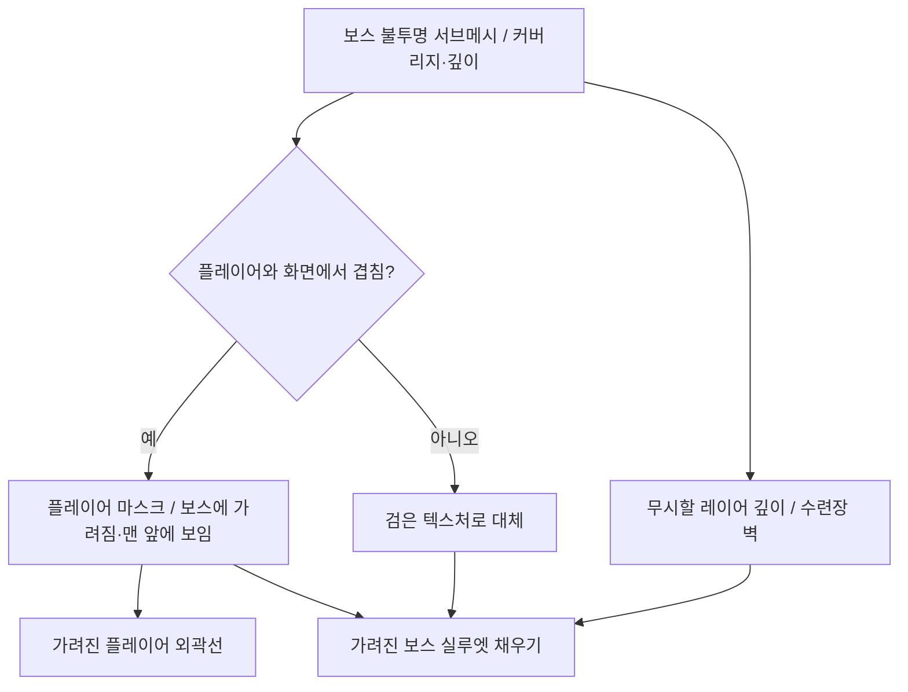
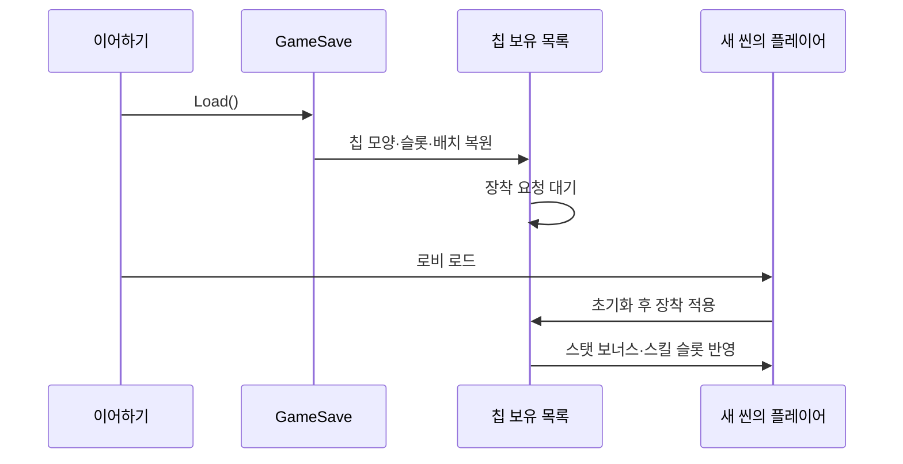
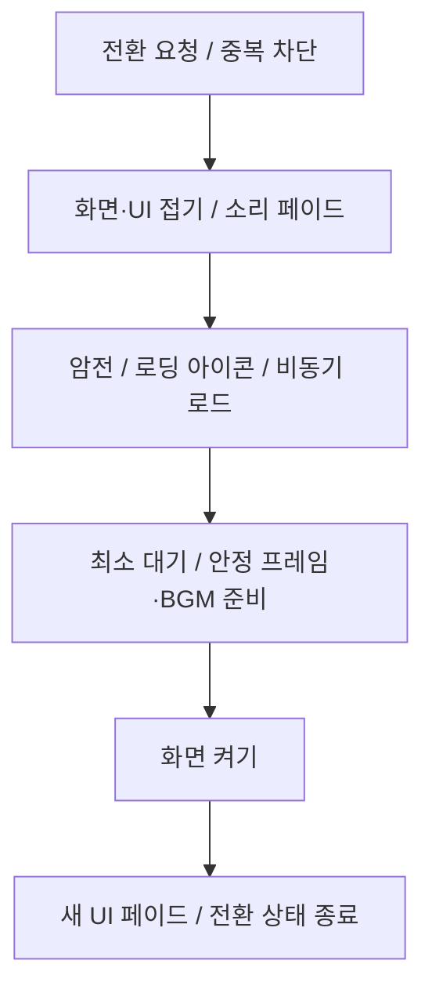
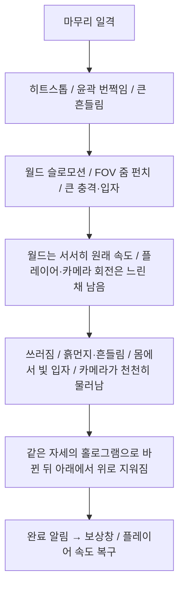

# ODDITY — 초능력 보스 액션 게임 기술 문서

> **한 줄 소개**: 주변 물체를 들어 휘두르거나 던지고, 시간 정지와 초능력 스킬을 조합해 보스와 싸우는 Unity 3D 액션 게임
> **구현 범위**: 염동력 조작과 물체 상호작용, 파편 생성·풀링, 시간 정지 기반과 연출, 보스 공통 패턴·피격·무력화 보완, 카메라·렌더링, UI/UX(조작 안내·HUD·전투 피드백), 보상·저장·씬 전환 연결

| 구분 | 시스템 | 핵심 내용 | 절 |
|---|---|---|---|
| 핵심 A | 물리 기반 염동력 | 조작 입력 → 대상 선택 → 잡기 → 물리 추종 → 휘두르기·투척 → 피해 결과 처리, 보스·지형과의 상호작용 | §2 |
| 핵심 B | 파편과 오브젝트 풀 | 크기별 물리 파편과 연출용 파편 분리, 형태를 바꾸어 재사용 | §3 |
| 핵심 C | 선택적 시간 제어 | 오브젝트별 시간·물리·애니메이션 제어와 염동력 예외 처리 | §4 |
| 핵심 D | 보스 전투와 연출 | 공통 공격 패턴, 그로기, 부위 판정, 공격 예고와 카메라 피드백 | §5 |
| 보조 E | 증강 칩·스킬·임무·보상 | 팀 공통 성장 구조에 스킬·보상·저장 경로 연결 | §6 |
| 핵심 F | 씬 전환과 플레이 흐름 | 화면·UI·소리 전환, 로딩 대기, 새 게임·이어하기 | §7 |
| 핵심 G ① | UI/UX — 화면 UI와 조작 | 상황별 조준점·키 안내·시스템 메시지, HUD 시인성, 창 연출·스타일 통일, 칩 이름 한글 검색, 환경설정 | §8 |
| 핵심 G ② | UI/UX — 전투 피드백과 비주얼 효과 | 피해 구간별 피격 연출, 보스 상태 연출, 공격 예고의 박자, 타이틀·등장 연출, 소리 연출 | §9 |

---

## 1. 프로젝트 개요

### 1.1 What — 무엇을 만들었나



**ODDITY**는 염동력과 초능력 스킬을 사용해 보스와 싸우는 Unity 3D 액션 팀 프로젝트입니다.
플레이어는 주변 물체를 들어 휘두르거나 던지고, 시간 정지와 여러 스킬을 조합해 전투합니다.
로비에서는 증강 칩을 장착하고 임무를 선택하며, 보스 처치 보상으로 새로운 칩을 얻습니다.

임무는 차르카로사우루스, 페르데로스, 휴머노이드 보스의 전투 씬으로 연결됩니다.
대형 보스의 투하·투척·충격파와 휴머노이드의 검격·반격 등 서로 다른 패턴에 대응하면서,
주변 물체와 파편을 공격 자원으로 활용하는 구조입니다.

### 1.2 Why — 왜 만들었나

소울류·몬스터 헌터류 액션 게임과는 **차별화된 전투 경험**을 주고 싶었습니다.
첫 3D 프로젝트인 만큼 3D에서만 가능한 시스템을 구현하고자 **염동력의 자연스러운 물리 반응**을 살리는 데 집중했고, 평소 중요하게 여기는 **UI/UX**에도 특히 공을 들였습니다.
UI/UX는 공격 예고와 HUD·미니맵, 화면·UI·소리가 함께 바뀌는 씬 전환처럼 플레이어가 전투 상황과 게임 흐름을 쉽게 읽을 수 있도록 다듬었습니다.

| 문제 | 구현 방향 |
|---|---|
| 카메라로 가리킨 물체를 물리 움직임과 연결해야 함 | 화면 중심 기반 선택과 Rigidbody 가속도 추종 분리 |
| 잡기·투척·시간 정지가 같은 물체의 상태를 바꿈 | 중력·충돌·시간 예외 상태의 저장과 복원 |
| 충돌했다는 사실과 실제 피해 성공이 다름 | 전투 이벤트의 처리 결과를 받아 파편화 결정 |
| 많은 파편을 반복 생성하고 제거해야 함 | 크기별 풀과 안정 상태 기반 반납 |
| 보스의 큰 몸체와 지형 때문에 판정·카메라가 어긋남 | 부위별 판정, 지면 투영 예고, 경계 기반 거리와 카메라 충돌 처리 |
| 월드 화면 효과만으로는 Overlay UI가 함께 꺼지지 않음 | 화면 효과와 UI 변형·마스크·소리 페이드를 함께 조율 |
| 칩 보유 상태와 실제 스탯 적용 시점이 다름 | 저장 목록 복원과 플레이어 생성 후 장착 적용 분리 |

### 1.3 개발 환경

| 항목 | 내용 |
|---|---|
| 장르 | 3D 보스 액션 |
| 기간 | 2026.10 - 2026.11 |
| 인원 | 4인 |
| Engine | Unity `6000.3.15f1`, URP·Shader Graph `17.3.0` (ScriptableRendererFeature·RenderGraph) |
| Language | C# |
| 주요 패키지 | Input System `1.19.0`, AI Navigation `2.0.12`, Cinemachine `3.1.7`, UniTask, DOTween, Odin Inspector |
| 데이터 | 증강 칩·보상·임무 TSV, 로컬 JSON 저장 |
| GitHub | [https://github.com/KooHoo-Dev/3rd_3D_1-3D-Project-team_odd](https://github.com/KooHoo-Dev/3rd_3D_1-3D-Project-team_odd) |

### 1.4 담당 범위

| 영역 | 직접 구현·보완한 내용 | 팀 기반과의 관계 |
|---|---|---|
| 염동력·파편 | 기본 공격, 잡기·휘두르기·투척, 피해 연동, 파편 생성과 풀링 | 플레이어 이동·스탯·IK·크기 조절 스킬과 연결 |
| 시간 제어 | 시간 정지와 염동 내려찍기, 정지 대상의 상태 복원·홀로그램 연출 | 개별 스킬과 시간 감속 기능은 팀 구현과 통합 |
| 보스 전투 | 투하·투척·충격파, 공통 패턴 정리, 공격 예고, 피격·그로기·이동 보완 | 상태 머신·Intent 판단·보스 기본 패턴 위에 확장 |
| 시각 피드백 | 외곽선·화면 효과, 보스 연출, 미니맵·HUD, 카메라 시점 보완 | 플레이어·카메라 기본 구현과 결합 |
| 게임 진행 | 보상 테이블·결과 화면, 칩·임무 저장, 이어하기, 타이틀·설정·씬 전환 개선 | 칩 배치·스킬 공통 구조와 임무 기본 기능에 연결 |

칩 배치와 스킬 전략, 공용 전투 이벤트, 플레이어 이동과 보스 판단 기반은 팀이 함께 만든 구조입니다.
아래에서는 이 기반의 전체 역할을 소개하고 직접 확장한 상호작용과 연동을 중심으로 설명합니다.

실제 게임 기능은 플레이어·염동력·초능력·전투·보스·로비·UI·저장과 연출로 나누어 설명합니다.

### 1.5 전체 구조



---

## 2. 기능 A — 물리 기반 염동력

### 2.1 개요와 시스템 구조

염동력은 화면에서 대상을 고르는 과정과 물체를 실제로 움직이는 과정, 피해를 처리하는 과정을 나눕니다.
잡은 물체는 단순히 손 위치로 이동시키는 장식물이 아니라 Rigidbody를 가진 공격 자원입니다.

| 클래스 | 책임 |
|---|---|
| `PsychokinesisController` | 입력, 대상 탐색, 잡기·투척·휘두르기 조율 |
| `PsychokinesisObject` | 물체의 원래 물리·충돌 상태, 홀딩·투척·파편화 관리 |
| `PsychokinesisForceWave` | 기본 공격의 발사·착탄·피해와 시각 효과 |
| `CombatManager` | 피해 이벤트 큐와 처리 결과 통지 |
| `TimeFreezable` | 시간 정지와 물체 조작의 예외 상태 연결 |

`Update`에서 입력을 예약하고 `LateUpdate`에서 카메라 기준 대상과 조작을 처리합니다.
물체 추종은 `FixedUpdate`에서 수행해 카메라 입력과 물리 갱신의 책임을 구분합니다.

### 2.2 사용법 — 조작 입력과 물체 상태

염동력은 마우스 두 버튼으로 잡기·던지기·기본 공격을 모두 처리합니다.
같은 좌클릭이라도 물체를 들고 있는지에 따라 기본 공격과 투척 준비로 나뉩니다.

| 입력 | 물체가 없을 때 | 물체를 들고 있을 때 |
|---|---|---|
| 우클릭 누르기·유지 | 조준 중인 물체를 잡음 | 계속 들고 있음 |
| 우클릭 떼기 | — | 투척 피해 없이 내려놓음 |
| 좌클릭 누르기 | 기본 공격(염동파) | 투척 준비 — 물체를 손 앞으로 당겨 모음 |
| 좌클릭 떼기 | — | 화면 중앙 조준점 방향으로 투척 |
| 카메라를 빠르게 수평 회전 | — | 짧은 시간 휘두르기 판정이 켜짐 |

잡기에는 조건이 있습니다. 물체 질량이 플레이어의 최대 염동 질량 이하이고, 스태미나가 최소량 이상이어야 합니다.
최대 염동 질량과 기본 공격 사거리는 기본 스탯에 증강 칩 보너스를 더한 값이라, 칩을 끼우고 빼면 바로 바뀌도록 사용할 때마다 다시 읽습니다.
들고 있는 동안에는 매 프레임 스태미나를 소모하고, 스태미나가 바닥나거나 물체가 플레이어에게서 일정 거리 이상 멀어지면 놓습니다.



입력에 맞춰 캐릭터의 자세도 함께 바뀝니다.
물체를 잡으면 조준 방향이 왼팔이 닿는 범위의 끝에 오도록 몸을 돌리고, 조준이 그 범위 안이면 팔만, 벗어나면 몸까지 돌립니다.
기본 공격은 팔이 닿는 범위 안이면 상체만 비틀고 벗어난 만큼만 몸을 돌리며, 마지막 공격 뒤 잠시 조준 자세를 유지해 연타 중 팔이 내려갔다 올라오지 않게 합니다.
투척 준비 중에는 왼팔을 굽혀 당기고, 기본 공격은 같은 팔 IK로 당겼다가 손바닥이 앞을 보도록 뻗습니다.

### 2.3 핵심 기능 — 화면 중심 기반 타겟 선택

`OverlapBoxNonAlloc`으로 카메라 방향의 후보를 수집합니다.
화면 중심과의 거리를 우선하고, 비슷한 후보는 플레이어와의 거리로 비교합니다.
화면 비율을 반영해 중심 거리를 계산하고, 더 좋은 후보에 대해서만 가림 검사를 수행합니다.

잡을 수 있는지는 대상의 사용 가능 상태와 플레이어의 최대 염동 질량·스태미나 등으로 판단합니다.
이미 물체를 잡고 있거나 입력이 막힌 상황에서는 불필요한 후보 탐색을 줄입니다.

이 방식은 월드에서 가장 가까운 물체보다 **플레이어가 화면으로 가리키는 물체**를 선택하는 데 맞춰져 있습니다.

타게팅 구간은 카메라 광선 위에서 **플레이어의 깊이부터** 잡기 거리만큼입니다.
카메라와 플레이어 사이, 즉 플레이어 뒤쪽에 있는 물체는 후보로 삼지 않습니다.

선택된 물체는 외곽선으로 표시하고, 지금 잡을 수 있는지에 따라 외곽선 색을 바꿉니다.
최대 염동 질량을 넘거나 스킬이 이미 붙잡고 있는 물체는 "잡을 수 없음" 색으로 보입니다.
크기 조절 스킬이 실패했을 때도 대상 외곽선이 잠깐 같은 색으로 바뀌어(`FlashUnavailable`) 왜 실패했는지 화면에서 알 수 있습니다.
잡을 수 있는 대상이면 조준점에 외곽선과 같은 색의 링이 나타납니다(§8.2).

### 2.4 핵심 기능 — 물리 추종과 휘두르기

홀딩 위치와 현재 위치의 차이로 가속도를 만들고, 목표 속도와 물체 속도의 차이로 감쇠를 적용합니다.

```csharp
Vector3 acceleration = offset * (followStrength * pullMultiplier)
    - (body.linearVelocity - targetVelocity) * followDamping;
acceleration = Vector3.ClampMagnitude(acceleration, maxAcceleration * pullMultiplier);
Vector3 nextVelocity = Vector3.ClampMagnitude(
    body.linearVelocity + acceleration * Time.fixedDeltaTime,
    maxHoldSpeed * pullMultiplier);
body.AddForce(
    (nextVelocity - body.linearVelocity) / Time.fixedDeltaTime,
    ForceMode.Acceleration);
```

위치 오차만 강하게 줄이면 물체가 목표를 지나치거나 심하게 흔들릴 수 있어 속도 감쇠와 상한을 함께 둡니다.
휘두르기 판정은 잡은 직후 바로 허용하지 않고, 목표 위치에 도착한 상태와 카메라 회전·물체의 상대 속도를 함께 사용합니다.
이를 통해 플레이어가 단순히 이동한 것을 강한 휘두르기로 오인하는 상황을 줄입니다.

#### 물체를 조준점 위에 두는 홀딩 위치

3인칭 카메라는 플레이어 어깨 쪽으로 비켜 있습니다.
그래서 카메라 정면 방향으로 일정 거리 앞에 물체를 두면 물체가 화면 중앙의 조준점에서 벗어납니다.
홀딩 위치는 플레이어 상체 높이의 기준점을 중심으로 한 구(반지름 = 홀딩 거리)와 카메라 중앙 광선의 먼 쪽 교점으로 정합니다.
이렇게 하면 물체는 늘 조준점 위에 보이면서 플레이어와의 거리도 일정하게 유지됩니다.

```csharp
// PsychokinesisController.GetCameraAlignedDirection — 홀딩 기준점 중심 구와 카메라 중앙 광선의 먼 쪽 교점
Vector3 toRayOrigin = cameraRay.origin - origin;
float b = Vector3.Dot(toRayOrigin, cameraRay.direction);
float c = toRayOrigin.sqrMagnitude - radius * radius;
float discriminant = b * b - c;
if (discriminant < 0f) return cameraRay.direction;   // 광선이 구를 비켜 가면 카메라 방향
float distance = -b + Mathf.Sqrt(discriminant);
if (distance <= 0f) return cameraRay.direction;
return (cameraRay.GetPoint(distance) - origin).normalized;
```

#### 회전 속도에 따라 뒤따라오는 물체

홀딩 방향은 조준 방향으로 바로 맞추지 않고 지수 보간으로 따라가게 합니다.
카메라 회전 속도가 빠를수록 따라가는 시간을 길게 잡고, 천천히 조준할 때는 짧게 잡아 거의 바로 따라옵니다.
뒤처지는 각도에는 상한(기본 60°)을 두어 빠르게 돌려도 물체가 화면 밖으로 밀려나지 않게 합니다.
빠르게 휘두르면 물체가 무게를 가진 것처럼 뒤따라오고, 조준할 때는 정확히 따라오도록 한 구성입니다.

휘두르기 판정은 카메라의 **수평 회전 속도**가 기준(기본 180°/s)을 넘는 순간 짧은 시간(기본 0.12초) 동안 켜집니다.
투척 준비 중이거나 놓는 중에는 켜지지 않습니다.
휘두르는 동안에는 물체의 피격 트리거에 여유 범위를 더해 빠르게 지나가는 물체도 대상에 닿게 합니다.
대상에 닿으면 물체와 대상 사이를 Raycast로 다시 확인해 벽 너머의 적은 맞지 않게 하고, 피해를 요청한 뒤 그 속도 그대로 물체를 놓습니다.
피해 계산에는 충돌 직전에 기록한 플레이어 대비 상대 속도를 사용합니다.

### 2.5 핵심 기능 — 당겨 모은 뒤 조준점으로 던지기

투척은 두 단계입니다.
좌클릭을 누르면 물체의 현재 위치에서 손 앞의 가까운 지점까지 짧은 시간 동안 `SmoothStep`으로 당겨 모읍니다.
이 동안 추종 세기·가속 상한·속도 상한에 당김 배율(기본 최대 3배)을 곱해, 무거운 물체도 빠르게 손 앞으로 모입니다.
당기는 소리와 던지는 소리는 각각 누르는 순간과 떼는 순간에 재생합니다.

좌클릭을 떼면 화면 중앙 광선을 따라 처음 닿는 장애물 지점을 구하고, 물체 중심에서 그 지점을 향해 발사합니다.
카메라와 물체 사이의 가까운 장애물을 조준해 방향이 카메라 반대쪽이 되면, 카메라 방향을 그대로 써서 물체가 뒤로 날아가지 않게 합니다.

```csharp
// PsychokinesisController.ReleaseHeld — 투척 방향 결정
Vector3 direction = ray.GetPoint(distance) - heldObject.Body.worldCenterOfMass;
// 카메라와 물체 사이의 가까운 장애물을 조준해 역방향 발사 방지
if (Vector3.Dot(direction, ray.direction) <= 0f) direction = ray.direction;
velocity = direction.normalized * throwSpeed;
```

물체는 던진 뒤 한 번만 투척 피해를 줄 수 있습니다.
트리거 판정은 물리 스텝이 끝난 뒤에 오므로, 물체가 매 `FixedUpdate`에서 스텝 직전 속도를 기록해 두고 그 속도와 대상 속도의 차이로 피해를 계산합니다.
시간 정지로 멈춘 동안에는 속도가 0이 되므로 멈추기 전 속도를 유지합니다.

### 2.6 핵심 기능 — 잡는 동안의 물리 상태 저장과 복원

잡은 물체는 손 앞을 따라다니는 동안 플레이어·중력·시간 정지와 다르게 반응해야 합니다.
잡는 순간 바꾼 값은 모두 원래 값을 저장해 두고, 놓을 때 되돌립니다.

| 항목 | 잡을 때 | 놓을 때 |
|---|---|---|
| 시간 정지 | 전체 정지에서 제외 | 정지 중에 던졌으면 정지가 끝날 때까지 예외 유지 |
| 중력·회전 | 중력 끔, 각감쇠를 높여 손 앞에서 덜 흔들림, 속도 0 | 원래 중력·각감쇠 복원, 투척 속도 적용 |
| 플레이어와의 충돌 | 물체·플레이어 콜라이더 쌍마다 원래 무시 여부를 저장하고 충돌 무시 | 쌍별로 원래 상태 복원 |
| 충돌 레이어 | Rigidbody `excludeLayers`에 홀딩 중 제외 레이어 추가 | 원래 `excludeLayers` 복원 |
| 피격 트리거 | 휘두르기 여유 범위만큼 확장 | 원래 크기 |
| 피해 | 투척 피해·벽 파편화 끔 | 던졌을 때만 투척 피해 허용 |

물체의 피격 판정은 몸체 콜라이더가 아니라 별도 레이어(`PsychokinesisHit`)의 트리거로 합니다.
보스 Rigidbody는 염동력 물체 레이어와 물리 충돌하지 않으므로, 이 트리거는 몬스터 레이어하고만 반응하도록 두었습니다.
물체가 보스 몸에 밀리거나 보스를 밀지 않고, 닿은 순간의 피해·파편화로만 이어집니다.

### 2.7 핵심 기능 — 실제 피해 성공 뒤 파편화

적에게 충돌해 피해를 요청하는 경로에서는 `DamageEvent`를 큐에 등록합니다.
이벤트가 처리되기 전에는 방어·무적 등으로 실제 피해가 발생했는지 알 수 없으므로,
자신이 요청한 이벤트의 결과를 확인한 뒤 파편화합니다.

```csharp
if (ReferenceEquals(damageEvent, pendingDamage) == false) return;
ClearPendingDamage();
if (receivedDamage <= 0) return;
Shatter();
```

같은 프레임에 다른 공격이 처리되어도 이벤트 인스턴스를 비교해 자신의 타격 결과만 사용합니다.
보스가 생성한 물체의 벽 충돌이나 외부 공격에 의한 파편화는 별도 경로로 처리합니다.
투척 피해에는 물체 질량·속도 또는 설정된 공격력 기반 규칙이 적용되며, 크기 변경 상태를 반영하는 배율도 연결했습니다.

### 2.8 핵심 기능 — 손 동작과 착탄 시점을 연결한 기본 공격

기본 공격은 버튼을 누른 프레임에 즉시 피해를 주지 않습니다.
`PsychokinesisForceWave.Fire`가 손을 당겼다 펴는 동작의 발사 지연을 예약하고,
발사 시점에 화면 중앙을 다시 검사해 손바닥 위치에서 탄을 출발시킵니다.
선택된 충돌 지점은 대상 Transform의 로컬 좌표로 보관해, 대상이 움직일 때 도착 위치도 따라가도록 합니다.

탄은 손 앞에서 잠시 머문 뒤 가속하고, 도착했을 때 전투 이벤트와 착탄 효과를 생성합니다.
매 프레임 새 경로를 물리 검사하는 탄환 방식이 아니라, 발사 시 선택한 대상·지점을 향하는 표현입니다.
피격 시 아직 발사하지 않은 예약은 취소하지만 이미 날아간 탄은 유지합니다.

착탄 주변 물체는 `ForcePush`로 밀어냅니다.
가벼운 물체는 `SweepTest`로 이동 가능한 거리를 먼저 제한하고 Fixed 갱신 Tween으로 이동시킨 뒤,
종료 속도와 회전 속도를 Rigidbody에 넘깁니다. 무거운 물체나 이동 공간이 부족한 물체는 제자리에서 흔들립니다.
착탄 범위의 적·플레이어에는 이 물체 밀어내기를 적용하지 않습니다.

탄·고리 효과와 발사 상태는 자체 Stack으로 재사용하고, 효과별 값은 `MaterialPropertyBlock`으로 전달합니다.
머티리얼이 없으면 해당 시각 효과를 생략하되, 발사 상태와 피해 처리는 진행합니다.

소스: `PsychokinesisForceWave.cs`, `ForcePush.cs`.

#### 크기 변경과 피해 등급을 함께 반영하는 방식

씬별 피해 오버라이드를 사용하지 않으면 질량과 충돌 전 상대 속도를 곱한 운동량 기반 피해를 계산합니다.
오버라이드를 사용하면 원래 질량으로 소형·중형·대형 등급을 정하고, 현재 공격력에 등급 배율과 누적 크기 배율을 곱합니다.

초기 등급 계산은 변경된 질량을 그대로 사용해 크기 조절 효과가 등급 경계에서만 나타날 수 있었습니다.
이를 원래 질량과 `sizeFactor`로 나누어, 원래 등급은 유지하고 크기 변경량을 피해에 직접 반영하도록 수정했습니다.
풀에서 다시 활성화될 때 배율을 1로 초기화해 이전 사용의 크기 상태가 다음 사용에 이어지지 않게 합니다.

로비 훈련 공간도 보스전과 같은 공격력 기반 물체 피해 경로를 사용하도록 씬 설정을 맞췄습니다.

```csharp
// PsychokinesisObject: 현재 질량에서 원래 질량을 복원해 등급 계산 요청
controller.TryCalculateObjectDamage(body.mass / sizeFactor, sizeFactor,
    out int overriddenDamage, out groggy);
// PsychokinesisController: 등급별 atkScale을 고른 뒤 현재 공격력과 크기 배율 반영
damage = Mathf.Max(1, Mathf.RoundToInt(combatEntity.CurrentStats.Atk * atkScale * sizeFactor));
groggy = Mathf.RoundToInt(damage * objectGroggyScale);
```

위 발췌는 피해 오버라이드 경로입니다. 휘두르기·투척은 같은 계산 함수로 연결되지만,
피해 요청을 허용하는 도착·속도·충돌 조건은 각 조작의 판정에 남아 있습니다.

### 2.9 핵심 기능 — 보스·지형과 맞물리는 물체

전투 공간의 물체는 플레이어만 쓰는 소품이 아니라 보스의 이동·공격과도 반응합니다.

| 상황 | 동작 |
|---|---|
| 보스가 물체를 밟음 | 보스의 다리·발 콜라이더(`BossShatterCollider`)에 닿았을 때만 밟힌 것처럼 파편화하고, 다른 부위에는 부딪히기만 함 |
| 플레이어가 든 물체가 보스 다리에 닿음 | 들고만 있으면 통과, 휘두르는 중이면 위 규칙 적용, 피해 처리를 기다리는 중이면 그 결과를 따름 |
| 맵에 처음부터 놓인 물체를 밟음 | 파편화하지 않고 보스 진행 방향의 좌우로 밀려남(정해진 속도까지만 채움) |
| 보스 발밑에서 막 생긴 물체 | 정해진 유예 시간 동안 다리·발에 닿아도 파편화하지 않음 |
| 보스가 만든 물체를 플레이어가 던짐 | 바닥에 닿기 전 처음 부딪힌 벽에서 파편화, 바닥에 먼저 닿았으면 이후 벽 충돌은 무시 |
| 보스 충격파·점프 착지 | 범위 안의 물체를 잠깐 띄웠다가 중력으로 떨어뜨림(`BossFragmentLift`) |
| 바닥 구멍 아래로 떨어짐 | 지정한 상자 영역(`PsychokinesisFallZone`)에 들어오면 파편 없이 회수 |

생성 유예에는 한 가지 처리를 더 했습니다.
유예 중에 닿은 보스 부위는 한 번 떨어질 때까지 계속 무시합니다.
유예가 끝나는 순간 발밑에 겹쳐 있던 물체가 바로 부서지지 않게 하기 위한 처리입니다.
플레이어가 물체를 잡으면 유예를 해제해 원래 규칙으로 돌아갑니다.

벽 파편화는 던진 물체가 날아가다 스친 다른 파편이나 플레이어에는 반응하지 않고, `Wall` 레이어에 처음 닿을 때만 일어납니다.

띄우기는 범위 안 물체를 kinematic으로 바꿔 무작위 높이만큼 DOTween으로 올린 뒤, Tween이 끝나면 kinematic을 풀어 중력으로 떨어뜨립니다.
플레이어가 들고 있거나 이미 kinematic인 물체는 건드리지 않습니다.
풀 파편은 크기별 풀의 부모 아래에서, 맵 배치 물체는 활성 목록에서 찾아 같은 물체를 두 번 띄우지 않습니다.

소스: `PsychokinesisObject.cs`, `BossFragmentLift.cs`, `PsychokinesisFallZone.cs`.

### 2.10 연동 구현 — 이동·회피·피격과 행동 제한

플레이어 이동·회피의 팀 기반 위에 염동력·피격·상체 연출을 연결합니다.
`PlayerController`는 카메라의 수평 방향을 기준으로 `CharacterController.Move`를 수행하고,
걷기·달리기·중력과 스태미나를 처리합니다.
구르기는 시작 방향을 고정하고 Animator 진행률과 속도 곡선으로 이동량을 계산합니다.

피격이 확정되면 기본 공격의 발사 예약과 염동력 입력을 취소하고, 잡은 물체를 놓으며 IK 상태를 정리합니다.
넉다운·기상과 기상 후 무적을 연결하고, 피격 종료 애니메이션 신호가 누락될 때를 위한 대기 상한도 둡니다.
행동 잠금과 초능력 잠금은 용도에 따라 구분하며 이동·염동력·스킬에서 해당 상태를 확인합니다.

상체 조준과 왼손·팔꿈치 IK를 기본 이동 애니메이션과 결합합니다.
시간 역행 중에는 IK를 내려 기록된 포즈의 복원을 방해하지 않도록 합니다.
회피 연출은 구르기 입력 자체가 아니라 실제 공격을 구르기 무적으로 막았을 때 발생합니다.
`PoseBaker`로 현재 SkinnedMesh 포즈를 메시로 구워 허물·잔상을 만들며, 이 메시들은 사용 후 제거하는 경로로 파편 풀과 다릅니다.

소스: `PlayerController.cs`, `Player.cs`, `DodgeEffect.cs`, `PoseBaker.cs`.

### 2.11 고민과 선택

| 선택 | 이점 | 비용·제약 |
|---|---|---|
| Transform 직접 이동 대신 가속도 추종 | Rigidbody를 유지하며 움직임과 공격 연결 | 질량·감쇠·상한 튜닝과 충돌 정책 필요 |
| 화면 중심 우선 후보 선정 | 조준 의도와 대상 선택을 연결 | 가림 검사·카메라 범위 조건 필요 |
| 실제 피해 결과 후 파편화 | 접촉과 피해 성공을 구분 | 대기 이벤트와 구독 정리 필요 |
| 잡는 동안 충돌·시간 예외 적용 | 플레이어와의 충돌, 정지 세계 속 조작 연결 | 해제·피격·비활성화 시 원래 상태 복원 필요 |
| 로비와 보스전의 피해 설정 통일 | 훈련과 전투에서 공격력·크기 변경이 같은 계산 경로 사용 | 속도 기반 기본 경로와 씬 오버라이드를 구분하고 직렬화 설정도 관리해야 함 |
| 구와 카메라 광선의 교점으로 홀딩 방향 결정 | 어깨 시점에서도 물체가 조준점 위에 보이고 플레이어와의 거리가 일정 | 카메라가 구 밖에 있어 교점이 없으면 카메라 방향을 그대로 씀 |
| 회전 속도에 따라 길어지는 홀딩 지연과 최대 지연 각 | 빠르게 휘두르면 무게감, 천천히 조준하면 바로 따라옴 | 지연 시간·최대 각·휘두르기 기준 속도를 함께 맞춰야 함 |
| 보스와는 물리 충돌 대신 전용 피격 트리거 | 물체와 큰 보스 몸이 서로 밀고 밀리지 않고 피해·파편화로만 이어짐 | 피격 레이어·트리거 크기를 몸체 콜라이더와 따로 관리 |

UI 진입·피격·조작 잠금 시에는 예약 입력과 공격 준비를 취소하고 잡은 물체를 놓도록 연결했습니다.

소스: `PsychokinesisController.cs`, `PsychokinesisObject.cs`.

---

## 3. 기능 B — 재사용 가능한 물리 파편과 연출 파편

### 3.1 개요와 구조

부서진 물체의 일부는 다시 염동력으로 사용할 수 있고, 작은 조각은 시각 효과를 담당합니다.
보스가 만든 파편과 플레이어가 던지는 물체가 같은 전투 공간에서 상호작용하도록 구성했습니다.

| 구성 | 역할 |
|---|---|
| `WallFragmentSpawner` | 크기별 파편 선택, 공간 확인, 배치와 초기 힘 |
| `WallFragment` | 풀 객체의 형태 적용과 물리 상태 초기화·반납 |
| `WallFragmentDebris` | 작은 파편의 지지·속도 안정 판정, 축소 후 반환 |
| `ObjectPoolManager` | 키별 풀과 비활성 객체 보관 |

실시간으로 원본 메시를 절단하는 방식이 아니라, 미리 만든 파편 형태를 조합해 생성합니다.
기본 생성 요청은 큰 파편 1개·중간 5개·작은 9개이며, 배치 공간을 찾지 못하면 일부가 생략될 수 있습니다.

### 3.2 핵심 기능 — 크기별 공유 풀과 형태 교체

풀은 `Dictionary<string, ObjectPool>`로 찾고, 내부에서는 `Stack<IObjectPoolItem>`로 객체를 꺼내고 돌려받습니다.

```csharp
public IObjectPoolItem Get()
{
    if (pool.Count == 0) Expand(expandSize);
    return pool.Pop();
}
```

초기 확보 수량과 고갈 시 확장 수량을 분리해, 작은 파편처럼 자주 쓰는 객체를 미리 준비할 수 있게 했습니다.
`Get`은 비활성 객체를 반환하며, 호출자가 형태·위치·회전을 적용한 뒤 활성화합니다.

`ApplyVariant`는 선택된 형태의 Mesh·Material·BoxCollider·질량·스케일을 풀 객체에 적용합니다.
형태마다 별도 풀을 만드는 대신 크기별 객체를 여러 외형으로 재사용하는 구조입니다.

### 3.3 핵심 기능 — 작은 파편의 수명과 반환

작은 파편은 생성 즉시 일정 시간만 기다리는 대신, 바닥 지지 여부와 선형·각속도를 검사합니다.
안정된 상태가 일정 시간 유지되면 DOTween으로 축소하고 풀로 돌려보냅니다.
시간 정지 상태에서는 안정 시간을 누적하지 않습니다.



활성화 시 속도와 관련 상태를 초기화하며, 파편의 중복 반납은 `WallFragment`의 상태로 방지합니다.

### 3.4 핵심 기능 — 재질별 파괴

파편화 이벤트는 위치·방향·질량뿐 아니라 연출에 사용할 재질도 전달합니다.
금속 소품은 해당 재질을 입힌 금속 조각을 생성하고, 지정이 없거나 금속 풀이 준비되지 않은 경우에는 콘크리트 파편 경로를 사용합니다.
파편 수는 질량 비례 계산에 상·하한을 적용하며, 금속 조각은 별도 수량·반경 설정으로 화면을 덜 가리도록 구성했습니다.

런타임은 준비된 파편 메시를 크기별 풀에서 꺼내 형태를 교체합니다.
큰·중간 파편의 염동력 조작과 작은 파편의 안정 판정·반납은 서로 다른 컴포넌트로 처리합니다.

소스: `WallFragment.cs`.

### 3.5 고민과 선택

큰·중간 파편과 작은 연출 파편을 나누면 전투에 필요한 물리 물체를 남기면서 연출물은 정리할 수 있습니다.
작은 파편은 배치 재시도와 충돌 검사 비용을 줄이고, 기본적으로 지면과 상호작용하는 용도로 사용합니다.
벽 충돌 파편은 충돌 지점 정면을 비우고 벽의 좌우·위쪽으로 퍼뜨려 생성 직후 겹침을 줄입니다.

풀에서 꺼내고 반납하는 기본 연산은 상수 시간이지만, 풀 고갈 시에는 `Instantiate`가 발생합니다.

소스: `WallFragmentSpawner.cs`, `WallFragmentDebris.cs`, `ObjectPoolManager.cs`.

---

## 4. 기능 C — 객체별 시간 제어와 시간 정지 연출

### 4.1 개요와 시스템 구조

시간 정지는 플레이어를 포함한 게임 전체의 `Time.timeScale`을 0으로 만드는 대신,
정지 가능한 객체에 `TimeFreezable`을 붙여 적용합니다.
플레이어는 움직이면서 멈춘 물체를 잡거나 공격할 수 있습니다.

| 구성 | 책임 |
|---|---|
| `TimeFreezeManager` | 일정 시간 동안 전체 또는 개별 대상 정지 요청 |
| `TimeFreezable` | 객체별 정지·감속, 로컬 시간, 물리·애니메이션 상태 복원 |
| `TimeFreezeOverlayFeature` | 정지 전환 구간의 홀로그램 오버레이 |
| `TimeStopSkill` | 스킬 사용 조건과 전체 정지 요청 연결 |

개별 정지와 전체 정지는 중첩해서 적용합니다.
개별 정지 횟수가 남아 있으면 정지하고, 전체 시간 효과가 여러 개라면 가장 낮은 배율을 사용합니다.
시간 정지 기반에 시간 감속 스킬과 중첩 배율·중력 보정 등 팀의 확장 기능을 통합한 구조입니다.

### 4.2 핵심 기능 — 로컬 시간과 상태 복원

객체는 정지·감속 동안 누적된 시간 차이를 반영해 자신의 시간을 계산합니다.

```csharp
public float LocalTime => Time.time - pausedDuration
    - (Time.time - pauseStartTime) * (1f - appliedTimeScale);
public float LocalDeltaTime => Time.deltaTime * appliedTimeScale;
public float LocalFixedDeltaTime => Time.fixedDeltaTime * appliedTimeScale;
```

Animator의 원래 속도와 Rigidbody의 운동 상태를 저장하고,
정지 시 Rigidbody를 kinematic으로 전환하며 관련 DOTween을 일시정지합니다.
해제 시에는 저장된 상태를 복구합니다.
보스 행동·이동 등 시간 영향을 받아야 하는 코드는 이 로컬 시간과 배율을 사용해야 합니다.

감속 중에는 속도를 배율에 맞추고 추가 중력을 적용합니다.
이는 기존 궤적을 느리게 표현하기 위한 보정입니다.

### 4.3 핵심 기능 — 염동력과 정지 세계의 예외

물체를 잡으면 전체 시간 정지에서 제외합니다.
던진 직후 정지 상태가 바로 덮여 물체가 멈추지 않도록 예외 해제 시점도 연결합니다.
따라서 시간 정지와 염동력은 독립된 화면 효과가 아니라 같은 물체 상태를 공유합니다.

홀로그램은 전환 중인 객체에만 덧그립니다.
완전히 덮이면 원래 `sharedMaterials`를 보관하고 홀로그램 재질로 교체해, 정지 내내 별도 오버레이를 반복해서 그리는 범위를 줄입니다.
해제할 때는 원래 재질을 복구한 뒤 오버레이가 걷히는 연출을 적용합니다.
홀로그램 셰이더는 도입한 외부 셰이더를 바탕으로 높이 마스크·물결·글리치 표현을 확장했습니다.

#### 시간 정지 막 셰이더 — 높이로 쓸어 올리는 마스크와 정지 순간 글리치

`TimeFreezeHologram.shader`는 도입한 홀로그램 셰이더(Knife Hologram Shader Unlit)의 Forward 패스를 바탕으로 두 가지를 더한 셰이더입니다.

첫째는 **높이로 쓸어 올리는 마스크**입니다.
`TimeFreezeOverlayFeature`가 오브젝트마다 진행도와 높이 범위를 전역 값으로 넘기고, 높이 범위는 그리는 렌더러들의 바운드를 합쳐 매 프레임 다시 재므로 움직이는 스킨드 메시에도 맞습니다.
셰이더는 진행도로 보이는 높이를 정해 그 위의 픽셀을 버리고, 경계 폭에 걸쳐 경계 색으로 물들며 옅어지게 합니다.
진행도 0에서는 하나도 보이지 않고 1에서 꼭대기까지 다 보이도록 위쪽에 경계 폭만큼 여유를 둡니다.
진행도는 시간에 따라 일정하게 오르고, 보이는 높이에는 세제곱 이징을 걸어 막이 덮이고 걷히는 속도에 변화를 줍니다.

```hlsl
// TimeFreezeHologram.shader — 쓸어 올린 높이 위는 버리고 경계 폭에 걸쳐 드러냄
float edgeWidth = max( _EdgeWidth, 0.001 );
float sweepHeight = lerp( _TimeFreezeOverlayBounds.x, _TimeFreezeOverlayBounds.y + edgeWidth, _TimeFreezeOverlayProgress );
float sweepMask = saturate( ( sweepHeight - WorldPosition.y ) / edgeWidth );
clip( sweepMask - 0.001 );
```

둘째는 **정지 순간의 글리치**입니다.
정지 직후 짧은 시간(기본 0.35초) 동안 줄어드는 세기를 넘겨, 정점을 노이즈 방향으로 흔들고 막을 깜빡이게 합니다.
원본 셰이더의 글리치는 키워드로 켜고 끄지만, 이 글리치는 키워드와 상관없이 세기 값으로만 켭니다.
막이 다 덮여 머티리얼을 교체한 뒤에는 높이 범위를 아주 넓게 넘겨 마스크 없이 전체가 보이게 합니다.

소스: `TimeFreezeHologram.shader`, `TimeFreezeOverlayFeature.cs`, `TimeFreezable.cs`.

#### 염동 내려찍기 — 개별 정지·물리 이동·카메라 조율

`PsychoSlamSkill`은 사거리·조준 각도 안의 가장 가까운 보스 또는 훈련 허수아비를 선택합니다.
대상이 없으면 `CanExecute`가 실패하므로 쿨타임·스태미나를 소비하지 않습니다.
선택한 대상은 개별 정지한 뒤 Rigidbody를 Fixed 갱신의 `MovePosition`으로 올리고 내립니다.
지면은 Ground 레이어 Raycast로 찾고, 찾지 못하면 시작 높이를 사용합니다.

시전 중 플레이어는 외부 홀딩 목표를 보며 행동이 잠기고, 카메라는 같은 목표에 집중합니다.
상승음의 피치를 높인 뒤 내려찍는 소리와 피해 이벤트로 연결합니다.
완료 시 저장된 운동 상태를 버리고 정지를 풀어, 들어 올리기 전 속도가 내려찍기 뒤 다시 적용되는 것을 막습니다.
`finally`는 플레이어 홀딩·행동 잠금·카메라·임시 목표를 정리합니다.

#### 전체 히트스톱과 선택적 시간 정지의 분리

`HitStop`은 타격 순간 월드 전체의 `Time.timeScale`을 0으로 만드는 별도 기능입니다.
유효한 중첩 요청은 종료 시각이 더 긴 쪽으로 합치고, 종료 뒤 짧은 재요청 제한을 둡니다.
지속시간은 `unscaledTime`으로 검사하며, 종료 시 무조건 1이 아니라 `BaseTimeScale`로 돌아갑니다.
따라서 회피 슬로모션 등 전체 시간 효과와 기본 시간 배율을 공유할 수 있습니다.

### 4.4 고민과 선택

| 선택 | 이점 | 비용·제약 |
|---|---|---|
| 객체별 시간 상태 | 플레이어와 일부 물체를 계속 조작 가능 | 관련 제어 코드가 로컬 시간을 사용해야 함 |
| 중첩 정지·감속 관리 | 하나의 효과가 끝나도 다른 효과 유지 | 요청·해제의 짝과 비활성화 정리 필요 |
| 전환 오버레이와 재질 교체 병행 | 전환 표현과 정지 유지 표현을 구분 | 원래 재질·프로퍼티·카메라 제외 처리 필요 |

정지 지속시간을 기다리는 매니저는 `WaitForSeconds`를 사용하므로 게임 전체의 일시정지에는 영향을 받습니다.

소스: `TimeFreezable.cs`, `TimeFreezeManager.cs`, `TimeFreezeOverlayFeature.cs`.

---

## 5. 기능 D — 보스 패턴·전투 판정과 시각 피드백

### 5.1 개요와 전체 구조

공용 전투 구조는 `ICombatable`과 `CombatEntity`, `DamageEvent`·`HealEvent`, `CombatManager`로 구성합니다.
피해를 요청하는 쪽은 이벤트를 큐에 등록하고, 처리 결과는 HUD·피격 연출과 염동 물체가 구독합니다.



`Update` 시작 시 큐에 있던 개수만큼 처리하며, 처리 중 새로 들어온 이벤트는 다음 Update로 넘어갑니다.
보호막·방어·가드 등은 엔티티와 팀 공통 스킬 구조가 담당합니다.
결과 이벤트에는 처리 함수의 반환값이 전달됩니다.
염동 물체의 파편화는 이 피해 결과값이 0보다 큰지를 기준으로 결정합니다.

### 5.2 보스 판단과 직접 확장한 패턴

보스는 상위 상태와 구체 공격 패턴을 나누고, 판단 결과를 실제 행동으로 이어갑니다.
상태 머신과 Intent 기반 판단은 팀 기반이며, 여기에 주변 물체를 이용한 투하·투척과 충격파,
공통 패턴 구성, 부위별 판정·무력화·연출을 확장했습니다.

| 범위 | 주요 내용 |
|---|---|
| 대형 보스 | 근접 공격, 물체 투하·투척, 충격파, 돌진, 도약 등 |
| 휴머노이드 | 검격·반격·회피·분신 등 별도 패턴과 페이즈 |
| 직접 보완한 공통 흐름 | 공격 예고, 애니메이션 발동 시점, 피격·그로기, 이동·착지와 지면 대응 |

`BossIdleState`는 공격 패턴의 사용 가능 조건·최소 거리·긴급 조건과 가중치로 공격 Intent를 선택합니다.
선택된 공격의 거리와 각도가 맞지 않으면 Chase·Turn으로 조건을 만든 뒤 실행합니다.

`BossMeleePattern`은 사거리·쿨타임·애니메이션 트리거·루트 모션·타격 예고·종료 정리를 공통으로 제공합니다.
하위 패턴은 `OnPatternEnter`·`OnPatternExit`·`OnPatternAnimEventOccurs`를 구현해 실제 행동을 확장합니다.
보스 상태는 상속 타입 매핑으로 연결되어 공통 상태 요청을 휴머노이드 전용 상태로 이어갈 수 있습니다.

| 계층 | API 또는 진입점 | 역할 |
|---|---|---|
| 판단 | `BossIdleState`의 Intent 선택 | 실행할 패턴과 접근·회전의 필요 판단 |
| 패턴 | `BossMeleePattern.OnEnter/OnExit` | 공통 시작·정리와 패턴별 확장 호출 |
| 타격 시점 | 애니메이션 `OnHitWarn` / `OnHit` | 예고 시작과 도형 기반 타격 판정 |
| 이동 | `BossMovement` / `BossPathfinder` | 물리·지면 대응 이동과 NavMesh 경로 계산 |

보스가 사용하는 파편과 플레이어 염동 물체가 같은 공간에서 상호작용하도록 구성했습니다.
공격의 시작·판정·종료를 애니메이션 신호에 연결하고, 상태 이탈 시 남은 예고와 구독을 정리합니다.

```csharp
root.AnimEventListener.OnOccursAnimStateEvent -= OnOccursAnimEvent;
Animator.applyRootMotion = false;
Animator.ResetTrigger(trigger);
for (int index = 0; index < hits.Length; index++)
{
    if (hitTelegraphs[index] != null) hitTelegraphs[index].Cancel();
    hitTelegraphs[index] = null;
    isLocked[index] = false;
}
OnPatternExit();
```

### 5.3 핵심 기능 — 환경 물체를 공유하는 보스 공격

| 패턴 | 준비와 실행 | 상호작용·정리 |
|---|---|---|
| `BossPsychokinesisDropPattern` | 애니메이션 신호로 원형 범위의 유효 위치에 파편 투하 | 큰·중간 파편은 착지 예고·판정, 작은 파편은 연출; 예상 착지 판정 시 비활성화됐거나 플레이어가 잡고 있으면 판정 생략 |
| `BossPsychokinesisThrowPattern` | 준비 중 경로 추적 후 발사 시 방향 고정 | 비행 물체의 겹침으로 타격 검사; 준비 상태에서 취소되면 물체를 떨어뜨림 |
| `BossShockwavePattern` | 예고·발동 인덱스와 고정 위치·방향을 공유 | 타격과 주변 염동 물체 띄우기를 연결 |
| `BossCharge` | 준비 후 방향을 고정해 돌진 | 같은 돌진의 중복 타격을 막고, 정면 벽 충돌 시 기절·파편 생성으로 연결 |

낙하물의 진행 시간은 보스의 시간과 구분합니다.
각 물체는 자기 시간 상태에 따라 대기하고, 예상 착지 시점의 활성·홀딩 상태를 확인해 판정합니다.
보스가 만들어 낸 파편도 플레이어의 잡기·투척 대상으로 연결되므로 공격 연출과 전투 자원이 겹칩니다.

### 5.4 핵심 기능 — 공격 예고와 그로기

공격 범위는 지면에 투영하는 예고로 표시합니다.
같은 `TelegraphShape`를 표시와 `OnHit` 순간의 `Contains` 판정에 사용하며, 근접 공격을 지속 Trigger 접촉으로 판정하는 방식과 구분합니다.
콤보 패턴에서도 예고 흐름을 공유하고 Ground 레이어를 기준으로 표시 범위를 제한합니다.
큰 보스에서는 중심점만으로 타격 위치를 계산하지 않고, 부위 판정과 몸체 기준 보정을 사용합니다.

공격 피해와 무력화량은 구분하며, 스킬의 무력화는 피해에 대한 `GroggyRate` 비율로 연결했습니다.
돌진 중 벽 충돌 등 특정 상황의 그로기와 피격 연출도 추가했습니다.

`BossGroggy`는 살아 있는 보스에 실제 피해가 전달되고 무력화량이 있을 때 현재 무력화 수치를 차감합니다.
수치가 0이 되면 Broken을 알리고, 상태 계층이 그로기 진입과 회복 후 복귀를 처리합니다.

돌진의 벽 충돌로 발생하는 기절과 `BossGroggy` 게이지 소진에 의한 그로기는 진입 조건이 다른 경로입니다.

### 5.5 팀 기반 확장 — 휴머노이드의 페이즈·반응·분신

휴머노이드는 공통 보스 구조 위에 HP 비율에 따른 2페이즈 전환, 플레이어가 잡았던 물체의 투척 위협을 감시해 회피·파괴·가드 반사로 대응하는 반응 패턴, 분신 소환을 결합한 팀 구현입니다.
여러 검격 클래스는 공통 `BossMeleePattern`을 그대로 상속하고 Animator와 타격 데이터로 차이를 만듭니다.
직접 연결한 부분은 공통 패턴·시간 제어와의 연동, 반사 투사체의 파편화 연출, 차원 가르기의 순간이동 홀로그램(§9.3), 분신 정리 시의 플레이어 수명 처리(§7.4)입니다.

### 5.6 핵심 기능 — 카메라·HUD·렌더링

기본 이동·카메라 위에 일반·홀딩·질주·보스 근접 시점을 구분하고, 오프셋·거리·FOV를 보간합니다.
보스 근접 판단은 큰 몸체의 Collider 경계까지의 수평 거리를 사용하며,
진입·이탈 거리를 다르게 두어 경계에서 시점이 반복 전환되는 현상을 줄입니다.

카메라의 벽 충돌은 SphereCast로 검사해 즉시 거리를 당기고, 벽에서 벗어나면 보간해 복구합니다.
어깨 쪽 공간이 부족하면 반대쪽이나 중앙으로 이동하도록 시점도 조정합니다.
보스 조우 연출은 별도 카메라 시점과 HUD 표시를 조율하고, 종료 후 추적 시점으로 돌아갑니다.

염동력 대상과 NPC 외곽선은 URP RendererFeature로 실루엣 마스크를 만든 뒤 합성합니다.
MSAA 마스크로 가장자리 표현을 보완하며, 시간 정지 오버레이와 미니맵 카메라의 표시 범위는 따로 처리합니다.
HUD에는 체력·보호막, 스태미나, 스킬 슬롯·쿨타임, 보스 상태와 시스템 메시지를 연결했습니다.

### 5.7 핵심 기능 — 물리 검사로 만드는 미니맵 이동 영역

미니맵은 위에서 본 장면만 표시하지 않고, `MinimapWalkableBaker`로 플레이어가 설 수 있는 영역의 마스크를 만듭니다.



구의 반경으로 작은 틈을 처리하고, 캡슐이 들어갈 공간을 검사해 벽 안쪽이나 머리 공간이 없는 칸을 제외합니다.
연결 영역 옵션이 켜져 있으면 플레이어 시작 지점에서 상하좌우로 탐색하고, 허용 높이 차를 넘는 이웃은 연결하지 않습니다.
마지막으로 플레이어 반경만큼 영역을 넓혀 몸체가 닿을 수 있는 가장자리를 표시합니다.

물리 검사는 `SpherecastCommand`·`OverlapCapsuleCommand`의 배치 Job을 사용하지만,
각 단계에서 `Complete`로 완료를 기다립니다. 마스크는 씬 시작 시 한 번 생성합니다.
`MinimapGround`와 전용 셰이더가 결과 텍스처를 표시하고, 활성 물체·보스 등의 표시는 미니맵 계층에서 별도로 처리합니다.

소스: `BossPsychokinesisDropPattern.cs`, `BossPsychokinesisThrowPattern.cs`, `HumanoidProjectileWatcher.cs`, `HumanoidPhaseController.cs`, `HumanoidCloneSummon.cs`, `MinimapWalkableBaker.cs`, `MinimapGround.cs`.

#### 몸체 기준 타격 지점과 효과의 역할 분리

다중 Collider 보스에서 범위 공격의 첫 후보만 사용하면 발 Collider에 이펙트가 몰릴 수 있습니다.
`HitPoint.GetBodyBounds`는 활성 비Trigger Collider를 묶어 몸 전체 Bounds를 만들고,
`TowardBody`는 공격 방향 쪽 몸통 높이의 점을, `OnLineNearBody`는 공격 선분 위에서 몸 중심에 가까운 점을 구합니다.
피해 요청의 기준점을 정한 뒤 실제 표면 연출은 `BossHitFeedback`에서 다시 보정합니다.

#### 여러 부위 Collider를 같은 전투 대상으로 연결

`MonsterRegistry`는 충돌한 Collider를 `ICombatable`로 변환하는 Dictionary입니다.
`BossHitboxRegistrar`는 보스의 여러 비Trigger 부위를 같은 소유자에 등록하고 비활성화 시 자신이 등록한 항목을 해제합니다.
대표 Collider와 이미 등록된 Collider는 제외해 중복 등록을 피합니다.
따라서 타격 위치는 부위별로 얻으면서 HP·방어·그로기 대상은 같은 보스로 묶을 수 있습니다.

#### 렌더 패스별 마스크와 합성 책임

| RendererFeature | 별도 처리 |
|---|---|
| `PsychokinesisOutlineFeature` | 후처리 전에 4× MSAA 실루엣을 만들고 해석된 마스크를 화면 외곽선으로 합성 |
| `BossOcclusionOutlineFeature` | 보스 깊이와 플레이어 실루엣을 따로 준비해 보스에 가려진 플레이어의 외곽선, 다른 물체에 가려진 보스의 반투명 실루엣을 합성 |
| `TelegraphMaskFeature` | 불투명 렌더 뒤 Ground 외 물체와 등록 렌더러에 스텐실 128을 기록해 예고가 몸·소품 위에 묻는 현상 제한 |
| `HitFlashFeature` | 투명 렌더 뒤 활성 피격 대상의 서브메시를 덧그리고 대상별 강도를 전달 |

화면 효과 하나로 모든 표시를 처리하는 대신 필요한 색·깊이·마스크를 RenderGraph의 읽기·쓰기 대상으로 선언합니다.
직접 `DrawRenderer`하는 경로는 카메라 컬링 마스크만으로 제외되지 않으므로, 대상 카메라를 별도로 거르는 API가 있습니다.
효과가 없을 때는 패스 등록을 생략합니다.
시간 정지 위에 피격 번쩍임을 보이게 하려면 RendererFeature의 순서도 설정해야 합니다.

외곽선 셰이더(`PsychokinesisOutline.shader`)는 원본 픽셀은 칠하지 않고 마스크의 바깥 경계만 합성합니다.
MSAA로 그린 마스크가 Resolve되면 r 채널에 픽셀 커버리지가 남으므로, 이웃 픽셀 중심에서 (0.5 − 커버리지)만큼 떨어진 곳을 실제 경계로 근사해 픽셀 단위 계단을 없앱니다.
바깥 경계는 이 거리로, 안쪽 경계는 오브젝트가 덮지 않은 비율만큼만 칠해 양쪽을 모두 부드럽게 합니다.
피격 번쩍임(`HitFlash.shader`)은 피격 대상의 메시 위에 가산 림을 덧그리고, 세기는 대상마다 전역 값으로 받습니다.

공격 예고 셰이더는 깊이로 월드 위치를 복원하고 화면 미분으로 표면 방향을 구합니다.
높이 범위와 표면 조건을 검사한 뒤 원·부채꼴·상자의 거리 함수로 예고 모양을 만들고, `fwidth`로 경계를 완화합니다.
별도의 스텐실 마스크는 보스 몸체·소품 위로 표시가 번지는 것을 추가로 제한합니다.

#### 서로 가리는 보스와 플레이어 — 가려진 쪽을 드러내는 두 가지 표현

큰 보스와 싸우면 두 가지 가림이 생깁니다.
보스가 플레이어를 가리면 내 캐릭터의 위치를 놓치고, 염동력으로 들고 있는 물체나 기둥·잔해가 보스를 가리면 보스의 자세와 공격 준비를 읽지 못합니다.
1차 시연에서 강사·동료 수강생·지인 모두에게 "들고 있는 물체가 시야를 가려 보스의 움직임을 볼 수 없다"는 피드백을 받았습니다(§10.3).
처음에는 보스에 가려진 플레이어의 외곽선만 그렸고, 이후 같은 RendererFeature에 **다른 물체에 가려진 보스 부분을 반투명 실루엣으로 채우는 패스**를 추가했습니다.

| 상황 | 표시 | 그리는 조건 |
|---|---|---|
| 보스가 플레이어를 가림 | 가려진 부분에만 플레이어 외곽선 | 보스·플레이어의 화면 사각형이 겹칠 때만 플레이어 마스크를 만듦 |
| 다른 물체가 보스를 가림 | 가려진 보스 부분을 채우기 색으로 덮음 | 보스가 화면 안에 있고 채우기 색의 알파가 0보다 클 때 |



채우기 패스는 보스 전용 깊이 텍스처와 카메라 깊이를 비교합니다.
보스 앞면보다 다른 물체가 `_FillMinGap`(기본 0.3m) 이상 앞에 있을 때부터 0.4m에 걸쳐 진해지게 해,
땅에 살짝 묻힌 발처럼 맞닿은 부분이 깜빡이며 칠해지는 현상을 줄였습니다.

```hlsl
// BossOcclusionOutline.shader — Screen Fill 패스의 일부
half hidden = saturate((bossDepth - sceneDepth - _FillMinGap) / FILL_FADE_DISTANCE);
half player = SAMPLE_TEXTURE2D_X(_BossOcclusionPlayerMask, sampler_PointClamp, uv).b;
half alpha = boss.r * hidden * (1.0 - player) * (1.0 - behindIgnored);
return half4(_FillColor.rgb, _FillColor.a * alpha);
```

플레이어 마스크의 `b` 채널은 "화면 맨 앞에 보이는 플레이어 면"이며, 이 부분은 채우기에서 빼서 실루엣이 플레이어 위를 덮지 않게 합니다.
플레이어가 보스와 겹치지 않는 프레임에는 플레이어 마스크를 그리지 않고 검은 텍스처를 넘겨 패스 하나를 줄입니다.
보스의 효과·공격 예고처럼 반투명한 서브메시는 깊이에 남지 않아 엉뚱한 곳이 채워지므로, `renderQueue`로 불투명 서브메시만 골라 마스크를 그립니다.

`BossHUD`는 대상에 맞게 채우기 설정을 넘깁니다.
쓰러진 보스는 채우지 않고, 수련장 허수아비는 `Wall` 레이어를 무시할 가림으로 넘겨 훈련 공간의 벽 뒤에 있을 때는 칠하지 않습니다.
무시할 레이어의 불투명 물체는 `RendererList`로 따로 깊이를 그려, 그 물체가 보스 앞을 막는 부분만 채우기에서 뺍니다.

| 선택 | 이점 | 비용·제약 |
|---|---|---|
| 기존 외곽선 Feature에 채우기 패스 추가 | 보스 깊이 마스크를 외곽선과 실루엣이 같이 사용 | 한 Feature의 분기·텍스처 수명 관리가 늘어남 |
| 거리 간격 + 페이드로 가림 판정 | 맞닿은 부위의 깜빡임 감소 | 아주 가까이 붙은 얇은 물체 뒤는 덜 칠해질 수 있음 |
| 무시할 레이어를 별도 깊이로 그림 | 수련장 벽처럼 의도된 가림은 그대로 둠 | 채우기를 켠 프레임마다 해당 레이어를 한 번 더 그림 |

소스: `BossOcclusionOutlineFeature.cs`, `BossOcclusionOutline.shader`, `BossHUD.cs`.

#### 이동 제한과 이탈 복구를 분리한 보스 이동

`BossMovement`는 `BossPathfinder`의 경로 코너를 실제 이동으로 바꾸며, 벽 SphereCast와 지면 탐침으로 진행을 보정합니다.
크게 이탈한 보스는 팀 구현인 `BossNavMeshGuard`가 일정 간격으로 발밑 NavMesh를 검사해 가까운 NavMesh 위치로 복구하므로, 정상 이동의 제한과 예외적인 이탈 복구가 나뉩니다.

#### 투하·투척 판정의 경로

투하 패턴의 착지 판정은 실제 Collision 콜백이 아니라 예상 낙하시간을 기다린 뒤 실행하는 면적 판정이고, 투척 패턴은 탄도 속도로 발사한 뒤 비행 중 겹침으로 검사합니다.
보스 투척물은 타격을 요청한 직후 `ShatterAt`으로 파편화해, 피해 결과를 기다린 뒤 파편화하는 플레이어 물체(§2.7)와 경로를 나눕니다.

소스: `BossMovement.cs`, `BossNavMeshGuard.cs`, `BossPsychokinesisDropPattern.cs`, `BossPsychokinesisThrowPattern.cs`.

### 5.8 연동 구현 — 큰 보스 몸체와 겹칠 때의 이동 보정

플레이어는 보스 몸체 위에 올라서면 수평 방향으로 미끄러지게 하고,
몸체가 플레이어 안으로 들어오는 상황은 부위별 충돌 무시·분리 후 복구로 다룹니다.
잠시 지나가는 부위와 멈춘 채 오래 겹치는 부위를 구분하며, 장시간 겹침에는 측면 이동을 적용합니다.

서로 반대 방향의 부위에 끼어 단순한 밀어내기로 나오지 못하면 수평 16방향을 0.25m 간격으로 검사합니다.
허용 거리 안에서 몸체와 벽을 벗어날 후보를 고른 뒤 `CharacterController.Move`로 이동합니다.

`PlayerCombatIdle`은 대기 자세의 발 위치와 골반 높이를 보정합니다.
역행 중에는 기록한 포즈와 IK가 충돌하지 않도록 손·발 IK를 내리고,
제자리 회전에서는 발 고정을 풀어 다리가 바닥에 붙은 채 끌리는 상태를 줄입니다.
기본 이동·애니메이션은 팀 기반이며, 이러한 보완은 염동 자세·역행·피격 연동 과정의 세부 구현입니다.

소스: `PlayerController.cs`, `PlayerCombatIdle.cs`.

### 5.9 고민과 선택

공용 전투 이벤트를 유지하면서 염동력·스킬·보스가 같은 결과 경로를 사용하도록 연결했습니다.

보스의 NavMesh는 경로·다음 코너 계산에 사용하고 실제 이동은 `BossMovement`가 처리합니다.
루트 모션도 이동·회전 함수를 통과하도록 연결하고, 몸체 반경·벽·단차·도약 착지를 보정했습니다.

대형 보스와 휴머노이드는 몸체·이동·패턴이 달라 공통 요소와 전용 처리를 함께 유지합니다.
공통 패턴을 재사용하되 예외를 한 상태 안에 모두 넣지 않는 구성이 필요합니다.

소스: `BossMeleePattern.cs`, `CombatManager.cs`, `BossMonster.cs`, `CameraController.cs`, `PsychokinesisOutlineFeature.cs`.

---

## 6. 기능 E — 칩·스킬·임무와 보상·저장

### 6.1 전체 성장 구조

증강 칩의 배치·인벤토리·스킬 전략과 임무 기본 기능은 팀 구현입니다.
이 구조에 시간 정지·염동 내려찍기, 보상 테이블, 결과 화면, 로컬 저장과 이어하기를 연결했습니다.

| 구성 | 역할 |
|---|---|
| `AugmentationChipInventory` | 보유 칩, 장착 상태, 스탯 반영과 스킬 5개 슬롯 |
| `ChipGridView` | 회전된 칩 모양의 경계·점유 검사 |
| `SkillFactory` / `SuperpowerSkill` | 칩 데이터에서 스킬 생성, 실행·쿨타임 공통 흐름 |
| `SkillCaster` | 입력·행동 상태·쿨타임·스태미나 검사 |
| `MissionUI` / `MissionListUI` | 임무 표시·수락·이동할 임무 목록 |
| `BossChipReward` / `BossRewardPanel` | 처치 보상 지급·표시와 로비 복귀 |
| `GameSave` | 보유 칩·장착 배치·수락 임무 저장·복원 |

그리드의 경계·점유 검사는 UI 배치 계층이 담당하며, 스킬 슬롯과 스탯 적용은 인벤토리 계층에 연결합니다.

### 6.2 팀 기반 — 칩별 상태와 스킬 실행 규칙

칩 한 장(`OwnedChip`)이 모양·배치·회전과 스킬 인스턴스를 가지므로 쿨타임은 슬롯이 아니라 칩을 따라갑니다.
장착 효과는 기본 스탯 `ScriptableObject`를 유지한 채 `RuntimeStats`에 보너스를 더하거나 빼서 반영합니다.
스킬 입력은 UI·피격·행동 잠금·다른 스킬 시전 여부 확인 → 준비·실행 조건 검사 → `TryUse` 성공 시 쿨타임 시작과 스태미나 소비 순서로 처리하며, 실행하지 못한 이유는 시스템 메시지로 알립니다(§8.2).

### 6.3 팀 기반 — 방어·패시브와 시간 역행

`CombatEntity`는 무적·가드를 확인한 뒤 방어력·보호막·사망 방지 순서로 피해를 처리하며, 보호막·회복·사망 방지 같은 개별 스킬은 공통 전략 구조에 붙습니다.
시간 역행은 `TimeReverseRecorder`가 플레이어의 위치·회전·Animator 레이어·HP·스태미나를 기록했다가 역순으로 복원하는 팀 구현으로, 시간 정지의 객체별 시계와는 다른 방식입니다.
기록 복원 중에는 홀딩 전용 `Psycokinesis` 레이어의 가중치를 0으로 내려, 과거 홀딩 장면의 손가락·홀딩 자세가 현재 조작 상태와 어긋나지 않게 합니다.

#### 팀 스킬 보완 — 컴포넌트 비활성화에서 공통 행동 잠금으로

역행의 초기 방식은 `CharacterController`와 `PlayerController`를 끄고 끝날 때 다시 켰습니다.
현재는 두 컴포넌트를 직접 끄는 대신 `SetActionLocked`로 공통 행동 상태를 바꿉니다.
`IsSuperpowerLocked`가 행동 잠금을 포함하므로 별도 컴포넌트인 `SkillCaster`도 이를 읽어 다른 액티브 스킬 사용을 막습니다.
이동·구르기·염동력·마우스 카메라 회전도 각 입력 경로에서 같은 행동 잠금을 확인합니다.

```csharp
// TimeReverseRecorder.SetRewinding의 일부
owner.IsInvincible = rewinding;
if (rewinding) prevAnimatorSpeed = animator.speed;
animator.speed = rewinding ? 0f : prevAnimatorSpeed;
player.PlayerController.SetActionLocked(rewinding);
```

기록 위치를 `SetPositionAndRotation`으로 복원한 직후에는 `Physics.SyncTransforms()`를 호출합니다.
이는 켜져 있는 CharacterController의 다음 이동과 Transform 복원 위치를 맞추는 연결입니다.
제어 컴포넌트가 켜진 현재 흐름에서는 계속 갱신되는 홀딩 레이어를 기록 재생 쪽에서 0으로 덮고,
IK 코드도 `IsRewinding`을 확인해 기록 포즈와 현재 조작 자세가 서로 덮어쓰는 것을 제한합니다.

역행의 기록·재생과 행동 잠금 전환은 팀 구현·보완입니다.
직접 보완한 부분은 역행 중 상체·손·발 IK와 홀딩 레이어가 기록 포즈를 덮지 않게 하는 연결입니다.

### 6.4 핵심 기능 — 데이터 기반 보상 연결

임무 데이터에는 이동할 전투 씬과 보상 ID가 있습니다.
`BossReward.tsv`는 보상 ID별로 칩 칸 수의 범위와 지급 개수를 정의합니다.

| RewardId | MinCell | MaxCell | Count |
|---|---|---|---|
| 1 | 5 | 6 | 1 |
| 1 | 3 | 4 | 2 |
| 1 | 2 | 2 | 3 |

보스 사망 상태의 완료 이벤트가 보상 지급으로 이어지고, 규칙에 맞는 칩 후보에서 중복 ID를 제외해 추첨합니다.
임무 창의 보상 안내와 실제 보상도 같은 테이블을 사용하도록 연결했습니다.
보상 확인 버튼을 누르면 해당 임무를 목록에서 제거하고 로비로 이동합니다.

임무 이동에는 `MissionUI.RegisterAndMove`의 수락 후 즉시 이동과 `StageMoveUI.MoveToStage`의 수락 목록에서 이동하는 두 진입점이 있습니다.
두 경로 모두 선택한 임무의 `BossName`을 영속 `UIManager.CurrentBossName`에 전달합니다.
즉시 이동 경로에도 이 전달을 추가해, 보상 확인 시 이전 임무 이름이나 빈 이름으로 목록 제거를 요청하는 차이를 보완했습니다.

정상 보상 확인의 연결은 다음과 같습니다.

1. `BossRewardPanel.Close` → `UIManager.MissionListUpdate`로 현재 보스 이름을 전달합니다.
2. `MissionListUI.RemoveMission`이 이름이 일치하는 첫 임무를 정적 수락 목록에서 제거합니다.
3. `OnAcceptedMissionsChanged`를 구독한 `GameSave.Save`가 남은 목록을 기록합니다.
4. 로비 복귀 후 새 `MissionListUI.Awake`가 남은 임무로 화면 행을 다시 만듭니다.

보상 규칙은 보스가 속한 씬의 `NextStageName` 대응으로 고르고, 완료 임무 제거는 `BossName`으로 찾습니다.

### 6.5 핵심 기능 — 목록 복원과 실제 장착의 분리

저장 파일에는 칩 ID·모양 셀·장착 여부·배치 원점·회전·스킬 슬롯과 수락 임무 ID를 기록합니다.

목록을 읽는 시점에 플레이어 스탯이 준비되지 않을 수 있어, 장착 요청을 보관했다가 플레이어 생성 이후 적용합니다.
이어하기 시 이미 초기화가 끝난 플레이어가 있는 경우에도 장착을 반영하도록 연결했습니다.

```csharp
// 저장 목록을 복원할 때
chips.Add(chip);
if (equipped)
    pendingEquips.Add((chip, skillSlot));
```

```csharp
// 플레이어 초기화·씬 로드 후 대기 장착 반영
foreach ((OwnedChip chip, int slot) in pendingEquips)
    Equip(chip, chip.Origin, chip.Rotation, slot);
pendingEquips.Clear();
```



### 6.6 핵심 기능 — 로비 상호작용과 훈련 공간

`RepairShopZone`은 플레이어 위치를 `InverseTransformPoint`로 변환한 뒤 상자 내부인지 확인합니다.
별도 Trigger가 조준 Raycast에 걸리는 상황을 피하면서, 정비소 안에서는 공격·스킬을 제한하고 우클릭을 NPC 상호작용으로 넘깁니다.
임무·칩 조작 UI와 전투 조작이 같은 입력을 동시에 사용하는 상황을 공간 규칙으로 구분한 구성입니다.

1차 시연에서 "E로 칩 창을 열고 우클릭으로 빠른 장착·해제를 하려 했는데 NPC 대화가 먼저 열린다"는 피드백을 받았습니다(§10.3).
로비에서 E로 증강 칩 창을 연 채 NPC 앞에 서면, F나 우클릭이 NPC 창을 칩 창 위에 겹쳐 열 수 있었습니다.
우클릭은 칩 창에서 빠른 장착·해제 조작이기도 해서 두 창의 입력이 섞였습니다.
`MissionNPC`는 자기 창이 닫혀 있고 `UIManager.IsUIClose`가 참일 때만 새로 열고, 이미 열린 자기 창을 F로 닫는 동작은 그대로 둡니다.
칩 창의 검색 칸에 글자를 치는 동안에는 F(ㄹ)·Esc를 상호작용 키로 받지 않습니다(§8.5의 `TextInputFocus`).

훈련 공간의 `TrainingDummy`는 체력 회복·사망 방지와 HUD 표시를 제공합니다.
`PsychokinesisPropRespawner`는 맵 소품의 원본 복제본을 준비하고, 파괴 후 배치 가능한 빈자리를 찾아 다시 생성합니다.
배치가 막히면 재시도합니다.

소스: `SuperpowerSkill.cs`, `SkillCaster.cs`, `CombatEntity.cs`, `TimeReverseRecorder.cs`, `RepairShopZone.cs`, `TrainingDummy.cs`, `PsychokinesisPropRespawner.cs`.

#### 염동 물체를 사용하는 스킬의 상태 연결

크기 조절 스킬은 `Resize`로 질량과 누적 크기 배율을 반영한 뒤 외형 스케일을 Tween으로 변화시킵니다.
대상 조건을 만족하지 못하면 실행 대신 거절 연출을 하고 쿨타임·스태미나를 소비하지 않습니다.

염동 연사는 활성 물체 목록에서 설정 수량까지 확보합니다.
확보한 물체는 머리 주변의 배치 지점을 물리 속도로 추종하고, 각 발사 시점에 현재 조준점을 다시 구합니다.
종료 정리에서는 발사하지 못한 물체도 놓아 홀딩 상태가 남지 않게 합니다.
이 기능들은 공통 염동 물체와 팀의 스킬 전략을 결합한 경로입니다.

#### 이어하기에서 기존 플레이어까지 고려한 복원

초기 장착 복원은 새 플레이어의 `Start`에서 대기 장착을 적용하는 흐름이었습니다.
이미 시작한 플레이어가 살아 있는 상태에서 목록을 복원하면 `Start`가 다시 실행되지 않는 경우도 고려해야 합니다.
살아 있는 인벤토리를 추적하고 `sceneLoaded`에서도 대기 장착을 적용하도록 보완했습니다.

`ResetAll`은 목록을 비우기 전에 기존 플레이어에 적용한 스탯 보너스를 제거합니다.
복원 중 빈 목록으로 저장 파일을 덮지 않도록 이 초기화는 저장을 호출하지 않으며,
스킬 슬롯 변경 알림과 장착 적용을 분리해 UI가 이전 슬롯을 계속 표시하는 상황도 다룹니다.

### 6.7 고민과 선택

정의 데이터와 플레이 중 보유 상태를 나누면 테이블을 기준으로 저장된 ID를 복원할 수 있습니다.
현재는 목록 변경 시 동기 JSON 저장을 수행하며, 테이블에서 사라진 항목은 건너뜁니다.
파일 읽기·쓰기 예외는 처리합니다.

환경설정 파일은 게임 진행 저장과 별개이며, 현재 영속 저장 범위는 마스터·BGM·효과음 볼륨과 각 음소거 상태, 카메라 회전 속도입니다.

소스: `AugmentationChipInventory.cs`, `BossChipReward.cs`, `GameSave.cs`.

---

## 7. 기능 F — 월드·UI·소리가 함께 전환되는 씬 로딩

### 7.1 개요와 구조

씬 전환은 월드 화면이 꺼지고 새 씬이 켜지는 연출에 UI와 소리까지 맞추는 작업입니다.
`SceneLoadManager`는 비동기 씬 로드와 `ScreenOffEffect`, 화면 글리치·로딩 표시를 조율합니다.
타이틀의 새 게임·이어하기와 보상·사망 후 로비 복귀가 이 경로를 사용합니다.



### 7.2 핵심 기능 — 화면 효과와 Overlay UI의 차이

렌더러의 화면 효과 뒤에 그려지는 Screen Space Overlay UI는 월드의 화면 꺼짐만으로 숨겨지지 않습니다.
이를 해결하기 위해 Canvas 자식의 위치·스케일을 화면 효과와 함께 압축하고 검은 띠로 바깥을 덮습니다.
이전 상태는 저장했다가 복원하고, 새 씬의 UI는 숨긴 뒤 화면이 켜진 후 별도로 페이드 인합니다.

소리도 BGM만 끄는 대신 전환 중 전체 볼륨을 줄여 환경음이 갑자기 끊기는 상황을 완화합니다.
전환 Tween에는 실제 시간 갱신을 사용해 일시정지 상태와 화면 연출의 시간을 구분합니다.

### 7.3 핵심 기능 — 새 씬이 준비된 뒤 켜기

씬 로드 완료만으로 바로 화면을 켜면 초기 Start 처리·셰이더 준비 때문에 긴 프레임이 연출을 건너뛰게 할 수 있습니다.
최소 암전 시간과 연속 안정 프레임, BGM 준비 조건을 확인한 뒤 화면을 켭니다.

```csharp
stableFrames = Time.unscaledDeltaTime <= stableFrameTime ? stableFrames + 1 : 0;
bool bgmReady = SoundManager.IsInitialized == false
    || SoundManager.Instance.IsBGMLoading == false;

if (elapsed >= minBlackHold && stableFrames >= stableFrameCount && bgmReady) return;
if (elapsed >= maxSettleWait)
{
    // 경고 로그 후 대기를 종료
    return;
}
```

위 코드는 대기 루프 중 일부이며 경고 로그는 생략했습니다.
소스 기본 설정은 최소 암전 0.2초, 0.05초 이하 프레임 5회 연속, 최대 대기 2.5초입니다.
최대 시간을 넘기면 경고 후 진행해 안정 조건을 무한히 기다리지 않게 합니다.

씬 로드 후 이벤트 구독자의 예외 때문에 화면이 계속 꺼져 있지 않도록 해당 호출도 별도로 처리했습니다.

#### UI 입력 제한 기준의 통일

초기에는 염동력과 스킬이 `Cursor.lockState`로 UI 입력 제한을 판단했습니다.
이후 두 시스템이 `UIManager.IsUIClose`를 사용하도록 바꾸어, 커서를 직접 조회하는 대신 UIManager의 공통 조작 허용 상태를 기준으로 삼았습니다.
이 값은 `LockCursor`에서 커서 상태와 함께 갱신합니다.
`Update`에서 예약한 입력도 `LateUpdate`에서 다시 검사해 같은 프레임에 창이 열렸을 때 실행되지 않게 합니다.

#### 사망 화면과 씬 전환의 공통 연출 추출

사망 화면과 씬 로딩에 각각 있던 글리치→가로선→점→소멸 구간은 `ScreenOffEffect.Insert`로 공통화했습니다.
이 함수는 호출자가 소유한 DOTween Sequence에 연출을 넣고 종료 시각을 반환합니다.
완료·중단·시간 기준과 후속 UI는 호출자가 유지합니다.

두 연출이 같은 화면 상태(`ScreenGlitch`)를 공유하므로, 사망 화면에서 로비로 갈 때 정리 순서가 문제가 되었습니다.
사망 화면이 내려가며 `ScreenGlitch.Clear()`로 화면 꺼짐(PowerOff) 값까지 지우면, 다 꺼져 있어야 할 로딩 중에 새 씬이 먼저 비쳤다가 켜짐 연출 직전에 다시 꺼졌습니다.
현재 `DeathScreen`은 `SceneLoadManager`가 로딩 중이면 자신이 넣은 채도·가장자리 어둡기만 되돌리고, 화면 꺼짐·글리치는 전환 쪽에 맡깁니다.
또 타이틀 씬에는 전환용 Canvas 오브젝트가 꺼진 채 놓여 있어, 컴포넌트만 켜면 검은 화면·검은 띠·로딩 아이콘이 그려지지 않았습니다.
`SceneLoadManager.ShowCanvas`에서 오브젝트까지 활성화해 셰이더 값 하나에만 의존하지 않고 검은 화면이 새 씬을 가리도록 했습니다.

```csharp
// DeathScreen: 씬 전환 중이면 전환이 쓰는 화면 꺼짐은 남기고 자신의 효과만 되돌림
if (SceneLoadManager.IsInitialized && SceneLoadManager.Instance.IsLoading)
{
    ScreenGlitch.Desaturate = 0f;
    ScreenGlitch.Vignette = 0f;
}
else
{
    ScreenGlitch.Clear();
}
```

#### 화면 꺼짐 셰이더 — 신호가 끊기듯 접히는 화면

사망 화면과 씬 전환의 화면 꺼짐은 `ScreenGlitchFeature`가 후처리가 끝난 화면을 `ScreenGlitch.shader`로 한 번 더 그려 만듭니다.
글리치·채도·가장자리 어둡기·화면 꺼짐 네 값은 정적 클래스 `ScreenGlitch`에 두고, 연출 쪽이 DOTween으로 바꾼 뒤 끝나면 `Clear`로 되돌립니다.
네 값이 모두 0이면 패스를 넣지 않아 평소에는 비용이 없고, 화면에 바로 나가는 게임 카메라에만 그려 미니맵 카메라와 씬 뷰는 건너뜁니다.
글리치 시간은 실제 시간으로 진행해 히트스톱으로 게임 시간이 멈춰도 화면이 지직거립니다.
Screen Space Overlay UI는 이 패스 뒤에 그려지므로 영향을 받지 않아, UI는 `UIGlitch`로 따로 흔들고(§8.4) 화면 압축은 §7.2의 UI 변형이 맡습니다.

| 값 | 셰이더 표현 |
|---|---|
| 화면 꺼짐 (0~3) | 0~1 위아래로 접혀 가로 선, 1~2 선이 가운데 점으로 줄어듦, 2~3 점이 사라짐. 남은 범위에 화면 전체를 눌러 담고, 접힐수록 하얗게 빛남 |
| 글리치 | 굵은 가로 띠가 옆으로 밀리고 가는 줄 노이즈, RGB 색 분리, 깜빡임. 값은 초당 20번만 바꿔 디지털 신호처럼 끊겨 보임 |
| 채도 · 가장자리 어둡기 | 휘도로 흑백에 가깝게 섞고, 화면 비율을 맞춘 거리로 가장자리를 어둡게 함 |

```hlsl
// ScreenGlitch.shader — 화면을 위아래로 접은 뒤 점으로 줄이고, 남은 범위에 화면 전체를 눌러 담음
float fold = saturate(_PowerOff);
float shrink = saturate(_PowerOff - 1.0);
float fade = saturate(_PowerOff - 2.0);
float2 extent = float2(lerp(0.5, pixel.x * 1.5, shrink), lerp(0.5, pixel.y * 0.75, fold));
float2 screenUv = 0.5 + offset * 0.5 / extent;
```

소스: `ScreenGlitch.shader`, `ScreenGlitch.cs`, `ScreenGlitchFeature.cs`.

### 7.4 팀 공통 기반 — 씬별 객체와 영속 서비스의 수명 구분

공용 `SingletonBase<T>`는 기본적으로 기존 인스턴스를 찾거나 없으면 생성하고, 씬 사이에 유지합니다.
여기에는 **씬을 넘어 유지할지**와 **없을 때 생성해도 되는지**라는 서로 다른 정책이 있습니다.

| 객체·정책 | 씬 전환 시 유지 | 없을 때 `Instance` 조회 |
|---|---|---|
| 기본 `SingletonBase<T>` 서비스 | 기본값 true | 씬 검색 후 자동 생성 |
| `Player` | `PersistAcrossScenes = false` | `[SceneOnlySingleton]`으로 씬 검색만 하고 없으면 null |
| `CombatManager` | `PersistAcrossScenes = false` | 자동 생성 기본 정책 유지 |

`SceneOnlySingletonAttribute`는 상속을 포함해 타입에서 읽고, `createIfMissing`으로 생성 허용 여부를 결정합니다.

공용 싱글톤 기반과 기존 씬별 수명 설정은 팀 기반입니다.
직접 보완한 부분은 플레이어의 자동 생성 제한과 그 호출부 정리, 저장·전환의 연결입니다.

#### 고민과 선택 — 정리 중 조회가 새 플레이어를 만들지 않도록 제한

1차 시연에서 "보스 전투에서 로비로 넘어오면 플레이어가 없어 시점이 씬 카메라의 초기 위치에 고정된다"는 버그 제보를 받았습니다(§10.3).
이전에는 씬을 내리는 중 플레이어가 먼저 파괴된 뒤 다른 객체의 정리 코드가 `Player.Instance`를 조회하면,
빈 GameObject에 Player를 자동으로 붙이는 경로로 들어갈 수 있었습니다.
이 객체가 새 씬의 Player보다 먼저 싱글톤 참조를 차지하면, 씬에 올바르게 배치된 Player가 중복 객체로 제거되는 문제가 있었습니다.
`PersistAcrossScenes`를 false로 두는 것만으로는 이 조회·생성 경로를 차단하지 못합니다.

현재 Player는 씬 배치 객체만 허용하고, `UIManager.Start`는 플레이어가 없는 타이틀에서 null을 허용합니다.
UI 조작 시점의 `LockCursor`는 캐시가 비어 있으면 플레이어·카메라를 다시 찾습니다.
`HumanoidClone.OnDestroy`도 먼저 `Player.IsInitialized`를 검사해, 통과 몸체 등록을 해제하려고 새 플레이어를 찾거나 만드는 경로를 피합니다.

```csharp
// SingletonBase<T>.Instance: 기존 객체 검색 직후, 자동 생성 직전
instance = FindAnyObjectByType<T>();
if (instance == null && createIfMissing == false)
    return null;
```

모든 싱글톤의 자동 생성을 없애기보다 씬 필수 구성요소를 가진 Player에 생성 제한을 적용한 선택입니다.
대신 이 타입의 호출자는 Player가 없는 시점을 허용해야 합니다.

소스: `SingletonBase.cs`, `CombatManager.cs`, `Player.cs`.

### 7.5 고민과 선택

| 선택 | 이점 | 비용·제약 |
|---|---|---|
| 화면·UI·소리 전환 통합 | 씬 변경을 하나의 시각·청각 흐름으로 표현 | 서로 다른 Canvas와 오디오 상태 복원 필요 |
| 안정 프레임 조건 | 로드 직후 긴 프레임과 전환 연출을 분리 | 기기별 조건 튜닝과 상한 필요 |
| 로딩 표시 | 암전 중 대기 상태를 전달 | 전환 완료·중단 시 표시 정리 필요 |

소스: `SceneLoadManager.cs`, `ScreenOffEffect.cs`.

---

## 8. 기능 G — UI/UX ① 화면 UI와 조작

### 8.1 개요와 구조

개요에서 밝힌 UI/UX 작업을 두 장으로 나누어 설명합니다.
이 장(§8)은 화면 위의 UI와 조작을, 다음 장(§9)은 월드 안에서 일어나는 전투 피드백과 비주얼 효과를 다룹니다.
여기서 UX는 세 가지를 함께 가리킵니다.
첫째, 플레이어가 지금 무엇을 할 수 있는지 바로 알아보는 **조작 편의**입니다.
둘째, 전투 중 밝은 바닥·이펙트 위에서도 정보가 읽히는 **시인성**입니다.
셋째, 공격이 들어갔는지, 얼마나 셌는지, 무엇이 위험한지를 화면·카메라·시간으로 전달하는 **전투 피드백과 시각 효과**입니다.

| 갈래 | 다루는 문제 | 주요 구성 | 절 |
|---|---|---|---|
| 조작 안내 | 누를 키와 할 수 있는 행동을 시선을 옮기지 않고 알게 함 | `Crosshair`, `InteractionPrompt`, `KeyHintBuilder`, `ControlGuideWindow`, `SystemMessage` | §8.2 |
| 시인성 | HUD·글자가 어떤 배경 위에서도 읽힘 | `VectorBar`, `SkillSlotHUD`, `Minimap`, `BossHUD`, `ReadableTextStyle` | §8.3 |
| 창 연출과 일관성 | 모든 창이 같은 규칙으로 열리고 닫히며 같은 생김새를 가짐 | `UIPopIn`, `UILineReveal`, `UIGlitch`, `UICloseButton`, UI 통일 에디터 도구 | §8.4 |
| 반복 조작 줄이기 | 칩 정리·설정처럼 자주 하는 조작을 짧게 함 | 칩 검색·전체 해제·툴팁, 환경설정·일시정지 메뉴 | §8.5·§8.6 |
| 전투 피드백 | 맞혔는지·맞았는지·얼마나 셌는지를 전달 | `DamageVignette`, `PlayerHUD`, `BossHitFeedback`, `BossDizzy`, `BossDeathState` | §9.2·§9.3 |
| 예고와 박자 | 보스 공격의 범위와 타이밍을 미리 읽게 함 | `AttackTelegraph`, `BossTelegraph.shader` | §9.4 |
| 연출과 소리 | 타이틀·보스 등장 장면, 그 밖의 시각 효과, 효과음·BGM | `TitleCinematicDirector`, `BossIntroCinematic`, `AnimStateSoundSender`, `SoundManager` | §9.5~§9.7 |

UI 전반에 같은 규칙 세 가지를 적용했습니다.

- **연출은 실제 시간으로 진행합니다.** 히트스톱·시간 정지·일시정지 메뉴로 게임 시간이 멈춰도 메시지·창·HUD 연출은 멈추지 않습니다.
- **크기는 1920×1080 기준입니다.** 캔버스는 Scale With Screen Size(Expand)로 두고, 테두리 두께·가장자리 부드럽게 하기 같은 값은 화면 픽셀을 캔버스 단위로 바꿔 씁니다.
- **같은 정보는 같은 생김새로 보입니다.** 키 안내는 모두 같은 키캡, 패널·슬롯·게이지는 모두 같은 그림자·1px 테두리·반투명 트랙입니다.

앞 장에서 다룬 UX 요소는 해당 절에 있습니다.
미니맵 이동 영역과 보스·플레이어 가림 실루엣은 §5.7, 카메라 시점 전환은 §5.6, 화면·UI·소리가 함께 바뀌는 씬 전환은 §7입니다.

### 8.2 조작 안내 — 조준점·키 안내·시스템 메시지

#### 조준점이 지금 할 수 있는 행동을 보여 줌

`Crosshair`는 가운데 점에 상황별 표시를 겹쳐, 화면 중앙만 보고도 지금 할 수 있는 행동을 알 수 있게 합니다.
링·짧은 선은 큰 반지름에서 투명하게 시작해 조여들며 나타나고, 색·크기·투명도는 목표값을 지수 보간으로 따라갑니다.

| 표시 | 나타나는 조건 | 알려 주는 것 |
|---|---|---|
| 점 + 어두운 테두리 | 항상 | 밝은 바닥·벽 위에서도 보이는 기준점 |
| 링 | 조준한 염동력 물체를 지금 잡을 수 있을 때, 또는 말을 걸 수 있는 NPC가 있을 때 | 우클릭으로 잡기·대화 가능, 링 색은 그 대상의 외곽선 색 |
| + (상하좌우 짧은 선) | 기본 공격 사거리 안에서 화면 중앙에 처음 닿는 대상이 살아 있는 적일 때 | 지금 쏘면 맞음 |
| × (대각선 짧은 선) | 플레이어의 기본 공격·투척·휘두르기가 실제 피해를 줬을 때 | 적중 확인, 짧게 퍼지며 사라짐 |

```csharp
// Crosshair.Update — 조준점 링·사거리 표시 조건
PsychokinesisObject focused = PsychokinesisObject.OutlinedObject;
// 염동력 대상이 없으면 말을 걸 수 있는 NPC에도 같은 링을 띄운다 (외곽선과 같은 우선순위)
MissionNPC npc = focused == null ? MissionNPC.OutlinedNPC : null;
bool showRing = held == null && ((focused != null && focused.IsFocusAvailable) || npc != null);
bool canAttack = psychokinesis != null && psychokinesis.CanNormalAttack;
bool hasEnemy = canAttack && psychokinesis.HasAttackTarget;
```

+ 표시의 판정(`HasAttackTarget`)은 실제 기본 공격과 같은 광선·사거리를 쓰고, 여러 곳에서 읽어도 프레임마다 한 번만 Raycast하도록 결과를 보관합니다.
× 표시는 `CombatManager`의 처리 결과에서 받은 피해가 0보다 크고 보낸 쪽이 플레이어인 이벤트로만 띄웁니다.
그래서 방어·무적으로 막힌 공격에는 ×가 나타나지 않습니다.
점·링·선은 텍스처 없이 `VertexHelper`로 직접 만든 메시로 그리고, 가장자리를 화면 픽셀 단위로 부드럽게 처리합니다.

#### 같은 생김새의 키 안내

`[F] 또는 [우클릭] 상호작용`처럼 키캡과 설명을 한 줄로 늘어놓는 안내는 `KeyHintBuilder` 하나로 만듭니다.
네 곳의 안내가 같은 키캡 패널·글자색·간격을 공유합니다.

| 안내 | 위치·조건 |
|---|---|
| `InteractionPrompt` | 말을 걸 수 있는 NPC가 있을 때 조준점 바로 위. 조준점 링과 같은 때 나타나 시선을 옮기지 않고 읽힘. 우클릭은 정비소 안에서만 함께 표시 |
| `ChipPanelHotkey` | 로비 화면 아래 가운데, 시스템 메시지 바로 위의 `[E] 증강 칩 장착`. 창이 열려 있으면 숨김 |
| `ChipControlHint` | 증강 칩 창 제목 오른쪽의 `[드래그] 장착/해제 [우클릭] 빠른 장착/해제 [R] 회전` |
| `ControlGuideWindow` | 로비 조작 콘솔이 여는 조작 안내 창. 이동·염동력 두 단으로 키를 늘어놓음 |

증강 칩 캔버스는 기준 해상도가 3840×2160이라 HUD(1920×1080)의 두 배입니다.
`ChipControlHint`는 배율을 2로 넘겨 다른 안내와 화면에서 같은 크기로 보이게 합니다.
조작 안내 창은 키캡 칸의 너비를 가장 긴 키 묶음(`[W][A][S][D]`)에 맞춰 설명이 세로로 줄을 서게 하고, 스킬 키는 슬롯 UI와 같은 `SkillCaster.SlotKeys`에서 읽어 키를 바꾸면 안내도 따라 바뀝니다.

NPC가 여럿이면 각자 거리를 재다가 두 창이 함께 열릴 수 있습니다.
`MissionNPC`는 프레임마다 거리 안에서 가장 가까운 NPC 하나만 골라 외곽선·조준점 링·F 입력을 그 NPC에만 줍니다.

#### 시스템 메시지 — 왜 안 되는지 한 줄로 알림

`SystemMessage`는 HUD 프리팹의 기상기 슬롯 위에 잠깐 떠오르는 한 줄 안내이며, 어느 씬에서나 `SystemMessage.Show`로 띄웁니다.
입력이 거절됐을 때 아무 반응이 없으면 플레이어는 키가 안 눌린 것인지 조건이 안 맞은 것인지 알 수 없습니다.
그래서 스킬·칩 창·정비소·빠른 기상에서 실행하지 못한 이유를 이 한 줄로 알립니다.

| 상황 | 문구 |
|---|---|
| 스킬 슬롯이 비어 있음 | 장착된 스킬이 없습니다. |
| 스킬 재사용 대기 중 | 재사용 대기시간 중입니다. |
| 스태미나 부족 | 스태미나가 부족합니다. |
| 염동 내려찍기 대상 없음 | 사거리 안에 대상이 없습니다. |
| 회복 스킬, 체력이 가득 참 | 체력이 가득 차 있습니다. |
| 크기 조절 대상 없음 / 더 커지면 들 수 없음 | 들고 있거나 조준한 염동력 오브젝트가 없습니다. / 더 커지면 들 수 없습니다. |
| 넉다운 중 빠른 기상 재사용 대기 | 빠른 기상 재사용 대기시간 중입니다. |
| 정비소 안에서 공격·스킬 | 정비소에서는 기본 공격을 사용할 수 없습니다. / 정비소에서는 스킬을 사용할 수 없습니다. |
| 칩 장착 실패 | 장착할 자리가 없습니다. / 스킬 칩은 5개까지만 장착할 수 있습니다. |

경고 문구는 채도를 올린 주황색과 경고 효과음을 쓰고, 퀘스트 수락·칩 획득 같은 일반 안내는 조작 안내와 같은 백색으로 표시합니다.
쿨타임 중 키를 연타하면 같은 문구가 연달아 들어옵니다.
이때는 새로 나타나지 않고 표시 시간만 늘리며 살짝 튀게 해 깜빡임 없이 읽히게 하고, 다른 문구가 오면 바로 바꿔 띄웁니다.

처음에는 HUD 캔버스와 UI 캔버스의 정렬 순서가 같아 메시지가 열린 창 뒤로 숨었습니다.
메시지만 하위 캔버스로 빼고 정렬 덮어쓰기를 켜서 창 위에 그리도록 했습니다.
하위 캔버스의 정렬 덮어쓰기는 켜져 있는 상태에서 지정해야 값이 남으므로 활성화 뒤에 설정합니다.

#### 어떤 배경에서도 읽히는 글자

시스템 메시지·조작 안내·스킬 슬롯의 남은 초는 바깥 외곽선과 오른쪽 아래 그림자를 켠 글자 스타일(`ReadableTextStyle`)을 씁니다.
외곽선은 글자를 두껍게 한 만큼만 바깥으로 그려 글자 안쪽을 깎지 않습니다.
TextMeshPro의 외곽선·그림자는 셰이더 키워드라, 실행 중에 켜면 빌드에서 해당 셰이더 변형이 빠질 수 있습니다.
그래서 키워드를 켠 머티리얼 에셋을 미리 만들어 `Resources`로 묶어 두고, 머티리얼이 같은 폰트 아틀라스를 쓰는 글자에만 입힙니다.

소스: `Crosshair.cs`, `KeyHintBuilder.cs`, `InteractionPrompt.cs`, `ChipPanelHotkey.cs`, `ChipControlHint.cs`, `ControlGuideWindow.cs`, `SystemMessage.cs`, `ReadableTextStyle.cs`.

### 8.3 HUD 시인성 — 게이지·스킬 슬롯·미니맵·보스 정보

#### 받은 피해량이 남는 게이지

체력·스태미나·보스 체력·무력화 바는 모두 `VectorBar` 하나로 그립니다.
그림자·테두리·배경 트랙·채움을 사각형 메시로 만들고, 가장자리를 화면 픽셀 단위로 부드럽게 해 어느 해상도에서도 벡터 이미지처럼 보이게 합니다.

| 기능 | 동작 | 쓰는 곳 |
|---|---|---|
| 잔상 | 값이 줄면 줄어든 구간을 잠시 남겼다가 따라 줄여 받은 피해량이 한눈에 보임 | 체력, 보스 체력·무력화 (계속 오르내리는 스태미나는 끔) |
| 차오름 | 값이 늘면 바로 채우지 않고 DOTween으로 차오름 | 회복·부활 |
| 번쩍임 | 채움이 번쩍이고 바가 좌우로 흔들림 | 플레이어가 강공격(넉다운)을 맞았을 때 |
| 덧붙임 구간 | 채움 오른쪽에 다른 색 구간을 그리며, 채움·잔상 값과 따로 움직임 | 보호막 (아래 「보호막 표시와 씬을 넘는 슬롯 연결」) |

#### 쿨타임을 읽기 쉬운 스킬 슬롯

화면 아래 가운데의 1~5번 슬롯은 체력바와 같은 그림자·테두리·트랙으로 그린 각진 사각 슬롯입니다.
쿨타임은 남은 비율만큼 12시 방향부터 시계 방향으로 덮고, 시간이 지나며 덮개가 걷힙니다.
덮개가 사각형 모서리에서 꺾일 때 모서리 각도를 사이에 넣어 변이 곧게 유지되게 했습니다.

- 쿨타임 중에는 아이콘을 흐리게 깔고 남은 초를 외곽선 글자로 위에 띄웁니다.
- 쿨타임이 끝나면 테두리가 밝은 색으로 바뀌고 슬롯이 하얗게 한 번 번쩍입니다.
- 아드레날린 과분비 칩처럼 쿨타임을 당겨 주는 효과가 들어오면 그 슬롯만 번쩍이며 살짝 커졌다 돌아옵니다.
- 장착하는 순간 이미 쿨타임이 끝나 있으면 번쩍임 없이 바로 사용 가능 상태로 둡니다.
- 슬롯 바탕색은 칩 칸 스프라이트와 짝지은 색이라, 칩 창의 색과 HUD 슬롯의 색이 이어집니다.
- 넉다운 뒤 빠른 기상의 쿨타임이 도는 동안에만 슬롯 줄 위에 같은 모양의 기상기 슬롯을 띄웁니다.

#### 회전하는 원형 미니맵

`Minimap`은 플레이어를 중심으로 카메라 Yaw에 맞춰 회전하는 원형 지도입니다.
바닥은 씬 시작 시 구운 이동 가능 영역(§5.7)을 단색 실루엣과 외곽선으로만 그리고, 보스와 염동력 물체는 점, 플레이어는 바라보는 방향이 뾰족한 점으로 그립니다.
범위 밖의 대상은 외곽선 위의 테두리 원과 바깥쪽 화살표로 방향을 알려 줍니다.
모든 마커에 테두리와 부드러운 그림자를 깔아 바닥 색과 상관없이 눈에 띄게 했습니다.
메인 카메라가 `LateUpdate`에서 회전을 마친 뒤에 지도가 따라 돌도록 실행 순서를 늦췄습니다.
물체를 들거나 기본 공격을 하는 동안 플레이어 방향 표시는 몸이 아니라 조준 방향을 따라가, 홀딩·공격 전환 사이에 방향이 튀지 않습니다.

#### 미니맵 표현 방식의 선택

초기 벽 표시용 렌더 패스에서 이동 가능 영역 마스크를 굽는 방식으로 바꾸었습니다.
벽 외형 자체보다 플레이어의 크기·머리 공간·단차와 시작 지점의 연결성을 지도에 반영하는 선택입니다.
대신 시작 시 배치 물리 검사의 완료를 기다리는 비용과 고정 격자의 근사 오차가 생기며, 이후 움직이는 지형은 자동 갱신하지 않습니다.

#### 보스 정보 HUD

`BossHUD`는 보스의 체력과 무력화 수치를 두 바로 보여 줍니다.
보스를 지정하지 않으면 씬에서 활성화된 보스를 찾아 연결하므로, 보스를 켜고 끄며 바꿔도 따라가고 보스가 사라지면 바를 비우고 숨깁니다.
새 보스로 바뀌면 바를 새 보스의 체력·무력화 수치로 바로 맞춥니다.
휴머노이드의 분신 체력 바는 따로 페이드하며, 분신이 죽어 사라질 때는 비워진 바와 잔상이 보이도록 마지막 체력을 그대로 둡니다.
보스가 없는 로비에서는 플레이어가 들어가 있는 수련장의 허수아비를 보여 줍니다.

#### 보호막 표시와 씬을 넘는 슬롯 연결

체력·보호막 합이 최대 HP를 넘을 때는 `VectorBar`의 `DisplayScale`로 기존 체력·지연 바를 축소하고,
`ExtraAmount`로 보호막 구간을 추가합니다. 표시 비율이 달라진 것을 실제 피격의 지연 효과와 구분합니다.
일부 회복 Tween은 자동 제거를 끄고 종료값을 바꾸어 재사용합니다.

`SkillSlotHUD`는 새 씬에서 살아 있는 플레이어의 인벤토리에 다시 연결합니다.
슬롯 스킬이 바뀌면 기존 `CooldownReduced` 구독을 해제하고 새 스킬의 이벤트에 연결해 강조 연출을 실행합니다.
전투당 한 번만 발동하는 스킬은 사용 후 덮개를 유지하되 긴 내부 쿨타임을 초 단위로 표시하지 않습니다.

소스: `VectorBar.cs`, `SkillSlotGraphic.cs`, `SkillSlotHUD.cs`, `Minimap.cs`, `BossHUD.cs`, `PlayerHUD.cs`.

### 8.4 UI 연출 부품과 스타일 통일

#### 다시 쓰는 연출 부품

창과 결과 화면의 등장 연출은 작은 부품으로 나누어, 화면마다 세기만 바꿔 조합합니다.
모든 부품은 실제 시간으로 진행해 시간 정지·히트스톱 중에도 열립니다.

| 부품 | 동작 | 쓰는 곳 |
|---|---|---|
| `UIPopIn` | 투명도가 차오르며 살짝 작았던 크기가 제자리로 돌아옴 | 켜졌다 꺼지는 창·팝업 전반 |
| `UILineReveal` | 가운데 1px 선이 좌우로 뻗은 뒤 위아래로 열리고, 닫을 때는 선으로 접힌 뒤 점으로 줄어듦 | 보상창 |
| `UIGlitch` | 위치가 튀고 깜빡이며 붉은색·청록색 복사본으로 색이 갈라짐. 값은 일정 간격으로만 바꿔 디지털 신호처럼 끊겨 보임 | 보상창(짧고 약하게), 사망 화면(길고 강하게), 메뉴 버튼 |
| `UIStaggerReveal` | 자식을 일정 간격으로 하나씩 켜며 짧게 깜빡임. 숨긴 동안에는 마우스를 받지 않아 보이지 않는 슬롯에 툴팁이 뜨지 않음 | 보상 슬롯, 사망 화면 문구 |
| `ResultBanner` | 윗줄이 한 글자씩 찍히고 제목이 흰빛으로 번쩍이며 자리 잡음, 진행 막대를 가운데로 줄임 | 임무 성공(금색)·실패(붉은색, 카운트다운 막대) |
| `BossIntroTitle` | 수식어와 이름이 옆으로 밀려 들어오며 나타나고 제자리에서 흐려짐 | 보스 등장 연출 |

보상창은 이 부품을 차례로 이어, 잠시 뒤 가운데 선이 열리며 화면이 켜지고 짧게 지직거린 뒤 보상 슬롯이 하나씩 번쩍이며 켜집니다.
확인을 누르면 보상창을 띄운 채 바로 씬 전환을 시작해 화면과 함께 꺼지고, 꺼지는 동안 다시 누르지 못하게 막습니다.
보상창 뒤의 플레이어는 느린 채로 남지 않고, 하던 동작을 마친 뒤 대기 자세로 돌아갑니다.
사망 화면은 히트스톱·슬로모션 → 채도가 빠지고 가장자리가 어두워짐 → 화면 전체와 HUD가 지직거린 뒤 HUD가 사라짐 → 화면이 가로 선으로 접혔다가 점으로 꺼짐 → 문구와 카운트다운 순서로 같은 부품을 더 강하게 씁니다.

#### 창의 공통 규칙

| 요소 | 규칙 |
|---|---|
| 닫기 버튼(`UICloseButton`) | 사각형 없이 X자 선만 보이고 주변의 투명한 영역까지 눌림. 마우스를 올리면 X가 밝아지고 살짝 커짐. 창마다 캔버스 배율이 달라도 화면에서 같은 크기·같은 거리로 보이도록 실행 중 자기 크기를 맞춤 |
| 제목줄 | 모든 팝업의 제목줄 높이·글자 크기를 증강 칩 창에 맞추고, 제목 글자를 우상단 X와 같은 높이에 둠 |
| 메뉴 버튼(`TitleMenuButton`) | 마우스를 올리면 살짝 커지고 왼쪽에서 강조 바가 펼쳐지며 글자가 밀리고 짧게 지직거림. 저장 데이터가 없으면 이어하기는 회색으로 반응하지 않음 |
| 창 색 | 거의 불투명한 짙은 바탕 + 옅은 1px 외곽선 + 넓고 흐린 그림자. 안쪽 버튼은 바탕 없는 외곽선 버튼, 주 버튼만 밝게 채우고 글자를 어둡게 뒤집어 할 일이 하나로 보이게 함 |

#### 에디터 도구로 한 번에 맞춘 UI

팀원마다 기준 해상도(1920×1080·3840×2160)와 배율이 다른 창을 손으로 하나씩 고치지 않고, 같은 규칙을 적용하는 에디터 도구를 만들었습니다.
도구는 다시 실행해도 같은 결과가 되도록 이미 만든 것을 지우고 새로 만들거나, 이미 맞춰진 것은 건너뜁니다.

| 도구 | 하는 일 |
|---|---|
| `UIStyleUnifier` | Final 씬의 최상위 캔버스를 Scale With Screen Size(Expand)로, 글꼴을 Pretendard로, 단색 패널·버튼을 `VectorPanel`로 바꾸고 켜졌다 꺼지는 창에 `UIPopIn`을 붙임 |
| `HUDPrefabBuilder` | 씬마다 복사돼 있던 HUD를 프리팹으로 만들고, 씬 오브젝트 참조를 경로로 기록했다가 프리팹 인스턴스로 바꾼 뒤 다시 연결 |
| `UICanvasScaleBaker` | 배율 0.65가 걸린 임무 창의 배율을 1로 바꾸고 그만큼 안쪽 위치·크기·글자에 곱해 겉모습을 유지 |
| `WindowCloseButtonInstaller` · `WindowTitleBarUnifier` | 환경설정·임무·증강 칩 창에 같은 X 버튼을 두고 제목줄을 맞춤 |
| `ResultScreenEnhancer` | 임무 성공·실패 화면에 `ResultBanner` 강조와 보상 칸을 붙임 |

`UICanvasScaleBaker`는 문제를 고치기 위해 만든 도구입니다.
배율이 걸린 창은 같은 글자 크기를 써도 다른 창보다 작게 보였고, `VectorPanel` 테두리가 화면 1px보다 얇게 그려져 흐렸습니다.
창 배율을 1로 굽고 안쪽 길이 값에 0.65를 곱해, 겉모습은 그대로 두면서 테두리를 화면 픽셀 기준으로 그리게 했습니다.

#### 벡터 UI — 텍스처 없이 그리는 패널과 테두리 강조

`VectorShape`는 볼록 외곽 점으로 채움 메시를 만들고 feather 구간의 알파를 낮춰 경계를 표현합니다.
16겹 그림자 고리와 공통 퍼짐·알파 설정을 `VectorPanel`·`VectorBar` 등에서 재사용하며,
화면 픽셀 폭은 Canvas 스케일에 맞는 UI 단위로 변환합니다.
이는 모든 도형을 텍스처로 교체하는 대신 `VertexHelper`로 필요한 UI 메시를 만드는 구성입니다.

바탕이 투명한 버튼·드롭다운은 마우스를 올릴 때 바탕 전체가 밝아져 밝은 글자가 묻히는 문제가 있었습니다.
`VectorShape.Stroke`로 안쪽·바깥쪽 경계 사이의 띠만 칠하는 테두리 선을 추가하고, `VectorPanel`의 강조는 이 테두리 선에만 칠하도록 바꾸었습니다.
`OutlineOnly`를 켜면 테두리 색으로 바탕을 채우지 않고 선만 그리며, 증강 칩 창의 전체 해제 버튼처럼 실행 중에 복제한 버튼 하나만 다르게 보이게 할 때 사용합니다.

소스: `UIPopIn.cs`, `UILineReveal.cs`, `UIGlitch.cs`, `UIStaggerReveal.cs`, `ResultBanner.cs`, `BossRewardPanel.cs`, `UICloseButton.cs`, `TitleMenuButton.cs`, `UIStyleUnifier.cs`, `UICanvasScaleBaker.cs`, `VectorShape.cs`, `VectorPanel.cs`.

### 8.5 증강 칩 창의 조작 편의

증강 칩 창의 배치·인벤토리는 팀 구현이며(§6.1), 여기에 칩을 찾고 확인하고 정리하는 조작을 더했습니다.

| 기능 | 동작 |
|---|---|
| 툴팁 | 칩·스킬 슬롯에 마우스를 올리면 칩 이름·종류·등급·장착 상태(스킬 칩이면 슬롯 번호), 설명을 보여 줌. 헤더 오른쪽에 그 칩의 실제 모양을 그리고, 본문 속 수치는 HUD 강조 금색으로 칠함 |
| 드래그 중 툴팁 | 칩이나 스킬 슬롯을 들고 있는 동안에는 지나가는 칩의 툴팁을 띄우지 않고, 내려놓은 뒤에도 포인터가 칩 위에 있으면 바뀐 장착 상태로 다시 띄움 |
| 장착 실패 안내 | 놓을 자리는 맞았는데 스킬 슬롯이 가득 차 트레이로 돌아온 경우 시스템 메시지로 알림 |
| 전체 필터 | 유형 필터는 모두 켜진 채 시작하고, "전체" 토글은 모든 필터가 켜져 있을 때만 체크됨. 전체를 켜고 끄면 필터를 모두 같이 켜고 끔 |
| 수집 현황 | 모은 칩 종류 수 / 전체 칩 종류 수를 창 위쪽 오른쪽에 늘 표시 (같은 칩을 여러 장 가져도 한 종류) |
| 보상 칸 색 | 보상창의 칩 칸을 스킬 칩은 분류색(공격 빨강·방어 파랑·유틸 노랑·패시브 보라) 외곽선 + 칸 색 바탕, 스탯 칩은 아이콘 계열색 외곽선 + 검은 바탕으로 표시해 받은 칩의 종류를 색으로 구분 |

#### 툴팁 — 표시 소유권과 칩 모양

`TooltipView`는 `activeOwner`를 기록해 마지막으로 표시한 대상만 이동·숨김 요청을 할 수 있게 합니다.
이전 대상의 늦은 PointerExit가 새 대상의 툴팁을 숨기는 순서 문제를 줄이는 방식입니다.
표시 내용 변경 뒤 레이아웃을 갱신하고 실제 화면 크기를 계산해 커서 반대편 배치·피벗 전환·경계 보정·정수 픽셀 정렬을 적용합니다.
제목·본문·아이콘과 부가 슬롯은 내용이 없으면 숨겨 불필요한 레이아웃 공간을 줄입니다.

`ChipShapeGraphic`과 `ChipShapeBorder`는 유색 아이콘과 흰 테두리를 별도 Graphic으로 그립니다.
테두리까지 아이콘 색이 곱해지는 문제를 피하고, 위치·스케일이 바뀌면 화면 픽셀 경계로 다시 맞춥니다.
작은 칩 모양을 툴팁에 표시할 때 배율에 따라 선이 흐려지거나 간격이 달라지는 상황을 다루는 런타임 처리입니다.

소스: `TooltipView.cs`, `TooltipTrigger.cs`, `ChipTooltip.cs`, `ChipShapeGraphic.cs`, `ChipShapeBorder.cs`, `AugmentationChipPanel.cs`.

#### 증강 칩 창의 이름 검색 — 초성·조합 중 글자 매칭과 단축키 충돌 방지

칩 종류가 늘면 유형 필터만으로는 원하는 칩을 찾기 어렵습니다. 1차 시연에서도 "필터가 있어도 원하는 칩을 찾기 어렵다"는 피드백을 받았습니다(§10.3).
보유 칩 트레이의 제목 줄 오른쪽에 이름 검색 칸과 자동 완성 목록을 추가했습니다.

| 구성 | 책임 |
|---|---|
| `KoreanSearch` | 이름과 검색어 비교(띄어쓰기·대소문자 무시, 초성, 조합 중인 마지막 글자), 맞은 구간 반환 |
| `ChipSearchField` | 입력 칸·× 버튼·자동 완성 목록, ↑↓·Enter·Tab·Esc 처리, 검색어 변경 알림 |
| `ChipTrayView` | 필터를 통과한 칩 가운데 검색어와 맞는 칩만 배치, 자동 완성 후보 제공 |
| `TextInputFocus` | 입력 칸이 키보드를 받고 있는지 알려 E·F·Esc 단축키 쪽에서 확인 |

한글은 한 글자를 다 조합하기 전에도 화면의 글자가 바뀝니다.
`InputField.text`에는 조합이 끝난 글자만 들어 있으므로, `ChipSearchField`는 입력 모듈의 `compositionString`을 커서 위치에 끼워 **칸에 보이는 그대로** 검색합니다.
`KoreanSearch`는 유니코드 음절을 초성·중성·종성 번호로 나누어, 검색어의 마지막 글자가 이름의 글자로 "가는 중"이면 맞는 것으로 봅니다.

| 검색어 | 찾는 이름 | 판정 근거 |
|---|---|---|
| `ㅅㄱ` | 시간 정지, 시간 역행 | 초성만 친 글자는 이름 글자의 초성과 비교 |
| `수` | 순간 이동 | 받침을 아직 치지 않음 |
| `호` | 회복 | 겹모음(ㅚ)의 앞모음(ㅗ)까지만 침 |
| `상` | 사이 | 다음 글자의 초성(ㅇ)이 잠깐 받침으로 붙음 |

```csharp
// KoreanSearch.IsTypingToward — 조합 중인 글자 q가 계속 치면 n이 되는지
if (Cho(q) != Cho(n)) return false;
int qv = Jung(q), nv = Jung(n);   // 중성 번호
int qj = Jong(q), nj = Jong(n);   // 종성 번호 (0 = 받침 없음)
if (qj == 0) return qv == nv || qv == FirstVowel(nv);       // 받침·겹모음 뒷모음 전
if (qv != nv) return false;
if (nj != 0) return FirstConsonant(nj) == qj;               // 겹받침 뒷자음 전
return IsSyllable(next) && Choseong[Cho(next)] == Jongseong[qj]; // 다음 글자 초성이 받침으로 붙음
```

이 완화 규칙은 검색어의 **마지막 글자에만** 적용해, 이미 다 친 앞 글자들까지 느슨하게 맞추지 않습니다.
자동 완성은 이름 앞쪽에서 맞은 것, 짧은 이름, 가나다 순으로 최대 6개를 보여 주고, 맞은 구간만 밝게 칠합니다.

검색 칸은 처음 만들 때부터 기존 단축키와의 충돌을 함께 막도록 구현했습니다.
한글 입력 중에도 물리 키는 그대로 눌리므로, 따로 막지 않으면 `ㄷ`을 칠 때 E(칩 창 닫기), `ㄹ`을 칠 때 F(NPC 상호작용)가 함께 실행됩니다.
또 `InputField`는 Esc·Enter를 받은 **그 프레임 안에** 입력을 끝내므로, 같은 프레임에 늦게 읽는 단축키에게는 이미 입력이 끝난 것으로 보입니다.
`TextInputFocus.IsTyping`은 바로 앞 프레임까지 입력 중이었으면 이번 프레임도 입력 중으로 보아, Esc 한 번이 "입력 끝내기"와 "창 닫기"로 두 번 처리되지 않게 합니다.
`ChipPanelHotkey`·`PauseMenuUI`·`MissionNPC`가 이 값을 먼저 확인합니다.

```csharp
// TextInputFocus — 입력 칸이 Esc로 입력을 끝낸 프레임도 입력 중으로 본다
public static bool IsTyping
{
    get
    {
        if (IsFieldFocused()) MarkTyping();
        return Time.frameCount - lastTypingFrame <= 1;
    }
}
```

검색 칸과 그리드 위 "장착 칩" 제목, 장착한 칩을 모두 트레이로 돌려보내는 **전체 해제** 버튼은 프리팹을 고치지 않고 실행 중에 기존 정렬 버튼·제목을 복제해 만듭니다.
테두리·마우스 반응·글꼴을 그대로 이어받고 바탕만 바꾸므로 창의 다른 버튼과 생김새가 맞습니다.
대신 레이아웃 빌더로 배치를 다시 만들면 위치를 그때 다시 계산해야 하며, 그리드 위에 자리가 없으면 버튼을 보유 칩 수 글자 왼쪽으로 옮깁니다.
전체 해제는 "전체 해제 후 다시 배치할 일이 꽤 있는데 전체 해제가 없어 불편하다", 필터 음영은 "칩 유형을 색으로 구분했지만 필터에는 글자만 있어 직관적이지 않다"는 시연 피드백에 따른 것입니다(§10.3).
유형 필터 글자 뒤에는 칩 칸 스프라이트와 같은 계열색 음영을 깔아 필터와 칩 색을 이어 보이게 했습니다.

| 선택 | 이점 | 비용·제약 |
|---|---|---|
| 조합 중 글자까지 포함한 실시간 검색 | 한 글자를 다 치기 전에도 결과가 줄어듦 | 입력 모듈의 조합 문자열과 커서 위치 계산에 의존 |
| 단축키 쪽에서 입력 중 여부 확인 | 입력 칸 하나가 여러 단축키를 막을 수 있음 | 새 단축키를 만들 때마다 `IsTyping` 확인을 넣어야 함 |
| 기존 버튼 복제로 UI 생성 | 프리팹 수정 없이 생김새 통일 | 실행 중 생성이라 에디터에서 바로 보이지 않음 |

소스: `KoreanSearch.cs`, `ChipSearchField.cs`, `TextInputFocus.cs`, `ChipTrayView.cs`, `AugmentationChipPanel.cs`, `VectorPanel.cs`, `VectorShape.cs`.

### 8.6 환경설정과 일시정지 메뉴

타이틀과 일시정지 메뉴가 같은 설정 창을 쓰며, 1차 시연 피드백으로 카메라 회전 속도를 추가하면서 음소거 토글도 함께 넣었습니다(§10.3).

#### 환경설정 — 저장 값·음소거·카메라 입력 배율 분리

`GameSettings`는 `persistentDataPath/settings.json`에 볼륨·음소거·카메라 회전 속도를 기록합니다.
`TitleSettingsPopup`은 타이틀과 일시정지 메뉴에서 같은 설정 API를 사용하며, `OnEnable`에서 현재 값을 표시하고 `OnDisable`에서 저장합니다.
슬라이더는 0\~100 정수로 표시하고 설정에는 0\~1로 전달합니다.

볼륨을 0으로 덮어쓰는 대신 `masterMuted`·`bgmMuted`·`sfxMuted`를 별도로 보관합니다.
슬라이더의 원래 값은 유지하고, `MasterOutput`·`BgmOutput`·`SfxOutput`이 음소거일 때만 0을 반환합니다.
마스터는 `AudioListener.volume`에 즉시 적용하고 BGM·효과음은 `VolumeChanged`를 통해 `SoundManager`의 현재 소스에 적용합니다.
씬 로드 후 마스터 페이드 복구와 전환 객체 파괴 시 복구도 `MasterVolume` 대신 `MasterOutput`을 사용해 음소거를 반영합니다.

1차 시연에서 PC의 마우스 감도에 따라 카메라 회전이 너무 빠르거나 느리다는 피드백을 받아 카메라 회전 속도 설정을 추가했습니다(§10.3).
카메라 속도는 Inspector의 `mouseSensitivity`를 덮어쓰지 않고 입력 회전량에 배율로 곱합니다.

```csharp
// GameSettings: 저장된 0~1 값을 배율로 변환
public static float CameraRotationScale => Mathf.Pow(4f, Data.cameraRotationSpeed * 2f - 1f);
// CameraController.UpdateRotation: 일반 마우스 회전 경로의 일부
float sensitivity = mouseSensitivity * GameSettings.CameraRotationScale;
yaw += delta.x * sensitivity;
pitch -= delta.y * sensitivity;
```

슬라이더 0·50·100은 각각 0.25·1·4배입니다.
이전의 고정 Inspector 감도에서 사용자 배율을 추가한 것으로, 중앙값에서 기존 입력량을 유지합니다.

화면 모드·해상도는 열 때 현재 `Screen` 상태를 읽고 선택 즉시 적용하며 파일에 저장하지 않습니다.
기존 PlayerPrefs 볼륨은 설정 파일이 없을 때 읽는 이전 방식과의 연결이고, 파일 읽기에 실패하면 기본 설정으로 돌아갑니다.

소스: `GameSettings.cs`, `TitleSettingsPopup.cs`, `CameraController.cs`, `SoundManager.cs`, `SceneLoadManager.cs`.

#### 일시정지 메뉴와 설정 창의 시간·입력 연결

`PauseMenuUI`는 로비·보스 씬 로드 시 Resources의 프리팹을 생성하며, Esc 입력을 UIManager보다 먼저 처리합니다.
이미 열린 칩·임무·출격 창이 있으면 그 창부터 닫고, 전환 중이거나 보상·사망 화면이 입력을 점유한 상태에서는 메뉴를 열지 않습니다.
메뉴 안에 설정 팝업이 열려 있으면 Esc는 팝업을 닫고, 그다음 Esc가 게임 재개로 이어집니다.

메뉴는 `Time.timeScale = 0`과 `AudioListener.pause`를 사용하고 BGM 소스만 `ignoreListenerPause`로 계속 재생합니다.
이는 볼륨값을 보존하는 음소거와 다른 재생 정지 정책입니다.
BGM 소스는 현재 `SoundManager`의 비공개 필드를 Reflection으로 찾아 연결하므로 필드명 변경에도 의존합니다.
재개·비활성화 시 오디오 정지를 풀고, 히트스톱 상태와 `HitStop.BaseTimeScale`을 기준으로 시간을 복구합니다.
설정 창·메뉴의 Tween은 실제 시간으로 진행하며, 로비·메인 메뉴로 떠날 때도 시간 복구 후 공통 씬 전환을 시작합니다.

소스: `PauseMenuUI.cs`, `UIManager.cs`, `HitStop.cs`.

### 8.7 고민과 선택

| 선택 | 이점 | 비용·제약 |
|---|---|---|
| 조준점 하나에 잡기·사거리·적중 표시를 겹침 | 시선을 화면 중앙에 둔 채 행동 가능 여부를 읽음 | 표시끼리 겹치지 않도록 링·+·×의 반지름과 각도를 나눠야 함 |
| 거절된 입력마다 시스템 메시지 | 키가 안 눌린 것과 조건이 안 맞은 것을 구분할 수 있음 | 새 거절 조건을 만들 때마다 문구를 함께 넣어야 함 |
| UI 연출을 실제 시간으로 진행 | 히트스톱·시간 정지·일시정지 중에도 메시지·창이 멈추지 않음 | 슬로모션에 맞춰야 하는 연출은 따로 게임 시간으로 지정해야 함 |
| UI 규칙을 에디터 도구로 일괄 적용 | 팀원이 만든 창도 같은 생김새가 되고, 다시 실행해도 같은 결과 | 도구가 오브젝트 이름·경로에 의존하므로 창 구조가 바뀌면 도구도 고쳐야 함 |

---

## 9. 기능 G — UI/UX ② 전투 피드백과 비주얼 효과

### 9.1 개요와 구조

§8이 화면 위의 UI와 조작을 다뤘다면, 이 장은 월드 안에서 일어나는 연출로 전투 상황을 전달하는 방법을 다룹니다.
맞혔는지·맞았는지·얼마나 셌는지, 보스가 지금 어떤 상태인지, 공격이 언제 들어오는지를 HUD 숫자만이 아니라 화면 가장자리·카메라·시간 배율·보스의 몸과 주변 효과로 보여 줍니다.

| 절 | 다루는 것 |
|---|---|
| §9.2 플레이어 전투 피드백 | 피격 강도별 비네트·체력바·카메라 흔들림·히트스톱, 밀려남과 빠른 기상 |
| §9.3 보스 전투 피드백 | 피해 구간별 연출, 기절·그로기 자세, 포효·발밑 먼지, 절차적 타격 효과, 마무리 일격과 사망 |
| §9.4 공격 예고의 박자 | 차오르는 범위 표시와 시간 정지 연동 |
| §9.5 타이틀·보스 등장 연출 | 타이틀 시네마틱·홀로그램, 보스 등장 카메라 |
| §9.6 그 밖의 시각 효과 | 생성 파편 텍스처, 보호막 해제 |
| §9.7 소리 연출 | 애니메이션 효과음, BGM 전환, 볼륨·음소거 |

§8.1의 규칙대로 대부분의 연출은 실제 시간으로 진행해 히트스톱 중에도 보입니다.
마무리 일격의 충격과 사망 홀로그램처럼 슬로모션에 맞춰 느려져야 하는 연출만 게임 시간으로 진행합니다.

#### 셰이더 한눈에 보기

연출에 쓴 셰이더는 여러 장에 나뉘어 있어 한곳에 모았습니다.

| 셰이더 | 쓰는 연출 | 핵심 기법 | 본문 |
|---|---|---|---|
| `TimeFreezeHologram` | 시간 정지 막 | 도입한 홀로그램 셰이더에 높이로 쓸어 올리는 마스크와 정지 순간 정점 글리치를 더함 | §4.3 |
| `PsychokinesisOutline` | 염동력 대상·NPC 외곽선 | 4× MSAA 마스크의 커버리지로 경계 거리를 근사해 계단 없는 외곽선 | §5.7 |
| `BossOcclusionOutline` | 가려진 플레이어 외곽선, 가려진 보스 실루엣 | 보스 전용 깊이와 장면 깊이를 비교하고, 거리 간격과 페이드로 맞닿은 부위의 깜빡임을 줄임 | §5.7 |
| `BossTelegraph` | 보스 공격 범위 예고 | 깊이로 표면 위치를 되살리는 화면 공간 데칼, 거리 함수 도형, 차오르는 진행도 | §5.7 · §9.4 |
| `TelegraphMask` | 예고가 몸·소품에 묻지 않게 | 바닥 외 물체에 스텐실 비트(128)를 표시, 색·깊이는 그대로 | §5.7 |
| `HitFlash` | 피격 번쩍임 | 대상 메시 위에 가산 림을 덧그림, 대상별 세기 | §5.7 |
| `ScreenGlitch` | 사망·씬 전환의 화면 꺼짐 | 후처리 뒤 화면을 접어 점으로 줄임, 가로 띠 밀림·RGB 분리, 값이 0이면 패스 생략 | §7.3 |
| `HitImpact` | 타격 섬광 | 시드별 빛줄기·중심 섬광·베기 형태를 절차적으로 합성, 깊이로 가려진 빛줄기를 약하게 | §9.3 |
| `HitDebris` | 강한 피격의 빛 입자 | 늘어난 빌보드 안의 빛줄기, 미리 곱한 알파로 밝은 배경에서도 보임 | §9.3 |
| `ForceRipple` | 염동파 고리, 보스 포효 음파 | 불투명 텍스처를 UV 오프셋으로 굴절시키는 고리와 볼록 렌즈 | §9.3 |
| `GroundDust` | 흙먼지·바닥 충격파 | 입자별 난수와 수명, 노이즈 침식, 빛 방향 밀도 차이로 입체감 | §9.3 |
| `TriplanarRock` | UV 없는 생성 파편 | 오브젝트 공간 트라이플래너, URP Lit과 같은 조명 | §9.6 |

보스 사망과 휴머노이드 순간이동의 홀로그램은 도입한 홀로그램 셰이더의 머티리얼을 그대로 쓰고, 지금 자세를 굽는 처리와 진행을 코드로 맡습니다(§9.3).

### 9.2 플레이어 전투 피드백 — 피격 강도와 빠른 기상

플레이어가 맞았을 때는 피격 강도에 따라 연출의 겹을 늘립니다.

| 피격 | 화면 가장자리 | 체력바 | 카메라 | 히트스톱 |
|---|---|---|---|---|
| 일반 | 붉게 번쩍 → 유지 → 서서히 사라짐 | 잔상 | — | 없음 |
| 강공격(넉다운) | 더 진하게 | 번쩍이며 좌우로 흔들림 | trauma 흔들림 | 짧게 (기본 0.06초) |
| 저체력 | 기준 체력(기본 30%) 아래에서 맥박처럼 깜빡이며, 낮을수록 진해짐 | — | — | — |
| 회복 스킬 | 같은 모양을 초록색으로 한 번 | 차오름 | — | — |

`DamageVignette`는 텍스처 없이 화면 사각형을 조금씩 줄인 둥근 사각형 고리 16겹을 이어 그려, 화면 끝은 진하고 안쪽은 투명한 그라데이션을 만듭니다.
더 강한 연출이 재생 중이면 약한 연출이 덮어쓰지 않습니다.
회복의 초록은 피격 색처럼 어둡게 눌러 원색 느낌을 뺐고, 회복 스킬은 별도 이펙트 없이 이 초록 비네트로만 보여 줍니다.

#### trauma 기반 카메라 흔들림

카메라 흔들림은 충격량(trauma, 0~1)을 쌓고 그 **제곱**으로 세기를 정합니다.
약한 충격은 아주 작게, 강한 충격은 확실하게 흔들리고, 여러 충격이 겹치면 더해지되 1을 넘지 않습니다.
위치·회전 흔들림은 축마다 다른 Perlin 노이즈를 쓰고, 노이즈 시간은 실제 시간으로 진행해 히트스톱 중에도 흔들림이 이어집니다.
플레이어 피격, 보스 피격 구간, 보스 그로기·사망이 모두 같은 `AddTrauma(양, 사라지는 시간)`를 부릅니다.

```csharp
// CameraController — 충격을 trauma로 쌓고, 세기는 trauma²
public void AddTrauma(float amount, float fadeTime = 0f)
{
    trauma = Mathf.Clamp01(trauma + amount);
    currentDecay = fadeTime > 0f ? trauma / fadeTime : traumaDecay;
}
// UpdateTrauma 중 일부
float power = trauma * trauma;
noiseTime += Time.unscaledDeltaTime * shakeFrequency;
```

#### 밀려나는 거리와 빠른 기상

보스의 공격 판정마다 피해·반응(넉백·넉다운)과 함께 밀려나는 거리·높이·시간·방향(`HitPush`)을 정합니다.
넉다운은 구간 가운데에서 가장 높은 포물선으로 띄우고, 거리와 높이가 모두 0이면 밀지 않고 피격 모션만 재생합니다.
피격 반응 중 다시 맞으면 피해만 받고 반응은 새로 시작하지 않습니다.

넉다운 뒤에는 기상 가능 시점(애니메이션의 WakeUp 신호)부터 Space로 바로 일어날 수 있습니다.
쿨타임 중에 누르면 "빠른 기상 재사용 대기시간 중입니다."를 띄우고, 남은 쿨타임은 기상기 슬롯에 표시합니다.
무적은 기상 시작부터 정해진 시간 동안 유지되며, 기상 모션이 먼저 끝나면 무적인 채로 행동할 수 있습니다.
기상 모션은 기어가며 자리를 옮기므로 기상하는 동안만 루트 모션의 수평 이동을 캐릭터 캡슐에 반영해, 대기로 돌아갈 때 위치가 튀지 않게 합니다.

소스: `DamageVignette.cs`, `PlayerHUD.cs`, `CameraController.cs`, `HitPush.cs`, `PlayerController.cs`.

### 9.3 보스 전투 피드백 — 피해 구간과 몸으로 보여 주는 상태

#### 받은 피해를 공격자 공격력과 비교한 세 구간

`BossHitFeedback`은 보스가 맞을 때마다 피해 크기를 약·중·강 세 구간으로 나누고, 구간이 높을수록 연출의 겹을 늘립니다.

| 구간 | 기준 (기본값) | 연출 |
|---|---|---|
| 약 | 공격자 공격력의 2.5배 미만 | 윤곽 번쩍임, 충격 빌보드·점광원·입자, 약한 피격음 |
| 중 | 2.5배 이상 | 더 큰 충격과 입자, 짧은 히트스톱, 카메라 흔들림 |
| 강 | 6배 이상 또는 넉다운 반응 | 가장 큰 충격·밝은 점광원·긴 히트스톱·센 흔들림, 카메라 FOV 줌 펀치 |
| 마무리 일격 | 숨을 끊는 피격 | 가장 큰 충격과 많은 입자를 슬로모션 배율대로 느리게 퍼뜨림 |

구간은 받은 피해를 고정 수치가 아니라 **공격자의 현재 공격력**과 비교해 정합니다.
공격력 칩을 끼우거나 보스가 달라져도 같은 종류의 공격은 같은 구간에 들어가도록 하기 위해서입니다.
공격력은 칩·패시브로 바뀔 수 있으므로 맞을 때마다 다시 읽습니다.
약한 피격은 기본 공격처럼 자주 들어오므로 히트스톱을 걸지 않아 조작 흐름을 끊지 않습니다.

```csharp
// BossHitFeedback.GetTier
if (damageEvent.Info.Reaction == HitReaction.Knockdown) return HitTier.Strong;
int atk = damageEvent.Sender is CombatEntity attacker && attacker != null ? attacker.CurrentStats.Atk : 0;
if (atk <= 0) atk = fallbackAtk;
if (receivedDamage >= atk * strongHitAtkScale) return HitTier.Strong;
if (receivedDamage >= atk * mediumHitAtkScale) return HitTier.Medium;
return HitTier.Weak;
```

충격 효과는 히트스톱 중에도 보이도록 실제 시간으로 진행하고, 마무리 일격만 슬로모션에 맞춰 게임 시간으로 퍼지게 합니다.
루트 캡슐 기준으로 맞은 지점은 허공일 수 있어, 카메라에서 몸 중심을 바라봤을 때 처음 닿는 부위 표면으로 옮겨 터뜨립니다(§5.7 몸체 기준 타격 지점).
강한 피격의 빛 입자는 `HitDebris.shader`로 끝이 둥글게 흐려지는 빛줄기처럼 그리고, 미리 곱한 알파로 배경을 눌러 밝은 곳에서도 보이게 합니다.

#### 무력화·기절을 자세로 보여 줌

보스가 어떤 상태인지를 HUD 숫자만이 아니라 몸의 움직임으로도 읽을 수 있게 했습니다.
`BossDizzy`는 애니메이션 위에 척추·목·머리 뼈를 덧흔드는 두 겹을 제공합니다.

| 겹 | 표현 | 쓰는 곳 | 함께 나오는 연출 |
|---|---|---|---|
| Sway | 원을 그리며 기울고 고개를 느리게 좌우로 돌림, 머리를 부딪혀 멍한 느낌 | 돌진 중 벽 충돌 기절 | 머리 위를 맴도는 반짝이(`BossDizzyStars`) |
| Slump | 고개·등이 아래로 처지고 거친 숨에 맞춰 들썩이며 잘게 떨림 | 무력화 그로기 | 숨의 가장 깊은 순간마다 입에서 뿜는 콧김(`BossDizzyBreath`) |

- 각 겹은 쓰는 쪽이 `Begin`/`End`를 짝지어 부르면 가중치가 서서히 오르내리고, 횟수로 세므로 겹쳐 걸어도 안전합니다.
- 부위마다 정한 각도를 그 부위의 뼈 수로 나눠 쓰므로 목뼈 개수가 다른 보스도 같은 값으로 비슷하게 흔들립니다.
- Slump 동안에는 척추에 매달린 팔을 흔들기 전 월드 회전으로 되돌려, 바닥을 짚은 손이 몸통을 따라 들리지 않게 합니다.
- 반짝이는 가중치가 어느 정도 오른 뒤에야 보이고 먼저 사라져, 피격 직후와 회복 순간에는 화면을 가리지 않습니다.
- 모든 흔들림·반짝이·숨은 보스의 시계(`TimeFreezable`)를 따라 시간 정지 중에는 그 자세로 멈춥니다.

그로기 상태(`BossGroggyState`)는 전용 클립이 없어 Death 클립의 구간을 골라 네 단계로 재생합니다.
무너지는 순간에는 히트스톱·윤곽 번쩍임·카메라 흔들림, 땅에 닿을 무렵에는 몸이 닿은 자리의 흙먼지와 흔들림, 누운 동안에는 Slump 겹, 일어날 때는 클립을 거꾸로 감아 Idle로 섞습니다.
누운 몸이 단차 위 바닥에 파묻히지 않도록 `BossLyingGroundFit`이 부위 콜라이더마다 바로 아래 바닥 윗면을 재 가장 많이 파묻힌 만큼 보스를 들어 올리고, 끝나면 원래 높이로 내립니다.

#### 포효 음파와 발밑 흙먼지

몸집이 큰 보스의 무게와 공격 범위를 주변 효과로도 보여 줍니다.

| 연출 | 동작 |
|---|---|
| `BossRoarWave` | 포효 순간 발밑에서 수평으로 퍼지는 화면 굴절 고리를 시간차로 여러 겹 터뜨려 밀어내는 범위를 보여 주고, 머리에서 카메라 쪽으로 퍼지는 고리와 바닥 흙먼지를 더함 |
| `BossFootDust` | 점프·홉 착지 순간 두 발에서 고리 먼지·바닥 충격파·흙 파편·늦게 피어오르는 큰 먼지, 돌진 중에는 달린 거리마다 발을 번갈아 뒤로 차올림 |

포효 고리는 `ForceRipple.shader`를 쓰며, 보스가 움직여도 이미 퍼진 바닥 고리는 제자리에 남고 머리 쪽 고리만 따라갑니다.
발밑 먼지는 발 아래 땅 표면에서 일어나고 땅이 멀면(공중) 생략합니다.
보스는 `FixedUpdate`에서 움직여 프레임마다 이동량이 들쭉날쭉하므로, 돌진 먼지는 속도 대신 달린 거리로 간격을 셉니다.
무력화나 사망으로 몸째 쓰러질 때는 발이 아니라 몸이 닿은 자리에서 먼지가 일어납니다.

#### 절차적 타격·흙먼지 표현과 화면 텍스처 의존성

`ForceRipple.shader`는 같은 Quad에서 고리와 볼록 렌즈를 구분합니다.
고리는 진행도에 따라 반지름·두께·감쇠를 바꾸고, 렌즈는 중심부터 배경을 밀어내는 UV 오프셋을 사용합니다.
화면 비율과 카메라 거리를 보정한 뒤 URP의 불투명 텍스처를 샘플링합니다.
렌더러의 Opaque Texture 설정과 머티리얼 연결이 갖춰져야 의도한 배경 왜곡을 볼 수 있습니다.

`HitImpact.shader`는 시드별 굵고 가는 빛줄기, 중심 섬광, 베기 형태를 절차적으로 합성합니다.
타격점의 깊이와 장면 깊이를 비교해 가려진 빛줄기를 약하게 하되, 중심 섬광은 별도 설정으로 강조합니다.
피격 메시 위에 림을 덧그리는 `HitFlashFeature`와 타격 지점의 Quad 효과는 역할이 다릅니다.

`GroundDust.shader`는 입자별 고정 난수와 수명 비율을 정점 스트림으로 받아 뭉게 먼지·지면 고리·작은 파편을 구분합니다.
노이즈 변형과 수명에 따른 침식, 주광원·SH 환경광, 빛 방향으로 추가 샘플한 밀도 차이로 입체감을 근사합니다.
장면 깊이와 카메라 거리에 따른 페이드는 바닥과 교차하는 경계와 카메라 가까이의 과도한 가림을 완화합니다.

소스: `ForceRipple.shader`, `HitImpact.shader`, `GroundDust.shader`.

#### 마무리 일격과 사망 연출

보스의 숨을 끊는 순간은 한 번뿐인 장면이라 가장 긴 연출을 붙였습니다.



`SlowMotion`은 `HitStop.BaseTimeScale`을 바꿔 히트스톱과 겹쳐도 서로 덮어쓰지 않고, 물리가 끊겨 보이지 않도록 `fixedDeltaTime`도 배율에 맞춰 줄였다가 되돌립니다.
월드가 원래 속도로 돌아오는 동안 플레이어·카메라 회전은 같은 곡선으로 일부만 돌아와 남고, 보상창이 열릴 때 풀립니다.
`BossDeathShed`는 SkinnedMesh의 지금 자세를 메시로 구워 도입한 홀로그램 셰이더의 머티리얼로 같은 자리에 그립니다.
홀로그램이 다 나타나면 원본을 끄고 몸 콜라이더를 트리거로 바꿔, 보이지 않는 몸에 플레이어가 막히지 않으면서 사망 잔재 입자(`BossDeathResidue`)는 부위 표면에서 계속 나오게 합니다.
같은 홀로그램 굽기는 공용 클래스(`HologramShell`)로 분리해 휴머노이드의 순간이동 연출(`HumanoidHologramWarp`)에서도 재사용합니다.

소스: `BossHitFeedback.cs`, `HitImpact.cs`, `HitDebris.shader`, `BossDizzy.cs`, `BossDizzyStars.cs`, `BossDizzyBreath.cs`, `BossGroggyState.cs`, `BossLyingGroundFit.cs`, `BossRoarWave.cs`, `BossFootDust.cs`, `BossDeathState.cs`, `SlowMotion.cs`, `BossDeathShed.cs`, `BossDeathResidue.cs`, `HologramShell.cs`.

### 9.4 공격 예고의 박자 — 차오르는 범위 표시

공격 예고는 범위만이 아니라 **언제 맞는지**도 보여 줍니다.
`AttackTelegraph`는 바닥에 범위 외곽선을 그린 뒤 안쪽을 정해진 시간 동안 차오르게 하고, 공격이 들어가는 순간 가득 채운 뒤 사라집니다.
원·부채꼴은 중심에서 바깥으로, 사각형은 시작점에서 끝으로 차오릅니다.

| API | 역할 |
|---|---|
| `Show` | 외곽선과 함께 안쪽이 경고 시간 동안 차오름. 실제 판정 시점은 패턴의 공격 신호가 정함 |
| `Resolve` | 공격이 들어가는 순간 안쪽을 가득 채운 뒤 사라지며 풀로 돌아감 |
| `Cancel` | 패턴이 끊겼을 때 바로 돌아감 |
| `Restart` | 색·위치는 그대로 두고 처음부터 다시 차오름. 한 표시로 여러 번 때리는 콤보에서 다음 타격까지의 박자를 보여 줌 |
| `SetPlacement` | 차오른 정도는 유지한 채 위치·모양만 갱신(대상을 따라가는 예고) |
| `ResolveWhenFilled` | 공격 신호 없이 시간으로 끝나는 예고(낙하물, 투척 비행)를 다 차면 스스로 마무리 |

`Show`에 보스나 물체의 시계를 넘기면 그 시계가 멈춘 동안 차오름과 사라짐도 멈춥니다.
시간 정지로 보스를 멈춰 두면 예고도 그 진행도에서 멈춰, 정지가 풀린 뒤 남은 시간을 그대로 읽을 수 있습니다.

표시는 바닥 높이 근처를 덮는 상자 하나에 `BossTelegraph.shader`로 그리는 화면 공간 데칼입니다.
장면 깊이로 픽셀의 표면 위치를 되살려 상자 안에 있고 위를 향한 면에만 모양을 그리므로, 단차 위에도 틈 없이 붙고 벽 옆면·구멍 아래에는 그리지 않습니다.
플레이어 발바닥 위 원기둥 영역은 그리지 않되 발바닥과 같은 높이의 바닥은 남겨, 몸에는 예고가 묻지 않으면서 발밑의 예고는 보이게 합니다.
보스·소품 몸에 묻는 것을 막는 스텐실 마스크와 도형 판정은 §5.4·§5.7에서 다룹니다.

소스: `AttackTelegraph.cs`, `BossTelegraph.shader`.

### 9.5 타이틀·보스 등장 연출

#### 타이틀 전용 시네마틱 구성

`TitleCinematicDirector`는 카메라 상승·물체 투척·보스 반격·되돌아오는 물체·암전·메뉴 표시를 전용 코루틴과 Animator로 조율합니다.
초점은 보스와 물체 사이에서 전환하고, 동작의 남은 시간으로 비행 속도를 보정해 반격 시점과 물체 이동을 맞춥니다.
물체 메시 Bounds와 카메라 near clip을 기준으로 화면을 덮는 위치를 정하며, 메뉴 홀로그램도 Bounds로 구도를 잡습니다.

타이틀 내부의 짧은 정지는 전투용 `HitStop`과 별개로 시간 배율을 잠시 매우 낮추는 연출입니다.

#### 타이틀 홀로그램의 박동과 교체

`TitleHologramPulse`는 강·약 박동 곡선과 실제 시간의 회전·부유를 조합합니다.
강한 박동 이벤트를 스캔 링·타이틀 HUD 움직임과 연결하고, 글리치 구간에는 다른 홀로그램으로 잠시 교체합니다.
교체한 캐릭터의 크기·피벗이 달라도 머리·발목과 골반 뼈를 기준으로 높이와 수평 중심을 맞춥니다.
가시 재질과 깊이 재질에는 슬롯별 PropertyBlock을 적용해 같은 값을 공유하면서도 각 패스의 역할을 유지합니다.

#### 보스 등장 연출

보스 등장(`BossIntroCinematic`)은 씬 시작 시 카메라를 보스 정면의 연출 위치로 옮기고, 대표 패턴 하나의 애니메이션만 판정·예고 없이 재생하며 이름을 띄웁니다.
연출 동안 카메라는 천천히 다가서며 보스 주위를 살짝 돌고 타격 신호마다 가볍게 흔들리며, HUD는 숨겼다가 카메라가 돌아오기 시작하면 서서히 다시 나타납니다.
카메라 거리는 보스 메시를 지금 자세로 구워 화면 세로의 정해진 비율을 채우도록 계산하므로, 크기가 다른 보스도 비슷한 구도로 잡힙니다.
카메라가 플레이어 추적 시점으로 돌아온 뒤에 보스 상태 머신을 시작하고 조작을 풀어 줍니다.

소스: `TitleCinematicDirector.cs`, `TitleHologramPulse.cs`, `BossIntroCinematic.cs`, `BossIntroTitle.cs`.

### 9.6 그 밖의 시각 효과 — 생성 파편 텍스처와 보호막 해제

UV가 없는 생성 콘크리트 파편에는 `TriplanarRock.shader`가 오브젝트 공간의 세 방향 투영으로 텍스처를 적용합니다.
이는 메시 생성·공유 머티리얼과 함께 사용하는 렌더링 구성입니다.
오브젝트 공간에서 투영하므로 던지고 굴려도 무늬가 돌과 함께 움직이고, 오브젝트 크기를 곱한 위치를 써서 크기가 달라도 1m당 텍스처 밀도가 같습니다.
큰 얼룩 노이즈로 반복 무늬를 깨 돌마다 명암이 달라 보이게 하고, 축마다 탄젠트 공간 노멀을 오브젝트 공간으로 돌려 합칩니다.
조명은 URP Lit과 같은 `UniversalFragmentPBR`을 써서 주변과 같은 빛·그림자·SSAO·안개를 받고, 움직이는 물체라 라이트맵 대신 라이트 프로브로 간접광을 받습니다.
외부 모델·애니메이션과 홀로그램 원본 셰이더는 도입한 에셋입니다.

#### 팀 효과 연결 — 원본 메시를 보존하는 보호막 해제

`BarrierEffect`는 수정 가능한 효과 메시를 복제하고 정점의 높이에 따른 알파로 보호막이 위에서 아래로 사라지게 합니다.
종료 시 복제 메시를 정리해 도입한 원본 에셋을 직접 바꾸지 않습니다.
이 보호막 효과의 기반은 팀 구현이며, 개인 작업은 공통 스킬·HUD·소리와 연결하거나 보완한 범위로 구분합니다.

소스: `TriplanarRock.shader`, `BarrierEffect.cs`.

### 9.7 소리 연출

애니메이션·시간 제어와 오디오의 동작을 연결합니다.
`AnimStateSoundSender`는 애니메이션 진행률에 맞는 효과음과 중복 재생 제한을 담당합니다.

효과음은 단순히 상태 진입마다 재생하는 대신 `normalizedTime`의 진행을 확인합니다.
시간 역행이나 정지로 애니메이션 시간이 뒤로 가거나 멈추면 기준을 동기화하고,
전환 중 생략과 최소 재생 간격으로 같은 효과음이 연속해서 겹치는 상황을 줄입니다.

소스: `AnimStateSoundSender.cs`.

#### BGM 전환과 효과음의 시간 기준

`BGMPlayer`는 씬 전환 중 `OnEnable`에서 곡을 바로 재생하지 않고 로드 완료 통지를 기다립니다.
이전 씬 객체의 `OnDisable`이 BGM을 멈추는 흐름과 새 곡 재생이 엇갈리지 않도록 하기 위한 구성입니다.
여러 곡을 순환하는 `ChangeBGM`은 이전 곡 정지에 맞춘 실제 시간 지연 후 다음 객체를 켭니다.
페이드 완료 이벤트를 기다리는 대신 `switchDelay`만큼 기다리는 방식입니다.

`SoundData.PlayAsync`는 오디오가 전체 시간 배율과 독립적으로 재생되는 점에 맞춰 실제 시간으로 클립 길이를 기다립니다.
루프 효과음은 반환된 AudioSource를 보관했다가 별도 정지 API로 끝내므로, 스킬 종료·중단 시 구독과 루프 정리를 함께 해야 합니다.

#### 볼륨 원본과 설정값의 분리

`SoundManager`는 BGM·루프 효과음·씬에 배치된 AudioSource의 원래 레벨을 따로 보관하고,
음소거를 반영한 설정 출력값(`BgmOutput`·`SfxOutput`)을 곱해 실제 소스 볼륨에 적용합니다.
한 번 설정을 반영한 소스를 다시 등록하면서 설정값을 중복해서 곱하지 않도록 이미 등록된 소스는 원본을 유지합니다.
씬 변경 시 사라진 소스를 정리하고 새 소스를 등록하며, 설정 변경 이벤트는 현재 재생 중인 소리에도 반영합니다.

새 BGM 요청은 기존 CancellationToken을 취소해 이전 대기·페이드를 끝냅니다.
새 곡 재생은 볼륨 0에서 시작하고, 정지는 현재 레벨에서 0으로 감소시키는 경로로 구분합니다.
클립 데이터가 Loading이면 완료를 기다린 뒤 재생과 페이드를 시작해, 소리가 나기 전에 페이드만 진행되는 상황을 다룹니다.

저주파 필터는 AudioListener에 연결해 SoundManager 외부에서 재생한 환경음에도 적용합니다.

### 9.8 고민과 선택

| 선택 | 이점 | 비용·제약 |
|---|---|---|
| 보스 피격 구간을 공격자 공격력 비율로 판정 | 칩·보스가 달라도 같은 공격은 같은 강도로 느껴짐 | 구간 배율을 공격 종류별 피해에 맞춰 조정해야 함 |
| 상태를 HUD 외에 보스 자세로도 표시 | 그로기·기절을 화면 중앙의 보스만 보고도 알 수 있음 | 뼈 구조가 다른 보스마다 기준 뼈를 찾는 처리가 필요함 |

월드의 시간 정지·히트스톱, 실제 시간으로 진행할 화면 전환·소리, 대상별 UI 갱신은 시간 기준이 다릅니다.
각 연출이 사용하는 시간과 상태 소유자를 구분해 연결하고, 종료·비활성화 때 남은 효과를 정리합니다.

추가 소스: `PsychoSlamSkill.cs`, `HitStop.cs`, `HitPoint.cs`, `MonsterRegistry.cs`, `BossHitboxRegistrar.cs`, `SoundManager.cs`.

---

## 10. 결과와 배운 점

### 10.1 구현 결과

| 구현 결과 | 연결 구조 |
|---|---|
| 환경 물체를 직접 조작하는 전투 | 화면 타겟 → Rigidbody 홀딩 → 휘두르기·투척 → 전투 이벤트 |
| 파편의 공격 자원·연출 역할 구분 | 큰·중간 물리 파편과 작은 연출물, 공유 풀과 반환 정책 |
| 시간 정지 중 염동력 조작 | 객체별 시간 상태와 잡기·투척 예외 |
| 보스 전투의 판정과 피드백 연결 | 공용 패턴, 부위 판정·그로기, 지면 예고·카메라·HUD |
| 로비에서 보상·이어하기까지 진행 | 칩·임무·보상 테이블과 저장·씬 전환 연결 |
| 행동 가능 여부와 피격 강도를 화면에서 바로 읽는 UI | 상황별 조준점·키 안내·시스템 메시지, 피해 구간별 히트스톱·흔들림·비네트, 차오르는 공격 예고 |

### 10.2 대표 문제 해결

| 문제 | 원인·상태 차이 | 반영한 대응 |
|---|---|---|
| 적과 충돌했지만 실제 피해가 없는데 물체가 파편화될 수 있음 | 접촉과 전투 처리 결과를 같은 시점으로 판단 | 자신의 DamageEvent 처리 반환값이 양수인지 확인 후 파편화 |
| 물체를 잡는 동안 플레이어·다른 물체와 충돌 간섭 | 원래 충돌 관계와 홀딩 예외가 섞임 | 충돌 무시 상태 저장·복원과 해제 경로 정리 |
| 외곽선 가장자리의 계단 현상 | 실루엣 마스크의 가장자리 표현 | MSAA 마스크와 합성 보완 |
| 시간 정지 효과가 미니맵에도 표시 | 메인 화면과 미니맵의 렌더 범위 차이 | 카메라별 오버레이 제외 처리 |
| 보스 공격 예고가 지형 밖에도 표시 | 실제 바닥과 표시 범위 불일치 | Ground 레이어 기반 지면 투영 |
| 이어하기 후 칩 목록과 실제 장착 효과 불일치 | 저장 목록 복원과 플레이어 초기화 순서 차이 | 장착 대기 상태와 초기화·씬 로드 후 적용 |
| 씬 로드 후 화면이 꺼진 채 남거나 UI 잔류 | 콜백·전환 화면·Overlay UI의 처리 차이 | 콜백 예외 처리, UI 변형·복원, 전환 흐름 보완 |
| 로드 직후 켜짐·소리 연출이 급격히 진행 | 초기 긴 프레임이 시간 보간에 영향 | 최소 홀드·안정 프레임 대기와 상한, UI·소리 페이드 분리 |
| 씬 전환 후 배치된 플레이어가 제거됨 | 이전 씬 정리 중 `Instance` 조회가 빈 Player를 만들 수 있음 | 씬 배치 전용 생성 정책, UI의 null 허용과 분신 정리 시 초기화 검사 |
| 수락 후 즉시 이동한 임무가 보상 확인 뒤 목록에 남음 | 이동 진입점별 현재 보스 이름 전달 차이 | 두 이동 경로에서 `CurrentBossName` 설정 후 이름 기반 제거·저장 연결 |
| 로비와 전투의 물체 피해 규칙 차이 | 씬의 피해 오버라이드 설정 불일치 | 로비도 공격력·원래 질량 등급·크기 배율 경로 사용 |
| 기존 볼륨을 보존하면서 음소거를 설정·복구해야 함 | 저장 볼륨과 실제 출력은 다른 상태 | 음소거 플래그·출력값 분리, 씬 전환 복구에 출력값 사용 |
| 시스템 메시지가 열린 창 뒤로 숨음 | HUD 캔버스와 UI 캔버스의 정렬 순서가 같음 | 메시지만 하위 캔버스로 빼고 정렬 덮어쓰기 |
| 배율이 걸린 창의 글자가 작고 테두리가 흐림 | 임무 창 Canvas 배율 0.65로 테두리가 화면 1px보다 얇게 그려짐 | 배율을 1로 굽고 안쪽 길이 값에 배율을 곱해 겉모습 유지 |
| 사망 후 로비 전환 중 새 씬이 잠깐 비쳤다가 다시 꺼짐 | 사망 화면 정리가 전환이 쓰는 화면 꺼짐 값까지 지움, 타이틀의 전환 Canvas 오브젝트가 꺼져 있음 | 로딩 중에는 사망 화면 자신의 효과만 되돌림, 전환 Canvas 오브젝트 활성화 |

### 10.3 1차 시연 피드백과 반영

2026.11.04 - 11.08에 1차 시연을 진행하고 강사·동료 수강생·지인에게 피드백을 받았습니다.
이후 11월 7일 커밋과 그 뒤 작업에서 받은 피드백을 개선하고, 그 과정에서 발견한 누락과 버그도 함께 보완했습니다.
가장 많이 나온 피드백은 **들고 있는 물체가 보스를 가려 움직임을 볼 수 없다**는 시야 문제였고, 강사·동료 수강생·지인 모두에게서 나왔습니다.

| 받은 피드백 | 준 사람 | 반영 | 본문 |
|---|---|---|---|
| 들고 있는 물체가 시야를 가려 보스의 움직임을 볼 수 없어 불편함 | 강사·동료 수강생·지인 | 다른 물체에 가려진 보스 부분을 반투명 실루엣으로 채워 표시 | §5.7 |
| 보스 전투에서 로비로 넘어오면 플레이어가 로비에 없어, 시점이 씬 카메라의 초기 위치에 고정됨 | 동료 수강생 | 씬 정리 중 조회가 빈 Player를 만들던 경로를 막고 Player를 씬 배치 객체로만 허용 | §7.4 |
| PC의 마우스 감도에 따라 카메라 회전이 너무 빠르거나 느림 | 동료 수강생·지인 | 환경설정에 카메라 회전 속도(0.25~4배) 추가. 환경설정을 넓히며 편의 기능으로 음소거 토글도 추가 | §8.6 환경설정 |
| 필터가 있어도 원하는 증강 칩을 찾기 어려움 | 지인 | 초성·조합 중인 글자까지 맞추는 이름 검색과 자동 완성 | §8.5 칩 이름 검색 |
| 전체 해제 후 다시 배치할 일이 꽤 있는데 전체 해제 기능이 없음 | 동료 수강생·지인 | 장착한 칩을 모두 트레이로 돌려보내는 전체 해제 버튼 | §8.5 칩 이름 검색 |
| 칩 유형을 색으로 구분했지만 필터는 글자뿐이라 직관적이지 않음 | 동료 수강생·지인 | 필터 글자 뒤에 같은 계열색 음영을 깔아 칩 색과 연결 | §8.5 칩 이름 검색 |
| E로 칩 창을 열고 우클릭으로 빠른 장착·해제를 하려 했는데 NPC 대화가 먼저 열림 | 지인 | 다른 창이 열려 있으면 NPC 창을 새로 열지 않음 | §6.6 |

피드백을 반영하며 직접 찾아 함께 보완한 부분은 다음과 같습니다.

| 발견한 문제 | 계기 | 보완 | 본문 |
|---|---|---|---|
| 사망 후 로비로 갈 때 새 씬이 잠깐 비쳤다가 다시 꺼짐 | 시연 중 직접 발견 | 로딩 중에는 사망 화면 자신의 효과만 되돌리고 전환 Canvas를 활성화 | §7.3 |
| 로비 훈련 공간의 물체 피해 계산이 보스전과 다름 | 수정 작업 중 누락 발견 | 로비 씬도 공격력 기반 피해 오버라이드 사용 | §2.8 |
| 수락 후 바로 이동한 임무가 보상 확인 뒤에도 목록에 남음 | 수정 작업 중 누락 발견 | 즉시 이동 경로에서도 보스 이름 전달 | §6.4 |
| 시스템 메시지·조작 가이드·환경설정의 용어가 서로 다름 | 환경설정 작업 중 정리 | "기상기" → "빠른 기상", "시점 회전" → "카메라 회전"으로 통일 | — |
| 바탕이 투명한 버튼에 마우스를 올리면 바탕이 밝아져 글자가 묻힘 | 칩 창 작업 중 추가 개선 | 강조를 테두리 선에만 칠함(`VectorShape.Stroke`) | §8.4 벡터 UI |

### 10.4 한계와 개선 과제

- 파편 풀을 사용하더라도 고갈 시 생성·물리 시뮬레이션·배치 검사의 비용은 남습니다. GC·프레임 시간 개선량은 측정이 필요합니다.
- 염동력 탐색 버퍼가 가득 차는 환경, 시간 정지와 풀 반환·재활성화가 겹치는 상황은 통합 동작 확인이 필요합니다.
- 시간 제어는 관련 객체와 코드가 로컬 시간·예외 규칙을 사용하는 범위에 적용됩니다.
- 데이터 테이블의 칩·보상·임무·씬 이름이 실제 에셋과 일치해야 하며, 저장 파일의 버전 변환·백업은 추가 과제입니다.
- 씬 전환의 전체 실패 복구와 비동기 취소, 장시간 플레이·장면 전환 반복 검증이 필요합니다.
- 플레이어가 없는 타이틀과 씬 해제 순서가 다른 상황에서의 `Instance` 호출, 휴머노이드 분신이 남은 상태의 로비 복귀는 실행 확인이 필요합니다.
- 임무의 즉시 이동·목록 이동 각각에서 보상 확인·수락 목록 제거·재실행 후 저장 복원까지 통합 확인이 필요합니다. 보상창의 `OnDisable`도 `Close`를 호출하므로 확인 버튼 외 비활성화 경로의 임무 처리도 함께 확인해야 합니다.
- 음소거 상태에서 씬 전환·BGM 교체 후 해제, 설정 창 재개방·재실행, 이전 설정 파일의 새 필드 기본값과 카메라 감도 체감은 실행 확인이 필요합니다.
- 시간 역행 중 다른 액티브 스킬·염동력·카메라 입력 제한은 코드 경로와 별도로 통합 플레이 확인이 필요합니다.
- 보스 가림 실루엣은 채우기를 켠 프레임마다 4× MSAA 마스크와 무시할 레이어 깊이를 추가로 그립니다. 해상도별 GPU 시간은 프로파일러로 측정이 필요합니다.
- 칩 검색의 조합 중 글자 처리는 입력 모듈의 `compositionString`에 의존하므로, Windows·macOS 빌드의 한글 입력기에서 각각 확인이 필요합니다. 새 단축키를 추가할 때는 `TextInputFocus.IsTyping` 확인을 함께 넣어야 합니다.

### 10.5 배운 점과 회고

처음 목표는 소울류·몬스터 헌터류 액션 게임과는 다른 전투 경험이었고, 그 중심에 염동력의 물리 반응을 두었습니다.
의도한 재미가 가장 잘 드러난 순간은 **보스가 떨어뜨리거나 던진 물체를 잡아 되던지는 장면**이었습니다.
보스의 공격에 쓰인 물체가 그대로 플레이어의 공격 자원이 되도록, 파편과 염동 물체를 같은 전투 공간에서 상호작용하게 만든 구조(§2.9·§5.3)가 전투 안에서 드러나는 장면입니다.
여러 스킬 칩을 조합해 자기만의 빌드를 만들어 싸우는 플레이도 의도했던 재미였습니다.

시연에서는 UI와 연출, 조작감과 조작 편의, 피드백, 그리고 보스·플레이어 애니메이션의 부드러움과 자연스러움에 대해 좋은 반응을 받았습니다.
반면 보스 수와 콘텐츠 양이 적었고, 데미지 밸런스가 다소 맞지 않은 점이 아쉬움으로 남았습니다.

가장 오래 붙잡았던 문제는 **플레이어 IK를 튜닝해 자세를 자연스럽게 만드는 일**과 **큰 보스 몸과 겹쳤을 때 자연스럽게 비켜서는 회피 로직**이었습니다.
부위별 충돌 무시와 측면 이동, 끼었을 때의 수평 방향 탈출 검사, 대기 자세의 발·골반 보정(§5.8)을 거쳐 지금 소스의 방식으로 어느 정도 해결했습니다.

협업에서는 UI를 처음부터 정형화하지 않고 나중에 한 번에 통일하다 보니 손이 많이 갔습니다.
기준 해상도와 배율이 서로 다른 창을 맞추기 위해 에디터 도구를 따로 만들어야 했습니다(§8.4).
그래픽에서도 스킬 이펙트와 에셋, 연출 파티클, 홀로그램 사이의 스타일 차이로 약간의 이질감이 남았습니다.
스킬·스탯 칩의 수치도 나중에 붙이면서 데미지 밸런스가 다소 맞지 않게 되었습니다.
UI 규칙과 수치 기준을 초반에 정해 두지 않으면 나중에 맞추는 비용이 커진다는 점을 경험했습니다.

UI/UX에 공을 들인 것은 제 개발 모토가 **"플레이하기 편한 경험을 명확한 구조로 설계"**하는 것이기 때문입니다.
확실한 피드백을 주고, 플레이어에게 어차피 해야 하는 불필요한 동작을 요구하지 않는 UX를 기준으로 삼았습니다.
이 프로젝트에서는 조준점의 상황별 표시와 거절된 입력의 이유 안내(§8.2), 피해 구간별 피격 연출(§9.3)이 피드백 쪽의 기준을, 칩 이름 검색·전체 해제(§8.5)와 빠른 기상(§9.2)이 불필요한 동작을 줄이는 쪽의 기준을 따른 작업입니다.

첫 3D 프로젝트로서 2D와 가장 달랐던 점은 다음과 같습니다.

| 경험 | 배운 점 |
|---|---|
| 보스 상태 머신 설계 | 3D에서는 공격을 고를 때 거리뿐 아니라 시야각·회전까지 고려할 것이 2D보다 훨씬 많음(§5.2의 Chase·Turn) |
| 히트박스와 몸체 충돌 | 플레이어·보스 히트박스 판정, 보스가 플레이어를 막거나 지나칠 때 Collider를 세분화하고 추가 처리를 해야 함(§5.8, §5.7) |
| 3인칭 카메라 | 어깨 시점에서는 조준점과 물체 위치를 맞추는 계산(§2.4)과 벽 충돌·보스 근접 시점 처리(§5.6)가 따로 필요함 |
| 렌더 파이프라인 | 외곽선·가림 실루엣·공격 예고 마스크처럼 화면 효과 하나로 안 되는 표시는 URP RendererFeature로 직접 그려야 함(§5.7) |
| 여러 시간 기준 | 히트스톱·시간 정지·슬로모션과 실제 시간으로 진행할 UI를 구분해 연결해야 함(§4, §9.8) |

특히 **여러 셰이더를 활용해 연출을 직접 만들어 본 경험**이 인상 깊었습니다.
시간 정지 홀로그램(§4.3), 염동력 대상 외곽선과 보스·플레이어 가림 실루엣(§5.7), 바닥에 붙는 공격 예고(§9.4), 타격 섬광·빛 입자·흙먼지와 화면 굴절 고리(§9.3)처럼 연출마다 필요한 표현을 셰이더로 만들었습니다.

다음에는 맵 기믹, 휴머노이드 보스와 분신의 합동 패턴·페이즈, 세분화된 데미지 밸런싱을 더하고 싶습니다.
