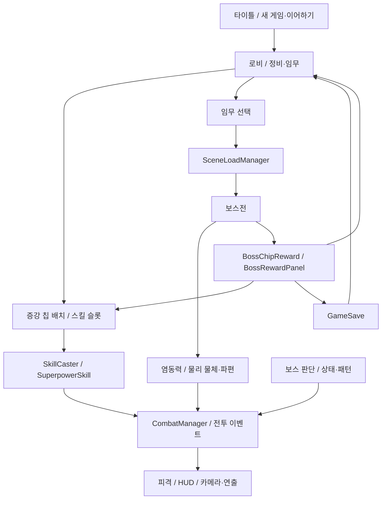
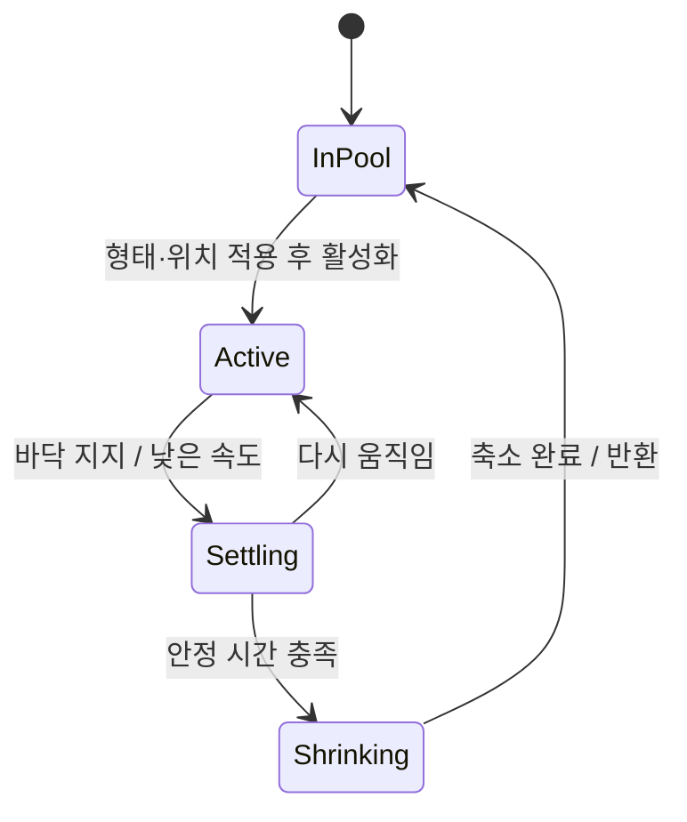
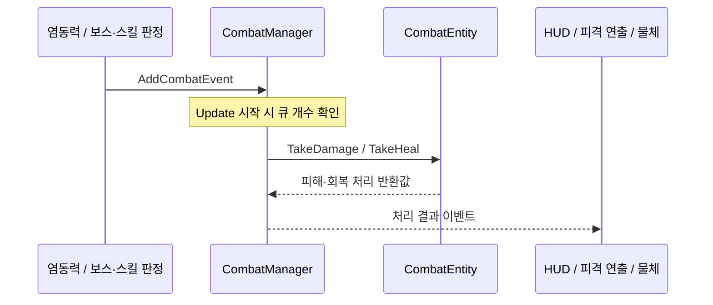
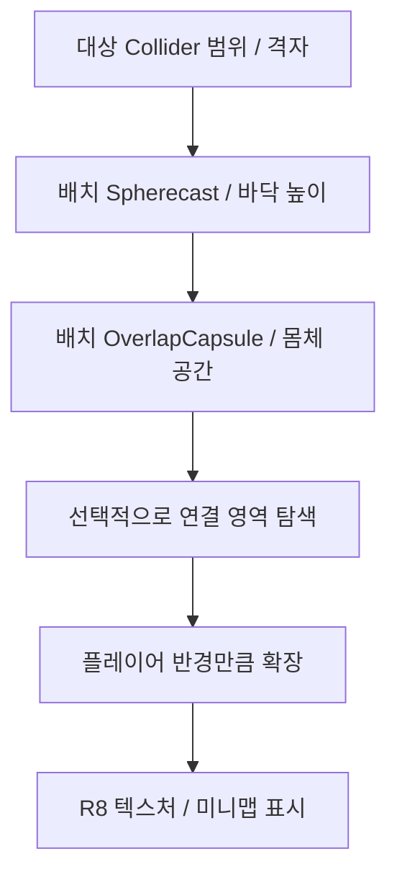
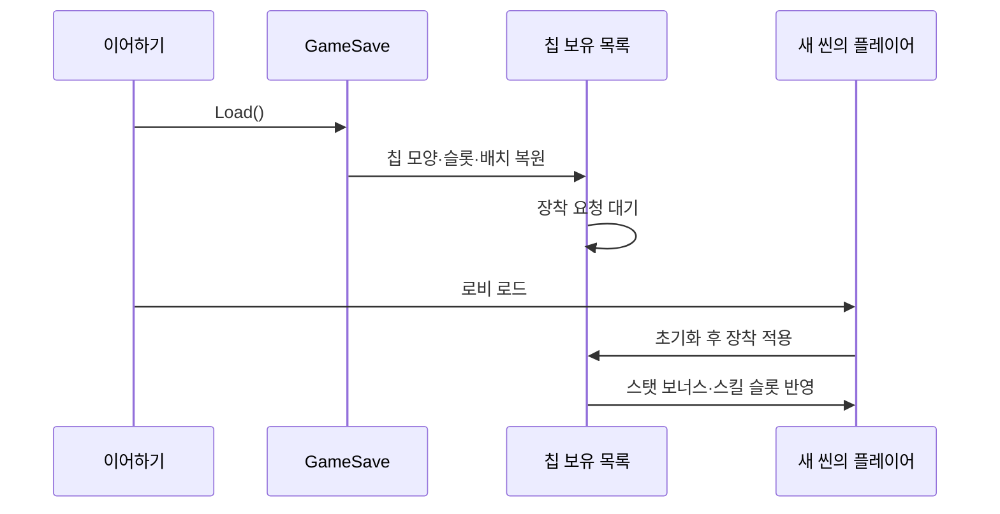
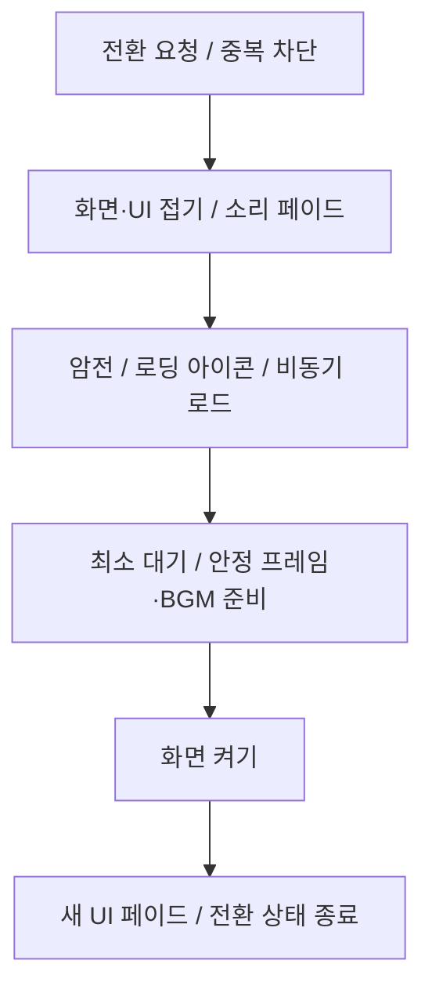

# ODDITY — 초능력 보스 액션 게임 기술 문서

> **담당 영역**: 염동력 조작과 물체 상호작용, 파편 생성·풀링, 시간 정지 기반과 연출, 보스 공통 패턴·피격·무력화 보완, 카메라·HUD·렌더링, 보상·저장·씬 전환 연결

| 구분 | 시스템 | 핵심 내용 |
|---|---|---|
| 핵심 A | 물리 기반 염동력 | 대상 선택 → 잡기 → 물리 추종 → 휘두르기·투척 → 피해 결과 처리 |
| 핵심 B | 파편과 오브젝트 풀 | 크기별 물리 파편과 연출용 파편 분리, 형태를 바꾸어 재사용 |
| 핵심 C | 선택적 시간 제어 | 오브젝트별 시간·물리·애니메이션 제어와 염동력 예외 처리 |
| 핵심 D | 보스 전투와 연출 | 공통 공격 패턴, 그로기, 부위 판정, 공격 예고와 카메라 피드백 |
| 연동 E | 증강 칩·스킬·임무·보상 | 팀 공통 성장 구조에 스킬·보상·저장 경로 연결 |
| 핵심 F | 씬 전환과 플레이 흐름 | 화면·UI·소리 전환, 로딩 대기, 새 게임·이어하기 |
| 연동 기반 | 연출·오디오·UI | 애니메이션 효과음, 볼륨 관리, 타이틀·툴팁 표현 |

---

## 1. 프로젝트 개요

### 1.1 What — 무엇을 구현했나

**ODDITY**는 염동력과 초능력 스킬을 사용해 보스와 싸우는 Unity 3D 액션 팀 프로젝트입니다.
플레이어는 주변 물체를 들어 휘두르거나 던지고, 시간 정지와 여러 스킬을 조합해 전투합니다.
로비에서는 증강 칩을 장착하고 임무를 선택하며, 보스 처치 보상으로 새로운 칩을 얻습니다.

임무는 차르카로사우루스, 페르데로스, 휴머노이드 보스의 전투 씬으로 연결됩니다.
대형 보스의 투하·투척·충격파와 휴머노이드의 검격·반격 등 서로 다른 패턴에 대응하면서,
주변 물체와 파편을 공격 자원으로 활용하는 구조입니다.

### 1.2 Why — 다루는 문제와 구현 방향

소울류·몬스터 헌터류 액션 게임과는 **차별화된 전투 경험**을 주고 싶었습니다.
첫 3D 프로젝트인 만큼 3D에서만 가능한 시스템을 구현하고자 **염동력의 자연스러운 물리 반응**을 살리는 데 집중했고, 평소 중요하게 여기는 **UI/UX**에도 특히 공을 들였습니다.
UI/UX는 공격 예고와 HUD·미니맵, 화면·UI·소리가 함께 바뀌는 씬 전환처럼 플레이어가 전투 상황과 게임 흐름을 쉽게 읽을 수 있도록 다듬었습니다.

| 문제 | 구현 방향 |
|---|---|
| 카메라로 가리킨 물체를 물리 움직임과 연결해야 함 | 화면 중심 기반 선택과 Rigidbody 가속도 추종 분리 |
| 잡기·투척·시간 정지가 같은 물체의 상태를 바꿈 | 중력·충돌·시간 예외 상태의 저장과 복원 |
| 충돌했다는 사실과 실제 피해 성공이 다름 | 전투 이벤트의 처리 결과를 받아 파편화 결정 |
| 많은 파편을 반복 생성하고 제거해야 함 | 크기별 풀과 안정 상태 기반 반납 |
| 보스의 큰 몸체와 지형 때문에 판정·카메라가 어긋남 | 부위별 판정, 지면 투영 예고, 경계 기반 거리와 카메라 충돌 처리 |
| 월드 화면 효과만으로는 Overlay UI가 함께 꺼지지 않음 | 화면 효과와 UI 변형·마스크·소리 페이드를 함께 조율 |
| 칩 보유 상태와 실제 스탯 적용 시점이 다름 | 저장 목록 복원과 플레이어 생성 후 장착 적용 분리 |

### 1.3 개발 환경

| 항목 | 내용 |
|---|---|
| Engine | Unity `6000.3.15f1` |
| Rendering | URP·Shader Graph `17.3.0`, ScriptableRendererFeature·RenderGraph |
| Language | C# |
| Input | Input System `1.19.0` |
| 이동·카메라 관련 패키지 | AI Navigation `2.0.12`, Cinemachine `3.1.7` |
| 비동기·연출 | UniTask, DOTween |
| 에디터 도구 | Odin Inspector |
| 데이터 | 증강 칩·보상·임무 TSV, 로컬 JSON 저장 |
| 기간 | 2026.10 - 2026.11 |
| 인원 | 4인 팀 |
| GitHub | [https://github.com/KooHoo-Dev/3rd_3D_1-3D-Project-team_odd](https://github.com/KooHoo-Dev/3rd_3D_1-3D-Project-team_odd) |

### 1.4 담당 범위와 팀 구현의 연결

| 영역 | 직접 구현·보완한 내용 | 팀 기반과의 관계 |
|---|---|---|
| 염동력·파편 | 기본 공격, 잡기·휘두르기·투척, 피해 연동, 파편 생성과 풀링 | 플레이어 이동·스탯·IK·크기 조절 스킬과 연결 |
| 시간 제어 | 시간 정지와 염동 내려찍기, 정지 대상의 상태 복원·홀로그램 연출 | 개별 스킬과 시간 감속 기능은 팀 구현과 통합 |
| 보스 전투 | 투하·투척·충격파, 공통 패턴 정리, 공격 예고, 피격·그로기·이동 보완 | 상태 머신·Intent 판단·보스 기본 패턴 위에 확장 |
| 시각 피드백 | 외곽선·화면 효과, 보스 연출, 미니맵·HUD, 카메라 시점 보완 | 플레이어·카메라 기본 구현과 결합 |
| 게임 진행 | 보상 테이블·결과 화면, 칩·임무 저장, 이어하기, 타이틀·설정·씬 전환 개선 | 칩 배치·스킬 공통 구조와 임무 기본 기능에 연결 |

칩 배치와 스킬 전략, 공용 전투 이벤트, 플레이어 이동과 보스 판단 기반은 팀이 함께 만든 구조입니다.
아래에서는 이 기반의 전체 역할을 소개하고 직접 확장한 상호작용과 연동을 중심으로 설명합니다.

실제 게임 기능은 플레이어·염동력·초능력·전투·보스·로비·UI·저장과 연출로 나누어 설명합니다.
저장소에 함께 있는 `99. Study`의 학습 예제와 외부 플러그인 코드는 게임의 직접 구현 범위에 포함하지 않습니다.
단, 실제 게임에서 참조하는 공용 유틸리티는 해당 기능의 기반으로 설명합니다.

### 1.5 전체 흐름



### 1.6 전체 플레이의 기반 — 이동·회피·피격과 행동 제한

플레이어 이동·회피의 팀 기반 위에 염동력·피격·상체 연출을 연결합니다.
`PlayerController`는 카메라의 수평 방향을 기준으로 `CharacterController.Move`를 수행하고,
걷기·달리기·중력과 스태미나를 처리합니다.
구르기는 시작 방향을 고정하고 Animator 진행률과 속도 곡선으로 이동량을 계산합니다.
설정한 `rollDistance`가 곡선 형태와 무관하게 항상 정확한 총이동 거리를 보장하는 방식은 아닙니다.

피격이 확정되면 기본 공격의 발사 예약과 염동력 입력을 취소하고, 잡은 물체를 놓으며 IK 상태를 정리합니다.
넉다운·기상과 기상 후 무적을 연결하고, 피격 종료 애니메이션 신호가 누락될 때를 위한 대기 상한도 둡니다.
행동 잠금과 초능력 잠금은 용도에 따라 구분하며 이동·염동력·스킬에서 해당 상태를 확인합니다.

상체 조준과 왼손·팔꿈치 IK를 기본 이동 애니메이션과 결합합니다.
시간 역행 중에는 IK를 내려 기록된 포즈의 복원을 방해하지 않도록 합니다.
회피 연출은 구르기 입력 자체가 아니라 실제 공격을 구르기 무적으로 막았을 때 발생합니다.
`PoseBaker`로 현재 SkinnedMesh 포즈를 메시로 구워 허물·잔상을 만들며, 이 메시들은 사용 후 제거하는 경로로 파편 풀과 다릅니다.

소스: `PlayerController.cs`, `Player.cs`, `DodgeEffect.cs`, `PoseBaker.cs`.

---

### 1.7 연동 구현 — 큰 보스 몸체와 겹칠 때의 이동 보정

플레이어는 보스 몸체 위에 올라서면 수평 방향으로 미끄러지게 하고,
몸체가 플레이어 안으로 들어오는 상황은 부위별 충돌 무시·분리 후 복구로 다룹니다.
잠시 지나가는 부위와 멈춘 채 오래 겹치는 부위를 구분하며, 장시간 겹침에는 측면 이동을 적용합니다.

서로 반대 방향의 부위에 끼어 단순한 밀어내기로 나오지 못하면 수평 16방향을 0.25m 간격으로 검사합니다.
허용 거리 안에서 몸체와 벽을 벗어날 후보를 고른 뒤 `CharacterController.Move`로 이동합니다.
이는 제한된 방향·거리의 탐색이며 모든 지형에서 탈출을 보장하는 전역 경로 탐색은 아닙니다.
행동 잠금과 이 충돌 보정은 별도이므로, 시전 중 행동이 막혀도 위치가 절대 고정된다고 해석하지 않습니다.

`PlayerCombatIdle`은 대기 자세의 발 위치와 골반 높이를 보정합니다.
역행 중에는 기록한 포즈와 IK가 충돌하지 않도록 손·발 IK를 내리고,
제자리 회전에서는 발 고정을 풀어 다리가 바닥에 붙은 채 끌리는 상태를 줄입니다.
기본 이동·애니메이션은 팀 기반이며, 이러한 보완은 염동 자세·역행·피격 연동 과정의 세부 구현입니다.

소스: `PlayerController.cs`, `PlayerCombatIdle.cs`.

---

## 2. 기능 A — 물리 기반 염동력

### 2.1 개요와 시스템 구조

염동력은 화면에서 대상을 고르는 과정과 물체를 실제로 움직이는 과정, 피해를 처리하는 과정을 나눕니다.
잡은 물체는 단순히 손 위치로 이동시키는 장식물이 아니라 Rigidbody를 가진 공격 자원입니다.

| 클래스 | 책임 |
|---|---|
| `PsychokinesisController` | 입력, 대상 탐색, 잡기·투척·휘두르기 조율 |
| `PsychokinesisObject` | 물체의 원래 물리·충돌 상태, 홀딩·투척·파편화 관리 |
| `PsychokinesisForceWave` | 기본 공격의 발사·착탄·피해와 시각 효과 |
| `CombatManager` | 피해 이벤트 큐와 처리 결과 통지 |
| `TimeFreezable` | 시간 정지와 물체 조작의 예외 상태 연결 |

`Update`에서 입력을 예약하고 `LateUpdate`에서 카메라 기준 대상과 조작을 처리합니다.
물체 추종은 `FixedUpdate`에서 수행해 카메라 입력과 물리 갱신의 책임을 구분합니다.

### 2.2 핵심 기능 — 화면 중심 기반 타겟 선택

`OverlapBoxNonAlloc`으로 카메라 방향의 후보를 수집합니다.
화면 중심과의 거리를 우선하고, 비슷한 후보는 플레이어와의 거리로 비교합니다.
화면 비율을 반영해 중심 거리를 계산하고, 더 좋은 후보에 대해서만 가림 검사를 수행합니다.

잡을 수 있는지는 대상의 사용 가능 상태와 플레이어의 최대 염동 질량·스태미나 등으로 판단합니다.
이미 물체를 잡고 있거나 입력이 막힌 상황에서는 불필요한 후보 탐색을 줄입니다.

이 방식은 월드에서 가장 가까운 물체보다 **플레이어가 화면으로 가리키는 물체**를 선택하는 데 맞춰져 있습니다.
고정 크기 버퍼를 사용하므로 한 번에 매우 많은 Collider가 겹치는 상황은 별도 확인이 필요합니다.

### 2.3 핵심 기능 — 물리 추종과 휘두르기

홀딩 위치와 현재 위치의 차이로 가속도를 만들고, 목표 속도와 물체 속도의 차이로 감쇠를 적용합니다.

```csharp
Vector3 acceleration = offset * (followStrength * pullMultiplier)
    - (body.linearVelocity - targetVelocity) * followDamping;
acceleration = Vector3.ClampMagnitude(acceleration, maxAcceleration * pullMultiplier);
Vector3 nextVelocity = Vector3.ClampMagnitude(
    body.linearVelocity + acceleration * Time.fixedDeltaTime,
    maxHoldSpeed * pullMultiplier);
body.AddForce(
    (nextVelocity - body.linearVelocity) / Time.fixedDeltaTime,
    ForceMode.Acceleration);
```

위치 오차만 강하게 줄이면 물체가 목표를 지나치거나 심하게 흔들릴 수 있어 속도 감쇠와 상한을 함께 둡니다.
휘두르기 판정은 잡은 직후 바로 허용하지 않고, 목표 위치에 도착한 상태와 카메라 회전·물체의 상대 속도를 함께 사용합니다.
이를 통해 플레이어가 단순히 이동한 것을 강한 휘두르기로 오인하는 상황을 줄입니다.

### 2.4 핵심 기능 — 실제 피해 성공 뒤 파편화

적에게 충돌해 피해를 요청하는 경로에서는 `DamageEvent`를 큐에 등록합니다.
이벤트가 처리되기 전에는 방어·무적 등으로 실제 피해가 발생했는지 알 수 없으므로,
자신이 요청한 이벤트의 결과를 확인한 뒤 파편화합니다.

```csharp
if (ReferenceEquals(damageEvent, pendingDamage) == false) return;
ClearPendingDamage();
if (receivedDamage <= 0) return;
Shatter();
```

같은 프레임에 다른 공격이 처리되어도 이벤트 인스턴스를 비교해 자신의 타격 결과만 사용합니다.
보스가 생성한 물체의 벽 충돌이나 외부 공격에 의한 파편화는 별도 경로로 처리합니다.
투척 피해에는 물체 질량·속도 또는 설정된 공격력 기반 규칙이 적용되며, 크기 변경 상태를 반영하는 배율도 연결했습니다.

### 2.5 핵심 기능 — 손 동작과 착탄 시점을 연결한 기본 공격

기본 공격은 버튼을 누른 프레임에 즉시 피해를 주지 않습니다.
`PsychokinesisForceWave.Fire`가 손을 당겼다 펴는 동작의 발사 지연을 예약하고,
발사 시점에 화면 중앙을 다시 검사해 손바닥 위치에서 탄을 출발시킵니다.
선택된 충돌 지점은 대상 Transform의 로컬 좌표로 보관해, 대상이 움직일 때 도착 위치도 따라가도록 합니다.

탄은 손 앞에서 잠시 머문 뒤 가속하고, 도착했을 때 전투 이벤트와 착탄 효과를 생성합니다.
매 프레임 새 경로를 물리 검사하는 탄환 방식이 아니라, 발사 시 선택한 대상·지점을 향하는 표현입니다.
따라서 비행 중 새로 들어온 장애물을 모두 판정하는 투사체와는 동작이 다릅니다.
피격 시 아직 발사하지 않은 예약은 취소하지만 이미 날아간 탄은 유지합니다.

착탄 주변 물체는 `ForcePush`로 밀어냅니다.
가벼운 물체는 `SweepTest`로 이동 가능한 거리를 먼저 제한하고 Fixed 갱신 Tween으로 이동시킨 뒤,
종료 속도와 회전 속도를 Rigidbody에 넘깁니다. 무거운 물체나 이동 공간이 부족한 물체는 제자리에서 흔들립니다.
착탄 범위의 적·플레이어에는 이 물체 밀어내기를 적용하지 않습니다.

탄·고리 효과와 발사 상태는 자체 Stack으로 재사용하고, 효과별 값은 `MaterialPropertyBlock`으로 전달합니다.
머티리얼이 없으면 해당 시각 효과를 생략하되, 발사 상태와 피해 처리는 진행합니다.

소스: `PsychokinesisForceWave.cs`, `ForcePush.cs`.

#### 크기 변경과 피해 등급을 함께 반영하는 방식

씬별 피해 오버라이드를 사용하지 않으면 질량과 충돌 전 상대 속도를 곱한 운동량 기반 피해를 계산합니다.
오버라이드를 사용하면 원래 질량으로 소형·중형·대형 등급을 정하고, 현재 공격력에 등급 배율과 누적 크기 배율을 곱합니다.
두 방식은 서로 다른 계산 경로이며, 투척 속도가 모든 설정에서 피해에 비례하는 것은 아닙니다.

초기 등급 계산은 변경된 질량을 그대로 사용해 크기 조절 효과가 등급 경계에서만 나타날 수 있었습니다.
이를 원래 질량과 `sizeFactor`로 나누어, 원래 등급은 유지하고 크기 변경량을 피해에 직접 반영하도록 수정했습니다.
풀에서 다시 활성화될 때 배율을 1로 초기화해 이전 사용의 크기 상태가 다음 사용에 이어지지 않게 합니다.
크기 조절은 길이·질량에 같은 배율을 적용하는 게임 규칙이며, 부피에 비례해 질량을 세제곱하는 물리 모델은 아닙니다.

로비 훈련 공간도 보스전과 같은 공격력 기반 물체 피해 경로를 사용하도록 씬 설정을 맞췄습니다.
현재 최종 로비·Easy·Normal·Hard 씬은 `overrideObjectDamage`가 켜져 있고, 등급 경계는 4.5·9입니다.
공통 Player 프리팹의 기본값은 오버라이드가 꺼져 있으므로, 클래스나 프리팹만 읽으면 실제 전투 씬의 피해 규칙과 다르게 해석할 수 있습니다.

```csharp
// PsychokinesisObject: 현재 질량에서 원래 질량을 복원해 등급 계산 요청
controller.TryCalculateObjectDamage(body.mass / sizeFactor, sizeFactor,
    out int overriddenDamage, out groggy);
// PsychokinesisController: 등급별 atkScale을 고른 뒤 현재 공격력과 크기 배율 반영
damage = Mathf.Max(1, Mathf.RoundToInt(combatEntity.CurrentStats.Atk * atkScale * sizeFactor));
groggy = Mathf.RoundToInt(damage * objectGroggyScale);
```

위 발췌는 피해 오버라이드 경로입니다. 휘두르기·투척은 같은 계산 함수로 연결되지만,
피해 요청을 허용하는 도착·속도·충돌 조건은 각 조작의 판정에 남아 있습니다.

### 2.6 고민과 선택

| 선택 | 이점 | 비용·제약 |
|---|---|---|
| Transform 직접 이동 대신 가속도 추종 | Rigidbody를 유지하며 움직임과 공격 연결 | 질량·감쇠·상한 튜닝과 충돌 정책 필요 |
| 화면 중심 우선 후보 선정 | 조준 의도와 대상 선택을 연결 | 가림 검사·카메라 범위 조건 필요 |
| 실제 피해 결과 후 파편화 | 접촉과 피해 성공을 구분 | 대기 이벤트와 구독 정리 필요 |
| 잡는 동안 충돌·시간 예외 적용 | 플레이어와의 충돌, 정지 세계 속 조작 연결 | 해제·피격·비활성화 시 원래 상태 복원 필요 |
| 로비와 보스전의 피해 설정 통일 | 훈련과 전투에서 공격력·크기 변경이 같은 계산 경로 사용 | 속도 기반 기본 경로와 씬 오버라이드를 구분하고 직렬화 설정도 관리해야 함 |

UI 진입·피격·조작 잠금 시에는 예약 입력과 공격 준비를 취소하고 잡은 물체를 놓도록 연결했습니다.
대상 탐색에 NonAlloc API를 사용하지만, 잡기 상태 저장 등 다른 경로에는 배열 생성이 있어 시스템 전체가 무할당인 것은 아닙니다.

소스: `PsychokinesisController.cs`, `PsychokinesisObject.cs`.

---

## 3. 기능 B — 재사용 가능한 물리 파편과 연출 파편

### 3.1 개요와 구조

부서진 물체의 일부는 다시 염동력으로 사용할 수 있고, 작은 조각은 시각 효과를 담당합니다.
보스가 만든 파편과 플레이어가 던지는 물체가 같은 전투 공간에서 상호작용하도록 구성했습니다.

| 구성 | 역할 |
|---|---|
| `WallFragmentSpawner` | 크기별 파편 선택, 공간 확인, 배치와 초기 힘 |
| `WallFragment` | 풀 객체의 형태 적용과 물리 상태 초기화·반납 |
| `WallFragmentDebris` | 작은 파편의 지지·속도 안정 판정, 축소 후 반환 |
| `ObjectPoolManager` | 키별 풀과 비활성 객체 보관 |

실시간으로 원본 메시를 절단하는 방식이 아니라, 미리 만든 파편 형태를 조합해 생성합니다.
기본 생성 요청은 큰 파편 1개·중간 5개·작은 9개이며, 배치 공간을 찾지 못하면 일부가 생략될 수 있습니다.

### 3.2 핵심 기능 — 크기별 공유 풀과 형태 교체

풀은 `Dictionary<string, ObjectPool>`로 찾고, 내부에서는 `Stack<IObjectPoolItem>`로 객체를 꺼내고 돌려받습니다.

```csharp
public IObjectPoolItem Get()
{
    if (pool.Count == 0) Expand(expandSize);
    return pool.Pop();
}
```

초기 확보 수량과 고갈 시 확장 수량을 분리해, 작은 파편처럼 자주 쓰는 객체를 미리 준비할 수 있게 했습니다.
`Get`은 비활성 객체를 반환하며, 호출자가 형태·위치·회전을 적용한 뒤 활성화합니다.

`ApplyVariant`는 선택된 형태의 Mesh·Material·BoxCollider·질량·스케일을 풀 객체에 적용합니다.
형태마다 별도 풀을 만드는 대신 크기별 객체를 여러 외형으로 재사용하는 구조입니다.

### 3.3 핵심 기능 — 작은 파편의 수명과 반환

작은 파편은 생성 즉시 일정 시간만 기다리는 대신, 바닥 지지 여부와 선형·각속도를 검사합니다.
안정된 상태가 일정 시간 유지되면 DOTween으로 축소하고 풀로 돌려보냅니다.
시간 정지 상태에서는 안정 시간을 누적하지 않습니다.



활성화 시 속도와 관련 상태를 초기화하며, 파편의 중복 반납은 `WallFragment`의 상태로 방지합니다.
범용 풀 자체가 모든 종류의 중복 반납을 검사하는 구조는 아닙니다.

### 3.4 핵심 기능 — 재질별 파괴

파편화 이벤트는 위치·방향·질량뿐 아니라 연출에 사용할 재질도 전달합니다.
금속 소품은 해당 재질을 입힌 금속 조각을 생성하고, 지정이 없거나 금속 풀이 준비되지 않은 경우에는 콘크리트 파편 경로를 사용합니다.
파편 수는 질량 비례 계산에 상·하한을 적용하며, 금속 조각은 별도 수량·반경 설정으로 화면을 덜 가리도록 구성했습니다.

런타임은 준비된 파편 메시를 크기별 풀에서 꺼내 형태를 교체합니다.
큰·중간 파편의 염동력 조작과 작은 파편의 안정 판정·반납은 서로 다른 컴포넌트로 처리합니다.

소스: `WallFragment.cs`.

### 3.5 고민과 선택

큰·중간 파편과 작은 연출 파편을 나누면 전투에 필요한 물리 물체를 남기면서 연출물은 정리할 수 있습니다.
작은 파편은 배치 재시도와 충돌 검사 비용을 줄이고, 기본적으로 지면과 상호작용하는 용도로 사용합니다.
벽 충돌 파편은 충돌 지점 정면을 비우고 벽의 좌우·위쪽으로 퍼뜨려 생성 직후 겹침을 줄입니다.

풀에서 꺼내고 반납하는 기본 연산은 상수 시간이지만, 풀 고갈 시에는 `Instantiate`가 발생합니다.
배치 검사와 물리 시뮬레이션 비용도 남으므로 풀링만으로 파편 전체 비용이 사라지지는 않습니다.

소스: `WallFragmentSpawner.cs`, `WallFragmentDebris.cs`, `ObjectPoolManager.cs`.

---

## 4. 기능 C — 객체별 시간 제어와 시간 정지 연출

### 4.1 개요와 시스템 구조

시간 정지는 플레이어를 포함한 게임 전체의 `Time.timeScale`을 0으로 만드는 대신,
정지 가능한 객체에 `TimeFreezable`을 붙여 적용합니다.
플레이어는 움직이면서 멈춘 물체를 잡거나 공격할 수 있습니다.

| 구성 | 책임 |
|---|---|
| `TimeFreezeManager` | 일정 시간 동안 전체 또는 개별 대상 정지 요청 |
| `TimeFreezable` | 객체별 정지·감속, 로컬 시간, 물리·애니메이션 상태 복원 |
| `TimeFreezeOverlayFeature` | 정지 전환 구간의 홀로그램 오버레이 |
| `TimeStopSkill` | 스킬 사용 조건과 전체 정지 요청 연결 |

개별 정지와 전체 정지는 중첩해서 적용합니다.
개별 정지 횟수가 남아 있으면 정지하고, 전체 시간 효과가 여러 개라면 가장 낮은 배율을 사용합니다.
시간 정지 기반에 시간 감속 스킬과 중첩 배율·중력 보정 등 팀의 확장 기능을 통합한 구조입니다.

### 4.2 핵심 기능 — 로컬 시간과 상태 복원

객체는 정지·감속 동안 누적된 시간 차이를 반영해 자신의 시간을 계산합니다.

```csharp
public float LocalTime => Time.time - pausedDuration
    - (Time.time - pauseStartTime) * (1f - appliedTimeScale);
public float LocalDeltaTime => Time.deltaTime * appliedTimeScale;
public float LocalFixedDeltaTime => Time.fixedDeltaTime * appliedTimeScale;
```

Animator의 원래 속도와 Rigidbody의 운동 상태를 저장하고,
정지 시 Rigidbody를 kinematic으로 전환하며 관련 DOTween을 일시정지합니다.
해제 시에는 저장된 상태를 복구합니다.
보스 행동·이동 등 시간 영향을 받아야 하는 코드는 이 로컬 시간과 배율을 사용해야 합니다.

감속 중에는 속도를 배율에 맞추고 추가 중력을 적용합니다.
이는 기존 궤적을 느리게 표현하기 위한 보정이며, 모든 외부 물리 제어까지 자동으로 감속시키는 기능은 아닙니다.

### 4.3 핵심 기능 — 염동력과 정지 세계의 예외

물체를 잡으면 전체 시간 정지에서 제외합니다.
던진 직후 정지 상태가 바로 덮여 물체가 멈추지 않도록 예외 해제 시점도 연결합니다.
따라서 시간 정지와 염동력은 독립된 화면 효과가 아니라 같은 물체 상태를 공유합니다.

홀로그램은 전환 중인 객체에만 덧그립니다.
완전히 덮이면 원래 `sharedMaterials`를 보관하고 홀로그램 재질로 교체해, 정지 내내 별도 오버레이를 반복해서 그리는 범위를 줄입니다.
해제할 때는 원래 재질을 복구한 뒤 오버레이가 걷히는 연출을 적용합니다.
홀로그램 셰이더는 도입한 외부 셰이더를 바탕으로 높이 마스크·물결·글리치 표현을 확장했습니다.

#### 염동 내려찍기 — 개별 정지·물리 이동·카메라 조율

`PsychoSlamSkill`은 사거리·조준 각도 안의 가장 가까운 보스 또는 훈련 허수아비를 선택합니다.
대상이 없으면 `CanExecute`가 실패하므로 쿨타임·스태미나를 소비하지 않습니다.
선택한 대상은 개별 정지한 뒤 Rigidbody를 Fixed 갱신의 `MovePosition`으로 올리고 내립니다.
지면은 Ground 레이어 Raycast로 찾고, 찾지 못하면 시작 높이를 사용합니다.

시전 중 플레이어는 외부 홀딩 목표를 보며 행동이 잠기고, 카메라는 같은 목표에 집중합니다.
상승음의 피치를 높인 뒤 내려찍는 소리와 피해 이벤트로 연결합니다.
완료 시 저장된 운동 상태를 버리고 정지를 풀어, 들어 올리기 전 속도가 내려찍기 뒤 다시 적용되는 것을 막습니다.
`finally`는 플레이어 홀딩·행동 잠금·카메라·임시 목표를 정리합니다.
다만 대상 정지 해제 자체는 정상 완료 경로에 있으므로, 모든 중단 상황에서 모든 상태를 복구한다고 확대하지 않습니다.

#### 전체 히트스톱과 선택적 시간 정지의 분리

`HitStop`은 타격 순간 월드 전체의 `Time.timeScale`을 0으로 만드는 별도 기능입니다.
유효한 중첩 요청은 종료 시각이 더 긴 쪽으로 합치고, 종료 뒤 짧은 재요청 제한을 둡니다.
지속시간은 `unscaledTime`으로 검사하며, 종료 시 무조건 1이 아니라 `BaseTimeScale`로 돌아갑니다.
따라서 회피 슬로모션 등 전체 시간 효과와 기본 시간 배율을 공유할 수 있습니다.
플레이어가 계속 움직이는 `TimeFreezable` 기반 스킬과 타격감용 전체 히트스톱을 같은 기능으로 취급하지 않습니다.

### 4.4 고민과 선택

| 선택 | 이점 | 비용·제약 |
|---|---|---|
| 객체별 시간 상태 | 플레이어와 일부 물체를 계속 조작 가능 | 관련 제어 코드가 로컬 시간을 사용해야 함 |
| 중첩 정지·감속 관리 | 하나의 효과가 끝나도 다른 효과 유지 | 요청·해제의 짝과 비활성화 정리 필요 |
| 전환 오버레이와 재질 교체 병행 | 전환 표현과 정지 유지 표현을 구분 | 원래 재질·프로퍼티·카메라 제외 처리 필요 |

정지 지속시간을 기다리는 매니저는 `WaitForSeconds`를 사용하므로 게임 전체의 일시정지에는 영향을 받습니다.
물체를 풀로 반환했다가 다시 사용하는 상황, 기존에 따로 일시정지된 Tween과 겹치는 상황은 추가 확인이 필요합니다.

소스: `TimeFreezable.cs`, `TimeFreezeManager.cs`, `TimeFreezeOverlayFeature.cs`.

---

## 5. 기능 D — 보스 패턴·전투 판정과 시각 피드백

### 5.1 개요와 전체 구조

공용 전투 구조는 `ICombatable`과 `CombatEntity`, `DamageEvent`·`HealEvent`, `CombatManager`로 구성합니다.
피해를 요청하는 쪽은 이벤트를 큐에 등록하고, 처리 결과는 HUD·피격 연출과 염동 물체가 구독합니다.



`Update` 시작 시 큐에 있던 개수만큼 처리하며, 처리 중 새로 들어온 이벤트는 다음 Update로 넘어갑니다.
프레임당 고정 N건으로 처리량을 제한하는 방식은 아닙니다.
보호막·방어·가드 등은 엔티티와 팀 공통 스킬 구조가 담당합니다.
결과 이벤트에는 처리 함수의 반환값이 전달됩니다.
현재 피해 반환값은 보호막·방어 처리를 반영하지만, 남은 HP를 넘는 피해나 사망 방지 처리까지 고려한 실제 HP 차이와 항상 같지는 않습니다.
회복도 최대 HP로 제한된 실제 증가분 대신 요청량을 반환합니다.
염동 물체의 파편화는 이 피해 결과값이 0보다 큰지를 기준으로 결정합니다.

### 5.2 보스 판단과 직접 확장한 패턴

보스는 상위 상태와 구체 공격 패턴을 나누고, 판단 결과를 실제 행동으로 이어갑니다.
상태 머신과 Intent 기반 판단은 팀 기반이며, 여기에 주변 물체를 이용한 투하·투척과 충격파,
공통 패턴 구성, 부위별 판정·무력화·연출을 확장했습니다.

| 범위 | 주요 내용 |
|---|---|
| 대형 보스 | 근접 공격, 물체 투하·투척, 충격파, 돌진, 도약 등 |
| 휴머노이드 | 검격·반격·회피·분신 등 별도 패턴과 페이즈 |
| 직접 보완한 공통 흐름 | 공격 예고, 애니메이션 발동 시점, 피격·그로기, 이동·착지와 지면 대응 |

`BossIdleState`는 공격 패턴의 사용 가능 조건·최소 거리·긴급 조건과 가중치로 공격 Intent를 선택합니다.
선택된 공격의 거리와 각도가 맞지 않으면 Chase·Turn으로 조건을 만든 뒤 실행합니다.
단순히 매번 모든 패턴 중 하나를 균등 추첨하는 구조는 아닙니다.

`BossMeleePattern`은 사거리·쿨타임·애니메이션 트리거·루트 모션·타격 예고·종료 정리를 공통으로 제공합니다.
하위 패턴은 `OnPatternEnter`·`OnPatternExit`·`OnPatternAnimEventOccurs`를 구현해 실제 행동을 확장합니다.
보스 상태는 상속 타입 매핑으로 연결되어 공통 상태 요청을 휴머노이드 전용 상태로 이어갈 수 있습니다.

| 계층 | API 또는 진입점 | 역할 |
|---|---|---|
| 판단 | `BossIdleState`의 Intent 선택 | 실행할 패턴과 접근·회전의 필요 판단 |
| 패턴 | `BossMeleePattern.OnEnter/OnExit` | 공통 시작·정리와 패턴별 확장 호출 |
| 타격 시점 | 애니메이션 `OnHitWarn` / `OnHit` | 예고 시작과 도형 기반 타격 판정 |
| 이동 | `BossMovement` / `BossPathfinder` | 물리·지면 대응 이동과 NavMesh 경로 계산 |

보스가 사용하는 파편과 플레이어 염동 물체가 같은 공간에서 상호작용하도록 구성했습니다.
공격의 시작·판정·종료를 애니메이션 신호에 연결하고, 상태 이탈 시 남은 예고와 구독을 정리합니다.

```csharp
root.AnimEventListener.OnOccursAnimStateEvent -= OnOccursAnimEvent;
Animator.applyRootMotion = false;
Animator.ResetTrigger(trigger);
for (int index = 0; index < hits.Length; index++)
{
    if (hitTelegraphs[index] != null) hitTelegraphs[index].Cancel();
    hitTelegraphs[index] = null;
    isLocked[index] = false;
}
OnPatternExit();
```

### 5.3 핵심 기능 — 환경 물체를 공유하는 보스 공격

| 패턴 | 준비와 실행 | 상호작용·정리 |
|---|---|---|
| `BossPsychokinesisDropPattern` | 애니메이션 신호로 원형 범위의 유효 위치에 파편 투하 | 큰·중간 파편은 착지 예고·판정, 작은 파편은 연출; 예상 착지 판정 시 비활성화됐거나 플레이어가 잡고 있으면 판정 생략 |
| `BossPsychokinesisThrowPattern` | 준비 중 경로 추적 후 발사 시 방향 고정 | 비행 물체의 겹침으로 타격 검사; 준비 상태에서 취소되면 물체를 떨어뜨림 |
| `BossShockwavePattern` | 예고·발동 인덱스와 고정 위치·방향을 공유 | 타격과 주변 염동 물체 띄우기를 연결 |
| `BossCharge` | 준비 후 방향을 고정해 돌진 | 같은 돌진의 중복 타격을 막고, 정면 벽 충돌 시 기절·파편 생성으로 연결 |

낙하물의 진행 시간은 보스의 시간과 구분합니다.
보스 상태가 바뀌었다고 공중의 모든 물체가 같은 시점에 끝나는 구조가 아니며,
해당 물체의 시간 상태에 따라 대기하고, 예상 착지 시점의 활성·홀딩 상태를 확인해 판정합니다.
보스가 만들어 낸 파편도 플레이어의 잡기·투척 대상으로 연결되므로 공격 연출과 전투 자원이 겹칩니다.

### 5.4 핵심 기능 — 공격 예고와 그로기

공격 범위는 지면에 투영하는 예고로 표시합니다.
같은 `TelegraphShape`를 표시와 `OnHit` 순간의 `Contains` 판정에 사용하며, 근접 공격을 지속 Trigger 접촉으로 판정하는 방식과 구분합니다.
콤보 패턴에서도 예고 흐름을 공유하고 Ground 레이어를 기준으로 표시 범위를 제한합니다.
큰 보스에서는 중심점만으로 타격 위치를 계산하지 않고, 부위 판정과 몸체 기준 보정을 사용합니다.

공격 피해와 무력화량은 구분하며, 스킬의 무력화는 피해에 대한 `GroggyRate` 비율로 연결했습니다.
돌진 중 벽 충돌 등 특정 상황의 그로기와 피격 연출도 추가했습니다.

`BossGroggy`는 살아 있는 보스에 실제 피해가 전달되고 무력화량이 있을 때 현재 무력화 수치를 차감합니다.
수치가 0이 되면 Broken을 알리고, 상태 계층이 그로기 진입과 회복 후 복귀를 처리합니다.
보호막에 막힌 Hit 반응과 실제 피해 후 그로기 처리는 같은 조건이 아닙니다.

돌진의 벽 충돌로 발생하는 기절과 `BossGroggy` 게이지 소진에 의한 그로기는 진입 조건이 다른 경로입니다.

### 5.5 팀 기반 확장 — 휴머노이드의 페이즈·반응·분신

휴머노이드는 공통 보스 구조 위에 별도 판단·반응·페이즈를 결합합니다.
여러 검격 클래스는 공통 `BossMeleePattern`을 그대로 상속하고, Animator와 타격 데이터로 차이를 만듭니다.
도약·회전·충격파 계열도 기존 패턴을 상속해 재사용하므로, 패턴 클래스 수가 각각 독립적인 판정 구현 수를 뜻하지는 않습니다.

| 구성 | 실제 동작 |
|---|---|
| `HumanoidPhaseController` | HP 비율로 전환을 예약하고, 시간 정지·감속과 차단 상태가 끝난 뒤 2페이즈 진입·리스너 알림 |
| `HumanoidPhaseTransition` | 공통 포효 패턴을 재사용하고 전환 중 무적·이동 상태를 정리 |
| `HumanoidProjectileWatcher` | 플레이어가 잡았던 물체의 진행 방향·속도·접근 시간을 검사해 투척 위협 예측 |
| 반응 패턴 | 허용 상태와 쿨타임·가중치·확률을 거쳐 회피·파괴·가드 반사 실행 |
| `HumanoidCloneSummon` | 대기 복제본을 준비했다가 소환 신호로 활성화하고 본체 사망 시 정리 |
| `HumanoidDimensionSlash` | 시간 효과·플레이어 행동 제한·분신 중지·화면 연출을 조율하고 상태 종료 시 복원 |

반응 패턴은 일반 Idle 추첨과 별도로 위협 감시자가 진입시킵니다.
전이 직후 잠시 이전 애니메이션의 잔여 신호를 무시해 다른 패턴의 타격이 잘못 발동하는 상황을 줄입니다.
반사 시에는 원래 물체를 제거하고 전용 투사체 풀에 외형·질량을 복사합니다.
이 투사체에는 `PsychokinesisObject`가 없어 플레이어가 다시 잡는 일반 물체와 구분됩니다.

분신은 전용 홀로그램·예고 색을 사용하지만 일반 파편처럼 풀에서 재사용하지는 않습니다.
대기본은 `Instantiate`로 만들고 소멸 시 제거하며, 분신이 사라진 뒤 로컬 시간 기준으로 재소환을 기다립니다.
본체 전용 연출 중에는 분신을 일시 중지했다가 HP를 유지한 채 복귀시키는 경로가 있습니다.

이 영역의 페이즈·분신·반응 기반은 팀 구현이며, 직접 담당한 공통 패턴·시간 제어·렌더링과 연결되는 전체 전투 구조로 소개합니다.

하드 보스의 전투 수치는 클래스 기본값 외에 씬의 직렬화 오버라이드로 조정합니다.
현재 최종 Hard 씬의 분신 최대 체력은 본체의 10%, 재소환 대기는 분신 소멸 후 로컬 시간 20초입니다.
기존 15%·30초에서 바뀐 씬 설정이며, 재소환 타이밍은 소멸 시각을 기록하는 `HumanoidCloneSummon`의 상태와 함께 해석해야 합니다.
이 수치 조정은 팀의 보스 구성에 해당하며, 분신 풀링이나 새로운 소환 알고리즘을 개인 구현한 것으로 포함하지 않습니다.

### 5.6 핵심 기능 — 카메라·HUD·렌더링

기본 이동·카메라 위에 일반·홀딩·질주·보스 근접 시점을 구분하고, 오프셋·거리·FOV를 보간합니다.
보스 근접 판단은 큰 몸체의 Collider 경계까지의 수평 거리를 사용하며,
진입·이탈 거리를 다르게 두어 경계에서 시점이 반복 전환되는 현상을 줄입니다.

카메라의 벽 충돌은 SphereCast로 검사해 즉시 거리를 당기고, 벽에서 벗어나면 보간해 복구합니다.
어깨 쪽 공간이 부족하면 반대쪽이나 중앙으로 이동하도록 시점도 조정합니다.
보스 조우 연출은 별도 카메라 시점과 HUD 표시를 조율하고, 종료 후 추적 시점으로 돌아갑니다.

염동력 대상과 NPC 외곽선은 URP RendererFeature로 실루엣 마스크를 만든 뒤 합성합니다.
MSAA 마스크로 가장자리 표현을 보완하며, 시간 정지 오버레이와 미니맵 카메라의 표시 범위는 따로 처리합니다.
HUD에는 체력·보호막, 스태미나, 스킬 슬롯·쿨타임, 보스 상태와 시스템 메시지를 연결했습니다.

### 5.7 핵심 기능 — 물리 검사로 만드는 미니맵 이동 영역

미니맵은 위에서 본 장면만 표시하지 않고, `MinimapWalkableBaker`로 플레이어가 설 수 있는 영역의 마스크를 만듭니다.



구의 반경으로 작은 틈을 처리하고, 캡슐이 들어갈 공간을 검사해 벽 안쪽이나 머리 공간이 없는 칸을 제외합니다.
연결 영역 옵션이 켜져 있으면 플레이어 시작 지점에서 상하좌우로 탐색하고, 허용 높이 차를 넘는 이웃은 연결하지 않습니다.
마지막으로 플레이어 반경만큼 영역을 넓혀 몸체가 닿을 수 있는 가장자리를 표시합니다.

물리 검사는 `SpherecastCommand`·`OverlapCapsuleCommand`의 배치 Job을 사용하지만,
각 단계에서 `Complete`로 완료를 기다립니다. 씬 시작 시 한 번 생성하는 마스크이며 프레임마다 비동기로 갱신하는 지도는 아닙니다.
`MinimapGround`와 전용 셰이더가 결과 텍스처를 표시하고, 활성 물체·보스 등의 표시는 미니맵 계층에서 별도로 처리합니다.
NavMesh 기반 자동 길찾기나 베이크 이후의 동적 지형 변화까지 반영하는 기능은 아닙니다.

소스: `BossPsychokinesisDropPattern.cs`, `BossPsychokinesisThrowPattern.cs`, `HumanoidProjectileWatcher.cs`, `HumanoidPhaseController.cs`, `HumanoidCloneSummon.cs`, `MinimapWalkableBaker.cs`, `MinimapGround.cs`.

#### 몸체 기준 타격 지점과 효과의 역할 분리

다중 Collider 보스에서 범위 공격의 첫 후보만 사용하면 발 Collider에 이펙트가 몰릴 수 있습니다.
`HitPoint.GetBodyBounds`는 활성 비Trigger Collider를 묶어 몸 전체 Bounds를 만들고,
`TowardBody`는 공격 방향 쪽 몸통 높이의 점을, `OnLineNearBody`는 공격 선분 위에서 몸 중심에 가까운 점을 구합니다.
피해 요청의 기준점을 정한 뒤 실제 표면 연출은 `BossHitFeedback`에서 다시 보정합니다.
Bounds는 몸체의 근사 영역이므로 복잡한 메시의 정확한 표면 판정을 대체하지는 않습니다.

#### 여러 부위 Collider를 같은 전투 대상으로 연결

`MonsterRegistry`는 충돌한 Collider를 `ICombatable`로 변환하는 Dictionary입니다.
`BossHitboxRegistrar`는 보스의 여러 비Trigger 부위를 같은 소유자에 등록하고 비활성화 시 자신이 등록한 항목을 해제합니다.
대표 Collider와 이미 등록된 Collider는 제외해 중복 등록을 피합니다.
따라서 타격 위치는 부위별로 얻으면서 HP·방어·그로기 대상은 같은 보스로 묶을 수 있습니다.

이는 판정 부위와 전투 대상의 대응표이며, 해당 부위마다 별도 HP를 제공하는 부위 파괴 시스템은 아닙니다.
활성 중 Collider를 추가·제거하는 기능까지 자동 추적하지는 않으므로 동적 부위 변경에는 재등록 정책이 필요합니다.

#### 렌더 패스별 마스크와 합성 책임

| RendererFeature | 별도 처리 |
|---|---|
| `PsychokinesisOutlineFeature` | 후처리 전에 4× MSAA 실루엣을 만들고 해석된 마스크를 화면 외곽선으로 합성 |
| `BossOcclusionOutlineFeature` | 보스 깊이와 플레이어 실루엣을 따로 준비해 보스에 가려진 플레이어 표현에 사용 |
| `TelegraphMaskFeature` | 불투명 렌더 뒤 Ground 외 물체와 등록 렌더러에 스텐실 128을 기록해 예고가 몸·소품 위에 묻는 현상 제한 |
| `HitFlashFeature` | 투명 렌더 뒤 활성 피격 대상의 서브메시를 덧그리고 대상별 강도를 전달 |

화면 효과 하나로 모든 표시를 처리하는 대신 필요한 색·깊이·마스크를 RenderGraph의 읽기·쓰기 대상으로 선언합니다.
직접 `DrawRenderer`하는 경로는 카메라 컬링 마스크만으로 제외되지 않으므로, 대상 카메라를 별도로 거르는 API가 있습니다.
효과가 없을 때는 패스 등록을 생략하는 조건도 두지만, 활성 대상이 많으면 다시 그리는 메시와 임시 텍스처 비용은 남습니다.
시간 정지 위에 피격 번쩍임을 보이게 하려면 RendererFeature의 순서도 설정해야 합니다.

공격 예고 셰이더는 깊이로 월드 위치를 복원하고 화면 미분으로 표면 방향을 구합니다.
높이 범위와 표면 조건을 검사한 뒤 원·부채꼴·상자의 거리 함수로 예고 모양을 만들고, `fwidth`로 경계를 완화합니다.
별도의 스텐실 마스크는 보스 몸체·소품 위로 표시가 번지는 것을 추가로 제한합니다.
보스 가림 외곽선은 보스 자체의 테두리가 아니라 보스 뒤에 가려진 플레이어를 표현하는 기능이며,
다른 벽에 가린 상황까지 모두 보여 주는 일반 투시 기능은 아닙니다.


#### 이동 제한과 이탈 복구를 분리한 보스 이동

`BossPathfinder`의 경로 코너를 실제 이동으로 바꾸는 `BossMovement`는 벽 SphereCast와 지면 탐침으로 진행을 보정합니다.
루트 모션 이동도 같은 경로를 통과하며, 도약 중의 이동과 착지 후의 지면·NavMesh 제한은 구분합니다.

한 번 크게 이탈한 보스를 이동 제한만으로 복귀시키기 어려워 `BossNavMeshGuard`가 별도로 검사합니다.
로컬 시간 기준으로 일정 간격마다 발밑 NavMesh와 수평 차이를 보고, 유예시간을 넘기면 가까운 NavMesh 위치로 복구합니다.
그 위치도 찾지 못하면 마지막 안전 좌표를 사용하고, 기록이 없으면 복구하지 못합니다.
도약·등장·사망 연출처럼 의도적으로 다른 위치에 있는 구간에서는 검사를 억제합니다.
즉 정상 이동을 제한하는 역할과 예외적인 이탈을 복구하는 역할을 분리한 구성입니다.

#### 투하·투척 판정과 휴머노이드 위협 예측의 범위

투하 패턴의 착지 판정은 실제 Collision 콜백이 아니라 예상 낙하시간을 기다린 뒤 실행하는 면적 판정입니다.
투척 패턴은 탄도 속도로 발사하고 비행 중 겹침 검사를 사용합니다.
보스 투척물이 타격을 요청한 직후 `ShatterAt`하는 경로는 플레이어 물체가 피해 결과를 기다린 뒤 파편화하는 경로와 다릅니다.
공통 `TelegraphShape.Contains`도 XZ 도형과 대상 반경을 비교하며, 그 함수 자체가 높이 차까지 판정하지는 않습니다.

휴머노이드의 투척 위협 감지는 현재 속도의 직선 투영을 이용하며 중력까지 적분한 미래 궤적 예측은 아닙니다.
차원 가르기는 세계·플레이어 감속과 초능력 제한을 조합하고, 종료 시 분신과 시간 상태를 복구합니다.
최종 피해는 현재 HP와 남길 최소 HP 비율을 고려해 요청량을 제한하지만,
실제 방어·보호막 계산을 통과한 뒤의 HP를 특정 값으로 강제하는 기능은 아닙니다.

현재 Hard 씬의 `HumanoidDimensionSlash`는 `damageRatio = 0.3`, `minHpRatio = 0.7`이며,
별도 `HumanoidDimensionSlash_2` 인스턴스는 각각 1·0.5입니다.
두 번째 클래스는 첫 클래스를 그대로 상속한 빈 클래스이므로 판정 알고리즘을 새로 구현한 것이 아니라 상태 타입과 인스턴스별 설정을 구분한 구성입니다.
최소 HP 비율은 피해 요청량의 상한을 계산하는 값입니다.
요청량이 0이어도 `CombatEntity.TakeDamage`는 방어 계산 뒤 최소 피해를 1로 만들 수 있으므로, 이 패턴이 플레이어를 절대로 죽이지 않는다고 설명하지 않습니다.

소스: `BossNavMeshGuard.cs`, `BossMovement.cs`, `HumanoidDimensionSlash.cs`, `HumanoidDimensionSlash_2.cs`, `HumanoidCloneSummon.cs`.

### 5.8 고민과 선택

공용 전투 이벤트를 유지하면서 염동력·스킬·보스가 같은 결과 경로를 사용하도록 연결했습니다.
반면 공격 예고·피격 반응·카메라·보스 패턴은 실제 전투 타이밍과 연결되어 있어,
이벤트화만으로 모든 클래스의 결합이 사라지는 구조는 아닙니다.

보스의 NavMesh는 경로·다음 코너 계산에 사용하고 실제 이동은 `BossMovement`가 처리합니다.
루트 모션도 이동·회전 함수를 통과하도록 연결하고, 몸체 반경·벽·단차·도약 착지를 보정했습니다.

대형 보스와 휴머노이드는 몸체·이동·패턴이 달라 공통 요소와 전용 처리를 함께 유지합니다.
공통 패턴을 재사용하되 예외를 한 상태 안에 모두 넣지 않는 구성이 필요합니다.
공격 예고 풀이 연결되지 않은 경우에도 타격 판정은 진행되므로, 표시와 판정의 Inspector·애니메이션 연결을 함께 확인해야 합니다.

소스: `BossMeleePattern.cs`, `CombatManager.cs`, `BossMonster.cs`, `CameraController.cs`, `PsychokinesisOutlineFeature.cs`.

---

## 6. 연동 E — 칩·스킬·임무와 보상·저장

### 6.1 전체 성장 구조

증강 칩의 배치·인벤토리·스킬 전략과 임무 기본 기능은 팀 구현입니다.
이 구조에 시간 정지·염동 내려찍기, 보상 테이블, 결과 화면, 로컬 저장과 이어하기를 연결했습니다.

| 구성 | 역할 |
|---|---|
| `AugmentationChipInventory` | 보유 칩, 장착 상태, 스탯 반영과 스킬 5개 슬롯 |
| `ChipGridView` | 회전된 칩 모양의 경계·점유 검사 |
| `SkillFactory` / `SuperpowerSkill` | 칩 데이터에서 스킬 생성, 실행·쿨타임 공통 흐름 |
| `SkillCaster` | 입력·행동 상태·쿨타임·스태미나 검사 |
| `MissionUI` / `MissionListUI` | 임무 표시·수락·이동할 임무 목록 |
| `BossChipReward` / `BossRewardPanel` | 처치 보상 지급·표시와 로비 복귀 |
| `GameSave` | 보유 칩·장착 배치·수락 임무 저장·복원 |

장착 가능 여부 전체를 인벤토리가 검사하는 것은 아닙니다.
그리드의 경계·점유 검사는 UI 배치 계층이 담당하며, 스킬 슬롯과 스탯 적용은 인벤토리 계층에 연결합니다.

### 6.2 팀 기반 — 칩별 상태와 스킬 실행 규칙

`OwnedChip`은 공통 정의 데이터를 참조하면서 칩 한 장의 모양 셀·배치·회전과 스킬 인스턴스를 보유합니다.
따라서 쿨타임은 슬롯이 아니라 칩을 따라갑니다.
인벤토리는 장착된 슬롯만 Tick하므로 해제 중에는 쿨타임이 진행되지 않고, 씬 로드 시에는 쿨타임과 패시브 효과를 정리합니다.

`ChipShapeLibrary`는 칸 수에 맞는 연결 모양을 만들고, 회전·좌표 정규화로 중복 후보를 제거해 캐시합니다.
그리드 크기에 들어가는 후보 중 모양을 선택하며, 회전 동일성과 좌우 반사 동일성을 같은 규칙으로 처리하지는 않습니다.
기본 스탯 `ScriptableObject`는 유지하고 `RuntimeStats`에 보너스를 더하거나 제거해 장착 효과를 반영합니다.
최대 HP가 늘면 증가분만큼 현재 HP를 보충하고, 줄면 변경된 최대 HP 안으로 제한합니다.

스킬 입력은 다음 공통 흐름을 사용합니다.

1. UI·피격·행동 잠금·정비소·다른 스킬 시전 여부를 확인합니다.
2. 슬롯의 스킬이 준비되었고 필요한 대상 등 실행 조건이 맞는지 검사합니다.
3. `TryUse`가 성공하면 쿨타임을 시작해 실행하고, 호출자가 스태미나를 소비합니다.
4. 채널링은 키 해제나 행동 제한 시 `Release`로 종료합니다.

공격 스킬은 현재 공격력의 백분율로 피해를 계산하고 무력화 비율을 연결합니다.
지속 타격의 작은 무력화 수치는 소수점 잔여량을 다음 틱에 누적해 매번 반올림할 때 생기는 손실을 줄입니다.

### 6.3 팀 기반 — 방어·패시브와 시간 역행

`CombatEntity`는 사망·무적과 `Guard.BlockDamage`를 확인한 후 `Hit`를 알리고,
방어력·보호막·사망 방지 순서로 피해를 처리합니다.
보호막으로 HP 피해가 0이 되어도 `Hit` 반응은 발생합니다.
반면 `PassiveSkillRunner`의 피해를 주거나 받은 트리거는 양수 결과를 대상으로 하므로 피격 반응과 패시브 발동의 조건을 구분합니다.

플레이어의 `IDamageGuard`는 회피·기상 무적과 패시브 방어를 연결합니다.
보호막·회복·사망 방지·쿨타임 감소 등 개별 스킬의 동작은 공통 전략 구조에 붙습니다.

시간 역행은 월드 전체를 되감는 기능이 아닙니다.
`TimeReverseRecorder`가 플레이어의 위치·회전·Animator 레이어·HP·스태미나를 기록하고,
역행 중에는 무적과 행동 잠금을 적용한 채 플레이어 기록을 역순으로 복원합니다.
기본 기록 설정은 0.05초 간격·최대 20초이며, 재생 속도는 별도로 설정합니다.
시간 정지의 객체별 시계와 시간 역행의 기록 복원은 서로 다른 구현 방식입니다.

기록 복원에서도 홀딩 전용 `Psycokinesis` 레이어는 가중치를 0으로 내려 재생하지 않습니다.
과거 홀딩 장면의 손가락·홀딩 자세가 현재 조작 상태와 어긋나는 상황을 피하기 위한 처리입니다.
일반 레이어의 상태·진행률·가중치 복원과 손·발 IK 해제를 함께 적용하므로, 모든 레이어를 기록 그대로 재생하는 구조는 아닙니다.

#### 팀 스킬 보완 — 컴포넌트 비활성화에서 공통 행동 잠금으로

역행의 초기 방식은 `CharacterController`와 `PlayerController`를 끄고 끝날 때 다시 켰습니다.
현재는 두 컴포넌트를 직접 끄는 대신 `SetActionLocked`로 공통 행동 상태를 바꿉니다.
`IsSuperpowerLocked`가 행동 잠금을 포함하므로 별도 컴포넌트인 `SkillCaster`도 이를 읽어 다른 액티브 스킬 사용을 막습니다.
이동·구르기·염동력·마우스 카메라 회전도 각 입력 경로에서 같은 행동 잠금을 확인합니다.
잠금은 이동 입력을 없애는 것이며, 중력·몸체 겹침 보정까지 모두 멈추는 물리 고정은 아닙니다.

```csharp
// TimeReverseRecorder.SetRewinding의 일부
owner.IsInvincible = rewinding;
if (rewinding) prevAnimatorSpeed = animator.speed;
animator.speed = rewinding ? 0f : prevAnimatorSpeed;
player.PlayerController.SetActionLocked(rewinding);
```

기록 위치를 `SetPositionAndRotation`으로 복원한 직후에는 `Physics.SyncTransforms()`를 호출합니다.
이는 켜져 있는 CharacterController의 다음 이동과 Transform 복원 위치를 맞추는 연결입니다.
제어 컴포넌트가 켜진 현재 흐름에서는 계속 갱신되는 홀딩 레이어를 기록 재생 쪽에서 0으로 덮고,
IK 코드도 `IsRewinding`을 확인해 기록 포즈와 현재 조작 자세가 서로 덮어쓰는 것을 제한합니다.

역행의 기록·재생과 행동 잠금 전환은 팀 구현·보완입니다.
직접 보완한 부분은 역행 중 상체·손·발 IK와 홀딩 레이어가 기록 포즈를 덮지 않게 하는 연결이며, 역행 전체를 단독 성과로 포함하지 않습니다.

### 6.4 핵심 기능 — 데이터 기반 보상 연결

임무 데이터에는 이동할 전투 씬과 보상 ID가 있습니다.
`BossReward.tsv`는 보상 ID별로 칩 칸 수의 범위와 지급 개수를 정의합니다.

| RewardId | MinCell | MaxCell | Count |
|---|---|---|---|
| 1 | 5 | 6 | 1 |
| 1 | 3 | 4 | 2 |
| 1 | 2 | 2 | 3 |

보스 사망 상태의 완료 이벤트가 보상 지급으로 이어지고, 규칙에 맞는 칩 후보에서 중복 ID를 제외해 추첨합니다.
임무 창의 보상 안내와 실제 보상도 같은 테이블을 사용하도록 연결했습니다.
보상 확인 버튼을 누르면 해당 임무를 목록에서 제거하고 로비로 이동합니다.

임무 이동에는 `MissionUI.RegisterAndMove`의 수락 후 즉시 이동과 `StageMoveUI.MoveToStage`의 수락 목록에서 이동하는 두 진입점이 있습니다.
두 경로 모두 선택한 임무의 `BossName`을 영속 `UIManager.CurrentBossName`에 전달합니다.
즉시 이동 경로에도 이 전달을 추가해, 보상 확인 시 이전 임무 이름이나 빈 이름으로 목록 제거를 요청하는 차이를 보완했습니다.

정상 보상 확인의 연결은 다음과 같습니다.

1. `BossRewardPanel.Close` → `UIManager.MissionListUpdate`로 현재 보스 이름을 전달합니다.
2. `MissionListUI.RemoveMission`이 이름이 일치하는 첫 임무를 정적 수락 목록에서 제거합니다.
3. `OnAcceptedMissionsChanged`를 구독한 `GameSave.Save`가 남은 목록을 기록합니다.
4. 로비 복귀 후 새 `MissionListUI.Awake`가 남은 임무로 화면 행을 다시 만듭니다.

보상 규칙은 보스가 속한 씬의 `NextStageName` 대응으로 고르고, 완료 임무 제거는 `BossName`으로 찾습니다.
두 연결 키가 다르므로 같은 보스 이름을 여러 임무에 중복 사용하거나 임무 선택 없이 전투 씬을 직접 실행하는 경우까지 자동으로 식별한다고 해석하지 않습니다.

후보가 부족하면 지급 결과가 설정 개수와 달라질 수 있으므로 데이터 구성과 UI 슬롯 처리를 함께 확인해야 합니다.
임무 제거는 보스 사망 즉시가 아니라 보상 확인 흐름에 연결되어 있습니다.

### 6.5 핵심 기능 — 목록 복원과 실제 장착의 분리

저장 파일에는 칩 ID·모양 셀·장착 여부·배치 원점·회전·스킬 슬롯과 수락 임무 ID를 기록합니다.
체력·위치·보스 패턴·전투 중 쿨타임을 저장하는 전투 중간 세이브는 아닙니다.

목록을 읽는 시점에 플레이어 스탯이 준비되지 않을 수 있어, 장착 요청을 보관했다가 플레이어 생성 이후 적용합니다.
이어하기 시 이미 초기화가 끝난 플레이어가 있는 경우에도 장착을 반영하도록 연결했습니다.

```csharp
// 저장 목록을 복원할 때
chips.Add(chip);
if (equipped)
    pendingEquips.Add((chip, skillSlot));
```

```csharp
// 플레이어 초기화·씬 로드 후 대기 장착 반영
foreach ((OwnedChip chip, int slot) in pendingEquips)
    Equip(chip, chip.Origin, chip.Rotation, slot);
pendingEquips.Clear();
```



### 6.6 핵심 기능 — 로비 상호작용과 훈련 공간

`RepairShopZone`은 플레이어 위치를 `InverseTransformPoint`로 변환한 뒤 상자 내부인지 확인합니다.
별도 Trigger가 조준 Raycast에 걸리는 상황을 피하면서, 정비소 안에서는 공격·스킬을 제한하고 우클릭을 NPC 상호작용으로 넘깁니다.
임무·칩 조작 UI와 전투 조작이 같은 입력을 동시에 사용하는 상황을 공간 규칙으로 구분한 구성입니다.

훈련 공간의 `TrainingDummy`는 체력 회복·사망 방지와 HUD 표시를 제공하지만 실제 보스의 그로기 상태 머신을 모두 실행하지는 않습니다.
`PsychokinesisPropRespawner`는 맵 소품의 원본 복제본을 준비하고, 파괴 후 배치 가능한 빈자리를 찾아 다시 생성합니다.
배치가 막히면 재시도하며, 이 경로는 `Instantiate` 기반으로 파편의 공유 풀과 구분됩니다.

소스: `SuperpowerSkill.cs`, `SkillCaster.cs`, `CombatEntity.cs`, `TimeReverseRecorder.cs`, `RepairShopZone.cs`, `TrainingDummy.cs`, `PsychokinesisPropRespawner.cs`.

#### 스킬 종류별 판정과 수명

| 계열 | 구현 세부와 책임 |
|---|---|
| 염동 빔 | 스킬은 생성·해제를 맡고 `PsychoBeam`이 조준 갱신·벽까지의 길이·관통 대상·틱 피해를 처리; 채널링 중 이동 제한과 구르기 중단 연결 |
| 염동 폭풍 | `PsychoTempest`가 등록된 적을 추적·재탐색하고 반경의 대상에 주기 피해; 대상이 없어도 미리 설치 가능 |
| 보호막 | 재사용 시 남은 보호막에 더하지 않고 새 값으로 교체; 효과 객체는 보호막 소진·만료를 관찰 |
| 회복 | HP가 가득 차면 실행하지 않음; 회복 이벤트와 별도로 수동 회복 전용 화면 알림을 보내 모든 흡혈 회복이 화면을 깜빡이지 않게 구분 |
| 쿨타임 감소 패시브 | 쿨타임 중인 액티브 후보를 추려 하나를 선택; 패시브와 후보가 없는 경우는 제외 |

염동 투사는 `PsychoBeamSkill.IsCasting => beam != null`을 재정의해 활성 빔의 수명을 공통 시전 상태에 연결합니다.
`SkillCaster`는 모든 장착 슬롯의 `IsCasting`을 검사하므로, 채널링 중 다른 스킬 키를 눌러도 새 스킬을 실행하지 않습니다.
이전에는 빔 자체의 중복 생성만 막았지만, 현재는 다른 슬롯 사용 제한에도 빔 상태가 반영됩니다.
`IsMoveBlocked`는 걷기·달리기 제한, `IsCasting`은 다른 스킬 사용 제한이며 역할이 다릅니다.
구르기는 허용하고 빔의 실행 루프가 구르기를 감지해 종료하므로, 카메라까지 잠그는 역행의 행동 잠금과 동일하게 취급하지 않습니다.
빔의 공통 시전 상태 연결과 칩 장착·해제 효과음은 팀의 스킬·UI 보완에 해당합니다.
장착음은 UI 배치 성공 후, 해제음은 그리드 제거·인벤토리 해제 경로에서 재생하며 저장 복원 자체의 효과음으로 일반화하지 않습니다.

스킬마다 범위·추적·충돌·지속시간이 다르므로 공통 `TryUse`가 모든 실제 판정을 수행하지는 않습니다.
Prefab 기반 지속 효과 중에는 생성·제거 경로를 사용하는 것도 있어, 게임 전체 효과가 공용 풀링된다고 표현하지 않습니다.

#### 염동 물체를 사용하는 스킬의 상태 연결

크기 조절 스킬은 `Resize`로 질량과 누적 크기 배율을 반영한 뒤 외형 스케일을 Tween으로 변화시킵니다.
따라서 물리 값의 변경과 외형 보간의 시간이 같지는 않습니다.
대상 조건을 만족하지 못하면 실행 대신 거절 연출을 하고 쿨타임·스태미나를 소비하지 않습니다.

염동 연사는 활성 물체 목록에서 설정 수량까지 확보하며, 거리가 가까운 순으로 정렬하는 방식은 아닙니다.
확보한 물체는 머리 주변의 배치 지점을 물리 속도로 추종하고, 각 발사 시점에 현재 조준점을 다시 구합니다.
종료 정리에서는 발사하지 못한 물체도 놓아 홀딩 상태가 남지 않게 합니다.
이 기능들은 공통 염동 물체와 팀의 스킬 전략을 결합한 경로로, 개별 스킬 전체를 단독 개발한 성과와는 구분합니다.

#### 이어하기에서 기존 플레이어까지 고려한 복원

초기 장착 복원은 새 플레이어의 `Start`에서 대기 장착을 적용하는 흐름이었습니다.
이미 시작한 플레이어가 살아 있는 상태에서 목록을 복원하면 `Start`가 다시 실행되지 않는 경우도 고려해야 합니다.
살아 있는 인벤토리를 추적하고 `sceneLoaded`에서도 대기 장착을 적용하도록 보완했습니다.

`ResetAll`은 목록을 비우기 전에 기존 플레이어에 적용한 스탯 보너스를 제거합니다.
복원 중 빈 목록으로 저장 파일을 덮지 않도록 이 초기화는 저장을 호출하지 않으며,
스킬 슬롯 변경 알림과 장착 적용을 분리해 UI가 이전 슬롯을 계속 표시하는 상황도 다룹니다.
일반 씬 전환에서는 `Player`가 새로 생성되므로, 이 보완을 모든 플레이어가 타이틀 이후에도 영속한다는 뜻으로 해석하지 않습니다.

### 6.7 고민과 선택

정의 데이터와 플레이 중 보유 상태를 나누면 테이블을 기준으로 저장된 ID를 복원할 수 있습니다.
현재는 목록 변경 시 동기 JSON 저장을 수행하며, 테이블에서 사라진 항목은 건너뜁니다.
파일 읽기·쓰기 예외는 처리하지만, 저장 버전 변환·백업·원자적 파일 교체까지 제공하지는 않습니다.

환경설정 파일은 게임 진행 저장과 별개이며, 현재 영속 저장 범위는 마스터·BGM·효과음 볼륨과 각 음소거 상태, 카메라 회전 속도입니다.
화면 모드·해상도까지 파일에 저장되는 것으로 확대하지 않습니다.

소스: `AugmentationChipInventory.cs`, `BossChipReward.cs`, `GameSave.cs`.

---

## 7. 기능 F — 월드·UI·소리가 함께 전환되는 씬 로딩

### 7.1 개요와 구조

씬 전환은 월드 화면이 꺼지고 새 씬이 켜지는 연출에 UI와 소리까지 맞추는 작업입니다.
`SceneLoadManager`는 비동기 씬 로드와 `ScreenOffEffect`, 화면 글리치·로딩 표시를 조율합니다.
타이틀의 새 게임·이어하기와 보상·사망 후 로비 복귀가 이 경로를 사용합니다.



### 7.2 핵심 기능 — 화면 효과와 Overlay UI의 차이

렌더러의 화면 효과 뒤에 그려지는 Screen Space Overlay UI는 월드의 화면 꺼짐만으로 숨겨지지 않습니다.
이를 해결하기 위해 Canvas 자식의 위치·스케일을 화면 효과와 함께 압축하고 검은 띠로 바깥을 덮습니다.
이전 상태는 저장했다가 복원하고, 새 씬의 UI는 숨긴 뒤 화면이 켜진 후 별도로 페이드 인합니다.

소리도 BGM만 끄는 대신 전환 중 전체 볼륨을 줄여 환경음이 갑자기 끊기는 상황을 완화합니다.
전환 Tween에는 실제 시간 갱신을 사용해 일시정지 상태와 화면 연출의 시간을 구분합니다.

### 7.3 핵심 기능 — 새 씬이 준비된 뒤 켜기

씬 로드 완료만으로 바로 화면을 켜면 초기 Start 처리·셰이더 준비 때문에 긴 프레임이 연출을 건너뛰게 할 수 있습니다.
최소 암전 시간과 연속 안정 프레임, BGM 준비 조건을 확인한 뒤 화면을 켭니다.

```csharp
stableFrames = Time.unscaledDeltaTime <= stableFrameTime ? stableFrames + 1 : 0;
bool bgmReady = SoundManager.IsInitialized == false
    || SoundManager.Instance.IsBGMLoading == false;

if (elapsed >= minBlackHold && stableFrames >= stableFrameCount && bgmReady) return;
if (elapsed >= maxSettleWait)
{
    // 경고 로그 후 대기를 종료
    return;
}
```

위 코드는 대기 루프 중 일부이며 경고 로그는 생략했습니다.
소스 기본 설정은 최소 암전 0.2초, 0.05초 이하 프레임 5회 연속, 최대 대기 2.5초입니다.
최대 시간을 넘기면 경고 후 진행해 안정 조건을 무한히 기다리지 않게 합니다.
실제 값은 씬·프리팹의 Inspector 설정에 따라 달라질 수 있습니다.

씬 로드 후 이벤트 구독자의 예외 때문에 화면이 계속 꺼져 있지 않도록 해당 호출도 별도로 처리했습니다.
이것이 전체 로딩 실패를 모두 복구한다는 의미는 아닙니다.
잘못된 씬 이름이나 다른 예외에 대한 전역 복구·취소 정책은 추가 보완 대상입니다.

#### UI 입력 제한 기준의 통일

초기에는 염동력과 스킬이 `Cursor.lockState`로 UI 입력 제한을 판단했습니다.
이후 두 시스템이 `UIManager.IsUIClose`를 사용하도록 바꾸어, 커서를 직접 조회하는 대신 UIManager의 공통 조작 허용 상태를 기준으로 삼았습니다.
이 값은 `LockCursor`에서 커서 상태와 함께 갱신하며, 모든 UI의 표시 여부를 독립적으로 자동 탐지하는 기능은 아닙니다.
`Update`에서 예약한 입력도 `LateUpdate`에서 다시 검사해 같은 프레임에 창이 열렸을 때 실행되지 않게 합니다.
이는 입력 차단 조건을 통일한 것이며 UI와 전투 코드의 직접 참조를 모두 제거한 구조는 아닙니다.

#### 사망 화면과 씬 전환의 공통 연출 추출

사망 화면과 씬 로딩에 각각 있던 글리치→가로선→점→소멸 구간은 `ScreenOffEffect.Insert`로 공통화했습니다.
이 함수는 호출자가 소유한 DOTween Sequence에 연출을 넣고 종료 시각을 반환합니다.
완료·중단·시간 기준과 후속 UI는 호출자가 유지하므로, 사망 결과 화면과 새 씬 로드의 다른 흐름을 같은 클래스로 합치지 않습니다.

### 7.4 고민과 선택

| 선택 | 이점 | 비용·제약 |
|---|---|---|
| 화면·UI·소리 전환 통합 | 씬 변경을 하나의 시각·청각 흐름으로 표현 | 서로 다른 Canvas와 오디오 상태 복원 필요 |
| 안정 프레임 조건 | 로드 직후 긴 프레임과 전환 연출을 분리 | 기기별 조건 튜닝과 상한 필요 |
| 로딩 표시 | 암전 중 대기 상태를 전달 | 전환 완료·중단 시 표시 정리 필요 |

소스: `SceneLoadManager.cs`, `ScreenOffEffect.cs`.

---

### 7.5 팀 공통 기반 — 씬별 객체와 영속 서비스의 수명 구분

공용 `SingletonBase<T>`는 기본적으로 기존 인스턴스를 찾거나 없으면 생성하고, 씬 사이에 유지합니다.
여기에는 **씬을 넘어 유지할지**와 **없을 때 생성해도 되는지**라는 서로 다른 정책이 있습니다.

| 객체·정책 | 씬 전환 시 유지 | 없을 때 `Instance` 조회 |
|---|---|---|
| 기본 `SingletonBase<T>` 서비스 | 기본값 true | 씬 검색 후 자동 생성 |
| `Player` | `PersistAcrossScenes = false` | `[SceneOnlySingleton]`으로 씬 검색만 하고 없으면 null |
| `CombatManager` | `PersistAcrossScenes = false` | 자동 생성 기본 정책 유지 |

`SceneOnlySingletonAttribute`는 상속을 포함해 타입에서 읽고, `createIfMissing`으로 생성 허용 여부를 결정합니다.
매니저라는 이름이나 `PersistAcrossScenes = false`만으로 자동 생성까지 막히는 것은 아닙니다.

영속 객체는 부모에서 분리한 뒤 `DontDestroyOnLoad`를 적용하며,
씬에 새로 생긴 중복 객체는 제거합니다. 현재 인스턴스가 파괴되면 참조와 초기화 표시를 비우되,
애플리케이션 종료 표시는 `OnApplicationQuit`에서만 설정합니다.
종료 중에도 이미 살아 있는 객체는 정리에 사용할 수 있지만 새 객체 생성은 차단합니다.

저장 목록·장착 대기 같은 정적 데이터는 플레이어 컴포넌트의 수명과 별개입니다.
씬 전환 후 새 엔티티에 스탯을 다시 적용하는 절차와, 살아 있는 인벤토리에서 불러오기 직전 보너스를 제거하는 절차를 구분해야 합니다.
일부 초기화 진입은 `Awake`와 `Instance`의 경로가 겹칠 수 있어 `SoundManager`처럼 중복 초기화를 피하는 검사도 둡니다.
공용 싱글톤 기반과 기존 씬별 수명 설정은 팀 기반입니다.
직접 보완한 부분은 플레이어의 자동 생성 제한과 그 호출부 정리, 저장·전환의 연결입니다.

#### 고민과 선택 — 정리 중 조회가 새 플레이어를 만들지 않도록 제한

이전에는 씬을 내리는 중 플레이어가 먼저 파괴된 뒤 다른 객체의 정리 코드가 `Player.Instance`를 조회하면,
빈 GameObject에 Player를 자동으로 붙이는 경로로 들어갈 수 있었습니다.
이 객체가 새 씬의 Player보다 먼저 싱글톤 참조를 차지하면, 씬에 올바르게 배치된 Player가 중복 객체로 제거되는 문제가 있었습니다.
`PersistAcrossScenes`를 false로 두는 것만으로는 이 조회·생성 경로를 차단하지 못합니다.

현재 Player는 씬 배치 객체만 허용하고, `UIManager.Start`는 플레이어가 없는 타이틀에서 null을 허용합니다.
UI 조작 시점의 `LockCursor`는 캐시가 비어 있으면 플레이어·카메라를 다시 찾습니다.
`HumanoidClone.OnDestroy`도 먼저 `Player.IsInitialized`를 검사해, 통과 몸체 등록을 해제하려고 새 플레이어를 찾거나 만드는 경로를 피합니다.
휴머노이드 분신 기반을 새로 구현한 것이 아니라 씬 해제와 플레이어 수명에 접하는 정리 경로를 보완한 내용입니다.

```csharp
// SingletonBase<T>.Instance: 기존 객체 검색 직후, 자동 생성 직전
instance = FindAnyObjectByType<T>();
if (instance == null && createIfMissing == false)
    return null;
```

모든 싱글톤의 자동 생성을 없애기보다 씬 필수 구성요소를 가진 Player에 생성 제한을 적용한 선택입니다.
대신 이 타입의 호출자는 Player가 없는 시점을 허용해야 하며, 이 분기만으로 다른 모든 `Instance` 호출부의 null 처리가 보장되지는 않습니다.

소스: `SingletonBase.cs`, `CombatManager.cs`, `Player.cs`.

---

## 8. 연동 기반 — 연출·오디오와 UI

### 8.1 구조와 핵심 기능

애니메이션·시간 제어·화면 UI와 오디오의 동작을 연결합니다.
`AnimStateSoundSender`는 애니메이션 진행률에 맞는 효과음과 중복 재생 제한을 담당합니다.

효과음은 단순히 상태 진입마다 재생하는 대신 `normalizedTime`의 진행을 확인합니다.
시간 역행이나 정지로 애니메이션 시간이 뒤로 가거나 멈추면 기준을 동기화하고,
전환 중 생략과 최소 재생 간격으로 같은 효과음이 연속해서 겹치는 상황을 줄입니다.

UV가 없는 생성 콘크리트 파편에는 `TriplanarRock.shader`가 오브젝트 공간의 세 방향 투영으로 텍스처를 적용합니다.
이는 메시 생성·공유 머티리얼과 함께 사용하는 렌더링 구성입니다.
여러 화면·스킬 셰이더는 팀 구현을 포함하며, 외부 모델·애니메이션·홀로그램 원본까지 직접 제작한 것으로 포함하지 않습니다.

소스: `AnimStateSoundSender.cs`.

#### BGM 전환과 효과음의 시간 기준

`BGMPlayer`는 씬 전환 중 `OnEnable`에서 곡을 바로 재생하지 않고 로드 완료 통지를 기다립니다.
이전 씬 객체의 `OnDisable`이 BGM을 멈추는 흐름과 새 곡 재생이 엇갈리지 않도록 하기 위한 구성입니다.
여러 곡을 순환하는 `ChangeBGM`은 이전 곡 정지에 맞춘 실제 시간 지연 후 다음 객체를 켭니다.
페이드 완료 이벤트를 기다리는 대신 `switchDelay`만큼 기다리는 방식입니다.

`SoundData.PlayAsync`는 오디오가 전체 시간 배율과 독립적으로 재생되는 점에 맞춰 실제 시간으로 클립 길이를 기다립니다.
대기 취소가 이미 재생된 소리의 정지를 뜻하지는 않습니다.
루프 효과음은 반환된 AudioSource를 보관했다가 별도 정지 API로 끝내므로, 스킬 종료·중단 시 구독과 루프 정리를 함께 해야 합니다.

#### 미니맵 표현 방식의 선택

초기 벽 표시용 렌더 패스에서 이동 가능 영역 마스크를 굽는 방식으로 바꾸었습니다.
벽 외형 자체보다 플레이어의 크기·머리 공간·단차와 시작 지점의 연결성을 지도에 반영하는 선택입니다.
대신 시작 시 배치 물리 검사의 완료를 기다리는 비용과 고정 격자의 근사 오차가 생기며, 이후 움직이는 지형은 자동 갱신하지 않습니다.

#### 볼륨 원본과 설정값의 분리

`SoundManager`는 BGM·루프 효과음·씬에 배치된 AudioSource의 원래 레벨을 따로 보관하고,
음소거를 반영한 설정 출력값(`BgmOutput`·`SfxOutput`)을 곱해 실제 소스 볼륨에 적용합니다.
한 번 설정을 반영한 소스를 다시 등록하면서 설정값을 중복해서 곱하지 않도록 이미 등록된 소스는 원본을 유지합니다.
씬 변경 시 사라진 소스를 정리하고 새 소스를 등록하며, 설정 변경 이벤트는 현재 재생 중인 소리에도 반영합니다.

새 BGM 요청은 기존 CancellationToken을 취소해 이전 대기·페이드를 끝냅니다.
새 곡 재생은 볼륨 0에서 시작하고, 정지는 현재 레벨에서 0으로 감소시키는 경로로 구분합니다.
클립 데이터가 Loading이면 완료를 기다린 뒤 재생과 페이드를 시작해, 소리가 나기 전에 페이드만 진행되는 상황을 다룹니다.
오디오 클립은 경로별 Dictionary에 저장하고 없는 이름도 null로 기억합니다.
반복 경로의 재검색·경고는 줄지만, 실행 중 뒤늦게 같은 경로에 클립을 공급하는 기능까지 있는 것은 아닙니다.

루프 효과음은 AudioSource 컴포넌트를 생성·제거하며 별도 풀을 사용하지 않습니다.
저주파 필터는 AudioListener에 연결해 SoundManager 외부에서 재생한 환경음에도 적용합니다.

#### 환경설정 — 저장 값·음소거·카메라 입력 배율 분리

`GameSettings`는 `persistentDataPath/settings.json`에 볼륨·음소거·카메라 회전 속도를 기록합니다.
`TitleSettingsPopup`은 타이틀과 일시정지 메뉴에서 같은 설정 API를 사용하며, `OnEnable`에서 현재 값을 표시하고 `OnDisable`에서 저장합니다.
슬라이더는 0\~100 정수로 표시하고 설정에는 0\~1로 전달합니다.
타이틀 씬과 Pause Menu 프리팹에는 음소거 Toggle 3개와 카메라 속도 Slider·수치 텍스트 참조가 연결되어 있습니다.

볼륨을 0으로 덮어쓰는 대신 `masterMuted`·`bgmMuted`·`sfxMuted`를 별도로 보관합니다.
슬라이더의 원래 값은 유지하고, `MasterOutput`·`BgmOutput`·`SfxOutput`이 음소거일 때만 0을 반환합니다.
마스터는 `AudioListener.volume`에 즉시 적용하고 BGM·효과음은 `VolumeChanged`를 통해 `SoundManager`의 현재 소스에 적용합니다.
씬 로드 후 마스터 페이드 복구와 전환 객체 파괴 시 복구도 `MasterVolume` 대신 `MasterOutput`을 사용해 음소거를 반영합니다.

카메라 속도는 Inspector의 `mouseSensitivity`를 덮어쓰지 않고 입력 회전량에 배율로 곱합니다.

```csharp
// GameSettings: 저장된 0~1 값을 배율로 변환
public static float CameraRotationScale => Mathf.Pow(4f, Data.cameraRotationSpeed * 2f - 1f);
// CameraController.UpdateRotation: 일반 마우스 회전 경로의 일부
float sensitivity = mouseSensitivity * GameSettings.CameraRotationScale;
yaw += delta.x * sensitivity;
pitch -= delta.y * sensitivity;
```

슬라이더 0·50·100은 각각 0.25·1·4배입니다.
이전의 고정 Inspector 감도에서 사용자 배율을 추가한 것으로, 중앙값에서 기존 입력량을 유지합니다.
`rotationSmoothSpeed`의 지수 감쇠는 그대로 별도로 적용하므로 이 설정은 회전 보간 속도 자체를 바꾸지 않습니다.
집중 대상이 있는 `AimAtFocus`와 카메라 연출 시점 전체를 같은 배율로 빠르게 재생하는 기능도 아닙니다.

화면 모드·해상도는 열 때 현재 `Screen` 상태를 읽고 선택 즉시 적용하며 파일에 저장하지 않습니다.
기존 PlayerPrefs 볼륨은 설정 파일이 없을 때 읽는 이전 방식과의 연결이고, 파일 읽기에 실패하면 기본 설정으로 돌아갑니다.
이전 형식 JSON에 새 음소거·속도 필드가 없는 경우의 기본값과 실제 빌드의 화면 모드 전환은 실행 확인이 필요합니다.

소스: `GameSettings.cs`, `TitleSettingsPopup.cs`, `CameraController.cs`, `SoundManager.cs`, `SceneLoadManager.cs`.

#### 일시정지 메뉴와 설정 창의 시간·입력 연결

`PauseMenuUI`는 로비·보스 씬 로드 시 Resources의 프리팹을 생성하며, Esc 입력을 UIManager보다 먼저 처리합니다.
이미 열린 칩·임무·출격 창이 있으면 그 창부터 닫고, 전환 중이거나 보상·사망 화면이 입력을 점유한 상태에서는 메뉴를 열지 않습니다.
메뉴 안에 설정 팝업이 열려 있으면 Esc는 팝업을 닫고, 그다음 Esc가 게임 재개로 이어집니다.

메뉴는 `Time.timeScale = 0`과 `AudioListener.pause`를 사용하고 BGM 소스만 `ignoreListenerPause`로 계속 재생합니다.
이는 볼륨값을 보존하는 음소거와 다른 재생 정지 정책입니다.
BGM 소스는 현재 `SoundManager`의 비공개 필드를 Reflection으로 찾아 연결하므로 필드명 변경에도 의존합니다.
재개·비활성화 시 오디오 정지를 풀고, 히트스톱 상태와 `HitStop.BaseTimeScale`을 기준으로 시간을 복구합니다.
설정 창·메뉴의 Tween은 실제 시간으로 진행하며, 로비·메인 메뉴로 떠날 때도 시간 복구 후 공통 씬 전환을 시작합니다.

소스: `PauseMenuUI.cs`, `UIManager.cs`, `HitStop.cs`.

#### 벡터 UI와 툴팁 소유권

`VectorShape`는 볼록 외곽 점으로 채움 메시를 만들고 feather 구간의 알파를 낮춰 경계를 표현합니다.
16겹 그림자 고리와 공통 퍼짐·알파 설정을 `VectorPanel`·`VectorBar` 등에서 재사용하며,
화면 픽셀 폭은 Canvas 스케일에 맞는 UI 단위로 변환합니다.
이는 모든 도형을 텍스처로 교체하는 대신 `VertexHelper`로 필요한 UI 메시를 만드는 구성입니다.

`TooltipView`는 `activeOwner`를 기록해 마지막으로 표시한 대상만 이동·숨김 요청을 할 수 있게 합니다.
이전 대상의 늦은 PointerExit가 새 대상의 툴팁을 숨기는 순서 문제를 줄이는 방식입니다.
표시 내용 변경 뒤 레이아웃을 갱신하고 실제 화면 크기를 계산해 커서 반대편 배치·피벗 전환·경계 보정·정수 픽셀 정렬을 적용합니다.
제목·본문·아이콘과 부가 슬롯은 내용이 없으면 숨겨 불필요한 레이아웃 공간을 줄입니다.

#### 타이틀 전용 시네마틱 구성

`TitleCinematicDirector`는 카메라 상승·물체 투척·보스 반격·되돌아오는 물체·암전·메뉴 표시를 전용 코루틴과 Animator로 조율합니다.
실제 보스 AI가 플레이어와 자동 전투하는 장면이 아니라 타이틀 구도에 맞춘 연출입니다.
초점은 보스와 물체 사이에서 전환하고, 동작의 남은 시간으로 비행 속도를 보정해 반격 시점과 물체 이동을 맞춥니다.
물체 메시 Bounds와 카메라 near clip을 기준으로 화면을 덮는 위치를 정하며, 메뉴 홀로그램도 Bounds로 구도를 잡습니다.

타이틀 내부의 짧은 정지는 전투용 `HitStop`과 별개로 시간 배율을 잠시 매우 낮추는 연출입니다.
사용 입력으로 건너뛰는 기능은 현재 실행 흐름에 구현되어 있지 않으므로 지원 기능으로 포함하지 않습니다.

#### 절차적 타격·흙먼지 표현과 화면 텍스처 의존성

`ForceRipple.shader`는 같은 Quad에서 고리와 볼록 렌즈를 구분합니다.
고리는 진행도에 따라 반지름·두께·감쇠를 바꾸고, 렌즈는 중심부터 배경을 밀어내는 UV 오프셋을 사용합니다.
화면 비율과 카메라 거리를 보정한 뒤 URP의 불투명 텍스처를 샘플링하므로,
투명 객체까지 포함한 최종 화면을 굴절하는 기능은 아닙니다.
렌더러의 Opaque Texture 설정과 머티리얼 연결이 갖춰져야 의도한 배경 왜곡을 볼 수 있습니다.

`HitImpact.shader`는 시드별 굵고 가는 빛줄기, 중심 섬광, 베기 형태를 절차적으로 합성합니다.
타격점의 깊이와 장면 깊이를 비교해 가려진 빛줄기를 약하게 하되, 중심 섬광은 별도 설정으로 강조합니다.
피격 메시 위에 림을 덧그리는 `HitFlashFeature`와 타격 지점의 Quad 효과는 역할이 다릅니다.

`GroundDust.shader`는 입자별 고정 난수와 수명 비율을 정점 스트림으로 받아 뭉게 먼지·지면 고리·작은 파편을 구분합니다.
노이즈 변형과 수명에 따른 침식, 주광원·SH 환경광, 빛 방향으로 추가 샘플한 밀도 차이로 입체감을 근사합니다.
이는 실제 체적 유체나 볼륨 그림자 계산이 아니라, 파티클 판 위의 절차적 표현입니다.
장면 깊이와 카메라 거리에 따른 페이드는 바닥과 교차하는 경계와 카메라 가까이의 과도한 가림을 완화합니다.

외곽선 합성은 마스크 주변 픽셀을 검사하므로 폭을 키우면 픽셀당 샘플 수도 늘어납니다.
MSAA로 경계를 보완하더라도 임시 마스크와 재렌더 비용이 없어지는 것은 아니며,
실제 비용은 해상도·효과 면적·동시 대상 수를 함께 측정해야 합니다.

소스: `ForceRipple.shader`, `HitImpact.shader`, `GroundDust.shader`.

#### 타이틀 홀로그램과 게임 HUD의 상태 표현

`TitleHologramPulse`는 강·약 박동 곡선과 실제 시간의 회전·부유를 조합합니다.
강한 박동 이벤트를 스캔 링·타이틀 HUD 움직임과 연결하고, 글리치 구간에는 다른 홀로그램으로 잠시 교체합니다.
교체한 캐릭터의 크기·피벗이 달라도 머리·발목과 골반 뼈를 기준으로 높이와 수평 중심을 맞춥니다.
가시 재질과 깊이 재질에는 슬롯별 PropertyBlock을 적용해 같은 값을 공유하면서도 각 패스의 역할을 유지합니다.

`ChipShapeGraphic`과 `ChipShapeBorder`는 유색 아이콘과 흰 테두리를 별도 Graphic으로 그립니다.
테두리까지 아이콘 색이 곱해지는 문제를 피하고, 위치·스케일이 바뀌면 화면 픽셀 경계로 다시 맞춥니다.
작은 칩 모양을 툴팁에 표시할 때 배율에 따라 선이 흐려지거나 간격이 달라지는 상황을 다루는 런타임 처리입니다.

체력·보호막 합이 최대 HP를 넘을 때는 `VectorBar`의 `DisplayScale`로 기존 체력·지연 바를 축소하고,
`ExtraAmount`로 보호막 구간을 추가합니다. 표시 비율이 달라진 것을 실제 피격의 지연 효과와 구분합니다.
일부 회복 Tween은 자동 제거를 끄고 종료값을 바꾸어 재사용합니다.

`SkillSlotHUD`는 새 씬에서 살아 있는 플레이어의 인벤토리에 다시 연결합니다.
슬롯 스킬이 바뀌면 기존 `CooldownReduced` 구독을 해제하고 새 스킬의 이벤트에 연결해 강조 연출을 실행합니다.
전투당 한 번만 발동하는 스킬은 사용 후 덮개를 유지하되 긴 내부 쿨타임을 초 단위로 표시하지 않습니다.

#### 팀 효과 연결 — 원본 메시를 보존하는 보호막 해제

`BarrierEffect`는 수정 가능한 효과 메시를 복제하고 정점의 높이에 따른 알파로 보호막이 위에서 아래로 사라지게 합니다.
종료 시 복제 메시를 정리해 도입한 원본 에셋을 직접 바꾸지 않습니다.
이 보호막 효과의 기반은 팀 구현이며, 개인 작업은 공통 스킬·HUD·소리와 연결하거나 보완한 범위로 구분합니다.

소스: `TitleHologramPulse.cs`, `ChipShapeBorder.cs`, `VectorBar.cs`, `SkillSlotHUD.cs`, `BarrierEffect.cs`.

### 8.2 고민과 선택

월드의 시간 정지·히트스톱, 실제 시간으로 진행할 화면 전환·소리, 대상별 UI 갱신은 시간 기준이 다릅니다.
각 연출이 사용하는 시간과 상태 소유자를 구분해 연결하고, 종료·비활성화 때 남은 효과를 정리합니다.
UI 메시·서브메시 재렌더·일시적인 AudioSource 생성 등에는 별도 비용이 남으므로 모든 연출이 풀링되거나 무할당이라고 일반화하지 않습니다.

---

추가 소스: `PsychoSlamSkill.cs`, `HitStop.cs`, `HitPoint.cs`, `MonsterRegistry.cs`, `BossHitboxRegistrar.cs`, `SoundManager.cs`.

## 9. 구현 결과와 문제 해결

### 9.1 구현 결과

| 구현 결과 | 연결 구조 |
|---|---|
| 환경 물체를 직접 조작하는 전투 | 화면 타겟 → Rigidbody 홀딩 → 휘두르기·투척 → 전투 이벤트 |
| 파편의 공격 자원·연출 역할 구분 | 큰·중간 물리 파편과 작은 연출물, 공유 풀과 반환 정책 |
| 시간 정지 중 염동력 조작 | 객체별 시간 상태와 잡기·투척 예외 |
| 보스 전투의 판정과 피드백 연결 | 공용 패턴, 부위 판정·그로기, 지면 예고·카메라·HUD |
| 로비에서 보상·이어하기까지 진행 | 칩·임무·보상 테이블과 저장·씬 전환 연결 |

### 9.2 대표 문제와 대응

| 문제 | 원인·상태 차이 | 반영한 대응 |
|---|---|---|
| 적과 충돌했지만 실제 피해가 없는데 물체가 파편화될 수 있음 | 접촉과 전투 처리 결과를 같은 시점으로 판단 | 자신의 DamageEvent 처리 반환값이 양수인지 확인 후 파편화 |
| 물체를 잡는 동안 플레이어·다른 물체와 충돌 간섭 | 원래 충돌 관계와 홀딩 예외가 섞임 | 충돌 무시 상태 저장·복원과 해제 경로 정리 |
| 외곽선 가장자리의 계단 현상 | 실루엣 마스크의 가장자리 표현 | MSAA 마스크와 합성 보완 |
| 시간 정지 효과가 미니맵에도 표시 | 메인 화면과 미니맵의 렌더 범위 차이 | 카메라별 오버레이 제외 처리 |
| 보스 공격 예고가 지형 밖에도 표시 | 실제 바닥과 표시 범위 불일치 | Ground 레이어 기반 지면 투영 |
| 이어하기 후 칩 목록과 실제 장착 효과 불일치 | 저장 목록 복원과 플레이어 초기화 순서 차이 | 장착 대기 상태와 초기화·씬 로드 후 적용 |
| 씬 로드 후 화면이 꺼진 채 남거나 UI 잔류 | 콜백·전환 화면·Overlay UI의 처리 차이 | 콜백 예외 처리, UI 변형·복원, 전환 흐름 보완 |
| 로드 직후 켜짐·소리 연출이 급격히 진행 | 초기 긴 프레임이 시간 보간에 영향 | 최소 홀드·안정 프레임 대기와 상한, UI·소리 페이드 분리 |
| 씬 전환 후 배치된 플레이어가 제거됨 | 이전 씬 정리 중 `Instance` 조회가 빈 Player를 만들 수 있음 | 씬 배치 전용 생성 정책, UI의 null 허용과 분신 정리 시 초기화 검사 |
| 수락 후 즉시 이동한 임무가 보상 확인 뒤 목록에 남음 | 이동 진입점별 현재 보스 이름 전달 차이 | 두 이동 경로에서 `CurrentBossName` 설정 후 이름 기반 제거·저장 연결 |
| 로비와 전투의 물체 피해 규칙 차이 | 씬의 피해 오버라이드 설정 불일치 | 로비도 공격력·원래 질량 등급·크기 배율 경로 사용 |
| 기존 볼륨을 보존하면서 음소거를 설정·복구해야 함 | 저장 볼륨과 실제 출력은 다른 상태 | 음소거 플래그·출력값 분리, 씬 전환 복구에 출력값 사용 |

### 9.3 한계와 추가 확인

- 파편 풀을 사용하더라도 고갈 시 생성·물리 시뮬레이션·배치 검사의 비용은 남습니다. GC·프레임 시간 개선량은 측정이 필요합니다.
- 염동력 탐색 버퍼가 가득 차는 환경, 시간 정지와 풀 반환·재활성화가 겹치는 상황은 통합 동작 확인이 필요합니다.
- 시간 제어는 관련 객체와 코드가 로컬 시간·예외 규칙을 사용하는 범위에 적용됩니다.
- 데이터 테이블의 칩·보상·임무·씬 이름이 실제 에셋과 일치해야 하며, 저장 파일의 버전 변환·백업은 추가 과제입니다.
- 씬 전환의 전체 실패 복구와 비동기 취소, 장시간 플레이·장면 전환 반복 검증이 필요합니다.
- 플레이어가 없는 타이틀과 씬 해제 순서가 다른 상황에서의 `Instance` 호출, 휴머노이드 분신이 남은 상태의 로비 복귀는 실행 확인이 필요합니다.
- 임무의 즉시 이동·목록 이동 각각에서 보상 확인·수락 목록 제거·재실행 후 저장 복원까지 통합 확인이 필요합니다. 보상창의 `OnDisable`도 `Close`를 호출하므로 확인 버튼 외 비활성화 경로의 임무 처리도 함께 확인해야 합니다.
- 음소거 상태에서 씬 전환·BGM 교체 후 해제, 설정 창 재개방·재실행, 이전 설정 파일의 새 필드 기본값과 카메라 감도 체감은 실행 확인이 필요합니다.
- 시간 역행 중 다른 액티브 스킬·염동력·카메라 입력 제한, 빔 시전 중 다른 스킬 제한과 구르기 종료는 코드 경로와 별도로 통합 플레이 확인이 필요합니다.
