# Nutrifit — 영양소 기반 음식 추천과 앱·서버 연동 기술 문서

> **한 줄 소개**: 신체 정보와 식사 기록으로 남은 영양소를 계산해 다음 식사 후보를 추천하는 Android 애플리케이션
> **구현 범위**: 추천 서버(데이터 정제·영양소 목표 계산·코사인 유사도 추천·Flask API)와 Android 통계·추천 화면

| 구분 | 시스템 | 핵심 내용 | 절 |
|---|---|---|---|
| 핵심 A | 영양소 기반 추천 | 사용자 정보·섭취 기록으로 다음 음식 후보 계산 — pandas 정제, 잔여 영양소 벡터, cosine similarity | §2 |
| 핵심 B | 앱·서버 연동 | Android 기록을 전송하고 Flask 결과를 수신 — JSON, OkHttp 비동기 요청, Flask API | §3 |

---

## 1. 프로젝트 개요

### 1.1 What — 무엇을 만들었나

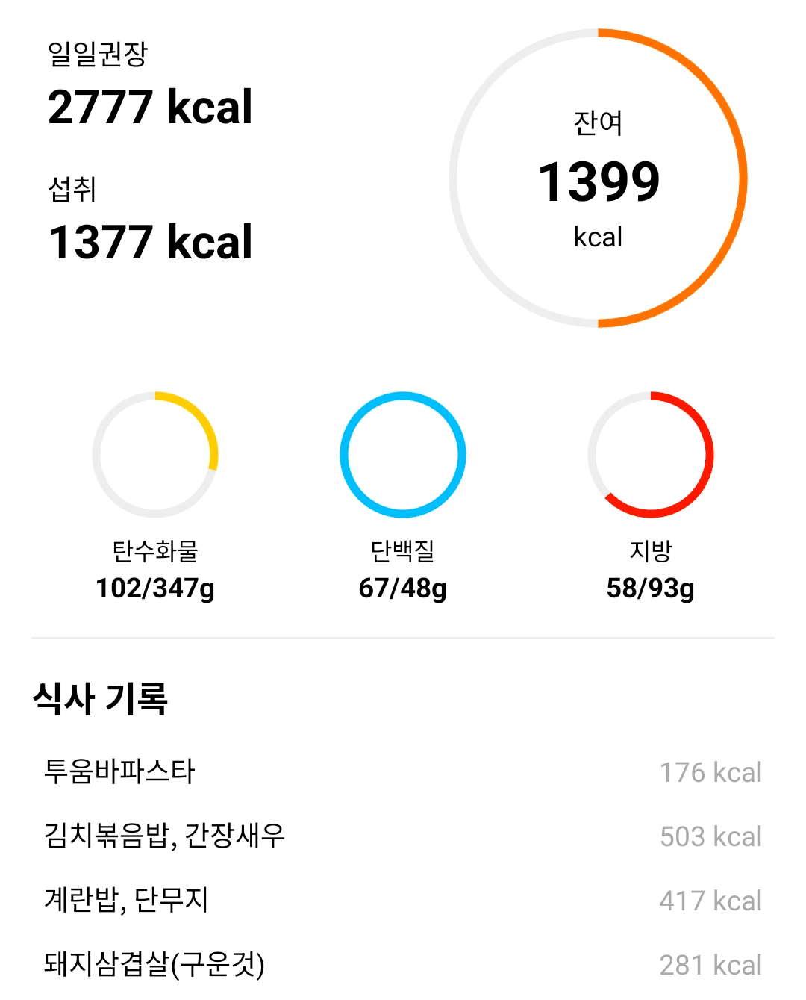 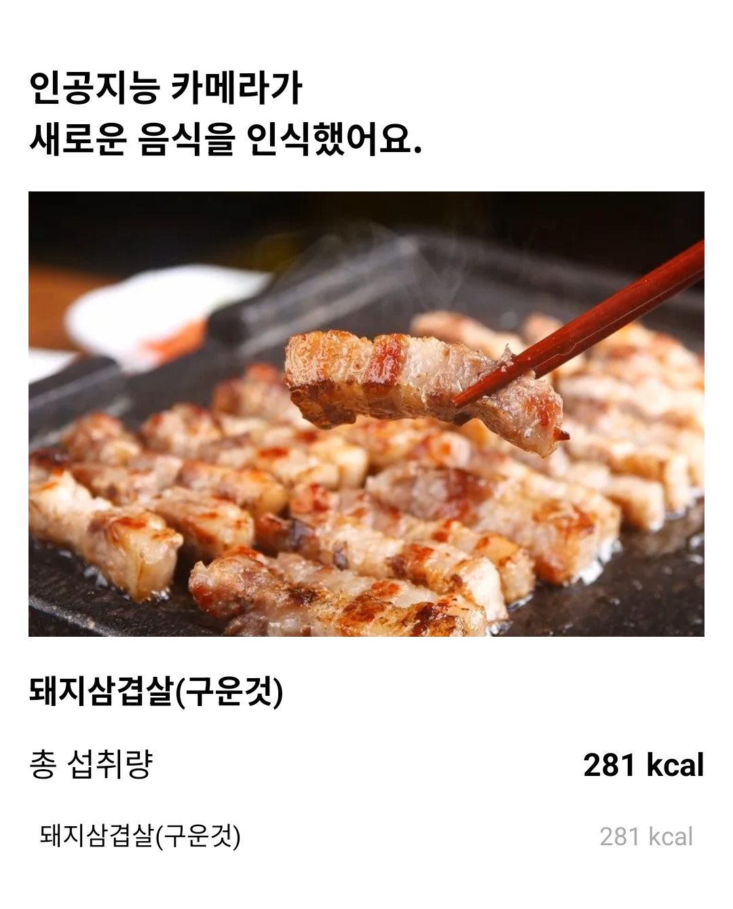

Nutrifit은 신체 정보와 식사 기록을 바탕으로 영양소 섭취 현황과 다음 식사의 후보를 제공하는 Android 프로젝트입니다.
앱은 FoodLens SDK를 이용한 음식 사진 분석과 수동 입력을 제공하며, 기록을 JSON 파일로 저장합니다.
별도 Python 서버는 공공데이터포털의 「전국통합식품영양성분정보(음식) 표준데이터」 CSV와 앱에서 받은 사용자·식사 정보를 이용해 추천을 계산합니다.
이름은 Nutrition(영양)과 Fit(맞추다)을 합친 말로, 사용자에게 맞춘 식단을 제안한다는 뜻을 담았습니다.

### 1.2 Why — 왜 만들었나

바쁜 현대인이 건강을 위해 균형 잡힌 식단을 찾고 **챙겨 먹는 데 드는 시간을 줄이고자** 했습니다.
음식 사진을 찍으면 FoodLens SDK로 **음식의 종류와 양을 자동으로 인식**해 기록의 번거로움을 덜고, 신체 정보와 식사 기록으로 목표 대비 남은 영양소를 계산해 다음 식사로 먹을 음식 후보를 추천하는 데 집중했습니다.

| 문제 | 구현 방향 |
|---|---|
| 식사 기록만으로 다음 메뉴를 선택하기 어려움 | 목표에서 섭취량을 뺀 영양소 벡터로 후보 비교 |
| 식품 데이터의 중복·결측과 분류 처리 필요 | 필요한 열 선택, 결측 제거, 대표식품명·대분류별 평균 |
| 앱과 추천 계산의 책임 분리 필요 | JSON 요청을 받는 Flask API |

### 1.3 개발 환경

| 항목 | 내용 |
|---|---|
| 장르 | Android 헬스케어 애플리케이션 |
| 기간 | 2024.09 — 2025.06 |
| 인원 | 5인 |
| 플랫폼 | Android |
| Language | Java (앱), Python (서버) |
| 주요 패키지 | OkHttp `4.10.0`, Gson `2.10`, FoodLens SDK |
| 서버 | Flask, pandas, NumPy, scikit-learn — AWS에서 실행 |
| GitHub | [앱](https://github.com/keeeery/Nutrifit), [서버](https://github.com/keeeery/Nutrifit_Recommendation) |
| 시연 영상 | [YouTube](https://youtube.com/shorts/G1EEo4VVekM) |

### 1.4 담당 범위

| 직접 구현한 부분 | 내용 |
|---|---|
| 추천 서버 | 식품 데이터 정제, 영양소 목표 계산, 코사인 유사도 추천, Flask `server.py`와 JSON 응답 |
| Android 화면·연동 | 홈의 식사 기록 표시, 주간 통계 페이지(`CustomLineChart`·`CustomBarChart`), 두 식단 추천 UI와 서버 요청 |

### 1.5 전체 구조

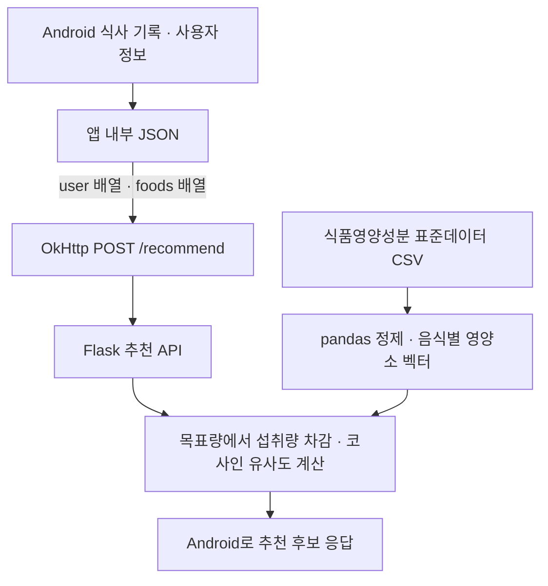

앱은 사진 인식과 수동 입력을 모두 내부 저장소의 식사 파일에 기록합니다. 사진 인식은 `CameraActivity`가 FoodLens SDK에서 결과를 받아 파일에 저장한 뒤 `CameraResultActivity`를 엽니다. 수동 입력은 `UserFoodCalculate`가 앱의 SQLite 음식 목록을 조회해 입력한 중량에 맞게 영양소를 계산합니다. 사용자 정보는 `UserInformActivity`가 SQLite에 저장한 뒤 `user_data.json`으로 내보냅니다.

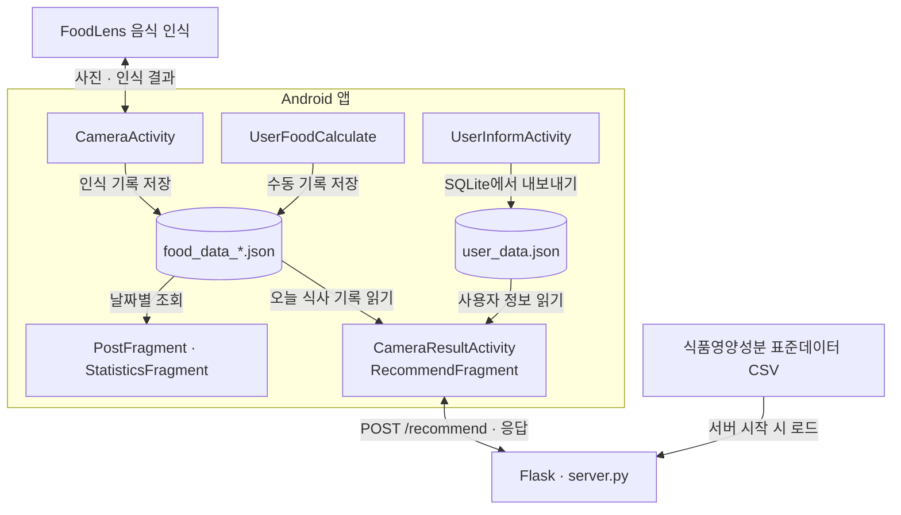

`CameraResultActivity`는 화면에 최근 수정된 식사 파일을 표시하고, 추천을 요청할 때는 오늘 날짜의 식사 파일을 모두 합칩니다. `RecommendFragment`는 오늘 날짜로 검색된 첫 파일의 배열만 전송하며, 응답 JSON에 음식이 10개 이상 있으면 두 식단으로 나눠 표시합니다. 공개 서버의 응답 형식과 후보 수는 §4.2에 정리했습니다.

아래 그림은 앱 내부 JSON과 추천 요청의 구조입니다. 식사 파일은 저장 시각을 넣은 `food_data_yyyyMMdd_HHmmss.json` 이름을 사용하며, 최상위 값은 음식 배열입니다. `foodID`는 사진 인식 항목에, `servingSize`와 `mealType`은 수동 입력 항목에 들어갑니다. 수동 입력의 `mealType` 값은 아침·점심·저녁입니다.

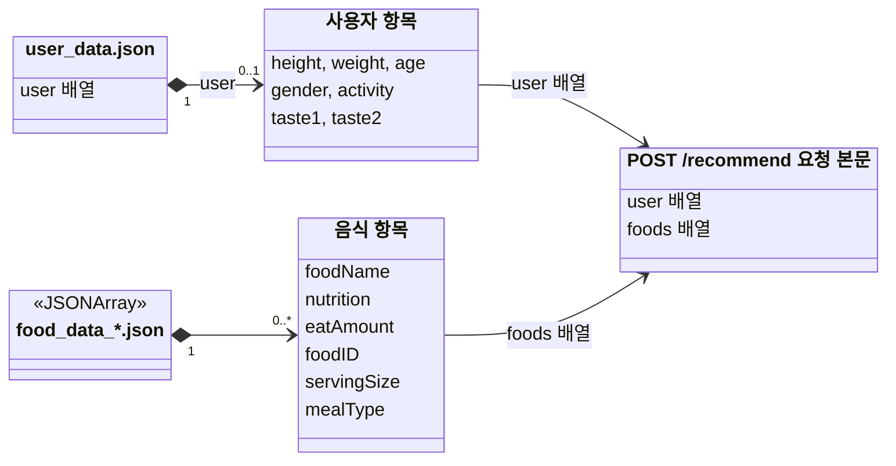

`nutrition`은 음식 항목 안의 객체입니다. 사진 인식은 FoodLens 응답의 키를 유지하고 수동 입력은 `carbohydrate`, `fiber`, `vitaminA`, `vitaminC` 등을 사용합니다. Flask는 `user[0]`과 `foods`를 읽고 `nutrition`과 `eatAmount`로 섭취량을 차감합니다.

소스는 [CameraActivity.java](https://github.com/keeeery/Nutrifit/blob/21991464c454283cf069188a4f5b7351b37b458e/app/src/main/java/com/nutrifit/CameraActivity.java#L183-L269), [UserFoodCalculate.java](https://github.com/keeeery/Nutrifit/blob/21991464c454283cf069188a4f5b7351b37b458e/app/src/main/java/com/nutrifit/UserFoodCalculate.java#L72-L119), [UserInformActivity.java](https://github.com/keeeery/Nutrifit/blob/21991464c454283cf069188a4f5b7351b37b458e/app/src/main/java/com/nutrifit/UserInformActivity.java#L193-L237), [CameraResultActivity.java](https://github.com/keeeery/Nutrifit/blob/21991464c454283cf069188a4f5b7351b37b458e/app/src/main/java/com/nutrifit/CameraResultActivity.java#L126-L188), [RecommendFragment.java](https://github.com/keeeery/Nutrifit/blob/21991464c454283cf069188a4f5b7351b37b458e/app/src/main/java/com/nutrifit/RecommendFragment.java#L57-L133), [server.py](https://github.com/keeeery/Nutrifit_Recommendation/blob/5b5e78c33435370b8980b64656b5418ba254b184/server.py#L110-L155)에서 확인할 수 있습니다.

---

## 2. 기능 A — 영양소 벡터 기반 추천

### 2.1 개요와 시스템 구조

서버는 시작할 때 CSV를 한 번 읽어 음식명·대분류와 11개 영양소를 선택하고,
결측 행을 제거한 뒤 같은 대표식품명·대분류의 영양소 평균으로 후보 테이블을 만듭니다.
요청이 오면 사용자 정보로 목표 영양소를 계산하고, 섭취량을 차감한 남은 영양소와 각 음식의 코사인 유사도를 비교합니다.

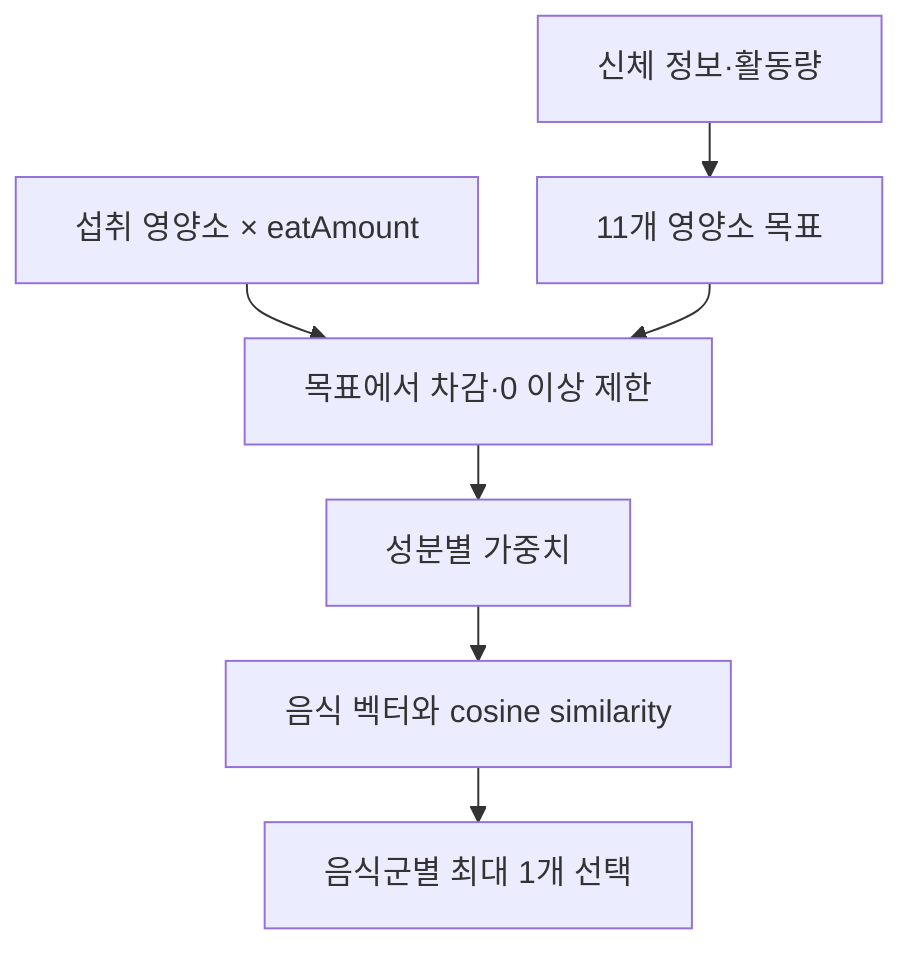

```python
nutrition_data = data[selected_columns].dropna()
nutrition_data_grouped = nutrition_data.groupby(
    ["대표식품명", "식품대분류명"], as_index=False
).mean()
```

### 2.2 핵심 기능 및 사용법

| API | 입력 | 결과 |
|---|---|---|
| `calculate_daily_intake(user)` | 체중·키·나이·성별·활동량 | 영양소 목표 Dictionary |
| `recommend_foods(deficiencies, taste1, taste2)` | 잔여 영양소와 선호 코드 | 음식명·영양소·추천점수 DataFrame |

에너지 목표는 기초대사량에 활동계수를 곱해 계산하고, 단백질·탄수화물 등은 체중·에너지 비율로 정합니다.

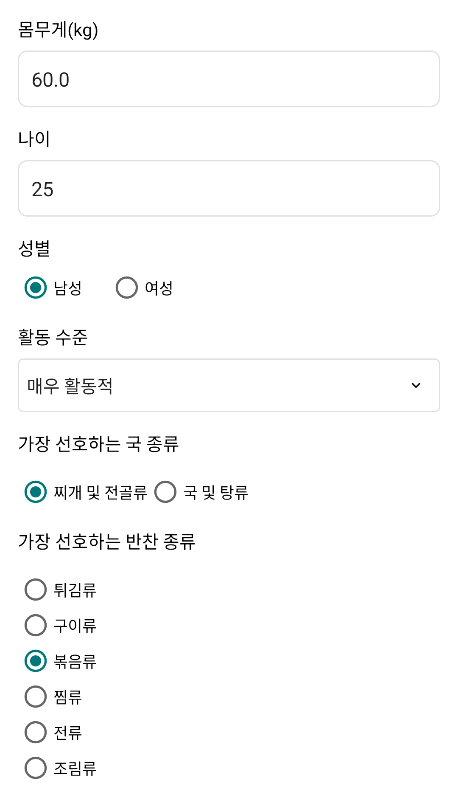

```python
bmr = 10 * weight + 6.25 * height - 5 * age + (5 if gender == "1" else -161)
tdee = bmr * (1.0 + 0.2 * (activity - 1))
```

섭취 영양소에 `eatAmount`를 곱해 차감하고 음수 잔여량은 0으로 제한한 뒤,
성분별 가중치(단백질·식이섬유 1.5, 철 1.4, 칼슘 1.3, 나트륨 0.7 등)를 곱한 잔여 벡터와 음식 벡터의 유사도를 점수로 씁니다.

```python
# server.py: recommend_foods 내부 select_top에서 발췌
features = df.drop(columns=["대표식품명", "식품대분류명"]).values
scores = cosine_similarity(features, weighted_vector.reshape(1, -1)).flatten() * boost
df = df.copy()
df["추천점수"] = scores
return df.sort_values(by="추천점수", ascending=False).head(1)
```

밥류 1개, 조건부 국·찌개 1개, 반찬 세 군에서 각각 1개를 골라 최대 5개 음식을 반환합니다.
시연 영상의 배포 서버는 두 식단을 만들 수 있게 10개를 돌려주지만, 그 코드는 저장소에 올라가 있지 않습니다(§4.2).

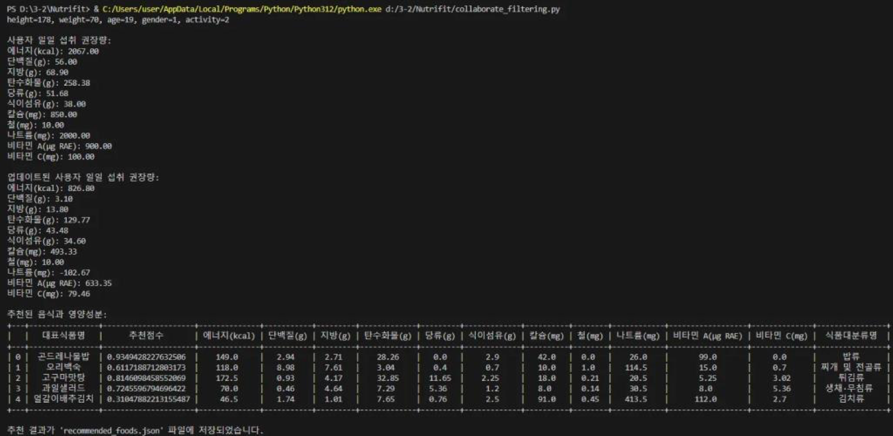

### 2.3 고민과 선택

| 고민 | 대안 | 선택과 이유 | 남은 한계 |
|---|---|---|---|
| 무엇을 기준으로 추천할까 | 사용자 평점 이력 기반 협업 필터링 | 음식 영양소 벡터의 유사도 — 평점 이력이 없어도 계산 가능 | kcal·g·mg 원본 단위의 스케일 영향 |
| 모델을 쓸까 | Autoencoder로 음식 특징 학습 (별도 실험 작성) | 수치 벡터 유사도를 API 경로로 사용 — 실험의 인코더 출력은 추천에 연결하지 않음 | 추천 품질은 미측정 |
| 식사를 어떻게 구성할까 | 식사 전체의 중량·열량을 제약식으로 최적화 | 음식군별 1개 선택 — 밥·국·반찬 형태로 구성 | 다섯 음식 합의 영양소 총합은 최적화하지 않음 |

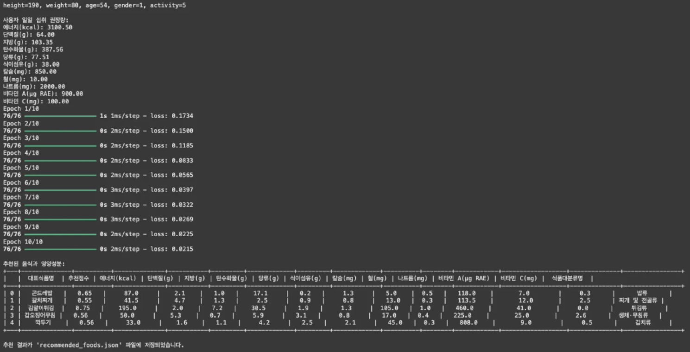

소스: [server.py](https://github.com/keeeery/Nutrifit_Recommendation/blob/main/server.py).

---

## 3. 기능 B — Android와 Flask의 연동

### 3.1 요청과 응답

앱은 `user_data.json`과 식사 파일을 읽어 `{ "user": [...], "foods": [...] }`로 전송합니다. 두 요청 화면의 식사 파일 선택 방식은 §1.5와 같습니다.
Flask의 `POST /recommend`는 `user[0]`과 `foods`로 추천을 계산합니다. 공개 코드의 응답 형식은 요청의 `Content-Type`에 따라 JSON 배열 또는 HTML 표로 달라집니다(§4.2).

```java
// RecommendFragment.java: merged는 user·foods를 담은 JSON 객체
RequestBody body = RequestBody.create(
        merged.toString(),
        MediaType.get("application/json; charset=utf-8")
);
Request request = new Request.Builder()
        .url(SERVER_URL)
        .post(body)
        .build();
```

`enqueue`로 비동기 요청하고, 응답 문자열은 UI 스레드로 넘겨 파싱한 뒤 두 식단 UI에 나누어 표시합니다.
응답 배열은 밥(0·1)·국(2·3)·반찬(4~9) 순서로 두 개씩 와야 하며, 짝수 번째를 식단 1, 홀수 번째를 식단 2로 나눕니다.
오류 응답은 앱에서 성공 여부를 확인해 Toast로 알립니다.

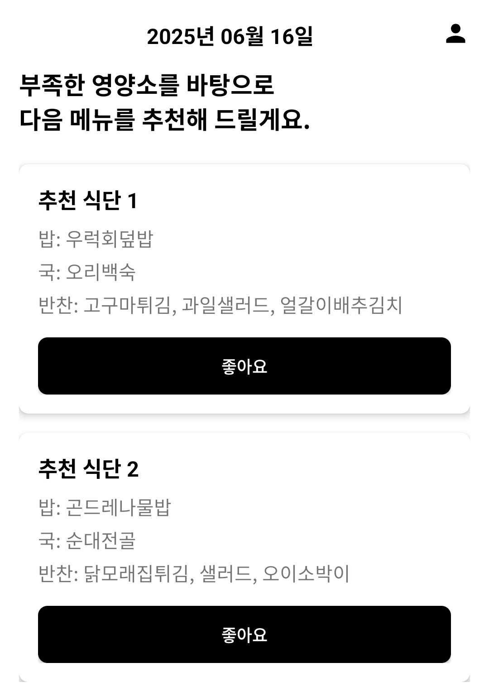

### 3.2 주간 통계 차트

`StatisticsFragment`는 6일 전부터 오늘까지 7일을 순회해 날짜별 기록을 집계하고, 차트 View에는 목록만 전달합니다.

```java
calorieChart.setData(labels, calorieData);
nutritionChart.setData(labels, nutritionData);
```

`CustomLineChart`는 Canvas·Path로 선과 점, 평균선을 그리고, 터치한 위치와 가까운 날의 kcal 말풍선을 화면 안쪽으로 보정해 띄웁니다.
`CustomBarChart`는 하루 탄수화물·단백질·지방의 g 구성비를 누적 막대로 그립니다.

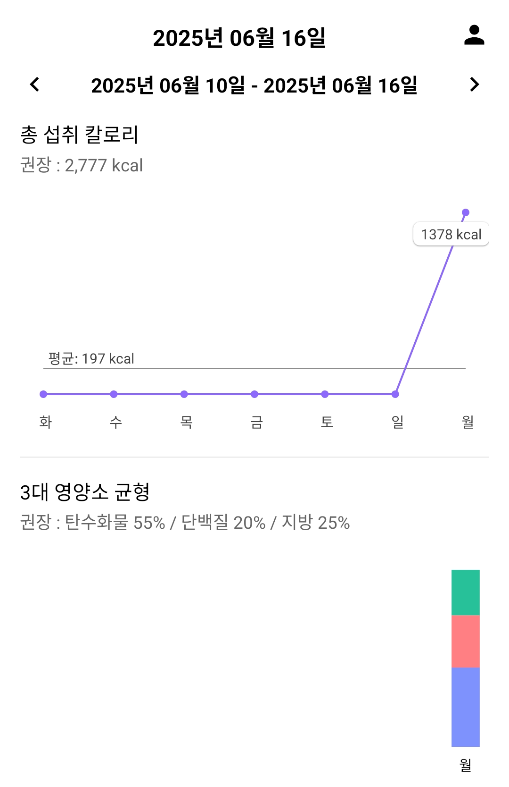

소스: [RecommendFragment.java](https://github.com/keeeery/Nutrifit/blob/main/app/src/main/java/com/nutrifit/RecommendFragment.java), [StatisticsFragment.java](https://github.com/keeeery/Nutrifit/blob/main/app/src/main/java/com/nutrifit/StatisticsFragment.java).

---

## 4. 결과와 배운 점

### 4.1 구현 결과

| 구현 결과 | 핵심 구현 |
|---|---|
| 음식 데이터를 추천 후보로 정제 | 결측 제거·분류별 평균 |
| 섭취 기록을 반영하는 추천 계산 | 잔여 영양소·가중치·코사인 유사도 |
| 앱과 서버의 HTTP 연결 | OkHttp 비동기 요청·Flask API |
| 주간 섭취 통계 | Canvas 기반 꺾은선·누적 막대 차트 |

### 4.2 한계와 개선 과제

- **배포 서버 코드가 저장소에 없음**: 시연 영상(2025.06.16)의 AWS 서버는 음식 10개를 JSON으로 돌려주어 추천 식단 두 개가 표시됩니다. 앱은 같은 날 두 식단(결과 10개)을 기대하도록 바뀌었지만, 서버 저장소의 마지막 커밋은 2025.04.19입니다. 공개된 `server.py`로는 이 화면이 나오지 않으므로, 배포 서버의 최종 코드는 저장소에 올라가지 않은 상태입니다. 공개 코드를 그대로 실행하면 다음 세 곳에서 앱과 맞지 않습니다.
  - **MIME**: 서버는 `Content-Type`이 정확히 `application/json`일 때만 JSON을 돌려주고 나머지는 HTML 표로 돌려줍니다. OkHttp는 `application/json; charset=utf-8`을 보내므로 HTML이 돌아오고, 앱의 JSON 파싱이 실패합니다.
  - **결과 개수**: 서버는 음식군마다 1개씩 최대 5개를 고르지만, 앱은 10개보다 적으면 「추천 결과가 부족합니다」를 띄우고 표시하지 않습니다.
  - **영양소 키**: 수동 입력 기록은 `carbohydrate`·`fiber`·`vitaminA`·`vitaminC`로 저장되는데, 서버는 `carbonhydrate`·`dietrayfiber`·`vitamina`·`vitaminc`를 읽어 키를 찾지 못합니다.
  
  → 배포한 서버 코드를 저장소에 올리고, MIME·개수·키 계약을 양쪽에서 통일해 실행으로 확인하는 것이 다음 과제입니다.
- **선호도 반영**: 선호 가중치(`boost=1.1`)가 같은 분류의 모든 점수에 똑같이 곱해져 실제 순위를 바꾸지 못합니다. → 선호도 효과 개선이 필요합니다.
- **추천 품질**: 단위 표준화와 가중치 효과, 추천 결과의 품질은 측정하지 않았습니다. → 단위 표준화와 데이터 품질·표본 평가가 다음 과제입니다.

### 4.3 배운 점

이 프로젝트는 데이터 계산을 API로 제공하고 클라이언트에서 사용하도록 연결한 경험입니다.
앱과 서버를 나누면 화면과 계산을 따로 바꿀 수 있지만, 그만큼 입력 키·배율·MIME·결과 배열 순서 같은 **계약을 양쪽에서 함께 관리해야 한다**는 점이 남았습니다.
