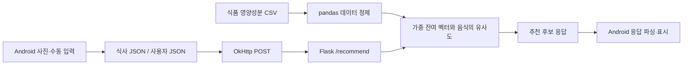
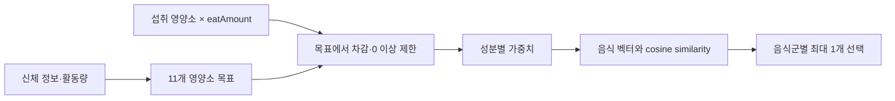

# Nutrifit — 영양소 기반 추천과 앱·서버 연동 기술문서 소스

> **핵심 범위**: 데이터 정제, 영양소 목표 계산, 코사인 유사도 기반 추천, Flask API를 통한 앱·서버 연동
> **담당 범위**: 데이터 정제, 영양소 목표 계산, 코사인 유사도 기반 추천 알고리즘, Flask API를 통한 앱·서버 연동을 직접 구현했습니다.

| 시스템 | 역할 | 구현 방식 |
|---|---|---|
| A. 영양소 기반 추천 | 사용자 정보·섭취 기록으로 다음 음식 후보 계산 | pandas 정제, 잔여 영양소 벡터, cosine similarity |
| B. 앱·서버 연동 | Android 기록을 전송하고 Flask 결과를 수신 | JSON, OkHttp 비동기 요청, Flask API |

---

## 1. 프로젝트 개요

### 1.1 What — 무엇을 구현했나

Nutrifit은 신체 정보와 식사 기록을 바탕으로 영양소 섭취 현황과 다음 식사의 후보를 제공하는 Android 프로젝트입니다.
앱은 FoodLens SDK를 이용한 음식 사진 분석과 수동 입력을 제공하며, 기록을 JSON 파일로 저장합니다.
별도 Python 서버는 식품 영양성분 CSV와 앱에서 받은 사용자·식사 정보를 이용해 추천을 계산합니다.

두 저장소는 하나의 프로젝트의 Android 앱과 추천 코드입니다.
현재 공개 소스에는 응답 MIME·개수·영양소 키의 불일치가 남아 있습니다. 구현된 연동 코드와 현재의 통합 과제를 구분해 설명합니다.

### 1.2 Why — 다루는 문제와 구현 방향

| 문제 | 구현 방향 | 범위 |
|---|---|---|
| 식사 기록만으로 다음 메뉴를 선택하기 어려움 | 목표에서 섭취량을 뺀 영양소 벡터로 후보 비교 | 음식 후보의 순위 계산 |
| 식품 데이터의 중복·결측과 분류 처리 필요 | 필요한 열 선택, 결측 제거, 대표식품명·대분류별 평균 | 서버 시작 시 데이터 준비 |
| 앱과 추천 계산의 책임 분리 필요 | JSON 요청을 받는 Flask API | 계산과 UI 분리, 계약 관리 필요 |

### 1.3 개발 환경

| 항목 | 내용 |
|---|---|
| Android | Java, XML Layout, Activity·Fragment |
| SDK | `compileSdk 34`, `targetSdk 34`, `minSdk 23` |
| Java 설정 | source/target compatibility `VERSION_11` |
| 통신·직렬화 | OkHttp `4.10.0`, Gson `2.10` |
| 음식 인식 | FoodLens 의존성에 `2.6.6`과 `1.0.0` 선언이 함께 존재; 실제 해석 버전은 빌드 확인 필요 |
| 로컬 저장 | SQLite 사용자·음식 데이터, 내부 저장소 JSON 기록 |
| 추천 API | Python, Flask, pandas, NumPy, scikit-learn |
| 별도 실험 | TensorFlow/Keras Autoencoder 코드; 현재 API 추천 경로에는 미연결 |

소스: [앱 Gradle 설정](https://github.com/keeeery/Nutrifit/blob/main/app/build.gradle.kts), [추천 서버](https://github.com/keeeery/Nutrifit_Recommendation/blob/main/server.py).
Python 의존성의 실행 버전은 저장소에서 고정되어 있지 않습니다.

### 1.4 전체 구조



---

## 2. 기능 A — 영양소 벡터 기반 추천

### 2.1 개요와 시스템 구조

서버는 CP949 CSV에서 음식명·대분류와 11개 영양소를 선택합니다.
결측 행을 제거하고 같은 대표식품명·대분류의 영양소 평균을 계산해 후보 테이블을 만듭니다.
사용자 정보로 목표 영양소를 계산한 뒤 섭취량을 차감하고, 남은 영양소와 각 음식의 코사인 유사도를 비교합니다.



### 2.2 핵심 기능 및 사용법

| API | 입력 | 결과 |
|---|---|---|
| `calculate_daily_intake(user)` | 체중·키·나이·성별·활동량 | 영양소 목표 Dictionary |
| `recommend_foods(deficiencies, taste1, taste2)` | 잔여 영양소와 선호 코드 | 음식명·영양소·추천점수 DataFrame |

에너지 목표는 아래의 코드 규칙으로 계산합니다. 산식의 건강 효과를 검증한 결과는 아닙니다.

```python
bmr = 10 * weight + 6.25 * height - 5 * age + (5 if gender == "1" else -161)
tdee = bmr * (1.0 + 0.2 * (activity - 1))
```

섭취 영양소에 `eatAmount`를 곱해 차감하고, 음수 잔여량은 0으로 제한합니다.
가중치를 적용한 잔여 벡터와 음식 벡터의 유사도를 점수로 사용합니다.

```python
# server.py: API에서 잔여량 계산 후
deficiencies = {k: max(0, v) for k, v in daily.items()}
```

```python
# server.py: recommend_foods 내부 select_top에서 발췌
features = df.drop(columns=["대표식품명", "식품대분류명"]).values
scores = cosine_similarity(features, weighted_vector.reshape(1, -1)).flatten() * boost
df = df.copy()
df["추천점수"] = scores
return df.sort_values(by="추천점수", ascending=False).head(1)
```

밥류 1개, 조건부 국·찌개 1개, 반찬 세 군에서 각각 1개를 선택해 최대 5개 음식을 반환합니다.
식사 전체의 중량·열량을 제약식으로 최적화하는 기능은 없습니다.

### 2.3 고민과 선택

| 선택 | 이점 | 현재 한계 |
|---|---|---|
| 음식 영양소 기반 유사도 | 사용자 평점 이력이 없어도 계산 가능 | kcal·g·mg의 원본 단위 스케일 영향 |
| 음식군별 후보 선택 | 밥·국·반찬 형태로 구성 | 첫 번째 데이터가 있는 하위 분류에서 선택 종료 |
| 성분별 가중치 | 잔여 벡터의 상대 비중 조절 | 가중치의 효과·추천 품질은 미측정 |

선호도 `boost=1.1`은 같은 분류 내 모든 점수에 곱해지며, 분류 간 비교 없이 `break`합니다.
따라서 현재 코드에서는 선호도에 따른 후보 변경 효과가 없습니다.
별도 Autoencoder 학습 실험은 존재하지만 인코더 출력은 추천 계산에 사용되지 않고, Flask도 학습 모델을 로드하지 않습니다.
실제 서비스 경로는 영양소 벡터의 유사도 계산입니다.

소스: [server.py](https://github.com/keeeery/Nutrifit_Recommendation/blob/main/server.py), [추천 저장소](https://github.com/keeeery/Nutrifit_Recommendation/tree/main).

---

## 3. 기능 B — Android와 Flask의 연동

### 3.1 개요와 시스템 구조

앱은 `user_data.json`과 식사 파일을 읽어 `{ "user": [...], "foods": [...] }`로 전송합니다.
Flask의 `POST /recommend`는 `user[0]`과 식사 배열로 계산하며, 정상 결과는 음식 객체 배열입니다.
`GET /recommend`는 안내 HTML, 예외는 HTML 본문과 HTTP 500을 반환합니다.

### 3.2 핵심 기능 및 사용법

```java
// RecommendFragment.java: merged는 user·foods를 담은 JSON 객체
RequestBody body = RequestBody.create(
        merged.toString(),
        MediaType.get("application/json; charset=utf-8")
);
Request request = new Request.Builder()
        .url(SERVER_URL)
        .post(body)
        .build();
```

`enqueue`로 비동기 요청하고 `RecommendFragment`는 응답 문자열을 UI 스레드로 전달해 파싱합니다.
`CameraResultActivity`는 당일 파일 전체를 모으지만 추천 Fragment는 정렬하지 않은 `files[0]` 하나를 사용합니다.
결과 화면은 응답을 `result_json` extra로 전달하나 `MainActivity`에는 이를 읽는 경로가 없으며, 추천 탭은 별도로 재요청합니다.

---

## 4. 결과 및 배운 점

| 구현 결과 | 핵심 구현 | 개선 과제 |
|---|---|---|
| 음식 데이터를 추천 후보로 정제 | 결측 제거·분류별 평균 | 데이터 품질·표본 평가 |
| 섭취 기록을 반영하는 추천 계산 | 잔여 영양소·가중치·코사인 유사도 | 단위 표준화·선호도 효과·추천 품질 |
| 앱과 서버의 HTTP 연결 코드 | OkHttp 비동기 요청·Flask API | MIME·개수·키 계약 통일 및 실행 확인 |

이 프로젝트는 데이터 계산을 API로 제공하고 클라이언트에서 사용하도록 연결한 경험입니다.

---

## 5. 추천 계산의 세부 규칙과 데이터 경계

### 5.1 시작 시 정제하는 데이터와 요청마다 계산하는 데이터

`server.py`는 모듈이 로드될 때 CSV를 한 번 읽고 후보 테이블을 준비합니다. 요청마다 전체 CSV를 다시 읽는 구조는 아닙니다. 선택 열은 대표식품명·식품대분류명과 에너지, 단백질, 지방, 탄수화물, 당류, 식이섬유, 칼슘, 철, 나트륨, 비타민 A·C입니다.

```python
nutrition_data = data[selected_columns].dropna()
nutrition_data_grouped = nutrition_data.groupby(
    ["대표식품명", "식품대분류명"], as_index=False
).mean()
```

`dropna()`는 선택된 열 중 결측이 있는 행을 제거합니다. 결측치를 추정해서 채우는 처리는 없습니다. 평균을 구할 때도 음식명만으로 합치지 않고 대분류를 함께 사용합니다. 같은 대표식품명의 다양한 표본을 하나의 비교 대상으로 줄이는 반면, 조리법·표본별 차이는 평균에 흡수됩니다. 이후 특정 음식명이 포함된 후보를 문자열 조건으로 제외합니다.

사용자별 목표와 섭취량 차감은 요청 안에서 별도로 계산합니다. 공통 후보 테이블과 요청별 계산을 구분하지만, 사용자별 추천 결과를 저장하거나 이전 결과를 학습에 누적하지는 않습니다.

### 5.2 목표·잔여량·가중치의 의미

활동량은 정수로 변환하고 에너지 목표에 `1.0 + 0.2 × (activity - 1)`을 곱합니다. 앱은 활동량을 1~5로 매핑하지만 서버에는 해당 범위 검증이 없습니다. 성별은 문자열 `"1"`이면 한 분기, 나머지는 다른 분기로 처리하므로 요청 타입도 계약에 포함됩니다.

| 성분 | 코드의 목표 규칙 | 유사도 가중치 |
|---|---|---|
| 에너지 | 신체 정보 기반 산식 × 활동계수 | 1.0 |
| 단백질 | 체중 × 0.8 | 1.5 |
| 지방 | 에너지 × 0.3 ÷ 9 | 1.0 |
| 탄수화물 | 에너지 × 0.5 ÷ 4 | 1.2 |
| 당류 | 에너지 × 0.1 ÷ 4 | 0.8 |
| 식이섬유 | 성별 분기에 따라 38 또는 25 | 1.5 |
| 칼슘 | 850 | 1.3 |
| 철 | 성별 분기에 따라 10 또는 18 | 1.4 |
| 나트륨 | 2000 | 0.7 |
| 비타민 A | 성별 분기에 따라 900 또는 700 | 1.0 |
| 비타민 C | 100 | 1.2 |

이 표는 코드의 계산 규칙이며 개인에게 적용할 영양 처방이나 검증된 목표값을 제시하는 표가 아닙니다.

예를 들어 목표 단백질을 60g, 기록의 단백질을 20g, `eatAmount=0.5`로 가정하면 차감량은 10g이고 잔여량은 50g입니다. 가중치 1.5를 곱한 벡터 성분은 75가 됩니다. 설명을 위한 가상 수치이며 실제 실행 결과는 아닙니다.

코사인 유사도는 벡터의 방향을 비교하므로, 추천된 음식 한 개가 잔여량을 정확히 채운다는 의미는 아닙니다. 또한 각 음식 선택 후 잔여량을 다시 차감하지 않고 같은 벡터로 모든 음식군을 평가합니다. 다섯 음식을 합친 식사의 영양소 총합을 최적화한 결과로 해석해서는 안 됩니다.

### 5.3 음식군 선택 순서와 선호도 처리

| 단계 | 후보 분류 | 선택 조건 |
|---|---|---|
| 주식 | 밥류 | 해당 분류 내 점수 상위 1개 |
| 국·찌개 | 찌개 및 전골류 → 국 및 탕류 | 주식 이름에 코드의 밥 관련 문자열이 포함된 경우 |
| 주요 반찬 | 튀김 → 구이 → 볶음 → 찜 → 전·적 및 부침 → 조림 | 처음 비어 있지 않은 분류에서 1개 |
| 채소 반찬 | 생채·무침 → 나물·숙채 | 처음 비어 있지 않은 분류에서 1개 |
| 절임 반찬 | 김치 → 장아찌·절임 → 젓갈 | 처음 비어 있지 않은 분류에서 1개 |

현재 구현은 분류별 최고점들을 모아 비교하는 방식이 아닙니다. 분류 목록을 순서대로 돌고 데이터가 있으면 그 안에서 하나를 골라 종료합니다. `boost=1.1`도 해당 분류의 모든 점수에 동일하게 곱해지므로 순위를 바꾸지 않습니다. 선호 코드가 존재하는 사실과 선호도가 실제 후보를 바꾸는 동작은 구분해야 합니다.

음수 잔여량에 가중치를 더 주는 표현식도 있지만, API는 그 전에 `max(0, v)`를 적용합니다. 따라서 정상 API 경로에서는 해당 음수 분기가 실행되지 않습니다. 초과 섭취를 별도 패널티로 반영했다고 설명하지 않습니다.

### 5.4 파일 실행 실험과 HTTP 제공 코드의 차이

| 파일 | 실행 방식 | 실제 역할 |
|---|---|---|
| `collaborate_filtering.py` | 로컬 사용자·식사 JSON을 읽어 실행 | 영양소 벡터 유사도 추천 및 `recommended_foods.json` 출력 |
| `model_based_filtering.py` | Colab Drive 경로의 데이터를 읽어 실행 | 정규화·Autoencoder 학습을 포함한 별도 실험 |
| `server.py` | Flask 요청 처리 | 요청별 사용자·식사 데이터를 받아 유사도 추천 |

파일명에 `collaborate`가 포함되어 있어도 사용자–아이템 평점 행렬이나 유사 사용자 이웃을 이용하지는 않습니다. 현재 추천을 사용자 기반 협업 필터링으로 설명하지 않습니다.

모델 실험은 `MinMaxScaler`로 음식의 11개 수치 열을 정규화하고, 11차원 입력 → 3차원 ReLU → 11차원 sigmoid를 Adam/MSE로 10 epoch, batch size 8로 학습하도록 작성되어 있습니다. 그러나 생성한 `encoder_model`의 출력을 후보 점수 계산에 사용하지 않습니다. 추천 함수는 여전히 음식 수치 벡터와 잔여량 벡터의 코사인 유사도를 사용합니다.

실험의 무작위 선택도 주의가 필요합니다. 점수로 정렬한 변수를 만들지만 선택 함수에는 정렬 전 DataFrame을 넘깁니다. 따라서 주석의 ‘점수 상위 5개 중 무작위’와 실제 입력 순서의 첫 5개 중 선택은 다릅니다. 실험 코드에는 Colab 전용 절대 경로도 있어 실행 환경을 맞추는 작업이 필요합니다.

소스: [파일 실행 추천](https://github.com/keeeery/Nutrifit_Recommendation/blob/main/collaborate_filtering.py), [모델 실험](https://github.com/keeeery/Nutrifit_Recommendation/blob/main/model_based_filtering.py).

---

## 6. 추천 입력을 만드는 Android 기록 흐름

### 6.1 진입과 사용자 정보 보관

`ExeScreenActivity`는 약 1초 뒤 내부 저장소의 `user_data.json` 존재 여부로 사용자 정보 입력 또는 메인 화면을 선택합니다. 파일 존재 검사는 내용의 정상 여부를 검증하는 기능은 아닙니다.

`UserInformActivity`는 키·체중·나이·성별·활동량·선호 코드를 읽고 `UserDBHelper.insertUser(...)`로 저장합니다. DB 저장은 기존 사용자 행을 지우고 한 행을 삽입하는 방식이며, 여러 사용자 계정을 관리하는 구조가 아닙니다. 이후 조회한 행들을 `{ "user": [...] }` 형태로 JSON 파일에 기록합니다. 서버와 홈 화면은 이 배열의 첫 번째 항목을 사용합니다.

SQLite는 화면 입력을 보관하고 JSON은 화면 간 조회와 서버 전송에 쓰입니다. 두 저장 형태를 사용하므로 한쪽 저장 실패 시 일관성을 보장하는 트랜잭션까지 제공하는 것은 아닙니다.

### 6.2 사진 분석에서 식사 파일까지

촬영은 `ActivityResultContracts.TakePicture`, 갤러리 선택은 `GetContent`로 결과를 받습니다. 선택 이미지는 Bitmap을 거쳐 JPEG 바이트로 변환하고 FoodLens에 전달합니다. 앱 자체가 음식 인식 모델을 학습하거나 추론하는 구조는 아닙니다.

```java
NetworkService networkService = FoodLens.createNetworkService(getApplicationContext());
networkService.setLanguageConfig(LanguageConfig.KO);
networkService.predictMultipleFood(imageData, new RecognizeResultHandler() {
    // 성공 결과를 식사 파일로 변환
});
```

위 코드는 호출 구조를 보여 주기 위한 일부 발췌입니다. 실제 콜백에는 성공·오류 처리가 있습니다.

저장 경로는 `foodPositionList → foodCandidates → nutrition`입니다. 영양 정보가 없는 후보는 제외하고, 처리한 `foodId`는 `HashSet`으로 중복을 제거합니다. 영양소 객체의 숫자 값을 변환해 보관하고 식사 항목 배열을 `food_data_yyyyMMdd_HHmmss.json`으로 저장합니다.

같은 음식 위치의 여러 후보를 순회하므로 인식 후보를 최종 선택 음식과 동일하게 취급하는 문제가 남을 수 있습니다. 또한 `foodId`를 전체 결과에서 한 번만 저장해 같은 음식의 여러 위치가 병합될 수 있습니다. 후보 선택 정책과 실제 섭취량 의미는 SDK 결과와 함께 확인해야 합니다.

### 6.3 수동 입력과 중량 환산

`UserFoodSelectActivity`는 음식명·중량을 목록에 넣고 `FoodListAdapter`로 표시·삭제합니다. 저장 시 음식명과 중량 배열을 Intent의 `foodListJson`으로 `UserFoodCalculate`에 전달합니다. DB 조회는 음식명 일치 조건을 사용하며, 자유 입력 문자열과 DB 이름이 다르면 해당 음식을 찾지 못합니다.

```java
Cursor cursor = foodDb.rawQuery(
    "SELECT * FROM " + FoodDBHelper.TABLE_NAME + " WHERE foodName = ?",
    new String[]{foodName}
);
```

기준 DB의 100g당 값을 `servingSize / 100f`로 환산하고, 환산된 영양소와 `eatAmount=1`을 저장합니다. 같은 배율을 다시 중량으로 곱하면 이중 환산이 되므로 기록을 읽는 모든 경로에서 단위 계약을 유지해야 합니다. `FoodDBHelper`는 11개 음식의 초기 값을 코드로 삽입하며 서버 CSV 전체를 자동 동기화하지 않습니다.

선택 화면은 빈 값은 검사하지만 숫자 형식·양수 범위·실제 DB 존재 여부를 모두 검증하지는 않습니다. 정확한 음식 선택 목록이나 입력 검증을 제공한 것으로 확대하지 않습니다. `FoodListAdapter`는 바인딩 당시 position을 삭제 콜백에서 사용하므로 연속 삭제 시 위치 갱신도 실행 확인 대상입니다.

사진 기록의 키를 서버에 그대로 넘기는 경로와 수동 입력의 키는 다릅니다. 수동 기록은 `carbohydrate`, `fiber`, `vitaminA`, `vitaminC`를 쓰지만 서버는 `carbonhydrate`, `dietrayfiber`, `vitamina`, `vitaminc`를 요구합니다. 변환 계층 없이 보내면 서버의 필수 키 접근에서 오류가 발생합니다.

### 6.4 홈과 통계에서 기록을 해석하는 방식

`PostFragment`는 당일 파일을 합산해 칼로리·탄수화물·단백질·지방을 표시하고, 별도로 파일별 식사 기록 행을 만듭니다. 목표 에너지는 서버와 같은 계수의 산식을 사용하며 ProgressBar는 상한을 100으로 제한합니다. 다만 총합 계산은 영양소 원값을 더하고 식사 기록 행은 `calories × eatAmount`를 사용해 두 표시가 다를 수 있습니다.

`StatisticsFragment`는 오늘부터 6일 전을 시작일로 설정하고 7일을 순회합니다. 날짜별 파일이 없어도 0을 추가하고, 이전·다음 버튼은 시작일을 7일씩 이동합니다. 주간 집계는 Fragment가 담당하고 차트 View에는 목록만 전달합니다.

```java
calorieChart.setData(labels, calorieData);
nutritionChart.setData(labels, nutritionData);
```

`CustomLineChart`는 Canvas·Path로 선과 점, 평균선을 그립니다. 터치한 X 위치와 가까운 데이터 인덱스를 골라 kcal 말풍선을 띄우고 좌우·상단 위치를 보정합니다. `CustomBarChart`는 하루 탄수화물·단백질·지방의 합으로 각 성분을 나누어 누적 막대 높이를 계산합니다. 따라서 막대는 g 구성비이며 4/4/9 kcal를 적용한 에너지 구성비가 아닙니다.

통계의 권장 1,780 kcal와 비율은 고정 문자열이고 사용자별 목표와 연결되지 않습니다. 통계 역시 `eatAmount`를 곱하지 않으며, 탄수화물 키도 수동 입력과 일치하지 않습니다. 차트 표현 구현과 데이터 해석의 일관성을 별도 검토해야 합니다.

소스: [사용자 정보](https://github.com/keeeery/Nutrifit/blob/main/app/src/main/java/com/nutrifit/UserInformActivity.java), [사진 분석](https://github.com/keeeery/Nutrifit/blob/main/app/src/main/java/com/nutrifit/CameraActivity.java), [수동 환산](https://github.com/keeeery/Nutrifit/blob/main/app/src/main/java/com/nutrifit/UserFoodCalculate.java), [홈](https://github.com/keeeery/Nutrifit/blob/main/app/src/main/java/com/nutrifit/PostFragment.java), [통계](https://github.com/keeeery/Nutrifit/blob/main/app/src/main/java/com/nutrifit/StatisticsFragment.java).

---

## 7. 요청·응답 계약과 화면 표시의 상세 경계

### 7.1 두 요청 경로를 구분한 흐름

`CameraResultActivity`는 수정 시각 기준 최근 식사 파일을 표시합니다. 전달받은 파일명 필드는 있지만 실제 표시 대상 선택은 최근 파일 탐색을 사용합니다. 저장 버튼에서는 당일 파일 전체를 합쳐 추천을 요청하고 응답을 MainActivity의 `result_json` extra에 넣습니다.

반면 `RecommendFragment`는 생성될 때 다시 요청합니다. 당일 파일 중 `files[0]`만 읽고 목록을 정렬하지 않으므로 ‘가장 최근 식사’라고 보장할 수 없습니다. 메인 화면은 결과 extra를 소비하지 않아 앞의 응답이 추천 탭에 그대로 이어지지 않습니다.

### 7.2 JSON MIME과 결과 개수

서버의 응답 분기는 MIME 해석 함수가 아니라 헤더 문자열의 완전 일치 비교입니다.

```python
if request.headers.get('Content-Type') == 'application/json':
    return jsonify(result)
```

앱은 `application/json; charset=utf-8`을 지정합니다. JSON 본문을 읽고 계산하더라도 위 조건은 맞지 않아 HTML 테이블 응답으로 진행합니다. 추천 Fragment가 이를 JSON 배열로 파싱하면 오류가 발생합니다. MIME 조건을 맞춰 JSON으로 연결해도 앱의 `resultArray.size() < 10` 검사와 서버 최대 5개 결과가 맞지 않습니다.

앱의 두 식단 UI는 밥 0·1번, 국 2·3번, 반찬 4·6·8번과 5·7·9번을 나누어 표시하는 배열 순서 계약을 사용합니다. 결과 개수뿐 아니라 역할별 배치도 응답 정의에 포함되어야 합니다. 서버가 음식 10개를 임의로 반환하는 것만으로 두 식단 계약이 충족되지는 않습니다.

### 7.3 비동기 콜백과 화면 생명주기

`RecommendFragment`는 OkHttp 콜백에서 받은 문자열을 `requireActivity().runOnUiThread(...)`로 넘깁니다. 그러나 요청을 화면 해제 시 취소하거나 콜백에서 Fragment 연결 상태를 검사하지는 않습니다. 요청 준비의 파일 읽기도 UI 진입 과정에서 동기로 수행됩니다. 네트워크 요청이 비동기라는 사실과 모든 파일 처리·화면 생명주기를 안전하게 다룬다는 주장은 구분해야 합니다.

오류 응답은 서버에서 HTML과 500으로 반환하고 앱은 성공 여부를 확인해 Toast로 알립니다. 서버에는 명시적인 입력 스키마 검사·사용자 인증·추천 피드백 저장이 없습니다. 좋아요 버튼도 문구·투명도·활성 상태만 바꾸며 추천 학습이나 영속 저장으로 연결되지 않습니다.

서버 주소는 앱 코드의 HTTP 고정 주소이며 현재 가동 여부는 확인하지 않았습니다. Flask 코드의 직접 실행은 `0.0.0.0:5000` 개발 서버이고 별도 운영 배포 설정이나 고정 Python 의존성 목록은 확인되지 않았습니다.

---

## 8. 구현 선택과 화면·API 연결

### 8.1 데이터와 화면 책임을 나눈 선택

| 선택 | 구현상 이점 | 남는 책임 |
|---|---|---|
| 공통 식품 테이블을 서버 시작 시 준비 | 요청마다 CSV 파싱을 반복하지 않음 | 데이터 갱신 시 프로세스 재로딩 정책 |
| 계산을 Flask API로 분리 | Android 화면과 추천 계산을 별도 변경 가능 | 입력 키·배율·MIME·배열 순서 계약 |
| SQLite 기준값과 JSON 기록을 구분 | DB 조회와 날짜별 기록 전송이 단순함 | 저장 경로 간 일관성·키 변환 |
| Canvas 차트를 직접 구현 | 필요한 평균선·터치 표시 구성 | 축·접근성·화면 크기와 데이터 정확성 |

### 8.2 직접 구현한 화면과 API 연결

- 식사 기록 표시 추가: 당일 파일에서 음식명·섭취 kcal을 읽고 홈에 파일별 기록 행을 생성했습니다.
- 통계 페이지 추가·개선: `StatisticsFragment`, `CustomLineChart`, `CustomBarChart`와 주간 UI, 터치 말풍선·표시 위치를 구현했습니다.
- 두 식단 추천 UI 변경: 응답 배열을 두 식단으로 나누는 표시 로직과 UI를 변경했습니다. 현재 서버와의 결과 개수 계약 문제는 별개입니다.
- 추천 서버의 Flask 지원: 파일 실행 계산을 HTTP 요청으로 제공하는 `server.py`를 추가했습니다.
- JSON 응답 추가: 요청 헤더 조건에 따라 JSON 응답을 반환하는 분기를 추가했습니다. charset 포함 헤더까지 처리한 구현은 아닙니다.
